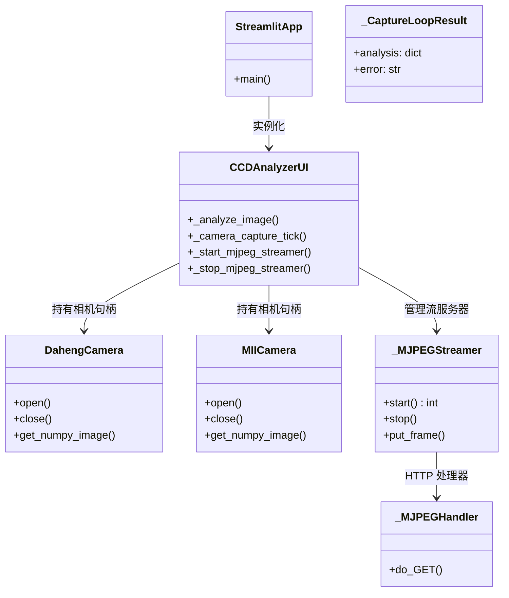
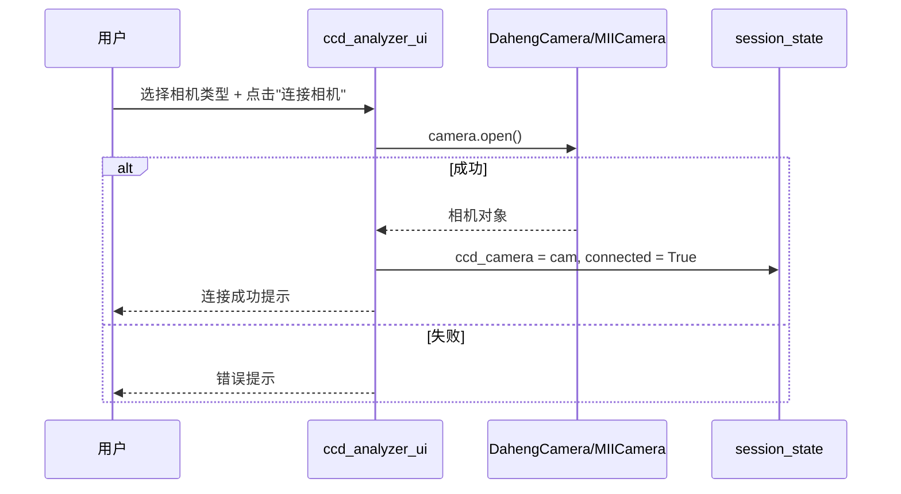
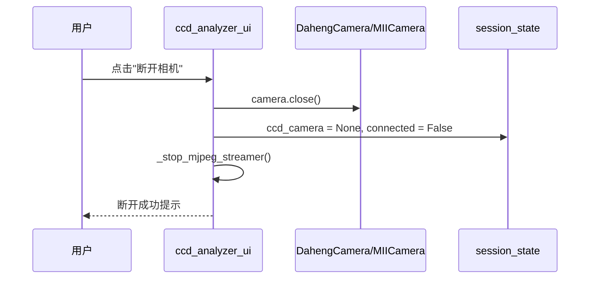
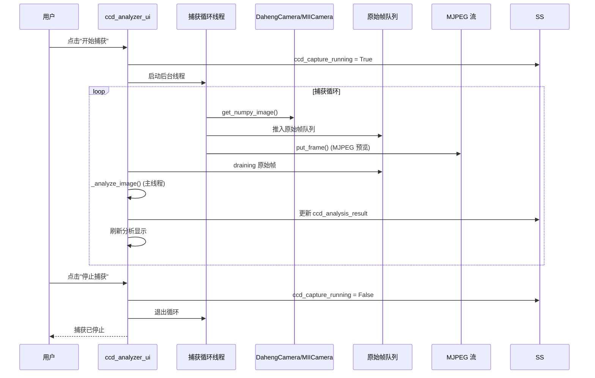
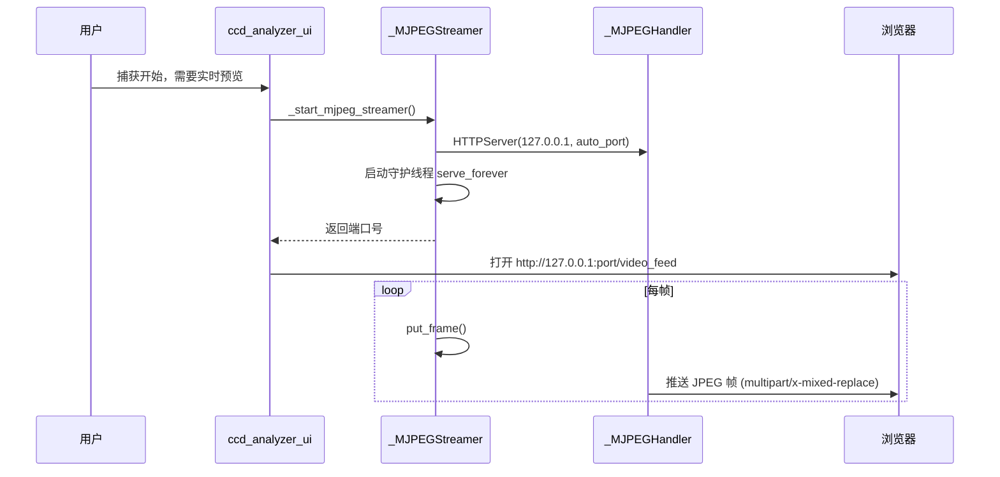

# CCD 实时图像分析 UI (ccd_analyzer.py) — 软件需求规格说明书 (SRS)

## 1. 概述

### 1.1 文档目的

本文件定义 `src/ao_shaping/gui/ccd/ccd_analyzer.py` 的功能需求、非功能需求、接口规范与关键设计约束。本模块是 CCD 相机实时图像分析的 Streamlit 前端页面，支持实时图像捕获、自动封闭椭圆计算、X/Y 方向强度截面与 Gaussian 拟合、MJPEG 低延迟实时预览流。

### 1.2 启动方式

```bash
streamlit run src/ao_shaping/gui/ccd/ccd_analyzer.py
```

### 1.3 依赖模块

| 模块 | 职责 |
|------|------|
| `ao_shaping.drivers.ccd.daheng.DahengCamera` | 大恒相机驱动 |
| `ao_shaping.drivers.ccd.miicam.driver.MIICamera` | MiiCam 相机驱动（可选） |
| `ao_shaping.utils.image.spots_calc.centroid` | 图像质心计算 |
| `ao_shaping.utils.io.file.ROOT_DIR` | 项目根目录 |

### 1.4 用户画像

- 光学实验操作员：实时观测 CCD 远场图像、分析光斑质心、椭圆参数与强度截面

---

## 2. 功能需求

### 2.1 相机连接与捕获

| ID | 需求 | 优先级 |
|----|------|--------|
| FR-1.1 | 支持连接 Daheng 或 MiiCam 相机 | 必须 |
| FR-1.2 | 支持断开相机，释放设备句柄 | 必须 |
| FR-1.3 | 支持实时图像捕获（后台线程循环） | 必须 |
| FR-1.4 | 支持 MJPEG 低延迟实时预览流 | 必须 |

### 2.2 图像分析

| ID | 需求 | 优先级 |
|----|------|--------|
| FR-2.1 | 支持自动计算光斑质心 | 必须 |
| FR-2.2 | 支持自动计算封闭椭圆参数 | 必须 |
| FR-2.3 | 支持 X/Y 方向强度截面提取 | 必须 |
| FR-2.4 | 支持 Gaussian 拟合曲线 | 必须 |
| FR-2.5 | 支持显示分析结果（质心坐标、椭圆参数、拟合参数） | 必须 |

### 2.3 捕获控制

| ID | 需求 | 优先级 |
|----|------|--------|
| FR-3.1 | 支持开始/停止捕获循环 | 必须 |
| FR-3.2 | 支持设置捕获参数（采样数、跳过首帧等） | 可选 |
| FR-3.3 | 支持调整 UI 刷新间隔 | 可选 |

---

## 3. 非功能需求

| ID | 需求 | 说明 |
|----|------|------|
| NF-1 | 后台线程隔离 | 捕获线程绝不直接操作 `st.session_state`，通过队列与 UI 通信 |
| NF-2 | 低延迟预览 | MJPEG 流服务器提供低延迟实时图像预览 |
| NF-3 | 错误隔离 | 相机连接/捕获失败不导致页面崩溃 |
| NF-4 | 内存安全 | MJPEG 队列有限长度（maxsize=2），丢弃最旧帧防止内存积压 |

---

## 4. 接口规范

### 4.1 Session State Schema

| 键 | 类型 | 含义 |
|----|------|------|
| `ccd_camera` | DahengCamera/MIICamera | 相机对象 |
| `ccd_camera_connected` | bool | 相机连接标志 |
| `ccd_capture_running` | bool | 捕获运行中标志 |
| `ccd_analysis_result` | dict | 图像分析结果（质心、椭圆、截面、拟合等） |
| `ccd_frame` | ndarray | 最新捕获帧 |
| `ccd_mjpeg_port` | int | MJPEG 服务器端口 |
| `ccd_camera_type` | str | 相机类型（daheng/miicam） |
| `ccd_exposure_ms` | float | 曝光时间（ms） |
| `ccd_n_sample` | int | 采样次数 |
| `ccd_skip_first` | bool | 是否跳过首帧 |

### 4.2 主要公共函数

| 函数 | 签名 | 说明 |
|------|------|------|
| `main()` | 无 | Streamlit 页面入口 |
| `_analyze_image(img)` | ndarray → dict | 图像分析（质心、椭圆、截面、高斯拟合） |
| `_camera_capture_tick(...)` | 无 | 单次捕获 tick（取帧、推入队列） |
| `_start_mjpeg_streamer()` | int → | 启动 MJPEG 流服务器 |
| `_stop_mjpeg_streamer()` | 无 | 停止 MJPEG 流服务器 |

---

## 5. 系统类图



---

## 6. 功能按钮时序图

### 6.1 连接相机



### 6.2 断开相机



### 6.3 开始/停止捕获



### 6.4 MJPEG 流启动



---

## 7. 开发规范（防止用例冲突）

| 规则 ID | 规则说明 | 执行机制 |
|---------|----------|----------|
| TH-1 | 捕获后台线程不直接操作 `st.session_state` | 通过 queue.Queue 与 UI 通信，UI 主线程 draining |
| TH-2 | MJPEG 队列有限长度 (maxsize=2) | 队列满时丢弃最旧帧，防止内存积压 |
| TH-3 | MJPEG 服务器为守护线程 | 页面关闭时自动退出，无需显式 join |
| ER-1 | 相机连接/捕获失败不导致页面崩溃 | try/except 捕获异常，通过 `st.error` 显示 |
| ER-2 | 断开相机时停止 MJPEG 流 | _stop_mjpeg_streamer() 释放 HTTP 服务器资源 |

---

## 8. 相关文档

- 用户手册: [`ccd_analyzer_user_manual.md`](./ccd_analyzer_user_manual.md)
- 图像分析算法: [`src/ao_shaping/utils/image/spots_calc.py`](../../../../src/ao_shaping/utils/image/spots_calc.py)
- GUI 索引: [`docs/gui.md`](../../../gui.md)
