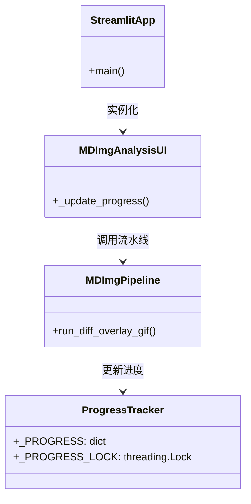
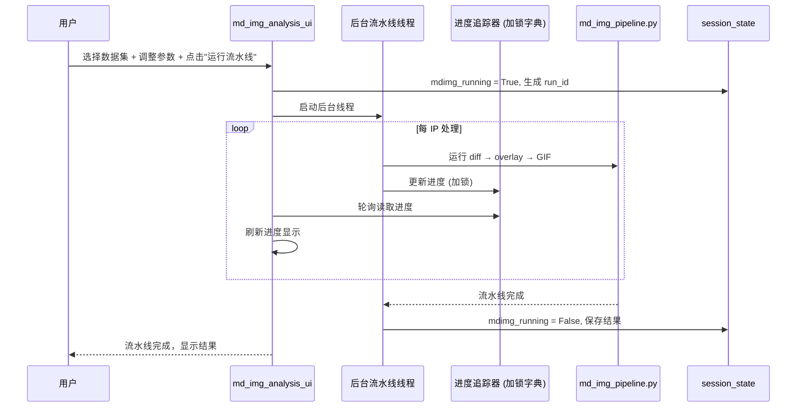
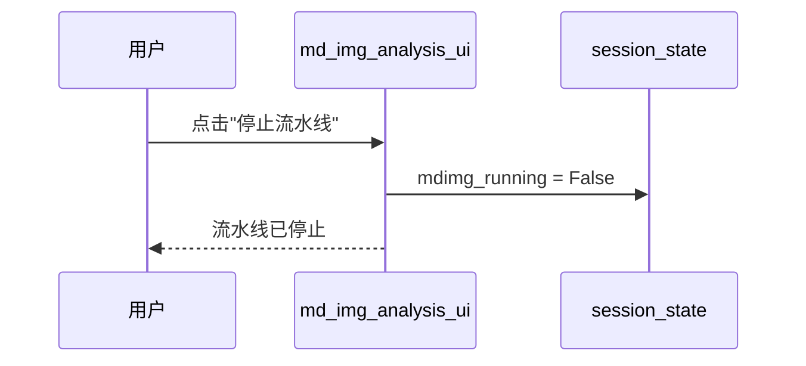
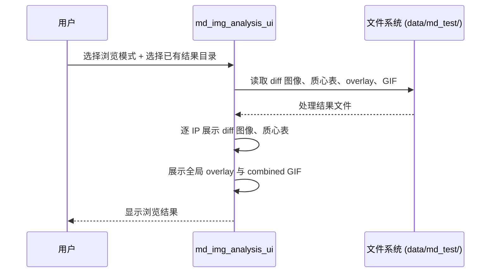

# Micro-DM 差分分析 UI (md_img_analysis_ui.py) — 软件需求规格说明书 (SRS)

## 1. 概述

### 1.1 文档目的

本文件定义 `src/ao_shaping/gui/dm/md_img_analysis_ui.py` 的功能需求、非功能需求、接口规范与关键设计约束。本模块是 Micro-DM 差分分析 UI 的 Streamlit 前端页面，包装 `scripts/dm/md_img_pipeline.py` 的完整 diff→overlay→GIF→combined 流水线，支持运行模式与浏览模式。

### 1.2 启动方式

```bash
streamlit run src/ao_shaping/gui/dm/md_img_analysis_ui.py
```

### 1.3 依赖模块

| 模块 | 职责 |
|------|------|
| `scripts/dm/md_img_pipeline.py` | 差分分析流水线核心逻辑 |
| `ao_shaping.utils.io.file.ROOT_DIR` | 项目根目录 |

### 1.4 用户画像

- 光学实验操作员：运行 Micro-DM 图像差分分析流水线，浏览处理结果（diff 图、overlay、GIF 动画）

---

## 2. 功能需求

### 2.1 运行模式

| ID | 需求 | 优先级 |
|----|------|--------|
| FR-1.1 | 支持选择数据集 | 必须 |
| FR-1.2 | 支持调整流水线参数（阈值、色图、缩放、FPS） | 必须 |
| FR-1.3 | 支持后台线程运行完整流水线 | 必须 |
| FR-1.4 | 支持实时显示进度（每 IP 的 diff/overlay/gif 状态 + 全局 overlay + combined GIF） | 必须 |
| FR-1.5 | 支持随时停止流水线 | 必须 |

### 2.2 浏览模式

| ID | 需求 | 优先级 |
|----|------|--------|
| FR-2.1 | 支持无需重新运行，直接查看已有处理结果 | 必须 |
| FR-2.2 | 支持查看逐 IP 的 diff 图像 | 必须 |
| FR-2.3 | 支持查看质心表 | 必须 |
| FR-2.4 | 支持查看 overlay 与动画 GIF | 必须 |
| FR-2.5 | 支持查看全局 overlay 与 combined GIF | 必须 |

---

## 3. 非功能需求

| ID | 需求 | 说明 |
|----|------|------|
| NF-1 | 后台线程隔离 | 工作线程绝不触碰 `st.session_state`，通过模块级进度字典与加锁通信 |
| NF-2 | 进度实时更新 | 轮询进度字典，实时显示每 IP 的处理状态 |
| NF-3 | 可中断执行 | 支持随时停止正在运行的流水线 |

---

## 4. 接口规范

### 4.1 Session State Schema

| 键 | 类型 | 含义 |
|----|------|------|
| `mdimg_run_id` | str | 当前运行 ID |
| `mdimg_running` | bool | 流水线运行中标志 |
| `mdimg_progress` | dict | 流水线进度信息 |
| `mdimg_results` | dict | 处理结果 |

### 4.2 流水线默认参数

| 参数 | 默认值 | 说明 |
|------|--------|------|
| 阈值 | 15.0 | 差分检测阈值 |
| 色图 | jet | 热图色图 |
| 缩放 | 0.25 | 图像缩放比例 |
| FPS | 8 | GIF 帧率 |
| 轮询间隔 | 0.5s | 进度轮询间隔 |

### 4.3 主要公共函数

| 函数 | 签名 | 说明 |
|------|------|------|
| `_update_progress(run_id, **fields)` | 无 | 更新指定 run_id 的进度条目（线程安全） |

---

## 5. 系统类图



---

## 6. 功能按钮时序图

### 6.1 运行流水线



### 6.2 停止流水线



### 6.3 浏览已有结果



---

## 7. 开发规范（防止用例冲突）

| 规则 ID | 规则说明 | 执行机制 |
|---------|----------|----------|
| TH-1 | 工作线程绝不触碰 `st.session_state` | 通过模块级 `_PROGRESS` 字典与 `_PROGRESS_LOCK` 加锁通信 |
| TH-2 | 进度轮询由主线程完成 | UI 主线程定期读取进度字典并刷新显示 |
| ER-1 | 流水线失败不导致页面崩溃 | 异常捕获，通过 UI 显示错误信息 |
| ER-2 | 支持随时停止 | `mdimg_running` 标志位控制流水线中断 |

---

## 8. 相关文档

- 用户手册: [`md_img_analysis_ui_user_manual.md`](./md_img_analysis_ui_user_manual.md)
- 流水线脚本: [`scripts/dm/md_img_pipeline.py`](../../../../../../scripts/dm/md_img_pipeline.py)
- 数据目录: [`data/md_test/`](../../../../../../data/md_test/)
- GUI 索引: [`docs/gui.md`](../../../gui.md)
