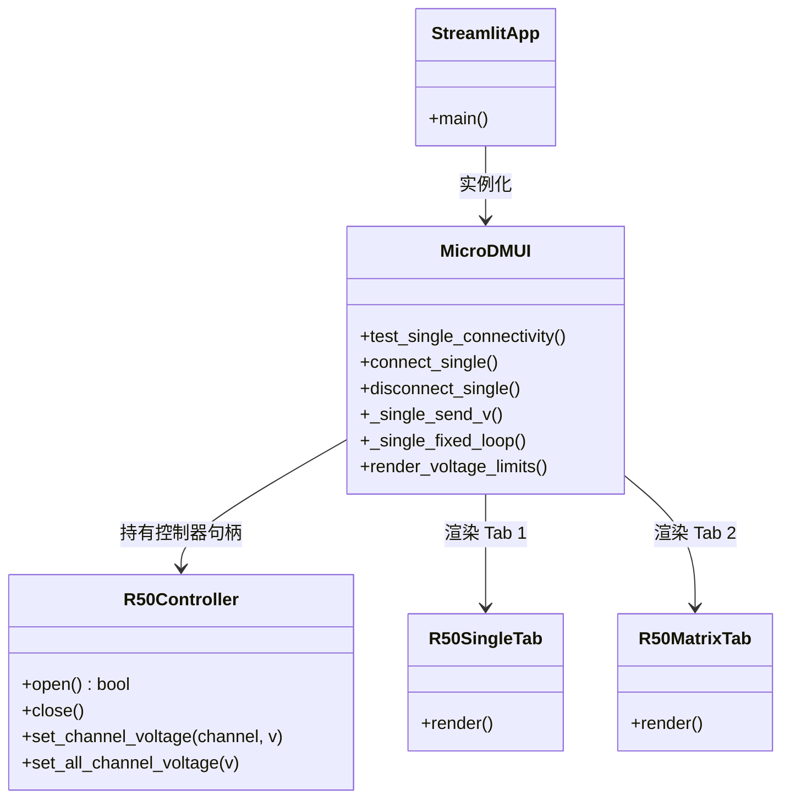
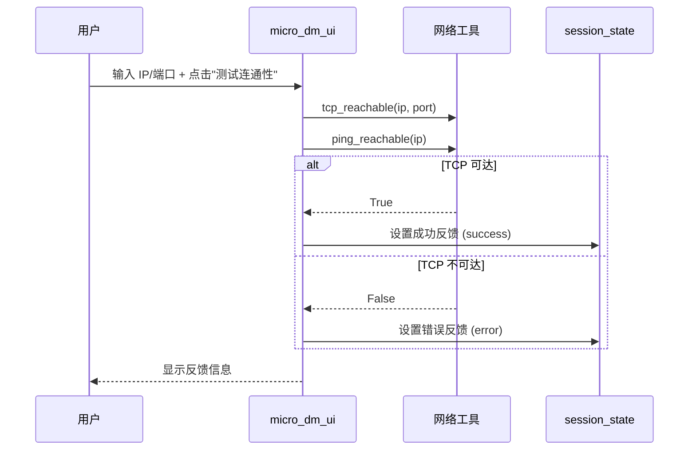
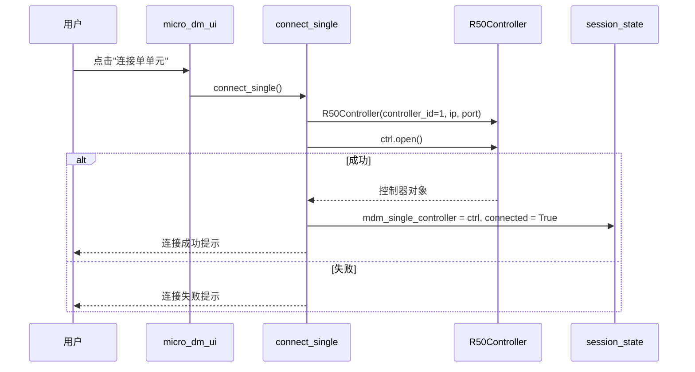
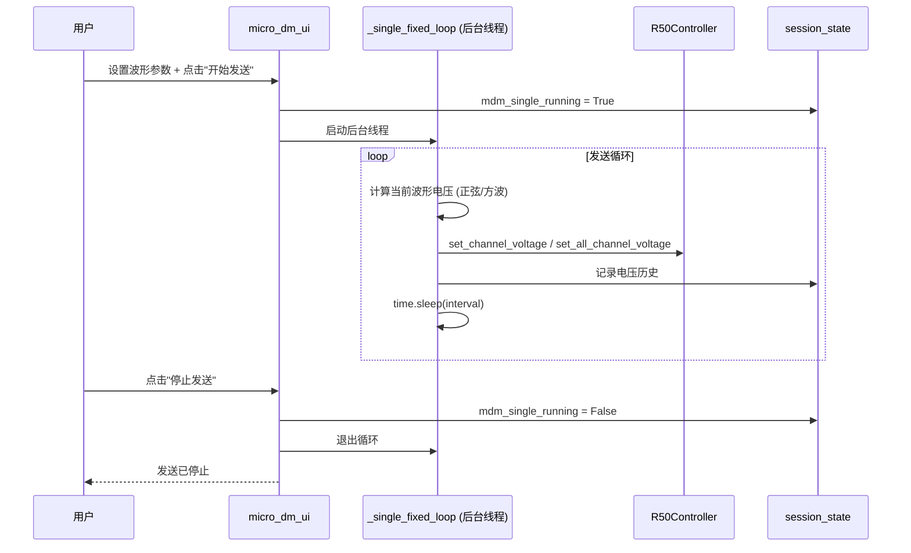

# Micro-DM 微驱动器控制 UI (micro_dm_ui.py) — 软件需求规格说明书 (SRS)

## 1. 概述

### 1.1 文档目的

本文件定义 `src/ao_shaping/gui/dm/micro_dm_ui.py` 的功能需求、非功能需求、接口规范与关键设计约束。本模块是 Micro-DM 微变形镜控制的 Streamlit 前端页面，支持单单元控制与 39×39 矩阵联合控制，电压下发、周期波形发送、实时热力图可视化。

### 1.2 启动方式

```bash
streamlit run src/ao_shaping/gui/dm/micro_dm_ui.py
```

### 1.3 依赖模块

| 模块 | 职责 |
|------|------|
| `ao_shaping.drivers.dm.micro.R50Controller` | R50Power 微驱动器控制器 |
| `ao_shaping.utils.io.network.ping_reachable` | IP 连通性探测 |
| `ao_shaping.utils.io.network.tcp_reachable` | TCP 端口连通性探测 |

### 1.4 用户画像

- 光学实验操作员：控制 Micro-DM 单元电压，进行单通道或 39×39 矩阵批量电压下发与可视化

---

## 2. 功能需求

### 2.1 设备连接与连通性

| ID | 需求 | 优先级 |
|----|------|--------|
| FR-1.1 | 支持单单元连接（IP/端口），测试 TCP/ICMP 连通性 | 必须 |
| FR-1.2 | 支持断开单单元连接 | 必须 |
| FR-1.3 | 支持 39×39 矩阵联合控制连接 | 必须 |
| FR-1.4 | 支持断开矩阵控制连接 | 必须 |

### 2.2 电压安全范围

| ID | 需求 | 优先级 |
|----|------|--------|
| FR-2.1 | 支持设置电压上下限（安全范围，共享两个 Tab） | 必须 |
| FR-2.2 | 电压下发自动裁剪到安全范围 | 必须 |
| FR-2.3 | 硬件物理极限：-20V ~ 120V | 必须 |

### 2.3 Tab 1 - 单单元控制

| ID | 需求 | 优先级 |
|----|------|--------|
| FR-3.1 | 支持设置目标通道号 | 必须 |
| FR-3.2 | 支持固定电压下发（单通道/全部通道） | 必须 |
| FR-3.3 | 支持周期波形发送（正弦/方波） | 必须 |
| FR-3.4 | 支持设置周期、振幅、偏移、高/低电平 | 必须 |
| FR-3.5 | 支持实时可视化当前下发电压（历史曲线） | 必须 |
| FR-3.6 | 支持开始/停止周期发送线程 | 必须 |

### 2.4 Tab 2 - 矩阵联合控制

| ID | 需求 | 优先级 |
|----|------|--------|
| FR-4.1 | 支持 39×39 矩阵批量电压控制 | 必须 |
| FR-4.2 | 支持热力图可视化 | 必须 |
| FR-4.3 | 支持一键应用全矩阵电压 | 必须 |
| FR-4.4 | 支持连续电压下发（间隔可设） | 可选 |
| FR-4.5 | 支持导入/导出矩阵配置 | 可选 |

---

## 3. 非功能需求

| ID | 需求 | 说明 |
|----|------|------|
| NF-1 | 会话状态隔离 | 两个 Tab 共享 `mdm_vmin/mdm_vmax`，各自拥有独立反馈与历史 |
| NF-2 | 线程安全 | 周期发送后台线程不直接操作 `st.session_state` |
| NF-3 | 电压安全 | 所有下发电压自动裁剪到安全范围与硬件物理极限 |
| NF-4 | 反馈机制 | Tab 独立反馈区，显示连接/操作结果 |

---

## 4. 接口规范

### 4.1 Session State Schema

| 键 | 类型 | 含义 |
|----|------|------|
| `mdm_vmin/mdm_vmax` | float | 共享电压上下限 |
| `mdm_single_ip` | str | 单单元 IP |
| `mdm_single_port` | int | 单单元端口 |
| `mdm_single_controller` | R50Controller | 单单元控制器对象 |
| `mdm_single_connected` | bool | 单单元连接标志 |
| `mdm_single_channel` | int | 目标通道号 |
| `mdm_single_fixed_voltage` | float | 固定电压值 |
| `mdm_single_mode` | str | fixed / periodic |
| `mdm_single_wave_type` | str | sine / square |
| `mdm_single_period` | float | 周期（s） |
| `mdm_single_amp` | float | 振幅（V） |
| `mdm_single_offset` | float | 偏移（V） |
| `mdm_single_high/low` | float | 高/低电平（V） |
| `mdm_single_running` | bool | 发送线程运行标志 |
| `mdm_single_history` | deque | 电压历史 |
| `mdm_dm` | 物体 | 矩阵控制器对象 |
| `mdm_connected` | bool | 矩阵连接标志 |
| `mdm_matrix` | ndarray | 39×39 电压矩阵 |
| `mdm_heatmap_vmin/vmax` | float | 热力图范围 |
| `mdm_colormap` | str | 热力图色图 |

### 4.2 主要公共函数

| 函数 | 签名 | 说明 |
|------|------|------|
| `main()` | 无 | Streamlit 页面入口 |
| `test_single_connectivity()` | 无 | 测试单单元连通性 |
| `connect_single()` | 无 | 连接单单元 |
| `disconnect_single()` | 无 | 断开单单元 |
| `_single_send_v(...)` | 无 | 向单单元下发电压 |
| `_single_fixed_loop(...)` | 无 | 固定电压持续下发线程 |
| `render_voltage_limits(...)` | 无 | 渲染电压上下限控件 |
| `set_tab1_feedback/set_tab2_feedback(...)` | 无 | 设置 Tab 反馈 |

---

## 5. 系统类图



---

## 6. 功能按钮时序图

### 6.1 连通性测试



### 6.2 连接单单元



### 6.3 周期波形发送



---

## 7. 开发规范（防止用例冲突）

| 规则 ID | 规则说明 | 执行机制 |
|---------|----------|----------|
| DV-1 | 同一设备同一时刻只能有一个连接 | 连接前先断开现有连接（close()） |
| TH-1 | 周期发送后台线程不直接操作 `st.session_state` | 通过线程局部变量与 UI 状态交互 |
| VF-1 | 所有下发电压自动裁剪 | np.clip 到安全范围与硬件物理极限 (-20V ~ 120V) |
| ER-1 | 连接失败不导致页面崩溃 | try/except 捕获异常，通过反馈区显示 |
| ER-2 | 断开时始终释放控制器 | finally 块确保句柄释放 |

---

## 8. 相关文档

- 用户手册: [`micro_dm_ui_user_manual.md`](./micro_dm_ui_user_manual.md)
- 驱动参考: [`src/ao_shaping/drivers/dm/micro/`](../../../../src/ao_shaping/drivers/dm/micro/)
- GUI 索引: [`docs/gui.md`](../../../gui.md)
