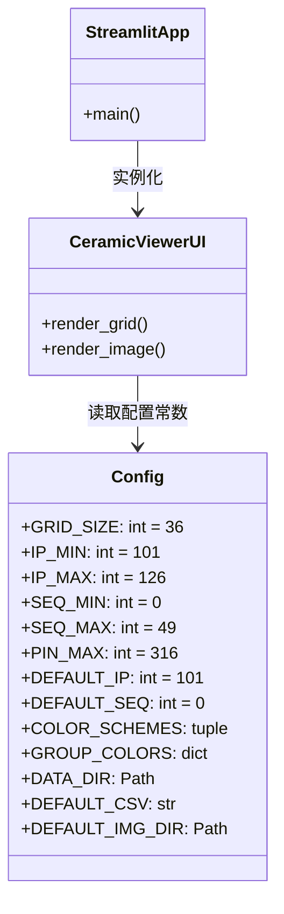
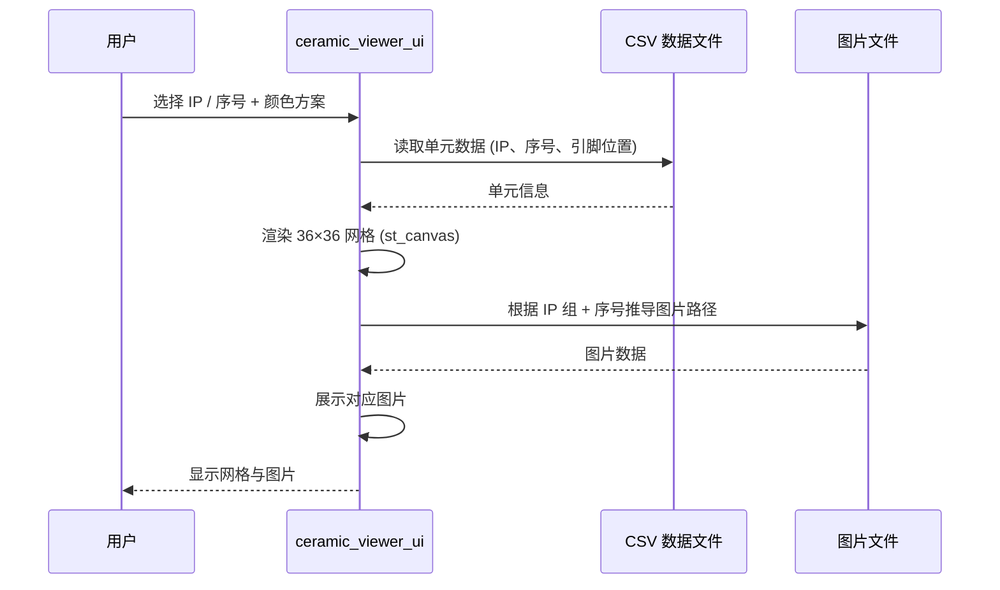

# 1300 陶瓷单元查看器 UI (ceramic_viewer.py) — 软件需求规格说明书 (SRS)

## 1. 概述

### 1.1 文档目的

本文件定义 `src/ao_shaping/gui/r50/ceramic_viewer.py` 的功能需求、非功能需求、接口规范与关键设计约束。本模块是 1300 陶瓷单元查看工具的 Streamlit 前端页面，支持 36×36 网格浏览陶瓷单元（IP、序号、引脚位置）与自动图片展示。

### 1.2 启动方式

```bash
streamlit run src/ao_shaping/gui/r50/ceramic_viewer.py
```

### 1.3 依赖模块

| 模块 | 职责 |
|------|------|
| `streamlit_drawable_canvas.st_canvas` | 可交互画布组件 |
| `pandas` | CSV 数据处理 |
| `PIL.Image` | 图片展示 |
| `numpy` | 数组计算 |
| `colorsys` | 颜色空间转换 |

### 1.4 用户画像

- 光学实验操作员：浏览 36×36 陶瓷单元网格，查看单元 IP、序号、引脚位置，自动展示对应图片

---

## 2. 功能需求

### 2.1 网格浏览

| ID | 需求 | 优先级 |
|----|------|--------|
| FR-1.1 | 支持 36×36 网格浏览陶瓷单元 | 必须 |
| FR-1.2 | 支持查看单元 IP、序号、引脚位置 | 必须 |
| FR-1.3 | 支持按 IP 组 / 所属组 / 序号 / 引脚编号着色 | 必须 |

### 2.2 图片展示

| ID | 需求 | 优先级 |
|----|------|--------|
| FR-2.1 | 支持根据 IP 组 + 序号自动推导图片路径 | 必须 |
| FR-2.2 | 支持展示对应单元图片 | 必须 |

### 2.3 配置

| ID | 需求 | 优先级 |
|----|------|--------|
| FR-3.1 | 支持设置默认 IP、序号 | 可选 |
| FR-3.2 | 支持选择 CSV 数据文件 | 可选 |
| FR-3.3 | 支持选择图片目录 | 可选 |

---

## 3. 非功能需求

| ID | 需求 | 说明 |
|----|------|------|
| NF-1 | 只读浏览 | 仅查看，不修改单元数据 |
| NF-2 | 颜色方案 | 多种颜色方案辅助区分单元组 |

---

## 4. 接口规范

### 4.1 配置常数 (Config 类)

| 常数 | 值 | 说明 |
|------|-----|------|
| `GRID_SIZE` | 36 | 网格大小 |
| `IP_MIN` | 101 | IP 最小值 |
| `IP_MAX` | 126 | IP 最大值 |
| `SEQ_MIN` | 0 | 序号最小值 |
| `SEQ_MAX` | 49 | 序号最大值 |
| `PIN_MAX` | 316 | 引脚最大值 |
| `DEFAULT_IP` | 101 | 默认 IP |
| `DEFAULT_SEQ` | 0 | 默认序号 |

### 4.2 颜色方案

| 方案 | 说明 |
|------|------|
| 无 | 不着色 |
| 按 IP 按 IP 组着色 | |
| 按所属组 | 按所属组着色 |
| 按序号 | 按序号着色 |
| 按引脚编号 | 按引脚编号着色 |

---

## 5. 系统类图



---

## 6. 功能按钮时序图

### 6.1 网格浏览



---

## 7. 开发规范（防止用例冲突）

| 规则 ID | 规则说明 | 执行机制 |
|---------|----------|----------|
| RO-1 | 只读浏览，不修改单元数据 | UI 仅读取 CSV 与图片文件，不写入 |
| PF-1 | 图片路径自动推导 | 根据 IP 组 + 序号构造路径，文件不存在时显示提示 |
| ER-1 | 文件缺失不导致页面崩溃 | 缺失图片/CSV 时显示友好提示 |

---

## 8. 相关文档

- 用户手册: [`ceramic_viewer_user_manual.md`](./ceramic_viewer_user_manual.md)
- 数据目录: [`data/md_test/`](../../../../../../data/md_test/)
- GUI 索引: [`docs/gui.md`](../../../gui.md)
