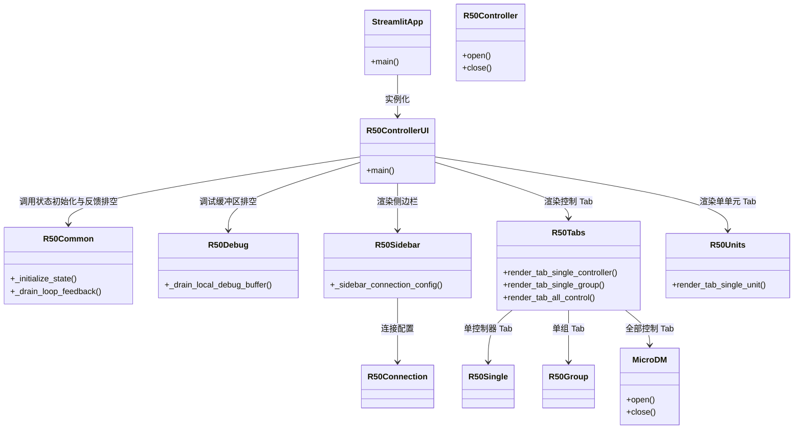
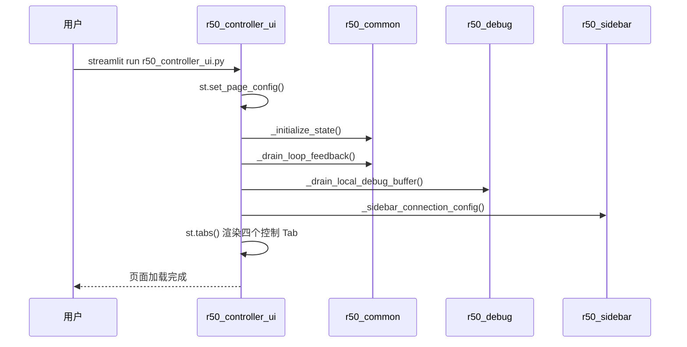
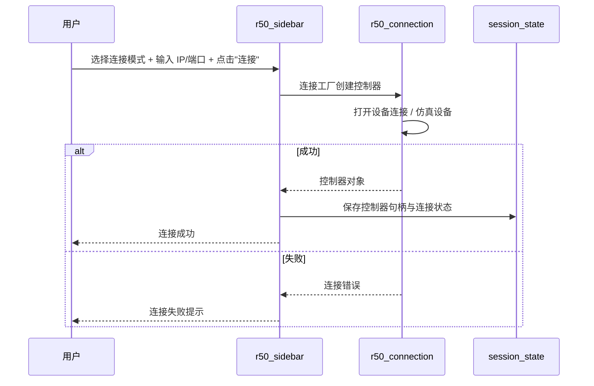

# R50 控制器控制面板 UI (r50_controller_ui.py) — 软件需求规格说明书 (SRS)

## 1. 概述

### 1.1 文档目的

本文件定义 `src/ao_shaping/gui/r50/r50_controller_ui.py` 的功能需求、非功能需求、接口规范与关键设计约束。本模块是 R50Power 微驱动器控制器的 Streamlit 前端页面，作为薄编排层，组装 r50_channel_select、r50_connection、r50_voltage_send、r50_debug、r50_common、r50_single、r50_joint、r50_group、r50_units、r50_tabs、r50_sidebar 等兄弟模块，提供四个控制 Tab：单单元控制、单控制器控制、单组控制、全部控制。

### 1.2 启动方式

```bash
streamlit run src/ao_shaping/gui/r50/r50_controller_ui.py
```

### 1.3 依赖模块

| 模块 | 职责 |
|------|------|
| `ao_shaping.gui.r50.r50_common` | 反馈 / session_state 初始化 / 通道标签 / 发送循环管理 |
| `ao_shaping.gui.r50.r50_debug` | 调试 TCP 客户端 / 指令日志 / 操作日志 / 本地调试服务器 |
| `ao_shaping.gui.r50.r50_sidebar` | Sidebar (调试面板 / 连接配置 / 三种模式连接界面) |
| `ao_shaping.gui.r50.r50_tabs` | 三个控制 Tab 的渲染 |
| `ao_shaping.gui.r50.r50_units` | 单单元控制 Tab |
| `ao_shaping.drivers.dm.micro.R50Controller/MicroDM` | 底层驱动 |

### 1.4 用户画像

- 光学实验操作员：控制 R50Power 微驱动器，进行单单元/单控制器/单组/全部控制与电压下发

---

## 2. 功能需求

### 2.1 连接配置

| ID | 需求 | 优先级 |
|----|------|--------|
| FR-1.1 | 支持三种连接模式：单控制器 / 单组 / 全部控制 | 必须 |
| FR-1.2 | 支持 IP/端口配置与连通性测试 | 必须 |
| FR-1.3 | 支持仿真设备与真实设备切换 | 必须 |
| FR-1.4 | 支持下电安全机制 | 必须 |

### 2.2 控制 Tab

| ID | 需求 | 优先级 |
|----|------|--------|
| FR-2.1 | 支持单单元控制 Tab（通道选择 / 连通性 / 继电器 / 单次下发） | 必须 |
| FR-2.2 | 支持单控制器控制 Tab | 必须 |
| FR-2.3 | 支持单组控制 Tab（组连接 / 下发 / 批量上下电） | 必须 |
| FR-2.4 | 支持全部控制 Tab（MicroDM 矩阵 / 编辑 / 可视化） | 必须 |

### 2.3 电压下发

| ID | 需求 | 优先级 |
|----|------|--------|
| FR-3.1 | 支持电压裁剪到安全范围 | 必须 |
| FR-3.2 | 支持批量下发 | 必须 |
| FR-3.3 | 支持发送循环管理 | 必须 |

### 2.4 调试功能

| ID | 需求 | 优先级 |
|----|------|--------|
| FR-4.1 | 支持调试 TCP 客户端 | 可选 |
| FR-4.2 | 支持指令日志 / 操作日志 | 可选 |
| FR-4.3 | 支持本地调试服务器 | 可选 |

---

## 3. 非功能需求

| ID | 需求 | 说明 |
|----|------|------|
| NF-1 | 模块化编排 | 主文件只负责组装，可测试逻辑位于兄弟模块 |
| NF-2 | 反馈循环排空 | 主入口负责循环反馈排空与 Tab 布局 |
| NF-3 | 会话状态初始化 | 统一在 `_initialize_state()` 中初始化 |

---

## 4. 接口规范

### 4.1 主要公共函数

| 函数 | 签名 | 说明 |
|------|------|------|
| `main()` | 无 | Streamlit 页面入口 |

### 4.2 兄弟模块职责

| 模块 | 职责 |
|------|------|
| `r50_channel_select` | 配置 / CSV 索引 / 通道选择（纯逻辑） |
| `r50_connection` | 连接工厂 / 仿真设备 / 下电安全（纯逻辑） |
| `r50_voltage_send` | 裁剪 / 批量下发 / 发送循环（纯逻辑） |
| `r50_debug` | 调试 TCP 客户端 / 指令日志 / 操作日志 / 本地调试服务器 |
| `r50_common` | 反馈 / session_state 初始化 / 通道标签 / 发送循环管理 |
| `r50_single` | 单控制器（连通性 / 连接 / 继电器 / 单次下发） |
| `r50_joint` | 联合控制（MicroDM 矩阵 / 编辑 / 可视化） |
| `r50_group` | 分组控制（组连接 / 下发 / 批量上下电） |
| `r50_units` | 单单元控制 Tab |
| `r50_tabs` | 三个控制 Tab 的渲染 |
| `r50_sidebar` | Sidebar（调试面板 / 连接配置 / 三种模式连接界面） |

---

## 5. 系统类图



---

## 6. 功能按钮时序图

### 6.1 页面启动



### 6.2 连接配置（Sidebar）



---

## 7. 开发规范（防止用例冲突）

| 规则 ID | 规则说明 | 执行机制 |
|---------|----------|----------|
| MO-1 | 主文件仅负责组装，不包含可测试逻辑 | 可测试逻辑位于兄弟模块（r50_channel_select / r50_connection / r50_voltage_send 等） |
| MO-2 | 统一 session_state 初始化 | 所有状态在 `_initialize_state()` 中通过 setdefault 初始化 |
| MO-3 | 反馈循环排空 | 主入口在每次 rerun 时调用 `_drain_loop_feedback()` |
| ER-1 | 连接失败不导致页面崩溃 | 兄弟模块内部 try/except 捕获异常 |

---

## 8. 相关文档

- 用户手册: [`r50_controller_ui_user_manual.md`](./r50_controller_ui_user_manual.md)
- 驱动参考: [`ao_shaping/drivers/dm/micro/`](../../../../../drivers/dm/micro/)
- GUI 索引: [`docs/gui.md`](../../../gui.md)
