# Multi-SLM 控制器 (multi_slm_controller.py) — 软件需求规格说明书 (SRS)

## 1. 概述

### 1.1 文档目的

本文件定义 `src/ao_shaping/gui/slm/multi_slm_controller.py` 的功能需求、非功能需求、接口规范与关键设计约束。本模块是 Santec SLM-200 空间光调制器的 Streamlit 前端页面，支持最多两台 SLM，每台可独立连接、配置和相位编程，并内置闭环远场光束整形（GS+SPGD 与物理预测模型闭环）。

### 1.2 启动方式

```bash
streamlit run src/ao_shaping/gui/slm/multi_slm_controller.py
```

### 1.3 依赖模块

| 模块 | 职责 |
|------|------|
| `ao_shaping.drivers.slm.santec.Santec` | SLM 驱动（open/close/write_phase/display_memory/create_phase_from_array/apply_shift 等） |
| `ao_shaping.gui.slm.pattern_controls` | 图案注册表 `PATTERN_REGISTRY`、`generate_phase_gray`、`refresh_phase_preview`、`PatternControl` 基类 |
| `ao_shaping.gui.slm.shaping_controls` | 闭环整形区 `render_closed_loop_shaping`、`ShapingMethod` 适配器、装饰器 `shaping_session` |
| `ao_shaping.utils.wavefront.pattern_helper.PatternHelper` | 按设备缓存的图案计算助手（面板分辨率、像素间距） |
| `ao_shaping.runners.runner_common` | 共用 runner 参数对象与保存器（与 CLI 同一代码路径） |

### 1.4 用户画像

- 光学实验操作员：连接 SLM、下发相位图案、进行远场图像观测
- 闭环整形用户：运行 GS+SPGD 或物理预测模型闭环整形，获取最佳相位与远场均匀度

---

## 2. 功能需求

### 2.1 设备发现与连接

| ID | 需求 | 优先级 |
|----|------|--------|
| FR-1.1 | 支持扫描 SLM 编号 1..8，探测设备是否空闲（SLM_Ctrl_Open 返回码） | 必须 |
| FR-1.2 | 空闲设备读取序列号、Panel_Res、Pitch_um、波长等设备参数 | 必须 |
| FR-1.3 | 已占用设备（ret > 0）标记为“使用中”，不可连接 | 必须 |
| FR-1.4 | 无设备（ret < 0）跳过，不报错 | 必须 |
| FR-1.5 | 支持最多两台 SLM 同时连接，各自独立 session state 命名空间 `slm1` / `slm2` | 必须 |
| FR-1.6 | 探测运行在守护线程中，单台超时 3s，避免 Santec SDK 挂起阻塞 UI | 必须 |

### 2.2 SLM 参数配置

| ID | 需求 | 优先级 |
|----|------|--------|
| FR-2.1 | 支持设置波长（nm），EEPROM 写入约需 40s | 必须 |
| FR-2.2 | 支持设置显示模式（内存模式 / DVI 模式），DVI 模式被拒绝（已禁用） | 必须 |
| FR-2.3 | 支持设置 2π 灰度值 `_max_gray` | 必须 |
| FR-2.4 | 支持加载/保存设备配置（JSON） | 可选 |
| FR-2.5 | 支持加载/清除波前矫正 CSV | 可选 |
| FR-2.6 | 支持设置平移 (shift_x/shift_y) 并应用 | 可选 |

### 2.3 相位图案生成与下发

| ID | 需求 | 优先级 |
|----|------|--------|
| FR-3.1 | 支持多种全息相位图案：平场、线性光栅、圆形光栅、透镜、全息光栅、闪耀光栅、棋盘格、二元光栅、微透镜阵列、湍流相位屏、Zernike、达曼光栅、涡旋相位、半半相位 | 必须 |
| FR-3.2 | 图案生成通过 `PatternHelper` 生成弧度相位，经 `Santec.create_phase_from_array()`（弧度→灰度+矫正+LUT+平移）下发 | 必须 |
| FR-3.3 | 平场灰度走原始 uint16 路径（`np.full((h,w), gray, dtype=np.uint16)`），不经弧度转换 | 必须 |
| FR-3.4 | 内存槽自动轮换：连续写同一槽位固件判 no-op，每次选取 2..125 中不同于当前显示槽的槽位 | 必须 |
| FR-3.5 | 支持“从 CSV 加载相位”：CSV 格式 1200×1920，值 0~1023，首行/首列为 Y/X 索引；管线 `load_gray_from_csv` → `csv_to_phase` → `display_phase` | 必须 |
| FR-3.6 | 支持“导出当前相位为 CSV”：数据区为弧度值，保留 Y/X 行列索引；导出文件不可再交给灰度加载管线 | 必须 |
| FR-3.7 | 支持“应用平移”：读取当前相位、撤销旧偏移、施加新偏移、轮换槽位、重新显示 | 可选 |
| FR-3.8 | 支持“保存当前相位为底相位”，并在下发时自动叠加底相位（开关可控） | 可选 |

### 2.4 周期切换（持续任务）

| ID | 需求 | 优先级 |
|----|------|--------|
| FR-4.1 | 支持两相位 A/B 周期切换，频率由用户设定 | 必须 |
| FR-4.2 | 切换时钟基于 `time.time()` 墙钟差值：`int(elapsed * 2.0 * freq) % 2 == 0`，无累积误差 | 必须 |
| FR-4.3 | 后台线程绝不直接碰 `st.session_state`，通过 `threading.Event` 传递停止信号，通过可变列表（`slm_container`、`freq_ref`）传递快照 | 必须 |
| FR-4.4 | 每次切换选取不同于当前显示槽的内存槽位，确保 LCOS 面板刷新 | 必须 |
| FR-4.5 | 支持停止周期切换，释放线程与事件 | 必须 |

### 2.5 闭环远场整形

| ID | 需求 | 优先级 |
|----|------|--------|
| FR-5.1 | 支持 GS+SPGD 闭环整形（已验证配方），与 CLI `slm-gs-refine` 同一代码路径 | 必须 |
| FR-5.2 | 支持物理预测模型闭环整形（前沿，需 torch） | 可选 |
| FR-5.3 | 运行期间暂时释放目标 SLM 句柄，结束后重新获取（Santec SDK 句柄不可重入） | 必须 |
| FR-5.4 | 运行期间停止后台周期切换线程，避免冲突 | 必须 |
| FR-5.5 | 结束后把最佳相位（raw 弧度）经常规 `display_phase` 路径下发显示 | 必须 |
| FR-5.6 | 显示 flat/GS/best 各阶段得分、PIB、CV，以及 GS 对比择优 判定（adopted/rejected） | 必须 |
| FR-5.7 | debug 模式下产物存于 `data/debug/slm_gs_refine/<ts>/` | 可选 |

---

## 3. 非功能需求

| ID | 需求 | 说明 |
|----|------|------|
| NF-1 | 会话状态隔离 | 每个 SLM 以 `slm{N}`（N=1 或 2）为命名空间，互不干扰 |
| NF-2 | 线程安全 | 后台周期切换线程不直接操作 `st.session_state`；所有 UI 更新在主线程完成 |
| NF-3 | 错误隔离 | 优化器崩溃不应导致页面设备句柄泄露，`shaping_session` 装饰器在 `finally` 中重新获取句柄 |
| NF-4 | 字节级一致 | GUI 预览与硬件下发共用 `create_phase_from_array()`，确保显示与实际下发一致 |
| NF-5 | 无 DVI 模式 | DVI 模式 `open()` 可能挂起 120s/300s，且挂起后 memory 模式 `open()` 也挂起，需物理断电恢复；因此仅提供内存模式 |

---

## 4. 接口规范

### 4.1 Session State Schema（每台 SLM）

| 键 | 类型 | 含义 |
|----|------|------|
| `slm{N}` | Santec | SLM 对象（断开时为 None） |
| `slm{N}_connected` | bool | 连接标志 |
| `slm{N}_wavelength` | int | 工作波长（nm） |
| `slm{N}_video_mode` | str | 显示模式（内存模式） |
| `slm{N}_next_memory` | int | 下一个内存槽提示 |
| `slm{N}_phase_preview` | ndarray | 缓存的预览图像 |
| `slm{N}_phase_source` | str | 缓存相位的来源标签 |
| `slm{N}_shift_x/y` | int | 平移值 |
| `slm{N}_use_correction` | bool | 波前矫正开关 |
| `slm{N}_toggle_phase_a/b` | ndarray | 周期切换存储的相位 |
| `slm{N}_toggle_active` | bool | 周期切换是否运行 |
| `slm{N}_toggle_frequency` | float | 切换频率（Hz） |
| `slm{N}_toggle_thread` | Thread | 后台线程句柄 |
| `slm{N}_toggle_stop_event` | threading.Event | 停止信号 |
| `slm{N}_toggle_freq_ref` | list | 可变频率引用（单元素） |
| `slm{N}_toggle_slm_container` | list | 可变 SLM 引用（单元素） |
| `slm{N}_base_phase` | ndarray | 用于叠加的底相位 |
| `slm{N}_overlay_base` | bool | 叠加开关 |
| `slm{N}_width/height` | int | 面板分辨率 |
| `slm{N}_pixel_pitch_um` | float | 像素间距 |
| `slm{N}_bits` | int | 位深 |
| `slm{N}_loaded_config` | dict | 缓存的配置文件 |

### 4.2 主要公共函数

| 函数 | 签名 | 说明 |
|------|------|------|
| `main()` | 无 | Streamlit 页面入口 |
| `render_slm_sidebar(slm_num)` | 无 | 设备发现、连接、参数设置侧边栏 |
| `render_phase_control(slm_num)` | 无 | 相位图案生成、CSV 加载/导出、平移、底相位、周期切换控制面板 |
| `display_slm_status(slm_num)` | 无 | 显示 SLM 连接状态 |
| `_stop_toggle(slm_num)` | 无 | 停止指定 SLM 的周期切换线程 |
| `_toggle_phases_task(container, phase_a, phase_b, stop_event, freq_ref)` | 无 | 后台周期切换线程主体 |
| `_scan_available_slms()` | list[dict] | 扫描 SLM 设备列表（守护线程，3s 超时） |

---

## 5. 系统类图

以下为 `multi_slm_controller.py` 及其直接协作模块的类图，使用 Mermaid `classDiagram` 语法。

```mermaid
classDiagram
    class StreamlitApp {
        +main()
        +render()
    }
    class MultiSLMController {
        -slm_container: list
        +render_slm_sidebar(slm_num)
        +render_phase_control(slm_num)
        +display_slm_status(slm_num)
        +_stop_toggle(slm_num)
        +_scan_available_slms()
    }
    class Santec {
        +open()
        +close()
        +write_phase(phase, memory_number)
        +display_memory(memory_number)
        +display_data(phase, wait_time_s)
        +get_displayed_phase() tuple
        +apply_shift(sx, sy)
        +create_phase_from_array(phase_rad)
        +load_gray_from_csv(path)
        +csv_to_phase(path)
        +save_phase_to_csv(phase_rad, dest)
        +set_wavelength(wl)
        +set_shift(sx, sy)
        +get_wavelength_info()
        +shift_phase(phase, sx, sy)
    }
    class PatternControl {
        <<abstract>>
        +render(prefix)
        +generate_phase_gray(slm, pattern_type, params)
    }
    class FlatControl
    class LinearGratingControl
    class CircularGratingControl
    class LensControl
    class HologramGratingControl
    class BlazedGratingControl
    class CheckerboardControl
    class BinaryGratingControl
    class MicrolensArrayControl
    class TurbulenceScreenControl
    class ZernikeControl
    class DammannGratingControl
    class VortexPhaseControl
    class HalfHalfPhaseControl
    class PatternHelper {
        +Panel_Res: int
        +Pitch_um: float
        +generate_zernike_polynomial(...)
        +generate_vortex(...)
        +linear_grating(...)
        +circular_grating(...)
    }
    class WavefrontCorrection {
        +is_valid: bool
        +map_error(phase, max_grayscale)
    }
    class SLMConfigManager {
        +load_config(serial)
        +save_config(serial, config)
    }
    class BackgroundToggle {
        -slm_container: list
        -phase_a: ndarray
        -phase_b: ndarray
        -stop_event: threading.Event
        -freq_ref: list
        +run()
    }
    class ShapingMethod {
        <<abstract>>
        +execute(config)
        +save(params, outcome, debug)
    }
    class GsRefineMethod
    class ModelInLoopMethod
    class ShapingOutcome {
        +flat_score: float
        +gs_score: float
        +best_score: float
        +best_phase: ndarray
        +best_frame: ndarray
    }
    class ShapingSessionDecorator {
        +shaping_session(method)
    }

    StreamlitApp --> MultiSLMController
    MultiSLMController --> Santec
    MultiSLMController --> PatternControl
    MultiSLMController --> BackgroundToggle
    PatternControl <|-- FlatControl
    PatternControl <|-- LinearGratingControl
    PatternControl <|-- CircularGratingControl
    PatternControl <|-- LensControl
    PatternControl <|-- HologramGratingControl
    PatternControl <|-- BlazedGratingControl
    PatternControl <|-- CheckerboardControl
    PatternControl <|-- BinaryGratingControl
    PatternControl <|-- MicrolensArrayControl
    PatternControl <|-- TurbulenceScreenControl
    PatternControl <|-- ZernikeControl
    PatternControl <|-- DammannGratingControl
    PatternControl <|-- VortexPhaseControl
    PatternControl <|-- HalfHalfPhaseControl
    PatternControl --> PatternHelper
    PatternControl --> Santec
    Santec --> WavefrontCorrection
    Santec --> SLMConfigManager
    BackgroundToggle --> Santec
    MultiSLMController --> ShapingMethod
    ShapingMethod <|-- GsRefineMethod
    ShapingMethod <|-- ModelInLoopMethod
    ShapingSessionDecorator ..> ShapingMethod
    GsRefineMethod --> ShapingOutcome
    ModelInLoopMethod --> ShapingOutcome
```

### 5.1 类职责说明

| 类 | 职责 |
|----|------|
| `MultiSLMController` | Streamlit 页面主控制器，协调设备发现、连接、相位下发、周期切换、闭环整形 |
| `Santec` | SLM-200 驱动，负责与 SDK 交互、相位下发、内存槽管理、波长/矫正/平移配置 |
| `PatternControl` (抽象) | 图案生成基类，定义 `render(prefix)` 与 `generate_phase_gray()` 接口 |
| `FlatControl` … `HalfHalfPhaseControl` | 具体图案控制类，各自实现 `generate_phase_gray` 输出 uint16 灰度或弧度 |
| `PatternHelper` | 按设备缓存的图案计算助手，提供面板分辨率、像素间距、Zernike/涡旋等相位生成 |
| `WavefrontCorrection` | 波前矫正映射，将相位误差映射到灰度补偿 |
| `SLMConfigManager` | 设备配置 JSON 持久化 |
| `BackgroundToggle` | 后台周期切换线程，通过 `threading.Event` 停止，通过可变列表传快照 |
| `ShapingMethod` (抽象) | 闭环整形适配器基类，统一 `execute` / `save` 接口 |
| `GsRefineMethod` / `ModelInLoopMethod` | GS+SPGD 与物理预测模型闭环整形适配器 |
| `ShapingOutcome` | 标准化闭环整形结果，平坦 UI 与优化器特定类型的解耦 |
| `ShapingSessionDecorator` | 装饰器，负责设备生命周期（释放/重新获取 SLM 句柄）与错误隔离 |

---

## 6. 功能按钮时序图

以下为每个主要功能按钮的操作时序图，使用 Mermaid `sequenceDiagram` 语法。

### 6.1 连接 SLM

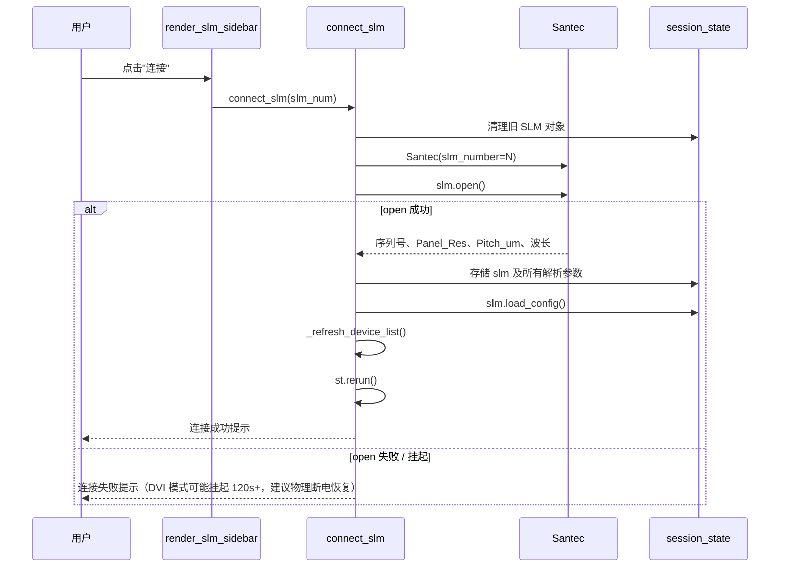

### 6.2 断开 SLM

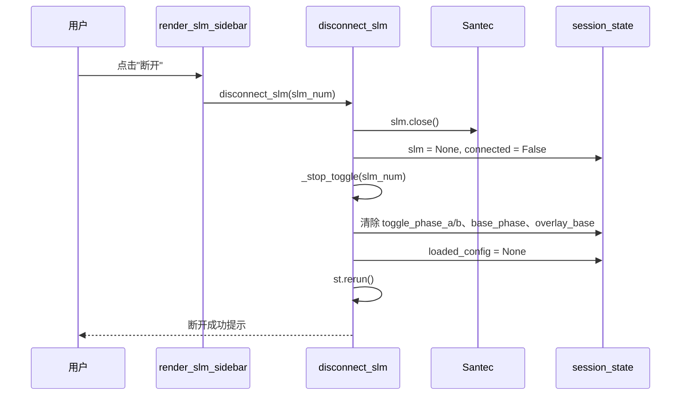

### 6.3 从模式生成器生成相位

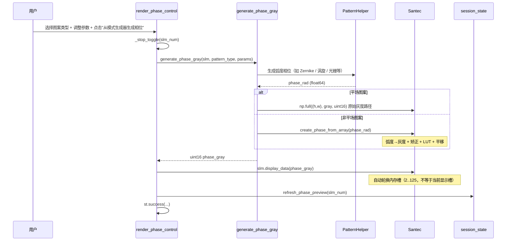

### 6.4 应用平移

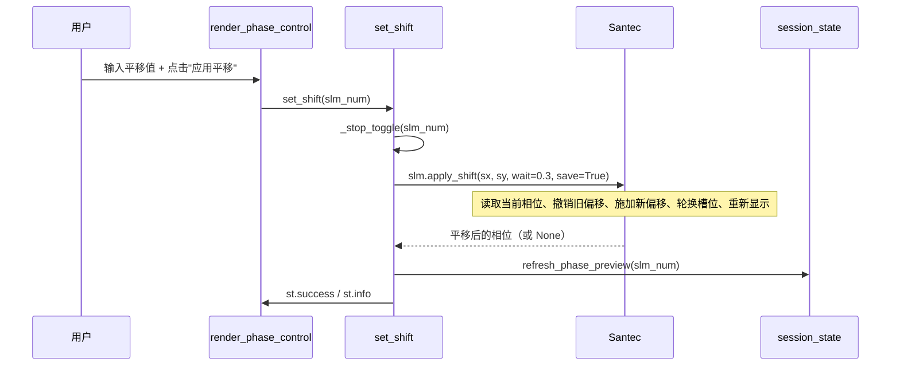

### 6.5 周期切换（开始）

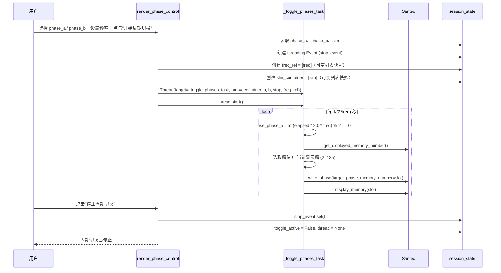

### 6.6 设为相位 A / B

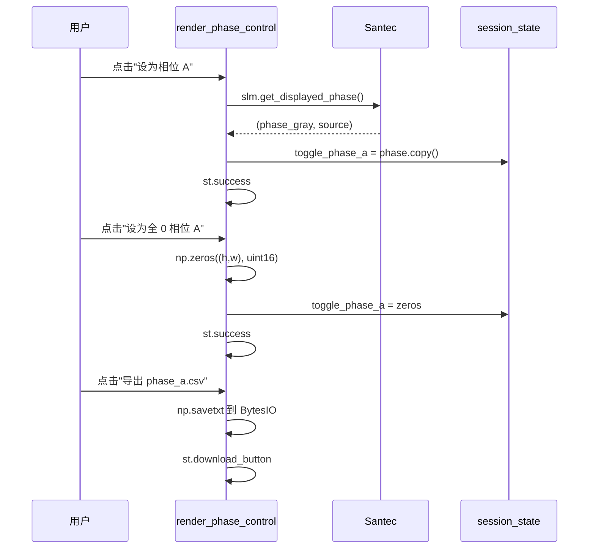

### 6.7 从 CSV 加载相位

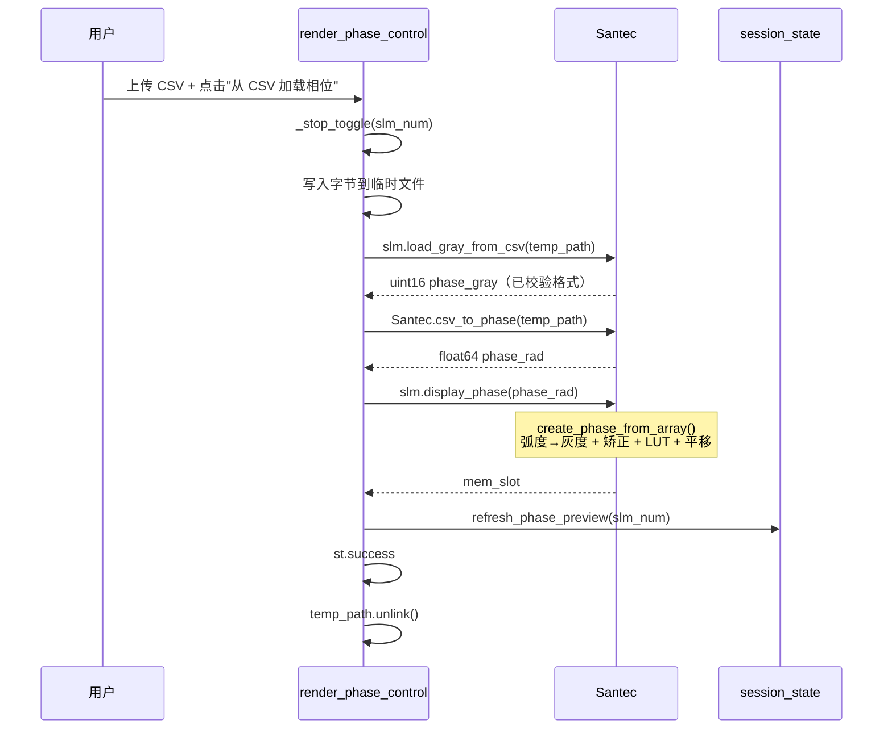

### 6.8 保存当前相位为底相位

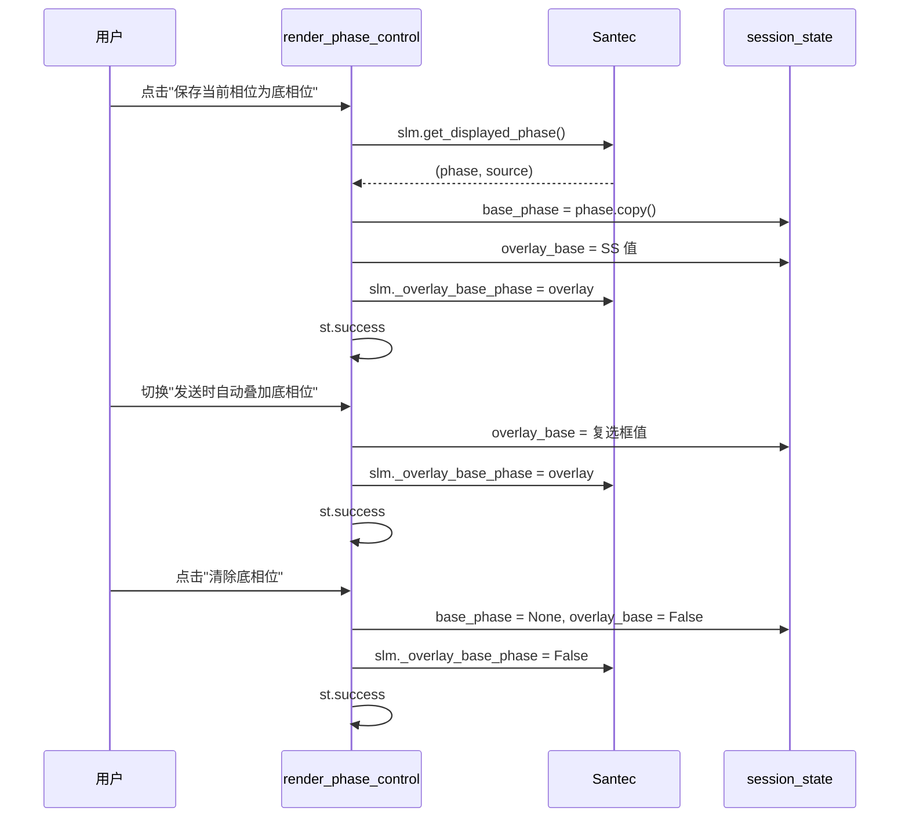

### 6.9 应用/清除波前矫正

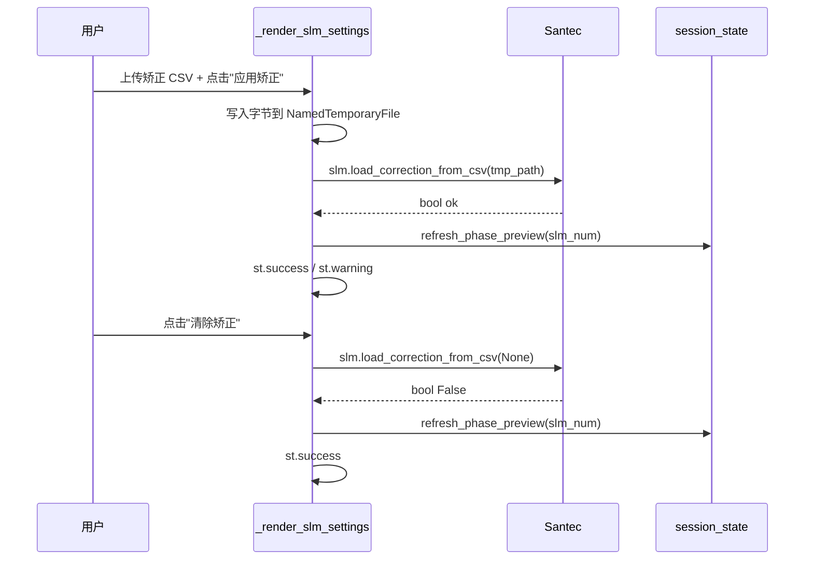

### 6.10 设置波长

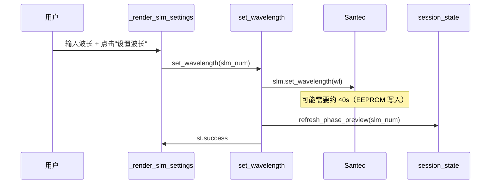

### 6.11 设置模式（内存 / DVI）

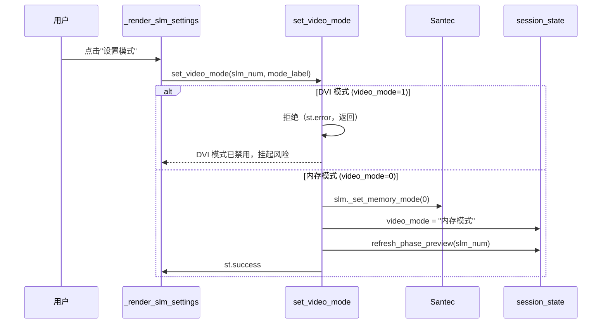

### 6.12 灰度设置

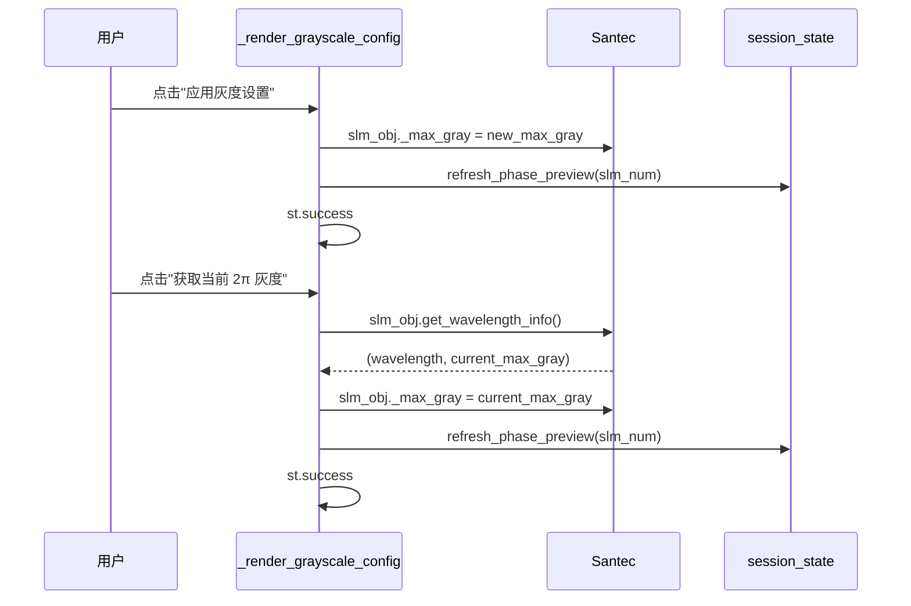

### 6.13 保存配置

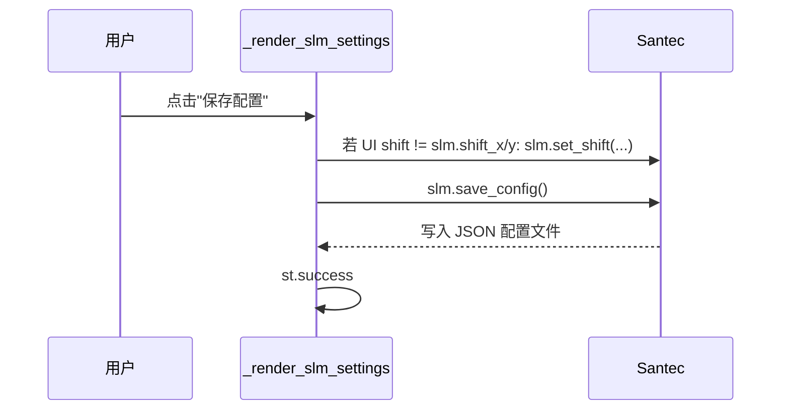

### 6.14 保存当前相位到 CSV

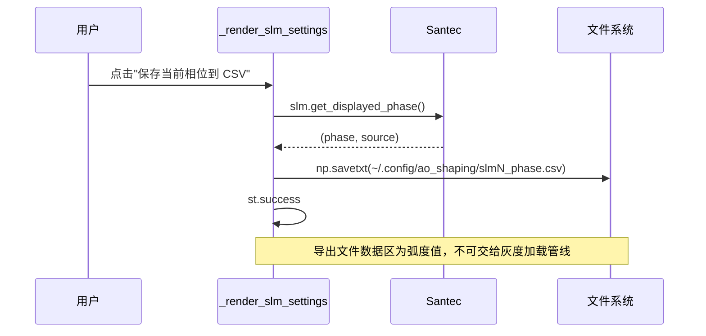

### 6.15 设备扫描

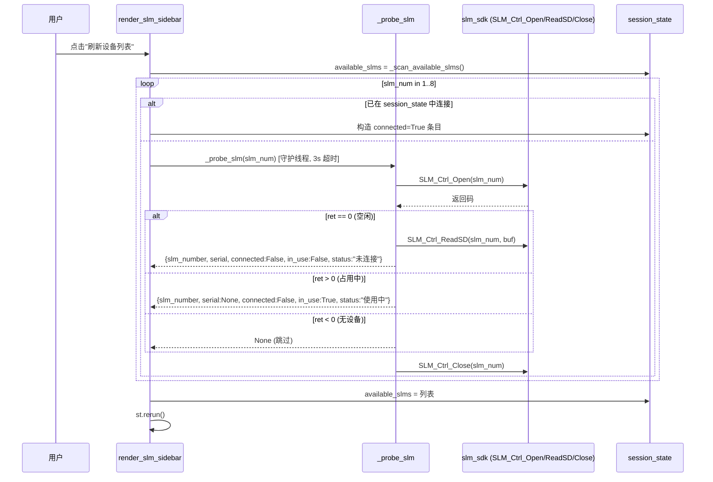

### 6.16 闭环整形（GS+SPGD / 物理预测模型）

```mermaid
sequenceDiagram
    participant U as 用户
    participant PC as render_closed_loop_shaping
    participant SM as ShapingMethod (适配器)
    participant OPT as 优化器 (GS+SPGD / ModelInLoop)
    participant SLM as Santec
    participant CAM as Daheng CCD
    participant SS as session_state

    U->>PC: 选择方法 + 调整参数 + 点击"运行闭环整形"
    PC->>PC: _stop_toggle(slm_num)
    PC->>SS: 释放目标 SLM 句柄
    PC->>SM: execute(config)
    SM->>OPT: 构建 runner 参数对象（与 CLI 同一路径）
    loop 每轮优化
        OPT->>SLM: 下发相位（内存槽轮换）
        OPT->>CAM: 捕获远场帧
        OPT->>OPT: 计算 PIB / CV / 得分
        OPT-->>SM: 回调 (epoch, score)
        SM-->>PC: 更新进度（主线程 widget，不碰 session_state）
    end
    OPT-->>SM: 最佳相位、最佳帧、各阶段得分
    SM-->>PC: ShapingOutcome (标准化结果)
    PC->>SM: save(params, outcome, debug)
    SM->>SM: 保存 best_phase.npy / best_far_field.csv / debug 产物
    PC->>SLM: display_phase(best_phase)  下发最佳相位显示
    PC->>SS: 重新获取目标 SLM 句柄
    PC->>PC: 显示 flat/GS/best 得分、PIB、CV、对比择优判定
    PC-->>U: 闭环整形完成
```

---
## 7. SLM 设置详细说明

本节详细说明 SLM 设置面板中的每个设置项、取值范围、默认值、生效机制及注意事项。所有设置项位于侧边栏「SLM N 设置」展开区中，分为三个折叠区：**设备/波长/模式/平移**、**灰度设置**、**波前矫正**。

> ⚠️ **重要**：所有 SLM 设置更改后，建议点击对应的「应用/设置」按钮使更改生效。波长、灰度、矫正等更改会自动触发 `refresh_phase_preview()` 刷新相位预览，并清除上下文关联 Widget（如平场灰度、涡旋波长），使其在下一次重渲染时从新的设备上下文重新初始化。

### 7.1 设备信息（只读）

在连接 SLM 后，设备信息区显示以下只读字段，无法通过 GUI 修改：

| 字段 | 说明 | 来源 |
|------|------|------|
| 分辨率 | SLM 面板分辨率（宽 × 高，像素） | `Panel_Res` |
| 像素间距 | SLM 像素物理间距，单位 μm | `Pitch_um` |
| Bit 数 | 灰度位深 | `Gray_Scale_bits` |
| SLM 序列号 | 设备出厂序列号 | `_serial_number` |
| SLM 编号 | GUI 中的逻辑编号（1 或 2） | `slm_number` |

---

### 7.2 波长设置

| 项 | 说明 |
|------|------|
| 参数名 | 波长 (nm) |
| 取值范围 | 450 ~ 1600 nm |
| 步长 | 1 nm |
| 默认值 | 连接时从设备读取，或 1064 nm |
| 生效机制 | 点击「设置波长」按钮，调用 `slm.set_wavelength(wavelength)` 写入设备 EEPROM（约需 40s） |
| 副作用 | 写入后自动触发 `refresh_phase_preview()` 刷新相位预览，并调用 `_reset_context_widgets()` 清除上下文关联 Widget（如 `flat_gray`、`vortex_wavelength`），使其在下一次重渲染时从新的波长和 2π 最大灰度重新初始化 |
| 警告 | 若 Widget 设定值与设备实际值不一致，侧边栏会显示警告并提供「同步」按钮，将 Widget 值重设为设备值 |

**设置流程**：
1. 在「波长 (nm)」输入框修改数值
2. 点击「设置波长」按钮
3. 等待 EEPROM 写入完成（约 40s），期间界面可能短暂阻塞
4. 系统自动刷新预览并重新初始化关联 Widget

---

### 7.3 显示模式设置

| 项 | 说明 |
|------|------|
| 参数名 | 视频模式 |
| 可用选项 | `内存模式`（仅此一项，DVI 模式已禁用） |
| 默认值 | 内存模式 |
| 生效机制 | 点击「设置模式」按钮，调用 `slm._set_memory_mode(0)` |
| 禁用原因 | DVI 模式（`video_mode=1`）的 `open()` 已知会挂起 120s/300s，且挂起后内存模式的 `open()` 也会挂起，仅靠物理断电恢复。因此 GUI 中仅提供内存模式，不提供 DVI 选项 |

---

### 7.4 灰度设置

| 项 | 说明 |
|------|------|
| 参数名 | 2π 灰度值 |
| 取值范围 | 1 ~ 1023（`Santec.MAX_GRAYSCALE_VALUE`） |
| 默认值 | 设备当前 `_max_gray`，或 1023 |
| 生效机制 | 点击「应用灰度设置」按钮，更新 `slm_obj._max_gray`，触发 `refresh_phase_preview()` 和 `_reset_context_widgets()`，并执行 `st.rerun(scope="app")` 重新渲染全页 |
| 副作用 | 全页重渲染会重新初始化所有控制组件，使平场灰度滑块等组件从新的 `_max_gray` 重新计算范围 |
| 「获取当前 2π 灰度」 | 调用 `slm.get_wavelength_info()` 从设备读取实际的 2π 最大灰度值，覆盖 `slm_obj._max_gray`，随后刷新预览并重置关联 Widget |

**设置流程**：
1. 在「2π 灰度值」输入框修改数值（1 ~ 1023）
2. 点击「应用灰度设置」按钮
3. 或点击「获取当前 2π 灰度」按钮从设备读取实际值
4. 全页重渲染后，所有相位图案控件的灰度范围会自动更新

---

### 7.5 波前矫正

| 项 | 说明 |
|------|------|
| 参数名 | 叠加矫正 CSV（复选框） |
| 默认值 | `True`（启用） |
| 生效机制 | 勾选/取消勾选时调用 `toggle_correction(slm_num, enabled)`；启用时从配置文件重新加载矫正数据，禁用时清空矫正对象 |
| 矫正文件状态 | 若已加载，显示「当前矫正文件: <文件名>」；否则显示「未加载矫正文件」 |
| 矫正加载 | 上传 CSV 文件后点击「应用矫正」，调用 `slm.load_correction_from_csv(tmp_path)`；成功后刷新相位预览 |
| 矫正作用 | 启用时，写入相位会自动叠加波前误差矫正数据（在驱动层 `create_phase_from_array()` 中应用） |

**设置流程**：
1. 勾选「叠加矫正 CSV」复选框启用/禁用矫正
2. 上传矫正 CSV 文件（`.csv` 格式）
3. 点击「应用矫正」按钮
4. 成功后显示「矫正已应用: <文件名>」并刷新相位预览

---

### 7.6 平移设置

| 项 | 说明 |
|------|------|
| 参数名 | Shift X / Shift Y（像素） |
| 取值范围 | -500 ~ 500 像素 |
| 步长 | 1 像素 |
| 默认值 | 0 |
| 生效机制 | 点击「应用平移」按钮，调用 `slm.apply_shift(shift_x, shift_y, wait_time_s=0.3, save_config=True)` |
| 副作用 | 驱动层负责读取当前相位、撤销旧偏移、施加新偏移、轮换内存槽、重新显示；成功后刷新相位预览 |
| 注意 | 如当前没有缓存的相位可自动下发，会提示「请先生成或捕获一个相位图案」 |

**设置流程**：
1. 在「Shift X」和「Shift Y」输入框修改数值（-500 ~ 500）
2. 点击「应用平移」按钮
3. 等待驱动层完成偏移重下发，刷新相位预览

---

### 7.7 配置加载与保存

| 项 | 说明 |
|------|------|
| 配置文件路径 | `~/.config/ao_shaping/slm<N>_config.json`（按 SLM 编号分文件） |
| 加载时机 | 连接 SLM 时自动调用 `slm.load_config()`；设备序列号不匹配时显示「未找到匹配的配置文件（使用设备默认值）」 |
| 手动刷新 | 点击「刷新配置」按钮，重新调用 `slm.load_config()` 并更新 `session_state[f"slm{N}_loaded_config"]` |
| 保存配置 | 点击「保存配置」按钮，若 UI 中的平移值与 SLM 当前值不同，先调用 `slm.set_shift()`，再调用 `slm.save_config()` 写入 JSON |
| 配置内容 | 包含波长、灰度、平移、矫正开关等设备级参数 |

---

## 8. 设置时序设计

本节为每个 SLM 设置操作提供 Mermaid 时序图，说明用户操作、UI 控制器、SLM 驱动、设备 SDK 之间的交互顺序与关键节点。

### 8.1 波长设置时序

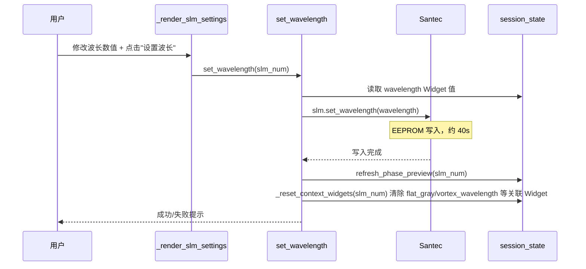

### 8.2 灰度设置时序

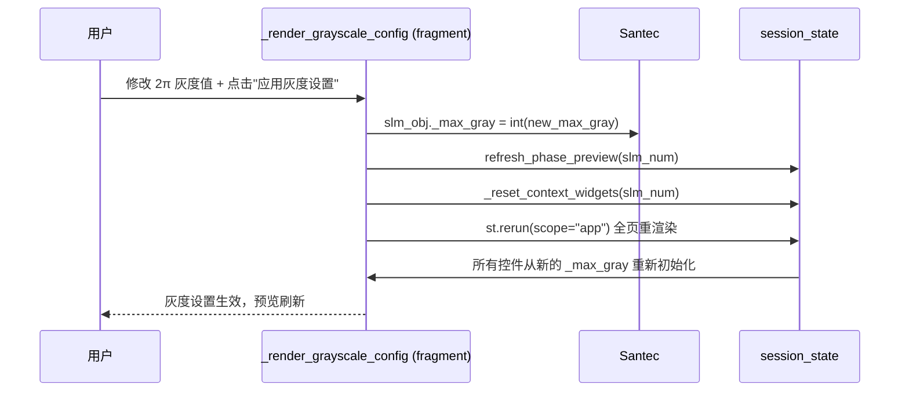

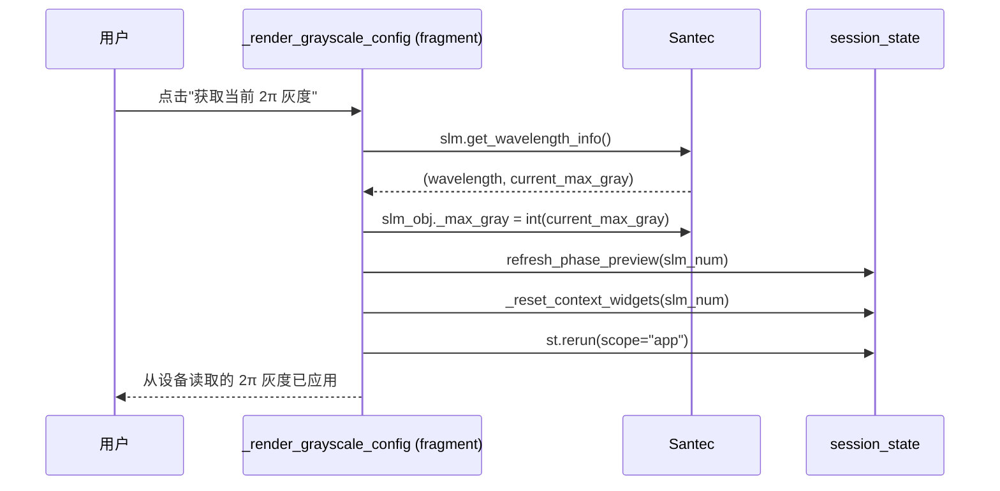

### 8.3 波前矫正时序

```mermaid
sequenceDiagram
    participant U as 用户
    participant UI as _render_slm_settings (波前矫正区)
    participant SLM as Santec
    participant FS as 文件系统 (临时文件)
    participant SS as session_state

    U->>UI: 上传矫正 CSV + 点击"应用矫正"
    UI->>FS: 写入字节到 NamedTemporaryFile
    UI->>SLM: slm.load_correction_from_csv(tmp_path)
    alt 加载成功
        SLM-->>UI: bool True
        UI->>SS: refresh_phase_preview(slm_num)
        UI-->>U: 矫正已应用
    else 加载失败
        SLM-->>UI: bool False
        UI-->>U: 应用失败提示
    end

    U->>UI: 勾选/取消"叠加矫正 CSV"
    UI->>SS: st.session_state.use_correction = enabled
    UI->>SLM: toggle_correction(slm_num, enabled)
    Note over SLM: 启用时从配置文件加载矫正；禁用时清空矫正对象
    UI-->>U: 矫正开关已更新
```

### 8.4 平移设置时序

```mermaid
sequenceDiagram
    participant U as 用户
    participant UI as _render_slm_settings (平移区)
    participant C as set_shift
    participant SLM as Santec
    participant SS as session_state

    U->>UI: 修改 Shift X/Y + 点击"应用平移"
    UI->>C: set_shift(slm_num)
    C->>SS: _stop_toggle(slm_num)  停止周期切换
    C->>SLM: slm.apply_shift(sx, sy, wait_time_s=0.3, save_config=True)
    Note over SLM: 读取当前相位、撤销旧偏移、施加新偏移、轮换内存槽、重新显示
    SLM-->>C: 平移后相位（或 None）
    alt 有缓存相位
        C->>SS: refresh_phase_preview(slm_num)
        C-->>U: 平移已应用并自动下发
    else 无缓存相位
        C-->>U: 平移参数已更新，请先生成或捕获相位
    end
```

### 8.5 配置保存时序

```mermaid
sequenceDiagram
    participant U as 用户
    participant UI as _render_slm_settings (保存配置区)
    participant SLM as Santec
    participant FS as 文件系统 (~/.config/ao_shaping/)
    participant SS as session_state

    U->>UI: 点击"保存配置"
    alt UI shift != SLM shift
        UI->>SLM: slm.set_shift(sx, sy)
    end
    UI->>SLM: slm.save_config()
    SLM->>FS: 写入 JSON 配置文件 (slm<N>_config.json)
    SLM-->>UI: 保存完成
    UI-->>U: 配置已保存提示
```

---

## 9. 配置相关说明

### 9.1 配置文件布局

| 配置项 | 路径 | 说明 |
|--------|------|------|
| SLM 配置文件 | `~/.config/ao_shaping/slm<N>_config.json` | 按 SLM 编号（1 或 2）分文件，存储波长、灰度、平移、矫正开关等设备级参数 |
| 相位导出文件 | `~/.config/ao_shaping/slm<N>_phase.csv` | 导出当前显示相位为弧度 CSV，包含 Y/X 行列索引 |
| 矫正 CSV 文件 | 用户上传的临时文件 | 上传后写入系统临时目录，加载后即可删除 |

### 9.2 配置加载机制

1. **连接时自动加载**：`connect_slm()` 成功后调用 `slm.load_config()`，读取与设备序列号匹配的配置文件，将波长、灰度、平移等参数写入 `session_state[f"slm{N}_loaded_config"]`。
2. **序列号不匹配**：若设备序列号与配置文件中的序列号不一致，显示「未找到匹配的配置文件（使用设备默认值）」，使用设备出厂默认值。
3. **手动刷新**：点击「刷新配置」按钮，重新调用 `slm.load_config()` 并更新 session state，无需重新连接设备。

### 9.3 配置同步机制（上下文关联 Widget）

当以下设备上下文发生变更时，GUI 会清除关联 Widget 的 session state 值，使其在下一次重渲染时从新上下文重新初始化：

| 变更事件 | 清除的 Widget 关键字 | 受影响的控件 |
|----------|---------------------|------------|
| 波长设置 | `slm{N}_flat_gray`、`slm{N}_vortex_wavelength` | 平场灰度范围、涡旋波长 |
| 灰度设置（_max_gray 变更） | `slm{N}_flat_gray`、`slm{N}_halfhalf_flat_gray` | 平场灰度、半半相位平面灰度 |

**实现机制**：`_reset_context_widgets(slm_num)` 遍历 `PATTERN_REGISTRY` 中所有控制类的 `CONTEXT_SYNCED_WIDGETS`，从 `session_state` 中删除对应键。删除后，下一次 `_build_control()` 重新构建控件时会使用新的默认值。

### 9.4 配置与下发的一致性规则

| 规则 | 说明 |
|------|------|
| 灰度值与 2π 对应 | `_max_gray` 决定了 2π 弧度对应的灰度值（如 1064nm 下约 993），用于弧度→灰度转换 |
| 平移配置持久化 | `apply_shift(..., save_config=True)` 会将平移值保存到配置文件，重连后恢复 |
| 矫正配置持久化 | 矫正 CSV 加载后，驱动层持有矫正对象；`toggle_correction` 控制是否在写入时叠加矫正 |
| 配置不跨设备共享 | 每台 SLM 独立配置文件，slm1 和 slm2 的设置互不干扰 |

---

## 10. 开发规范（防止用例冲突）

以下规范旨在防止不同功能按钮、后台线程与闭环整形之间的用例冲突与状态竞争。

### 10.1 设备句柄互斥

| 规则 ID | 规则说明 | 执行机制 |
|---------|----------|----------|
| DV-1 | 同一台 SLM 同一时刻只能由一个功能占用（连接 / 下发 / 周期切换 / 闭环整形） | `shaping_session` 装饰器在 `finally` 中重新获取句柄；按钮点击前调用 `_stop_toggle(slm_num)` 停止周期切换 |
| DV-2 | 闭环整形运行期间，暂时释放目标 SLM 句柄，结束后重新获取（Santec SDK 句柄不可重入） | `shaping_session` 在 `try` 前释放，`finally` 后重新获取 |
| DV-3 | 另一台 SLM 在整形期间保持连接，不受影响 | 每台 SLM 独立 `slm{N}` session state 命名空间 |

### 10.2 后台线程与 UI 状态隔离

| 规则 ID | 规则说明 | 执行机制 |
|---------|----------|----------|
| TH-1 | 后台周期切换线程绝不直接操作 `st.session_state` | 通过 `threading.Event` 传停止信号，通过 `slm_container` / `freq_ref` 可变列表传快照 |
| TH-2 | 所有 UI 更新（st.success/st.error/st.rerun）仅在主 Streamlit 线程完成 | `_toggle_phases_task` 仅执行 `write_phase` / `display_memory`，不调用 Streamlit API |
| TH-3 | 启动周期切换前必须先停止已运行的切换线程 | 按钮点击处统一调用 `_stop_toggle(slm_num)` |

### 10.3 内存槽冲突防护

| 规则 ID | 规则说明 | 执行机制 |
|---------|----------|----------|
| MS-1 | 连续向同一内存槽 `write_phase` + `display_memory` 固件判 no-op，LCOS 不刷新 | 每次下发选取 2..125 中不同于当前显示槽的槽位（`get_displayed_memory_number()` 读取当前槽） |
| MS-2 | 周期切换与手动下发共享同一槽位池 | 两者均通过同一 `_pick_next_memory_slot` 逻辑选槽，避免槽位竞争 |

### 10.4 相位数据格式防混淆

| 规则 ID | 规则说明 | 执行机制 |
|---------|----------|----------|
| DF-1 | 平场灰度始终走原始 uint16 路径（`np.full((h,w), gray, dtype=np.uint16)`），不经 `create_phase_from_array()` | `FlatControl.generate_phase_gray` 直接返回 uint16，不调用驱动弧度转换 |
| DF-2 | 非平场图案始终经 `Santec.create_phase_from_array()`（弧度→灰度+矫正+LUT+平移） | `PatternControl.generate_phase_gray` 基类默认实现走驱动路径 |
| DF-3 | 导出的 CSV 数据区为弧度值，不可再交给 `load_gray_from_csv()` 或 `csv_to_phase()` | 文档与 UI 均标注“弧度 CSV”；重新使用时应按弧度读取传入 `create_phase_from_array()` |
| DF-4 | 重写缓存相位必须走驱动层 `apply_shift()`，绝不能对缓存相位再跑 `write_phase`（会二次叠加矫正） | 平移功能仅通过 `Santec.apply_shift()` 入口 |

### 10.5 时序与频率一致性

| 规则 ID | 规则说明 | 执行机制 |
|---------|----------|----------|
| TS-1 | 周期切换时钟基于 `time.time()` 墙钟差值，非计数器累加 | `int(elapsed * 2.0 * freq) % 2 == 0`，无累积误差 |
| TS-2 | 波长设置 EEPROM 写入约需 40s，期间 UI 阻塞 | `set_wavelength` 同步执行，超时后刷新预览 |

### 10.6 错误隔离与恢复

| 规则 ID | 规则说明 | 执行机制 |
|---------|----------|----------|
| ER-1 | 优化器崩溃不应导致页面设备句柄泄露 | `shaping_session` 装饰器在 `finally` 中重新获取句柄，错误仅记录并 surfaced 一次 |
| ER-2 | 设备扫描单台超时 3s，避免 Santec SDK 挂起阻塞 UI | `_probe_slm` 在守护线程运行，3s 后放弃 |
| ER-3 | DVI 模式 `open()` 可能挂起 120s/300s，且挂起后 memory 模式 `open()` 也挂起 | DVI 模式已禁用，仅提供内存模式；挂起需物理断电恢复 |

---

## 11. 配色方案

以下为 Streamlit 页面与图表输出的统一配色规范，用于保持视觉一致性并便于功能区分。

### 11.1 基础色板

| 用途 | 颜色 | 十六进制 | 说明 |
|------|------|----------|------|
| 主品牌色 | 深蓝 | `#1f4e79` | 标题、主按钮、活跃状态 |
| 辅助色 | 蓝绿 | `#2e8b57` | 成功状态、连接成功、适用 |
| 警告色 | 橙 | `#d97706` | 警告、可选操作、非默认路径 |
| 错误色 | 红 | `#dc2626` | 失败、拒绝操作（如 DVI 模式）、异常 |
| 中性灰 | 灰 | `#6b7280` | 辅助文字、禁用状态、边框 |
| 背景色 | 浅灰 | `#f3f4f6` | 页面背景、卡片背景 |

### 11.2 功能按钮配色

| 按钮/功能 | 颜色 | 十六进制 | 使用场景 |
|-----------|------|----------|----------|
| 连接（成功） | 绿 | `#2e8b57` | SLM 已连接状态 |
| 断开 | 红 | `#dc2626` | SLM 断开操作 |
| 生成/下发相位 | 蓝 | `#1f4e79` | 主要动作按钮 |
| 周期切换 开始 | 绿 | `#2e8b57` | 启动后台切换 |
| 周期切换 停止 | 红 | `#dc2626` | 停止后台切换 |
| 应用平移 | 蓝 | `#1f4e79` | 平移操作 |
| 应用矫正 | 橙 | `#d97706` | 可选/非默认 |
| 保存配置 | 蓝 | `#1f4e79` | 配置持久化 |
| 闭环整形 运行 | 蓝 | `#1f4e79` | 主闭环动作 |
| 闭环整形 被采纳 (adopted) | 绿 | `#2e8b57` | 对比择优 判定通过 |
| 闭环整形 被拒绝 (rejected) | 红 | `#dc2626` | 对比择优 判定未通过 |

### 11.3 图表与渲染配色

| 图表类型 | 颜色方案 | 说明 |
|----------|----------|------|
| SLM 相位渲染 | `twilight` (循环色图) | 相位绕到 [0, 2π)，循环色图避免 0/2π 处不连续 |
| CCD 远场强度 | `inferno` | 单通道强度，黑→红→黄→白，突出高亮区域 |
| X/Y 截面主曲线 | 钢蓝 / 深橙 | `#4682b4` (X 轴)、`#d2691e` (Y 轴) |
| 截面中心标记线 | 红虚线 | `#dc2626`，标注光斑中心位置 |
| 进度条 / 评分 | 绿→黄→红 | 得分越高越绿，CV 越低越绿 |

### 11.4 状态指示配色

| 状态 | 颜色 | 十六进制 | 使用位置 |
|------|------|----------|----------|
| 已连接 | 绿 | `#2e8b57` | SLM 状态指示灯 |
| 未连接 | 灰 | `#6b7280` | SLM 状态指示灯 |
| 使用中 | 橙 | `#d97706` | 设备扫描列表 |
| 运行中 | 蓝 | `#1f4e79` | 闭环整形进度 |
| 完成 | 绿 | `#2e8b57` | 任务完成标记 |
| 失败 | 红 | `#dc2626` | 错误提示框 |

---

## 12. 与 CLI 的对应关系

| GUI 功能 | CLI 命令 | 代码路径 |
|----------|----------|----------|
| 相位图案生成与下发 | — | `pattern_controls.generate_phase_gray` → `Santec.create_phase_from_array` |
| GS+SPGD 闭环整形 | `slm-gs-refine` | `SlmGsRefineParams` → `build_gs_refine_config` → `optimize_slm_gs_refine` → `save_gs_refine_results` |
| 物理预测模型闭环整形 | `slm-model-in-loop` | `SlmModelInLoopParams` → `build_model_in_loop_config` → `optimize_slm_model_in_loop` → `save_model_in_loop_results` |

---
## 13. 相关文档

- 用户手册: [`docs/GUI/slm/multi_slm_controller/multi_slm_controller_user_manual.md`](./multi_slm_controller_user_manual.md)
- SLM GUI 操作时长分类与路线图: [`docs/slm/slm_gui_operation_map.md`](../../../slm/slm_gui_operation_map.md)
- GUI 索引: [`docs/gui.md`](../../../gui.md)
- 闭环整形实测报告: [`report/shape_trials/gs_refine/gs_refine_live_20261012.md`](../../../../report/shape_trials/gs_refine/gs_refine_live_20261012.md)
- 物理预测模型闭环实测报告: [`report/shape_trials/model_in_loop/model_in_loop_live_20261013.md`](../../../../report/shape_trials/model_in_loop/model_in_loop_live_20261013.md)
