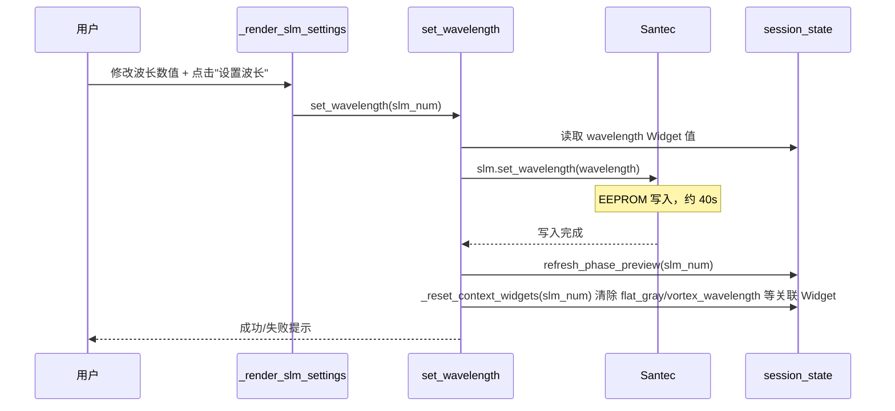
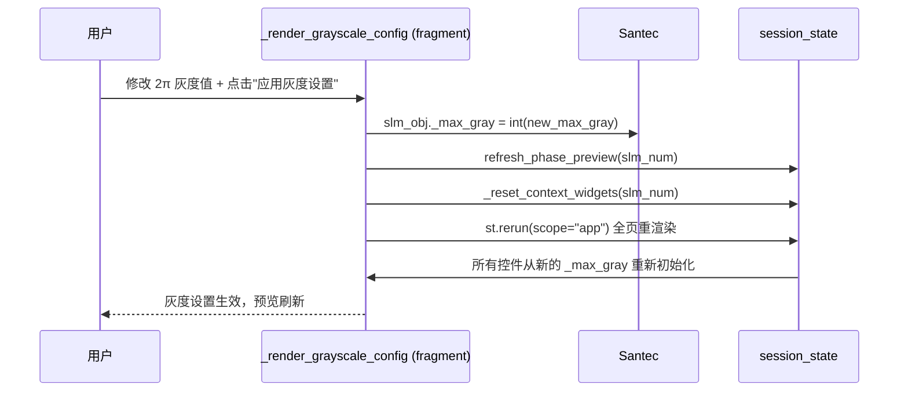
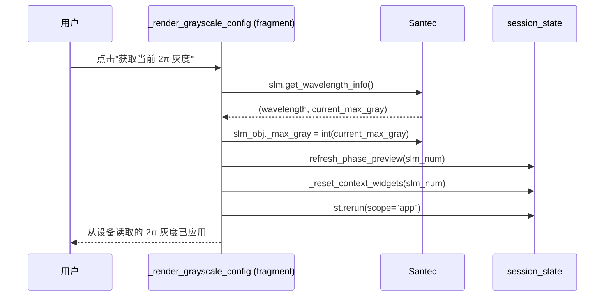
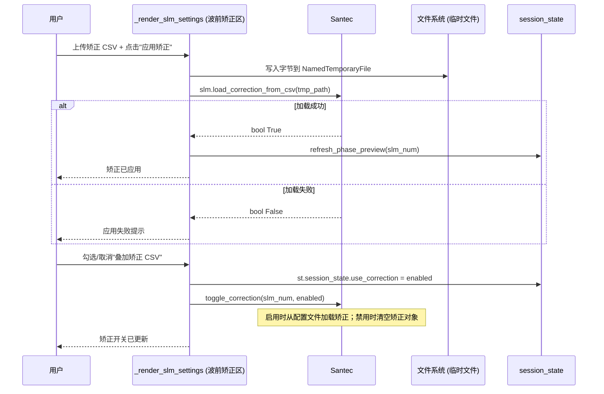
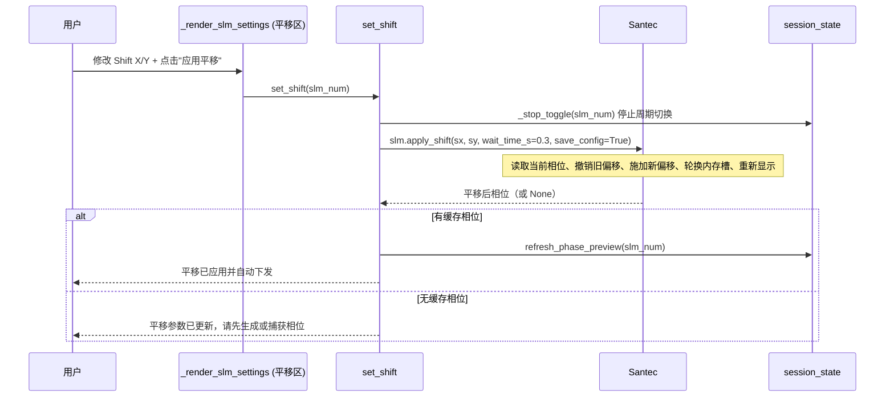
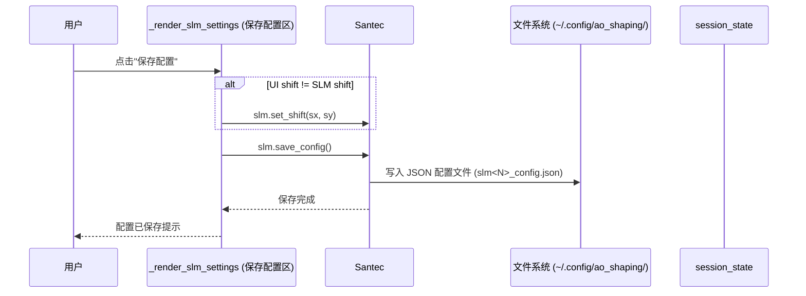

# Multi-SLM 控制器 (multi_slm_controller.py) — 用户手册

## 1. 概述

`multi_slm_controller.py` 是 Santec SLM-200 空间光调制器的 Streamlit 前端页面。支持最多两台 SLM，每台可独立连接、配置和相位编程，并内置闭环远场光束整形（GS+SPGD 与正向模型闭环）。

启动方式：

```bash
streamlit run src/ao_shaping/gui/slm/multi_slm_controller.py
```

完整技术细节（类图、时序图、Session State Schema、图案注册表、设计规则）见 [`docs/GUI/slm/multi_slm_controller/multi_slm_controller_srs.md`](./multi_slm_controller_srs.md)。

---

## 2. 快速上手

### 2.1 连接 SLM

1. 在侧边栏点击“刷新设备列表”，扫描 SLM 编号 1..8。
2. 对空闲设备点击“连接”，系统自动读取序列号、面板分辨率、像素间距、波长。
3. 连接成功后，SLM 对象存入 `session_state`，可进行相位下发。

### 2.2 生成并下发相位

1. 在相位控制面板选择图案类型（平场、线性光栅、透镜、Zernike 等）。
2. 调整参数后点击“从模式生成器生成相位”。
3. 系统通过 `PatternHelper` 生成弧度相位，经 `Santec.create_phase_from_array()` 转为 uint16 灰度（含矫正、LUT、平移），下发到 SLM 内存槽并显示。

### 2.3 从 CSV 加载相位

CSV 格式要求：1200×1920，值 0~1023，首行/首列为 Y/X 索引。

管线：`load_gray_from_csv`（驱动层格式校验）→ `csv_to_phase`（灰度→弧度）→ `display_phase`（`create_phase_from_array()` 弧度→灰度+矫正+LUT+平移）。

> ⚠️ 注意：导出的弧度 CSV（`Santec.save_phase_to_csv()`）数据区为弧度值，**不可**再交给 `load_gray_from_csv()` 或 `csv_to_phase()`；重新使用时应按弧度读取并传入 `create_phase_from_array()`。

### 2.4 周期切换（A/B 相位）

1. 先将两个相位分别设为“相位 A”与“相位 B”。
2. 设置切换频率（Hz），点击“开始周期切换”。
3. 后台线程按 `int(elapsed * 2.0 * freq) % 2 == 0` 精确频率切换，每次选取不同于当前显示槽的内存槽位（2..125），确保 LCOS 面板刷新。
4. 点击“停止周期切换”释放线程。

---

## 3. 闭环远场整形

`render_closed_loop_shaping()` 在「闭环整形」区渲染，取代已移除的开环方形整形。两种方法均在 GUI 内调用 canonical 优化器管线（与 CLI 同一代码路径），并在结束后把最佳相位（raw 弧度）经常规 `display_phase` 路径下发显示。

| 方法 | 代码路径（与 CLI 等价） | 说明 |
|------|-------------------------|------|
| **GS+SPGD 闭环整形（已验证配方）** | `SlmGsRefineParams` → `build_gs_refine_config` → `optimize_slm_gs_refine` → `save_gs_refine_results`（同 CLI `slm-gs-refine`） | 默认值即交替重放验证过的配方 |
| **正向模型闭环整形（前沿）** | `SlmModelInLoopParams` → `build_model_in_loop_config` → `optimize_slm_model_in_loop`（同 CLI `slm-model-in-loop`） | 需要 torch |

### 3.1 GS+SPGD 闭环整形（已验证配方）

GS 开环预矫正（bake-off（对比择优），仅当实测优于平场才采用）+ 无感知 SPGD 细化。

GUI 默认值取自交替重放验证过的配方（[`report/shape_trials/gs_refine_live_20261012.md`](../../report/shape_trials/gs_refine_live_20261012.md)）：

- `cam_type=daheng`、曝光 `0.05 ms`（大恒曝光上限按会话：`AO_DAHENG_MAX_EXPOSURE_MS`，0 = 画面探测）
- `pupil_center=960,690`、`beam_radius_px=450`、`target_side=100`、`cam_size=250`
- `gs_iters=12`、`far_field_padding=3`、`phase_grid=12`、`epochs=12`、`seed=0`、`confirm_best` 开、`gs_method=plain`
- 验证结果：**flat 0.527 → plain GS 0.775 → SPGD best 0.780**（两次一致的交替重放）

### 3.2 正向模型闭环整形（前沿）

每轮用强随机探针重拟合正向模型的 Zernike 像差（Step A），再冻结该像差合成目标方斑相位（Step B），带 trust region 与逐轮验收。

需 `torch`。目前最佳均匀性 **CV 0.643 / EE 0.786**，但尚未成为被接受的均匀方形，见 [`report/shape_trials/model_in_loop_live_20261013.md`](../../report/shape_trials/model_in_loop_live_20261013.md)。

### 3.3 设备生命周期注意

上述优化器在**内部**自行打开/关闭 SLM 与相机（Santec SDK 句柄**不可重入**），因此 GUI 在整形运行期间会**暂时释放目标 SLM 句柄**、运行结束后重新获取（只释放目标 SLM，另一台 SLM 保持连接）。GUI 显示 flat/GS/best 各阶段得分、PIB、CV 与 GS bake-off 判定（adopted/rejected）；debug 开启时产物存于 `data/debug/slm_gs_refine/<ts>/`。

---

## 4. 关键设计规则

| 规则 | 说明 |
|------|------|
| 内存槽轮换 | 对同一槽位连续 `write_phase` + `display_memory` 会被固件判为 no-op，LCOS 面板不刷新。换槽在 2..125 中随机选取，不等于当前显示槽。 |
| DVI 模式已禁用 | `video_mode=1` 的 `open()` 可能挂起 120s/300s，且挂起后 memory 模式 `open()` 也挂起，需物理断电恢复。仅提供内存模式。 |
| 平场灰度 RAW 路径 | 始终通过 `np.full((h,w), gray, dtype=np.uint16)` 发送原始 uint16 灰度。切勿将平场相位走 `create_phase_from_array()`。 |
| 平移数学 | 唯一实现在驱动层的静态 `Santec.shift_phase`。重写缓存相位必须走驱动层 `apply_shift()`，绝不能对缓存相位再跑 `write_phase`（会二次叠加矫正）。 |
| 后台线程 | 绝不直接碰 `st.session_state`。`_toggle_phases_task` 使用可变列表作为快照，并用 `threading.Event` 传递停止信号。 |
| 时序 | 优先用 `time.time()` 墙钟差值而非计数器 —— `int(elapsed * 2.0 * freq) % 2 == 0` 按精确频率切换，无累积误差。 |
| 0 级光斑 | 绝不假设 0 级光斑位于相机画面中心 —— 用 `argmax` 定位。 |

---

## 5. 已移除功能

旧的开环方形整形功能（**GS方形整形** / **GS方形整形(高斯版)** / **稳像法整形**，含 `_gs_square_phase_radians` / `generate_gs_square_phase`）已移除。

原因：在本 2f-Fourier 实验系统上，用未标定实验系统参数做开环方形整形已被实测证明行不通 —— Zernike SPGD 与未标定 GS 从未产出过均匀方形，见 [`report/shape_trials/README.md`](../../report/shape_trials/README.md) 与 [`report/shape_trials/online_20261010.md`](../../report/shape_trials/online_20261010.md)。

取而代之的是上方第 3 节「闭环整形」区（GS+SPGD 闭环 / 正向模型闭环，均走已验证的闭环管线）。

---

## 7. 相位图案参数说明

本节详细说明每种相位图案类型的可调参数、取值范围、默认值及生成逻辑。所有参数均在「相位控制」面板中通过 Streamlit Widget 交互设置，点击「从模式生成器生成相位」后下发到 SLM。

> ⚠️ **重要**：所有非平场相位均以**弧度（raw radians，未 mod-2π 包裹）**生成，由 `Santec.create_phase_from_array()` 负责弧度→灰度+矫正+LUT+平移转换后下发。平场灰度走**原始 uint16 RAW 路径**，不经过弧度转换。

### 7.1 平场 (FlatControl)

| 参数 | 说明 | 范围 | 默认值 | 步长 |
|------|------|------|--------|------|
| 灰度 | 平面区域的原始 uint16 灰度值，直接下发到 SLM 面板，不经弧度转换 | 0 ~ max_gray | 0 | 1 |

**生成逻辑**：`np.full((h, w), flat_gray, dtype=np.uint16)`。Santec SLM 在 1064nm 处存在幅度耦合，平场必须走 RAW 路径，切勿通过 `create_phase_from_array()`（否则会被误解为弧度并导致值被损坏）。

---

### 7.2 线性光栅 (LinearGratingControl)

| 参数 | 说明 | 范围 | 默认值 | 步长 |
|------|------|------|--------|------|
| 周期 (像素) | 光栅空间周期，单位像素 | 1.0 ~ 1000.0 | 64.0 | 1.0 |
| 相位范围 (π) | 相位调制幅度，单位为 π；输入 N 表示 Nπ 弧度，发送时自动乘以 π | 0.05 ~ 2.0 | 2.0 | 0.1 |

**生成逻辑**：`PatternHelper.linear_grating(period, phase_range_rad)`，`phase_range_rad = phase_range × π`。

---

### 7.3 全息光栅 (HologramGratingControl)

| 参数 | 说明 | 范围 | 默认值 | 步长 |
|------|------|------|--------|------|
| 周期 (像素) | 全息光栅空间周期，单位像素 | 1.0 ~ 1000.0 | 64.0 | 1.0 |
| 相位范围 (π) | 相位调制幅度，单位为 π | 0.05 ~ 2.0 | 2.0 | 0.1 |

**生成逻辑**：`PatternHelper.hologram(period, phase_range_rad)`，`phase_range_rad = phase_range × π`。

---

### 7.4 闪耀光栅 (BlazedGratingControl)

| 参数 | 说明 | 范围 | 默认值 | 步长 |
|------|------|------|--------|------|
| 周期设置方式 | `direct` 直接设置周期 / `angle` 根据衍射角度和波长计算 | — | direct | — |
| 周期 (像素) | 直接模式下的空间周期，单位像素 | 1.0 ~ 10000.0 | 10.0 | 1.0 |
| 衍射角度 θ (度) | 角度模式下的衍射角，用于计算周期 `d = λ / sin(θ)` | 0.1 ~ 89.0 | 10.0 | 0.5 |
| 波长 λ (nm) | 角度模式计算所用波长，与 SLM 当前波长同步 | 400 ~ 1600 | 1064 | 1 |
| 像素间距 (μm) | 角度模式计算所用 SLM 像素间距 | 0.1 ~ 100.0 | 8.0 | 0.1 |
| 相位范围 (π) | 相位调制幅度，单位为 π | 0.05 ~ 2.0 | 2.0 | 0.1 |
| 光栅方向 | `vertical` 竖条纹 / `horizontal` 横条纹 | — | vertical | — |

**生成逻辑**：角度模式下先计算 `period = calc_blazed_grating_period(angle_deg, calc_wl, calc_pitch)`，然后 `PatternHelper.linear_grating(period, phase_range_rad, direction)`。

---

### 7.5 圆形光栅 (CircularGratingControl)

| 参数 | 说明 | 范围 | 默认值 | 步长 |
|------|------|------|--------|------|
| 圆形周期半径 (像素) | 圆形光栅的空间周期半径，单位像素 | 1.0 ~ 2000.0 | 64.0 | 10.0 |
| 相位范围 (π) | 相位调制幅度，单位为 π | 0.05 ~ 2.0 | 2.0 | 0.1 |

**生成逻辑**：`PatternHelper.circular_grating(radius, phase_range_rad)`，`phase_range_rad = phase_range × π`。

---

### 7.6 透镜 (LensControl)

| 参数 | 说明 | 范围 | 默认值 | 步长 |
|------|------|------|--------|------|
| 焦距 (mm) | 薄透镜相位的焦距，单位毫米 | 1.0 ~ 100000.0 | 300.0 | 10.0 |
| 像素间距 (um) | SLM 像素物理间距，用于相位斜率计算 | 0.1 ~ 100.0 | 从 SLM 读取 | 0.1 |
| 透镜半径 (像素) | 透镜光圈半径，超出此半径相位置零 | 1 ~ 2000 | `min(width, height) // 2` | 1 |

**生成逻辑**：`PatternHelper.lens(focal_length_m, wavelength_m, pixel_size_m, lens_radius_px)`，焦距由 mm→m，波长由 nm→m，像素间距由 um→m。

---

### 7.7 棋盘格 (CheckerboardControl)

| 参数 | 说明 | 范围 | 默认值 | 步长 |
|------|------|------|--------|------|
| 棋盘格周期 (像素) | 棋盘格每个黑白方块的边长，单位像素 | 1 ~ 1000 | 50 | 1 |

**生成逻辑**：`PatternHelper.generate_checkerboard(period)`，输出二元 0/π 相位。

---

### 7.8 二元光栅 (BinaryGratingControl)

| 参数 | 说明 | 范围 | 默认值 | 步长 |
|------|------|------|--------|------|
| 亮条纹宽度 a (像素) | 相位为 0 的条纹宽度，单位像素 | 1 ~ 1000 | 2 | 1 |
| 暗条纹宽度 b (像素) | 相位为 π 的条纹宽度，单位像素 | 1 ~ 1000 | 3 | 1 |
| 方向 | `horizontal` 水平条纹 / `vertical` 垂直条纹 | — | horizontal | — |

**生成逻辑**：`PatternHelper.generate_binary_grating(a, b, direction)`，输出二元 0/π 相位。

---

### 7.9 微透镜阵列 (MicrolensArrayControl)

| 参数 | 说明 | 范围 | 默认值 | 步长 |
|------|------|------|--------|------|
| 微透镜尺寸 (像素) | 每个微透镜单元的边长，单位像素 | 8 ~ 1000 | 16 | 1 |
| 焦距 (mm) | 单个微透镜的焦距，单位毫米 | 1.0 ~ 100000.0 | 300.0 | 1.0 |
| 像素间距 (um) | SLM 像素物理间距 | 0.1 ~ 100.0 | 从 SLM 读取 | 0.1 |

**生成逻辑**：`PatternHelper.generate_microlens_array(lens_size, focal_length_m, wavelength_m, pixel_size_m)`。

---

### 7.10 湍流相位屏 (TurbulenceScreenControl)

| 参数 | 说明 | 范围 | 默认值 | 格式 |
|------|------|------|--------|------|
| Cn² | 大气折射率结构常数，单位 m^(-2/3) | 1e-18 ~ 1e-10 | 1e-15 | `%.1e` |
| 传播距离 L (m) | 传播路径长度，单位米 | 0.1 ~ 1e6 | 1000.0 | 10.0 |
| 像素间距 (um) | SLM 像素物理间距 | 0.1 ~ 100.0 | 从 SLM 读取 | 0.1 |

**生成逻辑**：基于 Kolmogorov 谱生成相位屏。Fried 参数 `r0 = (0.423 × k² × Cn² × L)^(-3/5)`，其中 `k = 2π/λ`，外尺度 `L0 = 10 m`。每帧独立生成，随机种子由 helper 内部管理。

---

### 7.11 涡旋相位 (VortexPhaseControl)

| 参数 | 说明 | 范围 | 默认值 | 步长 |
|------|------|------|--------|------|
| 拓扑荷 | 涡旋相位的拓扑荷数 `l`，相位 `φ = l·θ` | -10 ~ 10 | 1 | 1 |
| 波长 (nm) | 相位生成所用波长，与 SLM 当前波长同步 | 400 ~ 1600 | 1064 | 1 |
| 像素间距 (um) | SLM 像素物理间距 | 1.0 ~ 100.0 | 8 | 1.0 |

**生成逻辑**：`PatternHelper.generate_vortex(topological_charge, wavelength_m, pixel_size_m)`。输出原始弧度（无 mod-2π 包裹），驱动负责 wrapping + 矫正 + LUT。

---

### 7.12 Zernike (ZernikeControl)

| 参数 | 说明 | 范围 | 默认值 | 步长 |
|------|------|------|--------|------|
| 最大径向阶数 N | Zernike 多项式的最大径向阶数，决定模式数量 | 1 ~ 10 | 5 | 1 |
| 系数表 | 每个 Zernike 模式 (n, m) 的弧度系数，支持系数表编辑器或逐项输入 | -100 ~ 100 rad | 各模式 0.0 | 0.001 |
| 孔径半径 (像素) | Zernike 相位的孔径半径，超出半径置零 | 1 ~ 2000 | `min(width, height) // 2` | 1 |

**生成逻辑**：`PatternHelper.generate_zernike_polynomial(coefficients, radius, n_max)`，输出原始弧度相位（不 mod-2π，不归一化），驱动负责弧度→灰度转换并保留系数绝对幅度。

> **编辑器回退**：若环境未安装 pyarrow，`st.data_editor` 系数表将回退为逐项 `st.number_input` 控件，每个模式单独输入系数。

---

### 7.13 达曼光栅 (DammannGratingControl)

| 参数 | 说明 | 范围 | 默认值 | 步长 |
|------|------|------|--------|------|
| 衍射级数 | 达曼光栅的衍射级数，决定光斑阵列规律 | 2 ~ 8 | 3 | 1 |
| 填充因子 | 达曼掩模的填充比例 | 0.1 ~ 1.0 | 0.5 | 0.1 |

**生成逻辑**：`PatternHelper.generate_dammann_grating(order, fill_factor)`，输出二元 0/π 相位。

---

### 7.14 半半相位 (HalfHalfPhaseControl)

| 参数 | 说明 | 范围 | 默认值 | 步长 |
|------|------|------|--------|------|
| 划分方向 | `左右` 左半平面平场+右半闪耀光栅 / `上下` 上半平面+下半闪耀光栅 | — | 左右 | — |
| 平面灰度 | 平场半区的原始 uint16 灰度，走 RAW 路径 | 0 ~ max_gray | `max_gray // 2` | 1 |
| 光栅周期 (像素) | 闪耀光栅半区的空间周期 | 1.0 ~ 1000.0 | 4.0 | 1.0 |
| 相位范围 (π) | 闪耀光栅半区的相位调制幅度，单位为 π | 0.05 ~ 2.0 | 2.0 | 0.1 |
| 闪耀光栅方向 | `horizontal` 横条纹 / `vertical` 竖条纹（仅上下划分时可选） | — | vertical | — |

**生成逻辑**：平场半区走 `np.full(..., flat_gray, dtype=np.uint16)` RAW 路径；闪耀光栅半区经 `PatternHelper.linear_grating()` 生成弧度后通过 `slm.create_phase_from_array()` 转灰度。左右划分时闪耀光栅固定为竖条纹方向。

---

## 8. SLM 设置详细说明

本节详细说明 SLM 设置面板中的每个设置项、取值范围、默认值、生效机制及注意事项。所有设置项位于侧边栏「SLM N 设置」展开区中，分为三个折叠区：**设备/波长/模式/平移**、**灰度设置**、**波前矫正**。

> ⚠️ **重要**：所有 SLM 设置更改后，建议点击对应的「应用/设置」按钮使更改生效。波长、灰度、矫正等更改会自动触发 `refresh_phase_preview()` 刷新相位预览，并清除上下文关联 Widget（如平场灰度、涡旋波长），使其在下一次重渲染时从新的设备上下文重新初始化。

### 8.1 设备信息（只读）

在连接 SLM 后，设备信息区显示以下只读字段，无法通过 GUI 修改：

| 字段 | 说明 | 来源 |
|------|------|------|
| 分辨率 | SLM 面板分辨率（宽 × 高，像素） | `Panel_Res` |
| 像素间距 | SLM 像素物理间距，单位 μm | `Pitch_um` |
| Bit 数 | 灰度位深 | `Gray_Scale_bits` |
| SLM 序列号 | 设备出厂序列号 | `_serial_number` |
| SLM 编号 | GUI 中的逻辑编号（1 或 2） | `slm_number` |

---

### 8.2 波长设置

| 项 | 说明 |
|------|------|
| 参数名 | 波长 (nm) |
| 取值范围 | 450 ~ 1600 nm |
| 步长 | 1 nm |
| 默认值 | 连接时从设备读取，或 1064 nm |
| 生效机制 | 点击「设置波长」按钮，调用 `slm.set_wavelength(wavelength)` 写入设备 EEPROM（约需 40s） |
| 副作用 | 写入后自动触发 `refresh_phase_preview()` 刷新相位预览，并调用 `_reset_context_widgets()` 清除上下文关联 Widget（如 `flat_gray`、`vortex_wavelength`），使其在下一次重渲染时从新的波长和 2π 最大灰度重新初始化 |
| 警告 | 若 Widget 设定值与设备实际值不一致，侧边栏会显示警告并提供「同步」按钮，将 Widget 值重设为设备值 |

**设置流程**：
1. 在「波长 (nm)」输入框修改数值
2. 点击「设置波长」按钮
3. 等待 EEPROM 写入完成（约 40s），期间界面可能短暂阻塞
4. 系统自动刷新预览并重新初始化关联 Widget

---

### 8.3 显示模式设置

| 项 | 说明 |
|------|------|
| 参数名 | 视频模式 |
| 可用选项 | `内存模式`（仅此一项，DVI 模式已禁用） |
| 默认值 | 内存模式 |
| 生效机制 | 点击「设置模式」按钮，调用 `slm._set_memory_mode(0)` |
| 禁用原因 | DVI 模式（`video_mode=1`）的 `open()` 已知会挂起 120s/300s，且挂起后内存模式的 `open()` 也会挂起，仅靠物理断电恢复。因此 GUI 中仅提供内存模式，不提供 DVI 选项 |

---

### 8.4 灰度设置

| 项 | 说明 |
|------|------|
| 参数名 | 2π 灰度值 |
| 取值范围 | 1 ~ 1023（`Santec.MAX_GRAYSCALE_VALUE`） |
| 默认值 | 设备当前 `_max_gray`，或 1023 |
| 生效机制 | 点击「应用灰度设置」按钮，更新 `slm_obj._max_gray`，触发 `refresh_phase_preview()` 和 `_reset_context_widgets()`，并执行 `st.rerun(scope="app")` 重新渲染全页 |
| 副作用 | 全页重渲染会重新初始化所有控制组件，使平场灰度滑块等组件从新的 `_max_gray` 重新计算范围 |
| 「获取当前 2π 灰度」 | 调用 `slm.get_wavelength_info()` 从设备读取实际的 2π 最大灰度值，覆盖 `slm_obj._max_gray`，随后刷新预览并重置关联 Widget |

**设置流程**：
1. 在「2π 灰度值」输入框修改数值（1 ~ 1023）
2. 点击「应用灰度设置」按钮
3. 或点击「获取当前 2π 灰度」按钮从设备读取实际值
4. 全页重渲染后，所有相位图案控件的灰度范围会自动更新

---

### 8.5 波前矫正

| 项 | 说明 |
|------|------|
| 参数名 | 叠加矫正 CSV（复选框） |
| 默认值 | `True`（启用） |
| 生效机制 | 勾选/取消勾选时调用 `toggle_correction(slm_num, enabled)`；启用时从配置文件重新加载矫正数据，禁用时清空矫正对象 |
| 矫正文件状态 | 若已加载，显示「当前矫正文件: <文件名>」；否则显示「未加载矫正文件」 |
| 矫正加载 | 上传 CSV 文件后点击「应用矫正」，调用 `slm.load_correction_from_csv(tmp_path)`；成功后刷新相位预览 |
| 矫正作用 | 启用时，写入相位会自动叠加波前误差矫正数据（在驱动层 `create_phase_from_array()` 中应用） |

**设置流程**：
1. 勾选「叠加矫正 CSV」复选框启用/禁用矫正
2. 上传矫正 CSV 文件（`.csv` 格式）
3. 点击「应用矫正」按钮
4. 成功后显示「矫正已应用: <文件名>」并刷新相位预览

---

### 8.6 平移设置

| 项 | 说明 |
|------|------|
| 参数名 | Shift X / Shift Y（像素） |
| 取值范围 | -500 ~ 500 像素 |
| 步长 | 1 像素 |
| 默认值 | 0 |
| 生效机制 | 点击「应用平移」按钮，调用 `slm.apply_shift(shift_x, shift_y, wait_time_s=0.3, save_config=True)` |
| 副作用 | 驱动层负责读取当前相位、撤销旧偏移、施加新偏移、轮换内存槽、重新显示；成功后刷新相位预览 |
| 注意 | 如当前没有缓存的相位可自动下发，会提示「请先生成或捕获一个相位图案」 |

**设置流程**：
1. 在「Shift X」和「Shift Y」输入框修改数值（-500 ~ 500）
2. 点击「应用平移」按钮
3. 等待驱动层完成偏移重下发，刷新相位预览

---

### 8.7 配置加载与保存

| 项 | 说明 |
|------|------|
| 配置文件路径 | `~/.config/ao_shaping/slm<N>_config.json`（按 SLM 编号分文件） |
| 加载时机 | 连接 SLM 时自动调用 `slm.load_config()`；设备序列号不匹配时显示「未找到匹配的配置文件（使用设备默认值）」 |
| 手动刷新 | 点击「刷新配置」按钮，重新调用 `slm.load_config()` 并更新 `session_state[f"slm{N}_loaded_config"]` |
| 保存配置 | 点击「保存配置」按钮，若 UI 中的平移值与 SLM 当前值不同，先调用 `slm.set_shift()`，再调用 `slm.save_config()` 写入 JSON |
| 配置内容 | 包含波长、灰度、平移、矫正开关等设备级参数 |

---

## 9. 设置时序设计

本节为每个 SLM 设置操作提供 Mermaid 时序图，说明用户操作、UI 控制器、SLM 驱动、设备 SDK 之间的交互顺序与关键节点。

### 9.1 波长设置时序



### 9.2 灰度设置时序





### 9.3 波前矫正时序



### 9.4 平移设置时序



### 9.5 配置保存时序



---

## 10. 配置相关说明

### 10.1 配置文件布局

| 配置项 | 路径 | 说明 |
|--------|------|------|
| SLM 配置文件 | `~/.config/ao_shaping/slm<N>_config.json` | 按 SLM 编号（1 或 2）分文件，存储波长、灰度、平移、矫正开关等设备级参数 |
| 相位导出文件 | `~/.config/ao_shaping/slm<N>_phase.csv` | 导出当前显示相位为弧度 CSV，包含 Y/X 行列索引 |
| 矫正 CSV 文件 | 用户上传的临时文件 | 上传后写入系统临时目录，加载后即可删除 |

### 10.2 配置加载机制

1. **连接时自动加载**：`connect_slm()` 成功后调用 `slm.load_config()`，读取与设备序列号匹配的配置文件，将波长、灰度、平移等参数写入 `session_state[f"slm{N}_loaded_config"]`。
2. **序列号不匹配**：若设备序列号与配置文件中的序列号不一致，显示「未找到匹配的配置文件（使用设备默认值）」，使用设备出厂默认值。
3. **手动刷新**：点击「刷新配置」按钮，重新调用 `slm.load_config()` 并更新 session state，无需重新连接设备。

### 10.3 配置同步机制（上下文关联 Widget）

当以下设备上下文发生变更时，GUI 会清除关联 Widget 的 session state 值，使其在下一次重渲染时从新上下文重新初始化：

| 变更事件 | 清除的 Widget 关键字 | 受影响的控件 |
|----------|---------------------|------------|
| 波长设置 | `slm{N}_flat_gray`、`slm{N}_vortex_wavelength` | 平场灰度范围、涡旋波长 |
| 灰度设置（_max_gray 变更） | `slm{N}_flat_gray`、`slm{N}_halfhalf_flat_gray` | 平场灰度、半半相位平面灰度 |

**实现机制**：`_reset_context_widgets(slm_num)` 遍历 `PATTERN_REGISTRY` 中所有控制类的 `CONTEXT_SYNCED_WIDGETS`，从 `session_state` 中删除对应键。删除后，下一次 `_build_control()` 重新构建控件时会使用新的默认值。

### 10.3 配置与下发的一致性规则

| 规则 | 说明 |
|------|------|
| 灰度值与 2π 对应 | `_max_gray` 决定了 2π 弧度对应的灰度值（如 1064nm 下约 993），用于弧度→灰度转换 |
| 平移配置持久化 | `apply_shift(..., save_config=True)` 会将平移值保存到配置文件，重连后恢复 |
| 矫正配置持久化 | 矫正 CSV 加载后，驱动层持有矫正对象；`toggle_correction` 控制是否在写入时叠加矫正 |
| 配置不跨设备共享 | 每台 SLM 独立配置文件，slm1 和 slm2 的设置互不干扰 |

---

## 11. 相关文档

- 需求规格说明书: [`docs/GUI/slm/multi_slm_controller/multi_slm_controller_srs.md`](./multi_slm_controller_srs.md)
- SLM GUI 操作时长分类与路线图: [`docs/slm/slm_gui_operation_map.md`](../slm/slm_gui_operation_map.md)
- GUI 索引: [`docs/gui.md`](../../../gui.md)
- 闭环整形实测报告: [`report/shape_trials/gs_refine_live_20261012.md`](../../report/shape_trials/gs_refine_live_20261012.md)
- 正向模型闭环实测报告: [`report/shape_trials/model_in_loop_live_20261013.md`](../../report/shape_trials/model_in_loop_live_20261013.md)
