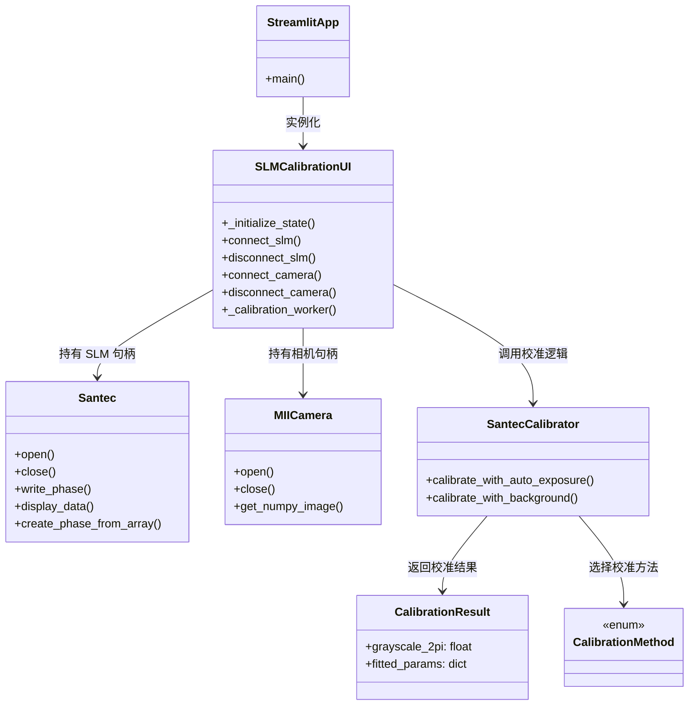
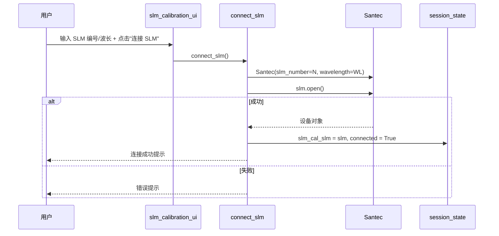
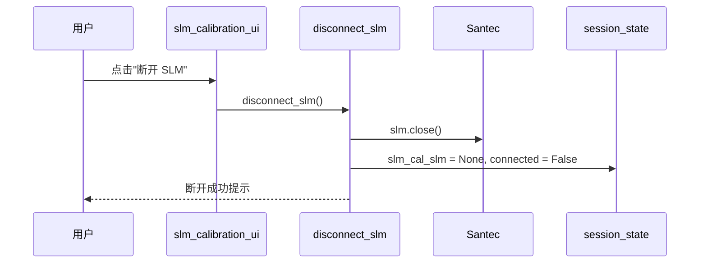
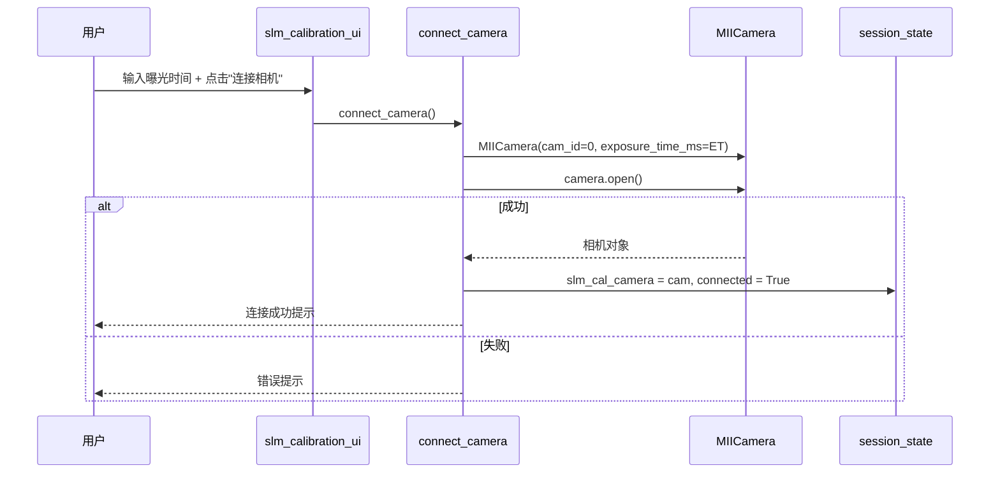
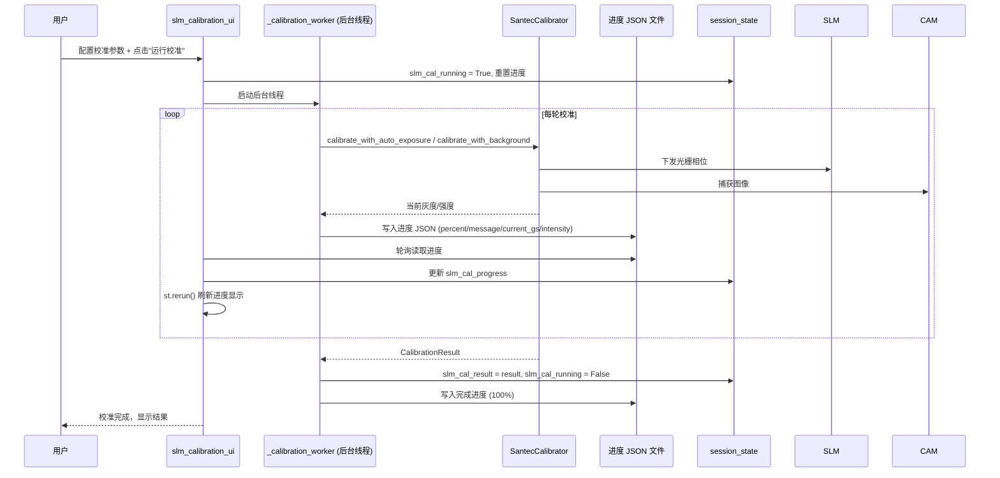
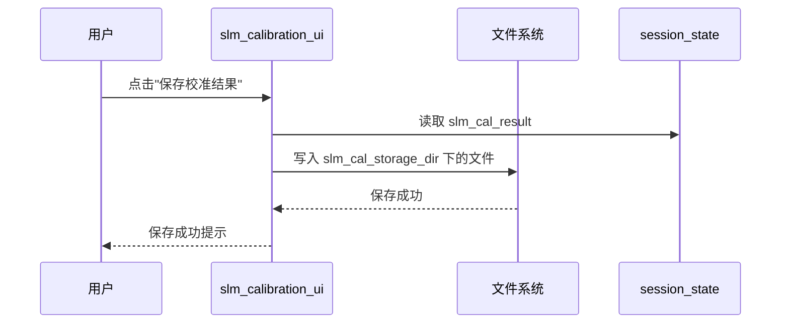

# SLM LUT 校准 UI (slm_calibration_ui.py) — 软件需求规格说明书 (SRS)

## 1. 概述

### 1.1 文档目的

本文件定义 `src/ao_shaping/gui/slm/slm_calibration_ui.py` 的功能需求、非功能需求、接口规范与关键设计约束。本模块是 SLM 查找表 (LUT) 校准的 Streamlit 前端页面，支持连接 SLM 与相机、配置校准参数、运行闪耀光栅校准以寻找 2π 相位对应的灰度值、实时可视化校准曲线、保存/加载校准结果。

### 1.2 启动方式

```bash
streamlit run src/ao_shaping/gui/slm/slm_calibration_ui.py
```

### 1.3 依赖模块

| 模块 | 职责 |
|------|------|
| `ao_shaping.drivers.slm.santec.Santec` | SLM 驱动，open/close/write_phase/display_data/create_phase_from_array |
| `ao_shaping.drivers.ccd.MIICamera` | 相机驱动，open/close/get_numpy_image |
| `ao_shaping.tools.slm.calibration.SantecCalibrator` | 校准核心逻辑，calibrate_with_auto_exposure / calibrate_with_background |
| `ao_shaping.tools.slm.calibration.CalibrationMethod` | 校准方法枚举 |
| `ao_shaping.tools.slm.calibration.CalibrationResult` | 校准结果数据类 |
| `ao_shaping.utils.io.file.ROOT_DIR` | 项目根目录，用于默认存储路径 |

### 1.4 用户画像

- 光学实验操作员：连接 SLM 与相机，配置并运行 2π 灰度值校准，获取 SLM 的 LUT 曲线

---

## 2. 功能需求

### 2.1 设备发现与连接

| ID | 需求 | 优先级 |
|----|------|--------|
| FR-1.1 | 支持连接 SLM（指定编号、波长）与相机（指定曝光时间） | 必须 |
| FR-1.2 | 支持断开 SLM 与相机，释放设备句柄 | 必须 |
| FR-1.3 | 连接失败时显示错误提示，不中断页面 | 必须 |

### 2.2 校准参数配置

| ID | 需求 | 优先级 |
|----|------|--------|
| FR-2.1 | 支持选择校准方法（闪耀光栅 BLAZED_GRATING） | 必须 |
| FR-2.2 | 支持设置光栅周期（像素） | 必须 |
| FR-2.3 | 支持设置灰度范围（最小/最大） | 必须 |
| FR-2.4 | 支持设置灰度步长 | 必须 |
| FR-2.5 | 支持设置细搜索步长与范围 | 可选 |
| FR-2.6 | 支持设置采样次数 | 可选 |
| FR-2.7 | 支持设置目标强度范围（最小/最大） | 可选 |
| FR-2.8 | 支持设置 ROI 中心与尺寸 | 可选 |
| FR-2.9 | 支持设置自动曝光开关 | 可选 |
| FR-2.10 | 支持设置背景测量开关 | 可选 |

### 2.3 校准执行与监控

| ID | 需求 | 优先级 |
|----|------|--------|
| FR-3.1 | 支持启动校准（后台线程运行，UI 不阻塞） | 必须 |
| FR-3.2 | 支持实时显示校准进度（百分比、当前灰度、强度） | 必须 |
| FR-3.3 | 支持停止校准 | 必须 |
| FR-3.4 | 校准完成后显示校准结果（2π 灰度值、拟合参数等） | 必须 |
| FR-3.5 | 校准失败时显示错误信息 | 必须 |

### 2.4 校准结果保存与加载

| ID | 需求 | 优先级 |
|----|------|--------|
| FR-4.1 | 支持保存校准结果到指定目录 | 必须 |
| FR-4.2 | 支持从指定目录加载历史校准结果 | 可选 |
| FR-4.3 | 默认存储目录为 `data/slm_calibration` | 必须 |

---

## 3. 非功能需求

| ID | 需求 | 说明 |
|----|------|------|
| NF-1 | 会话状态隔离 | 每个设备以 `slm_cal_*` 为前缀的 session state 命名空间，互不干扰 |
| NF-2 | 线程安全 | 校准运行在后台线程，通过 JSON 文件与 UI 通信进度，不直接操作 `st.session_state` |
| NF-3 | 错误隔离 | 设备连接/校准失败不导致页面崩溃，错误通过 `st.error` 显示 |
| NF-4 | 配置持久化 | 校准参数与结果通过 session state 在 rerun 间保持 |

---

## 4. 接口规范

### 4.1 Session State Schema

| 键 | 类型 | 含义 |
|----|------|------|
| `slm_cal_slm` | Santec | SLM 对象（断开时为 None） |
| `slm_cal_slm_connected` | bool | SLM 连接标志 |
| `slm_cal_camera` | MIICamera | 相机对象 |
| `slm_cal_camera_connected` | bool | 相机连接标志 |
| `slm_cal_method` | str | 校准方法 |
| `slm_cal_grating_period` | int | 光栅周期（像素） |
| `slm_cal_grayscale_min/max` | int | 灰度范围 |
| `slm_cal_step` | int | 灰度步长 |
| `slm_cal_fine_step` | int | 细搜索步长 |
| `slm_cal_fine_range` | int | 细搜索范围 |
| `slm_cal_n_samples` | int | 采样次数 |
| `slm_cal_auto_exposure` | bool | 自动曝光开关 |
| `slm_cal_target_min/max` | int | 目标强度范围 |
| `slm_cal_roi_center` | tuple | ROI 中心 |
| `slm_cal_roi_size` | int | ROI 尺寸 |
| `slm_cal_storage_dir` | str | 结果存储目录 |
| `slm_cal_result` | CalibrationResult | 校准结果 |
| `slm_cal_running` | bool | 校准运行中标志 |
| `slm_cal_progress` | dict | 校准进度（percent/message/current_gs/intensity） |
| `slm_cal_slm_number` | int | SLM 编号 |
| `slm_cal_wavelength` | int | 波长（nm） |
| `slm_cal_exposure_time` | int | 曝光时间（ms） |

### 4.2 主要公共函数

| 函数 | 签名 | 说明 |
|------|------|------|
| `main()` | 无 | Streamlit 页面入口 |
| `connect_slm()` | bool → | 连接 SLM 设备 |
| `disconnect_slm()` | 无 | 断开 SLM 设备 |
| `connect_camera()` | bool → | 连接相机设备 |
| `disconnect_camera()` | 无 | 断开相机设备 |
| `_calibration_worker(...)` | 无 | 后台校准线程，通过 JSON 文件汇报进度 |
| `_initialize_state()` | 无 | 初始化所有 session_state 变量 |

---

## 5. 系统类图



---

## 6. 功能按钮时序图

### 6.1 连接 SLM



### 6.2 断开 SLM



### 6.3 连接相机



### 6.4 运行校准



### 6.5 保存校准结果



---

## 7. 开发规范（防止用例冲突）

| 规则 ID | 规则说明 | 执行机制 |
|---------|----------|----------|
| DV-1 | 同一设备同一时刻只能有一个连接 | 连接前先断开现有连接（close()） |
| TH-1 | 校准后台线程不直接操作 `st.session_state` | 通过 JSON 文件与 UI 通信进度，UI 轮询读取 |
| TH-2 | 校准运行期间禁止重复启动 | `slm_cal_running` 标志位阻止重复提交 |
| ER-1 | 设备连接/校准失败不导致页面崩溃 | try/except 捕获异常，通过 `st.error` 显示 |
| ER-2 | 断开设备时始终执行 close() | finally 块确保句柄释放 |

---

## 8. 相关文档

- 用户手册: [`slm_calibration_ui_user_manual.md`](./slm_calibration_ui_user_manual.md)
- 校准算法参考: [`ao_shaping/tools/slm/calibration/`](../../../../../tools/slm/calibration/)
- GUI 索引: [`docs/gui.md`](../../../gui.md)
