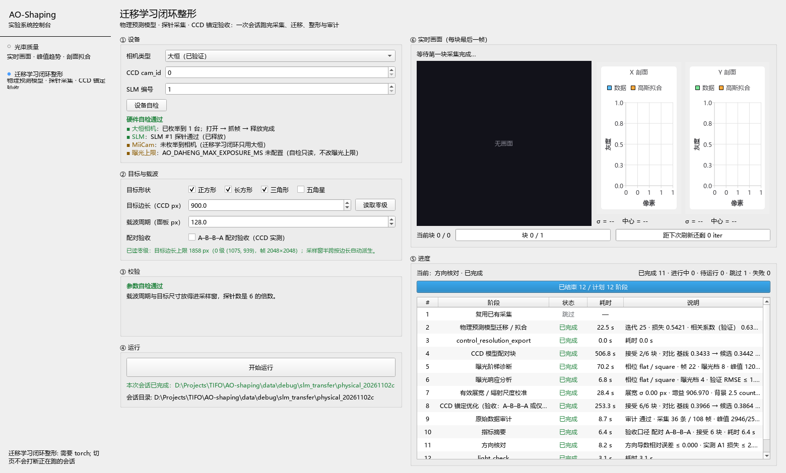
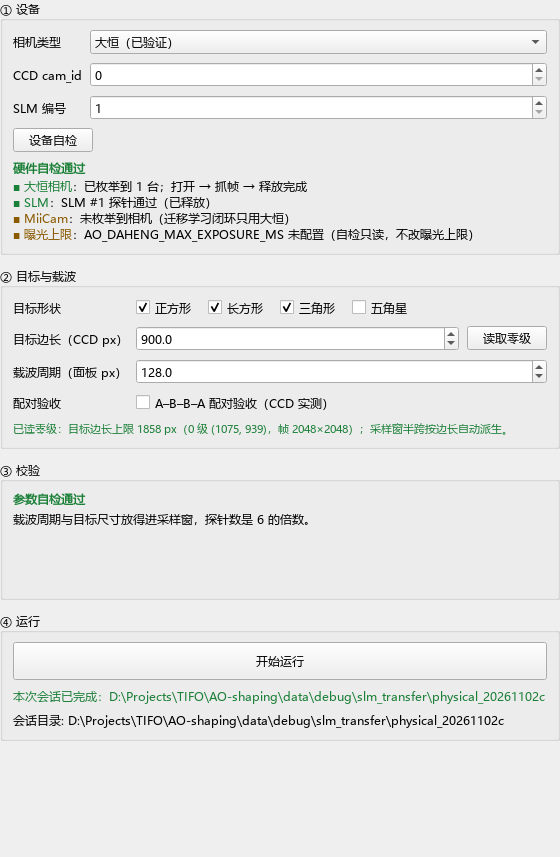
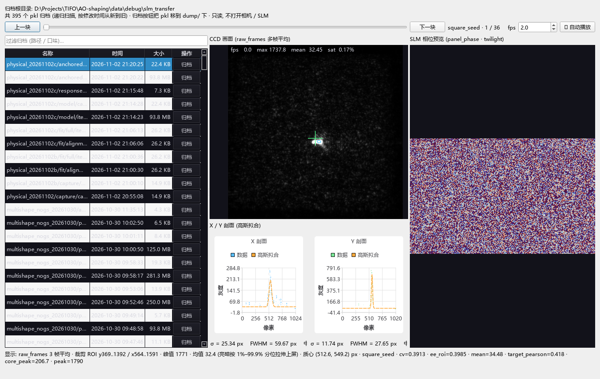
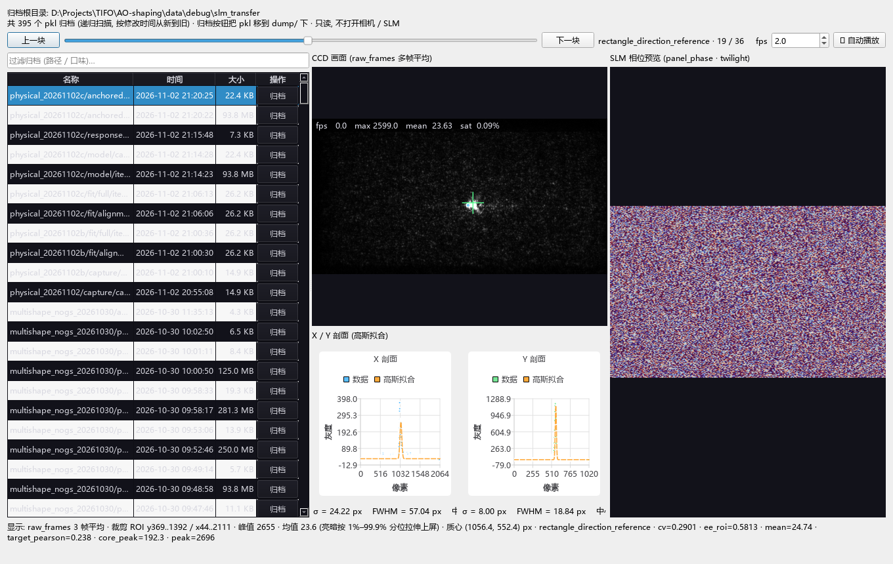
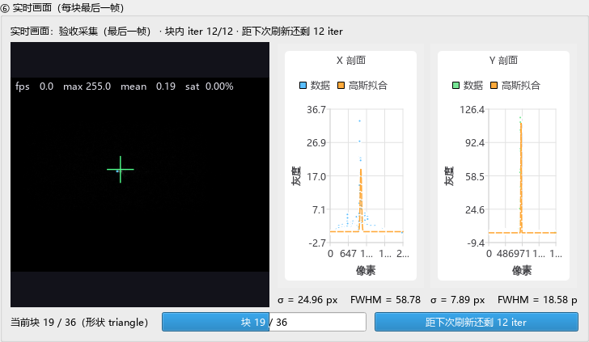
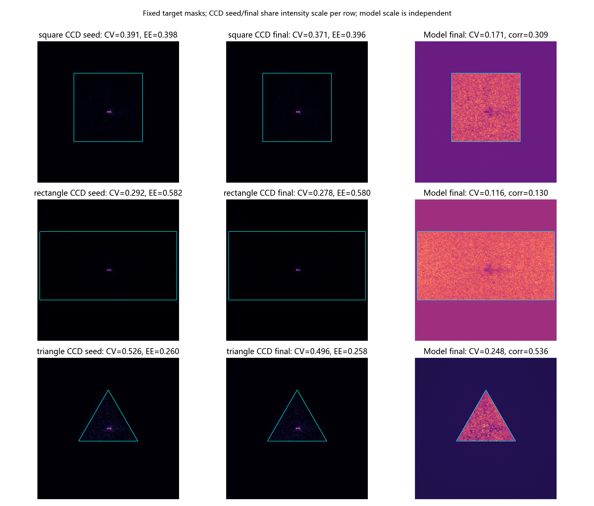
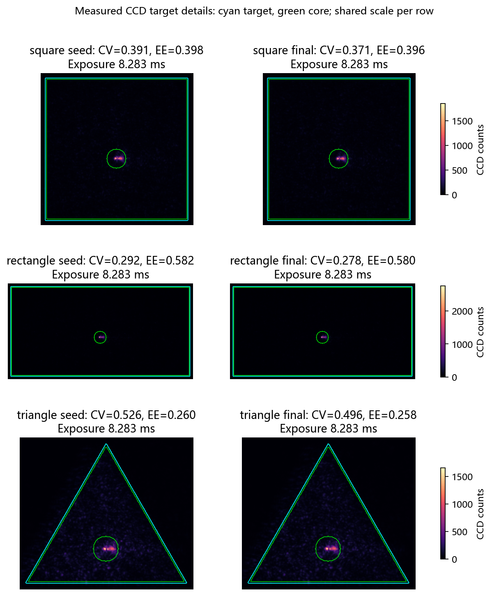

# 迁移学习闭环整形 — 桌面版用户手册

本手册说明 PySide6 桌面控制台中「迁移学习闭环整形」页（`src/ao_shaping/gui/slm/transfer_desktop/`）的操作流程。页面入口与启动方式见 [beam_quality/README.md](../../../../src/ao_shaping/gui/ccd/beam_quality/README.md)。

## 1. 启动

```bash
.venv\Scripts\python.exe -m ao_shaping.gui.ccd.beam_quality
```

左侧导航栏选择第 1 页「迁移学习闭环整形」。该页在第一次切换时才创建，避免启动时加载 `torch`。



*图 1　桌面控制台。左侧窄导航栏切换两页；右侧为「迁移学习闭环整形」页的主区域。*

## 2. 页面布局

页面分两列：

- **左列（表单）**：按 ① 设备 → ② 目标与载波 → ③ 校验 → ④ 运行 自上而下排列。
- **右列（进度）**：⑤ 进度表，逐阶段显示状态、耗时与产物。



*图 2　左列表单。① 设备选择相机与 SLM，并含「设备自检」按钮；② 目标与载波设置形状、边长、载波周期，含「读取零级」与「配对验收」复选框；③ 校验区显示阻塞错误与提醒；④ 运行区含「开始运行」按钮与会话目录。*

## 3. 操作步骤

### 3.1 ① 设备

| 控件 | 含义 | 默认 |
|------|------|------|
| 相机类型 | 迁移学习只支持 `daheng`；选其它类型会被校验阻塞 | daheng |
| cam_id | CCD 序号 | 0 |
| SLM 编号 | SLM 序号 | 1 |

### 3.2 ② 目标与载波

1. 勾选目标形状（正方形 / 长方形 / 三角形 / 五角星，可多选）。
2. 设置目标边长（CCD px）与载波周期（面板 px）。
3. 点击「读取零级」：开一次相机，找到 0 级光斑，由 0 级到最近帧边的距离算出目标边长上限，并把边长控件的上限放宽到实测值。该操作**只读**，结束后相机关闭。未读取时上限为保守值，页面会在说明行写明这一点。
4. 勾选或取消「配对验收」（A–B–B–A，默认关闭）：
   - **关**：保留 CCD 锚定反馈，候选只按模型损失接受，会话摘要写 `acceptance=model_only`（等价于命令行 `--no-abba`）。
   - **开**：每个块测量 A1 / B1 / B2 / A2，由实测指标决定候选是否接受。

### 3.3 ③ 校验

改动任何参数都会即时校验：

- 红字为阻塞错误，「开始运行」保持禁用；
- 黄字为提醒，不阻塞运行。

启动前必须满足：`torch` 可导入、相机为 `daheng`、至少选择一个形状、几何参数通过 `preflight` 检查（例如载波周期不低于下限、边长不超出采样窗）。

### 3.4 ④ 运行

1. 点「设备自检」：只读枚举大恒相机、探测 SLM、检查曝光上限配置。结论逐项列出，必需项失败会阻止运行。自检与「读取零级」互斥，同一时刻只执行一个。
2. 自检通过后点「开始运行」。页面在 `data/debug/slm_transfer/<时间戳>` 下创建会话目录，后台线程执行整场会话。
3. 运行中参数控件禁用；结束或失败后按钮复位，可再次启动。

### 3.5 ⑤ 进度

进度表按阶段列出状态与耗时（阶段名取中文标签）。页面每秒读取一次会话目录中的 `journal.json` 与各阶段产物，因此即使切换页面，进度也会从磁盘恢复。右上角「归档回放…」按钮可打开离线回放弹窗（见 3.6）。

### 3.6 ⑥ 实时画面

闭环运行中，右栏 ⑥ 展示 CCD 画面与 X/Y 剖面。刷新粒度是**每块一次**：每个锚定块验收用的最后一帧更新一次画面，而不是逐迭代刷新，避免 GUI 重绘拖慢采集。

- **块进度条**：当前块序号 / 总块数。
- **「距下次刷新还剩 N iter」进度条**：下一次画面刷新前还需的优化迭代数，约等于一整块的迭代数；最后一块结束后为 0。它是每次刷新时的快照值，不是逐 iter 倒计时。

### 3.7 归档回放（离线）

点击 ⑤ 进度标题行的「归档回放…」，弹出非模态窗口。它递归扫描 **整个 debug 根** `data/debug/slm_transfer/`（所有历史会话目录，不限当前会话），把找到的每一个 `*.pkl` 都列进左侧归档表格——只要满足 `*.pkl` 就能回放；表格按文件修改时间从新到旧排序，顶部过滤框可按路径或归档口味筛选。选中某个归档才惰性加载（大文件先显示「加载中…」），再用滑块或「上一块 / 下一块」在其记录间切换。右侧仍是三块视图：CCD 画面（多帧均值，界面标注帧数）、X/Y 剖面及高斯拟合、SLM 相位预览。

左侧表格分四列：

| 列 | 内容 |
| --- | --- |
| **名称** | 归档相对 debug 根的完整路径（悬停看绝对路径与口味、加载后的记录数）。**是相对路径而不是文件名**：395 个归档只叫 `capture_records.pkl` / `iterations.pkl` 两个名字，只显示文件名会让每行一模一样。 |
| **时间** | 文件修改时间（`YYYY-MM-DD HH:MM:SS`），按时间数值从新到旧排。 |
| **大小** | 文件体积（如 `93.8 MB`）。 |
| **操作** | 该行的「归档」按钮（见下）。 |

**归档按钮（每行一个）**：按下后先弹确认框（默认「否」，框里同时给出源相对路径与目标路径，并说明是**移动**），确认后把这个 `*.pkl` 移动到 `data/debug/slm_transfer/dump/` 下**并保留原有的相对路径**（`physical_20261102c/anchored/capture_records.pkl` → `dump/physical_20261102c/anchored/capture_records.pkl`）——222 个文件都叫 `capture_records.pkl`，平铺进一个目录会互相覆盖，所以目标目录按原名分层；**只移动这一个 pkl**，同目录的兄弟 `capture_*.npz` 留在原处（它们不是这一行代表的归档，且留着不影响别的复盘）。移动可手工搬回复原；目标已存在时拒绝执行（不覆盖）。成功后该行从表格消失、计数更新；若移的是当前正在回放的归档，则清空右侧视图并停止播放。`dump/` 子树不参与扫描，归档后的文件不会再出现在列表里。

**自动播放**：滑块行右端是 `fps` 输入框（0.5–30，默认 2.0）与「▶ 自动播放」开关。打开后按 `1000/fps` 毫秒一拍推进记录，走到最后一条回到第 0 条循环播放；三种口味都能播（指标口味推进文本视图）。播放中改 fps 下一拍生效。手动拖滑块、点「上一块 / 下一块」、切换归档、归档当前归档或关闭窗口都会停止播放，按钮回到「▶ 自动播放」。

历史归档按内容分三种，均可回放（缺失的视图自动降级成占位提示，不会崩溃）：

- **`capture_records.pkl`**：一块一条记录，记录里 `file` 指向同目录的 `capture_<序号>.npz`。完整三视图（CCD + 剖面 + 相位都来自兄弟 npz），并显示该块的 `label` 与 `cv` / `ee_roi` 等指标。
- **`iterations.pkl`（相位口味，`anchored/` / `model/` / `response/`）**：一条一次迭代，带 `phase`（弧度）与 `terms`，无 CCD 帧。显示 SLM 相位预览 + 「该归档只有迭代相位, 无 CCD 帧」占位，并列出 `shape` / `block` / `iteration` 与 `loss` / `ee_roi` / `l_cv` / `shape_loss`。
- **`iterations.pkl`（拟合口味，`fit/alignment/` / `fit/full/`）**：只有 `loss` / `parameters`，无相位也无 CCD 帧。显示「该归档只有拟合指标 (无相位 / 无 CCD 帧)」占位 + `iteration` / `loss` / 关键 `parameters`。

其他约定：

- 只读：弹窗不访问相机、SLM，也不占用设备互斥锁，运行中也能打开。
- 扫描阶段只枚举文件名、不打开任何 pkl（历史可达数百个 / 数十 GB）；每次只读取当前选中的那一个 pkl 与当前一条记录的兄弟 npz，不会一次性载入全部帧。
- 归档是**移动**（不是复制、不是删除），且只搬 pkl；`dump/` 目录不参与扫描。
- 兄弟 npz 缺失、pkl 损坏或根目录下没有 pkl 时，都只在窗口内显示一行提示，不会崩溃。



*图 5　归档回放弹窗，第 1 块（真实历史数据 `physical_20261102c`）。*



*图 6　归档回放弹窗，中间一块，画面与相位随块变化。*



*图 7　闭环运行中的实时画面（仿真 CCD，无硬件；块进度与刷新倒计时可见）。*

## 4. 形状与 CCD 结果示例

下面两张图来自同一次实验会话（`data/debug/slm_transfer/physical_20261102c`），对应页面运行的三形状迁移结果。



*图 3　三形状的 CCD 实测结果与物理预测模型预测的对比。*



*图 4　目标区域局部放大。*

## 5. 常见问题

| 现象 | 处理 |
|------|------|
| 运行按钮禁用，提示需要 torch | 在项目环境中安装 torch（参见 `docs/environment.md`）。 |
| 目标边长被自动压低 | 边长超过 0 级实测上限，先点「读取零级」，或减小边长。 |
| 自检报告「已过期」 | 修改了相机或 SLM 参数，重新点「设备自检」。 |
| 「读取零级」失败 | 页面会写明原因（如光斑全暗、0 级贴边），按提示检查光路后重试；上限保持原值。 |

## 6. 截图说明

图 1–2 由 `scripts/slm/capture_transfer_desktop_screens.py` 生成；图 5–7 分别由 `--replay`（真实历史数据）与 `--sim-live`（仿真 CCD）模式生成。默认模式为仿真：离屏渲染，硬件入口被替换为断言桩，数据来自上述实验会话。`--live` 模式会点击页面真实的「读取零级」与「设备自检」，在占用 SLM 与 CCD 的情况下只读取结果后截图。
