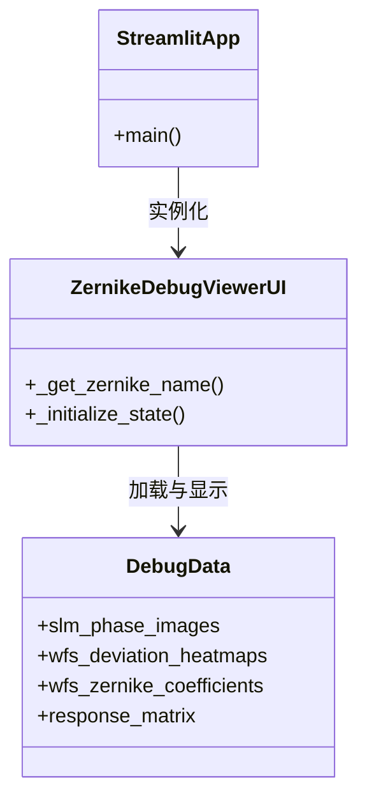
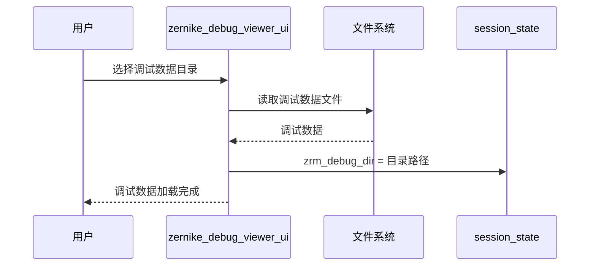
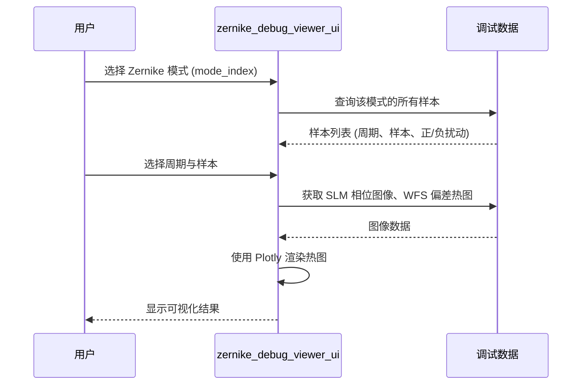

# Zernike 响应矩阵调试查看器 UI (zernike_debug_viewer.py) — 软件需求规格说明书 (SRS)

## 1. 概述

### 1.1 文档目的

本文件定义 `src/ao_shaping/gui/zernike/zernike_debug_viewer.py` 的功能需求、非功能需求、接口规范与关键设计约束。本模块是 Zernike 响应矩阵调试数据查看器的 Streamlit 前端页面，支持加载标配调试数据、按 Zernike 模式浏览、查看 SLM 相位图像与 WFS 偏差热图、对比不同样本的响应差异。

### 1.2 启动方式

```bash
streamlit run src/ao_shaping/gui/zernike/zernike_debug_viewer.py
```

### 1.3 依赖模块

| 模块 | 职责 |
|------|------|
| `plotly.express` / `plotly.graph_objects` | 交互式图表绘制 |
| `plotly.subplots.make_subplots` | 子图布局 |
| `ao_shaping.utils.io.file.ROOT_DIR` | 项目根目录 |

### 1.4 用户画像

- 光学实验操作员：调试 Zernike 响应矩阵标配过程，分析 SLM 相位与 WFS 偏差的对应关系

---

## 2. 功能需求

### 2.1 调试数据加载

| ID | 需求 | 优先级 |
|----|------|--------|
| FR-1.1 | 支持加载标配调试数据目录（--debug 标志保存的数据） | 必须 |

### 2.2 数据浏览

| ID | 需求 | 优先级 |
|----|------|--------|
| FR-2.1 | 支持按 SLM Zernike 模式（mode_index）浏览 | 必须 |
| FR-2.2 | 支持查看 SLM 相位图像（已平移、归一化到灰度） | 必须 |
| FR-2.3 | 支持按周期与样本（正/负扰动）浏览 | 必须 |
| FR-2.4 | 支持可视化 WFS 偏差 (x, y) 热图 | 必须 |
| FR-2.5 | 支持可视化原始 WFS Zernike 系数（平均前） | 必须 |
| FR-2.6 | 支持对比同一模式的不同样本 | 必须 |
| FR-2.7 | 支持可视化已标配的响应矩阵（.h5 文件） | 必须 |

---

## 3. 非功能需求

| ID | 需求 | 说明 |
|----|------|------|
| NF-1 | 只读查看 | 仅读取调试数据，不修改 |
| NF-2 | 交互式图表 | 使用 Plotly 提供交互式可视化 |

---

## 4. 接口规范

### 4.1 Session State Schema

| 键 | 类型 | 含义 |
|----|------|------|
| `zrm_debug_dir` | str | 调试数据目录路径 |

### 4.2 主要公共函数

| 函数 | 签名 | 说明 |
|------|------|------|
| `_get_zernike_name(n_max)` | int → dict | 获取 Zernike 模式名称映射 |
| `_initialize_state()` | 无 | 初始化 session_state |

---

## 5. 系统类图



---

## 6. 功能按钮时序图

### 6.1 加载调试数据



### 6.2 按模式浏览



---

## 7. 开发规范（防止用例冲突）

| 规则 ID | 规则说明 | 执行机制 |
|---------|----------|----------|
| RO-1 | 只读查看，不修改调试数据 | UI 仅读取数据文件，不写入 |
| ER-1 | 数据目录不存在时显示提示 | 目录不存在时显示友好错误信息 |

---

## 8. 相关文档

- 用户手册: [`zernike_debug_viewer_user_manual.md`](./zernike_debug_viewer_user_manual.md)
- 标配算法: [`ao_shaping/optimizer/wf/zernike_response_matrix.py`](../../../../src/ao_shaping/optimizer/wf/zernike_response_matrix.py)
- GUI 索引: [`docs/gui.md`](../../../gui.md)
