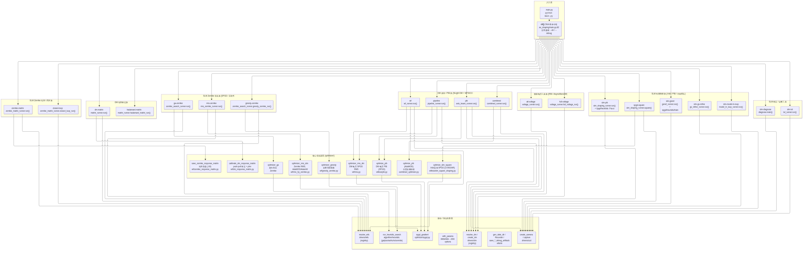

# 调用图总览

从 `main.py`（仓库根，7 行）出发的完整函数调用图。数据来自 AST 静态分析
（`scripts/call_graph/build_call_graph.py`，产物 `raw/assets/call_graph_final.json`）：
**497 个仓库模块** 中从 `main.py` 可达 **193 个函数节点 / 290 条调用边**。

> 图源：`../raw/assets/diagram_layers.mmd`（mermaid，可经 kroki.io 重新渲染）。
> SVG 版本：`../assets/diagram_layers.svg`。

## 四层结构

| 层 | 内容 | 页面 |
|---|---|---|
| ① 入口 | `main.py` → `cli()`（Click 根组，全局 `--dir`/`--debug`） | [[entry/main-py]]、[[entry/cli]] |
| ② 命令 | 20 个 `cli.add_command` 注册的 runner（7 族），懒加载 import | [[index#CLI 命令]] |
| ③ 优化器 | `optimizer/` 下 9 个核心函数（RMS/PIB/Zernike/方形/标定） | [[index#骨架函数]] |
| ④ 驱动/算法 | `drivers/` 注册表工厂、`algorithm/heuristic` 搜索驱动、`utils/` 工具 | 各 function 页 |

## 阅读方法

1. **找命令**：图中 ② 层按 7 族分组；每个命令框标注 `runner 文件.入口函数()`。
   命令框上连 `cli()`，下连其调用的 ③ 层优化器。
2. **找函数文档**：③④ 层每个节点都有对应的 `functions/*.md` 页
   （签名 + docstring 原文 + 入/出边）。
3. **看硬件**：命令页"调用链分析（自动）"段列出该命令可达的硬件
   （DM / SLM / CCD / WFS / 时序）——静态可达性，非逐帧 trace。
4. **调参入口**：每个命令的 CLI 选项由 `with_params` 装饰器从 dataclass 生成
   （见 [[functions/with-params]]），`--help` 与 dataclass 字段一一对应。

## 命令 → 入口函数 → 核心优化器 全表

| 命令 | runner 入口 | 核心优化器/工具 |
|---|---|---|
| `wf` | `runners.nlight_dm.wf_runner.run` | [[functions/optimizer-rms-dm]] |
| `pib` | `runners.nlight_dm.axis_beam_runner.run` | [[functions/optimize-pib-wfless]] |
| `pipeline` | `runners.nlight_dm.pipeline_runner.run` | [[functions/optimizer-rms-dm]] + [[functions/optimize-pib-wfless]] |
| `combined` | `runners.nlight_dm.combined_runner.run` | [[functions/optimize-pib-combined]] |
| `dm-matrix` | `runners.matrix_runner.run` | [[functions/calibrate-dm-matrix]] + [[functions/save-dm-matrix]] |
| `hadamard-matrix` | `runners.matrix_runner.hadamard_matrix_run` | （矩阵构建 + `flatten_slopes`） |
| `alt-voltage` | `runners.micro_drive.voltage_runner.run` | `drivers.dm.micro.R50Controller`（电压下发） |
| `full-voltage` | `runners.micro_drive.voltage_runner.full_voltage_run` | `AsyncMicroDM`（全量交替） |
| `zernike-matrix` | `runners.slm.zernike_matrix_runner.run` | [[functions/save-zernike-matrix]] + 离线矫正自检 |
| `closed-loop` | `runners.slm.zernike_matrix_runner.closed_loop_run` | 响应矩阵 + 控制律闭环 |
| `rms-zernike` | `runners.slm.rms_zernike_runner.run` | [[functions/optimizer-rms-slm]] |
| `ga-zernike` | `runners.zernike_search_runner.run` | [[functions/optimizer-ga]]（经 [[functions/run-heuristic-search]]） |
| `greedy-zernike` | `runners.zernike_search_runner.greedy_zernike_run` | [[functions/optimizer-greedy]] |
| `slm-pib` | `runners.slm.slm_shaping_runner.run`（`spgd`/`heuristic` 子命令） | PIB 族（SPGD/启发式） |
| `slm-pib square` | `runners.slm.slm_shaping_runner.square` | [[functions/optimize-slm-square]] |
| `slm-gsnet` | `runners.slm.gsnet_runner.run`（`spgd`/`heuristic`/`train`） | freeform SPGD / FourierGSNet 训练 |
| `slm-gs-refine` | `runners.slm.gs_refine_runner.run` | GS 开环预矫正 + SPGD 细化（经 `runner_common`） |
| `slm-model-in-loop` | `runners.slm.model_in_loop_runner.run` | 正向模型闭环（经 `runner_common`） |
| `slm-lut` | `tools.slm.calibration.lut_runner.run` | [[functions/slm-lut]]（LUT 反演） |
| `slm-diagnose` | `tools.slm.panel.diagnose.main` | 面板逐级自检（纯驱动调用） |

## 未解析边说明

静态分析无法解析的目标在 JSON 中 `nodes[X]=null`，页面里标 `*(未解析/外部)*`。
两类来源：
1. **模块内私有 helper**（`_*` 函数，仅在本文件被调用）—— 数量少，已按文件归属标注；
2. **动态/反射调用**（click 分发、`__getattr__` 懒加载、字符串 dispatch）——
   不影响"命令 → 优化器"主干完整性。

96/103 个未解析简单名已用"全库同名唯一匹配"恢复（`call_graph/recovered.json`），
歧义的 7 个（`create_wfs`/`create_dm`/`learning_schedule` 等）多候选，保留为未解析。

## 相关

- [[entry/cli]]（命令注册 + 懒加载机制）
- [[entry/main-py]]
- `raw/assets/call_graph.json`（机器可读全图）
