# 全局类图

全库共 **587 个顶层类**（186 个文件）；本页只保留**核心架构骨架**——设备抽象层、
注册表工厂、光场数据模型、优化器、目标函数、SLM 标定、闭环控制七个域。
所有继承边均逐一核对源码（无基类的类不画继承边）。

> 图源：`../diagram/class-diagram.mmd`（mermaid classDiagram，可用 mmdc 重新渲染）。

## 七个域

| 域 | 核心类 | 结构 |
|---|---|---|
| 设备抽象（`drivers`） | `Device`、`DM`、`BaseWFS`、`BaseCamera` | 四条继承树；`SimulatedDevice → OpticalDevice` 是仿真设备支系 |
| 注册表工厂（`drivers/*/_registry`） | `DMRegistry`、`WFSRegistry` | 字符串名到类的映射 + 懒加载 import；`..>` 注册边到具体驱动 |
| 光场模型（`model`） | `PhaseMap`/`AmplitudeMap`/`ComplexField` + 8 个 `quantities` | 纯数据类，无继承；组合边表示换算/拟合关系 |
| 优化器（`algorithm.gradient`） | `RegisteredBase` 根 + `SGD/Adam/AdamW/AdaMOD/Muon` | 注册表模式：`create(name)` 按名实例化 |
| 目标函数（`utils.image.target`） | `ShapingObjective` + `ImageTargetFunc` | 可调用目标，供 SPGD/启发式共用 |
| SLM 标定（`tools.slm.calibration`） | `SLMCalibratorBase` + 3 个子类 | 依赖注入：`SLMProtocol`/`CameraProtocol`（Protocol 鸭子类型） |
| 闭环控制（`algorithm.signal_processing.controller`） | `BaseController` + 6 个子类 | `PID/LeakyIntegrator/QuadraticGaussian/LQG/Predictive/AdaptiveGain` |

## 关键设计观察

1. **两套设备基类并存**：`Device`（新抽象，`BaseWFS` 用）与 `DM`/`BaseCamera`
   （仅 `ABC`）。`DM` 不继承 `Device`——这是 [[relations/similar-functions]] 之外
   的又一处"平行抽象"，重构时注意统一方向（见 `docs/architecture.md`）。
2. **SLM 无公共基类**：`ZernikeSLM` 与 `Santec` 各自独立，仅通过
   `SLMCalibratorBase` 的 `SLMProtocol` 协议间接协作。
3. **注册表 = 工厂 + 懒加载**：`DMRegistry.create_dm(name)` 按字符串解析
   `drivers.dm.nlight.driver.NLight` 等，与 [[entry/cli]] 的命令懒加载同构。
4. **仿真支系独立**：`SimulateDM`/`SimMicroDM`/`SimulatedCCD` 继承真实驱动基类，
   保证 `--cam-type sim` 与硬件路径同接口（与 `docs/simulation.md` 一致）。

## 与调用图的关系

- 调用图（[[diagram/global-call-graph]]）回答"函数间调用流向"；
- 本页回答"类间继承与协作"——两者互补：例如 `optimizer.wfless` 在调用图中是枢纽包，
  在本页则看到它依赖的 `BaseController`/`ShapingObjective` 类型骨架。

## 相关

- [[diagram/global-call-graph]]（全局调用图）
- [[diagram/call-graph-overview]]（分层调用图）
- `docs/architecture.md`（`model` 包数据模型详解）
- `docs/drivers_architecture.md`（驱动抽象层设计文档）
