# 全局调用图（包级聚合）

[[diagram/call-graph-overview|分层图]] 按「入口→命令→优化器→驱动」四层展开；本页给**全局视角**：
把 193 个已解析函数节点聚合到**包级**（`ao_shaping.X.Y`），一次看全 8 个一级包之间的
调用流向与强度（边权 = 调用次数）。

> 图源：`../diagram/global-call-graph.mmd`（mermaid 源码，可用 mmdc 或 kroki.io 重新渲染）。
> 渲染管线：`npx -y @mermaid-js/mermaid-cli -p puppeteer-config -i ... -o ...`
> （puppeteer 配置指向 `/tmp/chromium`，见 `coding_conventions`）。

## 聚合规则（`scripts/call_graph/build_module_graph.py`，幂等可重跑）

1. `ao_shaping.drivers.ccd.common.capture_x` 聚到 `ao_shaping.drivers.ccd`（3 级包节点）；
2. 类引用目标（末段大写，如 `...adam.AdaMOD`、`...file.Recorder`）并入其所在包；
3. 包级重导出别名（`ao_shaping.utils.gen_date_dir` 这类非真实 3 级包）回退到 2 级包；
4. 103 个文件内私有 helper（裸名节点，无模块信息）归入单桶，不画内部边；
5. 权重 1 的边与包内自环隐去（全量见 `raw/assets/call_graph_final.json`）。

## 读图要点

| 观察 | 数据支撑 |
|---|---|
| 调用量最大的是 `utils.cli` 的裸名 helper 调用（220 次），集中在 `with_params` 参数装饰链 | 边权 220 → 未解析桶 |
| `optimizer.wfless` 是枢纽：上接 4 个 runner 族，下接 `drivers.ccd`（26）、`utils.image`（9）、禁忌/SPGD 算法 | 多方向边权 26/9/4/3 |
| `runners.slm` 是 SLM 命令族入口，向 `utils.io`（13/9）、`runner_common`（7）、`optimizer.wf`（3）扇出 | 边权标注 |
| 优化器层内部几乎无横向调用（`optimizer.wf → optimizer.spgd` 仅 3），符合"优化器互相独立、经 runner 编排"的架构 | 缺失横向边 |
| `model` 数据类包在调用图中无出边——它是纯数据结构层，只被 import 不被调用，属预期 | 无 model 出边 |

## 与分层图的关系

- 分层图回答"**这个命令的调用链怎么走**"（深度）；
- 本页回答"**哪个包被依赖最多、依赖面多宽**"（广度），用于找枢纽与坏味道
  （如 `utils.cli` 承载 220 次 helper 调用，是参数装配逻辑的聚集地）。

## 相关

- [[diagram/call-graph-overview]]（分层图 + 命令全表）
- [[diagram/class-diagram]]（类图：继承 + 协作）
- [[relations/similar-functions]]（相似函数关联层）
- `raw/assets/call_graph_final.json`（机器可读全图，193 节点 / 290 边）
