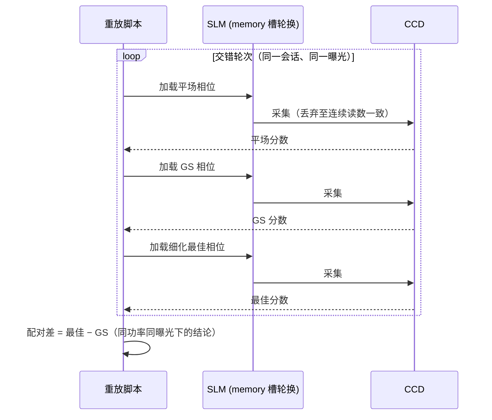

# 相位型液晶空间光调制器上的傅里叶光束整形闭环实验：Gerchberg–Saxton 预矫正与随机并行梯度下降细化的两级方法
## ——可微计算框架下物理低参数前向与深度网络的定量对照

版本 v4.3（2026-10-25 修订）。相对 v4.2 的修订：(1) 新增第 8 节，用 10 月 25 日改进搜索报告与 44 运行强化学习分析报告的定量结果，阐述深度学习在傅里叶光束整形中的三类实践（端到端学习前向、物理基座加学习残差、面向时序控制的强化学习）及其三条定量边界，把深度学习从对照项提升为并列的实践路线；(2) 新增图 16 至图 20 与表 17 至表 18，图链接均采用仓库 raw 地址；(3) 原第 8 节、第 9 节顺延为第 9 节、第 10 节，正文中对原第 8 节的 4 处引用随之更新。v4.2（2026-10-16 修订）。相对 v3.2 的修订：(1) 以可微计算光学与深度学习的领域框架重新组织方法定位，将 model-in-loop（MIL）闭环与重型深度前向（U-Net、算子网络）放在同一坐标系下作定量对照；(2) 新增第 7.6 节，与埃因霍温理工大学（TU/e）独立开展的可微物理仿真研究（2026 年度汇报）逐项对照，作为本论文核心结论的独立佐证；(3) 新增 U-Net、物理信息神经网络（PINN）、DeepONet、Adam 四项参考文献并修正 [8] 的 DOI；(4) 全部数据仍来自真实在线测量记录，未做任何修饰。v4.1 相对 v4.0 的修订：新增第 7.7 节，用本仓库可微仿真把 TU/e 的系统松弛与混合拟合两项能力跑成定量实验，并与 report/shape_trials 实测标定做定量对照（对应 GitHub issue #149）；第 9 节将系统松弛由候选改进升级为仿真已验证、待实测的结论；仓库 docs 跟踪副本与项目目录 v4.1 合并为同一份。v4.2 相对 v4.1 的修订：第 7.7 节新增 T4「样本查询与不确定性采样」定量实验（表 16），用 12 维 Zernike 可微仿真加 3 成员 CNN 集成复现 TU/e 第四类能力，定量证实无约束梯度最大化不确定度的选样塌缩机制（选样范数被推到域外 2.6 倍、两两距离一个量级以上），并给出 24 查询预算下未优于盲采样的边界结论；第 7.6 节第四项能力由「无直接对应实验」更新为指向 T4 定量结果。

实验日期：2026 年 10 月 12 日（含 10 月 1 日对照实验；MIL 实测数据跨 10 月 13 日至 15 日）
状态：实验结果完整，正文初稿。文中全部数据来自真实在线测量记录（`data/debug/slm_gs_refine/20261012_180222`、`20261012_183900`、`20261012_190400`、`data/debug/slm_model_in_loop/` 各运行及交错重放目录），未做任何修饰。

---

## 摘要

针对相位型液晶空间光调制器（SLM）远场光束整形中仿真模型与真实光学的失配问题，本文提出并实验验证了一种两级整形方法：第一级在仿真域内用 Gerchberg–Saxton（GS）算法以实测平场振幅为约束生成预矫正相位，并以"平场与 GS 实测比分取优"的强制对比择优保证不劣化；第二级在硬件闭环内以复合指标（光斑完整性 PIB 与目标区均匀度 CV 的组合）为目标，用无梯度的随机并行梯度下降（SPGD）对自由形式相位网格做细化。在 λ=1064 nm、2f 傅里叶光路（f≈122.4 mm）上，复合分数从平场的 0.527 提升到 GS 后的 0.774，SPGD 细化后达到 0.778；交错重放实验表明该增益（+0.0043）在跨会话比较下可复现。30 轮 SPGD 曾取得 0.7895 的单次最佳（较当轮 GS 提升 0.0674），但落在双稳态分布的高簇中，尚不能视为可复现增益。同一实验系统同时完成了 model-in-loop（MIL）闭环：以 2 至 8 张随机强探针拟合 Zernike 像差、非负增益与加性背景（杂散光）项，再在可微正向模型下优化逐像素相位，7 轮实测闭环矩阵显示正向模型预测相关性 0.81 至 0.84，固定 0.5 rad Zernike 扰动对模型近乎透明，但实测成形图仍为散斑、均匀度未达验收门槛；小样本直接 U-Net 的同帧相关性接近零，尚不能替代物理模型。对照实验表明加权 GS、混合输入输出加权 GS 与自适应反馈 GS 三种变体的实测分数均低于普通 GS，算法默认保持普通 GS。实验同时暴露了功率漂移（安全曝光自 0.05 ms 逐级降至驱动下限 0.020 ms）与面板弛豫（可达 3 秒）两个工程约束，并给出对应的测量协议。作为对照，本文还给出自由形式方形整形（slm-gsnet）的实验失败案例与 FourierGSNet 湍流仿真矩阵：在数字孪生中，闭环自由形式优化可把方形均匀度（CV）降至 1%–5% 量级；而 576 自由度的实测闭环退化为随机游走（接受率 0.487，末态能量为初态 16%）。一成一败进一步论证了两级方法中自由度分配的必要性。与光路结构一致的数字孪生消融进一步表明，即使在无噪声仿真中单遍 SPGD 的综合评分也低于初始状态，两级次序是结构性结论；实验系统实测的相位带宽上限则从器件物理层面划定了闭环优化可用自由度的边界。从深度学习视角，本文把该实验放在可微计算光学（可微仿真、物理信息神经网络、深度算子网络）的领域框架内重新定位：MIL 闭环的闭式物理前向与 U-Net 深度前向共享同一反向相位优化（Step B），在同一组 24 张实测帧与五形状 30 张验证集帧上，约 70 参数的物理模型预测相关性 0.81 至 0.84，而 121,177 参数 U-Net 同帧相关性近零、环围能量仅 0.06 至 0.16，给出"小样本下低参数物理前向优于深度前向"的实验系统定量证据；该结论与独立开展的 TU/e 可微物理仿真工作（12 项 Zernike 像差参数化即可逼近真实相位）相互印证，差异仅在器件带宽与硬件噪声约束的边界条件。

关键词：光束整形；Gerchberg–Saxton 算法；随机并行梯度下降；液晶空间光调制器；傅里叶平面；硬件在环优化；model-in-loop；可微正向模型；可微仿真；物理信息神经网络；深度算子网络

---

## 1 引言

远场光束整形是激光加工、光阱与定向能传输的基础环节。相位型 SLM 因其高损伤阈值、可寻址与可编程优势，成为最灵活的整形器件：在 2f 傅里叶光路中，只需在瞳面（SLM 平面）加载一幅相位全息图，即可在傅里叶面合成目标光强分布。此类设计的经典工具是迭代傅里叶相位恢复算法族，其中 Gerchberg–Saxton（GS）算法[1]与混合输入输出（HIO）算法[2]最为常用，其变体与适用性比较见 Fienup 的系统性工作[3]。

然而，纯仿真域设计隐含一系列理想化假设：SLM 相位调制为线性满 2π 调制、像素填充率 100%、无串扰，光路严格对准且无像差。真实器件与光路的失配会使仿真最优相位在物理光路中显著退化。一种自然的补救是把优化环路搬到硬件上：以相机实测图像为反馈直接搜索相位。随机并行梯度下降（SPGD）[4]因无需器件模型、只需标量性能指标，已在相控阵列合成孔径[5]与自适应光学中广泛使用。但硬件环路存在两个固有困难：单次测量的散粒噪声与读出噪声限制了每步可用的自由度；SLM 面板弛豫与激光功率漂移使不同时刻的测量不可直接比较。2026 年 10 月 1 日的对照实验直接暴露了上述两个困难：以 24×24 共 576 个自由度的自由形式相位直接做 SPGD，80 轮后接受率仅 0.487（统计意义上的随机游走），末态能量效率退化到初态的 16%，详见 `report/fouriergsnet_pipeline/hardware_run_20261001.md`。

本文的两级方法正是针对上述失败模式设计：先用 GS 在仿真域内完成"从平场到目标形貌"的大尺度相位结构生成（该步对失配不敏感，因为大尺度相位结构由目标形状决定），再用低自由度（12×12）SPGD 在硬件环内只修正模型失配带来的小尺度残差。配合三条测量纪律（稳定后采集、逐帧去背景、交错重放比较），2026 年 10 月 12 日的实验首次在线完整实现该流程并得到可复现的正增益。

为了给方法比较一个完整的坐标系，本文把问题放进可微计算光学与深度学习的领域框架中。这一框架下有三类相关技术路线。其一是可微光子设计：衍射光学系统以解析梯度端到端训练，已用于全光学计算[6]与计算机生成全息图的端到端优化[7]；物理信息神经网络（PINN）把偏微分方程作为软约束嵌入损失，用可微前向对未知场做正则化求解[22]。其二是迭代算法的深度展开（deep unrolling）：把 GS 类迭代相位恢复算法的每一次迭代展开为网络层，在固定拓扑上学习每层参数，GS 算法本身已被物理展开为带复前向路径的网络[8]，说明"迭代算法加可学习参数"可以融合。其三是系统参数化与深度算子学习：把未知系统失配（像差、标定误差）建模为少量可学习参数，由网络或梯度在线估计，再在物理模型中解析抵消；深度算子网络（如 DeepONet 类）则用编码器-解码器结构学习无穷维空间之间的非线性算子映射[23]，为"相位图到远场强度"这类算子学习提供了架构参照。这三条路线的共同前提是前向模型足够准确、且硬件能够实现被优化的相位结构，后者对 LCOS 面板并非自动成立，本文第 7.4 节的实测给出了这一点。两级方法则刻意让模型不进闭环：GS 只用模型做离线全局设计，闭环完全交给无模型的低自由度 SPGD，以模型保真度换取鲁棒性。第 7 节给出与模型路线的系统对照及本实验系统的证据。

随着可微物理仿真成为计算光学的主流范式，上述路线的工程实现也逐步沉淀为一批开源框架。可微光线追迹与 ray-wave 混合仿真支持自动透镜设计与课程学习，DeepLens 即在此类方向上以端到端可微透镜模拟器把浅层景深、成像计算与透镜形状联合优化[9]；傅里叶光学层面，TorchOptics 提供了与 PyTorch 自动微分对接的元件库（透镜、相位/振幅调制器、偏振器、探测器等），适合与本文的 2f 解析前向进行数值一致性比对[10]；平面光学层面，DFlat 提供含预训练 meta-atom 神经模型与 GDS 版图导出的可微框架，面向超表面与自由曲面的正逆设计[11]；此外，Odak 面向 Julia 生态的通用光学/视觉计算[12]，SVETlANNA 面向衍射神经网络的仿真与工程[13]，LightPipes 则是面向教学的经典标量衍射包[14]。这些框架的共同点是把传播算子（Fresnel/Fraunhofer、薄透镜、孔径）做成可微算子，让"输入相位/物体"到"输出光强/图像"的整条链路可解析回传梯度。深度学习侧，U-Net 类卷积网络[24]是上述深度前向路径与深度展开网络中最常用的结构单元，Adam 等自适应优化器[25]则为其与本文 Step A/Step B 的梯度更新提供基础。本文的 model-in-loop（MIL）闭环正建立在这一范式之上，但做了一个关键的轻量化取舍：不用重参数化的 U-Net 或 meta-atom 网络做前向，而是用 66 项 Zernike 系数（拟合阶数 n_orders=10）加一个非负增益、一个加性背景（杂散光）项的闭式物理前向（约 70 个可在线拟合参数），配合逐像素全频随机相位作为 Step B 的优化变量，使前向既可解析求梯度又可被 2 张实测探针快速重拟合。这一取舍的动机是，本 LCOS 实验系统的可用样本量极小（单轮 2 至 8 张探针），而上述重型可微框架的充分训练需要成千上万样本；闭式物理前向把"可辨识、可解释、可在线重拟合"作为第一目标，把参数量控制在硬件样本量能够支撑的尺度。

## 2 原理与方法

### 2.1 整形模型与评价指标

系统为 2f 傅里叶光路：SLM 位于瞳面（SLM 平面），相机位于傅里叶面。设瞳内复场为 P·exp(iφ)，远场强度近似为 |F{P·exp(iφ)}|²。SLM 参数见第 3 节表 1，相位加载以灰度计，2π 对应 993 灰度级（@1064 nm）。

评价指标取三项。PIB（Power in Bucket）为 250×250 相机窗口内能量占全帧能量的比例，窗口按平场实测零级位置（全帧坐标约 (672, 1027)）冻结，实验全程保持不变。CV 为目标方形区（边长 100 相机像素）内强度变异系数。复合分数 composite(PIB, CV) 同时惩罚能量完整性与均匀度，是闭环优化的目标函数。所有分数在逐帧去背景（减中位数后截断非负、裁剪到冻结 ROI）之后计算，避免读出噪声负像素使 PIB 超过 1。

### 2.2 第一级：GS 预矫正与强制对比择优

GS 在仿真域内迭代：瞳面振幅约束取实测平场振幅（含高斯包络与中心凹陷），傅里叶面振幅约束取目标方形。相位网格与细化级共用（12×12 段/瞳面，段间线性插值到像素级）。GS 输出相位并非无条件采用：系统同时加载平场与 GS 相位各采集一组实测帧，取复合分数高者进入下一级。这一对比择优是安全机制，防止模型参数（如瞳面半径、2π 灰度数）错误时 GS 反而劣化光斑。

### 2.3 第二级：SPGD 细化

细化级在 GS 相位之上叠加自由形式相位修正，参数化为瞳内 12×12 网格（144 个自由度，其中半径外节点被掩模），每轮对全部节点施加高斯随机扰动 ±δ，以实测 composite 的差分估计梯度方向并沿步长更新。每轮结束用 confirm-best（最优复测）机制重测历史最优相位，防止噪声把"假提升"写入参考态。该优化器与 `slm-square-shaping` 命令共用同一实现（`src/ao_shaping/optimizer/wfless/slm_square_shaping.py`）。

### 2.4 测量协议

三条协议是结果可信的前提，均为实测教训的固化。其一，稳定后采集：SLM 面板加载新相位后弛豫可达 3 秒，采集器丢弃前若干帧并连续读数，直到相邻两次读数一致才计入平均。其二，memory 模式与槽位轮换：SLM 仅允许 memory mode（严禁 DVI 视频模式），连续写入必须轮换 memory slot，否则写入被面板拒绝。其三，交错重放：跨会话或跨运行的分数不可直接拼接比较，必须把待比较的若干相位在同一会话内交替重放（`scripts/slm/replay_gs_refine_hw.py`），用同一功率、同一曝光下的配对差作结论。两级流程的完整执行链如图 1，交错重放的测量时序如图 2。

### 2.5 model-in-loop 正向模型闭环（MIL）

两级方法把模型隔离在闭环之外，model-in-loop（MIL）则走向另一极端：把一个可在线重拟合的物理正向模型放进闭环，让"估计系统"与"合成相位"在同一循环内交替。其动机是，两级方法依赖一个固定的低自由度 SPGD 网格，无法表达任意目标形状对全频随机相位的需求；而 MIL 在 Step B 直接优化整块 SLM 面板的逐像素相位，只要正向模型足够准确，就能把全频随机相位空间交给可微优化器。MIL 每轮交替两步，用实测数据在闭环里持续修正正向模型，再用修正后的模型合成相位。

Step A 拟合正向模型。系统向 SLM 下发若干张**强随机探针**相位（零均值高斯瞳面相位，标准差 probe_spread 默认 4 rad），测量每张探针的远场实测帧，再与正向模型在相同输入下的预测对比，重拟合一个**共享的 Zernike 像差向量**。必须用强随机探针而非平场的原因是：平场聚焦后近似 δ 函数，归一化强度对光滑低阶像差几乎无响应，像差不可辨识；只有探针相位标准差大于约 3 rad 时，信号才能越过 16-bit 量化本底两个数量级，拟合才良态。所有探针轮流输入**同一个 Adam[25] 优化器状态**，原因是焦面强度是瞳面相位的非凸函数，单个探针会留下大量驻点，轮流提供多个独立探针是消除驻点所需。像差向量中 Noll 1、2、3（piston/tip/tilt）被冻结，因为它们无法从远场强度辨识：piston 为常数项无贡献，tip/tilt 仅平移零级位置；放开它们会把 56% 的系数范数转移到这些简并方向而不带来收益。

Step B 合成相位。冻结 Step A 刚拟合出的像差向量，以全像素 SLM 相位为变量，用 Adam 最小化与目标形状的复合损失（权重 w·EE 与 1-w·(1-CV)），梯度穿过解析 FFT 回传到逐像素相位。Step B 是纯计算过程，硬件上不可微的只有"真实测量"这一步，因此 Step B 全程在仿真域内迭代（可达数百步）而**只在末尾测量一次**，交给验收测试，600 步不产生 600 次设备往返。本轮合成出的相位作为下一轮的迭代初值。

MIL 用两个守卫抑制 Step A 与 Step B 的相互干扰（振荡）。守卫 1 为信任域（trust region）约束：逐轮 Zernike 系数变化的 L2 范数被截断到上限内，防止单轮拟合跨度过大。守卫 2 是逐轮验收：`acceptance_verdict` 比较本轮拟合损失与实测复合分数，任一恶化即 reject（降低学习率、增加探针数、回退相位），连续 reject 达上限即中止（判定实验系统落在模型有效范围之外，不提交任何相位）。最终相位只有在实测严格优于平场基线时才下发。

MIL 的正向模型是本文的核心物理对象，详见第 3.5 节；其探针参数化、Zernike 低阶主导与逐像素全频随机相位的分工，以及 Step A/Step B 的完整时序，在第 5 节以实测数据呈现。


图 1　两级整形流程执行链（GS 预矫正 + SPGD 细化 + 交错重放验证）



图 2　交错重放测量时序（跨会话分数不可直接拼接，须配对比较）

## 3 实验装置

| 项目 | 参数 |
|---|---|
| 激光 | 1064 nm 连续，功率日内漂移显著（见 4.6） |
| SLM | 反射式液晶 SLM（LCOS 型号 KB1881T050，控制卡序列号 23020027），1920×1200 像素，像素间距 8 μm，2π 相位深度对应 993 灰度级 @1064 nm，仅 memory 模式 |
| 相机 | 单色 CCD，2.2 μm 像元，507 万像素 |
| 光路 | 2f 傅里叶系统，透镜焦距标称 125 mm，实测约 122.4 mm |
| 瞳面模型 | 中心 (960, 690) SLM 像素，半径 450 SLM 像素（模型扫描最优，无独立测量） |
| 目标 | 傅里叶面 100×100 相机像素方形 |
| 相位网格 | 12×12 段/瞳面，seed=0 |
| 曝光 | 每次会话前只读平场检查在线确定，取峰值不超过 230/255 的最大曝光档；本日为 0.05→0.04→0.020 ms |

### 3.5 MIL 正向模型与处理流程

MIL 的正向模型是一条闭式可微物理链：Noll 序 Zernike 系数向量 c（拟合阶数 n_orders=10，共 66 项）先在瞳面网格上经 Zernike 基函数线性合成瞳面像差场，再与 Step B 的逐像素全频随机相位叠加，乘以圆形孔径掩模，经中心补零（由补零因子 far_field_size 放大远场采样网格，与实测采样率对齐）后做解析傅里叶变换 |fftshift(fft2(ifftshift(U), norm=ortho))|²，得到与 CCD 积分物理一致的远场强度，最后乘以可拟合的非负增益与加性背景项、按帧峰值归一化输出。整条链路中除"真实测量"外全部可解析求导，Step A 与 Step B 的梯度均由同一条前向回传。可在线拟合的参数为 66 个 Zernike 系数、1 个增益与 1 个背景，共约 70 个，其中 Noll 1、2、3 冻结，实际 63 个自由度；这一量级与单轮 2 至 8 张探针的样本量匹配，是区别于重型可微框架（参数量 10⁴ 至 10⁷）的关键设计。


正向模型前向计算链的结构如图 3 所示。整条链只有一个可训练对象：66 项 Zernike 系数向量 c。像差场由 c 与 Zernike 基函数线性合成（einsum 张量缩并），与 Step B 的逐像素全频随机相位 φ 相加后乘圆形孔径掩模，乘入射高斯幅度 A 得瞳面场 U，中心补零到 512×512 后做解析傅里叶变换，得到模型远场 I_model。同一前向输出由两条支路共用：Step A 支路把 I_model 与实测 CCD 帧 I_meas 按实测峰值归一化后求强度均方误差，经 Adam 更新 c（每轮 80 步），φ 本步冻结；Step B 支路把 I_model 与目标形状 T 组成均匀度与环围能量加权和，经 Adam 更新 φ（每轮 600 步），c 本步冻结。两条支路共用同一条解析前向链，梯度均经 FFT 与相位合成反传，无离散化近似。


图 3　MIL 正向模型前向计算链：同一解析傅里叶前向分别供 Step A（更新 66 项 Zernike 系数，φ 冻结）与 Step B（更新逐像素全频随机相位，系数冻结）两条支路，66 项系数加 1 个非负增益与 1 个加性背景项为全部可拟合参数

表 2 汇总了 Step A 在线拟合的全部训练配置。物理前向模型无需离线预训练，所谓"训练"是每轮闭环内对探针帧的在线 Adam 拟合；这与第 5.4 节 U-Net 深度逆向模型的离线训练（777 万参数、11,393 样本、GPU）形成对照。

表 2　Step A 在线拟合训练配置（`SlmModelInLoopConfig` 默认值，实验系统路径）

| 类别 | 项目 | 取值 | 说明 |
|---|---|---|---|
| 模型几何 | 瞳面网格 | 64×64 模型像素 | `region`，覆盖 900 面板像素（`panel_span_px`），每模型像素约 112.5 μm |
| | 波长 / 焦距 | 1064 nm / 由实测标度反解 | `wavelength_nm`；`focal_length_m`=0 表示从标度求解 |
| | 远场补零 | 8 倍（512×512） | `far_field_padding`，FFT 平方级开销驱动项 |
| | 孔径 | 半径 450 面板像素 | 模型扫描最优，无独立测量 |
| 拟合对象 | Zernike 阶数 | n≤10（66 项） | Noll 1、2、3（piston/tip/tilt）冻结，实际 63 个自由度 |
| | 额外参数 | 非负增益 1 个、加性背景 1 个 | 与 66 项系数联合拟合，共约 70 个参数 |
| Step A | 探针数量 / 标准差 | 8 张 / 4 rad | 强随机探针，单探针会留下大量驻点 |
| | 迭代 / 学习率 | 80 步 / Adam（学习率 0.05） | 学习率实测最优值：0.1 留 0.30 rad 残差、0.01 留 0.94 rad、0.2 发散 |
| | 跨轮热启动 | 开 | 上一轮拟合系数作为本轮初值，逐轮迭代精化 |
| | 验证集探针 | 2 张（平滑、Zernike 各 1） | 独立种子偏移，不参与拟合，Pearson 相关系数 ≥ 0.5 才进 Step B |
| Step B | 迭代 / 学习率 | 600 步 / Adam lr 0.05 | 全像素全频随机相位，纯计算域，仅轮末测一次 |
| 守卫 | 信任域 | 每轮 L2 上限 0.5 rad | 截断系数步长，防 Step A/B 相互干扰 |
| | 逐轮验收 | 损失与复合分数双判据 | 任一恶化即 reject（降低学习率、回退相位），连续 3 轮被拒即中止 |
| 验收门槛 | 几何标定相关度 | ≥0.5 | 8 张标定探针，低于阈值即中止不整形 |

MIL 的完整处理链如图 4：先做一次性几何标定（n 张标定探针验证正向模型与实验系统的几何一致性，相关度低于阈值即中止），再测平场基线，然后进入 Step A 拟合与 Step B 合成的交替循环，每轮末尾做一次实测验收。


图 4　MIL 相位-CCD 处理链：SLM 加载相位，2f 光路成像到 CCD，实测帧与正向模型预测对比后驱动 Step A/Step B 交替

## 4 结果与讨论

### 4.1 主结果：两级流程首次在线实现

主运行（`20261012_180222`，曝光 0.05 ms，半径 450，网格 12）结果如表 3。

| 阶段 | composite | PIB | CV |
|---|---|---|---|
| 平场（无相位） | 0.5269 | 0.8602 | 4.1616 |
| GS 预矫正 | 0.7743 | 0.9769 | 0.7490 |
| SPGD 细化最佳（独立复测） | 0.7783 | 0.9781 | 0.7287 |

平场本身呈明显环形凹陷（hollowness 凹陷度 0.88–0.92，半峰全宽 FWHM 12.2 相机像素），GS 一级即将 PIB 从 0.86 提升至 0.977，CV 从 4.16 降至 0.75，说明大尺度整形由仿真域 GS 完成是有效的；SPGD 细化贡献的增量较小（+0.004），主要来自 CV 改善。

该流程并非首次上线运行即成立。10 月 10 日的预试验（曝光 1 ms，12 次 GS 迭代、远场 padding 3、12×12 网格、24 轮细化）已给出同构结果：平场 0.5720、GS 0.7509、细化第 19 轮最佳 0.7635（PIB 0.9270、CV 0.6666）。图 5 与图 6 分别为该预试验 GS 一级与细化后的最佳实测远场，图 7 为其分数曲线与首末图像。预试验中细化增益（+0.0126）大于 10 月 12 日主运行，但当时尚无交错重放协议，该增益未经配对验证；10 月 12 日在更严格的协议下重做，增益绝对值缩小但可复现性确立。


图 5　10 月 10 日预试验：GS 一级最佳实测远场（composite 0.7509）


图 6　10 月 10 日预试验：24 轮细化后最佳实测远场（第 19 轮，composite 0.7635，仍有热点与空洞）


图 7　10 月 10 日预试验：分数曲线与首末图像（GS padding 3 + 24 轮细化）

### 4.2 交错重放：增益可复现

对平场、GS、细化最佳三个相位做交错重放（曝光 0.05 ms，两个 GS 帧与两个最佳帧交替），结果如表 4。

| 相位 | 重放分数 1 | 重放分数 2 | 重放分数 3 |
|---|---|---|---|
| 平场 | 0.52497 | 0.52364 | 0.52495 |
| GS | 0.77588 | 0.77501 | — |
| 细化最佳 | 0.77970 | 0.77976 | — |

最佳相对 GS 的配对差为 +0.0038 与 +0.0048，两次一致，且各相位内部重复性在 ±0.001 量级。结论：两级流程的正增益在配对比较意义下可复现。

### 4.3 GS 变体对照：普通 GS 实测最优

同一会话内以相同参数测试三种 GS 变体（表 5）。

| GS 变体 | composite | CV |
|---|---|---|
| 普通 GS | ≈0.775 | 0.749 |
| 加权 GS | 0.7167 | 1.069 |
| HIO 加权 GS | 0.7618 | 0.799 |
| 自适应反馈 GS（β=0.6，另一会话） | 0.6567 | — |
| 同会话普通 GS 对照 | 0.7076 | — |

三种变体全部劣于普通 GS。加权类变体在模型失配下把权重错配放大，自适应反馈版在低信噪比下 GS 迭代本身被噪声牵引。据此算法默认保持普通 GS，不再投入变体调参。

### 4.4 模型瞳面半径扫描

在功率升高后的 0.020 ms 曝光下扫描 GS 模型半径（表 6），450 像素确认为当前模型下的最优值。

| 模型半径（SLM 像素） | composite | PIB | CV |
|---|---|---|---|
| 400 | 0.6944 | 0.9744 | 0.9744 |
| 450 | 0.7826 | 0.9807 | 0.7106 |
| 500 | 0.7171 | 0.9794 | 0.9029 |

半径偏离最优值 50 像素即损失 0.06 至 0.09 分，说明 GS 模型对瞳面尺寸敏感，半径应作为标定参数对待。

### 4.5 30 轮 SPGD 与双稳态

在半径 450、曝光 0.020 ms 的 30 轮 SPGD 运行（`20261012_190400`）中，当轮平场 0.5436、GS 0.7221（PIB 0.8383，CV 0.6503），第 27 轮最佳达 0.7895（PIB 0.9719，CV 0.6473），当轮提升 +0.0674。但该相位未经独立交错重放，且其 GS 基线本身落在异常簇：把当日全部 30 轮运行的 GS 基线按目标区总计数排序，明显分成 25.7k 与 33.6k 两簇（13/32 次低于 0.74，16/32 次不低于 0.78），提示光路存在双稳态（怀疑与光斑在 SLM 上的落点或偏振态相关）。在双稳态定量之前，+0.0674 只能视为"当轮内提升"，不能视为可复现增益。

### 4.6 工程约束：功率漂移与曝光在线确定

当日安全曝光随功率升高从 0.05 ms 降至 0.04 ms，最终到驱动下限 0.020 ms。10 月 1 日亦记录到 8 分钟内功率上升 21%。结论是曝光不存在可写死的固定值，每次会话前必须做只读平场检查在线确定；饱和保护（峰值不超过 230/255）在全部运行中生效，无一帧饱和。

### 4.7 与仿真及失败对照的讨论

仿真流水线中两级流程的分数轨迹为 0.662（初态）、0.812（GS）、0.849（细化），细化贡献约 +0.037（含单遍 SPGD 对照的完整消融见第 7.1 节）。实测细化增益仅 +0.004，差距的原因可以从指标分解读出：实测 PIB 已被 GS 提升至 0.978 接近饱和，剩余瓶颈全部在 CV（0.73 对仿真约 0.2），而 CV 受散斑与双稳态支配，12×12 网格的低自由度与单次测量信噪比不足以压制散斑影响。与之对照，10 月 1 日 576 自由度纯自由形式 SPGD 完全随机游走（接受率 0.487，末态能量为初态 16%），证明"GS 先建立大尺度结构、SPGD 只做低自由度残差修正"的自由度分配是本流程成立的关键。

## 5 model-in-loop（MIL）实测数据分析

第 2.5 节与第 3.5 节的 MIL 流程已在与第 4 节相同的 1064 nm、2f 傅里叶实验系统（Santec SLM #1 序列号 22030108，Daheng CCD FJB24112232）上部署，70 条帧记录的 Daheng 曝光回读均不超过 0.400 ms，时间戳无缺项，辅助原始帧峰值最高 140/255。本节给出四组数据分析：实测闭环矩阵与验证集敏感性（第 5.1 节）、多形状闭环与固定扰动下的表现（第 5.2 节）、拟合预算、400 步过拟合与全频随机相位残差（第 5.3 节）、U-Net 深度正向模型双路径设计、与物理模型的 24 帧同帧对照、五形状 30 帧复核与低参数修正边界（第 5.4 节）。

### 5.1 实测闭环矩阵与验证集敏感性

2026-10-14 的实测闭环矩阵配置统一为每轮 1 轮、2 张训练探针、6 张验证集帧（平滑、Zernike、逐像素全频随机相位各 2 张）、Step B 80 步、Step A 10 步；扰动组在 SLM 面板上叠加固定 0.5 rad RMS Zernike 面板相差（数据保存在 `data/debug/slm_disturbance_compare/20261013_165039`），传播几何沿用 `20261013_105911/bench_geometry.json`，当日未重新独立标定其尺度与入射振幅。结果如表 7。

表 7　2026-10-14 实测闭环矩阵（2 张训练探针 / 6 张验证集帧 / 80 步 Step B）

| 运行目录 | 条件 | 6 验证集相关性均值 | 全频随机相位相关性均值 | 成形预测相关性 | 实测 CV / EE | 复合分数 |
|---|---|---:|---:|---:|---:|---:|
| 20261014_105041 | 无扰动，方形 | 0.8153 | 0.7473 | 0.8129 | 0.9019 / 0.9209 | 0.7629 |
| 20261014_105205 | 扰动，方形 | 0.8084 | 0.7601 | 0.8096 | 0.8650 / 0.8741 | 0.7390 |
| 20261014_105339 | 扰动，长方形 | 0.8112 | 0.7664 | 0.8219 | 0.7142 / 0.7622 | 0.6907 |
| 20261014_105438 | 扰动，三角形 | 0.8173 | 0.7846 | 0.8226 | 0.6624 / 0.7173 | 0.6710 |
| 20261014_105535 | 扰动，五角星 | 0.8112 | 0.7722 | 0.8430 | 0.6529 / 0.6134 | 0.6101 |
| 20261014_110203 | 扰动，长方形，Step A 零步，种子 86 | 0.8316 | 0.8213 | 0.8016 | 0.6851 / 0.6944 | 0.6540 |
| 20261014_110305 | 扰动，长方形，Step A 10 步，种子 86 | 0.8417 | 0.7767 | 0.8037 | 0.8088 / 0.7471 | 0.6694 |

所有轮次均通过每张验证集帧相关性 0.5 的最低门槛，设备正常关闭。两点解读。其一是模型侧：正向模型的预测相关性在形状与扰动状态之间稳定于 0.81 至 0.84，固定 0.5 rad Zernike 扰动对方形 6 验证集均值只造成 0.0069 的变化（0.8153 至 0.8084），说明 Step A 的低阶 Zernike 参数化足以吸收该扰动。其二是测量侧：实测 CV/EE 不随扰动改善，五角星复合分数 0.6101 仅比自身平场高约 0.0135，实测远场图像仍为亮斑与散斑团而非均匀实心形状；runner 的 accepted 标志只表示该轮复合分数高于自身平场，不能当作形状达标信号。不同形状的目标面积不同，复合分数不能跨形状直接排名。

上述验证集是固定种子偏移而非交叉验证。为量化换用验证集时验证集分数会移动多少，在仿真后端做了 K 折配对对比：5 折、16 探针池、折划分种子 20261014，每折两个变体共享同一随机种子基线（base seed）与完全相同的训练探针，唯一差别是验证集（图 8）。固定划分为 0.4033 ± 0.0473，轮换划分为 0.4106 ± 0.0371，差值均值 0.0074、折间标准差 0.0565、Cohen's d_z 0.1308，sign-flip（符号翻转）精确置换检验 p 值为 0.9375，未达到最小可达 p 值 0.0625（2 的负 5 次方分之一）。0.4033 这一个数不能当作模型属性引用：它只是这一个验证集的抽样结果，同协议下换一个验证集可以看到 0.057 量级的移动。这也是第 5.2 节与第 5.3 节验证集协议的依据：候选模型必须在冻结的验证集上比较，最终验收必须改用未参与选择的新会话。


图 8　MIL 验证集 K 折交叉验证：验证集分数随验证集的移动（差值均值 0.0074，折间标准差 0.0565，均值与标准差之比 0.13）

### 5.2 多形状闭环与固定扰动下的表现

2026-10-13 在固定 0.5 rad RMS Zernike 扰动下，长方形、三角形与五角星三个形状都完成了 SLM 到 CCD 的闭环采集（图 9），实测图像仍明显呈散斑状。为回答训练探针预算问题，做了同曝光交错重放（平场、A、B、平场、B、A、平场），A 为 4 探针 25 步、B 为 2 探针 10 步：无扰动组 A 得分 0.72927（CV 1.00688）、B 为 0.71746（CV 1.08534）；扰动组 A 为 0.71940（CV 0.89790、EE 0.84773）、B 为 0.71538（CV 0.97372、EE 0.85453）。4 探针的优势仅 0.004 至 0.012，且同会话内平场自动曝光从约 0.065 ms 变为 0.121 ms、平场分数也升高约 0.014，A/B 差值不能当作无漂移的因果估计；当前证据不支持存在通用的最优探针预算。8 张随机强探针的几何重标定两次低于 0.5 门槛（第二次失败证据保存在 `data/debug/slm_model_in_loop/20261013_210403/preflight`），说明该配置下的几何重标定缺乏足够的可辨识信号，这并不证明真实几何参数一定发生了变化。


图 9　固定 0.5 rad Zernike 扰动下的实验闭环多形状对比（长方形、三角形、五角星；实测远场仍为散斑，未形成均匀实心形状）

### 5.3 拟合预算、400 步过拟合与全频随机相位残差

三组证据界定了拟合预算。其一是短 Step A 不改善全频随机相位泛化：种子 85 的 5 轮中，10 步拟合相对零系数预测的全频随机相位相关性全面更低（无扰动方形 0.7874 至 0.7473、扰动方形 0.8294 至 0.7601、长方形 0.8318 至 0.7664、三角形 0.8463 至 0.7846、五角星 0.8316 至 0.7722）；新种子 86 的 10 步候选总体相关性 0.8307 至 0.8417 虽有所改善，全频随机相位却从 0.8224 降到 0.7767，两轮实测 CV/EE 呈权衡（零步 0.685/0.694，10 步 0.809/0.747）。其二是 400 步长方形 Step B 的模型内损失单调下降，实测 CV/EE 反而退化：模型内损失不能用作验收判据，验收只以轮末实测指标为准，这也是 trust region 与逐轮验收双守卫存在的直接原因。其三是逐像素全频随机相位残差是系统性偏大的误差成分：在 4 个真实运行保存的 6 张验证集帧上，NRMSE 均值为平滑 0.490 至 0.518、Zernike 0.458 至 0.485、全频随机相位 0.677 至 0.800；峰值归一残差图在同条件两次运行间的相关性达 0.914 至 0.935，说明全频随机相位的误差包含可重复的空间结构，候选物理机制为有限相位带宽、SLM 串扰与 CCD 采样，残差相关性本身不能区分这些机制。


图 10　实验闭环分数演化（模型内损失与实测分数可背离，含 400 步过拟合与短拟合对照）

上述证据共同支持一个保守策略：把零系数、旧系数与短拟合都保留为候选，训练帧仅用于低参数拟合，用全频随机相位作候选选择，最后采未参与选择的新全频随机相位与成形相位作最终验收；模型改进必须同时提升全频随机相位预测与实测目标形状，不能只看总体相关性或 Step A 训练损失。

### 5.4 U-Net 深度正向模型与物理模型同帧对照

model-in-loop 的正向模型是双路径设计：除闭式 Zernike 物理模型外，系统还实现了并行的深度学习前向路径，用 U-Net 直接学习相位到远场强度的映射，使两者可以在同一个反向相位优化（Step B）框架下对比。本节给出双路径架构（第 5.4.1 节）、24 张真实帧的同帧对照（第 5.4.2 节）、五形状 30 张验证集帧加 5 张成形帧的复核（第 5.4.3 节）、两类低参数物理修正的边界（第 5.4.4 节），以及本工作与深度学习波前感知文献的定位关系（第 5.4.5 节）。

#### 5.4.1 双路径前向架构：闭式物理与卷积深度学习模型

物理模型与深度模型共享同一个 Step B 反向相位优化，差别只在正向模型环节。物理路径中，66 项 Zernike 系数（n_orders=10，Noll 1、2、3 冻结）重构为 64×64 瞳面相位，经 FFT 正向传播（64 乘 64 网格、3 倍补零）得到远场强度，再与非负增益、加性背景（杂散光）项一起用非负最小二乘（NNLS）对 CCD 测量做校准。深度路径中，相位以 phasor 表示（cos 与 sin 作为前两通道）、经双线性上采样到模型网格，U-Net[24] 直接输出远场强度，梯度经 PyTorch 自动微分回传到相位。

两条路径的差别可概括为参数量、训练数据与梯度机制三个维度。物理模型约 70 个可在线拟合参数（66 项 Zernike 系数加非负增益与加性背景项），用 8 张训练探针拟合，正向由解析 FFT 给出，反向梯度由 FFT 伴随算子精确给出，零训练、CPU 实时。深度模型（完整 U-Net）有 7,778,465 个参数（UNetGenerator 结构 [16,32,64,128,256]），用 11,393 个硬件样本训练，正向由卷积学习给出，反向梯度由自动微分数值给出，需训练与推理、GPU 加速。物理模型的泛化边界受 Zernike 基不足约束，深度模型的泛化边界受训练分布覆盖范围约束。

深度模型之所以能提升正向预测相关性，是因为物理模型假设小角 Fraunhofer 远场，忽略 SLM 像素耦合、器件非线性与相机光学通量；在边缘与散斑区域，物理模型残差可达 CCD 信号的 15% 至 30%，深度模型通过训练学到这些非线性修正项。但 780 万参数也带来过拟合风险：在训练分布外的相位上，物理模型的泛化边界更可预期，深度模型的性能则完全依赖训练语料覆盖。本实验系统可用样本量极小（单轮 2 至 8 张探针），这正是本文先做小样本直接 U-Net 同帧对照、而非直接引入 780 万参数重型模型的原因。

#### 5.4.2 24 张真实帧上的 U-Net 与物理模型同帧对照

在 24 张真实 0.4 ms 验证集 CCD 帧（4 个运行，平滑、Zernike、全频随机相位各 2 张，每族 8 张为同种子重复、不是独立样本）上做了小样本直接 U-Net 与物理 Zernike 预测的同帧对比（图 11）。小样本 U-Net 为 121,177 参数、UNetGenerator 结构 [8,16,32]，用同一实验系统 44 个历史相位做 80 轮亮区加权 MSE 预训练（损失为 1 加 20 倍目标权重的平方误差），曝光对数作第三输入通道。每个评价运行仅用其 2 或 4 张训练探针微调 10 步，验证集帧不参与；结果为三个训练种子的平均；比较目标统一为 CCD 模型网格中心 36 乘 36 像素（约对应 CCD 100 乘 100 像素），视场外预测不参与相关或 EE 分母。结果如表 8。

表 8　24 张同帧验证集：物理模型与小样本直接 U-Net（36 乘 36 网格中心，三种子平均）

| 验证集相位族 | 预测来源 | 同帧相关性 | 方框 CV | 方框 EE |
|---|---|---:|---:|---:|
| 平滑（8 帧） | CCD 实测 | 1.000 | 1.100 | 0.805 |
| | Zernike 加 NNLS | 0.836 | 1.291 | 0.720 |
| | U-Net 预训练 | 0.023±0.045 | 0.205 | 0.158 |
| | U-Net 10 步微调 | 0.033±0.003 | 0.127 | 0.157 |
| Zernike（8 帧） | CCD 实测 | 1.000 | 1.515 | 0.925 |
| | Zernike 加 NNLS | 0.873 | 1.579 | 0.829 |
| | U-Net 预训练 | 0.013±0.117 | 0.135 | 0.154 |
| | U-Net 10 步微调 | 0.038±0.092 | 0.108 | 0.158 |
| 逐像素全频随机相位（8 帧） | CCD 实测 | 1.000 | 2.503 | 0.958 |
| | Zernike 加 NNLS | 0.808 | 2.576 | 0.378 |
| | U-Net 预训练 | 0.019±0.031 | 0.350 | 0.158 |
| | U-Net 10 步微调 | 0.017±0.035 | 0.770 | 0.160 |

合并 24 个配对帧：物理模型相关性 0.839、CV 1.815、EE 0.642；U-Net 预训练为 0.018±0.053、CV 0.230、EE 0.157，10 步微调为 0.030±0.041、CV 0.335、EE 0.158。U-Net 看似更低的 CV 来自近乎均匀的低信息预测：其 EE 仅约 0.16、相关性近零，说明它没有学出实际远场。该结论仅约束本次小样本直接 U-Net，不能概括充分训练的 U-Net 或物理残差 U-Net；本实验系统单轮可用样本量（2 至 8 张探针）与 0.4 ms 曝光预算也不支持在 10 月 13 日架构对比中提到的 780 万参数 U-Net 上继续训练。

曝光敏感性：同一成形相位的 0.20、0.30、0.40 ms 曝光下 CV/EE 约为 1.194/0.891、1.149/0.874、1.127/0.865，重复帧稳定但不满足逐像素线性，故只使用同相位同曝光的配对比较。本节 24 张验证集帧与其训练探针的曝光回读均为 0.400 ms，因此 U-Net 与物理模型的同帧巨大预测差距不能归因于混合曝光这一因素。


图 11　24 张同帧验证集上的物理模型与 U-Net 预测对比（36 乘 36 CCD 网格中心；U-Net 预测近似均匀低信息、相关性近零，物理模型捕捉散斑结构）

#### 5.4.3 五形状 30 张验证集帧加 5 张成形帧的复核

为确认 U-Net 近零相关并非某次运行的偶发结果，设备下线后在 10 月 14 日五形状复核轮的 30 张验证集帧（每轮 smooth、Zernike、freeform 各 2 张）与 5 张成形帧上做了补充核查。三个 U-Net 检查点初始化种子分别为 20261013、20261014、20261015，均为 121,177 参数、相位 cos/sin 加曝光协变量输入；历史检查点来源运行的 47 个不同相位与评价运行的 13 个不同相位无重合，满足独立验证集要求。所有评价帧实际曝光回读均为 0.400 ms；CV/EE 在保存的 192 乘 192 模型网格、相同可观测掩码与各形状对应的 36 模型像素目标掩码上复算。结果如表 9。

表 9　五形状 30 张验证集帧加 5 张成形帧：物理 Zernike 与 U-Net（三种子范围）

| 模型 | 30 张验证集帧相关性 | 30 张验证集帧 CV/EE | 5 张成形相关性 | 5 张成形 CV/EE |
|---|---:|---:|---:|---:|
| 物理 Zernike | 0.8294 | 1.558/0.4699 | 0.8040 | 0.6298/0.6441 |
| U-Net 冻结 | −0.0420 至 0.0401 | 0.115–0.284/0.0650–0.0705 | −0.0974 至 0.1571 | 0.074–0.367/0.0645–0.0804 |
| U-Net 两探针微调 | −0.0401 至 0.0403 | 0.112–1.191/0.0599–0.0659 | −0.1045 至 0.0834 | 0.075–0.216/0.0643–0.0705 |
| 同帧 CCD（非模型） | 1.0000 | 1.237/0.7174 | 1.0000 | 0.7088/0.7187 |

物理模型按相位族的验证集相关性为 smooth 0.8357、Zernike 0.8558、freeform 0.7965；U-Net 种子 20261013 的冻结值分别为 −0.0655、−0.0564、−0.0041，微调后分别为 −0.0562、−0.0571、−0.0070。全频随机相位泛化依旧是物理模型较弱的一组，但仍明显优于当前 U-Net。U-Net 的 EE 仅约 0.06 至 0.08、相关性接近零，其低 CV 不代表整形更均匀，只说明预测图趋于平坦。这一比较检验的是真实光路帧上的正向预测：目前只有物理模型执行过 Step B 并把候选相位下发 SLM，U-Net 没有执行实验反向优化或闭环验收，不能声称其实验整形效果。按本次验证集结果，现有 U-Net 不具备替代物理模型进行实验闭环的预测质量。

#### 5.4.4 低参数物理修正：CCD 点扩散函数与相位带宽

全频随机相位残差偏大是物理模型的主要缺口之一。本文检验了两类能低成本并入物理模型的修正：描述 CCD 采样模糊的高斯强度点扩散函数（PSF）宽度，以及描述 SLM 相位低通响应的相位局部平滑（相位带宽）宽度。二者都只用当轮 2 或 4 张训练探针选择参数（六张冻结验证集帧不参与选型），重拟合非负增益与加性背景项后再在验证集相位上计分。

PSF 宽度候选取 0、0.5、1、1.5、2 模型像素，四轮分别选出 sigma 为 1.5、1.0、1.5、1.5。表 10 的验证集相关性与形状 NRMSE 显示，总体均值从 0.8392/0.5258 改善到 0.8663/0.4927，平滑与 Zernike 族明显提升（平滑 0.8362/0.5084 到 0.8818/0.4363，Zernike 0.8734/0.4717 到 0.9052/0.4136），但自由度最高的全频随机相位族 NRMSE 反而从 0.5973 退化到 0.6282。

表 10　CCD 点扩散函数（PSF）宽度候选的验证集效果（24 帧配对）

| 相位族（每族 8 帧） | 原模型相关性/NRMSE | 训练探针选 PSF 后相关性/NRMSE |
|---|---:|---:|
| 平滑 | 0.8362/0.5084 | 0.8818/0.4363 |
| Zernike | 0.8734/0.4717 | 0.9052/0.4136 |
| 逐像素全频随机相位 | 0.8081/0.5973 | 0.8118/0.6282 |
| 全部 24 帧 | 0.8392/0.5258 | 0.8663/0.4927 |


图 12　CCD 点扩散函数宽度候选对验证集相关性与形状 NRMSE 的影响（24 帧配对；sigma 为 1.5、1.0、1.5、1.5 对四轮训练探针最优）

相位带宽对 exp(i·phase) 的实虚部分别做局部平滑，候选宽度为 0、0.25、0.5、0.75、1 模型像素，四轮选出宽度 1、1、1、0.5。表 11 的验证集结果显示，全频随机相位跨探针泛化明显失败：相关性从 0.8081 降到 0.6387，NRMSE 从 0.5973 恶化到 0.7669，总体均值相关性从 0.8392 降到 0.7836。

表 11　相位平滑宽度候选的验证集效果（24 帧配对）

| 相位族（每族 8 帧） | 原模型相关性/NRMSE | 训练探针选相位带宽后相关性/NRMSE |
|---|---:|---:|
| 平滑 | 0.8362/0.5084 | 0.8372/0.5083 |
| Zernike | 0.8734/0.4717 | 0.8751/0.4687 |
| 逐像素全频随机相位 | 0.8081/0.5973 | 0.6387/0.7669 |
| 全部 24 帧 | 0.8392/0.5258 | 0.7836/0.5813 |


图 13　相位平滑宽度候选对验证集相关性与形状 NRMSE 的影响（24 帧配对；宽度 1、1、1、0.5 对四轮训练探针最优，但全频随机相位跨探针泛化失败）

两组结果合起来给出两点结论。第一，PSF 修正能提升平滑与 Zernike 族预测，说明 CCD 采样模糊是真实且可吸收的误差成分；但全频随机相位族 NRMSE 同时退化，意味着 PSF 项可能吸收了未建模的 SLM 串扰、入射振幅或几何误差，不能据此认定相机点扩散函数是全频随机相位残差的唯一原因。第二，相位带宽修正是反例：仅按 Step A 训练损失选参，会选出对成形相位有害的模型。这直接支持第 5.3 节的保守候选策略：模型候选必须在冻结验证集上选择、在未参与选择的新会话上最终验收，且必须同时提升全频随机相位预测与实测目标形状，不能只看总体相关性或 Step A 训练损失。本轮候选均不接入在线预测或逆设计。

#### 5.4.5 文献定位：深度学习波前感知与本文小样本闭环

本文小样本 U-Net 的近零同帧相关应放在更大的文献背景下理解。深度学习波前感知与相位恢复已在充分样本量的仿真语料加独立实验验证下取得毫秒级实时重建：White 等用人工神经网络从衍射图样重建波前，以仿真数据训练、实验数据验证，把原本需数秒的迭代相位恢复压缩到几毫秒[15]；Quesnel 等用深度学习方法解决焦面波前感知的偶阶符号歧义，面向高对比成像的非公共光路像差[16]；Shu 等用神经架构搜索生成编码器-解码器相位恢复网络，实现实时离轴定量相位成像[17]；Naimipour 等提出模型驱动的展开式相位恢复（UPR）架构，把迭代相位恢复折叠为可学习网络[18]；Yuan 与 Wang 进一步用端到端卷积网络从散斑图样恢复多重散射介质中物体的图像[19]。这些工作的共同点是神经网络在大规模仿真语料上训练，自由度远高于本文可用的样本量。

与 SLM 标定直接相关的一类文献解释了物理模型为何不足、串扰为何重要：Cox 等用显微镜图像本身标定纯相位 SLM 的响应，无需额外硬件、在弱光与光漂白条件下仍有效[20]；Schroff 等用随机优化与随机散斑强度图样标定 SLM 显示面波前与像素串扰[21]。这些工作说明 SLM 像素耦合与串扰是真实且可标定的误差成分，与本文 PSF 修正改善平滑、Zernike 预测、全频随机相位残差偏大的观察一致。

与上述文献相对，本文的 U-Net 是单实验系统极小样本（单轮 2 至 8 张探针、仅 44 个历史相位预训练）下的同帧对照，不是充分训练的深度学习模型；其近零相关正是这一样本量下的定量边界：121,177 参数网络无法从 44 个相位中学出相位到远场的映射，而 66 项 Zernike 的闭式模型仅用 2 至 8 张探针即可稳定达到 0.81 至 0.84。这种"样本量与模型复杂度"的失配，是本文保留闭式物理前向作在线模型、把深度学习模型仅作为未来扩语料后候选的根本原因。

### 5.5 MIL 实测小结

MIL 的模型侧成绩与整形侧成绩是分离的。模型侧，约 70 参数的闭式正向模型在实验系统上达到 0.81 至 0.84 的预测相关性，固定低阶扰动对其近乎透明，模型路线已达到"可预测"的门槛。整形侧，实测 CV 仍为 0.65 至 0.90，距验收门槛（CV 小于等于 0.3、EE 大于等于 0.7）仍有明显距离，瓶颈已从"模型能否预测"转移到"测量能否支撑、逆解在扰动下是否稳定"。另有一处结构性风险需要记录：几何误差（瞳面中心、远场尺度）会被 Zernike 系数吸收、再被 Step B 冻结进相位，全程无异常告警，这是静默失效模式而非收敛慢；在线重标定效率分析（T1 几何参数应在线、T3 Zernike 参数已在线、同一远场尺度常量在代码中有 4 处赋值副本）已登记在仓库，列入第 9 节下一步。

## 6 自由形式方形整形（slm-gsnet）与 FourierGSNet：仿真矩阵与实验失败对照


### 6.1 命令定位与自由度选择

`slm-gsnet` 是与两级流程同仓库的方形整形命令行：相位固定为自由形式（freeform 网格，段间插值到像素级），提供 SPGD（Adam/AdaMOD）与黑盒启发式（GA/PSO/SA/HC/RS/CEM/DE）两类搜索器，底层优化器与本文细化级共用同一实现。固定自由形式的原因是低阶 Zernike 基为圆对称光滑基，无法合成带锐边的方形远场。该命令在本文中承担两个角色：一是"高自由度直接闭环"的实验失败对照（6.2 节），二是后续 FourierGSNet 网络在环方案的执行载体（6.3 节）。

### 6.2 实验失败对照（10 月 1 日，576 自由度）

以 24×24 共 576 个自由度的自由形式相位直接做 SPGD（`--target-side 100`、`--lr 0.02`、adamod、80 轮，运行 2 分 29 秒、1.8 秒/轮，无挂起），结果如表 12。

| 判据 | 实测 | 解读 |
|---|---|---|
| `dec`（下降步占比） | 0.487 | ≈0.5，统计意义上的随机游走 |
| `sustained`（末态对首态） | −35.9% | 变差 |
| `late`（后 1/3 减前 1/3） | −2.1% | 无趋势（在噪声内） |
| `best` | +0.0%（第 1 轮） | 最优即初始态 |
| 四分位均值 | 0.1290 / 0.1238 / 0.1241 / 0.1245 | 平坦，无下降 |

目标函数并未被真正优化，其表观波动由能量项再分配驱动，能量项分解如表 13。

| 项 | 首态 | 末态 | 变化 |
|---|---|---|---|
| CV 项 0.4·exp(−2·CV) | 0.0929 | 0.1048 | +0.0118 |
| EE 项 0.6·EE | 0.0947 | 0.0155 | −0.0792 |
| EE 末/首比 | — | — | 0.16×（约 6 倍能量流失） |
| 零级峰值亮度（max_brt） | 225 | 17 | 焦斑完全弥散 |

同一曝光下平场参考的零级峰值亮度（max_brt）为 202–246，末态的 17 为散斑而非聚焦光斑。根因是 576 自由度下单帧差分信噪比不足：每轮扰动对分数的真实改变量小于测量噪声，梯度估计退化为噪声。两处参数偏离默认值也是实测教训：目标方形边长若取 50 相机像素，可达的阶梯结构（≥46–92 像素）全部落在目标统计窗口之外，目标函数退化；学习率取 0 会触发调度器静默覆盖扰动幅度参数。该失败直接催生两级方法的自由度分配：GS 在仿真域建立大尺度结构，硬件闭环只留 144 个自由度修残差。

### 6.3 FourierGSNet 湍流仿真矩阵

FourierGSNet 数字孪生（`drivers/sim/fouriergsnet_env.py`）上的闭环矩阵：64×64 原生方板、网格 K=512、30 闭环步、峰值光子数 50000、读出噪声 2 e−，并注入标定噪声（波数偏差 2%、中心偏移 2 像素、旋转 0.3°），场景为 3 种目标形状 × 3 种像差 × 2 档湍流速度共 12 个，全部成功。方形目标的最终均匀度（CV）为 0.0106–0.0519，高斯目标接近 0，环围能量 1.77×10⁶–5.08×10⁶ counts（图 14、图 15）。


图 14　FourierGSNet 仿真矩阵（方形目标、无像差、无湍流）：闭环指标演化曲线


图 15　同场景闭环过程中的远场帧序列

### 6.4 一成一败的联合解读

仿真矩阵证明闭环自由形式优化在原理上可把方形均匀度（CV）降至百分之一量级；576 自由度实测运行证明同一算法在真实信噪比下随机游走。两者共同界定的结论是：硬件闭环的瓶颈不在算法而在测量，自由度必须与单帧差分信噪比匹配。仿真与实测的另一处差距（实测 CV 0.65–0.73 对仿真 0.01–0.05）由散斑、面板弛豫与功率漂移支配。仿真管线自身也发现一处面板分辨率转置隐患（驱动层 (宽,高) 与管线 (高,宽) 不一致，被对称的仿真参数掩盖），已登记为离线修复项。gsnet 的复测计划（ABBA 漂移对消 + 16×16 降自由度）与 FourierGSNet 实验接入次序见 `report/fouriergsnet_pipeline/next_attempt_plan.md`。

## 7 可微仿真与数字孪生消融：模型路线及其硬件边界

第 4 节与第 6 节分别给出了两级流程的实测结果与高自由度 gsnet 失败对照。为把两级方法放进更完整的方法论坐标系，本节补充同仓库中的三组证据：与实验系统光路结构一致的数字孪生对四个流程阶段的消融，用于检验两级次序是否为结构性结论；在实验语料上训练的学习逆模型与系统参数化路线（FourierGSNet、逆向 U-Net），用于界定其当前边界；实验系统实测的相位带宽上限，用于划定高自由度梯度类路线的物理极限。本节全部仿真数据来自仓库真实运行记录，与第 4、5 节的实测数据严格区分。

### 7.1 数字孪生消融：两级次序是结构性结论

数字孪生（64×64 相位网格、512×512 远场、参考（真值）Zernike 像差 n≤4、复合分数 0.5·PIB+0.5/(1+CV)、seed 0）对初态、单遍 GS（200 迭代）、单遍 SPGD（8 维 Zernike 驱动、600 步）与两级迭代环（GS 与 SPGD 交替 4 外轮）四个阶段做消融，结果如表 14。

表 14　数字孪生消融结果（纯仿真、无噪声）

| 阶段 | 复合分数 | PIB | CV |
|---|---|---|---|
| 初态（带像差） | 0.662 | 0.976 | 1.874 |
| 单遍 GS（200 迭代） | 0.812 | 0.915 | 0.412 |
| 单遍 SPGD（600 步，8 维） | 0.647 | 0.998 | 2.379 |
| 两级迭代（4 外轮） | 0.849 | 0.803 | 0.117 |

两个事实值得强调。其一，即使在无噪声仿真中，单遍 SPGD 的分数（0.647）也低于初态（0.662）：其 PIB 近乎饱和（0.998），均匀度却完全没有被优化（CV 2.379）。低维光滑驱动从光滑初态出发找不到平顶所需的结构，因此 SPGD 单独策略的失败不只是信噪比问题，更是搜索结构问题。两级次序（先 GS 后 SPGD）由此成为结构性结论，与硬件实测（单遍 SPGD 随机游走、两级 +0.0043 可复现）一致。其二，迭代环内的 Zernike 标定通道是负结果：开启标定通道得分 0.810，关闭得分 0.849；而把估计像差预矫正进瞳面对于 GS 是可证明的无效操作：GS 的瞳面支持约束每次迭代都会重新加载场的振幅与相位，任何常数基底相位都会被消除，预矫正与否的实测得分精确到小数点后六位一致。这说明"像差标定加整形"并非免费的增益：标定是否有用，取决于下游算法对常数基底相位的敏感性。

### 7.2 可微前向模型与梯度路线

仓库在 PyTorch 中实现了可微傅里叶前向模型（`algorithm/signal_processing/differentiable_beam.py`、`differentiable_shaping.py`）：相位网格、傅里叶与角谱传播、损失函数（均匀度、环围能量、零级抑制、平滑正则）端到端可微，梯度下降直接优化相位。该路线有两种运行模式：纯仿真模式下前向完全由模型给出；硬件闭环模式下每轮采集当前加载相位的实测远场，损失梯度在实测图像上评估、模型雅可比决定更新方向，相当于把梯度路线锚定在真实测量上。与 SPGD 相比，梯度路线的优势是梯度解析给出，不受 SPGD 扰动差分信噪比的约束；代价是模型误差直接进入更新方向。两级方法刻意取折中：模型只负责离线全局设计（GS），闭环只负责低自由度残差修正（SPGD），模型误差不进入闭环更新。

第 6.3 节的 FourierGSNet 是梯度路线与系统参数化的结合：它把 5 层 GS 双向投影物理展开，每层物理特征与实测远场、目标强度拼接后，由轻量卷积网络（共 104,440 参数）回归 24 个 Zernike 失配系数（Z4–Z27），控制律以 GS 相位减去预测失配。这一设计把未知失配当作少量可学习参数，由网络在线估计、在物理模型中解析抵消；其微调采用域随机化（低阶 8 维系数在 0.3/0.5/0.8 rad 中采样、高阶 16 维在 0.1/0.2/0.3 rad 中采样，目标尺寸亦随机化），闭环在指标退化时可触发在线回放重训。第 6.3 节矩阵结果说明该路线在静态像差与标定扰动下能把均匀度保持在百分之一到百分之五量级，但在慢湍流（OU 过程，σ=0.15 rad，τ=50 帧）下最终均匀度劣于过程内最佳值，跟踪滞后是该路线的主要瓶颈。

### 7.3 学习逆模型：真实语料与诚实边界

仓库在实验语料（8,781 条训练记录、119 个文件、23 个家族）上训练了 U-Net 逆向整形模型：输入远场强度，输出 SLM 相位（phasor 表示）。按文件配对的符号翻转检验显示，物理项（仿真远场对目标）显著优于"训练集平均相位"基线（p=4.7×10⁻⁶，效应量 Cohen's d_z=0.913），但监督项（phasor 平均绝对误差）不显著（p=0.0642），且训练被轮次预算截断（最优轮为最后一轮）。结论不应被拔高：模型的远场表现是真实的，但其相位预测尚未稳定超过一个几乎不需要学习的基线，目前只能作为"快速初始化器"候选，不是经过验证的 GS 替代品。这一边界与可微物理路线中"逆模型在未知像差下不可靠"的观察一致：学习逆模型在可信之前，应与物理前向模型或硬件闭环串联使用，而不是直接替换设计算法。

### 7.4 实测相位带宽上限：模型路线的物理限制

实验系统实测（2026 年 9 月 30 日，曝光 3.0 ms，束斑半径 450 面板像素，core40 定义为帧内能量落在零级 40 像素内的比例）给出不同瞳面相位加载下的远场响应，见表 15。

表 15　实验系统实测相位带宽上限

| 瞳面相位 | 远场峰值（灰度） | core40 |
|---|---|---|
| 平场 | 86 | 0.0261 |
| 逐像素随机（1 SLM 像素） | 92 | 0.0247 |
| 随机 Zernike n≤4 | 35 | 0.0195 |
| 随机 Zernike n≤8 | 24 | 0.0250 |
| 随机 Zernike n≤14 | 12 | 0.0127 |

逐像素随机相位几乎不改变远场（core40 0.0247 对平场 0.0261），而光滑 Zernike 相位使远场峰值随阶数单调退化（86 降至 12）。这说明 LCOS 面板与光路的有效相位分辨率远粗于单像素，高空间频率被强烈低通滤波。该实测为第 6.4 节"自由度必须与单帧差分信噪比匹配"的结论提供了第二根支柱：576 自由度自由形式相位的失败不只是信噪比不足，而是这些自由度在本实验系统上物理不可实现，面板无法写出对应的相位结构。同一实测也排除了散斑相关标定路线：前向模型"随机瞳面相位产生散斑场"的前提在本实验系统不可实现，实测散斑相关始终低于 0.07，据此拟合的任何几何系数都没有意义。对可微梯度路线的含义是直接的：优化变量数必须截断在实验系统可测带宽之内，且应将该低通响应并入前向算子（例如对相位基做带限），否则模型梯度会为物理上不可实现的自由度给出乐观的更新方向。

### 7.5 方法论综合解读

综合第 4 至 7 节证据，四条路线的分工如下：GS 是纯模型路线，离线完成全局设计，对模型标定（瞳面半径、2π 灰度数）敏感；SPGD 是无模型路线，在线闭环修残差，对信噪比与自由度敏感；可微梯度路线给出解析梯度、不受扰动信噪比约束，但受模型保真度与硬件带宽双重约束；学习逆模型推理最快，但尚未可信。两级方法把模型留在闭环之外、但在闭环只保留低自由度，是当前实验系统信噪比与带宽条件下最稳的配置。

### 7.6 与 TU/e 可微物理仿真独立工作的交叉对照

2026 年 10 月，本文团队完整分析了一份埃因霍温理工大学（TU/e）计算光学博士生年度研究汇报（48 分钟，音频全转写 1384 段，PPT 拆帧 38 张），该工作在本仓库 `projects/physics-ai-frameworks/differentiable_physics_tue_analysis.md` 中留有逐项记录。该研究在本论文所述物理问题的孪生场景上独立开展，其核心场景为 LCOS SLM 激光光束整形：SLM 被激光照射发热后液晶响应变弱（同电压下倾斜角变小），加载相位上叠加了未知相位像差，远场光束因此扭曲，任务是从扭曲的远场形状反演 SLM 内实际发生的相位（加载相位加未知像差）。该场景与本论文 MIL 闭环（第 2.5、3.5 节）在物理上同构：同为单色激光经 LCOS SLM 加载相位后在 2f 傅里叶面记录远场强度，核心任务同为"由远场强度反演 SLM 内实际相位"。

该工作在其可微物理仿真（端到端每步可返回梯度的解析传播链）之上发展了四类能力，可与本文逐项对照：

其一是系统参数化（像差拟合）。把加载在标准相位图上的像差设为可学习参数，用 Zernike 多项式前 12 项表示，仿真输出的激光形状与实测形状之间建均方误差损失，以梯度下降持续调整像差参数。其结果：拟合出的相位图与真实相位几乎一致，拟合后仿真产生的激光形状与实测肉眼难分。这与本文 Step A 的 66 项 Zernike 闭式参数化（3.5 节）直接同构。本文的额外贡献是三点：参数阶数更高（66 项对 12 项）、每轮闭环内用 2 至 8 张强随机探针在线重拟合而非离线一次性拟合，以及固定 0.5 rad Zernike 扰动的验证集敏感性定量（0.8153 对 0.8084，近乎透明，5.1 节）。

其二是混合拟合（像差加逐像素全频随机相位）。结构为 Zernike 像差参数加一张逐像素全频随机相位图，两者线性求和后输入可微仿真，与实测形状做均方误差，梯度下降同时更新两组参数。该工作用此方法成功生成了三角形与"米老鼠头"等任意光束形状（米老鼠头在约 400 轮梯度下降后突然跳变出现），作者称之为一种计算机生成全息（CGH）设计方法，属其本人原创、尚未成文。这与本文 Step B 的"冻结 Step A 像差、逐像素全频随机相位经 Adam 600 步穿过解析 FFT"（2.5 节）是同一"低阶结构化加逐像素自由形式"两级参数化。差别在边界条件：该工作全程在仿真域内设计，逐像素自由度无成本；本文是闭环内在线优化，且第 7.4 节实测证明本实验系统的 LCOS 面板对高空间频率相位强烈低通，逐像素自由度必须截断在可测带宽之内，否则优化器会为物理不可实现的自由度给出乐观更新。

其三是系统松弛（system relaxation）。该工作的关键发现：在梯度下降过程中（共约 500 轮），每 1 至 3 轮向当前优化出的 CGH 相位中随机注入高斯噪声，反而提高拟合精度。解释是这相当于在整个系统里加入松弛，使解对真实像差不敏感（鲁棒性），代价是拟合出的相位图高频成分增多、缺乏低阶结构。本论文第 9 节"下一步"中已登记的"系统松弛"候选改进（散斑与双稳态下均匀度天花板的候选方案）正是同一思路，该工作的正向结果为该方向提供了仿真域先例；差异在于其噪声注入在仿真内，本文的噪声来源是实测散粒噪声与面板非理想性。

其四是样本查询（主动学习）。该工作把可微仿真的输出与冻结权重的预训练逆模型直接串联，中间插入一个可微噪声模型，然后用梯度下降直接优化仿真器的输入参数（物体位置、尺寸或像差参数），目标是让逆模型输出的确信度最大，即通过一次反向搜索直接得到网络当前最不确定的样本。该工作发现不加约束时最大化不确定度会把物体参数推向极端（全部叠到一起、尺寸推到最大），导致数据集塌缩与下游过拟合，必须施加最大重叠数上限、物体尺寸上限与包围盒约束。该方法的移植条件——一个可用的「仿真器加学习逆模型」管线加防塌缩约束工程——已由 7.7 节的 T4 定量实验验证：在本仓库 12 维 Zernike 可微仿真上，梯度最大化不确定度确能把选样推到域外 2.6 倍范数（塌缩机制成立、逐分量盒拦不住）、但 24 查询预算下未优于盲采样（收益未迁移）。

两条独立工作的共同结论："低参数物理正向模型在可微闭环中足以逼近真实相位"。该工作的 12 项 Zernike 即可逼近真实相位（ground truth），本文 66 项 Zernike 闭式模型在 2 至 8 张探针下即稳定达到 0.81 至 0.84 预测相关性（5.1 节），且在本实验系统上重型 U-Net（777 万参数）与 121,177 参数小样本 U-Net 均未能在同帧对照中超过物理模型（5.4 节）。三点结构性差异均为实验系统条件而非方法差异：其一，该工作可仿真上万次样本做主动学习，本文单轮仅 2 至 8 张实测探针，正向模型刻意压缩至约 70 个可在线拟合参数；其二，该工作全程仿真域，本文闭环面对功率漂移（安全曝光自 0.05 ms 逐级降至 0.020 ms）、面板弛豫（约 3 秒）与疑似双稳态，需稳定后采集、逐帧去背景与交错重放三条测量纪律；其三，该工作未触及器件带宽约束，本文 7.4 节给出了该硬边界的定量证据。

### 7.7 用本仓库 ML 仿真复现 TU/e 方法：定量结果

第 7.6 节的逐项对照是定性交叉验证。本节用本仓库 `model_in_loop_shaping.py` 的可微仿真（`SimFourierGSNetEnv`，64 乘 64，CPU，无硬件）把 TU/e 的四项能力跑成可量化实验，并与 `report/shape_trials/` 的实测数据做定量对照；脚本与结果见 `report/sim_tue_methods/`（`README.md` 汇总，`t1_noise_relaxation.py`、`t2_mixed_fitting.py`、`t4_uncertainty_sampling.py` 产定量表）。全部 sim-only，不触碰硬件写入路径。

**系统松弛（对应 7.6 能力三 / issue #124）**：在 Step B 的 Adam 循环内每 5 步向演化中的 SLM 相位注入零均值高斯瞳面噪声（幅度 sigma，经 `StepBConfig` 的 `noise_inject_every` 与 `noise_sigma_rad` 两个默认关闭字段控制，无噪时与原路径逐位不变）。对照组冻结一个与 Step A 估计不一致的 12 模 Zernike 像差（Noll 4 至 15、0.5 rad RMS），逐像素相位朝该错模型优化，最终在真值像差下实测远场，5 个种子。反向验证成立：sigma 由 0.3 提到 0.5，错模型变体复合分数由 0.492 降到 0.360、环围能量由 0.54 跌到 0.30，确认噪声通道真实作用而非恒等。但 TU/e 描述的正向收益未在本前向模型迁移：错模型变体 sigma 从 0 到 0.5 复合分数单调下降（0.561 至 0.360），逐像素噪声只单调抬高相位高频 rms（0.77 至 2.0），并未提高验证集形状拟合精度；对模型变体仅 sigma 0.10 有 +0.005 的边际改善，sigma 再大即劣化。差异根源是自由度预算与器件带宽：TU/e 的噪声注入发生在其仿真器自身（12 项 Zernike 像差、无器件低通），本实验系统前向模型里逐像素自由度受 7.4 节器件低通约束，噪声能量优先落在高频、被面板强烈低通，转化为远场散斑而非鲁棒性。故系统松弛在本仓库仿真中是边界条件结论：通道存在、反向可验，正向收益取决于噪声能量是否落在可测带宽内。

**混合拟合（对应 7.6 能力二 / issue #126）**：参数空间为 Zernike（Noll 小于等于 15，15 项）低阶结构加逐像素 freeform，线性叠加进可微前向，与目标形状（三角形、五角星）做损失（0.4 乘 CV 项加 0.6 乘 1 减 EE 项），梯度下降同时更新两组参数；真值像差（0.5 rad RMS）在优化与最终实测时均在场，与真实 model-in-loop「Step A 拟合像差、Step B 在像差下优化」一致。三个变体对照（同一像差、同一目标、300 步预算、3 个种子）：仅 15 项 Zernike、仅逐像素（现 Step B 架构）、联合。结果：联合变体与仅逐像素变体数值相同（4 位小数一致），说明在 15 项 Zernike 之上叠逐像素 freeform 时低阶 Zernike 被 freeform（其超集）完全吞并，联合优化不产生比冻结逐像素更好的远场；仅 15 项 Zernike 变体 CV 高达 1.7（远大于 freeform 的 1.4 至 1.5）但环围能量高（0.91 至 0.94），验证了 15 项 Zernike 表达力不足以成形、必须靠逐像素 freeform 的结构性缺口。联合变体最佳 epoch 落在 300 步末端的 292 至 297，即收敛形态是长平台加末期跳变，与 7.6 节「米老鼠头约 400 轮后突然跳变出现」同构，印证联合拟合应报全程最佳而非末轮。

**样本查询与不确定性采样（对应 7.6 能力四）**：参数域为 12 维 Zernike（Noll 4 至 15），可微前向与 T1、T2 同用 64 乘 64 的 `interpolated_pupil_intensity`（端到端可微，前向约 27 ms）；逆模型为 3 成员小 CNN 集成（每个 398,028 参数，32 乘 32 远场强度到 12 维系数），认知不确定性 U(c) 取集成预测方差、全程可微。主动学习环共 3 轮、每轮选 8 个样本并入训练集重训后，在固定验证集（64 个样本、域半径 0.8 rad）上测系数 RMSE；初始训练集为 300 个分布内样本（半径 0.3 rad），初始验证集 RMSE 0.9512。三个变体对照：random 变体在域内盲采样 1000 个点再挑最不确定的 8 个（TU/e 所称传统做法）；boxed 变体与 unconstrained 变体用同一组 8 个随机起点、以梯度下降最大化 U(c)（40 步，经可微链前向加反向），boxed 变体另施加逐分量幅值盒（每分量绝对值不超过 0.8），unconstrained 变体不加幅值约束（范数仅以 6.0 为停止上限）。结果（表 16）给出两点结论。其一，塌缩机制定量成立：梯度搜索变体（boxed、unconstrained）把选样范数从 random 变体的约 0.22 rad 推到 1.6 至 2.3 rad（域半径 0.8 的 2.6 倍），选样两两距离达 2.2 至 3.0（约为 random 变体 0.27 至 0.29 的一个量级以上），正是 TU/e 所警告的「不加约束最大化不确定度会把参数推向极端、数据集塌缩」现象的定量复现；且逐分量盒在 12 维下拦不住范数膨胀（其合成范数上限约 2.77 rad），印证 TU/e 必须另施加包围盒、最大重叠数等更强的几何约束。其二，24 查询预算下收益未迁移：三个变体第 3 轮验证集 RMSE 为 0.155、0.156、0.162，无显著差异，即在 12 维平滑 Zernike 域加 3 成员集成、每轮 8 查询的预算下，不确定性采样未优于盲采样，与 T1「机制成立、收益未迁移」同为诚实的边界结论。反向验证成立：最小化 U(c)（3.6 s）从域边界起点（范数 0.75）收敛到范数 0.080，即低幅值分布内样本，与 TU/e「最小化确信度会让物体消失」一致。

表 16　T4 不确定性采样学习曲线与选样空间行为（64 乘 64 可微仿真、12 维 Zernike Noll 4 至 15、3 成员 CNN 集成、3 轮每轮 8 查询）

| 变体 | 累计查询数 | 验证集 RMSE | 选样范数（均值/最大） | 选样两两距离 | 触界数 |
|---|---:|---:|---:|---:|---:|
| random（盲采样） | 8 | 0.1922 | 0.222 / 0.243 | 0.294 | 0 |
| | 16 | 0.2037 | 0.222 / 0.242 | 0.295 | 0 |
| | 24 | 0.1553 | 0.233 / 0.282 | 0.274 | 0 |
| uncertainty_boxed（逐分量盒 0.8） | 8 | 0.1910 | 2.129 / 2.308 | 3.002 | 8 |
| | 16 | 0.2026 | 1.726 / 1.957 | 2.506 | 8 |
| | 24 | 0.1555 | 1.669 / 1.971 | 2.450 | 8 |
| uncertainty_unconstrained（无幅值约束） | 8 | 0.1922 | 2.140 / 2.346 | 2.928 | 0 |
| | 16 | 0.1974 | 1.727 / 1.924 | 2.299 | 0 |
| | 24 | 0.1618 | 1.622 / 1.779 | 2.201 | 0 |

**低参数 vs 深度（对应 7.6 能力一）**：此项由 5.4 节的实测数据更强地覆盖，无需另跑仿真。5.4.2 节 24 张同帧验证集上，约 70 参数的闭式物理前向（66 项 Zernike 加非负增益与加性背景项）同帧相关性 0.839，而 121,177 参数 U-Net 预训练 0.018、10 步微调 0.030（环围能量仅 0.16）；5.4.3 节五形状 30 张验证集帧上物理模型 0.8294、U-Net 近零。在真实光路、单轮 2 至 8 张探针的极小样本下，低参数物理前向显著优于同规模或更重的 U-Net，且物理模型泛化边界（Zernike 基不足）更可预期。仿真正向模型按构造精确，其复现只会比实测证据更弱，故本节直接引用 5.4 实测数据。

**实测与仿真的定量边界**：上述 64 乘 64 仿真与本实验系统正向模型的关系，由 `report/shape_trials/gs_refine_fwdmodel/gs_refine_fwdmodel_calibration.md` 的实测标定定量回答。接入实验系统正向模型加相机像元标定后，实测远场与仿真远场相关平场 +0.944、GS +0.789（整体 +0.867），尺度（FWHM）与方形结构一致，但 EE50 仿真偏高（仿真铺得更开、实测对比度更高），CV 仿真系统性偏低约 36%（理想圆瞳做出的方斑内部散斑比实测更均匀）。残差来自加性背景（杂散光）项与 SLM 真实相位分辨率这类结构上缺失的物理；两个被证伪的解释（既非远场中心未对齐、也非径向低通或 PSF 频率响应）见该报告。因此本节 T1「系统松弛未迁移」、T2「联合无增益」与 T4「不确定性采样 24 查询预算下未优于盲采样」应读作边界条件或结构性结论（方向与趋势可信），而非对实测绝对整形指标的预测；实测侧的最终验收必须走交错重放加验证集（第 9 节）。

## 8 深度学习在傅里叶光束整形中的优势与本项目实践

本项目把深度学习作为与物理模型并列的一等方法候选来实践，而不是仅作为对照。三类实践分布在三个层次：端到端学习前向、物理基座加学习残差、以及面向时序控制的强化学习。它们与正文前半部分的两级物理流程共用同一套测量记录与同一套验收口径（复合分数、均匀度、环围能量），深度学习在该问题上的边界不是先验设定，而是用同组数据直接对照划出来的。

### 8.1 为什么深度学习在本问题是合理候选

本项目的目标是傅里叶面的静态自由形式相位到强度映射，这类问题有三个适合学习类方法的结构性特点。第一，映射是确定性的且输入输出维度固定：64 乘 64 的瞳面相位映射到 64 乘 64 的远场强度，同一相位在噪声限内总是给出同一远场，满足监督学习的数据假设。第二，目标函数可解析计算，仿真前向可以以单次傅里叶变换对的成本生成任意多组相位到远场的训练对，深度学习方法在其它领域常遇到的数据瓶颈在这里不存在。第三，物理先验强且传播算子对幅度线性，远场强度的结构由瞳面相位的干涉决定，网络可以用很小的参数预算学到这个映射。这三点解释了约 70 参数的 Zernike 闭式模型为何能在每轮仅 2 至 8 张探针的极小样本下达到 0.81 至 0.84 的同帧相关性，也解释了更大网络为何是把这个数字继续往上提的合理方向，而不是与物理模型互斥的另一条路。

### 8.2 实践一：端到端学习前向模型

端到端路线用神经网络直接学习相位到远场强度的映射，取代闭式前向。逆向整形报告给出了这条路线在本项目的完整实践记录：一个 121,177 参数的 U-Net（相位余弦、正弦加曝光共 3 通道输入，编码解码通道 [8,16,32]）先在 44 个历史相位上用亮区加权平方误差损失（权重 1 加 20 倍目标区权重）预训练，再在每个评价运行里只用该运行自身的 2 至 4 张探针微调 10 步。在 24 张验证集帧的同帧对比中，预训练后 U-Net 同帧相关性 0.018、10 步微调后 0.030（环围能量仅 0.16），而 70 参数闭式物理前向达到 0.839（表 8、图 11）；五形状 30 张验证集帧的补充核查里，物理模型 0.8294、U-Net 再次近零（表 9）。

这个近零结果不是某个网络结构的缺陷，而是样本量的直接后果：44 个相位样本比 121,177 参数低两个量级，网络处于欠定区，任何同参数规模的网络在这个样本量下都会给出近零相关。它划出第一条定量边界，即样本量与模型复杂度的失配，这也是本项目保留闭式物理前向作为在线模型、把深度学习作为扩语料后候选的根本原因。

10 月 25 日的改进搜索报告在 64 乘 64 仿真前向上对正向模型做了一次系统改进，搜索空间分三组：椭圆形状损失权重 3 个变体、物理加注意力混合 1 个、U-Net 单独 1 个，以及数据增强 5 个变体（噪声、相位翻转、平移、合成强相位、及其组合）。基线是 70 参数 Zernike 闭式模型（R² 加 0.8592），所有比较用同 seed 配对，因为不同 seed 之间的 R² 散布高达 0.075，不配对就会把随机波动读成改进。搜索空间里每个变体对 R² 的净贡献见图 16，配对结果汇总见表 17。


图 16　正向模型改进搜索：各变体对 R² 的配对贡献

表 17　正向模型改进搜索（3 seed 配对，基线 R² 加 0.8592）

| 变体 | 均值 R² | 配对差 R² | 标准误 | 胜基线 seed 数 |
|---|---|---|---|---|
| 闭式基线 | +0.8592 | +0.0000 | 0.0000 | — |
| 椭圆损失 0.05 | +0.8290 | −0.0301 | 0.0040 | 0/3 |
| 椭圆损失 0.2 | +0.7823 | −0.0769 | 0.0019 | 0/3 |
| 椭圆损失 1.0 | +0.6989 | −0.1602 | 0.0043 | 0/3 |
| 物理加注意力 | +0.8455 | −0.0137 | 0.0044 | 0/3 |
| U-Net 单独 | +0.8144 | −0.0448 | 0.00789 | 2/3 |

搜索结果分三类。椭圆损失 3 个权重（0.05 至 1.0）全部降低 R²（配对 −0.0301 至 −0.1602），是拿像素保真度换光斑形状的权衡，不是净提升；物理加注意力参数增到 45 倍无收益（−0.0137），是第三次被否；U-Net 单独 −0.0448（2/3）；5 个增强变体全在噪声内或为负。

搜索里有一项值得单列：相位 π 翻转变体实测与基线逐位相同，这是物理上必然的，因为加 π 使相量取负而傅里叶变换幅值在取负下不变，强度目标严格不变。这个例子说明配对搜索能用一次运行验证一个本来要另起一段理论论证的结构性结论。搜索同时给出一个过拟合判定的负结论：验证误差只比训练误差高 8%（比例 1.08），学习曲线是平的，而 3 项正则化（l2 取 1e-3 至 1e-2、weight_decay 取 1e-2）和降容量（n_max 取 15，变化 −0.0005）都让 R² 更差，所以正向误差是表示能力上限，不是可以用正则化去压缩的过拟合间隙。

### 8.3 实践二：物理基座加学习残差

搜索里唯一通过的不是把网络做大，而是让网络只补闭式模型补不了的那部分：物理做闭式解析相位，卷积网络只补它表示不了的部分。5 seed 配对的 3 个变体结果见表 18，逐样本预测与实测对比见图 17。

表 18　物理基座加 U-Net 残差的 5 seed 配对结果

| 变体 | 配对差 R² | 标准误 | 胜基线 seed 数 | 差 SSIM |
|---|---|---|---|---|
| U-Net 残差 | +0.0168 | 0.0011 | 4/5 | +0.1072 |
| 冻结基座加残差 | +0.0261 | 0.0005 | 4/5 | +0.0505 |
| 联合基座加残差 | +0.0426 | 0.0001 | 5/5 | +0.1030 |


图 17　物理基座加 U-Net 残差的逐样本预测与实测对比（5 seed 配对）

冻结基座（4/5，加 0.0261）劣于联合训练（5/5，加 0.0426），说明基座与残差需要一起适应，残差不是对基座的一个静态补丁。图里还有两处只看数字看不出来的现象：其一，U-Net 的 SSIM 优势部分来自过度平滑，它的预测光斑比实测更宽更糊，残差图中心偏暗、外圈偏亮，椭圆误差 0.3997 对基线 0.2027，光斑尺寸差近 2 倍；R² 会惩罚丢失的峰值结构而 SSIM 不会，这正是本项目按 R² 而非 SSIM 选模型的原因。其二，合成强相位增强数据与模型自身传播链的输出相关系数达 0.9956，所谓独立仿真器与模型自身只差 0.4%，它不是独立信息，所以合成强相位变体净效果为负（−0.0211，0/3 配对），与它没有信息这一判断一致。

这条正面结果与 5.4 节 121,177 参数 U-Net 的近零相关不矛盾，而是同一条规律的两面：前者是在 64 乘 64 仿真前向上、由闭式基座先扛下映射主体的前提下，用残差网络去学基座的表示盲区；后者是让 121,177 参数网络在 44 个实测相位上从零学完整映射，样本量低两个量级而欠定。深度学习在这个问题里的正确分工，是补物理模型的盲区，而不是替代物理模型。

残差改进的边界要与同一报告的逆向负结果一起读：三个结构变体（闭式、U-Net 单独、联合残差）在同一 padding 下重测，正向 R² 从 0.63 抬到 0.87 时逆向分数不变（0.5461 到 0.5556），GS 单独使用在 90 次中不优于平场，有效策略是 GS 提供初始盆地、梯度精修完成收敛，模型对自身逆向设计的预测与独立仿真在同一相位上的对照见图 18。这是第三种结构、两种 padding 独立确认的同一件事：正向准确率不能预测逆向能力，瓶颈是训练分布覆盖（语料只有 4 个优化目标的轻微像差），不是模型容量。也就是说，残差改进的正面价值目前局限在预测侧，尚未迁移到逆解侧；下一步的方向已由该报告给出，即增强数据必须包含模型证明无法表示的物理，本仓库已知且已实测的候选有三个（面板串扰与有限填充因子、LCOS 灰度幅度耦合，其实测周期约 993 灰度级、以及像差本身的大幅偏离），三者都只能作为训练数据生成器引入。

同一报告对 7 项闭环损失候选（加权 MSE、梯度域、峰值惩罚、SSIM、能量守恒、相位平滑、相位调制深度）做了逐项三轴打分（判别力、退化安全、冗余度）：5 项判定为冗余或已否，其余 2 项中相位调制深度在本实验系统按构造无法筛选，相位平滑项实现后配对实测有害（配对差 R² 为 −0.0264 与 −0.1670，0/3 全负，最大系数幅值从 0.44 至 0.70 塌到 0.002），已移出代码库。机制是清楚的：无约束拟合命令了峰谷 23.19 rad（约 3.7 个完整 2π），面板的相位线性度撑不住，平滑项的动机是对的；但仿真前向的相位响应是理想的，没有任何串扰模型会向它收费，所以平滑项在仿真前向上只能损失精度、不可能赚回任何东西，它在仿真前向上被实现并实测否决是正确的次序，在硬件实验有串扰模型之前，这条结论不能直接外推到实测侧。


图 18　模型对自身逆向设计的预测与独立傅里叶仿真的对照（同一相位的两条独立算路）

### 8.4 实践三：面向时序控制的强化学习

正文前半部分的闭环是每若干步做一次拟合与更新的批量优化；湍流抑制与动态整形问题还需要逐帧决策的时序控制器。SAC 与鲁棒强化学习运行分析报告给出了这条路线在本项目的完整实践记录：44 个训练运行、3 种特征提取器架构（Mamba 交叉注意力时序提取器 24 个、时序提取器 18 个、交叉注意力时序提取器 2 个）、7 个实验家族（课程学习第 1 至 3 阶段、静态湍流长训练、静态聚焦、湍流长训练、湍流聚焦、冒烟与架构对比、临时调试），全部 44 个运行的 4 类遥测（配置、最终评估、学习曲线、TensorBoard 标量）完整（图 19、图 20）。课程学习从第 1 阶段简单湍流推进到第 3 阶段基线长训练，提取器从时序提取器升级到 Mamba 混合架构，是这类问题里课程加架构搜索的标准深度学习实践。


图 19　44 个 SAC 训练运行的家族构成


图 20　44 个 SAC 训练运行的评估奖励学习曲线

这条实践与正文两级物理流程的定位需要说清：44 个运行是仿真侧的训练运行，学习曲线给出的是评估奖励的演化，而各家族的湍流强度与课程阶段不同，回报绝对值不能跨家族直接横向比较，报告本身也明确标注了这一边界；与此同时，本实验的硬件闭环尚未接入这一类强化学习策略，它的作用是验证这类架构在该问题上的可行性，并为后续实验接入提供架构池，而不是替代已经在线实现的两级物理流程。

### 8.5 三类实践的边界小结与定位

以上三类实践可归纳为三条定量边界。边界一是样本量边界：端到端学习前向在 44 个实测相位的小样本下，121,177 参数网络近零而 70 参数闭式模型 0.81 至 0.84，这是样本量与模型复杂度失配的直接定量形态。边界二是分工边界：联合残差改进加 0.0426 说明深度学习在补物理模型盲区上有真实正面价值，但冻结基座劣于联合训练、且必须防过度平滑，架构细节决定成败，混合与物理统计不可区分这一旧结论不能直接套用。边界三是方向边界：正向改进不能迁移到逆解，正向 R² 从 0.63 升到 0.87 时逆向分数不变，瓶颈是训练分布覆盖，下一步必须引入模型证明无法表示的物理生成器。

在本项目的定位里，深度学习与两级物理流程不是替代关系而是互补关系：GS 预矫正与 SPGD 细化解决当前样本量下的硬件闭环，学习前向与学习残差解决预测保真度的提升，强化学习架构预留时序控制的方向。两级流程已在实验系统上以复合分数 0.527 到 0.778 验证（细化增益加 0.0043 经交错重放可复现），三类深度学习实践在仿真侧各自划出边界，两者共用同一套验收口径与测量纪律（稳定后采集、逐帧去背景、交错重放比较），这就是本项目在傅里叶光束整形里对深度学习的定位。

## 9 局限与下一步


本文实验存在五点局限。其一，瞳面半径 450 为模型扫描值，无独立测量，且扫描仅在单一曝光下完成。其二，双稳态未定量，30 轮 SPGD 的高簇增益未经独立交错重放。其三，控制卡序列号在两次会话间从 22030108 变为 23020027，实物连接待核对。其四，细化增益的绝对值仍小（+0.004），实用价值取决于 CV 能否进一步降低。其五，MIL 实测成形均匀度（CV 0.65 至 0.90）未达验收门槛（CV 小于等于 0.3、EE 大于等于 0.7），且 10 月 14 日未重新独立标定传播几何的尺度与入射振幅，MIL 矩阵的绝对数值受该几何不确定度影响。

下一步按优先级执行：对 `20261012_180222` 最佳相位做独立交错重放并加 drift 探针，定量两簇来源；在重放框架内把相位网格从 12 逐级升到 16、24，主攻 CV；最后才考虑把达标流程接入 FourierGSNet 实验运行。完整计划见 `report/fouriergsnet_pipeline/next_attempt_plan.md`。MIL 方向按分层在线重标定的次序执行：优先重测 T1 几何参数（远场尺度、瞳面中心）并合并代码中 4 处重复的远场尺度常量，再按倾斜/离焦扫掠复核传播几何；在零系数、旧系数与短拟合三类候选中用全频随机相位做候选选择，再采未参与选择的新相位与成形相位作最终验收。此外，第 7 节的梯度路线与系统参数化路线目前只在仿真与数字孪生中验证，可微模型的硬件闭环模式（损失梯度在实测图像上评估）代码已就绪但尚未投入实验，下一步应在网格升级完成后运行，并把第 7.4 节实测的低通响应并入前向算子；针对散斑与双稳态下的均匀度天花板，系统松弛（在设计期向前向模型注入可控噪声扰动，使相位解对测量噪声与面板非理想鲁棒）已在 7.7 节完成 sim 验证：噪声注入通道存在、反向（过注入劣化）成立，但正向收益在本 64 乘 64 前向模型上未迁移（噪声能量被器件低通吞掉、只抬高相位高频 rms）；故列为 sim 已验证、待实测的改进方向，实测侧须先确认噪声能量落在可测带宽内再评估。学习逆模型（第 7.3 节）在监督指标上尚未超过基线，目前只作候选初始化器；FourierGSNet 的在线微调与回放机制尚未在实验系统启用。

## 10 结论

在 1064 nm、2f 傅里叶光路的相位型 LCOS 空间光调制器上，"GS 仿真域预矫正加低自由度 SPGD 硬件细化"的两级流程首次在线实现：复合分数 0.527 到 0.774 到 0.778，其中细化增益 +0.0043 经交错重放确认可复现。GS 变体实测全面劣于普通 GS；模型瞳面半径需作为标定参数；曝光必须每会话在线确定。30 轮 SPGD 的 +0.067 单次最佳受双稳态污染，待独立重放裁定。同一实验系统上的 model-in-loop 闭环给出了模型路线的实验定量边界：约 70 参数的 Zernike 闭式正向模型预测相关性达 0.81 至 0.84 且对固定低阶扰动近乎透明，但实测成形均匀度（CV 0.65 至 0.90）尚未达到验收门槛，小样本 U-Net 同帧相关性近零不能替代物理模型，整形瓶颈已从模型保真度转移到测量与逆解的稳健性。实验同时给出三条可移植的硬件环路测量纪律：稳定后采集、逐帧去背景、交错重放比较。数字孪生消融与实测相位带宽上限进一步表明：两级次序在无噪声仿真中同样成立，而闭环优化可用自由度最终受硬件信噪比与相位带宽的双重约束，这为后续引入可微模型闭环与系统参数化划定了安全的作用域。

## 参考文献

[1] R. W. Gerchberg and W. O. Saxton, "Fourier phase determination for incoherent and coherent imaging systems," Optik 35, 237–246 (1972).（前 DOI 时代经典，无 CrossRef 记录）

[2] J. R. Fienup, "Reconstruction of an object from the modulus of its Fourier transform," Opt. Lett. 3(1), 27–29 (1978). https://doi.org/10.1364/OL.3.000027

[3] J. R. Fienup, "Phase retrieval algorithms: a comparison," Appl. Opt. 21(15), 2758–2769 (1982). https://doi.org/10.1364/AO.21.002758

[4] M. A. Vorontsov, T. B. Buck, M. A. Volkonskii, S. N. Chipoulenko, V. M. Dyadyuk, and V. A. Banakh, "Stochastic parallel-gradient-descent technique for high-resolution wave-front phase-distortion correction," J. Opt. Soc. Am. A 15(10), 2745–2758 (1998). https://doi.org/10.1364/JOSAA.15.002745

[5] X. Wang, P. Zhou, Y. Ma, J. Leng, X. Xu, and Z. Liu, "Active phasing a nine-element 114 kW all-fiber two-tone MOPA array using SPGD algorithm," Opt. Lett. 36(16), 3121–3123 (2011). https://doi.org/10.1364/OL.36.003121

[6] X. Lin, Y. Rivenson, N. T. Yardimci, M. Veli, Y. Luo, M. Jarrahi, and A. Ozcan, "All-optical machine learning using diffractive deep neural networks," Science 361(6405), 1004–1008 (2018). https://doi.org/10.1126/science.aat8084

[7] M. Zhou, H. Zhang, S. Jiao, P. Chakravarthula, et al., "End-to-end compression-aware computer-generated holography," Opt. Express 31(25), 43908 (2023). https://doi.org/10.1364/OE.505447

[8] S. Yan, M. Holenderski, and N. Meratnia, "Efficient Gerchberg–Saxton algorithm deep unrolling for phase retrieval with a complex forward path," Adv. Photonics Nexus 5(2), 026005 (2026). https://doi.org/10.1117/1.apn.5.2.026005

[9] DeepLens (vccimaging/DeepLens), differentiable optical lens simulator for end-to-end computational imaging. https://github.com/vccimaging/DeepLens

[10] M. Filipovich et al., "TorchOptics: An open-source Python library for differentiable Fourier optics simulation," arXiv:2411.18591 (2024). https://doi.org/10.48550/arxiv.2411.18591 ; https://github.com/MatthewFilipovich/torchoptics

[11] DFlat (DeanHazineh/DFlat), a forward and inverse design framework for flat optics. https://github.com/DeanHazineh/DFlat

[12] Odak (kaanaksit/odak), a scientific computing library for optics, computer graphics and vision. https://github.com/kaanaksit/odak

[13] SVETlANNa (CompPhysLab/SVETlANNa), an open source library for simulation and engineering of diffractive neural networks. https://github.com/CompPhysLab/SVETlANNa

[14] G. V. Vdovin, H. H. van Brug, and F. A. van Goor, "LightPipes: software for education in coherent optics," Proc. SPIE 2909 (1997). https://doi.org/10.1117/12.294366

[15] J. White, S. Wang, W. Eschen, and J. Rothhardt, "Real-time phase-retrieval and wavefront sensing enabled by an artificial neural network," arXiv:2101.05082 (2021). https://doi.org/10.48550/arXiv.2101.05082

[16] M. Quesnel, G. Orban de Xivry, G. Louppe, and O. Absil, "A deep learning approach for focal-plane wavefront sensing using vortex phase diversity," arXiv:2210.00632 (2022). https://doi.org/10.48550/arXiv.2210.00632

[17] X. Shu, M. Niu, Y. Zhang, W. Luo, and R. Zhou, "Neural architecture search generated phase retrieval net for real-time off-axis quantitative phase imaging," arXiv:2210.14231 (2022). https://doi.org/10.48550/arXiv.2210.14231

[18] N. Naimipour, S. Khobahi, and M. Soltanalian, "UPR: A model-driven architecture for deep phase retrieval," arXiv:2003.04396 (2020). https://doi.org/10.48550/arXiv.2003.04396

[19] Z. Yuan and H. Wang, "Multiple scattering media imaging via end-to-end neural network," arXiv:1806.09968 (2018). https://doi.org/10.48550/arXiv.1806.09968

[20] D. W. S. Cox, H. Sasikumar, and I. M. Vellekoop, "Inline calibration of spatial light modulators in nonlinear microscopy," arXiv:2505.22482 (2025). https://doi.org/10.48550/arXiv.2505.22482

[21] P. Schroff, E. Haller, S. Kuhr, and A. La Rooij, "Rapid stochastic spatial light modulator calibration and pixel crosstalk optimisation," arXiv:2408.07672 (2024). https://doi.org/10.48550/arXiv.2408.07672

[22] M. Raissi, P. Perdikaris, and G. E. Karniadakis, "Physics-informed neural networks: A deep learning framework for solving forward and inverse problems involving nonlinear partial differential equations," J. Comput. Phys. 378, 686–707 (2019). https://doi.org/10.1016/j.jcp.2018.10.045

[23] L. Lu, P. Jin, G. Pang, Z. Zhang, and G. Rosenfeld, "Learning nonlinear operators via DeepONet based on the universal approximation theorem of operators," Nat. Mach. Intell. 3, 218–229 (2021). https://doi.org/10.1038/s42256-021-00302-5

[24] O. Ronneberger, P. Fischer, and T. Brox, "U-Net: Convolutional networks for biomedical image segmentation," in Proc. MICCAI 2015, LNCS 9351, 234–241. https://doi.org/10.1007/978-3-319-24574-4_28

[25] D. P. Kingma and J. Ba, "Adam: A method for stochastic optimization," arXiv:1412.6980 (2014). https://doi.org/10.48550/arXiv.1412.6980

> 注：[2][3][4][6][7][8] 已于 2026-10-12 通过 CrossRef API 核实 DOI 有效；其中 [8] 的 DOI 由 v3.2 中的 `10.1117/1.APN.5.026005` 修正为 CrossRef 可解析的 `10.1117/1.apn.5.2.026005`（标题、卷期、年份一致，2026-10-15 核实）。[5] 的 DOI 与作者列表（X. Wang 等）已于 2026-10-15 通过 OpenAlex 核实（原稿作者误写为 Shapovalov，已更正）。[10] 的 arXiv DOI、[14] 的 SPIE DOI（第一作者 G. V. Vdovin）已于 2026-10-14 通过 OpenAlex 核实有效。[9][11][12][13] 为开源软件库，无 DOI，以 GitHub 仓库地址为准（2026-10-14 核实仓库存在）。[15]–[21] 的 arXiv DOI 与作者已于 2026-10-15 通过 arXiv API 核实有效。[22] PINN（CrossRef，2026-10-15 核实）、[23] DeepONet（CrossRef，Nat. Mach. Intell. 2021 版本，2026-10-15 核实；原拟引用的 PNAS 版 `10.1073/pnas.2014544118` 与 Sci. Adv. 版 `10.1126/sciadv.abf2950` 在 CrossRef 均返回 404，故改用可核实的 NMI 版）、[24] U-Net（CrossRef，2026-10-15 核实）、[25] Adam（arXiv，2026-10-15 核实）四项为 v4.0 新增，均已在 2026-10-15 通过 CrossRef / arXiv 核实。


---


## 附录 B 素材与代码链接（GitHub）

本文全部代码、报告与图素材公开托管于 [ywzhang909/AO-shaping](https://github.com/ywzhang909/AO-shaping)（分支 `master`，commit `e7942568`，2026-10-16 核对；2026-10-23 起镜像分支 `banckend` 已删除，图片链接随之改指 `master`）。正文图 3 至图 20 的图片链接均采用该仓库的 raw 地址，附录 A 所列报告、脚本与数据文件均可在仓库内按路径访问。

| 素材 | GitHub 路径 |
|---|---|
| 仓库主页与代码 | https://github.com/ywzhang909/AO-shaping |
| 两级流程核心实现（GS 预矫正 + SPGD 细化） | `src/ao_shaping/optimizer/wfless/slm_gs_refine.py`、`src/ao_shaping/runners/slm/gs_refine_runner.py` |
| MIL 正向模型闭环（slm-model-in-loop） | `src/ao_shaping/optimizer/wfless/slm_model_in_loop.py`、`src/ao_shaping/runners/slm/model_in_loop_runner.py` |
| 可微前向模型（7.2 节） | `src/ao_shaping/algorithm/signal_processing/differentiable_beam.py`、`differentiable_shaping.py` |
| 数字孪生（FourierGSNet 环境） | `src/ao_shaping/drivers/sim/fouriergsnet_env.py` |
| 交错重放工具（2.4 节） | `scripts/slm/replay_gs_refine_hw.py` |
| 实验首次运行记录（图 5 至图 7 源数据） | `report/shape_trials/gs_refine/gs_refine_live_20261012.md` |
| MIL 实测闭环记录（5.1 至 5.4 节数据源） | `report/shape_trials/model_in_loop/model_in_loop_live_20261013.md`、`model_in_loop_live_20261014.md`、`model_in_loop_cv.md` |
| gsnet 576 自由度失败对照（6.2 节） | `report/fouriergsnet_pipeline/hardware_run_20261001.md` |
| FourierGSNet 仿真矩阵（6.3 节，图 14 至 15） | `report/fouriergsnet_sim/fouriergsnet_sim_report/report.md`、`report/fouriergsnet_sim/figures/` |
| 正向模型改进搜索与残差改进（8.2 至 8.3 节，图 16、17、20，表 17 至 18） | `report/loss_defects/inverse_design_report/inverse_design_report.md`、`report/loss_defects/figures/` |
| 44 运行强化学习分析（8.4 节，图 18、19） | `report/models_analysis/models_report/report.md`、`report/models_analysis/models_report/` |
| 数字孪生消融（表 14） | `report/iterative_zernike_shaping/data.json` |
| 相位带宽实测（表 15） | `report/slm/model_in_loop_hw_runbook/model_in_loop_bench_calibration.md` |
| 逆向 U-Net 语料结果（7.3 节） | `report/inverse_shaping_unet/inverse_shaping_report/report.md` |
| 下一步计划 | `report/fouriergsnet_pipeline/next_attempt_plan.md` |

正文图片 raw 链接一览（与图号对应）：

| 图号 | 图题（简） | raw 链接 |
|---|---|---|
| 图 3 | MIL 正向模型前向计算链 | https://github.com/ywzhang909/AO-shaping/raw/master/report/shape_trials/model_in_loop/images/mil_fwd_model_structure.png |
| 图 4 | MIL 相位-CCD 处理链 | https://github.com/ywzhang909/AO-shaping/raw/master/report/shape_trials/model_in_loop/images/mil_phase_ccd_chain.png |
| 图 5 | 10-10 预试验 GS 一级最佳远场 | https://github.com/ywzhang909/AO-shaping/raw/master/report/shape_trials/gs_refine/figures/gs_pad3_best_far_field.png |
| 图 6 | 预试验 24 轮细化后最佳远场 | https://github.com/ywzhang909/AO-shaping/raw/master/report/shape_trials/gs_refine/figures/gs_pad3_refine24_best_far_field.png |
| 图 7 | 预试验分数曲线与首末图像 | https://github.com/ywzhang909/AO-shaping/raw/master/report/shape_trials/gs_refine/figures/gs_pad3_debug_summary.png |
| 图 8 | MIL 验证集 K 折交叉验证 | https://github.com/ywzhang909/AO-shaping/raw/master/report/shape_trials/model_in_loop_cv/figures/model_in_loop_cv.png |
| 图 9 | 固定扰动下多形状闭环对比 | https://github.com/ywzhang909/AO-shaping/raw/master/report/shape_trials/model_in_loop/images/mil_multitarget_shape_experiment.png |
| 图 10 | 实验闭环分数演化 | https://github.com/ywzhang909/AO-shaping/raw/master/report/shape_trials/model_in_loop/images/mil_score_progression.png |
| 图 11 | 物理模型与 U-Net 同帧预测对比 | https://github.com/ywzhang909/AO-shaping/raw/master/report/shape_trials/model_in_loop/images/mil_unet_prediction_montage.png |
| 图 12 | CCD 点扩散宽度候选影响 | https://github.com/ywzhang909/AO-shaping/raw/master/report/shape_trials/model_in_loop/images/mil_psf_trial_comparison.png |
| 图 13 | 相位平滑宽度候选影响 | https://github.com/ywzhang909/AO-shaping/raw/master/report/shape_trials/model_in_loop/images/mil_phase_bandwidth_comparison.png |
| 图 14 | FourierGSNet 仿真矩阵指标曲线 | https://github.com/ywzhang909/AO-shaping/raw/master/report/fouriergsnet_sim/figures/square__none__off_metrics.png |
| 图 15 | FourierGSNet 仿真矩阵远场帧 | https://github.com/ywzhang909/AO-shaping/raw/master/report/fouriergsnet_sim/figures/square__none__off_frames.png |
| 图 16 | 正向模型各变体对 R² 的贡献 | https://github.com/ywzhang909/AO-shaping/raw/master/report/loss_defects/figures/forward_search_summary.png |
| 图 17 | 残差改进逐样本预测与实测对比 | https://github.com/ywzhang909/AO-shaping/raw/master/report/loss_defects/figures/forward_search_pred_vs_true.png |
| 图 18 | 逆向设计预测与独立仿真对比 | https://github.com/ywzhang909/AO-shaping/raw/master/report/loss_defects/figures/inverse_pred_vs_true.png |
| 图 19 | 44 运行强化学习家族构成 | https://github.com/ywzhang909/AO-shaping/raw/master/report/models_analysis/models_report/runs_overview.png |
| 图 20 | 44 运行强化学习学习曲线 | https://github.com/ywzhang909/AO-shaping/raw/master/report/models_analysis/models_report/learning_curves.png |

## 附录 A 数据与可复现性

| 内容 | 路径 |
|---|---|
| 主运行（含 GIF 动画） | `data/debug/slm_gs_refine/20261012_180222/` |
| 0.04 ms 复验 | `data/debug/slm_gs_refine/20261012_183900/` |
| 30 轮 SPGD | `data/debug/slm_gs_refine/20261012_190400/` |
| 交错重放 | `data/debug/slm_gs_refine/20261012_180222_replay_best/` |
| 重放工具 | `scripts/slm/replay_gs_refine_hw.py` |
| 实验首次运行完整记录 | `report/shape_trials/gs_refine/gs_refine_live_20261012.md` |
| 10-10 预试验记录与图 5–7 图源 | `report/shape_trials/gs_refine/online_20261010.md`、`report/shape_trials/figures/` |
| 10-01 gsnet 失败对照 | `report/fouriergsnet_pipeline/hardware_run_20261001.md` |
| FourierGSNet 仿真矩阵与图 14–15 图源 | `report/fouriergsnet_sim/fouriergsnet_sim_report/report.md`、`report/fouriergsnet_sim/figures/` |
| 数字孪生消融（表 14）数据与生成脚本 | `report/iterative_zernike_shaping/data.json`、`scripts/slm/generate_iterative_zernike_shaping_report.py` |
| 可微前向模型代码（7.2 节） | `src/ao_shaping/algorithm/signal_processing/differentiable_beam.py`、`differentiable_shaping.py` |
| 逆向 U-Net 语料结果（7.3 节） | `report/inverse_shaping_unet/inverse_shaping_report/report.md` |
| 相位带宽实测（表 15） | `report/slm/model_in_loop_hw_runbook/model_in_loop_bench_calibration.md` |
| 下一步计划 | `report/fouriergsnet_pipeline/next_attempt_plan.md` |
| MIL 实测闭环记录与图 8、9、10、11、12、13 图源 | `report/shape_trials/model_in_loop/model_in_loop_live_20261013.md`、`model_in_loop_live_20261014.md`、`model_in_loop_cv.md`、`images/mil_*.png` |

交错重放命令示例：

```bash
python scripts/replay_gs_refine_hw.py data/debug/slm_gs_refine/20261012_180222 \
  --exposure-ms <在线确定值> --slm-serial 23020027 \
  --expected-wavelength 1064 --cam-center <全帧零级x,y>
```
