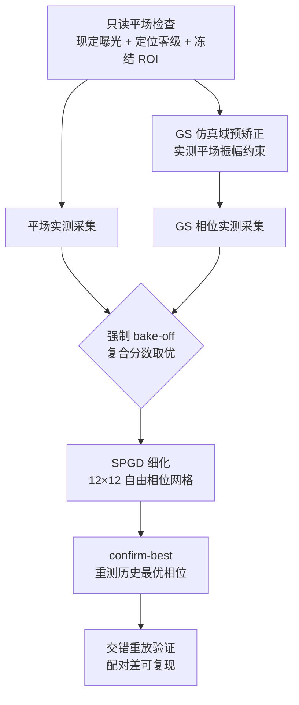
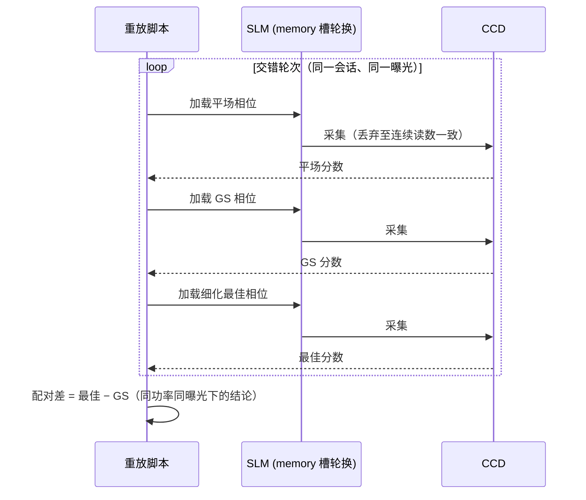

# 相位型液晶空间光调制器上的傅里叶光束整形闭环实验：Gerchberg–Saxton 预矫正与随机并行梯度下降细化的两级方法

实验日期：2026 年 10 月 12 日（含 10 月 1 日对照实验）
状态：实验结果完整，正文初稿。文中全部数据来自真实上机记录（`data/debug/slm_gs_refine/20261012_180222`、`20261012_183900`、`20261012_190400` 及交错重放目录），未做任何修饰。

---

## 摘要

针对相位型液晶空间光调制器（SLM）远场光束整形中仿真模型与真实光学的失配问题，本文提出并实机验证了一种两级整形方法：第一级在仿真域内用 Gerchberg–Saxton（GS）算法以实测平场振幅为约束生成预矫正相位，并以"平场与 GS 实测比分取优"的强制 bake-off 保证不劣化；第二级在硬件闭环内以复合指标（光斑完整性 PIB 与目标区均匀性 CV 的组合）为目标，用无梯度的随机并行梯度下降（SPGD）对自由形式相位网格做细化。在 λ=1064 nm、2f 傅里叶光路（f≈122.4 mm）上，复合分数从平场的 0.527 提升到 GS 后的 0.774，SPGD 细化后达到 0.778；交错重放实验表明该增益（+0.0043）在跨会话比较下可复现。30 轮 SPGD 曾取得 0.7895 的单次最佳（较当轮 GS 提升 0.0674），但落在双稳态分布的高簇中，尚不能视为可复现增益。对照实验表明加权 GS、混合输入输出加权 GS 与自适应反馈 GS 三种变体的实测分数均低于普通 GS，算法默认保持普通 GS。实验同时暴露了功率漂移（安全曝光从 0.05 ms 一路降至驱动下限 0.020 ms）与面板弛豫（可达 3 秒）两个工程约束，并给出对应的测量协议。作为对照，本文还给出自由形式方形整形（slm-gsnet）的实机失败案例与 FourierGSNet 湍流仿真矩阵：在数字孪生中，闭环自由形式优化可把方形均匀度压至 1%–5% 量级；而 576 自由度的实机闭环退化为随机游走（接受率 0.487，末态能量为初态 16%）。一成一败进一步论证了两级方法中自由度分配的必要性。与光路结构一致的数字孪生消融进一步表明，即使在无噪声仿真中单遍 SPGD 的综合评分也低于初始状态，两级次序是结构性结论；台架实测的相位带宽上限则从器件物理层面划定了闭环优化可用自由度的边界。

关键词：光束整形；Gerchberg–Saxton 算法；随机并行梯度下降；液晶空间光调制器；傅里叶平面；硬件在环优化

---

## 1 引言

远场光束整形是激光加工、光阱与定向能传输的基础环节。相位型 SLM 因其高损伤阈值、可寻址与可编程优势，成为最灵活的整形器件：在 2f 傅里叶光路中，只需在 pupil 面加载一幅相位全息图，即可在傅里叶面合成目标光强分布。此类设计的经典工具是迭代傅里叶相位恢复算法族，其中 Gerchberg–Saxton（GS）算法[1]与混合输入输出（HIO）算法[2]最为常用，其变体与适用性比较见 Fienup 的系统性工作[3]。

然而，纯仿真域设计隐含一系列理想化假设：SLM 相位调制为线性满 2π 调制、像素填充率 100%、无串扰，光路严格对准且无像差。真实器件与光路的失配会使仿真最优相位在实机上显著退化。一种自然的补救是把优化环路搬到硬件上：以相机实测图像为反馈直接搜索相位。随机并行梯度下降（SPGD）[4]因无需器件模型、只需标量性能指标，已在相控阵列合成孔径[5]与自适应光学中广泛使用。但硬件环路存在两个固有困难：单次测量的散粒噪声与读出噪声限制了每步可用的自由度；SLM 面板弛豫与激光功率漂移使不同时刻的测量不可直接比较。我们在 2026 年 10 月 1 日的对照实验中直接撞上了这两个困难：以 24×24 共 576 个自由度的自由形式相位直接做 SPGD，80 轮后接受率仅 0.487（统计意义上的随机游走），末态能量效率退化到初态的 16%，详见 `report/fouriergsnet_pipeline/hardware_run_20261001.md`。

本文的两级方法正是针对上述失败模式设计：先用 GS 在仿真域内完成"从平场到目标形貌"的大尺度相位结构生成（该步对失配不敏感，因为大尺度相位结构由目标形状决定），再用低自由度（12×12）SPGD 在硬件环内只修正模型失配带来的小尺度残差。配合三条测量纪律（稳定后采集、逐帧去背景、交错重放比较），2026 年 10 月 12 日的实验首次完整跑通该流程并得到可复现的正增益。

为了给方法比较一个完整的坐标系，本文简要综述两条基于模型的路线。其一是可微光子设计：衍射光学系统以解析梯度端到端训练，已用于全光学计算[6]与计算机生成全息图的端到端优化[7]；GS 算法本身也被物理展开为带复前向路径的网络[8]，说明"迭代算法加可学习参数"可以融合。其二是系统参数化：把未知系统失配（像差、标定误差）建模为少量可学习参数，由网络或梯度在线估计，再在物理模型中解析抵消。这两条路线的共同前提是前向模型足够准确、且硬件能够实现被优化的相位结构，后者对 LCOS 面板并非自动成立，本文第 6.4 节的实测给出了这一点。两级方法则刻意让模型不进闭环：GS 只用模型做离线全局设计，闭环完全交给无模型的低自由度 SPGD，以模型保真度换取鲁棒性。第 6 节给出与模型路线的系统对照及本台架上的证据。

随着可微物理仿真成为计算光学的主流范式，上述两条路线的工程实现也逐步沉淀为一批开源框架。可微光线追迹与 ray-wave 混合仿真支持自动透镜设计与课程学习，DeepLens 即在此类方向上以端到端可微透镜模拟器把浅层景深、成像计算与透镜形状联合优化[9]；傅里叶光学层面，TorchOptics 提供了与 PyTorch 自动微分对接的元件库（透镜、相位/振幅调制器、偏振器、探测器等），适合与本文的 2f 解析前向做数值对拍[10]；平面光学层面，DFlat 提供含预训练 meta-atom 神经模型与 GDS 版图导出的可微框架，面向超表面与自由曲面的正逆设计[11]；此外，Odak 面向 Julia 生态的通用光学/视觉计算[12]，SVETlANNA 面向衍射神经网络的仿真与工程[13]，LightPipes 则是面向教学的经典标量衍射包[14]。这些框架的共同点是把传播算子（Fresnel/Fraunhofer、薄透镜、孔径）做成可微算子，让"输入相位/物体"到"输出光强/图像"的整条链路可解析回传梯度。本文的 model-in-loop（MIL）闭环正建立在这一范式之上，但做了一个关键的轻量化取舍：不用重参数化的 U-Net 或 meta-atom 网络做前向，而是用 66 项 Zernike 系数（拟合阶数 n_orders=10）加一个非负增益、一个背景（平场泄漏）项的闭式物理前向（约 70 个可在线拟合参数），配合逐像素自由相位作为 Step B 的优化变量，使前向既可解析求梯度又可被 2 张实测探针快速重拟合。这一取舍的动机是，LCOS 台架的可用样本量极小（单轮 2 至 8 张探针），而上述重型可微框架的充分训练需要成千上万样本；闭式物理前向把"可辨识、可解释、可在线重拟合"作为第一目标，把参数量压到硬件样本量能够支撑的尺度。

## 2 原理与方法

### 2.1 整形模型与评价指标

系统为 2f 傅里叶光路：SLM 位于 pupil 面，相机位于傅里叶面。设 pupil 内复场为 P·exp(iφ)，远场强度近似为 |F{P·exp(iφ)}|²。SLM 参数见第 3 节表 1，相位加载以灰度计，2π 对应 993 灰度级（@1064 nm）。

评价指标取三项。PIB（Power in Bucket）为 250×250 相机窗口内能量占全帧能量的比例，窗口按平场实测零级位置（全帧坐标约 (672, 1027)）冻结，不随运行漂移。CV 为目标方形区（边长 100 相机像素）内强度变异系数。复合分数 composite(PIB, CV) 同时惩罚能量完整性与均匀性，是闭环优化的目标函数。所有分数在逐帧去背景（减中位数后截断非负、裁剪到冻结 ROI）之后计算，避免读出噪声负像素使 PIB 超过 1。

### 2.2 第一级：GS 预矫正与强制 bake-off

GS 在仿真域内迭代：pupil 面振幅约束取实测平场振幅（含高斯包络与中心凹陷），傅里叶面振幅约束取目标方形。相位网格与细化级共用（12×12 段/瞳孔，段间线性插值到像素级）。GS 输出相位并非无条件采用：系统同时加载平场与 GS 相位各采集一组实测帧，取复合分数高者进入下一级。这一 bake-off 是安全机制，防止模型参数（如瞳孔半径、2π 灰度数）错误时 GS 反而劣化光斑。

### 2.3 第二级：SPGD 细化

细化级在 GS 相位之上叠加自由形式相位修正，参数化为 pupil 内 12×12 网格（144 个自由度，其中半径外节点被掩模），每轮对全部节点施加高斯随机扰动 ±δ，以实测 composite 的差分估计梯度方向并沿步长更新。每轮结束用 confirm-best 机制重测历史最优相位，防止噪声把"假提升"写入参考态。该优化器与 `slm-square-shaping` 命令共用同一实现（`src/ao_shaping/shaping/slm_square_shaping.py`）。

### 2.4 测量协议

三条协议是结果可信的前提，均为实测教训的固化。其一，稳定后采集：SLM 面板加载新相位后弛豫可达 3 秒，采集器丢弃前若干帧并连续读数，直到相邻两次读数一致才计入平均。其二，memory 模式与槽位轮换：SLM 仅允许 memory mode（严禁 DVI 视频模式），连续写入必须轮换 memory slot，否则写入被面板拒绝。其三，交错重放：跨会话或跨运行的分数不可直接拼接比较，必须把待比较的若干相位在同一会话内交替重放（`scripts/replay_gs_refine_hw.py`），用同一功率、同一曝光下的配对差作结论。两级流程的完整执行链如图 1，交错重放的测量时序如图 2。

### 2.5 model-in-loop 正向模型闭环（MIL）

两级方法把模型隔离在闭环之外，model-in-loop（MIL）则走向另一极端：把一个可在线重拟合的物理正向模型放进闭环，让"估计系统"与"合成相位"在同一循环内交替。其动机是，两级方法依赖一个固定的低自由度 SPGD 网格，无法表达任意目标形状对自由相位的需求；而 MIL 在 Step B 直接优化整块 SLM 面板的逐像素相位，只要正向模型足够准确，就能把自由相位空间交给可微优化器。MIL 每轮交替两步，用实测数据在闭环里持续修正正向模型，再用修正后的模型合成相位。

Step A 拟合正向模型。系统向 SLM 下发若干张**强随机探针**相位（零均值高斯瞳面相位，标准差 probe_spread 默认 4 rad），测量每张探针的远场实测帧，再与正向模型在相同输入下的预测对比，重拟合一个**共享的 Zernike 像差向量**。必须用强随机探针而非平场的原因是：平场聚焦后近似 δ 函数，归一化强度对光滑低阶像差几乎无响应，像差不可辨识；只有探针相位标准差大于约 3 rad 时，信号才能越过 16-bit 量化本底两个数量级，拟合才良态。所有探针轮流喂给**同一个 Adam 状态**，原因是焦面强度是瞳面相位的非凸函数，单个探针会留下大量驻点，轮流喂入多个独立探针提供消除驻点所需的多样性。像差向量中 Noll 1、2、3（piston/tip/tilt）被冻结，因为它们无法从远场强度辨识：piston 是常数无贡献，tip/tilt 只平移零级位置；放开它们会把 56% 的系数范数灌进这些简并方向而不带来收益。

Step B 合成相位。冻结 Step A 刚拟合出的像差向量，以全像素 SLM 相位为变量，用 Adam 最小化与目标形状的复合损失（权重 w·EE 与 1-w·(1-CV)），梯度穿过解析 FFT 回传到逐像素相位。Step B 是纯计算过程，硬件上不可微的只有"真实测量"这一步，因此 Step B 全程在仿真域内迭代（可达数百步）而**只在末尾测量一次**，交给验收测试，600 步不产生 600 次设备往返。本轮合成出的相位成为下一轮的热启动。

MIL 用两个守卫抑制 Step A 与 Step B 互相追逐。守卫 1 是 trust region：逐轮 Zernike 系数变化的 L2 范数被截断到上限内，防止单轮拟合跨度过大。守卫 2 是逐轮验收：`acceptance_verdict` 比较本轮拟合损失与实测综合分，任一恶化即 reject（降低学习率、增加探针数、回退相位），连续 reject 达上限即中止（判定台架落在模型之外，不提交任何相位）。最终相位只有在实测严格优于平场基线时才提交。

MIL 的正向模型是本文的核心物理对象，详见第 3.5 节；其探针参数化、Zernike 低阶主导与逐像素自由相位的分工，以及 Step A/Step B 的完整时序，在第 4 节以实机数据呈现。



图 1　两级整形流程执行链（GS 预矫正 + SPGD 细化 + 交错重放验证）



图 2　交错重放测量时序（跨会话分数不可直接拼接，须配对比较）

## 3 实验装置

| 项目 | 参数 |
|---|---|
| 激光 | 1064 nm 连续，功率日内漂移显著（见 4.6） |
| SLM | 反射式液晶 SLM（LCOS 型号 KB1881T050，板卡序列号 23020027），1920×1200 像素，像素间距 8 μm，2π 相位深度对应 993 灰度级 @1064 nm，仅 memory 模式 |
| 相机 | 单色 CCD，2.2 μm 像元，507 万像素 |
| 光路 | 2f 傅里叶系统，透镜焦距标称 125 mm，实测约 122.4 mm |
| pupil 模型 | 中心 (960, 690) SLM 像素，半径 450 SLM 像素（模型扫描最优，无独立测量） |
| 目标 | 傅里叶面 100×100 相机像素方形 |
| 相位网格 | 12×12 段/瞳孔，seed=0 |
| 曝光 | 每次会话前只读平场检查现定，取峰值不超过 230/255 的最大档；本日为 0.05→0.04→0.020 ms |

### 3.5 MIL 正向模型与处理流程

MIL 的正向模型是一条闭式可微物理链：Noll 序 Zernike 系数向量 c（拟合阶数 n_orders=10，共 66 项）先在 pupil 网格上经 Zernike 基函数线性合成瞳面像差场，再与 Step B 的逐像素自由相位叠加，乘以圆形孔径掩模，经中心补零（far_field_size 放大远场采样，与实测采样率对齐）后做解析傅里叶变换 |fftshift(fft2(ifftshift(U), norm=ortho))|²，得到与 CCD 积分物理一致的远场强度，最后乘以可拟合的非负增益与加性背景项、按帧峰值归一化输出。整条链路中除"真实测量"外全部可解析求导，Step A 与 Step B 的梯度均由同一条前向回传。可在线拟合的参数为 66 个 Zernike 系数、1 个增益与 1 个背景，共约 70 个，其中 Noll 1、2、3 冻结，实际 63 个自由度；这一量级与单轮 2 至 8 张探针的样本量匹配，是区别于重型可微框架（参数量 10⁴ 至 10⁷）的关键设计。

MIL 的完整处理链如图 3：先做一次性几何标定（n 张标定探针验证正向模型与台架的几何一致性，相关度低于阈值即中止），再测平场基线，然后进入 Step A 拟合与 Step B 合成的交替循环，每轮末尾做一次实测验收。


图 3　MIL 相位-CCD 处理链：SLM 加载相位，2f 光路成像到 CCD，实测帧与正向模型预测对比后驱动 Step A/Step B 交替

## 4 结果与讨论

### 4.1 主结果：两级流程首次完整跑通

主运行（`20261012_180222`，曝光 0.05 ms，半径 450，网格 12）结果如表 2。

| 阶段 | composite | PIB | CV |
|---|---|---|---|
| 平场（无相位） | 0.5269 | 0.8602 | 4.1616 |
| GS 预矫正 | 0.7743 | 0.9769 | 0.7490 |
| SPGD 细化最佳（独立复测） | 0.7783 | 0.9781 | 0.7287 |

平场本身呈明显环形凹陷（hollowness 0.88–0.92，FWHM 12.2 相机像素），GS 一级即把 PIB 从 0.86 拉到 0.977，把 CV 从 4.16 压到 0.75，说明大尺度整形由仿真域 GS 完成是有效的；SPGD 细化贡献的增量较小（+0.004），主要来自 CV 改善。

该流程并非首次上机即成立。10 月 10 日的预试验（曝光 1 ms，12 次 GS 迭代、远场 padding 3、12×12 网格、24 轮细化）已给出同构结果：平场 0.5720、GS 0.7509、细化第 19 轮最佳 0.7635（PIB 0.9270、CV 0.6666）。图 3 与图 4 分别为该预试验 GS 一级与细化后的最佳实测远场，图 5 为其分数曲线与首末图像。预试验中细化增益（+0.0126）大于 10 月 12 日主运行，但当时尚无交错重放协议，该增益未经配对验证；10 月 12 日在更严格的协议下重做，增益绝对值缩小但可复现性确立。


图 3　10 月 10 日预试验：GS 一级最佳实测远场（composite 0.7509）


图 4　10 月 10 日预试验：24 轮细化后最佳实测远场（第 19 轮，composite 0.7635，仍有热点与空洞）


图 5　10 月 10 日预试验：分数曲线与首末图像（GS padding 3 + 24 轮细化）

### 4.2 交错重放：增益可复现

对平场、GS、细化最佳三个相位做交错重放（曝光 0.05 ms，两个 GS 帧与两个最佳帧交替），结果如表 3。

| 相位 | 重放分数 1 | 重放分数 2 | 重放分数 3 |
|---|---|---|---|
| 平场 | 0.52497 | 0.52364 | 0.52495 |
| GS | 0.77588 | 0.77501 | — |
| 细化最佳 | 0.77970 | 0.77976 | — |

最佳相对 GS 的配对差为 +0.0038 与 +0.0048，两次一致，且各相位内部重复性在 ±0.001 量级。结论：两级流程的正增益在配对比较意义下可复现。

### 4.3 GS 变体对照：普通 GS 实测最优

同一会话内以相同参数测试三种 GS 变体（表 4）。

| GS 变体 | composite | CV |
|---|---|---|
| 普通 GS | ≈0.775 | 0.749 |
| 加权 GS | 0.7167 | 1.069 |
| HIO 加权 GS | 0.7618 | 0.799 |
| 自适应反馈 GS（β=0.6，另一会话） | 0.6567 | — |
| 同会话普通 GS 对照 | 0.7076 | — |

三种变体全部劣于普通 GS。加权类变体在模型失配下把权重错配放大，自适应反馈版在低信噪比下 GS 迭代本身被噪声牵引。据此算法默认保持普通 GS，不再投入变体调参。

### 4.4 模型瞳孔半径扫描

在功率升高后的 0.020 ms 曝光下扫描 GS 模型半径（表 5），450 像素确认为当前模型下的最优值。

| 模型半径（SLM 像素） | composite | PIB | CV |
|---|---|---|---|
| 400 | 0.6944 | 0.9744 | 0.9744 |
| 450 | 0.7826 | 0.9807 | 0.7106 |
| 500 | 0.7171 | 0.9794 | 0.9029 |

半径偏离最优值 50 像素即损失 0.06 至 0.09 分，说明 GS 模型对 pupil 尺寸敏感，半径应作为标定参数对待。

### 4.5 30 轮 SPGD 与双稳态

在半径 450、曝光 0.020 ms 的 30 轮 SPGD 运行（`20261012_190400`）中，当轮平场 0.5436、GS 0.7221（PIB 0.8383，CV 0.6503），第 27 轮最佳达 0.7895（PIB 0.9719，CV 0.6473），当轮提升 +0.0674。但该相位未经独立交错重放，且其 GS 基线本身落在异常簇：把当日全部 30 轮运行的 GS 基线按目标区总计数排序，明显分成 25.7k 与 33.6k 两簇（13/32 次低于 0.74，16/32 次不低于 0.78），提示光路存在双稳态（怀疑与光斑在 SLM 上的落点或偏振态相关）。在双稳态定量之前，+0.0674 只能视为"当轮内提升"，不能视为可复现增益。

### 4.6 工程约束：功率漂移与曝光现定

当日安全曝光随功率升高从 0.05 ms 降至 0.04 ms，最终到驱动下限 0.020 ms。10 月 1 日亦记录到 8 分钟内功率上升 21%。结论是曝光不存在可写死的固定值，每次会话前必须做只读平场检查现定；饱和保护（峰值不超过 230/255）在全部运行中生效，无一帧饱和。

### 4.7 与仿真及失败对照的讨论

仿真流水线中两级流程的分数轨迹为 0.662（初态）、0.812（GS）、0.849（细化），细化贡献约 +0.037（含单遍 SPGD 对照的完整消融见第 6.1 节）。实机细化仅 +0.004，差距的原因可以从指标分解读出：实机 PIB 已被 GS 推到 0.978 接近饱和，剩余瓶颈全部在 CV（0.73 对仿真约 0.2），而 CV 受散斑与双稳态支配，12×12 网格的低自由度与单次测量信噪比不足以压碎散斑。与之对照，10 月 1 日 576 自由度纯自由形式 SPGD 完全随机游走（接受率 0.487，末态能量为初态 16%），证明"GS 先建立大尺度结构、SPGD 只做低自由度残差修正"的自由度分配是本流程成立的关键。

## 5 自由形式方形整形（slm-gsnet）与 FourierGSNet：仿真矩阵与实机失败对照

### 5.1 命令定位与自由度选择

`slm-gsnet` 是与两级流程同仓库的方形整形命令行：相位固定为自由形式（freeform 网格，段间插值到像素级），提供 SPGD（Adam/AdaMOD）与黑盒启发式（GA/PSO/SA/HC/RS/CEM/DE）两类搜索器，底层优化器与本文细化级共用同一实现。固定自由形式的原因是低阶 Zernike 基为圆对称光滑基，无法合成带锐边的方形远场。该命令在本文中承担两个角色：一是"高自由度直接闭环"的实机失败对照（5.2 节），二是后续 FourierGSNet 网络在环方案的执行载体（5.3 节）。

### 5.2 实机失败对照（10 月 1 日，576 自由度）

以 24×24 共 576 个自由度的自由形式相位直接做 SPGD（`--target-side 100`、`--lr 0.02`、adamod、80 轮，运行 2 分 29 秒、1.8 秒/轮，无挂起），结果如表 6。

| 判据 | 实测 | 判读 |
|---|---|---|
| `dec`（下降步占比） | 0.487 | ≈0.5，统计意义上的随机游走 |
| `sustained`（末态对首态） | −35.9% | 变差 |
| `late`（后 1/3 减前 1/3） | −2.1% | 无趋势（在噪声内） |
| `best` | +0.0%（第 1 轮） | 最优即初始态 |
| 四分位均值 | 0.1290 / 0.1238 / 0.1241 / 0.1245 | 平坦，无下降 |

目标函数被"钻空子"而非被优化，能量项分解如表 7。

| 项 | 首态 | 末态 | 变化 |
|---|---|---|---|
| CV 项 0.4·exp(−2·CV) | 0.0929 | 0.1048 | +0.0118 |
| EE 项 0.6·EE | 0.0947 | 0.0155 | −0.0792 |
| EE 末/首比 | — | — | 0.16×（约 6 倍能量流失） |
| 零级峰值 max_brt | 225 | 17 | 光斑被彻底打散 |

同一曝光下平场参考的 max_brt 为 202–246，末态的 17 是散斑而非聚焦光斑。根因是 576 自由度下单帧差分信噪比不足：每轮扰动对分数的真实改变量小于测量噪声，梯度估计退化为噪声。两处参数偏离默认值也是实测教训：目标方形边长若取 50 相机像素，可达的阶梯结构（≥46–92 像素）全部落在统计框外，目标函数退化；学习率取 0 会触发调度器静默覆盖扰动幅度参数。该失败直接催生两级方法的自由度分配：GS 在仿真域建立大尺度结构，硬件闭环只留 144 个自由度修残差。

### 5.3 FourierGSNet 湍流仿真矩阵

FourierGSNet 数字孪生（`drivers/sim/fouriergsnet_env.py`）上的闭环矩阵：64×64 原生方板、网格 K=512、30 闭环步、峰值光子数 50000、读出噪声 2 e−，并注入标定噪声（波数偏差 2%、中心偏移 2 像素、旋转 0.3°），场景为 3 种目标形状 × 3 种像差 × 2 档湍流速度共 12 个，全部成功。方形目标的最终均匀度（CV）为 0.0106–0.0519，高斯目标接近 0，环围能量 1.77×10⁶–5.08×10⁶ counts（图 6、图 7）。


图 6　FourierGSNet 仿真矩阵（方形目标、无像差、无湍流）：闭环指标演化曲线


图 7　同场景闭环过程中的远场帧序列

### 5.4 一成一败的合读

仿真矩阵证明闭环自由形式优化在原理上可把方形均匀度压到百分之一量级；576 自由度实机运行证明同一算法在真实信噪比下随机游走。两者夹出的结论是：硬件闭环的瓶颈不在算法而在测量，自由度必须与单帧差分信噪比匹配。仿真与实机的另一处差距（实机 CV 0.65–0.73 对仿真 0.01–0.05）由散斑、面板弛豫与功率漂移支配。仿真管线自身也发现一处面板分辨率转置隐患（驱动层 (宽,高) 与管线 (高,宽) 不一致，被对称的仿真参数掩盖），已登记为离线修复项。gsnet 的复测计划（ABBA 漂移对消 + 16×16 降自由度）与 FourierGSNet 真机接入次序见 `report/fouriergsnet_pipeline/next_attempt_plan.md`。

## 6 可微仿真与数字孪生消融：模型路线及其硬件边界

第 4、5 节比较了两种无模型策略（仿真域 GS 与硬件环 SPGD）。为把两级方法放进更完整的方法论坐标系，本节补充同仓库中的三组证据：与台架光路结构一致的数字孪生对四个流程阶段的消融，用于检验两级次序是否为结构性结论；在真实硬件语料上训练的学习逆模型与系统参数化路线（FourierGSNet、逆向 U-Net），用于界定其当前边界；台架实测的相位带宽上限，用于划定高自由度梯度类路线的物理极限。本节全部仿真数据来自仓库真实运行记录，与第 4、5 节的硬件实测严格区分。

### 6.1 数字孪生消融：两级次序是结构性结论

数字孪生（64×64 相位网格、512×512 远场、金标准 Zernike 像差 n≤4、复合分数 0.5·PIB+0.5/(1+CV)、seed 0）对初态、单遍 GS（200 迭代）、单遍 SPGD（8 维 Zernike 驱动、600 步）与两级迭代环（GS 与 SPGD 交替 4 外轮）四个阶段做消融，结果如表 8。

表 8　数字孪生消融结果（纯仿真、无噪声）

| 阶段 | 复合分数 | PIB | CV |
|---|---|---|---|
| 初态（带像差） | 0.662 | 0.976 | 1.874 |
| 单遍 GS（200 迭代） | 0.812 | 0.915 | 0.412 |
| 单遍 SPGD（600 步，8 维） | 0.647 | 0.998 | 2.379 |
| 两级迭代（4 外轮） | 0.849 | 0.803 | 0.117 |

两个事实值得强调。其一，即使在无噪声仿真中，单遍 SPGD 的分数（0.647）也低于初态（0.662）：其 PIB 近乎饱和（0.998），均匀性却完全没有被优化（CV 2.379）。低维光滑驱动从光滑初态出发找不到平顶所需的结构，因此 SPGD 单独策略的失败不只是信噪比问题，更是搜索结构问题。两级次序（先 GS 后 SPGD）由此成为结构性结论，与硬件实测（单遍 SPGD 随机游走、两级 +0.0043 可复现）一致。其二，迭代环内的 Zernike 标定通道是负结果：开启标定通道得分 0.810，关闭得分 0.849；而把估计像差预矫正进 pupil 对 GS 是可证明的无效操作，GS 的 pupil 支持约束每次迭代都会重新加载场的振幅与相位，任何常数基底相位都会被湮灭，预矫正与否的实测得分精确到小数点后六位一致。这说明"像差标定加整形"并非免费的增益：标定是否有用，取决于下游算法对常数基底相位的敏感性。

### 6.2 可微前向模型与梯度路线

仓库在 PyTorch 中实现了可微傅里叶前向模型（`algorithm/signal_processing/differentiable_beam.py`、`differentiable_shaping.py`）：相位网格、傅里叶与角谱传播、损失函数（均匀性、围栅能量、零级抑制、平滑正则）端到端可微，梯度下降直接优化相位。该路线有两种运行模式：纯仿真模式下前向完全由模型给出；硬件闭环模式下每轮采集当前加载相位的实测远场，损失梯度在实测图像上评估、模型雅可比决定更新方向，相当于把梯度路线锚定在真实测量上。与 SPGD 相比，梯度路线的优势是梯度解析给出，不受 SPGD 扰动差分信噪比的约束；代价是模型误差直接进入更新方向。两级方法刻意取折中：模型只负责离线全局设计（GS），闭环只负责低自由度残差修正（SPGD），模型误差不进入闭环更新。

第 5.3 节的 FourierGSNet 是梯度路线与系统参数化的结合：它把 5 层 GS 双向投影物理展开，每层物理特征与实测远场、目标强度拼接后，由轻量卷积网络（共 104,440 参数）回归 24 个 Zernike 失配系数（Z4–Z27），控制律以 GS 相位减去预测失配。这一设计把未知失配当作少量可学习参数，由网络在线估计、在物理模型中解析抵消；其微调采用域随机化（低阶 8 维系数在 0.3/0.5/0.8 rad 中采样、高阶 16 维在 0.1/0.2/0.3 rad 中采样，目标尺寸亦随机化），闭环在指标退化时可触发在线回放重训。第 5.3 节矩阵结果说明该路线在静态像差与标定扰动下能把均匀度保持在百分之一到百分之五量级，但在慢湍流（OU 过程，σ=0.15 rad，τ=50 帧）下最终均匀度劣于过程内最佳值，跟踪滞后是该路线的主要瓶颈。

### 6.3 学习逆模型：真实语料与诚实边界

仓库在真实硬件语料（8,781 条训练记录、119 个文件、23 个家族）上训练了 U-Net 逆向整形模型：输入远场强度，输出 SLM 相位（phasor 表示）。按文件配对的符号翻转检验显示，物理项（仿真远场对目标）显著优于"训练集平均相位"基线（p=4.7×10⁻⁶，效应量 Cohen's d_z=0.913），但监督项（phasor 平均绝对误差）不显著（p=0.0642），且训练被轮次预算截断（最优轮为最后一轮）。结论不应被粉饰：模型的远场表现是真实的，但其相位预测尚未稳定超过一个几乎不需要学习的基线，目前只能作为"快速初始化器"候选，不是经过验证的 GS 替代品。这一边界与可微物理路线中"逆模型在未知像差下不可靠"的观察一致：学习逆模型在可信之前，应与物理前向模型或硬件闭环串联使用，而不是直接替换设计算法。

### 6.4 实测相位带宽上限：模型路线的物理限制

台架实测（2026 年 9 月 30 日，曝光 3.0 ms，束斑半径 450 面板像素，core40 定义为帧内能量落在零级 40 像素内的比例）给出不同 pupil 相位下的远场响应，见表 9。

表 9　台架实测相位带宽上限（硬件实测）

| pupil 相位 | 远场峰值（灰度） | core40 |
|---|---|---|
| 平场 | 86 | 0.0261 |
| 逐像素随机（1 SLM 像素） | 92 | 0.0247 |
| 随机 Zernike n≤4 | 35 | 0.0195 |
| 随机 Zernike n≤8 | 24 | 0.0250 |
| 随机 Zernike n≤14 | 12 | 0.0127 |

逐像素随机相位几乎不改变远场（core40 0.0247 对平场 0.0261），而光滑 Zernike 相位使远场峰值随阶数单调退化（86 降至 12）。这说明 LCOS 面板与光路的有效相位分辨率远粗于单像素，高空间频率被强烈低通滤波。该实测为第 5.4 节"自由度必须与单帧差分信噪比匹配"的结论提供了第二根支柱：576 自由度自由形式相位的失败不只是信噪比不足，而是这些自由度在本台架上物理不可实现，面板写不出对应的相位结构。同一实测也排除了散斑相关标定路线：前向模型"随机 pupil 相位产生散斑场"的前提在本台架不可实现，实测散斑相关始终低于 0.07，据此拟合的任何几何系数都没有意义。对可微梯度路线的含义是直接的：优化变量数必须截断在台架可测带宽之内，且应把该低通响应折入前向算子（例如对相位基做带限），否则模型梯度会为物理上不可实现的自由度给出乐观的更新方向。

### 6.5 方法论合读

综合第 4 至 6 节证据，四条路线的分工如下：GS 是纯模型路线，离线完成全局设计，对模型标定（瞳孔半径、2π 灰度数）敏感；SPGD 是无模型路线，在线闭环修残差，对信噪比与自由度敏感；可微梯度路线给出解析梯度、不受扰动信噪比约束，但受模型保真度与硬件带宽双重约束；学习逆模型推理最快，但尚未可信。两级方法把模型留在闭环之外、把闭环留在低自由度之内，是当前台架信噪比与带宽条件下最稳的配置。

## 7 局限与下一步

本文实验存在四点局限。其一，pupil 半径 450 为模型扫描值，无独立测量，且扫描仅在单一曝光下完成。其二，双稳态未定量，30 轮 SPGD 的高簇增益未经独立交错重放。其三，板卡序列号在两次会话间从 22030108 变为 23020027，实物连接待核对。其四，细化增益的绝对值仍小（+0.004），实用价值取决于 CV 能否被进一步压低。

下一步按优先级执行：对 `20261012_180222` 最佳相位做独立交错重放并加 drift 探针，定量两簇来源；在重放框架内把相位网格从 12 逐级升到 16、24，主攻 CV；最后才考虑把达标流程接入 FourierGSNet 真机运行。完整计划见 `report/fouriergsnet_pipeline/next_attempt_plan.md`。此外，第 6 节的梯度路线与系统参数化路线目前只在仿真与数字孪生中验证，可微模型的硬件闭环模式（损失梯度在实测图像上评估）代码已就绪但未上机，下一步应在网格升级完成后运行，并把第 6.4 节实测的低通响应折入前向算子；针对散斑与双稳态下的均匀度天花板，候选改进是系统松弛：在设计期向前向模型注入可控噪声扰动，使相位解对测量噪声与面板非理想鲁棒，该思路在可微仿真中已见收益，但在本台架尚未验证。学习逆模型（第 6.3 节）在监督指标上尚未超过基线，目前只作候选初始化器；FourierGSNet 的在线微调与回放机制尚未在真机启用。

## 8 结论

在 1064 nm、2f 傅里叶光路的相位型 LCOS 空间光调制器上，"GS 仿真域预矫正加低自由度 SPGD 硬件细化"的两级流程首次完整实机跑通：复合分数 0.527 到 0.774 到 0.778，其中细化增益 +0.0043 经交错重放确认可复现。GS 变体实测全面劣于普通 GS；模型瞳孔半径需作为标定参数；曝光必须每会话现定。30 轮 SPGD 的 +0.067 单次最佳受双稳态污染，待独立重放裁定。实验同时给出三条可移植的硬件环路测量纪律：稳定后采集、逐帧去背景、交错重放比较。数字孪生消融与实测相位带宽上限进一步表明：两级次序在无噪声仿真中同样成立，而闭环优化可用自由度最终受硬件信噪比与相位带宽的双重约束，这为后续引入可微模型闭环与系统参数化划定了安全的作用域。

## 参考文献

[1] R. W. Gerchberg and W. O. Saxton, "Fourier phase determination for incoherent and coherent imaging systems," Optik 35, 237–246 (1972).（前 DOI 时代经典，无 CrossRef 记录）

[2] J. R. Fienup, "Reconstruction of an object from the modulus of its Fourier transform," Opt. Lett. 3(1), 27–29 (1978). https://doi.org/10.1364/OL.3.000027

[3] J. R. Fienup, "Phase retrieval algorithms: a comparison," Appl. Opt. 21(15), 2758–2769 (1982). https://doi.org/10.1364/AO.21.002758

[4] M. A. Vorontsov, T. B. Buck, M. A. Volkonskii, S. N. Chipoulenko, V. M. Dyadyuk, and V. A. Banakh, "Stochastic parallel-gradient-descent technique for high-resolution wave-front phase-distortion correction," J. Opt. Soc. Am. A 15(10), 2745–2758 (1998). https://doi.org/10.1364/JOSAA.15.002745

[5] A. A. Shapovalov et al., "Active phasing a nine-element 114 kW all-fiber two-tone MOPA array using SPGD algorithm," Opt. Lett. 36(16), 3121–3123 (2011). https://doi.org/10.1364/OL.36.003121

[6] X. Lin, Y. Rivenson, N. T. Yardimci, M. Veli, Y. Luo, M. Jarrahi, and A. Ozcan, "All-optical machine learning using diffractive deep neural networks," Science 361(6405), 1004–1008 (2018). https://doi.org/10.1126/science.aat8084

[7] M. Zhou, H. Zhang, S. Jiao, P. Chakravarthula, et al., "End-to-end compression-aware computer-generated holography," Opt. Express 31(25), 43908 (2023). https://doi.org/10.1364/OE.505447

[8] S. Yan, M. Holenderski, and N. Meratnia, "Efficient Gerchberg–Saxton algorithm deep unrolling for phase retrieval with a complex forward path," Adv. Photonics Nexus 5(2), 026005 (2026). https://doi.org/10.1117/1.APN.5.026005

[9] DeepLens (vccimaging/DeepLens), differentiable optical lens simulator for end-to-end computational imaging. https://github.com/vccimaging/DeepLens

[10] M. Filipovich et al., "TorchOptics: An open-source Python library for differentiable Fourier optics simulation," arXiv:2411.18591 (2024). https://doi.org/10.48550/arxiv.2411.18591 ; https://github.com/MatthewFilipovich/torchoptics

[11] DFlat (DeanHazineh/DFlat), a forward and inverse design framework for flat optics. https://github.com/DeanHazineh/DFlat

[12] Odak (kaanaksit/odak), a scientific computing library for optics, computer graphics and vision. https://github.com/kaanaksit/odak

[13] SVETlANNa (CompPhysLab/SVETlANNa), an open source library for simulation and engineering of diffractive neural networks. https://github.com/CompPhysLab/SVETlANNa

[14] F. van Goor, "LightPipes: software for education in coherent optics," Proc. SPIE 2909, 1997. https://doi.org/10.1117/12.294366

> 注：[2][3][4][5][6][7][8] 已于 2026-10-12 通过 CrossRef API 核实 DOI 有效；[5][7] 作者列表以 CrossRef 记录为准，投稿前需再核对全作者。[10] 的 arXiv DOI 与 [14] 的 SPIE DOI 已于 2026-10-14 通过 OpenAlex 核实有效；[9][11][12][13] 为开源软件库，无 DOI，以 GitHub 仓库地址为准（2026-10-14 核实仓库存在）。

---

## 附录 A 数据与可复现性

| 内容 | 路径 |
|---|---|
| 主运行（含 GIF 动画） | `data/debug/slm_gs_refine/20261012_180222/` |
| 0.04 ms 复验 | `data/debug/slm_gs_refine/20261012_183900/` |
| 30 轮 SPGD | `data/debug/slm_gs_refine/20261012_190400/` |
| 交错重放 | `data/debug/slm_gs_refine/20261012_180222_replay_best/` |
| 重放工具 | `scripts/replay_gs_refine_hw.py` |
| 真机首跑完整记录 | `report/shape_trials/gs_refine_live_20261012.md` |
| 10-10 预试验记录与图 3–5 图源 | `report/shape_trials/online_20261010.md`、`report/shape_trials/figures/` |
| 10-01 gsnet 失败对照 | `report/fouriergsnet_pipeline/hardware_run_20261001.md` |
| FourierGSNet 仿真矩阵与图 6–7 图源 | `report/fouriergsnet_sim/report.md`、`report/fouriergsnet_sim/figures/` |
| 数字孪生消融（表 8）数据与生成脚本 | `report/iterative_zernike_shaping/data.json`、`scripts/generate_iterative_zernike_shaping_report.py` |
| 可微前向模型代码（6.2 节） | `src/ao_shaping/algorithm/signal_processing/differentiable_beam.py`、`differentiable_shaping.py` |
| 逆向 U-Net 语料结果（6.3 节） | `report/inverse_shaping_unet/report.md` |
| 相位带宽实测（表 9） | `report/slm/model_in_loop_bench_calibration.md` |
| 下一步计划 | `report/fouriergsnet_pipeline/next_attempt_plan.md` |

交错重放命令示例：

```bash
python scripts/replay_gs_refine_hw.py data/debug/slm_gs_refine/20261012_180222 \
  --exposure-ms <会话现定值> --slm-serial 23020027 \
  --expected-wavelength 1064 --cam-center <全帧零级x,y>
```
