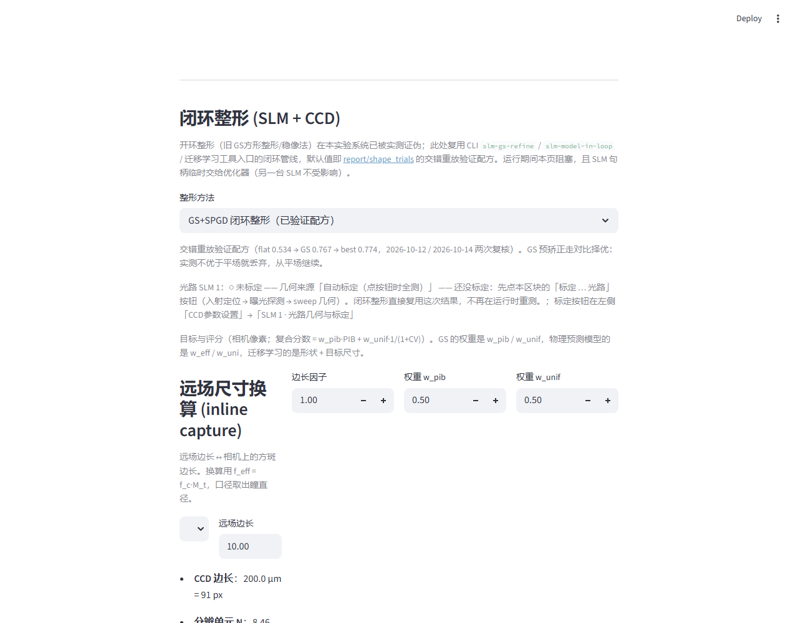
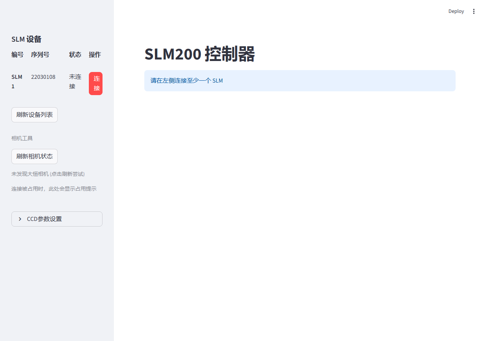

# 采样成像助手 — 用户使用手册

> 位置：SLM 整形页面 → 目标方边长右侧的 **「远场尺寸换算」popover → 第二段「采样光路」**。

## 它解决什么问题

操作员手上通常只有主路焦面上的方斑边长 `S`（毫米），但优化器要填的是
**采样相机上的像素数**。采样成像助手把 `S` 换算成 `S_CCD = S·f_sample/f_main`，
并同时检查这个主路方斑是否真的能被本台面的 SLM 与采样相机所表达。

## 公式（以公式为准）

```
S_CCD = S × f_sample / f_main          （只与 S、两焦距有关）
D_SLM = 2 · N · w                      （照明直径，N=扩束倍率，w=扩束前束腰）
N_eff = D_SLM / p                      （SLM 上的有效像素数）
Δ_min = λ · f_main / D_SLM            （主路分辨单元）
M_samp = λ · f_sample / (D_SLM · p_cam) = Δ_min · (f_sample/f_main) / p_cam
```

> **`N` 与 `w` 不进入 `S_CCD`**——它们只决定照明直径与各项可达性判据。
> `p`（SLM 像素间距，8 µm）与 `p_cam`（相机像元，2.2 µm）是**两个不同**的量。

## 可达性判据（全部由 `sampling_limit` 单一实现）

| 判据 | 物理含义 | 越界时建议 |
|---|---|---|
| `M_samp ≥ 2` | 采样相机能分辨主路的 Δ_min | 加大 `f_sample`，或减小 `D_SLM`（降 N / w） |
| `S ≤ λ·f_main/p` | 方斑不超出面板 Nyquist 视场 | 减小 `S`，或换更小的 `p` |
| `S ≤ min(面板宽, 面板高)` | 方斑不顶到面板物理尺寸 | 减小 `S` |
| `D_SLM ≤ 面板短边` | 照明不被面板边缘挡 | 降 `N` 或 `w` |
| `S_CCD ≤ 读出窗` | 换算结果装得进当前读出窗 | 开大读出窗或减小 `S` |

报告**只给事实**（`violations` 元组按严重程度排序：
照明超出面板 → 目标顶到面板 → 混叠 → 欠采样），从不自动夹取/阻断；
处置权在操作员与页面按钮。

## 工作示例（默认台面）

参数：`f_main = 1000 mm`、`N = 4`、`w = 1 mm`、`f_sample = 50 mm`、`S = 40 mm`、
`λ = 1064 nm`、`p = 8 µm`、`p_cam = 2.2 µm`。

| 量 | 值 |
|---|---|
| `S_CCD` | **2.000 mm = 909 px** |
| `D_SLM` | 8.00 mm（1000 px） |
| `Δ_min` | 133 µm |
| `M_samp` | 0.83（需 `f_sample ≥ 120.3 mm`） |
| 面板物理边长 / 无混叠视场 | 9.60 mm / 133.0 mm |
| 结论 | `ok = False`（欠采样 + 方斑顶到面板） |

把 `f_sample` 提到 ≥ 120.3 mm 后 `M_samp` 才 ≥ 2；把 `S` 降到 ≤ 9.6 mm 才不顶到面板。

## 操作步骤

1. 在 SLM 整形页面填好「目标方边长」旁的 **远场尺寸换算** popover。
2. popover 第二段「采样光路」里填 `S`、`f_main`、`f_sample`、`N`、`w`（`p` / `λ` / 面板尺寸取台面常量，`p_cam` 取侧栏「相机像元」）。
3. 看 summary：`S_CCD`、`D_SLM`、`Δ_min`、`M_samp`、面板/视场。
4. 若有 violation，按建议调整；「恢复采样光路参数」只复位**光路参数**（`S` 不动，避免抹掉刚测出的目标）。
5. 点 **「填入目标方边长（采样相机）」**：把 `S_CCD` 折成像素填入目标方边长；超出读出窗时夹取并告警。

## 运行效果



`shaping_section.png` — 页面实际渲染出来的「闭环整形 (SLM + CCD)」区块（顶部到「远场尺寸换算
(inline capture)」段被页面下缘截断）：整形方法下拉、三个数字输入（边长因子 1.00 /
权重 w_pib 0.50 / 权重 w_unif 0.50）、以及 `f_eff = f_c·M_t` 的换算说明与
`远场边长 10.00` → `CCD 边长 200.0 μm = 91 px`、`分辨单元 N 8.46`。

> ⚠️ **本目录曾有四张「不同参数」的副本，其实是同一张图的重新编码。**
> 2026-10-28 复核（逐像素比对 + SHA-256）：原 `config_2` 与原 `config_4`、原
> `config_3` 与原 `config_5` 字节相同；原 `config_1` 与其余四张也只差 24–60 个像素、
> 最大通道差 2/255（PNG 抗锯齿噪声）。那张图里**没有**「采样光路」字段、没有
> `f_sample` / `M_samp`、也没有 violation 告警行，所以旧正文里「`config_1` = 采样光路
> popover」「`config_2` = `ok=False` 红字」「`config_3` = `f_sample` 提到 180 mm 后的
> 正常态」三条 caption 都与像素不符，已删除，重复副本与一张没有被任何文档引用的图
> 一并删除。要展示那三种状态，需按上面「操作步骤」用对应 `SAMPLING_CFG` 重新截图；
> 本仓库目前没有那三张图。



`test_capture.png` — 设备未连接时的整页：侧栏「SLM 设备」表里列出一台真实枚举到的
控制器（序列号 22030108）且状态为「未连接」，下方「未发现大恒相机」；主区是
信息条「请在左侧连接至少一个 SLM」。这张证明的是**连接前**的界面形态，
不是采集结果。

> **这些图是布局截图，不是台面实测。** `shaping_section.png` 由
> `scripts/slm/screenshot_sampling_assist.py` 生成：它模拟一个已连接的 SLM，
> 因此不需要设备；`test_capture.png` 是设备关机时的真实界面截图。两者证明的都是
> **布局与文案**，不是某一条光路的实测结论 —— 实测量请走本页「操作步骤」在现场读
> summary。


## 非可互换的三条尺度律

同一 popover 里并列三段，**口径不同，不可互相代入**：

1. GS-refine `aperture·f/(d·p_cam)`（照明瞳几何像）。
2. `link_design` `W_ccd = f_c·M_t·W_far/L`（望远镜远场角尺度）。
3. 本助手 `S_CCD = S·f_sample/f_main`（主路方斑二次成像）。
