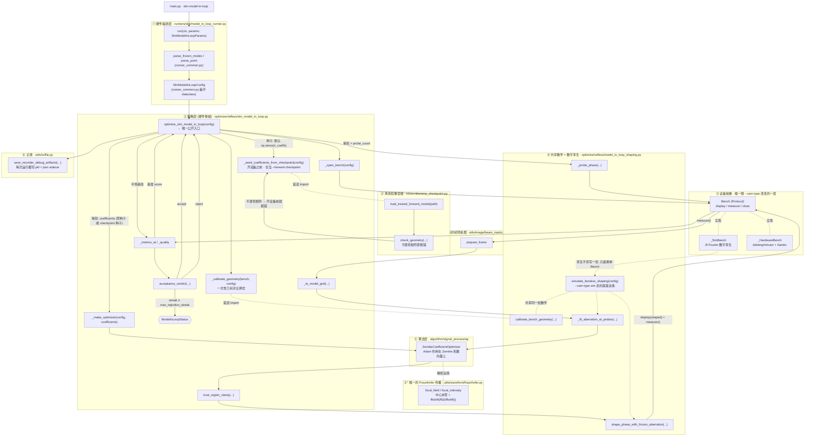
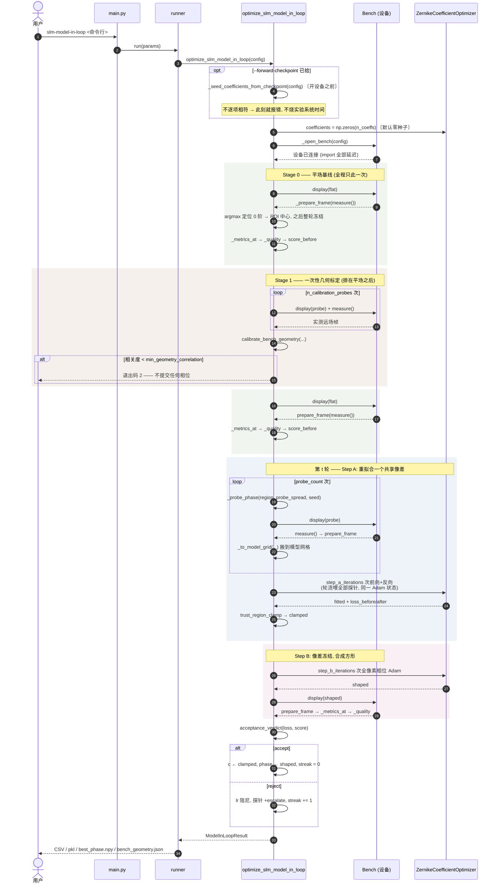
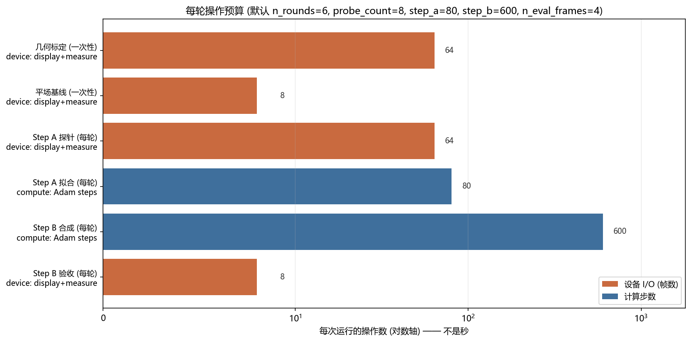
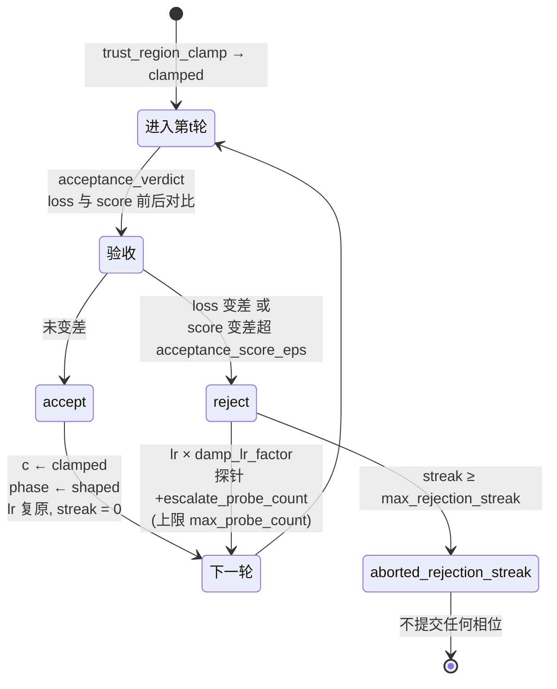
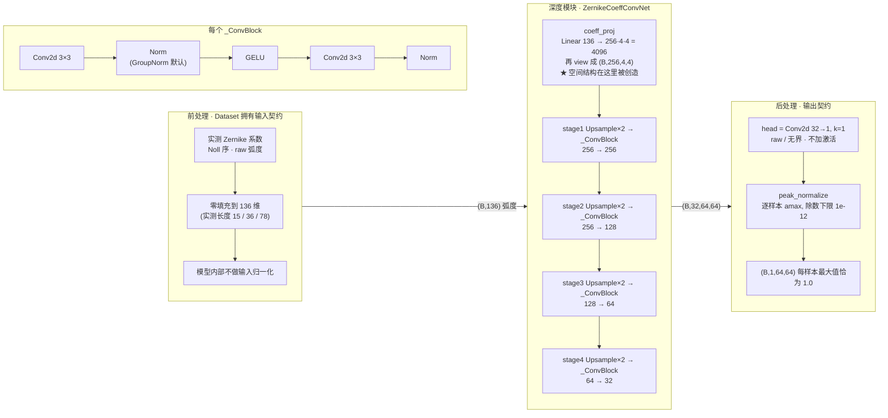

# 物理预测模型闭环整形 (slm-model-in-loop) —— 调用关系 / 计算时序 / 算法说明

> **生成脚本**: [`scripts/slm/generate_model_in_loop_report.py`](../../scripts/slm/generate_model_in_loop_report.py)
> **复现命令**: `python scripts/slm/generate_model_in_loop_report.py`
> **运行环境**: 离线 (纯源码静态分析 + 可选 torch 实测; 不开设备)
> **说明**: 本文档是**使用/结构说明**, 不是测量结论 —— 硬件实测另见
> [`report/slm/model_in_loop_hw_runbook/model_in_loop_bench_calibration.md`](../../report/slm/model_in_loop_hw_runbook/model_in_loop_bench_calibration.md)。

本报告描述 `slm-model-in-loop` 的**结构与算法**, 不是一次测量的结论。
全文离线可重生成: 图中的每个符号都对着源码解析过, 表格里的默认值是从 dataclass
的 AST 里读出来的 —— 改名会让生成失败, 而不是留下一份看起来仍然权威的旧文档。

> **口径声明: 本报告不含任何壁钟耗时。** 每轮的设备往返次数与计算步数可由配置
> 推出, 因此给出; 耗时取决于实验系统, 在这里写就是编造。

## 1. 这条命令做什么

每轮交替两步, 用实测数据在闭环里持续修正物理预测模型, 再用修正后的模型合成相位:

1. **Step A —— 拟合物理预测模型.** 显示若干个**强随机探针**相位, 把每个探针的远场实测帧
   与物理预测模型的预测对比, 重拟合**一个共享的 Zernike 像差向量**。
2. **Step B —— 合成方形.** **冻结**刚拟合出的像差, 优化**全像素 SLM 相位**逼近方形目标,
   下发实测; 本轮相位成为下一轮的热启动。

两个守卫 (§6) 抑制两步相互耦合振荡; 最终相位只有**实测优于平场基线**才提交。

## 2. 调用关系图

每个节点都是真实符号, ①…⑥ 标出它归哪一层。虚线 = 延迟 import (硬件栈在 import 期就碰硬件, 所以这些 import 全在函数内部)。



孪生与硬件的关系是这个模块的全部设计要点: 标 `[孪生]` 的行**不是**一份会腐烂的平行实现,
而是硬件层 import 进来的共享数学 (`model_in_loop_shaping`), 且 import 全部延迟到函数内 ——
`ao_shaping.drivers` 在 import 期就会碰硬件。于是 `--cam-type sim` 只替换 `Bench` 的实现,
其余数学逐位相同; 反过来, 仿真里验证过的 Step A/B 逻辑不会在硬件路径上悄悄漂移。

两个模块共享数学, 共享的**不是** config/result 类型 —— 孪生用
`ModelParams`/`StepAConfig`/`StepBConfig`/`ModelInLoopResult`, 硬件用扁平的
`SlmModelInLoopConfig`/`RoundRecord`/`ModelInLoopResult`, 因为硬件侧要把设备生命周期、
settle 判据和 recorder 行一并塞进一个可序列化的配置里。

## 3. 计算时序图

一轮的完整时序。`rect` 的底色区分阶段, 与 §3 的操作预算图配色一致: 米色 = 一次性几何标定, 浅绿 = 平场基线, 蓝 = Step A, 粉 = Step B。



### 顺序里三个容易看漏的点

**几何标定在最前面, 且只做一次.** 它自己也要 display+measure, 但它解的是
`BenchGeometry` —— 没有它, Step A 的 loss 会把「模型预测错」和「几何标定错」混在同一个残差里,
梯度方向是错的。相关度低于 `min_geometry_correlation` 直接以退出码 2 中止, **不提交任何相位**。

**Step A 的所有探针喂进同一个 Adam 状态, 不是每帧各跑一次优化.** 焦面强度是瞳面相位的
非凸函数, 单个探针留下大量驻点, Adam 会停在它进去的那一个; 轮流喂多个独立探针提供的是
消掉这些驻点所需的*多样性*。另外 `update` 在连续 30 步无改善后会锁存
(`PLATEAU_PATIENCE`), 且没有任何东西清这个锁存 —— `reset()` 会把系数倒回 `__init__` 的值, 所以
re-arm 必须绕着**当前**系数重建优化器。

**Step B 只在最后测一次, 不在每次迭代里测.** Step B 是纯计算 (可微物理预测模型过 FFT),
硬件上不可微的只有「真实测量」本身, 所以梯度来自模型而不是测量; 实测只在末尾做一次,
交给验收测试。因此 `step_b_iterations=600` 不产生 600 次设备往返。



## 4. Step A 详细: 共享像差拟合

### 4.1 为什么必须用探针, 不能直接用整形相位

平瞳面 (或光滑整形后的瞳面) 聚焦成近似 δ 函数, 其**归一化**强度对光滑低阶像差几乎不响应 ——
像差因此不可辨识。探针相位 std 高于约 3 rad 时信号才越过 16-bit 量化本底两个数量级, 拟合才良态。
这也解释了 `probe_spread` 不是一个可以随手调小的正则项。

### 4.2 逐步

1. `_probe_phase(region, probe_spread, seed)` 生成零均值高斯**瞳面相位** (raw 未包裹弧度)。
2. `bench.display(probe)` 下发, `bench.measure()` 读一帧, `prepare_frame` 逐帧去背景再裁剪
   —— 直接对原始帧算指标会被读出噪声污染 (对称读出噪声让约一半像素为负)。
3. `_to_model_grid` 把实测帧搬到**模型自己的网格**上。Step A 的 loss 比较的是
   「实测 CCD」与「模型预测」, 两者必须逐像素可比, 所以这一步的尺度关系必须由几何标定保证。
4. `_fit_aberration_at_probes` 把 `(实测远场, 探针相位)` 对**循环**喂进同一个
   `ZernikeCoefficientOptimizer` 的 `update`, 跑满 `step_a_iterations` 步。
5. 输出 `fitted` 与本轮 loss 首末值, 供验收测试使用。

### 4.3 冻结哪些模式, 以及为什么

`frozen_modes` 默认 `(1, 2, 3)`, 即 **Noll 1/2/3 = piston/tip/tilt**。它们**无法从远场
强度辨识**: piston 在瞳面上是常数, 对焦面强度无贡献; tip/tilt 只是把 0 阶搬个位置。
放开它们的实测后果是 56% 的系数范数转移到这些简并方向而**不带来任何收益** ——
即拟合在噪声方向上花掉了 trust region 的预算。

### 4.4 系数个数

`n_coefficients = calc_n_zernike_terms(n_orders)`, **含 piston**。
这与 `ml/zernike` 的离线约定**差一位**, 差异如何对齐见 §9.2。

**远场传播只有一份实现.** Step A 的解析远场、Step B 的可微远场, 以及离线 `ZernikeAmpModel`
的 `_propagate`, 三者都调用 `utils/wavefront/fraunhofer.py` 的 `focal_intensity` /
`focal_field`(中心补零 + `fftshift(fft2(ifftshift(·), norm="ortho"))` + `re²+im²`)。
改动前这三处是三份彼此独立的拷贝; 现在只有目标网格尺寸不同(绝对 `far_field_size` vs
`n × far_field_padding`), 其余完全相同 —— 收敛前逐位比对过。物理参数化差异(piston 处理、
瞳面振幅、孔径掩模、是否中心裁回 `grid`)**刻意不统一**, 那是模型差异不是复制粘贴。

## 5. Step B 详细: 冻结像差下的全像素相位合成

`shape_phase_with_frozen_aberration(optimizer, clamped, target, warm_start, step_b_cfg)`:
像差 `clamped` 作为**固定**的物理项进入物理预测模型, 自由变量是**整个 region×region 的相位网格**。
梯度穿过相干传播 + FFT 解析求出 (torch autograd), 所以这 600 步是纯 GPU/CPU 计算。

**为什么必须是全像素而不是低阶 Zernike.** Zernike 是圆对称光滑基, 物理上无法合成方形远场
(方形需要类 sinc 的近场结构 / 高空间频率)。这是 `slm-gs-refine` / `slm-gsnet` 同样遵守的约定。

**目标函数必须含能量项.** `_quality` 组合 `w_efficiency`/`w_uniformity`;
`w_efficiency` 必须非零 —— 只优化 `-CV` 会把能量推出目标框 (硬件实测 EE → 0.002)。

**热启动.** `warm` 取上一轮 `phase` (`--no-warm-start` 则退回平场)。实测分数**没有**变好时,
验收测试会 reject 该轮, 于是 `phase` 不前移 —— 被 reject 的那一轮不会污染下一轮的热启动。

## 6. 两个守卫: 为什么必须有

Step A 产出 `c_t`; Step B 产出以 `c_t` 为条件的 `phi_t`; 下一轮又通过 `phi_t` 的校正去重拟合
`c_{t+1}`。放任两者相互耦合振荡 —— 像差吸收一部分整形相位, 整形相位又补偿像差 —— 在硬件上
(漂移、LCOS 弛豫误差、读出噪声) 表现为**缓慢发散而不是崩溃**, 所以必须有廉价的上界。

**守卫 1 —— trust region.** 逐轮系数变化的 L2 范数被 `trust_region_c_l2` 截断。
**守卫 2 —— 逐轮验收.** `acceptance_verdict(loss_before, loss_after, score_before, score_after)`:
拟合 loss 变差、或实测复合分数变差 (容差 `acceptance_score_eps`), 该轮就被 reject。



持续 reject 意味着实验系统落在模型描述之外 (瞳面配准、面板倾斜、离面离焦、渐晕), 此时运行
**中止**而不是提交一个「模型自己喜欢」的相位。

## 7. 默认配置 (从 dataclass AST 读出, 非手抄)

| 项 | 值 |
|---|---|
| `n_rounds` | `6` |
| `probe_count / probe_spread` | `8 / 4.0 rad` |
| `step_a_iterations / step_a_lr` | `80 / 0.05` |
| `step_b_iterations / step_b_lr` | `600 / 0.05` |
| `n_orders` | `10` |
| `frozen_modes` | `(1, 2, 3)` |
| `region / far_field_padding` | `64 / 8` |
| `target_side` | `60` |
| `w_uniformity / w_efficiency` | `0.4 / 0.6` |
| `warm_start` | `True` |
| `n_calibration_probes` | `8` |
| `min_geometry_correlation` | `0.5` |
| `acceptance_loss_delta` | `0.0001` |
| `acceptance_score_eps` | `0.001` |
| `damp_lr_factor` | `0.5` |
| `escalate_probe_count / max_probe_count` | `2 / 16` |
| `max_rejection_streak` | `3` |
| `settle_discard / n_eval_frames` | `2 / 4` |
| `cam_type / cam_id / cam_size` | `daheng / 0 / 300` |
| `panel_span_px / pupil_center` | `900.0 / BEAM_CENTER_PANEL` |
| `camera_pixel_um / slm_pixel_um` | `2.2 / 8.0` |
| `wavelength_nm / focal_length_m` | `1064 / 0.0` |

孪生侧的 `region` 原生光斑腰 `native_w0(region)` 由 `TWIN_REGION = 512` 线性缩放;
硬件路径不强制这个等式 —— 它标定自己的几何。

## 8. 物理预测模型的结构 (前处理 / 深度模块 / 后处理)

本仓有**三个**都叫「物理预测模型」的东西, 用途完全不同。先分清, 再讲结构 —— 混淆这三者
本项目已经付出过代价: 离线 checkpoint 的 piston 约定与闭环约定差一位 (§9)。

| 模型 | 模块 | 形态 | 谁在用 |
|---|---|---|---|
| **解析 FFT** (闭环使用) | `utils/wavefront/fraunhofer.focal_intensity` | 无参数: `exp(i·patch)` → 中心补零 → `fftshift(fft2(ifftshift))` → `\|F\|²` | **`slm-model-in-loop` 的 Step A 真正在优化的那个**; Step B 的梯度也穿过它 |
| **物理 + 可学习系数** | `ZernikeAmpModel` | 整个数据集共享**一个**系数向量 (`nn.Parameter`, 零初始化) | 离线标定与逆向设计; `K = calc_n_zernike_terms(n_max) − 1` (不含 piston) |
| **学习式前向网络** | `ZernikeCoeffConvNet` / `ZernikeCoeffMLP` | 系数投影 + 卷积解码器 | 离线训练与评测; 本节余下部分讲它 |

> 也就是说: **闭环跑的是解析 FFT 那一个**, 不是下面的神经网络。讲后者是因为 §9 的
> checkpoint 来自它, 而它与闭环约定的差异正是那条坑。

解析那一条的完整链条很短, 也正因如此才值得写下来: `patch = (phase_slm + aberration) × aperture_t` → `field = amplitude × exp(i·patch)`
→ 中心补零到 `far_field_size` → `focal_field(field, far_field_size)`, 即
`fftshift(fft2(ifftshift(field), norm="ortho"))` → `focal_intensity` 取 `re² + im²`。
预测入口是 `forward_intensity`, 损失是 `_intensity_loss` —— 它把强度
按 `intensity / (max + PEAK_EPS)` 归一化后取 MSE(`PEAK_EPS = 1e-8`)。
**这条链不再内联在闭环里**: 传播本身只有 `utils/wavefront/fraunhofer.py` 一份实现, 闭环与
离线 `ZernikeAmpModel` 都调它(改动前是各写一份)。
**这里没有可学参数**: Step A 拟合的是那一个共享 Zernike 像差向量, 不是网络权重。

### 8.1 前处理: 输入侧刻意不归一化

输入是 `(B, 136)` 的 **Noll 序、raw 弧度**系数向量(`DEFAULT_N_COEFFS = calc_n_zernike_terms(15)`)。实测语料里的向量长度不一
(15 / 36 / 78), 统一**零填充**到 136 维 —— 于是有 58–121 个输入维**结构上恒为零**。

**`forward` 内部不做任何输入归一化**, 这是有意的: 输入契约归 Dataset 所有, 模型不该
偷偷再缩一次。代价是语料系数本身很小 —— 实测 `max|c| = 0.0617 rad`、`rms = 0.0142` ——
所以桥接层用 `nn.init.xavier_uniform_` 而不是零/极小初始化, 让 `Linear` 去学这些小尺度。

### 8.2 深度模块: 系数投影 + 卷积解码器



**为什么是「系数投影 + 卷积解码」而不是 flatten 到 `grid*grid` 的 MLP.** 这个映射是确定性的、
光滑的, 而且它的输出有**真实的二维局部性**: 类 Airy 光斑的位置跟着 tip/tilt 走, 径向结构跟着
高阶模式走。flatten 到向量的 MLP 把这个几何丢掉, 得靠单个权重矩阵重新学出平移等变性。
于是 `coeff_proj` 先把一个裸向量**创造**成常数特征图, 之后交给平移等变的卷积解码。

**可达性是一个被强制的不变量**: `grid == bottleneck · 2^len(features)`。默认
`grid=64`、`features=(256,128,64,32)` → `len=4` 个 2 倍上采样级, 于是 `bottleneck` 被**推导**为
`64 // 16 = 4`, 不是挑出来的。`grid` 是这个等式里动不了的一边(它是数据集物化的网格, 也是
`(B,1,grid,grid)` 的输出契约), 所以让路的一定是 `bottleneck`。`__init__` 里不满足就报错, 并
直接告诉你该拧哪个旋钮。

**每个 `_ConvBlock` 是 `Conv3×3 → Norm → GELU → Conv3×3 → Norm`.** 三点讲究:
- **先上采样再细化**: 最近邻上采样不引入新的可平均的值, 所以随后的 3×3 在更细的尺度上
  看到的是**真实邻域**, 而不是插值出来的平台。
- **默认 GroupNorm 而不是 BatchNorm**: 目标是逐帧 peak 归一化的, 逐样本尺度已经被归一化掉了;
  而 `BatchNorm` 还带每步更新的 running 统计量, 在 `eval()` 里被消费, 这会让训练时的行为
  **耦合**到它见过的 batch 顺序与历史。在几百条 64×64 记录上, 这种耦合是纯方差。
  `GroupNorm` 逐样本按通道组归一化, train/eval 行为一致, 跨 epoch 不带状态。
  `batch` / `none` 仍可选, 是为了让这个选择**可测**而不是只能被断言。
- `_make_norm` 在通道宽度不被 `norm_groups` 整除时按 `gcd(channels, norm_groups)` **降组**
  并记一条 debug, 而不是静默取整 —— 静默取整会把「你要求的组数根本不可用」藏起来。

### 8.3 后处理: 输出契约是 raw + peak 归一化

`head` 是 `Conv2d(32, 1, kernel_size=1)`, **raw 且无界, 刻意不加激活**。这一点是硬要求:
`ml.phase.unet.UNetGenerator` 的图像头字面就是 `self.sigmoid(self.final_conv(x))`, 出不来
`(0,1)` 之外的值, 会把动态范围**压平** —— 越过轨道的值全被压成同一个数, 模型就再也分不出
「很亮的核」和「亮的核」。`test_forward_model.py::TestAntiSigmoidHead` 是让未来有人
「顺手复用 U-Net」而大声失败的回归守卫。

逐帧尺度由调用方施加: `peak_normalize(x) = x / clamp(amax(x, dim=(-2,-1)), min=1e-12)`。
它的三条性质都是契约的一部分: **负值不裁掉**; **除数不跨 batch 共享**, 只逐样本;
下界 `1e-12` 与 `ml.zernike.models._EPS` 一致, 免得两个归一化器漂移。

**由此得到一个必须记住的推论**: `denormalized()` 返回的张量 `argmax` **按构造恰为 1.0**。
所以这个模型的输出**回答不了任何绝对亮度问题**(到了传感器多少光、激光漂没漂), 只回答
相对结构。

### 8.4 基线变体与参数量

`build_forward_model(config)` 按 `config.architecture` (`"conv"` / `"mlp"`) 实例化其中一个变体。
`ZernikeCoeffMLP` 是**刻意的对照组**: 输出契约与 conv 变体完全一致 (raw、无界、`(B,1,g,g)`),
但把 `grid*grid` 全部从一个 `Linear` 里吐出来 —— 丢掉的正是 2-D 局部性, 而这正是该对照要
检验的假设。

默认 `ZernikeCoeffConfig()` 下用 `count_parameters` **实测**: **conv 2,324,321**, **mlp 4,793,856** —— MLP 参数量更大而输出更差,
这正是「结构对, 而不是容量大」的论据。

### 8.5 评测口径

**只看 R² / correlation / 光斑域指标, 永远不要用 MSE/PSNR/SSIM 给这个模型选超参。**
目标是逐帧 peak 归一化的, 预测与目标的 `max` 都被钉在 1.0, 于是那三个指标主要在度量
**归一化本身**而不是拟合质量。实测反例: 某个 sibling 任务上「总能量」归一化给出
PSNR 72 dB、SSIM 0.9996, 而 R² 反而**更差**。

## 9. 加载预训练权重: 已接好的那条路

`--forward-checkpoint <best_coefficients.pt>` 让 Step A 从 `train_amp` 学到的系数起步, 而不是
从零。**默认关闭** —— 不给这个参数时种子逐位仍是 `np.zeros(n_coeffs)`, 与本特性之前完全一致。

读缝是 `ml/zernike/amp_checkpoint.py`(只读, 不认识硬件): `load_trained_forward_model(path)` 重建
一个 `ZernikeAmpModel` 并把系数**原地 copy 进**它自己的 `Parameter`(不替换对象, 否则任何持有该
引用的优化器会被悄悄脱钩), 返回一个冻结的 `TrainedForwardModel`; `check_geometry(...)` 决定这份
权重**能不能**用。被核对不了的三个字段集中在模块常量 `UNVERIFIED_GEOMETRY_FIELDS` 里。

### 9.1 严格相等: 能核对的逐项核对, 核不了的显式承认

checkpoint 只记录 7 个键, `check_geometry` 对其中能对照的**逐项硬相等**, 不符即报错:
`grid`↔`region`、`n_max`↔`n_orders`、有效补零倍数↔`far_field_padding`、
`observable` 必须 `intensity`、`normalization` 必须 `peak`。每条消息都同时写出两边的数字。

但 `radius` / `center_crop` / `conserve_energy` **checkpoint 根本没有记录**(实测 `config` 里
没有这三个键), 所以「严格」对它们只能诚实地做不到。因此它们不是被核对, 而是被**要求承认**:
不给 `--assume-unverified-geometry` 就直接拒绝这份权重, 给了才记一条 note。**「不知道」不能被
装成「核对过」** —— 测试专门断言未记录字段永远不会因为「与本机不同」而进 `errors`。

### 9.2 两侧差一位 piston, 以及为什么这不危险

离线 `K = calc_n_zernike_terms(n_max) - 1`(排除 Noll 1), 硬件
`n_coefficients = calc_n_zernike_terms(n_orders)`(包含 Noll 1):

| | 系数个数 |
|---|---|
| 离线 `n_max=4` → K | **14** |
| 硬件 `--n-orders 4` | **15** |

所以装载器把离线向量放在**偏移 1** 处(前面补 `0.0` 当 piston), 两侧随即按 Noll 序精确对齐。
补 0 恰好无害: `--frozen-modes` 默认已把 piston 冻在 0, 且装载器**再施加一次**冻结 ——
`ZernikeCoefficientOptimizer.__init__` 只校验种子的形状与有限性, 并不会把冻结项清零(它只为
更新路径建了掩码), 所以不清就会让第 1 轮从一个 Noll 2/3 非零的种子上开跑。

### 9.3 权重只是**初值**, 不绕过拟合

Step A 仍然每轮从探针重拟合, 预训练权重只影响第 1 轮的起点 —— 收益是「起步在正确的盆地」,
不是「跳过拟合」。trust region 与逐轮验收照样审它: 种子给错了, 验收测试仍然会 reject。

### 9.4 两个会让加载白做的前提

- **几何必须逐项相符**, 见 §9.1。现成的 `logs/*/best_coefficients.pt` 实测是
  `n_max=4, grid=64, far_field_padding=1`, 而硬件默认 `far_field_padding=8` —— **默认值下这份
  权重会被拒绝**, 这是设计如此而非故障。要么按 checkpoint 的几何显式传参, 要么离线按
  `--far-field-padding 8` 重训一份。
- `observable` 必须是 `intensity`。本仓实测 `amplitude` 在三个 `n_max` 上都落后 `intensity`
  约 0.12 R²; 现成的 `logs/amp_wandb/` 恰好是 `amplitude`, 属较弱变体。

几何核对与路径存在性都发生在**开设备之前**: 路径不存在在 `__post_init__` 就报错, 几何不符在
开设备前报错。写错一个参数不该用一次校准 + 一帧实测来发现。

## 10. 实验后的 TODO (尚未验证的部分)

本节列的是**代码之外、只能在实验系统上回答**的问题。离线与 `cam_type=sim` 已覆盖的是「接线是否正确、
几何不符是否报错、种子是否按位移 1 放置且冻结项被清零」, **不是**「这份权重对最终整形质量有多大
好处」。后者需要下面的对照实验, 目前**没有任何数据**。

1. **权重迁移到底有没有用 (唯一真正的问题).** 同 seed、同参数跑两次: 一次带

   `--forward-checkpoint`, 一次不带。比较第 1 轮系数变化量与最终实测分数。

   判据不是「带种子的分数更高」, 而是**带种子的坏起点能被验收测试恢复** —— 如果带种子的 run
   反而更差, 说明离线权重与本实验系统的物理不一致 (几何相符 ≠ 物理相符), 那就该先重训而不是调参数。

2. **默认 padding 的矛盾要不要在代码层面解决.** 现成权重是 `far_field_padding=1`, 闭环默认 8。
   目前靠使用者自己读 §9.4 对齐; 如果实际使用中经常踩到, 应考虑让 CLI 在拒绝时**直接打印该传什么**,
   而不是只报「effective padding 1 != 8」。

3. **未记录几何的假设到底成不成立.** `radius=None` / `center_crop=True` / `conserve_energy=False`
   是装载器的默认值, 不是 checkpoint 的记录。实验系统上如果装配口径与之不同 (例如实际有效口径不是
   内切圆), `--assume-unverified-geometry` 会掩盖这个差异 —— 需要一次**不带**该开关、改为显式
   指定真实口径的对照。

4. **每轮重拟合会不会把种子吃掉.** §9.3 断言种子只影响第 1 轮, 这一点在 sim 里可测; 实验系统上
   要确认的是漂移与 LCOS 弛豫下, 「正确盆地」的收益能否撑过多轮漂移。

5. **实验系统前置条件不变.** 曝光的「不固定」语义用令牌 `auto` / `default` 表达, **裸 `0` 会被
   CLI 拒绝**(见 §15.3); 若真的让 `0.0` 到了大恒驱动手里, 它会被钳到量程端点(暗 20–75 倍)。
   开机前按 `slm_drift_probe` → `slm_floor_probe` → `slm_abba_probe` 顺序表征(顺序不可反)。

## 11. 输出契约

- `data/debug/slm_model_in_loop/<YYYYmmdd_HHMMSS>/`: 逐轮历史 CSV、`best_phase.npy` (**raw 未包裹
  弧度**, 用 `Santec.create_phase_from_array()` 下发)、`bench_geometry.json` (拟合出的几何, 供复现)、
  可选最优远场图 PNG。
- `data/debug/slm_model_in_loop/<ts>/slm_model_in_loop_<ts>.pkl`: **每次运行都写**, 不依赖 `--debug`。
  结构 `{epoch: record}`, 带 `_epoch` 索引键, 配 `.json` sidecar (含完整已解析配置)。
  ⚠️ 行内**只有标量** (由测试锁定), 逐帧图像不在其中; 最优帧另存 PNG。
  CSV 额外保留字符串列 `reason`, 它不能进 pkl 的标量集 (writer 用 `float()` 转换)。
- `data/debug/slm_model_in_loop/<YYYYmmdd_HHMMSS>/` 下的 step dump: **逐测量 step dump, 只在
  `--debug` 时写** (§14)。里面是这一次运行的**全部数组**: `step_<NNNN>_<stage>.png` 每步一张
  双 panel 图, `steps.npz` 存无损的 `phase_rad` / `frame` 加标量, `steps.json` 存同样的标量加已解析的
  曝光与几何以便自描述。
  三条线的关系: CSV = 逐轮**标量**; pkl = 全程**运行记录**, 仍然只有标量; step dump = 逐**测量**的
  数组。**中止的运行同样把 step dump 写出来**, 所以它也是几何失败的诊断现场(§15.1)。

## 12. 终止状态

| 状态 | 含义 |
|---|---|
| `completed` | 至少一轮被接受 (或正确地保留了平场) |
| `aborted_unidentifiable` | 几何标定从未达到要求的相关度 |
| `aborted_rejection_streak` | 连续 reject 达上限 —— 实验系统落在模型之外 |
| `bake_off_rejected` | 跑完了, 但没有任何整形相位打过平场, 于是保留平场 |

退出码 `2` = 几何 对比择优 失败或持续落在模型之外, 该轮**没有**提交任何相位;
这种实验系统应改用 `slm-gs-refine`。

前两个状态**都**是退出码 `2`, 但诊断手段不同: `--debug` 的 step dump 能把它们分开 ——
`aborted_unidentifiable` 只留下 `flat` + `calib-probe` (一个 `stepA-probe` 都没有),
而 `aborted_rejection_streak` 的 `stepA-probe` / `stepB-shaped` 是**完整**的。见 §15.1。

## 13. 本报告**不**主张什么

- **不含壁钟耗时。** §3 的图是操作数, 不是秒。
- **不含实验系统结论。** 环境是 `离线`; 本报告描述代码, 没有任何一次硬件运行的数据 ——
  §10 列的就是必须上实验系统才能回答的问题。
- **不含收敛保证。** Step A 是非凸拟合, 探针多样性降低但**不消除**局部驻点;
  报告不主张给定轮数内必然收敛。
- **不主张离线权重对最终整形质量有确定好处。** §9 只主张接线正确、几何不符会报错;
  有没有收益是 §10 的第 1 条, 目前无数据。
- **孪生上的分数不可与硬件分数直接比较**: 孪生用 `TWIN_REGION = 512` 的
  解析光路, 硬件侧的标度来自 对比择优, 二者的绝对强度标度不同。

## 14. `--debug` 逐帧产物

`--debug` 让本次运行把**每一次测量**的 SLM 相位与 CCD 帧都落到盘上。它与 recorder pkl 是两件
不同的事, 也各有各的触发条件, 别混: pkl 是**运行记录**(每次都写, 只有标量), step dump 是
**逐测量证据**(只有加 `--debug` 才写, 带完整数组)。§11 列的是 pkl 那条线。

### 14.1 怎么打开: 三档, 任一为真即开

`resolve_debug(ctx, flag)`(`utils/io/cli_helpers.py`)把三处合成一个布尔:

- 组级 `main.py --debug slm-model-in-loop ...`
- 命令自身的 `--debug`
- 环境变量 `DEBUG`, 取值 `1` / `true` / `yes`, 不区分大小写

> ⚠️ `--dir` 与 `--debug` 都是**组级选项**, 必须写在子命令**之前**。
> `DEBUG=1 python ... slm-model-in-loop ...` 是等价的第三种写法, 且不占用位置。

### 14.2 输出目录与三个文件

目录由共享的 `debug_run_dir`(`utils/io/file.py`)生成, 于是落在仓库统一的 debug 布局下:

```
data/debug/slm_model_in_loop/<YYYYmmdd_HHMMSS>/
```

| 文件 | 内容 |
|---|---|
| `step_<NNNN>_<stage>.png` | 每一步一张双 panel 图: 左 = 下发的 SLM 相位, 右 = `_prepare_frame` 之后的 CCD 帧 |
| `steps.npz` | 无损数组: `phase_rad` `(N, region, region)` float64、`frame` `(N, cam, cam)` float32, 外加 `stage` / `round` / `probe_index` / `raw_peak` / `raw_p999` / `raw_mean` 标量 |
| `steps.json` | 同一批标量 + 已解析的曝光与几何, 全部 JSON 原生类型, 所以这个 dump **自描述**: 半年后只看 json 也能还原当时跑了什么 |

一次默认运行大约 **25 MB**。`cam` 是 `--cam-size`(默认 300), `region` 是 `--region`(默认 64)。

### 14.3 stage: **恰好四个**, 闭集

| stage | 哪一次测量 | 次数 |
|---|---|---|
| `flat` | 平场基线, Stage 0 | 全程 **1** 次 |
| `calib-probe` | 一次性实验系统几何 对比择优 的探针(`--n-calibration-probes`, 默认 8) | 全程 8 次 |
| `stepA-probe` | Step A 重拟合循环里的随机探针(`--probe-count`, 默认 8; 被 reject 后按 `--escalate-probe-count`(2) 递增, 上限 `--max-probe-count`(16)) | 每轮 `probe_count` 次 |
| `stepB-shaped` | 该轮真正下发显示的合成方形相位 | 每轮 **1** 次 |

payload 的键: 

- `phase_rad` —— **模型网格**上的 `(region, region)` float64, **raw 未包裹弧度**;
- `frame` —— `_prepare_frame` 去背景之后的那一帧(算指标用的就是它);
- `raw_peak` / `raw_p999` / `raw_mean` —— 饱和判据, 从**原始**帧读的三个标量(`frame.max()` / 99 分位 / `frame.mean()`), **不是**去背景后的那份;
- `round` / `probe_index` / `probe_count` —— 位置信息, 用来把一张图对回运行里的哪一步。
  `round` 在两个前置阶段(`flat` / `calib-probe`)是 **0**, 在轮内是 **1-based**;
  `probe_index` / `probe_count` 只在两个探针循环里有值, `flat` 与 `stepB-shaped` 上是 `None`。

### 14.4 为什么存模型网格, 而不是面板数组

两条理由, 一条是**省盘**, 一条更根本。

**省盘**: 面板数组只是模型网格上的一次确定性重采样, 所以存它不带来任何新信息。
模型网格约 **32 KB/步**, 面板数组约 **18 MB/步** —— 63 步的默认运行, 前者约 2 MB,
后者约 1.16 GB。dump 是拿来**看**的, 不是拿来当面板备份的。

**更根本的**: 面板数组与相机帧**根本不是同一套坐标** —— 本实验系统上两轴互换 90° 且尺度差 10 倍
以上。所以面板数组既不能与相机帧直接对照, 也不是模型预测过的那份东西; 把它存下来, 等于把
一个需要额外反解才能读懂的副本放进 dump。模型网格那份**就是**模型预测时的输入, 逐像素可比。

真要重新下发, 把 `phase_rad` 交给 `Santec.create_phase_from_array()` —— 那是全项目**唯一**的
弧度 → 灰度 wrap 点。**不要**自己 `mod 2π`, 更**不要** min-max 归一化(那会让图案尺度无关,
系数 ×1 与 ×4 给出字节相同的灰度图)。

### 14.5 步号枚举: 记公式, 不要记数字

默认参数(`-r 6`, `probe_count=8`, `n_calibration_probes=8`)下的执行顺序:

1. **先**平场基线(`flat`)—— 一次, 它同时把 ROI 中心定下来并**冻结**;
2. **再**几何标定探针(`calib-probe`)—— `n_calibration_probes` 次;
3. 然后每轮: 先 `stepA-probe`(`probe_count` 次), **再** `stepB-shaped`(一次)。

```
步数 = 1 + n_calibration_probes + n_rounds × (probe_count + 1)
```

默认参数代入就是 **63**。每次 reject 把 `probe_count` 往上抬 2 个, 
直到 `--max-probe-count` = 16, 所以步数是一个**范围**, 不是定值。

- 算术上界(假设 `probe_count` 真的抬到了上限 16): `1 + 8 + 6 × (16 + 1)` = **111**。
- 默认可达上界: `--max-rejection-streak` = 3, 第 3 次连续 reject 就中止, 所以 `probe_count` 最多抬到 `8 + 2 × 3` = 14, 步数 ≤ **99**。

**记住公式而不是记住数字。** 拧 `n_rounds`、`--probe-count`、`--n-calibration-probes` 或
`--max-rejection-streak` 中任何一个, 三个数字全变。

### 14.6 recorder pkl 没有变, 这是故意的

`--debug` 不影响 pkl: 它**每次运行都写**, 不看 `--debug`; 行里**只有标量**, 这条由测试锁死 ——
`tests/ao_shaping/optimizer/wfless/test_slm_model_in_loop.py::TestSimEndToEnd` 里的
`test_both_row_schemas_are_pinned_exactly` 钉死键集, 而
`test_history_rows_are_flat_scalars_only` 钉死每个值都是标量。

由此带来的**可见后果**, 也是下一位读者最可能想去"修"的地方: 共享 summary 图的图像 panel
与系数 panel 会**照字面**渲染占位符 —— 键 `'_c'` 硬编码在 `utils/io/file.py:614`, 它渲染的
`"no _c"` 在 `:621`; 键 `'_img'` 在 `:623`, `"no _img"` 在 `:632`。**在这里这两个占位符是
正确的**: 逐帧数组在 step dump 里, 不在 pkl 里。把数组塞回 pkl 会让 `ml.hwdataset` 那条语料
管线读到一个几百 MB 的 pickle, 换来的只是同一批数组的第二份拷贝。

## 15. 常用典型命令

§13 的口径对以下每一条同样成立: 这里给的是**怎么跑**, 不是**会跑出什么**。

### 15.1 🔴 实验前先读这一段: 退出码的当前语义

`slm-model-in-loop` 只有两个退出码(`model_in_loop_runner.py` 的 docstring 写明了):

| 退出码 | 含义 |
|---|---|
| `0` | 采纳了整形相位, **或**正确地保留了平场(没有任何整形相位打过平场) |
| `2` | 几何 对比择优 失败, 或持续落在模型描述范围之外 —— 该次运行**没有**提交任何相位 |

**所以「这条命令预期以退出码 2 结束」不是常态。** 那是 2026-10-15/16 那次会话的历史结果:
当时散斑相关度在几何 对比择优 处就被拒绝, 运行根本没进 Step B。2026-10-19 的会话
**已经越过几何标定**(标准相位族验证集相关性约 0.78–0.87), 改被**验证集相关性门槛**拦下
(全频随机相位验证集仅约 0.11–0.28, 低于逐样本门槛 `0.5`)
(`report/shape_trials/model_in_loop/model_in_loop_live_20261019.md`)。门槛既没被调低, 也没被绕过。

- 更早那次的实测: 散斑相关度在这台实验系统上**无论怎么拟合几何都上不去 ~0.07** —— LCOS 把高空间频率
  强烈低通掉, 于是"随机瞳面相位 ⇒ 远场散斑"这个模型前提本身不成立, 实测帧是**一个紧致
  光斑 + 一圈暗晕**, 而模型预测的是**铺满画幅的散斑**。
  (`report/slm/model_in_loop_bench_calibration.md:49-55`)
- 而 `--min-geometry-correlation` 默认 **0.5**(`runner_common.py:2992-3002`)。

> 🔴 **不要为了让运行"过"而调低 `--min-geometry-correlation`。** 那个守卫存在的理由就是
> 阻止运行提交一个**比平场更差**的相位 —— 几何不对时整形只会把光斑做坏
> (`slm_model_in_loop.py:2452-2460` 的异常文案说的就是这件事)。调低它会把一次干净的拒绝换成
> 一次看起来成功、实际更差的运行。

**dump 恰好就是这一情况的诊断工具**: 中止的运行照样把盘写出来, 于是
`steps.json` 里 stage 的**组成**就能把三条退出码 2 的路径分开:

| 终止状态 | 触发点 | dump 里的 stage 组成 |
|---|---|---|
| `aborted_unidentifiable` | 几何 对比择优 相关度不达标(`slm_model_in_loop.py:2451-2460` 抛 `RuntimeError` → runner 转 `SystemExit(2)`, `model_in_loop_runner.py:187-203`) | **只有** `flat` + `calib-probe`, **一个** `stepA-probe` 都没有 |
| `aborted_unidentifiable` | **验证集**相关性不达标(`slm_model_in_loop.py:2864-2884`) | `stepA-probe` 在, `stepB-shaped` **不在** |
| `aborted_rejection_streak` | 连续 reject 达 `--max-rejection-streak` (`slm_model_in_loop.py:3130-3138` → `model_in_loop_runner.py:269-275` 退出 `2`) | `stepA-probe` / `stepB-shaped` **都在**, 一直到最后被 reject 的那一轮 |

**先看 stage 列表, 再看数字** —— 几何失败、验证集失败和持续 reject 要走的路完全不同。

### 15.2 实验系统常数(每一条都有出处, 不要凭记忆)

| 项 | 值 | 出处 |
|---|---|---|
| 光路 | SLM 前焦面 → f=125 mm 透镜 → CCD 后焦面(2f Fourier); CCD 坐标 = 空间频率 | `src/ao_shaping/drivers/AGENTS.md:161` |
| SLM | Santec SLM-200 **#1**, sn `22030108`, 1920×1200, 10-bit, @1064 nm, **2π = 993 gray**, **只允许 memory mode** | `report/slm/model_in_loop_bench_calibration.md:293-294`; pitch 8 µm 见 `report/slm/bench_calibration_20261001.md:13` |
| CCD | Daheng MER2-507-23GM NIR, sn `FJB24112232`, 2592×1944, **像元 2.2 µm** | `src/ao_shaping/drivers/AGENTS.md:159`; 像元默认值 `--camera-pixel-um` `runner_common.py:2897-2906` (默认值常量 `_DEFAULT_CAMERA_PIXEL_UM=2.2` 在 `:149`) |
| 面板上的光斑 | 中心 **(960, 600)**, 半径 **450 面板 px**; 由半平面随机相位边界扫描实测 (0 阶浓度掉下去的那个拐点就是光斑边缘) | `src/ao_shaping/utils/slm/bench_constants.py:53-55`（R-47 下沉：`BEAM_CENTER_PANEL`/`BEAM_RADIUS_PANEL` 单一定义，`bench_kernels` 仅再导出）; 测量方式与数值 `report/slm/model_in_loop_bench_calibration.md:181-191` |
| `--panel-span-px` | **900** = 2 × 450 | `runner_common.py:2907-2919`(文档就写在 option 的 help 里) |
| 相机上的 0 阶 | ≈ **(674, 1028)** on 2592×1944, 距几何中心 (1296, 972) 偏 **622 px** | `report/slm/model_in_loop_bench_calibration.md:297-299` |

> 🔴 **0 阶一律用 `argmax` 定位, 永远不要用几何中心**(`argmax` 的依据见上表最后一行的
> 出处)。同一条规则还有更狠的版本: 面板坐标与相机坐标**不是同一套**, 两轴互换 90° 且尺度差
> 10 倍以上, 所以 `--pupil-center` 只能在**面板上实测**, 不能从相机位置推
> (`runner_common.py:2920-2933` 的 help 文本)。
>
> ⚠️ SLM 序列号在仓库里有**三路冲突**(`22030108` / `22030102` / `23020026`),
> `src/ao_shaping/drivers/AGENTS.md:163-168` 与 `TODO.md` **F-11** 都还没收口。上表记的是
> 2026-09-30 那次 `open()` 日志读到的值; **引用前先确认是哪台设备**。

### 15.3 曝光: 每次运行前**重新 bracket**, 不许沿用

| 曝光区间 | 实测结论 | 出处 |
|---|---|---|
| **≥ 0.4 ms** | 两次重复一致、单调、近线性 → 可用区间 | `report/slm/bench_calibration_20261001.md:77-85` |
| **< 0.4 ms** | 读数紊乱(同一档两次重复读到 80 与 255) → 不可用 | 同上 |
| **裁切拐点 ≈ 2.0–2.2 ms** | 达到量程饱和 | 同上 |
| **建议工作点 1.0–1.5 ms** | peak 119–198, 余量充足 | 同上 |
| **1.5 ms** | 该次会话实测 peak **202.5**, 50 px box 内 0% 饱和, 拐点在 **1.75–2.00 ms** | `report/fouriergsnet_pipeline/hardware_run_20261001.md:91-101` |

> 🔴 **1.5 ms 只是历史参考, 不能沿用。** 同一次会话里平场 peak 在 15:30 读到 202.5、
> 15:38 读到 246, **8 分钟内 +21%**
> (`report/fouriergsnet_pipeline/hardware_run_20261001.md:103-104`)。
> 所以下面的命令把曝光写成一个**必须替换的占位符**, 而不是写死 1.5 —— bash 碰到 `<` 会直接
> 报错, 这比静默用一个过期值跑完整轮要好。**每次实验都重新 bracket。**

> 🔴 **曝光的「不固定」语义现在由令牌承担, 裸 `0` 会被 CLI 拒绝。** `--exposure-time-ms`
> 接受三态: 正数 ms(原样使用) / `auto`(由本次画面探测) / `default`(保持设备当前曝光)。
> **裸 `0` 直接被拒**: `Error: Invalid value for --exposure-time-ms: '0' is not a usable
> exposure: pass a positive number of milliseconds, 'auto' ... or 'default' ... 0 is not a
> synonym for 'auto'`。两个令牌经 `exposure_ms_legacy` 都映射回旧的 `0.0` 交给驱动; 而
> **大恒驱动会把越界值钳到量程端点**(注释说明是为了避免 SDK 写失败), 于是这个 `0.0`
> 实际变成**设备最小值 ~0.02 ms**, 比可用区间 0.4–1.5 ms **暗 20–75 倍**。
> (`docs/slm/pre_run_characterization.md:220, 244-246`;
> `src/ao_shaping/drivers/ccd/daheng/driver.py:221-235`;
> `src/ao_shaping/utils/cli/exposure.py`)

### 15.4 焦面标度 `K` 目前**三方不一致**

`TODO.md` **F-12**(`TODO.md:148`)记着同一个常数有三种说法: `5021/Λ`、`7400–7600`、以及一个主张的
`10954`。以 2.2 µm 像元推算应得 **~7557**, 所以**三方无一是已验证的**。

`--focal-length-m` 默认 `0` = 用实测焦点标度 + `--camera-pixel-um` **派生**焦距
(`runner_common.py:2961-2971`)。派生值继承上面那个未定的标度; 想消掉这层不确定性, 就显式传
`--focal-length-m 0.125` 把标称镜头**钉死**。`F-12` 未收口之前, 两者都不算已验证。

### 15.5 ⚠️ CLI 默认网格比唯一硬件验证过的几何粗约 16×

CLI 默认 `--region 64` / `--far-field-padding 8` ⇒ 远场 `far_field_size = 512`。
而唯一通过硬件验证的几何是 `region=256` 配**有效补零 16**, 即
`far_field_size = 4096`(`report/slm/model_in_loop_bench_calibration.md:318-345, 396`)。

为什么差这么多: 不补零时模型的远场像元 `p_fft = λf/(P·d_slm)` = 64.94 µm, 是相机像元 2.2 µm 的
**29.5 倍**, 于是真实的 ~27 µm 光斑在模型上只有 **0.42 px**(报告实测模型给出 σ = 0.44 px,
一致到 4% —— 模型是对的, 只是欠采样)。补零是**纯采样**改动, 视场 `λf/d_slm` 不变。

代价: **一次带 autograd 的 4096² 前向约 0.77 s**
(`report/slm/model_in_loop_bench_calibration.md:422`), 150 次迭代的 Step B 约 2 min,
600 次约 8 min。默认的 64/8 便宜得多, 但**这份文档从未把两者对过账** —— 不要以为默认值
就是验证过的那个。

### 15.6 离线自检(不需要硬件)

先确认接线对不对 —— `--cam-type sim` 走 2f-Fourier 数字孪生, 不会去开 Santec。

```bash
# 纯离线自检
python src/ao_shaping/main.py slm-model-in-loop --cam-type sim -r 2

# 同一次运行顺带落 step dump (验证 dump 在没有硬件时也能写)
python src/ao_shaping/main.py --debug slm-model-in-loop --cam-type sim -r 2
```

### 15.7 探针三连: 顺序**不能反**

`drift → floor → abba`: 前者定曝光, 中者定本底与稳定判据, 后者才回答"某个扰动到底有没有
效果"。三个都支持 `--no-hw`(只打印采集计划、退出 0、不碰硬件), 所以**先加 `--no-hw` 过一遍
命令行本身**。完整流程见 `docs/slm/pre_run_characterization.md`。

```bash
# ① 平场稳不稳? 曝光线性吗? —— 这一步产出后面要用的曝光区间
python -m ao_shaping.tools.slm.slm_drift_probe \
    --cam-type daheng --cam-id 0 --exposure-ms 0.4 \
    --n-drift 24 --drift-period-s 5.0 \
    --exposure-ladder 0.2,0.3,0.4,0.6,0.8,1.0,1.25,1.5,2.0 \
    --ladder-repeats 2 --out data/slm_drift

# ② 能分辨多小的信号? 噪声是读噪声还是漂移?
python -m ao_shaping.tools.slm.slm_floor_probe \
    --cam-type daheng --cam-id 0 --exposure-ms 1.5 \
    --n-repeat 20 --settle-curve-s 4.0 --settle-sample-ms 120 \
    --ks 1,4,9 --perturbation-rad 0.6 --out data/slm_floor

# ③ 稠密随机相位测得出来吗? —— 散斑路线的总闸
python -m ao_shaping.tools.slm.slm_abba_probe \
    --cam-type daheng --cam-id 0 --rebracket-exposure \
    --n-patterns 12 --pairs 3 --grid 24 --delta-rad 0.5 \
    --out data/slm_abba
```

判读顺序: ① 报 `monotonic` 且未饱和 → ② 的 `verdict` 是 `noise_limited` 还是 `drift_limited`
(后者说明降 delta 无用, 要改稳定判据或改用 ABBA) → ③ 不是 `unusable`。③ 若是 `unusable`,
**不要去测任何转移矩阵**, 先把 ①② 的问题解决。

### 15.8 实验运行

把 `<...>` 换成 15.3 这一次 bracket 出来的曝光。`--debug` 用**组级**写法(也可以挪到子命令之后,
或者改用 `DEBUG=1` 环境变量, 三者等价, 见 §14.1)。

```bash
python src/ao_shaping/main.py --debug slm-model-in-loop \
    --cam-type daheng --cam-id 0 \
    --exposure-time-ms <本次 bracket 实测的曝光 ms> \
    --slm-number 1 --slm-wavelength 1064 \
    --panel-span-px 900 --pupil-center 960,600 \
    --camera-pixel-um 2.2 --focal-length-m 0.125 \
    -r 6
```

退出码按 §15.1 读: `0` = 采纳了整形相位或正确保留了平场; `2` = 几何 对比择优 或验证集门槛
拒绝, 该次运行**没有**提交任何相位(退路见 §15.9)。**「预期以 `2` 结束」是 2026-10-15/16
那次会话的历史结果, 不是这条命令的常态。** 要看的东西在
`data/debug/slm_model_in_loop/<时间戳>/` 里, 不在 stdout 里。

> **选项一律用连字符。** `--cam-type` / `--exposure-time-ms` / `--cam-size` / `--slm-number` /
> `--slm-wavelength` 都是连字符拼写; **下划线拼写会被 CLI 拒绝**
> (`Error: No such option`, 2026-10-20 实测)。抄命令时以
> `main.py slm-model-in-loop --help` 为准。

### 15.9 物理预测模型描述不了这台实验系统时的退路

改用 `slm-gs-refine`。它不做像差拟合, 只做 GS 开环预矫正(带 对比择优, 实测不优于平场就丢弃)
+ GS 逐像素相位 SPGD 细化, 所以它不需要"随机瞳面相位 ⇒ 远场散斑"这个前提。

```bash
python src/ao_shaping/main.py slm-gs-refine \
    --cam-type daheng --cam-id 0 \
    --exposure-time-ms <本次 bracket 实测的曝光 ms> \
    --cam-size 300 \
    --panel-pixel-um 8.0 --camera-pixel-um 2.2 --beam-radius-px 450 \
    --far-field-padding 3 \
    -e 400
```

### 15.10 看门狗: 必须当**独立进程**跑

SLM memory 模式的 `open()` **加上首次 CCD 采集**可能无限阻塞(`WaitImageV3` 的原生等待由 SDK
内部驱动, Python 侧的超时保护管不到), 而 DVI 模式一旦挂起, memory 模式也会挂到**物理断电**
为止。所以任何实验系统脚本都要**作为独立进程运行、外部可强杀、并带秒级超时**
(`report/fouriergsnet_pipeline/TODO.md:23-27`)。

```powershell
# 独立进程 + 外部超时; 超时后立刻确认没有残留进程占着 SLM
$p = Start-Process python -ArgumentList @(
    'src/ao_shaping/main.py','--debug','slm-model-in-loop',
    '--cam-type','daheng','--cam-id','0','--exposure-time-ms','<EXPOSURE>',
    '--slm-number','1','--slm-wavelength','1064',
    '--panel-span-px','900','--pupil-center','960,600',
    '--camera-pixel-um','2.2','-r','6'
) -PassThru -NoNewWindow
if (-not $p.WaitForExit(1800000)) { $p.Kill(); 'KILLED: 检查残留进程' }
Get-Process python* -ErrorAction SilentlyContinue
```

> 强杀之后**必须**确认没有残留 `python*` 进程还占着 SLM/相机, 否则下一次 `open()` 会失败或
> 读到别人的数据。逐个 `Stop-Process -Id <pid>`, **不要**用 `Stop-Process python* -Force`
> —— 那会连别的会话一起杀掉(`report/fouriergsnet_pipeline/TODO.md:23-25`)。
