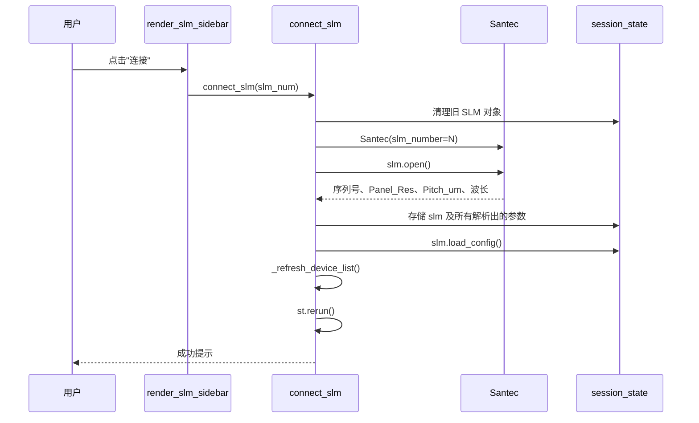
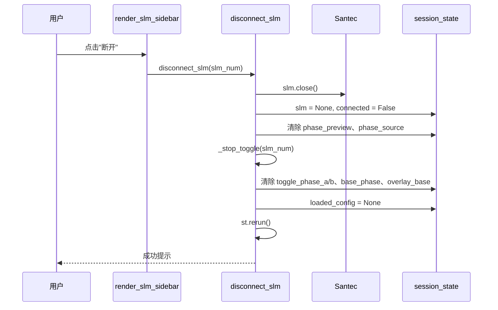
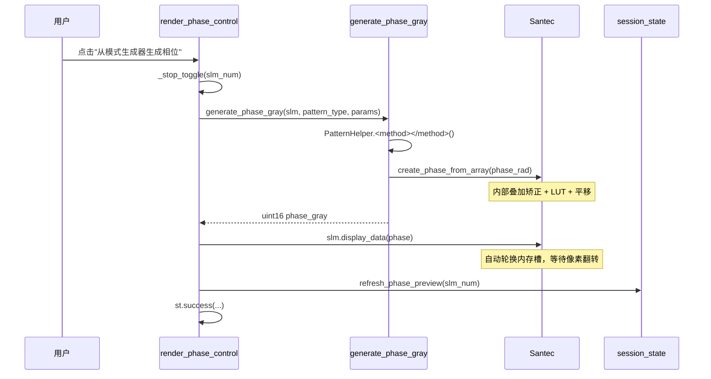
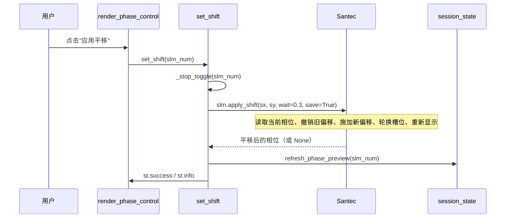
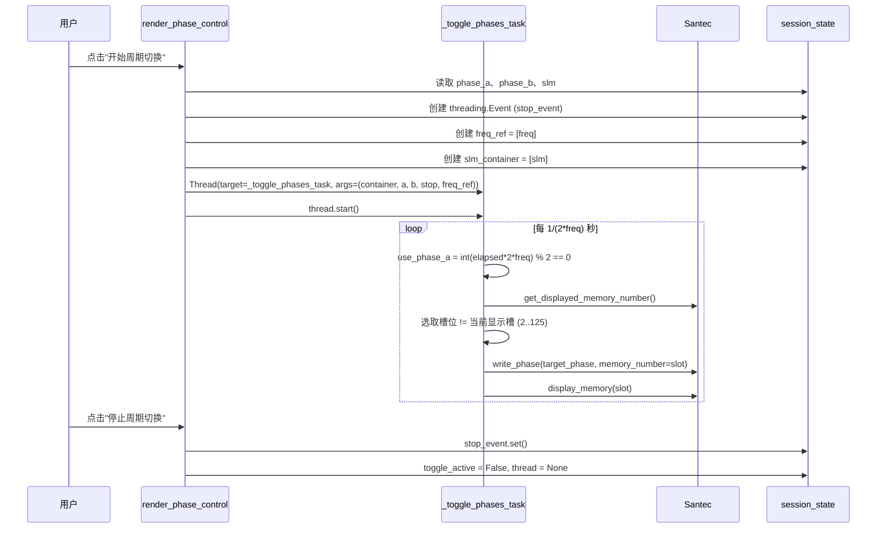
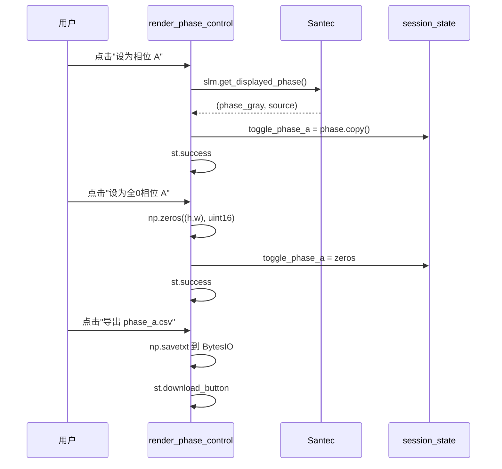
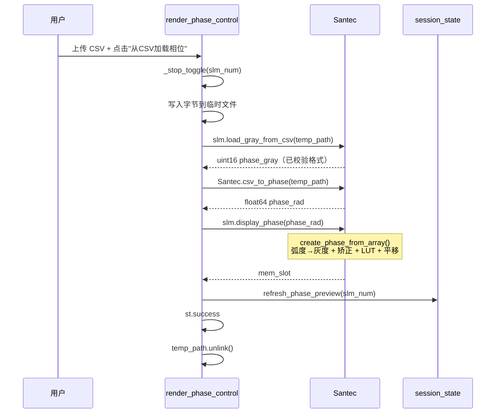

# Multi-SLM200 控制器软件说明书

## 1. 概述

`multi_slm_controller.py` 是 Santec SLM-200 空间光调制器的 Streamlit 前端页面。
支持最多两台 SLM，每台可独立连接、配置和相位编程。

启动方式：

```bash
streamlit run src/ao_shaping/gui/slm/multi_slm_controller.py
```

---

## 2. 类图


## 3. 模块映射

| 文件                    | 职责                                                       |
| ----------------------- | ---------------------------------------------------------- |
| multi_slm_controller.py | Streamlit 页面：设备发现、连接、相位控制、周期切换后台线程 |
| pattern_controls.py     | 图案类型注册表 + 相位生成流水线（generate_phase_gray）     |
| bench_settings.py       | 侧栏「CCD参数设置」区块 + 三态（探测/人工）session 契约  |
| shaping_controls.py     | 闭环整形主区：GS+SPGD 闭环 / 正向模型闭环 / 迁移模型闭环，三个适配器共用一个方法选择器（render_closed_loop_shaping） |
| slm_calibration_ui.py   | 独立的 LUT 标定页面（不在本说明书范围）                    |

---

## 4. Session State Schema

每个 SLM 以 slm{N}（N = 1 或 2）为命名空间。

| 键                          | 类型            | 含义                      |
| --------------------------- | --------------- | ------------------------- |
| slm{N}                      | Santec    | SLM 对象（断开时为 None） |
| slm{N}_connected            | bool            | 连接标志                  |
| slm{N}_wavelength           | int             | 工作波长（nm）            |
| slm{N}_video_mode           | str             | 内存模式（DVI 已禁用）    |
| slm{N}_next_memory          | int             | 下一个内存槽提示          |
| slm{N}_phase_preview        | ndarray         | 缓存的预览图像            |
| slm{N}_phase_source         | str             | 缓存相位的来源标签        |
| slm{N}_shift_x/y            | int             | 平移值                    |
| slm{N}_use_correction       | bool            | 波前矫正开关              |
| slm{N}_toggle_phase_a/b     | ndarray         | 周期切换存储的相位        |
| slm{N}_toggle_active        | bool            | 周期切换是否运行          |
| slm{N}_toggle_frequency     | float           | 切换频率（Hz）            |
| slm{N}_toggle_thread        | Thread          | 后台线程句柄              |
| slm{N}_toggle_stop_event    | threading.Event | 停止信号                  |
| slm{N}_toggle_freq_ref      | list            | 可变频率引用（单元素）    |
| slm{N}_toggle_slm_container | list            | 可变 SLM 引用（单元素）   |
| slm{N}_base_phase           | ndarray         | 用于叠加的底相位          |
| slm{N}_overlay_base         | bool            | 叠加开关                  |
| slm{N}_width/height         | int             | 面板分辨率                |
| slm{N}_pixel_pitch_um       | float           | 像素间距                  |
| slm{N}_bits                 | int             | 位深                      |
| slm{N}_loaded_config        | dict            | 缓存的配置文件            |
| slm{N}_use_correction_cb    | bool (widget)   | 波前矫正开关复选框（widget 键） |
| slm{N}_correction_csv       | UploadedFile    | 待加载的矫正 CSV（widget 键）  |
| slm{N}_max_gray             | int             | 2π 灰度值（widget 键）        |
| slm{N}_pattern_type         | str             | 当前选中的相位图类型（widget 键） |
| slm{N}_pattern_helper       | PatternHelper   | 按设备缓存的图案计算助手      |
| slm{N}_csv_file             | UploadedFile    | 待加载的相位 CSV（widget 键）  |
| slm{N}_preview_colormap     | str             | 预览色图标签                |
| slm{N}_preview_colormap_widget | str          | 预览色图 radio（widget 键）   |
| available_slms              | list[dict]      | 设备发现缓存              |
| camera_pixel_um             | float           | 相机像元间距（μm，全局；**已在「CCD参数设置」区块内**，key 不变） |
| _cam_pixel_checked/mismatch/detected | bool/bool/float | 像素间距自动探测状态（一次性） |
| bench_busy                  | bool            | 标定或闭环整形运行中（侧栏光路控件据此 disabled） |
| bench_detected              | dict            | 实验级探测值（exposure_ms 等） |
| bench_manual                | dict            | 实验级人工覆盖（只列被改过的字段） |
| bench_pending               | dict            | 实验级单次 flush 待写值（非 widget key） |
| bench_cam_type/cam_id       | str / int       | 实验级相机（widget 键）  |
| bench_exposure_ms           | float           | 会话曝光（0 = 自动起曝，widget 键） |
| bench_cam_crop/cam_size     | bool / int      | 读出窗口开关与边长（widget 键） |
| bench_blaze_period_px/direction | int / str   | 去零级载波（widget 键）  |
| bench_probe_window_btn      | —（button）     | 「探测窗口上限」按钮（B 读出窗口，widget 键） |
| detect_camera_pixel_btn     | —（button）     | 「探测」按钮，实测相机像元间距（A 相机，widget 键） |
| adopt_camera_pixel_btn      | —（button）     | 「采用」按钮，把硬件探测的像元间距写回会话值（仅探测值 ≠ 会话值时显示，widget 键） |
| detect_exposure_btn         | —（button）     | 「探测」按钮，按当前光路实测会话曝光（A 相机，仅 daheng 可用，widget 键） |
| refresh_devices_btn         | —（button）     | 「刷新设备列表」按钮（主区设备表，widget 键） |
| refresh_camera_status_btn   | —（button）     | 「刷新相机状态」按钮（主区相机工具，widget 键） |
| bench_window_probe          | dict            | 相机窗口上限探测缓存（按 cam_type/cam_id 失效） |
| slm{N}_bench_detected       | dict            | 该 SLM 的探测值（pupil_center / geometry_file / geometry_correlation / evidence_dir / calibrated_at / geometry_source） |
| slm{N}_bench_manual         | dict            | 该 SLM 的人工覆盖        |
| slm{N}_bench_pending        | dict            | 该 SLM 单次 flush 待写值 |
| slm{N}_bench_effective      | dict            | 最近一次运行生效的光路参数快照（含每字段三态标记） |
| slm{N}_bench_pupil_center   | str             | 入射中心 x,y（空 = 自动定位，widget 键） |
| slm{N}_bench_panel_span_px  | int             | 模型覆盖宽度（widget 键；GS 的 `beam_radius_px×2` 落同一字段） |
| slm{N}_bench_geometry_source| str             | auto / reuse / keep（widget 键） |
| slm{N}_bench_geometry_file  | str             | bench_geometry.json 路径（复用模式下出现，widget 键） |
| slm{N}_bench_beam_radius_px  | float           | 实测照明半径（面板px，0 = 未实测；「探测半径」按钮写入，widget 键） |
| slm{N}_bench_beam_radius_probe | dict           | 「探测半径」按钮的扫描证据（半平面随机相位边界扫描） |
| slm{N}_bench_focus_probe     | dict            | 「探测焦面」按钮的菲涅尔焦距实测（`best_focal_mm` 等；`bench_fresnel_focal_mm` 只读它） |
| slm{N}_defocus_enabled        | bool            | 离焦叠加开关（发送管线 T4 叠加层，作用于其后所有发送） |
| slm{N}_defocus_focal         | float           | 离焦焦距 (mm，菲涅尔项，widget 键；填 -9999 = 用「探测焦面」推荐值) |
| slm{N}_defocus_amount         | float           | 离焦细调 Zernike (2,0) 幅度（rad，widget 键） |
| slm{N}_defocus_use_reco      | bool            | 「用推荐值」按钮（把焦距写回探测推荐值，widget 键） |
| slm{N}_shp_pending         | dict            | 主区预算预设的单次 flush 待写值（非 widget key） |
| slm{N}_shp_budget_preset*   | str             | 预算预设选择与其「已应用」标记（widget 键） |

---

## 5. 按钮时序图

### 5.1 连接 SLM




### 5.2 断开 SLM



### 5.3 从模式生成器生成相位



### 5.4 应用平移



### 5.5 周期切换（开始/停止）



### 5.6 设为相位 A / B



### 5.7 从CSV加载相位



### 5.8 保存当前相位为底相位

mermaid
sequenceDiagram
    participant U as 用户
    participant PC as render_phase_control
    participant SLM as Santec
    participant SS as session_state

    U->>PC: 点击"保存当前相位为底相位"
    PC->>SLM: slm.get_displayed_phase()
    SLM-->>PC: (phase, source)
    PC->>SS: base_phase = phase.copy()
    PC->>SS: overlay_base = SS 值
    PC->>SLM: slm._overlay_base_phase = overlay
    PC->>PC: st.success

    U->>PC: 切换"发送时自动叠加底相位"
    PC->>SS: overlay_base = 复选框值
    PC->>SLM: slm._overlay_base_phase = overlay
    PC->>PC: st.success

    U->>PC: 点击"清除底相位"
    PC->>SS: base_phase = None, overlay_base = False
    PC->>SLM: slm._overlay_base_phase = False
    PC->>PC: st.success

### 5.9 应用/清除波前矫正

mermaid
sequenceDiagram
    participant U as 用户
    participant PC as _render_slm_settings
    participant SLM as Santec
    participant SS as session_state

    U->>PC: 上传矫正 CSV + 点击"应用矫正"
    PC->>PC: 写入字节到 NamedTemporaryFile
    PC->>SLM: slm.load_correction_from_csv(tmp_path)
    SLM-->>PC: bool ok
    PC->>SS: refresh_phase_preview(slm_num)
    PC->>PC: st.success / st.warning

    U->>PC: 点击"清除矫正"
    PC->>SLM: slm.load_correction_from_csv(None)
    SLM-->>PC: bool False
    PC->>SS: refresh_phase_preview(slm_num)
    PC->>PC: st.success

### 5.10 设置波长

mermaid
sequenceDiagram
    participant U as 用户
    participant PC as _render_slm_settings
    participant S as set_wavelength
    participant SLM as Santec
    participant SS as session_state

    U->>PC: 输入波长 + 点击"设置波长"
    PC->>S: set_wavelength(slm_num)
    S->>SLM: slm.set_wavelength(wl)
    Note over SLM: 可能需要约 40s（EEPROM 写入）
    S->>SS: refresh_phase_preview(slm_num)
    S->>PC: st.success

### 5.11 设置模式（内存/DVI）

mermaid
sequenceDiagram
    participant U as 用户
    participant PC as _render_slm_settings
    participant S as set_video_mode
    participant SLM as Santec
    participant SS as session_state

    U->>PC: 点击"设置模式"
    PC->>S: set_video_mode(slm_num, mode_label)
    S->>S: DVI 模式拒绝（st.error，返回）
    S->>SLM: slm._set_memory_mode(0)
    S->>SS: video_mode = "内存模式"
    S->>SS: refresh_phase_preview(slm_num)
    S->>PC: st.success

### 5.12 灰度设置

mermaid
sequenceDiagram
    participant U as 用户
    participant PC as _render_grayscale_config
    participant SLM as Santec
    participant SS as session_state

    U->>PC: 点击"应用灰度设置"
    PC->>SLM: slm_obj._max_gray = new_max_gray
    PC->>SS: refresh_phase_preview(slm_num)
    PC->>PC: st.success

    U->>PC: 点击"获取当前2π灰度"
    PC->>SLM: slm_obj.get_wavelength_info()
    SLM-->>PC: (wavelength, current_max_gray)
    PC->>SLM: slm_obj._max_gray = current_max_gray
    PC->>SS: refresh_phase_preview(slm_num)
    PC->>PC: st.success

### 5.13 保存配置

mermaid
sequenceDiagram
    participant U as 用户
    participant PC as _render_slm_settings
    participant SLM as Santec

    U->>PC: 点击"保存配置"
    PC->>SLM: 若 UI shift != slm.shift_x/y: slm.set_shift(...)
    PC->>SLM: slm.save_config()
    SLM-->>PC: 写入 JSON 配置文件
    PC->>PC: st.success

### 5.14 保存当前相位到 CSV

mermaid
sequenceDiagram
    participant U as 用户
    participant PC as _render_slm_settings
    participant SLM as Santec
    participant FS as 文件系统

    U->>PC: 点击"保存当前相位到CSV"
    PC->>SLM: slm.get_displayed_phase()
    SLM-->>PC: (phase, source)
    PC->>FS: np.savetxt(~/.config/ao_shaping/slmN_phase.csv)
    PC->>PC: st.success

### 5.15 设备扫描

mermaid
sequenceDiagram
    participant U as 用户
    participant PC as render_slm_sidebar
    participant P as _probe_slm
    participant SDK as slm_sdk (SLM_Ctrl_Open/ReadSD/Close)
    participant SS as session_state

    U->>PC: 点击"刷新设备列表"
    PC->>SS: available_slms = _scan_available_slms()
    loop slm_num in 1..8
        alt 已在 session_state 中连接
            PC->>SS: 构造 connected=True 条目
        else
            PC->>P: _probe_slm(slm_num) [守护线程, 3s 超时]
            P->>SDK: SLM_Ctrl_Open(slm_num)
            SDK-->>P: 返回码
            alt ret == 0 (空闲)
                P->>SDK: SLM_Ctrl_ReadSD(slm_num, buf)
                P-->>PC: {slm_number, serial, connected:False, in_use:False, status:"未连接"}
            else ret > 0 (占用中)
                P-->>PC: {slm_number, serial:None, connected:False, in_use:True, status:"使用中"}
            else ret < 0 (无设备)
                P-->>PC: None (跳过)
            end
            P->>SDK: SLM_Ctrl_Close(slm_num)
        end
    end
    PC->>SS: available_slms = 列表

---

## 6. 外部接口图

mermaid
flowchart LR
    U[用户浏览器] -->|HTTP| SL[Streamlit 服务端]
    SL -->|st.session_state| SS[会话状态字典]
    SL -->|threading| BG[后台周期切换线程]
    SL -->|ctypes FFI| SDK[Santec SDK DLL]
    SDK -->|SLM_Ctrl_*| HW[SLM-200 硬件]
    SL -->|读写| CFG[JSON 配置文件]
    SL -->|读写| CSV[矫正 CSV / 相位 CSV]
    SL -->|只读| PAT[PatternHelper]
    SL -->|只读| ZK[ZernikeCalc]

    subgraph 图案注册表
        PR[PATTERN_REGISTRY]
        PR --> FC[平场]
        PR --> LG[线性光栅]
        PR --> HG[全息光栅]
        PR --> BG[闪耀光栅]
        PR --> CG[圆形光栅]
        PR --> LS[透镜]
        PR --> CB[棋盘格]
        PR --> BG2[二元光栅]
        PR --> ML[微透镜阵列]
        PR --> TS[湍流相位屏]
        PR --> ZK2[Zernike]
        PR --> DG[达曼光栅]
        PR --> VP[涡旋相位]
        PR --> HH[半半相位]
    end

    SL -->|渲染| PR
    PAT -->|生成| PR
    SL -->|渲染| CL[闭环整形]

---

## 7. 图案注册表

| 图案       | 控制类                      | `generate_phase_gray` 中的输出路径                                                     |
| ---------- | --------------------------- | ---------------------------------------------------------------------------------------- |
| 平场       | `FlatControl`             | `np.full((h,w), gray, uint16)`（**原始灰度**，不经驱动）                                |
| 线性光栅   | `LinearGratingControl`    | `PatternHelper.linear_grating` → `create_phase_from_array`                          |
| 圆形光栅   | `CircularGratingControl`  | `PatternHelper.circular_grating` → `create_phase_from_array`                        |
| 透镜       | `LensControl`             | `PatternHelper.lens` → `create_phase_from_array`                                    |
| 全息光栅   | `HologramGratingControl`  | `PatternHelper.hologram` → `create_phase_from_array`                                |
| 闪耀光栅   | `BlazedGratingControl`    | `PatternHelper.linear_grating(direction=...)` → `create_phase_from_array`           |
| 棋盘格     | `CheckerboardControl`     | `PatternHelper.generate_checkerboard` → `create_phase_from_array`（**弧度**）          |
| 二元光栅   | `BinaryGratingControl`    | `PatternHelper.generate_binary_grating` → `create_phase_from_array`（**弧度**）        |
| 微透镜阵列 | `MicrolensArrayControl`   | `PatternHelper.generate_microlens_array` → `create_phase_from_array`（**弧度，未包裹**）|
| 湍流相位屏 | `TurbulenceScreenControl` | `init_turbulence_screen` + `generate_turbulence_screen` → `create_phase_from_array`  |
| Zernike    | `ZernikeControl`          | `PatternHelper.generate_zernike_polynomial` → `create_phase_from_array`             |
| 达曼光栅   | `DammannGratingControl`   | `PatternHelper.generate_dammann_grating` → `create_phase_from_array`（**弧度**）      |
| 涡旋相位   | `VortexPhaseControl`      | `PatternHelper.generate_vortex` → `create_phase_from_array`（**始终弧度，驱动负责 wrap**）|
| 半半相位   | `HalfHalfPhaseControl`    | 平场半区（原始）+ 闪耀半区（`create_phase_from_array`）拼接                            |

> ⚠️ **2026-10-01 修正**：
> 1. 原表把 5 个控制类（棋盘格 / 二元光栅 / 微透镜阵列 / 达曼光栅 / 涡旋）标成
>    「原始 uint16」，**与代码相反** —— 基类 `PatternControl.generate_phase_gray`
>    (`gui/slm/pattern_controls.py:138-145`) 默认实现是
>    `slm.create_phase_from_array(self.generate_phase_rad(params))`，
>    且这些 `PatternHelper` 方法现在返回**弧度**（`pattern_helper.py:338-353/355-380/382-416/595-630`）。
>    涡旋类的 docstring 更明确写着 "no mod-2π, no wrap checkbox — the driver applies wrapping"
>    (`pattern_controls.py:707-708`)。**真正走原始 uint16 的只有平场与半半相位的平场半区。**

> 🔴 **2026-10-13 变更**：原注册表中的三个**开环**方形整形控制 —— `GSSquareControl`
> （"GS方形整形"）、`GSSquareGaussianControl`（"GS方形整形(高斯版)"）与 `SteadyPhaseControl`
> （"稳像法整形"），连同助手 `_gs_square_phase_radians` / `generate_gs_square_phase` —— **已移除**。
> 原因：在本 2f-Fourier 实验系统上，用未标定实验系统参数做开环方形整形已被实测证明行不通
> （Zernike SPGD 与未标定 GS 从未产出过均匀方形），见
> [`report/shape_trials/README.md`](../../report/shape_trials/README.md) 与
> [`report/shape_trials/gs_refine/online_20261010.md`](../../report/shape_trials/gs_refine/online_20261010.md)。
> 取而代之的是下方 §8「闭环整形」区（GS+SPGD 闭环 / 正向模型闭环，均走已验证的闭环管线）。

---

## 8. 闭环整形

`render_closed_loop_shaping(slm_num)`（`src/ao_shaping/gui/slm/shaping_controls.py`）在
单/双 SLM 布局中渲染为独立的「闭环整形」区，取代上文已移除的开环方形整形。**三种方法**
共用**一个方法选择器**与一条运行路径（`ShapingMethod` 适配器 + `shaping_session` 装饰器）：
每个方法只实现 `execute` / `build_params` / `validate`，均
**在 GUI 内调用 canonical 优化器管线**（与对应 CLI 同一代码路径），并在结束后把最佳
相位（raw 弧度）经常规 `display_phase` 路径下发显示。

| 方法 | 代码路径（与 CLI 等价） | 说明 |
| --- | --- | --- |
| **GS+SPGD 闭环整形（已验证配方）** | `SlmGsRefineParams` → `build_gs_refine_config` → `optimize_slm_gs_refine` → `save_gs_refine_results`（同 CLI `slm-gs-refine`） | 默认值即交替重放验证过的配方 |
| **正向模型闭环整形（前沿，需 torch）** | `SlmModelInLoopParams` → `build_model_in_loop_config` → `optimize_slm_model_in_loop`（同 CLI `slm-model-in-loop`） | 需 torch；硬件上**必须有可复用的 sweep 几何**，否则运行前即被校验拒绝（§8.1.1） |
| **迁移模型闭环整形（物理模型，需 torch）** | `TransferSession` → `ao_shaping.tools.slm.transfer.workflow.run_session`（同 `python -m ao_shaping.tools.slm.transfer`） | 单一入口、GUI 侧不做编排；阶段进度条由 `on_stage` 回调驱动；相位**自带载波**（`ramp_matrix`） |

**共有的部分只有一份实现**：曝光校验 `validate_exposure`（GS+SPGD 固定曝光，正向模型允许
自动曝光令牌）、torch 可用性 `validate_torch`、目标入窗校验 `validate_target_fits_window`；
发送叠加层由 `ShapingMethod.prepare_config` 从 `bench_settings.build_send_overlay` 装到
优化器**自己打开的那个句柄**上（载波 / 离焦 / 底相位，整轮口径一致；迁移模型
`applies_send_overlay = False`，见下）；
最佳相位下发统一走 `ShapingMethod.show_phase`；参数对象共有的光路字段
（`common_param_values`：相机类型 / ID / 像元间距 / 读出窗 / 入射中心，
`blaze_period_px` 恒 `-1`）、目标方边长控件、数值控件与
格子布局、光路快照与结果表也都是同一份。

1. **GS+SPGD 闭环整形（已验证配方）**：GS 开环预矫正（对比择优，仅当实测优于平场才采用）
   + 无感知 SPGD 细化。GUI 默认值取自交替重放验证过的配方
   （[`report/shape_trials/gs_refine/gs_refine_live_20261012.md`](../../report/shape_trials/gs_refine/gs_refine_live_20261012.md)）：
   曝光 `0.05 ms`（大恒曝光上限按会话：`AO_DAHENG_MAX_EXPOSURE_MS`，0 = 画面探测）、
   模型覆盖 `900` 面板px（= 2×`beam_radius_px=450`）、`target_side=100`、`cam_size=250`、`gs_iters=12`、
   `far_field_padding=3`、`phase_grid=12`、`epochs=12`、`seed=0`、`confirm_best` 开、
   `gs_method=plain`。验证结果：**flat 0.527 → plain GS 0.775 → SPGD best 0.780**
   （两次一致的交替重放）。⚠️ `cam_type` / `pupil_center` / `camera_pixel_um` 已不在主区，
   改由侧栏「CCD参数设置」提供（见 §8.1）。

2. **正向模型闭环整形（前沿）**：每轮用强随机探针重拟合正向模型的 Zernike 像差
   （Step A），再冻结该像差合成目标方斑相位（Step B），带 trust region 与逐轮验收。
   需 `torch`。目前最佳均匀度 **CV 0.643 / EE 0.786**，但未成为被接受的均匀方形，
   见 [`report/shape_trials/model_in_loop/model_in_loop_live_20261013.md`](../../report/shape_trials/model_in_loop/model_in_loop_live_20261013.md)。

3. **迁移模型闭环整形（物理模型）**：少参数物理正向模型 + 当前光路重测几何 + 检查点迁移，
   再用 CCD 锚定短块与 A–B–B–A 配对验收生成目标相位。GUI **不做任何编排** —— 它把
   `TransferSession`（参数对象**就是** config）直接交给 `run_session`，与
   `python -m ao_shaping.tools.slm.transfer` 同一入口，因此阶段序列、journal、审计与
   验收规则和报告里那些运行逐条一致；阶段进度条由 `on_stage` 回调驱动。
   需 `torch`，且**只对大恒相机**做过实验验证（其他后端仅有接口支持）。目标形状可多选
   （正方形 / 长方形 / 三角形 / 五角星），只选一个形状时自动跳过跨形状展宽校准阶段
   （等价 CLI `--skip-calibration`）。侧栏的曝光与读出窗口**不驱动它的测量**：它自己做
   逐帧曝光搜索、读自己的固定测量窗（`half_span_px=220`），只有
   `AO_DAHENG_MAX_EXPOSURE_MS` 仍然钳住它。配方与验收见
   [`report/shape_trials/multishape_capability/physical_multishape_reproduction_20261023.md`](../../report/shape_trials/multishape_capability/physical_multishape_reproduction_20261023.md)。

> **迁移模型是唯一相位自带载波的方法**：载波写在模型与相位内部（`ramp_matrix`），
> 不是侧栏「相位叠加」里那一层。它的测量阶段会清掉驱动的**弧度叠加层**
> （`set_phase_overlay(None)` —— 侧栏的载波与离焦都在这一层），**运行期间不施加侧栏的
> 载波 / 离焦叠加**（两者都由模型自己拟合）。下发接受相位时也只临时摘掉侧栏的**载波层**，
> 底相位与离焦照常叠加，下发后立刻恢复，之后每次发送仍是操作员选的那一套。
> 其余两种方法相反：载波 / 离焦作为叠加层由优化器装在自己打开的句柄上。

> **设备生命周期**：三种方法的优化器都在**内部**自行打开/关闭 SLM 与相机（Santec SDK 句柄**不可重入**），
> GUI 与标定按钮共用 `with_slm_ownership(slm_num)`：停背景相位切换 → 释放目标 SLM 句柄 →
> `finally` 重连（只释放目标 SLM，另一台保持连接）。整个过程在 session 里置 `bench_busy`，
> 侧栏光路控件据此 `disabled=True`。
>
> **GUI 显示**：flat / GS / best 各阶段得分、PIB、CV，以及 GS 对比择优 判定
> （adopted / rejected）；debug 开启时产物存于 `data/debug/slm_gs_refine/<ts>/`。
> 运行结束时额外落盘 **`{save_dir}/params.json`** —— 本次运行**生效**的光路参数
> （逐字段带 `detected` / `manual` / `unset` 三态标记）。

### 8.1 侧栏「CCD参数设置」（`bench_settings.py`）

**一次实验 = 一条光路**。相机、读出窗口、曝光、载波，以及每台 SLM 的入射位置与几何，
都在侧栏按「实验级 / 每 SLM 级」两层下沉到 `st.expander(..., expanded=False)`，
折叠态也能看到**光路摘要卡**。

| 分组 | 内容 |
| --- | --- |
| A 相机 | 相机类型（daheng/miicam/sim）、相机 ID、像元间距 `μm`（**含「探测」按钮与渲染期自动探测告警**，`key="camera_pixel_um"` 未变，从旧「相机工具」区整体搬来）、会话曝光 `ms`（0 = 自动；caption 写明 0 会被大恒钳到约 0.02 ms，比可用区间暗 20–75×；超 `AO_DAHENG_MAX_EXPOSURE_MS` 立即 warning，运行前再 error 一次）**+ 「探测」按钮（`key="detect_exposure_btn"`，仅 daheng 可用）**：点一下按当前光路实测曝光 |
| B 读出窗口 | 「启用开窗」+ 窗口边长 `px`。上界 = `min(max_width, max_height)`、step = 设备特征网格 `inc`（**取得到相机时是真值，取不到时用保守兜底并在 caption 说明来源**，点「探测窗口上限」重读）。⚠️ 已**取消** `cam_size_min = max(16, target_side)` 互夹：侧栏先渲染、拿不到主区目标边长，而 Streamlit 对「min 变化后越界」是**抛异常不是夹取** → 改到运行前校验（§8.2） |
| C 载波（已移出） | **载波控件已并入侧栏「相位叠加（底相位 / 载波 / 离焦）」区块** —— 它现在是一层**发送叠加**，不再是实验光路的固定参数。见下方 §相位叠加 |
| D 面板与瞳面（每 SLM） | 入射中心 `x,y`（**空 = 自动定位**）、模型覆盖宽度（32 – `PANEL_RES[0]=1920`，step 10；GS 的 `beam_radius_px×2` 落同一字段）、**实测照明半径**（面板px，0 = 未实测）+ **「探测半径」按钮**（两轴各一次半平面随机相位边界扫描，约 5–10 分钟；证据落 `data/debug/bench_settings/beam_radius/`）+ **「探测焦面」按钮**（`key="detect_focus_btn"`，plain 相位上扫菲涅尔焦距 ±6 m⁻¹，逐点自动重调曝光，约 1–2 分钟；结果写 `slm{N}_bench_focus_probe`，供侧栏「离焦叠加 (发送叠加)」的推荐焦距做粗补偿，证据落 `data/debug/bench_settings/focus_probe/`）；SLM 面板 caption 并排展示**像素间距 `8 μm`（`PITCH_UM`，面板模型用这个）** 与**有效口径 `7.8 μm`（`PIXEL_SIZE_UM`）** —— 相差 0.2 μm 是真实器件几何，不是待修误差（见 `slm200_constants` 注释） |
| E 标定（每 SLM） | 几何来源（**只描述按钮口径，不影响运行**：自动标定（点按钮时全测）/ 复用已标定几何 / 沿用上次几何（只重测中心））+ 条件显示的几何文件路径（复用模式下用 `discover_model_in_loop_geometry(region=…)` 给建议值）+ 「标定 SLM N 光路」primary 按钮（**复用模式下 disabled**：那时两步都不测，点下去只会刷新 `calibrated_at`，却让人以为重新量过）+ 有手动改动时出现的「恢复探测值」 |

「SLM N · 光路几何与标定」的**折叠标题**自带标定状态（`● 已标定` / `○ 未标定`，
由 `bench_settings.calibration_marker` 给出，与摘要卡同一个判据 `is_calibrated`：
入射中心或 sweep 几何任一存在即算已标定）。放在标题里是为了**折叠状态下也能看出
这台 SLM 能不能直接整形** —— D/E 组块内只有字段，字段为空并不等于没标定，
标定状态不必展开再读。

**自动探测但允许人工修改（三态）**

| 状态 | 判据 | 显示 |
| --- | --- | --- |
| `unset` | 从未标定 | `○` |
| `detected` | 有探测值 | `●` + 探测值 |
| `manual` | 当前值与探测值的差 **超过阈值** | `✎` + 当前值 / 探测值 / 差值（带单位） |

差异提示阈值：中心任一坐标 ≥1 px；覆盖宽度 / 窗口边长 ≥1 个 step；像元间距相对 ≥0.5%；
曝光相对 ≥1%；相关度绝对 ≥0.02。`manual` 永远优先，**重新标定不覆盖手动值**，
只在 caption 提示「探测到新几何，当前仍使用手动值」。

**写值为什么走 pending-flush**：Streamlit 里 widget 一旦以 `key` 实例化，该 key 在本次
脚本运行内被锁；标定按钮是在侧栏 widget **渲染之后**被点击的，同一脚本运行内直接写
widget key 会抛 `StreamlitAPIException`。所以两段式：点击 → 写 `{prefix}_bench_pending`
（非 widget key）+ `st.rerun()` → 侧栏渲染函数**第一行** `flush_pending()` 把值写进 widget
key 并清空 pending，再实例化控件。**不使用 `_safe_set_state()` 做标定回填** —— 它吞异常会让
回填静默失败；它只保留给「运行后重连」那条晚于侧栏渲染的路径。

标定走 `ao_shaping.runners.slm.model_in_loop_session.calibrate_session` —— 与 CLI
`slm-model-in-loop` **同一个入口**（入射定位 → 曝光探测 → sweep 几何；该函数抛**普通异常**，
不是 click 异常；相关度 < 0.50 直接中止、不提交相位）。只在**换光路 / 换 SLM / 换相机**后重标；
这也是闭环整形运行唯一读到的标定结果 —— 运行路径**不再**重测（§8.1.1）。

### 8.1.1 光路标定只在侧栏执行一次，运行直接复用

**运行路径不测量光路。** 唯一的测量入口是侧栏「CCD参数设置」→「SLM N · 光路几何与
标定」这一块里的**一个**主按钮「标定 SLM N 光路」（`bench_settings.run_session_calibration`，
与 CLI `slm-model-in-loop` 共用 `calibrate_session`）。折叠标题自带状态标记
（`● 已标定` / `○ 未标定`），展开后**顶部是光路摘要卡**（入射中心 / 相关度 / 曝光 /
几何文件，未标定时那行直接指向下面的按钮），再往下是 D 组（面板几何与离焦）与
E 组（几何来源 / 标定按钮 / 三态回填 / 证据目录）。

**测量哪几步由「几何来源」决定，按钮本身只有一个**：`auto` = 入射定位 + sweep 几何
（几何步在会话没带几何文件、`cam_type != "sim"`、曝光 > 0 时还会做一次**照明半径
边界扫描**，耗时主要由它决定：带扫描约 3–8 分钟，不带约 1–3 分钟，口径只写在按钮
提示里）；`keep` = 只重测入射中心、沿用已有几何；`reuse` = 两步都不跑，按钮因此
**禁用**（否则点下去只刷新一个 `calibrated_at` 时间戳，却让人以为重新量过了）。
原先并存的第二个折叠块「SLM N · 一键光路标定 / 一键标定 SLM N 光路」已于 2026-10-24
删除 —— 它调的是同一个 `run_session_calibration`，只是把摘要卡放在自己的块里，
属于纯重复入口。
原先挂在运行按钮上的 `ModelInLoopMethod.auto_calibrate`（及其逐字段合并逻辑）**已删除** ——
运行不再有「先自己标定一遍」这条分支。

**唯一规则**：运行前先在侧栏点一次「标定 SLM N 光路」，之后每次运行都**复用**这次结果；
只有**换光路 / 换 SLM / 换相机**之后才需要重标。未标定时摘要卡那行的措辞是
「几何来源「…」—— 还没标定：先点本区块的「标定 … 光路」按钮（入射定位 → 曝光探测 →
sweep 几何）。闭环整形直接复用这次结果，不再在运行时重测。」

运行直接读侧栏的这几项：

| 运行要用的量 | 来源 |
| --- | --- |
| 入射中心 | `bench_pupil_center`（人工 → 探测 → 兜底实测值 `PUPIL_CENTER_FALLBACK`） |
| sweep 几何 | `bench_settings.reusable_geometry_file`（几何来源「复用已标定几何」的文本框 → 本会话按钮的探测产物） |
| 曝光 | 侧栏会话曝光 `ms`（`0` = 不固定；大恒会从约 0.02 ms 起步，比本光路可用区间暗 20–75×） |
| 读出窗口 | 侧栏「启用开窗」+ 窗口边长 |
| 载波 | 侧栏「相位叠加（底相位 / 载波 / 离焦）」的载波层（迁移模型除外，见 §8） |

几何来源下拉**只描述按钮做什么**，不改变运行行为：`auto` = 点按钮时全测；
`reuse` = 用给定几何文件（按钮 `disabled`）；`keep` = 只重测入射中心、沿用已有几何。

例外与提示：

- **`cam_type="sim"` 不需要标定**：数字孪生自带几何，没有面板可扫、也没有硬件几何可测，
  也不该碰硬件。
- **正向模型闭环在硬件上必须有可复用的 sweep 几何**：没有时**运行按钮之前**就被 `validate`
  拒绝（不是等优化器回落到 speckle 求解才中止），消息提示去侧栏点一次「标定 SLM N 光路」，
  或把几何来源切到「复用已标定几何」并填一条几何文件。
- **GS+SPGD 与正向模型闭环共用同一条提示**（提示不是错误）：从未标定时 caption 说明入射
  中心用的是兜底实测值 `PUPIL_CENTER_FALLBACK`，换光路必须先标定或手填。
- **人工值优先**：标定成功也**不覆盖**手动值，只提示「探测到新几何，当前仍使用手动值」；
  标定成功后几何来源回填为「复用已标定几何」（人工选的值仍优先）。
- **失败即中止**：相关度 < 0.50 直接中止、不提交相位；按钮那次 sweep 的 `--exposure-ms`
  取侧栏实测曝光，`0` 只是「不固定」。

### 8.2 主区固定顺序与上限放开

顺序是契约，不是偏好：

```
方法 → 状态条 → 目标与评分 → 预算 → 高级参数 → 校验区 → 运行按钮 → 结果
```

- **状态条**：`光路 SLM {n}：● 已标定 {时间} · 入射中心 (…) 探测值 · 相关度 … · N 项手动覆盖（…）`；
  未标定时提示**先去侧栏点一次「标定 SLM N 光路」**，运行会复用那次结果（§8.1.1）。
- **目标与评分**：共用区块标题与公式 caption，内部按方法渲染三套一行 4 列
  （GS：目标方边长(0=自动推导) / 边长因子 / w_pib / w_unif；
  MIL：目标形状 / 目标边长 / w_eff / w_uni；
  迁移模型：目标形状 / 目标边长 / 载波周期）。
- **预算**：MIL 给「预设」（快速 2/40/300、**标准 6/80/600** = `slm_model_in_loop.md` §5 默认值、
  长跑 12/160/1200）+ 轮数 / Step A 步数 / Step B 步数；预设**只在切换时**覆写，不冲掉手改值。
  GS **不给预设**，只显示 12/12 已验证配方并指向 `report/shape_trials/`。
  迁移模型按 CLI 同名口径给探针数 / 拟合迭代 / 锚定块数 / 每块更新数 / 每点帧数。
- **高级参数**（默认收起）：MIL 专属（探针数、探针 σ、验证集探针、全频随机相位验证集探针、region、
  远场补零、相关度门限、热启动、面板像素间距、学习率、Zernike 阶数…）；
  GS 专属（相位网格、扰动 δ、confirm-best、启用 GS、GS 变体、远场补零、面板像素间距、
  每测量均帧）；迁移模型专属（历史检查点、历史接受相位目录、迁移策略、验收指标等）。
  **`far_field_padding` 不合并**（GS 验证值 3，MIL 默认 8）。
- **校验区**在按钮**之前**渲染（否则按钮无法 `disabled`）：未连接 SLM / torch 缺失 /
  目标边长 > 窗口边长 / 复用几何与 region 不一致 / 曝光超上限 / 窗口边长非设备步长整数倍 /
  验证集探针 < 1（控件允许 0 以便「看到可以关」，但 Step A 拟合要求 ≥1，错误信息指向
  「全频随机相位验证集探针」）；迁移模型另有「至少选一个目标形状」/「只对大恒相机验证过」
  / `TransferSession.validate()` 的全部前置（检查点、几何窗等）。

| 字段 | 原上限 | 现上限 | 来源 |
| --- | --- | --- | --- |
| 相机窗口边长 | 硬编码 max 1944 / step 10 | `min(max_width, max_height)` / step=`inc` | 设备特征网格 |
| 模型覆盖宽度 | max 1920 | `PANEL_RES[0]` = 1920（min 32，step 10） | 设备常量 |
| 目标边长 | 3–1000 | 上界 = 窗口边长（关窗 = 传感器短边），下界 8（小于 8 时 warning） | 侧栏窗口 |
| 探针数 | 1–32 | 1–64 + 耗时 caption | — |
| region | 8–256 | 8–512（仍须 8 的倍数）+ 内存 caption | — |
| 远场补零 | 1–16 | 1–64（各自默认值不变） | — |
| GS 相位网格 | 2–64 | 2–128 + 耗时 caption | — |
| 验证集探针 | min 1 | min 0（0 = 不做验证集验证；见校验区） | — |
| 探针 σ | 3.0–8.0 | 3.0–12.0（>6 rad 时 caption 提示可辨识性下降） | — |

保留的硬约束：`w_eff > 0`（min 0.01，help 保留「只优化 -CV 会掏空目标框 实测环围能量→0.002」）；
探针 σ ≥ 3.0；窗口边长必须是设备 `inc` 的整数倍；曝光 min 0（0 时大恒强制 warning）。

### 8.2.1 远场尺寸换算（`link_design_assist.py`）

「目标方边长」控件紧邻一个**「远场尺寸换算」popover**（`ShapingMethod.render_link_assist`）：
操作员手上通常只有望远镜一侧的指标（1 km 处 10 cm 光斑），而这里要填的是诊断相机上的像素数。

- **换算只有一份实现**：远场边长（cm / mm / m，按目标距离）↔ 诊断相机 µm / px 全部走
  `ao_shaping.utils.wavefront.link_design`（issue #204 的单一事实源，`W_ccd = f_eff·θ`、
  `f_eff = f_c·M_t`）；popover 给出 CCD 边长、分辨单元 N、零级 Airy 斑半径与当前读出窗能覆盖的
  远场边长，反向「相机像素 → 远场」用同一个 `ccd_to_far`。
- **「填入目标方边长」**：换算出的像素数经 pending-flush 排进 `target_side`（与「预算预设」同一条
  路径），并夹到该方法的下界至当前读出窗边长（GS 下界 0 = 由照明瞳推导，MIL 下界 8）；物理边长
  装不进读出窗时按钮给出 warning 并说明夹到多少，而不是静默截断。
- **「光路参数」expander**：默认值即 issue #204 的锁定设计点（L = 1 km、f_c = 200 mm、M_t = 10、
  λ = 1064 nm、出瞳 90 mm、像元 2.2 µm）；改动**只影响本助手的换算**，不写回侧栏光路、也不改
  优化器参数，「恢复锁定参数」一键回到设计点。

### 8.3 相位叠加：底相位 / 载波 / 离焦（三层可多选）

三层都是**驱动层全局叠加**，且渲染在**同一个**侧栏区块
「相位叠加（底相位 / 载波 / 离焦）」里，各自一个 checkbox —— 可多选，勾中的**全部相加**。

| 层 | 驱动槽位 | 域 | 为什么在那一域 |
| --- | --- | --- | --- |
| 底相位 | `set_base_phase(gray)` | 灰度 | 它是「设备上已显示过的那张图」，按灰度原样叠加才与当初显示一致；送进 LUT 会改变它 |
| 载波（倾斜） | `set_phase_overlay(rad)` | 弧度 | 光路里真实的相位，应该被 LUT 重映射 |
| 离焦 | `set_phase_overlay(rad)` | 弧度 | 同上；菲涅尔粗调 + Zernike (2,0) 细调 |

**单一漏斗**：三层由 `bench_settings.build_send_overlay` 汇成一份 `PhaseOverlay`，
经 `_apply_slm_overlays` → `apply_overlays_to_handle` 推到句柄。因此任何走
`create_phase_from_array` 的发送（一键下发 / CSV / 周期切换 / 整形结果 / 优化器自开
句柄）都自动带上，不需要每个调用点各写一遍。

> **2026-10-23 修的缺陷**：载波原先只作为 `blaze_period_px` 喂给整形优化器、由优化器
> 自己在相位里加，于是侧栏「一次下发」的 PatternHelper 相位**从来没带上它**。
> 现在载波是叠加层的一层。实验验证：平场 + 周期 128 载波，0 级位移
> `(1218,964) → (1219,906)`，Δy = **−58 px**，与预测 `TILT_SHIFT_SCALE/128 = 57.8 px`
> 一致；关掉后回到 964（可逆、不累积）。

⚠️ **不重复施加**：载波叠加层在优化器打开句柄时就装到它的 SLM 上，所以整轮优化与最终
相位口径一致；因此 GUI 给整形优化器传 `blaze_period_px = -1`，否则倾斜会被加两遍。
**迁移模型是唯一例外**：它的载波在模型与相位内部（`ramp_matrix`），测量阶段会
`set_phase_overlay(None)` 清掉这一层，下发接受相位时也只临时摘掉载波层（见 §8）。

离焦不再是「整形完成后的手动微调」（旧版 `defocus_trim_fragment` 滑块，拖动即触发整页
rerun、面板丢失），而是与上面两层同机制的全局叠加。

**侧栏控件（`multi_slm_controller._render_defocus_overlay_block`，每台 SLM 一份）：**

| 控件 | 作用 |
| --- | --- |
| 启用离焦叠加（checkbox，`slm{N}_defocus_enabled`） | 总开关；关 = 不叠加（None） |
| 探测推荐焦距 caption | 读 `bench_fresnel_focal_mm`（D2「探测焦面」`best_focal_mm`） |
| 用推荐值（button，`slm{N}_defocus_use_reco`） | 把焦距写回探测推荐值并即时推驱动 |
| 焦距 (mm)（number_input，`slm{N}_defocus_focal`） | 菲涅尔项粗调；填 `-9999` = 用探测推荐值，人工填别的即覆盖 |
| 细调 Zernike (2,0)（number_input，`slm{N}_defocus_amount`） | 细调（rad 量纲，面板口径） |
| 离焦孔径 caption（只读） | 中心 `bench_pupil_center` / 半径 = 模型覆盖宽度/2 / 波长 |
| 离焦叠加状态行（只读，总渲染） | 启用时给出**生效**焦距与细调，操作者无需回滚即可核对 |

**叠加构造（`bench_settings.build_defocus_overlay`，纯函数，每次现算不累积）：**
菲涅尔项（`fresnel_panel`，焦距 mm 粗调）+ Zernike (2,0)（`zernike_panel`，细调），半径 =
`bench_panel_span_px / 2`，中心走 `bench_pupil_center` 取值链，波长取设备（缺省 1064 nm）。
两项均为零时返回全零，`rebuild_defocus_overlay` 据此置 `None`（等价不叠加）。

**三态焦距（`bench_settings.bench_defocus_focal`）：** 无手动值 / 填 `-9999` 哨兵 / 非有限值
→ 用探测推荐值；人工填的有限值 → 优先。

**单一真源（`multi_slm_controller._apply_slm_overlays`）：** 首连（`_sync_slm_session_state`）、
整形后重取、底相位保存/开关/清除、离焦开关/参数变更，全部经它把底相位（灰度，`set_base_phase`）
与离焦（弧度，`set_phase_overlay`）统一推给驱动，保证驱动上的叠加层始终等于 UI 当前配置，
重连不丢叠加。

**控件顺序硬约束：** 「用推荐值」按钮必须先于焦距 `number_input` 渲染，否则点击时写
`defocus_focal`（widget key）会因该 key 已被控件锁定而抛 `StreamlitAPIException`。

**主区状态行：** 闭环整形区尾部只保留一行只读状态（`shaping_controls` 读
`slm{N}_defocus_enabled`），不再挂滑块/fragment，从根源消除拖动触发整页 rerun 的回归。

---

## 9. 关键设计规则（来自 AGENTS.md）

1. **内存槽轮换**：对**同一**槽位连续 `write_phase` + `display_memory` 会被固件判为 no-op，LCOS 面板不刷新。换槽在 2..125 中随机选取**除当前显示槽外**的槽位、进程重启后仍有效；现由 GUI 周期切换 `_toggle_phases_task`（内联）与驱动 `_pick_next_memory_slot`（平移路径）两处实现（原独立助手 `_pick_next_memory` 已随 #85 删除并内联）。
2. **DVI 模式已禁用**：`video_mode=1` 的 `open()` 可能挂起 120s/300s，且挂起后 memory 模式 `open()` 也挂起，需物理断电恢复。仅提供内存模式。
3. **平场灰度 RAW 路径**：始终通过 `np.full((h,w), gray, dtype=np.uint16)` 发送原始 uint16 灰度。切勿将平场相位走 `create_phase_from_array()`（弧度转换）。
4. **平移数学**：唯一实现在驱动层的静态 `Santec.shift_phase`。重写缓存相位必须走驱动层 `apply_shift()`，绝不能对缓存相位再跑 `write_phase`（会二次叠加矫正）。
5. **后台线程**：绝不直接碰 `st.session_state`。`_toggle_phases_task` 使用 `slm_container`（列表）和 `freq_ref`（列表）作为可变快照，并用 `threading.Event` 传递停止信号。
6. **时序**：优先用 `time.time()` 墙钟差值而非计数器 —— `int(elapsed * 2.0 * freq) % 2 == 0` 按精确频率切换，无累积误差。
7. **0 级光斑**：绝不假设 0 级光斑位于相机画面中心 —— 用 `argmax` 定位。
