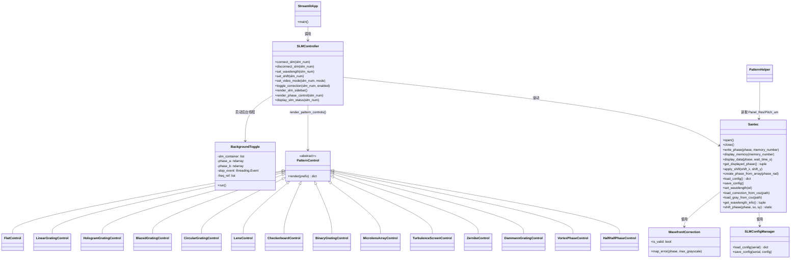
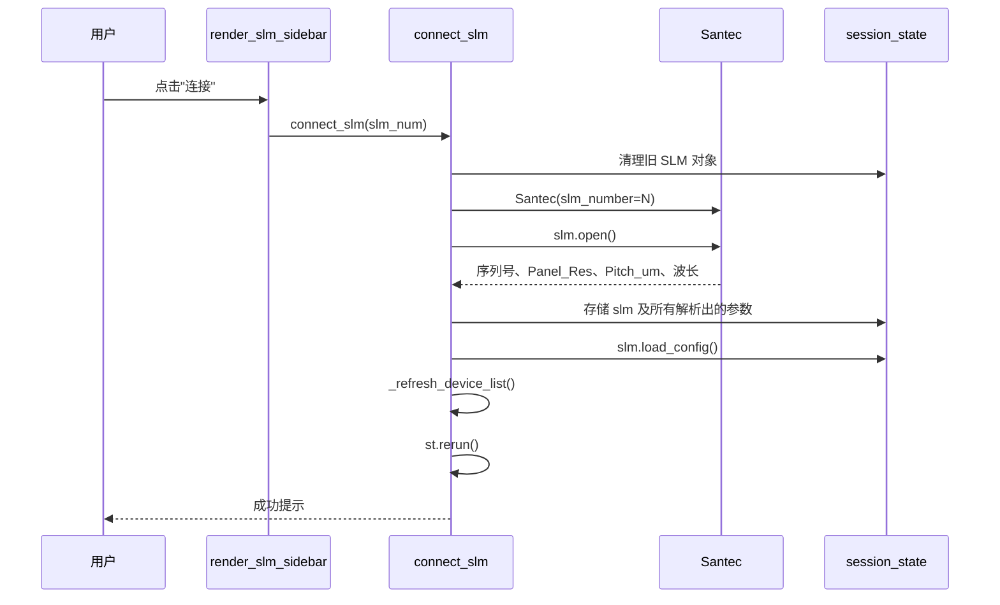
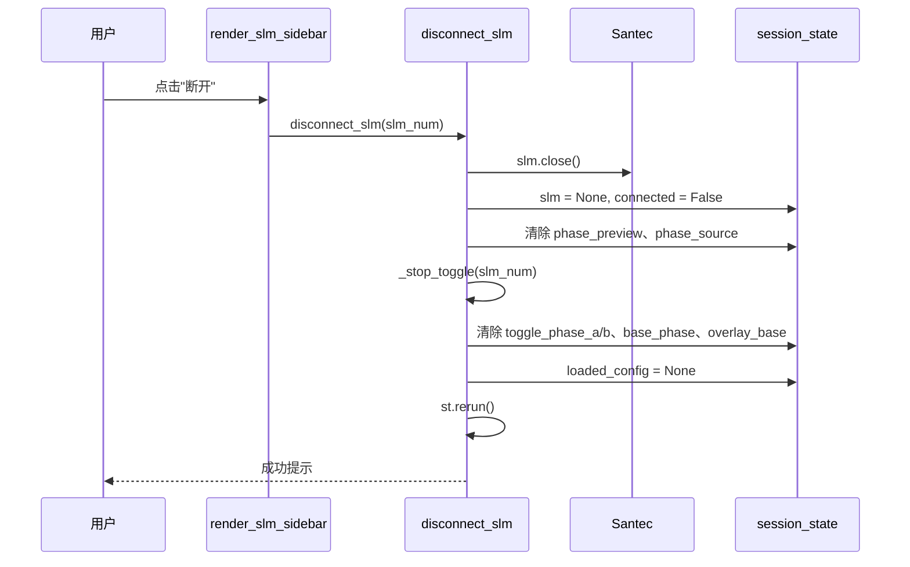
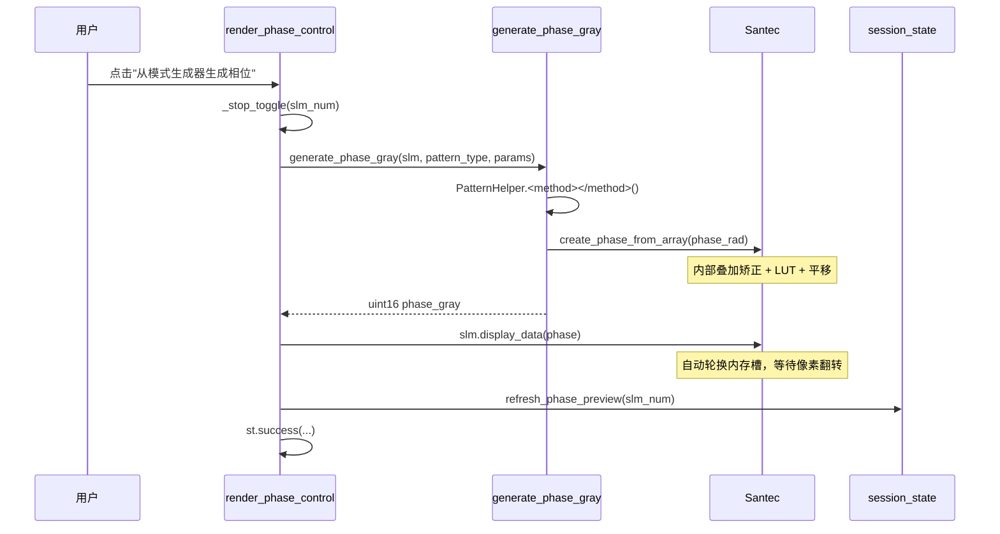
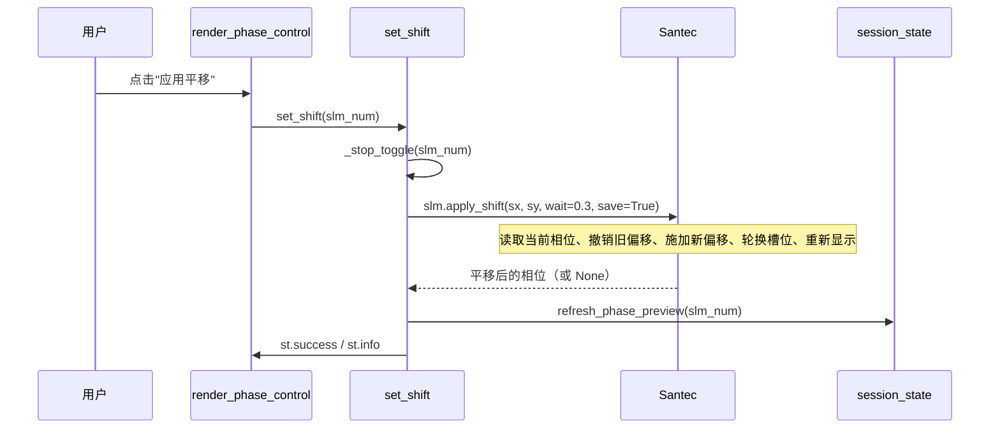
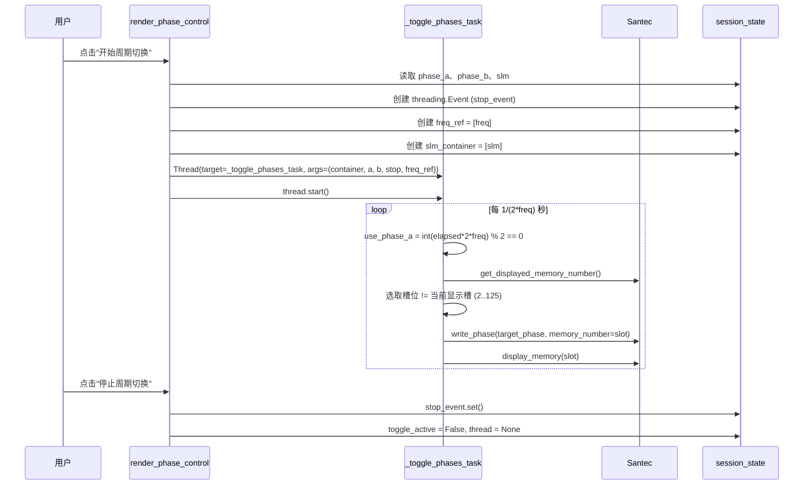
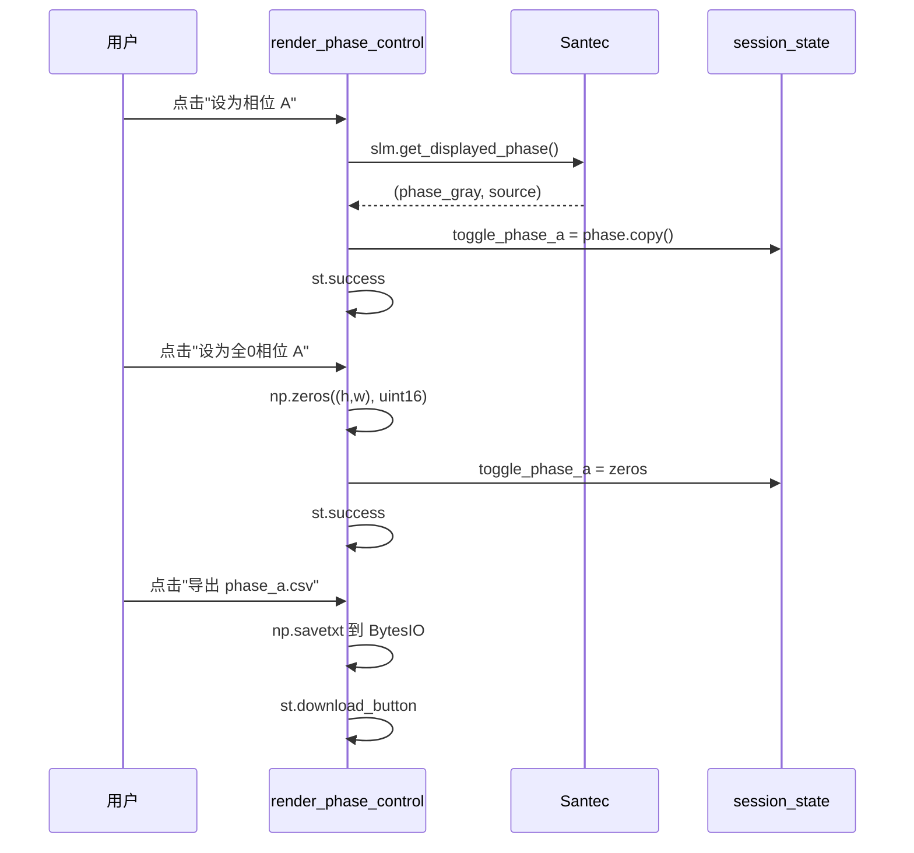
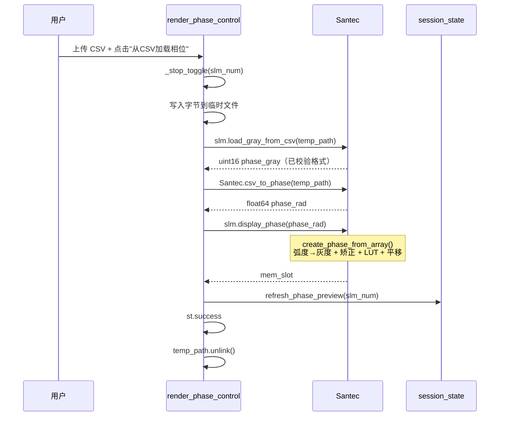

# Multi-SLM200 控制器软件说明书

## 1. 概述

`multi_slm_controller.py` 是 Santec SLM-200 空间光调制器的 Streamlit 前端页面。
支持最多两台 SLM，每台可独立连接、配置和相位编程。

启动方式：

```bash
streamlit run src/ao_shaping/gui/slm/multi_slm_controller.py
```

---

## 2. 类图



## 3. 模块映射

| 文件                    | 职责                                                       |
| ----------------------- | ---------------------------------------------------------- |
| multi_slm_controller.py | Streamlit 页面：设备发现、连接、相位控制、周期切换后台线程 |
| pattern_controls.py     | 图案类型注册表 + 相位生成流水线（generate_phase_gray）     |
| shaping_controls.py     | 闭环整形区：GS+SPGD 闭环 / 正向模型闭环（render_closed_loop_shaping） |
| slm_calibration_ui.py   | 独立的 LUT 标定页面（不在本说明书范围）                    |

---

## 4. Session State Schema

每个 SLM 以 slm{N}（N = 1 或 2）为命名空间。

| 键                          | 类型            | 含义                      |
| --------------------------- | --------------- | ------------------------- |
| slm{N}                      | Santec    | SLM 对象（断开时为 None） |
| slm{N}_connected            | bool            | 连接标志                  |
| slm{N}_wavelength           | int             | 工作波长（nm）            |
| slm{N}_video_mode           | str             | 内存模式（DVI 已禁用）    |
| slm{N}_next_memory          | int             | 下一个内存槽提示          |
| slm{N}_phase_preview        | ndarray         | 缓存的预览图像            |
| slm{N}_phase_source         | str             | 缓存相位的来源标签        |
| slm{N}_shift_x/y            | int             | 平移值                    |
| slm{N}_use_correction       | bool            | 波前矫正开关              |
| slm{N}_toggle_phase_a/b     | ndarray         | 周期切换存储的相位        |
| slm{N}_toggle_active        | bool            | 周期切换是否运行          |
| slm{N}_toggle_frequency     | float           | 切换频率（Hz）            |
| slm{N}_toggle_thread        | Thread          | 后台线程句柄              |
| slm{N}_toggle_stop_event    | threading.Event | 停止信号                  |
| slm{N}_toggle_freq_ref      | list            | 可变频率引用（单元素）    |
| slm{N}_toggle_slm_container | list            | 可变 SLM 引用（单元素）   |
| slm{N}_base_phase           | ndarray         | 用于叠加的底相位          |
| slm{N}_overlay_base         | bool            | 叠加开关                  |
| slm{N}_width/height         | int             | 面板分辨率                |
| slm{N}_pixel_pitch_um       | float           | 像素间距                  |
| slm{N}_bits                 | int             | 位深                      |
| slm{N}_loaded_config        | dict            | 缓存的配置文件            |
| slm{N}_use_correction_cb    | bool (widget)   | 波前矫正开关复选框（widget 键） |
| slm{N}_correction_csv       | UploadedFile    | 待加载的矫正 CSV（widget 键）  |
| slm{N}_max_gray             | int             | 2π 灰度值（widget 键）        |
| slm{N}_pattern_type         | str             | 当前选中的相位图类型（widget 键） |
| slm{N}_pattern_helper       | PatternHelper   | 按设备缓存的图案计算助手      |
| slm{N}_csv_file             | UploadedFile    | 待加载的相位 CSV（widget 键）  |
| slm{N}_preview_colormap     | str             | 预览色图标签                |
| slm{N}_preview_colormap_widget | str          | 预览色图 radio（widget 键）   |
| available_slms              | list[dict]      | 设备发现缓存              |
| camera_pixel_um             | float           | 相机像元间距（μm，全局）    |
| _cam_pixel_checked/mismatch/detected | bool/bool/float | 像素间距自动探测状态（一次性） |

---

## 5. 按钮时序图

### 5.1 连接 SLM




### 5.2 断开 SLM



### 5.3 从模式生成器生成相位



### 5.4 应用平移



### 5.5 周期切换（开始/停止）



### 5.6 设为相位 A / B



### 5.7 从CSV加载相位



### 5.8 保存当前相位为底相位

mermaid
sequenceDiagram
    participant U as 用户
    participant PC as render_phase_control
    participant SLM as Santec
    participant SS as session_state

    U->>PC: 点击"保存当前相位为底相位"
    PC->>SLM: slm.get_displayed_phase()
    SLM-->>PC: (phase, source)
    PC->>SS: base_phase = phase.copy()
    PC->>SS: overlay_base = SS 值
    PC->>SLM: slm._overlay_base_phase = overlay
    PC->>PC: st.success

    U->>PC: 切换"发送时自动叠加底相位"
    PC->>SS: overlay_base = 复选框值
    PC->>SLM: slm._overlay_base_phase = overlay
    PC->>PC: st.success

    U->>PC: 点击"清除底相位"
    PC->>SS: base_phase = None, overlay_base = False
    PC->>SLM: slm._overlay_base_phase = False
    PC->>PC: st.success

### 5.9 应用/清除波前矫正

mermaid
sequenceDiagram
    participant U as 用户
    participant PC as _render_slm_settings
    participant SLM as Santec
    participant SS as session_state

    U->>PC: 上传矫正 CSV + 点击"应用矫正"
    PC->>PC: 写入字节到 NamedTemporaryFile
    PC->>SLM: slm.load_correction_from_csv(tmp_path)
    SLM-->>PC: bool ok
    PC->>SS: refresh_phase_preview(slm_num)
    PC->>PC: st.success / st.warning

    U->>PC: 点击"清除矫正"
    PC->>SLM: slm.load_correction_from_csv(None)
    SLM-->>PC: bool False
    PC->>SS: refresh_phase_preview(slm_num)
    PC->>PC: st.success

### 5.10 设置波长

mermaid
sequenceDiagram
    participant U as 用户
    participant PC as _render_slm_settings
    participant S as set_wavelength
    participant SLM as Santec
    participant SS as session_state

    U->>PC: 输入波长 + 点击"设置波长"
    PC->>S: set_wavelength(slm_num)
    S->>SLM: slm.set_wavelength(wl)
    Note over SLM: 可能需要约 40s（EEPROM 写入）
    S->>SS: refresh_phase_preview(slm_num)
    S->>PC: st.success

### 5.11 设置模式（内存/DVI）

mermaid
sequenceDiagram
    participant U as 用户
    participant PC as _render_slm_settings
    participant S as set_video_mode
    participant SLM as Santec
    participant SS as session_state

    U->>PC: 点击"设置模式"
    PC->>S: set_video_mode(slm_num, mode_label)
    S->>S: DVI 模式拒绝（st.error，返回）
    S->>SLM: slm._set_memory_mode(0)
    S->>SS: video_mode = "内存模式"
    S->>SS: refresh_phase_preview(slm_num)
    S->>PC: st.success

### 5.12 灰度设置

mermaid
sequenceDiagram
    participant U as 用户
    participant PC as _render_grayscale_config
    participant SLM as Santec
    participant SS as session_state

    U->>PC: 点击"应用灰度设置"
    PC->>SLM: slm_obj._max_gray = new_max_gray
    PC->>SS: refresh_phase_preview(slm_num)
    PC->>PC: st.success

    U->>PC: 点击"获取当前2π灰度"
    PC->>SLM: slm_obj.get_wavelength_info()
    SLM-->>PC: (wavelength, current_max_gray)
    PC->>SLM: slm_obj._max_gray = current_max_gray
    PC->>SS: refresh_phase_preview(slm_num)
    PC->>PC: st.success

### 5.13 保存配置

mermaid
sequenceDiagram
    participant U as 用户
    participant PC as _render_slm_settings
    participant SLM as Santec

    U->>PC: 点击"保存配置"
    PC->>SLM: 若 UI shift != slm.shift_x/y: slm.set_shift(...)
    PC->>SLM: slm.save_config()
    SLM-->>PC: 写入 JSON 配置文件
    PC->>PC: st.success

### 5.14 保存当前相位到 CSV

mermaid
sequenceDiagram
    participant U as 用户
    participant PC as _render_slm_settings
    participant SLM as Santec
    participant FS as 文件系统

    U->>PC: 点击"保存当前相位到CSV"
    PC->>SLM: slm.get_displayed_phase()
    SLM-->>PC: (phase, source)
    PC->>FS: np.savetxt(~/.config/ao_shaping/slmN_phase.csv)
    PC->>PC: st.success

### 5.15 设备扫描

mermaid
sequenceDiagram
    participant U as 用户
    participant PC as render_slm_sidebar
    participant P as _probe_slm
    participant SDK as slm_sdk (SLM_Ctrl_Open/ReadSD/Close)
    participant SS as session_state

    U->>PC: 点击"刷新设备列表"
    PC->>SS: available_slms = _scan_available_slms()
    loop slm_num in 1..8
        alt 已在 session_state 中连接
            PC->>SS: 构造 connected=True 条目
        else
            PC->>P: _probe_slm(slm_num) [守护线程, 3s 超时]
            P->>SDK: SLM_Ctrl_Open(slm_num)
            SDK-->>P: 返回码
            alt ret == 0 (空闲)
                P->>SDK: SLM_Ctrl_ReadSD(slm_num, buf)
                P-->>PC: {slm_number, serial, connected:False, in_use:False, status:"未连接"}
            else ret > 0 (占用中)
                P-->>PC: {slm_number, serial:None, connected:False, in_use:True, status:"使用中"}
            else ret < 0 (无设备)
                P-->>PC: None (跳过)
            end
            P->>SDK: SLM_Ctrl_Close(slm_num)
        end
    end
    PC->>SS: available_slms = 列表

---

## 6. 外部接口图

mermaid
flowchart LR
    U[用户浏览器] -->|HTTP| SL[Streamlit 服务端]
    SL -->|st.session_state| SS[会话状态字典]
    SL -->|threading| BG[后台周期切换线程]
    SL -->|ctypes FFI| SDK[Santec SDK DLL]
    SDK -->|SLM_Ctrl_*| HW[SLM-200 硬件]
    SL -->|读写| CFG[JSON 配置文件]
    SL -->|读写| CSV[矫正 CSV / 相位 CSV]
    SL -->|只读| PAT[PatternHelper]
    SL -->|只读| ZK[ZernikeCalc]

    subgraph 图案注册表
        PR[PATTERN_REGISTRY]
        PR --> FC[平场]
        PR --> LG[线性光栅]
        PR --> HG[全息光栅]
        PR --> BG[闪耀光栅]
        PR --> CG[圆形光栅]
        PR --> LS[透镜]
        PR --> CB[棋盘格]
        PR --> BG2[二元光栅]
        PR --> ML[微透镜阵列]
        PR --> TS[湍流相位屏]
        PR --> ZK2[Zernike]
        PR --> DG[达曼光栅]
        PR --> VP[涡旋相位]
        PR --> HH[半半相位]
    end

    SL -->|渲染| PR
    PAT -->|生成| PR
    SL -->|渲染| CL[闭环整形]

---

## 7. 图案注册表

| 图案       | 控制类                      | `generate_phase_gray` 中的输出路径                                                     |
| ---------- | --------------------------- | ---------------------------------------------------------------------------------------- |
| 平场       | `FlatControl`             | `np.full((h,w), gray, uint16)`（**原始灰度**，不经驱动）                                |
| 线性光栅   | `LinearGratingControl`    | `PatternHelper.linear_grating` → `create_phase_from_array`                          |
| 圆形光栅   | `CircularGratingControl`  | `PatternHelper.circular_grating` → `create_phase_from_array`                        |
| 透镜       | `LensControl`             | `PatternHelper.lens` → `create_phase_from_array`                                    |
| 全息光栅   | `HologramGratingControl`  | `PatternHelper.hologram` → `create_phase_from_array`                                |
| 闪耀光栅   | `BlazedGratingControl`    | `PatternHelper.linear_grating(direction=...)` → `create_phase_from_array`           |
| 棋盘格     | `CheckerboardControl`     | `PatternHelper.generate_checkerboard` → `create_phase_from_array`（**弧度**）          |
| 二元光栅   | `BinaryGratingControl`    | `PatternHelper.generate_binary_grating` → `create_phase_from_array`（**弧度**）        |
| 微透镜阵列 | `MicrolensArrayControl`   | `PatternHelper.generate_microlens_array` → `create_phase_from_array`（**弧度，未包裹**）|
| 湍流相位屏 | `TurbulenceScreenControl` | `init_turbulence_screen` + `generate_turbulence_screen` → `create_phase_from_array`  |
| Zernike    | `ZernikeControl`          | `PatternHelper.generate_zernike_polynomial` → `create_phase_from_array`             |
| 达曼光栅   | `DammannGratingControl`   | `PatternHelper.generate_dammann_grating` → `create_phase_from_array`（**弧度**）      |
| 涡旋相位   | `VortexPhaseControl`      | `PatternHelper.generate_vortex` → `create_phase_from_array`（**始终弧度，驱动负责 wrap**）|
| 半半相位   | `HalfHalfPhaseControl`    | 平场半区（原始）+ 闪耀半区（`create_phase_from_array`）拼接                            |

> ⚠️ **2026-10-01 修正**：
> 1. 原表把 5 个控制类（棋盘格 / 二元光栅 / 微透镜阵列 / 达曼光栅 / 涡旋）标成
>    「原始 uint16」，**与代码相反** —— 基类 `PatternControl.generate_phase_gray`
>    (`gui/slm/pattern_controls.py:138-145`) 默认实现是
>    `slm.create_phase_from_array(self.generate_phase_rad(params))`，
>    且这些 `PatternHelper` 方法现在返回**弧度**（`pattern_helper.py:338-353/355-380/382-416/595-630`）。
>    涡旋类的 docstring 更明确写着 "no mod-2π, no wrap checkbox — the driver applies wrapping"
>    (`pattern_controls.py:707-708`)。**真正走原始 uint16 的只有平场与半半相位的平场半区。**

> 🔴 **2026-10-13 变更**：原注册表中的三个**开环**方形整形控制 —— `GSSquareControl`
> （"GS方形整形"）、`GSSquareGaussianControl`（"GS方形整形(高斯版)"）与 `SteadyPhaseControl`
> （"稳像法整形"），连同助手 `_gs_square_phase_radians` / `generate_gs_square_phase` —— **已移除**。
> 原因：在本 2f-Fourier 实验系统上，用未标定实验系统参数做开环方形整形已被实测证明行不通
> （Zernike SPGD 与未标定 GS 从未产出过均匀方形），见
> [`report/shape_trials/README.md`](../../report/shape_trials/README.md) 与
> [`report/shape_trials/online_20261010.md`](../../report/shape_trials/online_20261010.md)。
> 取而代之的是下方 §8「闭环整形」区（GS+SPGD 闭环 / 正向模型闭环，均走已验证的闭环管线）。

---

## 8. 闭环整形

`render_closed_loop_shaping(slm_num)`（`src/ao_shaping/gui/slm/shaping_controls.py`）在
单/双 SLM 布局中渲染为独立的「闭环整形」区，取代上文已移除的开环方形整形。两种方法均
**在 GUI 内调用 canonical 优化器管线**（与对应 CLI 同一代码路径），并在结束后把最佳
相位（raw 弧度）经常规 `display_phase` 路径下发显示。

| 方法 | 代码路径（与 CLI 等价） | 说明 |
| --- | --- | --- |
| **GS+SPGD 闭环整形（已验证配方）** | `SlmGsRefineParams` → `build_gs_refine_config` → `optimize_slm_gs_refine` → `save_gs_refine_results`（同 CLI `slm-gs-refine`） | 默认值即交替重放验证过的配方 |
| **正向模型闭环整形（前沿）** | `SlmModelInLoopParams` → `build_model_in_loop_config` → `optimize_slm_model_in_loop`（同 CLI `slm-model-in-loop`） | 需要 torch |

1. **GS+SPGD 闭环整形（已验证配方）**：GS 开环预矫正（bake-off（对比择优），仅当实测优于平场才采用）
   + 无感知 SPGD 细化。GUI 默认值取自交替重放验证过的配方
   （[`report/shape_trials/gs_refine_live_20261012.md`](../../report/shape_trials/gs_refine_live_20261012.md)）：
   `cam_type=daheng`、曝光 `0.05 ms`（大恒曝光上限按会话：`AO_DAHENG_MAX_EXPOSURE_MS`，0 = 画面探测）、`pupil_center=960,690`、
   `beam_radius_px=450`、`target_side=100`、`cam_size=250`、`gs_iters=12`、
   `far_field_padding=3`、`phase_grid=12`、`epochs=12`、`seed=0`、`confirm_best` 开、
   `gs_method=plain`。验证结果：**flat 0.527 → plain GS 0.775 → SPGD best 0.780**
   （两次一致的交替重放）。

2. **正向模型闭环整形（前沿）**：每轮用强随机探针重拟合正向模型的 Zernike 像差
   （Step A），再冻结该像差合成目标方斑相位（Step B），带 trust region 与逐轮验收。
   需 `torch`。目前最佳均匀性 **CV 0.643 / EE 0.786**，但尚未成为被接受的均匀方形，
   见 [`report/shape_trials/model_in_loop_live_20261013.md`](../../report/shape_trials/model_in_loop_live_20261013.md)。

> **设备生命周期**：上述优化器在**内部**自行打开/关闭 SLM 与相机（Santec SDK 句柄**不可重入**），
> 因此 GUI 在整形运行期间会**暂时释放目标 SLM 句柄**、运行结束后重新获取（只释放目标 SLM，
> 另一台 SLM 保持连接）。
>
> **GUI 显示**：flat / GS / best 各阶段得分、PIB、CV，以及 GS bake-off 判定
> （adopted / rejected）；debug 开启时产物存于 `data/debug/slm_gs_refine/<ts>/`。

---

## 9. 关键设计规则（来自 AGENTS.md）

1. **内存槽轮换**：对**同一**槽位连续 `write_phase` + `display_memory` 会被固件判为 no-op，LCOS 面板不刷新。换槽在 2..125 中随机选取**除当前显示槽外**的槽位、进程重启后仍有效；现由 GUI 周期切换 `_toggle_phases_task`（内联）与驱动 `_pick_next_memory_slot`（平移路径）两处实现（原独立助手 `_pick_next_memory` 已随 #85 删除并内联）。
2. **DVI 模式已禁用**：`video_mode=1` 的 `open()` 可能挂起 120s/300s，且挂起后 memory 模式 `open()` 也挂起，需物理断电恢复。仅提供内存模式。
3. **平场灰度 RAW 路径**：始终通过 `np.full((h,w), gray, dtype=np.uint16)` 发送原始 uint16 灰度。切勿将平场相位走 `create_phase_from_array()`（弧度转换）。
4. **平移数学**：唯一实现在驱动层的静态 `Santec.shift_phase`。重写缓存相位必须走驱动层 `apply_shift()`，绝不能对缓存相位再跑 `write_phase`（会二次叠加矫正）。
5. **后台线程**：绝不直接碰 `st.session_state`。`_toggle_phases_task` 使用 `slm_container`（列表）和 `freq_ref`（列表）作为可变快照，并用 `threading.Event` 传递停止信号。
6. **时序**：优先用 `time.time()` 墙钟差值而非计数器 —— `int(elapsed * 2.0 * freq) % 2 == 0` 按精确频率切换，无累积误差。
7. **0 级光斑**：绝不假设 0 级光斑位于相机画面中心 —— 用 `argmax` 定位。
