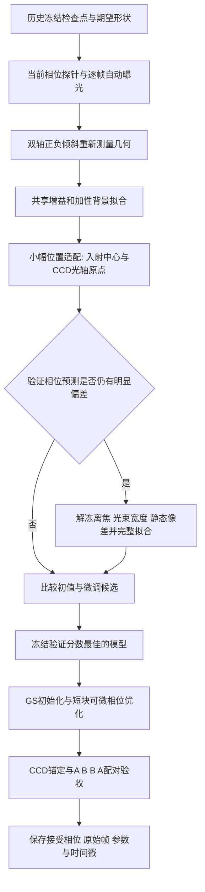
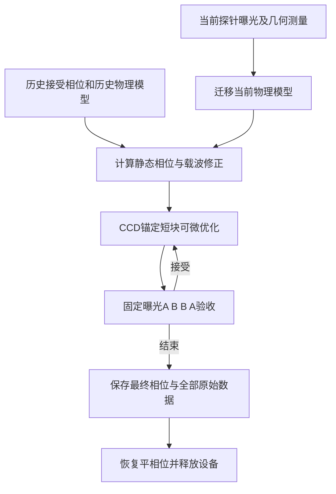

# 三形状物理模型整形：统一入口操作手册

统一入口为 `python -m ao_shaping.tools.slm.transfer`。它在一个会话目录中管理探针采集、物理模型迁移、GS 初始化、曝光响应诊断、展宽校准、CCD 锚定可微优化及原始数据验收。实验结果与适用范围见 [实验复现报告](../../report/shape_trials/multishape_capability/physical_multishape_reproduction_20261023.md)，本页说明操作方法。

已有接受相位、希望跳过 GS 并继续匀化时，直接使用 §10–§11 的历史相位迁移入口。

## 1. 准备环境

在仓库根目录执行：

```powershell
Set-Location D:\Projects\TIFO\AO-shaping
$py = '.venv\Scripts\python.exe'
$tag = Get-Date -Format 'yyyyMMdd_HHmmss'
$out = "data/debug/slm_transfer/$tag"
$checkpoint = 'data/debug/calibrate_transfer_blur/shapes_20261023_1956/frozen_parameters.json'
```

需要项目 Python 环境、PyTorch、NumPy、SciPy、Matplotlib，以及设备对应 SDK。当前物理模型常量针对 Santec 1200×1920、8 μm、1064 nm；更换波长或面板规格必须先调整模型并验证传播采样。相机通过现有工厂指定，默认 Daheng #0，SLM 默认 #1；其他相机后端仅有接口支持，不代表已完成实验验证。

Daheng 绑定优先使用已安装的 `gxipy`；设备操作时若未安装，则显式查找仓库 `libs/gxipy`。独立安装的 SDK 可设置 `AO_SHAPING_SDK_PATH` 为包含 `gxipy/` 的父目录。计划、离线拟合、回放和包导入不加载设备 SDK。

## 2. 先看计划，再执行

```powershell
& $py -m ao_shaping.tools.slm.transfer --help
& $py -m ao_shaping.tools.slm.transfer plan --out $out --checkpoint $checkpoint
& $py -m ao_shaping.tools.slm.transfer doctor --out "$out-device.json"
```

`doctor` 只枚举 Daheng，不打开图像流、不操作 SLM。枚举到设备不等于激光已开启，也不证明没有其他程序占用。实际实验前确认激光、光路、设备占用状态，采集期间保持光路和功率稳定。

正值环境变量 `AO_DAHENG_MAX_EXPOSURE_MS` 是当前光路的附加曝光上限。缺失或为 0 时，由设备曝光范围和画面反馈搜索，不继承历史固定上限。修改曝光上限只影响后续会话。

完整执行：

```powershell
& $py -m ao_shaping.tools.slm.transfer run --out $out --checkpoint $checkpoint --execute
```

`run` 不带 `--execute` 或 `--offline` 时只打印计划，不创建会话、不访问设备。默认流程为：

1. 当前光路采集：平相位参考、双轴正负倾斜和 24 个分组随机探针，每组 3 帧。
2. 物理参数迁移：历史检查点默认先进行最多 30 次位置适配，验证不足时增加最多 60 次完整拟合；没有检查点时直接完整拟合。训练与验证相位分离，验证集用于选择阶段。
3. 正方形、长方形、三角形 GS 初始化与模型模式配对测试，每种 2 块。
4. 固定相位曝光阶梯诊断，以及有效展宽/共享辐射尺度校准。
5. 以上一步接受相位启动 CCD 锚定优化，每种 4 块，每块 10 次模型更新。
6. 逐文件重算原始帧指标、曝光和相位核对、A–B–B–A 判定核对；生成对照图、方向检查和审计文件。

可以指定 `--count`、`--iterations`、`--blocks`、`--updates`、`--frames`、`--camera`、`--cam-id`、`--slm-number`、`--side`、`--period`。减少块数是短时流程验证，不应当作默认流程性能结论。改变目标后必须使用新目录。

完整校准需要正方形、三角形用于拟合，长方形用于验证。只测试一个形状时自动跳过此阶段，也可显式指定 `--skip-calibration`：

```powershell
& $py -m ao_shaping.tools.slm.transfer run --out $out --checkpoint $checkpoint --shapes square --skip-calibration --execute
```

`--side 80` 对应正方形边长 80、长方形 160×80、三角形外接圆半径 40，单位均为 CCD 像元；三角形不以边长解释此参数。载波和目标尺寸必须使目标完全落入固定窗口。脚本会在打开设备前检查目标边界以及全部回放相位的网格/掩膜一致性。

## 3. 没有历史检查点

省略 `--checkpoint` 即从新采集的几何建立名义初始化，再拟合：

```powershell
& $py -m ao_shaping.tools.slm.transfer run --out $out --execute
```

名义入射中心、宽度和零离焦只是初值，不代表已标定。较强离焦或入射偏移需要先用面板/离焦探测缩小初始化范围。需要控制初值时，先采集、显式生成初始化文件，再用该文件执行统一流程：

```powershell
& $py -m ao_shaping.tools.slm.transfer.capture --out "$out-capture" --count 24 --execute
& $py -m ao_shaping.tools.slm.transfer.bootstrap --dataset "$out-capture" --out "$out-initial" --center 960 600 --width 400 300 --defocus 0
& $py -m ao_shaping.tools.slm.transfer run --out $out --dataset "$out-capture" --checkpoint "$out-initial/frozen_parameters.json" --execute
```

`--dataset` 仅适合光路未变化的当前采集，或离线检验；它会跳过重新采集。若位置、像差、功率或几何发生变化，默认重新采集。名义模型不能保证从任意光路一次收敛。

## 4. 设备不可用时完整检查计算流程

```powershell
$capture = 'data/debug/transfer_multishape_experiment/capture_20261023_1938'
& $py -m ao_shaping.tools.slm.transfer run --out $out --dataset $capture --checkpoint $checkpoint --offline --iterations 2 --updates 3
```

该命令进行实际模型拟合、三形状各 80 次 GS 和指定次数的可微相位更新，保存预测与相位；不调用相机或 SLM。2 次拟合仅用于入口衔接检查，完整离线模型研究应增加迭代并检查验证指标。离线预测改善不能代替 CCD 实验验收。

## 5. 回放、审计和移交

```powershell
$run = 'data/debug/validate_transfer_shapes/anchored_20261023_2002'
& $py -m ao_shaping.tools.slm.transfer audit --run $run --out "$out-audit.json"
& $py -m ao_shaping.tools.slm.transfer replay --run $run --out "$out-replay"
```

`audit` 从全部原始帧重新计算核心 CV、均值、EE_ROI、峰值和图像目标，核对模型/面板相位、灰度尺寸、目标核心掩膜、曝光、主机时钟及逐块接受判定，给出逐 NPZ 的 SHA-256。`replay` 先审计，再生成 CCD/模型对照和保存方向上的数值梯度核对，不加载相位。

目录移动后，记录中的旧绝对检查点路径会沿当前运行目录的祖先查找相同 `data/` 后缀；找不到则明确报错。移交必须包含完整数据目录和检查点，单独的报告 PNG 不足以复算。

会话目录中的内容：

| 路径 | 内容 |
|---|---|
| `session.json` | 本轮参数、阶段计划、时间与设备操作模式 |
| `journal.json` | 各阶段开始/结束/失败状态，失败原因随即落盘 |
| `capture/` | 当前探针、原始帧、曝光搜索帧、相位和几何 |
| `initial/` | 冷启动名义模型及来源，仅省略检查点时生成 |
| `fit/` | 逐次参数/预测、训练验证指标、自动模式的 `adaptation.json` 与 `alignment/`、可选 `full/` 子阶段、最终冻结检查点 |
| `model/` | GS 种子与模型模式配对记录 |
| `response/`、`response_analysis/` | 曝光阶梯与诊断，尚未自动施加逐像元反响应 LUT |
| `blur/` | 有效展宽及辐射尺度校准 |
| `anchored/` | 局部锚定优化原始帧、相位、时间和接受记录 |
| `audit.json`、`summary/`、`direction/` | 完整性审计、图像/指标摘要、方向核对 |

目录已存在时拒绝覆盖。中断后先查看 `journal.json`，保留失败阶段数据；当前版本不自动跳过或续接设备阶段，避免把光路变化前后的记录拼成同一闭环。重新执行使用新目录，必要时用已完成采集继续离线分析。

各设备阶段均通过上下文管理器释放设备，并在退出前尝试恢复平相位。设备断连、SDK 阻塞或进程强制终止时仍须确认设备实际状态。

## 6. 代码入口

可复用实现位于 `src/ao_shaping/tools/slm/transfer/`；数值模型位于 `algorithm/signal_processing/physical_forward_fit.py`，形状目标/GS/锚定函数位于 `algorithm/signal_processing/multishape_objective.py`，曝光响应位于 `utils/image/exposure_response.py`。这些 `src` 模块不依赖 `scripts`。

原有 `scripts/slm/transfer_multishape_experiment.py` 等九个命令保留兼容入口，既有命令与报告不用修改；新工作优先使用包入口。报告图片生成器继续位于 `scripts/slm/`，只承担离线呈现。

## 7. 小幅变化后一键重新生成形状

保留最近接受的 `frozen_parameters.json`，每次使用新输出目录。相位无需手动重新分析，程序重新采集当前光路。正方形、长方形、三角形一起执行：

```powershell
& $py -m ao_shaping.tools.slm.transfer run --out $out --checkpoint $checkpoint --adaptation auto --execute
```

只生成选定形状，例如五角星：

```powershell
& $py -m ao_shaping.tools.slm.transfer run --out $out --checkpoint $checkpoint --shapes star --execute
```

单形状模式保留自动曝光、几何重测、迁移与 CCD 配对验收，但跳过曝光阶梯和跨形状展宽校准；它依赖已有曝光响应和展宽模型仍然适用。五角星是已实现的目标，尚无本次设备实验结果。当前仅支持这四种形状，不能把任意文字图案直接当作 CLI 输入。



`--adaptation auto` 是有历史检查点时的默认行为。第一阶段最多 30 次更新，只调整入射振幅中心 2 个参数、CCD 光轴原点 2 个参数；共享增益和非负加性背景（杂散光）项使用训练帧 NNLS 求解。离焦、振幅宽度和 Noll 5–11 像差保持历史值。功率变化优先由增益吸收，不以调整像差解释亮度。输入相位与相机图像的曝光毫秒数共同构成样本，不能用相机显示亮度代替曝光读回值。

阶段选择使用验证相位平均 `1 − correlation + relative_l2`。若相关性低于 0.85 或相对 L2 高于 0.25，自动增加完整参数拟合，再比较全部候选及各自零次光学更新的基线。阈值是可读的升级启发式，不是光路通用精度保证，也不阻止后续 CCD 验收。`fit/adaptation.json` 保存候选分数和选择原因；每级逐次原始预测、参数及时间仍在子目录中。

这里的验证集用于选择阶段，不能再称为独立测试集。最终结论必须来自后续实际 CCD 配对测量。若所有候选都差，自动选择只是“候选中误差较低”，不等于模型已准确。不存在历史检查点时，统一入口直接完整拟合。显式 `--adaptation alignment` 可只调整位置与强度，`--adaptation full` 可恢复旧版完整拟合路径。

执行结束会恢复平相位并释放设备；接受相位保存在 `anchored/<shape>_best.npy`，对应 CCD 图像在同目录。当前命令负责生成和验收，不会在退出后保持目标相位显示。

## 8. 如何通过仿真训练和验证

当前工程入口使用少参数物理模型，不需要先训练 U-Net。这里“仿真训练”是对已知参数生成的多相位数据重新拟合物理参数，验证参数可辨识性、曝光归一化和计算链。它不是从合成图像中学习一个可直接通用于任意光路的网络。

第一步生成确定随机种子的合成相位—图像样本，设入射功率乘 1.2，入射中心在 SLM 面板坐标中移动 `(12, −8)` 像元：

```powershell
$synthetic = "data/debug/slm_transfer/sim_$tag"
& $py -m ao_shaping.tools.slm.transfer simulate --out $synthetic --power 1.2 --shift 12 -8 --count 24 --seed 102419
```

仿真保存 `nominal.json`、`truth.json`、`manifest.json` 和逐相位 NPZ。使用线性、无噪声相机，并故意交替 0.5、1、1.5 ms 曝光；32×32 相位网格和 256 FFT 用于快速回归。数据不是设备采集，倾斜几何是真值。这里的 `--shift` 是入射光在 SLM 上的移动，不能解释为 CCD 平移。

第二步执行与实验同入口的参数迁移和目标相位优化：

```powershell
& $py -m ao_shaping.tools.slm.transfer run --out "${synthetic}_fit" --dataset $synthetic --checkpoint "$synthetic/nominal.json" --adaptation auto --offline --iterations 30 --updates 10
```

检查 `fit/adaptation.json`，将冻结参数与 `truth.json` 对比；查看各形状的 `*_offline_seed.npz` 与 `*_offline_iterations.json`。只有合成预测改善不足以证明实验改善。再分别用 0.8/1/1.2 倍功率、正负入射位移以及新的 `--seed` 执行新目录，检验跨相位族适应性；避免只对训练相位检查相关性。

若需要神经网络辅助快速初始化，建议使用物理传播生成广泛参数组合，以相位族和光路参数组合同时分组划分训练、验证和测试集，训练小型参数估计器或物理模型残差，而不是直接替换全部传播。当前生成器只注入功率和位置变化；噪声、非线性曝光、LUT、零级光、强离焦等随机化须使用既有 `drivers/sim/bench_twin.py` 扩展数据生产，并先确认与当前模型的单位、面板支撑域和采样一致。此类网络训练尚未纳入本统一入口，不应把它描述成已实现功能。

## 9. 光路误差的迁移学习与故障定位

| 观测变化 | 优先调整 | 验证依据与后续动作 |
|---|---|---|
| 整体亮度变化，形状大致一致 | 自动曝光、共享增益与加性背景 | 同相位多曝光应在已标定线性范围内给出一致的曝光归一化预测；不改像差补偿亮度 |
| 入射光小幅移动 | 入射振幅中心；重新探测几何、CCD 原点 | `alignment` 冻结离焦和宽度；检查验证相位预测和最终目标位置 |
| 光束大小变化、截光 | 振幅宽度及中心，必要时重新面板扫描 | 使用 `full`，明显截光时不能依靠两个高斯宽度完整解释 |
| CCD 轴向位置改变、峰宽持续不符 | 离焦、像差；必要时传播采样和像元积分 | 先验证采样收敛，再完整拟合；不能只用有效展宽掩盖离焦 |
| 所有相位都出现固定热点 | 零级光和加性背景、载波及目标位置 | 固定掩膜下报告排除/不排除零级的口径，避免将热点当作可调制场 |
| 相关性较好但 CV 偏差大 | 像元积分、曝光偏置、剩余峰宽误差 | 相同相位和曝光比较，检查曝光阶梯；整幅图相关性不能替代目标核心 CV |
| 自动微分与差分一致，但 CCD 更新反向 | 正向模型局部 Jacobian 的迁移误差 | 用已有正负方向探针检查，不反复增加逆向迭代数 |

推荐顺序为“历史检查点 → 当前多相位采集 → 少量位置/强度微调 → 验证不充分时完整微调 → 冻结参数 → 可微相位生成 → CCD 锚定短块验收”。采集过程中持续变化的光路不等于会话间的小幅变化：当前流程不保证动态跟踪，若参考相位明显漂移、图像饱和或目标出界，应保留数据、结束本轮，再以新会话重新探测。曝光非线性尚无通用自动反演，不能仅除以曝光就宣称跨曝光完全一致。

## 10. 从历史接受相位继续迁移与优化：本轮零 GS 调用

指定 `--seed-run` 后，初始相位来自历史运行的 `<shape>_final` 记录。`--seed-policy transfer` 根据新旧模型的静态像差差值和完整二维几何修正该相位，支持当前 CCD 定位变化；`strict` 则要求历史与当前网格、目标逐项相同。控制网格和目标尺寸必须兼容，历史目录中必须包含每个请求形状的最终接受相位。

```powershell
$seedRun = 'data/debug/transfer_integration/live_20261023/anchored'
& $py -m ao_shaping.tools.slm.transfer run --out $out --checkpoint $checkpoint `
  --seed-run $seedRun --seed-policy transfer --skip-calibration `
  --shapes square rectangle triangle --count 12 --iterations 30 `
  --blocks 4 --updates 10 --execute
```

这条命令先采集当前相位探针、迁移物理模型，再直接进入 CCD 锚定优化。每个更新块从当前接受相位继续优化并进行 A–B–B–A 验收。`--skip-calibration` 使本轮复用已有响应/展宽模型，省略模型模式预优化和曝光阶梯诊断。采集中的平相位是定位和强度参考；整形优化的初值仍是迁移后的历史接受相位。



修正采用 `phi_new = phi_accepted + static_old − static_new + 2π delta_q · panel_xy`，其中 `q = inverse(ramp_matrix) @ (target_xy − origin_xy)`。入射中心的变化通过新物理模型的振幅与 Jacobian 处理；本修正不保证复杂入射分布或强截光下的初值质量，因此第一组 CCD 测量及后续配对接受判据仍必需。

`anchored/config.json` 记录 `gs_iterations: 0`，并在 `seed_provenance` 中保存每个形状的来源、载波增量和静态修正 RMS。历史接受相位可能来自更早的 GS 实验，这不代表本轮又执行 GS。若希望完全不同的初值来源，需要另行提供与模型控制网格一致的已接受相位。

## 11. 优先改善均匀度的运行方式

在已有目标形状下继续匀化，可将图像优化目标和实际接受指标都设为 CV：

```powershell
& $py -m ao_shaping.tools.slm.transfer run --out $out --checkpoint $checkpoint `
  --seed-run $seedRun --seed-policy transfer --skip-calibration `
  --objective cv --accept-metric cv --execute
```

`--objective cv` 以固定目标核心内的 CV 平方作为图像优化项，沿用现有相位增量限制；EE 和形状误差继续记录，但不参与图像目标。`--accept-metric cv` 使用实测 CV 做 A–B–B–A 判定：候选平均 CV 必须小于参考平均 CV 减去前后参考 CV 的差值绝对值。这样，EE 增加而 CV 退化的候选不能仅凭综合目标下降而被接受。

原始数据审计按配置中的目标与接受指标分别重算，支持旧版综合目标记录。该模式适合对已有形状进行局部匀化；最终应同时查看光斑图和 EE，以判断匀化伴随的能量变化。设备恢复后的实验结果见复现报告新增实验记录。
