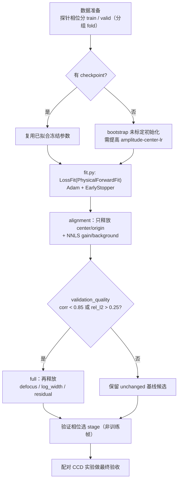
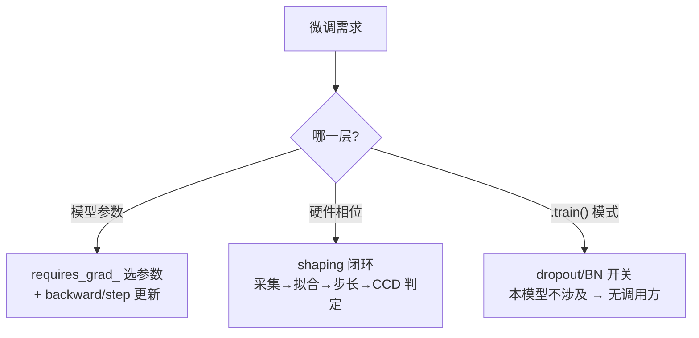
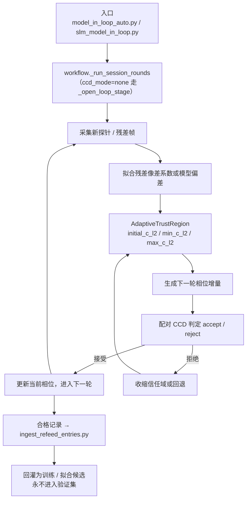

# Transfer 模型结构、全量训练与在线训练图文报告

> 生成日期：2026-11-20
> 范围：离线代码与文档梳理，未新开 SLM / CCD / 激光占用，未新增硬件采集。
> 数值与字段来自源码和仓库文档；技术标识符、路径、参数保持原样。

## 摘要

本报告梳理 `ao_shaping.tools.slm.transfer` 这条迁移学习整形链路的三个核心问题：

1. **模型结构**：核心是一个冻结的低维物理预测模型 `FrozenDefocusParameters` / `PhysicalForwardFit`，把面板相位经 SLM 非线性、瞳面振幅、离焦与残差像差、FFT 传播、相机采样与响应映射，得到可微的 CCD 强度预测。
2. **全量训练**：由 `fit.py` 在探针数据集上用 Adam + EarlyStopper 拟合；`adaptation.py` 以验证相位做 alignment → full 的分级释放；`pretrain.py` 用冻结前向合成 known-truth 库做仿真预训练；最终验收由配对 CCD 实验给出，与模型选择相互独立。
3. **在线训练**：`scripts/slm/model_in_loop_auto.py` / `slm_model_in_loop.py` 与 `workflow._run_session_rounds` 承载逐轮采集 → 残差拟合 → AdaptiveTrustRegion 步长 → 配对 CCD accept/reject 的闭环；合格记录经 `ingest_refeed_entries.py` 回灌为训练候选，永不进入验证集。

---

## 1. 模型结构（FrozenDefocusForward）

### 1.1 前向链路

```mermaid
flowchart LR
    A["指令相位<br/>raw 弧度 + focus + carrier"] --> B["相位符号作用域<br/>phase_sign / phase_sign_scope"]
    B --> C["SLM 非线性<br/>φ_eff = φ + a·sinφ + b·sin2φ"]
    C --> D["瞳面振幅<br/>Gaussian 幅宽 + 残差 Fourier"]
    D --> E["离焦 + Zernike 残差<br/>defocus_diopter / residual_noll_radians"]
    E --> F["FFT 远场传播<br/>fft_size / grid_size"]
    F --> G["ramp_matrix 逆映射<br/>+ registration_shift_ccd_px"]
    G --> H["CCD 采样 + sigma_ccd_px 模糊"]
    H --> I["响应 gain / background / bias"]
    I --> J["预测强度 → 固定掩膜 CV / correlation / relative_l2"]
```



### 1.2 冻结参数分组

来源：`src/ao_shaping/algorithm/signal_processing/differentiable_defocus_uniformity.py::FrozenDefocusParameters`。

| 参数组 | 字段 | 作用 |
| --- | --- | --- |
| 几何 / 照明 | `origin_xy`, `amplitude_center_xy`, `amplitude_width_xy` | 照明位置与幅宽；未标定时位置可差约 150 面板像元 |
| 波前 | `defocus_diopter`, `residual_noll_radians` | 离焦与残差 Zernike（弧度） |
| 采样 | `fft_size=1024`, `pixel_samples=3`, `grid_size=128` | 传播与采样网格 |
| 相机 | `ramp_matrix`, `sigma_ccd_px`, `bias_counts`, `registration_shift_ccd_px` | 面板斜率→相机位移、模糊、偏置与配准平移 |
| 响应 | `gain`, `background`, `monotonic_ccd_h/v_max` | NNLS 共享增益 / 背景与单调响应表 |
| 轴向 | `slm_axial_offset_m`, `axial_reference_curvature_diopter` | 轴向偏移与参考曲率 |
| 扩展（默认关闭） | `slm_phase_a`, `slm_phase_b`, `phase_sign`, `phase_sign_scope` | 保持历史线性基线逐位一致，按需由检查点开启 |

> 约束：`ramp_matrix` 是**面板像元 → 相机像元**的线性映射，前向用其逆把相机采样点映射回频域网格；它不在 `result.json` 中，必须由调用方显式提供。面板相位始终为未经包裹的 raw 弧度。

### 1.3 torchsummary 风格结构表

> 说明：`PhysicalForwardFit`（`physical_forward_fit.py:27`）现已转为 `torch.nn.Module`，可用 `named_parameters()` / `state_dict()` / `.to(device)` 等标准工具；前向算子（`gaussian_amplitude`、`defocus_phase`、`propagate`、`sample_intensity`）仍是函数式调用，没有注册为 `nn.Module` 子模块。`FrozenDefocusForward`（`differentiable_defocus_uniformity.py:240`）自身不持有可训练参数，唯一叶子是传入的相位。下表按真实 `nn.Parameter` 属性与前向张量形状整理成 torchsummary 等价格式；它是**源码派生的等价表示**，不是一次真实运行转储（各前向算子非子模块，直接跑 `torchsummary.summary()` 仍不会列出它们）。

**拟合器 `PhysicalForwardFit`（nn.Module）**

```
PhysicalForwardFit                        (torch.nn.Module)
─────────────────────────────────────────────────────────────────────────
Layer (functional op)          Output Shape              Param #
─────────────────────────────────────────────────────────────────────────
command phase (input)          (B, grid, grid)                 0
  ├─ phase_sign_scope           (B, grid, grid)                0   [optional]
  └─ SLM nonlinearity φ+a·sinφ  (B, grid, grid)                0   [optional]
d            (Parameter)       ()                              1   (defocus)
z4 / residual_basis            (Hres, grid, grid)              0   (buffer-like)
residual     (Parameter)       (7,)                            7   [learn_residual]
amplitude (gaussian)           (grid, grid)                    2   ← center
                                                               2   ← log_width
field = amp·exp(i·phase)       (grid, grid) complex            0
propagate (FFT)                (fft, fft)                      0
irradiance_scale               (fft, fft)                      0
origin       (Parameter)       (2,)                            2   (optical-axis)
inverse ramp_matrix            (2, 2)                          0   (buffer-like)
registration_shift (Parameter) (2,)                            2   [optional]
sample_intensity               (B, Hcam, Wcam)                 0
─────────────────────────────────────────────────────────────────────────
Total trainable params (full): 14   (d 1 + center 2 + log_width 2
                                     + residual 7 + origin 2)
Trainable params (alignment):  4    (center 2 + origin 2)
Non-trainable / buffers:       ramp_matrix(2×2), z4, residual_basis
─────────────────────────────────────────────────────────────────────────
grid = 128 (config); fft = 4·grid = 512 (fit default) or 1024 (frozen default)
B = batch_size; Hcam×Wcam = CCD native grid
```

**冻结前向 `FrozenDefocusForward`（plain class，全冻结）**

```
FrozenDefocusForward                      (plain class, fully frozen)
─────────────────────────────────────────────────────────────────────────
Layer (functional op)          Output Shape              Param #
─────────────────────────────────────────────────────────────────────────
phase (only leaf, require_grad) (B, grid, grid)                0
amplitude (frozen params)      (grid, grid)                    0
z4 / residual basis (1920²)    (1920, 1920)                    0
field = amp·exp(i·phase)       (grid, grid) complex            0
propagate (FFT)                (fft, fft)                      0
sample_intensity               (B, Hcam, Wcam)                 0
gain / background / bias       scalar (frozen)                 0
─────────────────────────────────────────────────────────────────────────
Total trainable params: 0
```

### 1.4 损失与测量锚定

- 损失用**固定掩膜内 CV**，不用全图峰值归一化 MSE。
- 相位增量按照明加权 RMS 限制（`phase_rms_cap`）。
- 测量锚定复用**同一完整模型**的 Jacobian（`states` / `jacobian` 接口），保证前向数学与检查点拟合口径一致（既有存档复现预测相对 L1 `9.976e-08`）。

---

## 2. 全量训练细节

### 2.1 流程总览



### 2.2 数据与拟合

- **数据划分**：探针相位按分组 fold 划为 train / valid；验证相位不参与任何拟合，回灌帧永不升格为验证集。
- **拟合器**：`PhysicalForwardFit` + Adam + `EarlyStopper`（`patience=8`, `min_delta=1e-4`）。
- **从零训练**：不传 `--checkpoint` 时，由当前光路一次探针采集经 `bootstrap` 给出未标定检查点。初始照明位置与实测可差约 150 面板像元，Adam 默认位置学习率走不完这段距离，因此需显式给 `--amplitude-center-lr`（既有实践约 4 面板像元/步），并把 `--fit-iterations` 提到 150 量级。默认 `--iterations=100`。
- **复用**：`--model-dir <session>` 复用该会话已采探针与已拟合模型，只跑整形段。

### 2.3 自适应选择（`adaptation.py` / `fit_adaptive`）

| 模式 | 可训练参数 | 触发条件 |
| --- | --- | --- |
| `alignment` | `center`, `origin` 恒开；NNLS 增益 / 背景；迭代上限 `min(iterations, 30)` | 默认起步 |
| `full` | 额外释放 `d`（defocus）、`log_width`、`residual` | `correlation < 0.85` 或 `relative_l2 > 0.25` |

- 两种模式各自保留 iteration-0 候选（含新几何与 NNLS，但无光学更新），当迁移反而变差时可作为回退。
- 选择只用**验证相位**的 `quality.score = 1 - correlation + relative_l2`；`adaptation.json` 记录 `selected_stage` / `escalated` / 各候选质量。
- 未改动的原光学基线始终是候选之一；配对 CCD 验收独立于该选择。

### 2.4 仿真预训练（`pretrain.py`）

- 用冻结前向合成 known-truth 数据；曝光遍历 `0.5 / 1 / 1.5 ms`，每幅图先按 `counts / exposure_ms` 归一化，使特征对曝光不变。
- 组合网格 `combo_grid`：defocus × shift × width_scale × aberration 全因子，默认取前 `combos=60` 组，每组 `probes_per_combo=8` 帧。
- 每帧抽取 8 维特征：能量比、相关、质心 dx/dy、x/y 展宽对数比、峰比、比值对数标准差。
- 分组折交叉验证 + ridge `alpha_sweep`，候选 `ALPHA_GRID = (0.01, 0.1, 1.0, 10.0)`，`DEFAULT_ALPHA = 0.01`（低惩罚端，保留共线的质心块；高惩罚端会把共享像差压入噪声）。

### 2.5 验收判据（`workflow.acceptance_verdict`）

- 只读 `session.json`（阈值配置）与 `rounds.json`，任何产物缺失返回安全的 `accepted=False`。
- 默认阈值：`acceptance_lower=0.85`（correlation 下限）、`acceptance_upper=0.25`（relative_l2 上限）。
- `accepted = measured_correlation >= lower and measured_relative_l2 <= upper`；`correlation_red_stop` 只看 correlation，作为更严格的 campaign 红灯信号。

### 2.6 “微调”的三层含义与 `.train()` 辨析

> 转 `nn.Module` 后一个常见疑问：既然没有调用方对 `PhysicalForwardFit` 调用 `.train()`，光路微调如何实现？关键是把三件事分开。

**第一层：模型参数微调（适配当前光路）— 靠 `requires_grad_` + 优化器，与 `.train()` 无关**

`adaptation.py::configure_adaptation` 用 `requires_grad_` 决定哪些 `nn.Parameter` 参与微调：

| 参数 | alignment | full |
| --- | --- | --- |
| `d`（离焦） | 冻结 | 释放 |
| `log_width`（幅宽） | 冻结 | 释放 |
| `residual`（残差 Zernike） | 冻结 | 释放 |
| `center`（照明位置） | 释放 | 释放 |
| `origin`（光轴截距） | 释放 | 释放 |

更新由梯度下降完成（`fit.py:382-387`、`parallel_fit.py:233-238`、类自身 `update()` `:225-247`）：

```python
loss.backward()
comps.model.optimizer.step()
with torch.no_grad():
    comps.model.d.clamp_(-2, 2)
    comps.model.center.clamp_(0, 1920)
    comps.model.log_width.clamp_(float(np.log(80)), float(np.log(800)))
```

**第二层：硬件光路的物理调整（SLM 相位 / DM 电压）— 不在这个类里**

真正调整实验系统相位图案的是 shaping 闭环（`workflow._run_session_rounds()` / `model_in_loop`）：采集配对帧 → 拟合残差 → `AdaptiveTrustRegion` 给相位步长 → CCD 判定接受 / 拒绝。`PhysicalForwardFit` 在这里只提供可微前向预测供优化器算梯度，自身不下发任何硬件指令。

**第三层：`.train()` 是什么 — PyTorch 的模式开关，与“训练/微调”正交**

`torch.nn.Module.train()` 只切换 dropout / BatchNorm 的行为。该模型既无 dropout 也无 BN，调不调结果完全一致，因此没有调用方需要它。训练掩码张量现已改名为 `self.train_mask`（供 `fit.py:277-278` 读取），不再遮蔽 `nn.Module.train()`；继承来的 `train()` / `eval()` 模式开关恢复可用，但由于无 dropout/BN，切换模式不改变任何数值。



---

## 3. 多形状四阶段 CCD 锚定（STAGE_RECIPES）

来源：`src/ao_shaping/tools/slm/transfer/stages.py`（单一事实源，纯 dataclass，不碰设备）。

| 阶段 | blocks | updates | phase_lr | phase_rms_cap | bit_depth | ccd_check | accept_metric | window_step | 备注 |
| --- | --- | --- | --- | --- | --- | --- | --- | --- | --- |
| `transport_cv` | 4 | 15 | 0.03 | 0.25 | 8 | False | `loss` | 4.0 | 从非 GS 几何种子起步 |
| `mono12_cv` | 8 | 20 | 0.025 | 0.20 | 12 | True | `cv` | 4.0 | 实测核心 CV 下降才接受 |
| `mono12_continue` | 12 | 15 | 0.02 | 0.15 | 12 | True | `cv` | 4.0 | 续跑上阶段接受相位 |
| `mono12_dense` | 4 | 20 | 0.015 | 0.12 | 12 | True | `cv` | 2.0 | `wide_model=True`, `core_margin=8.0`, `seed_policy=transfer` |

- 每形状 4 / 8 / 12 / 4 = **28 块**；四形状 **112 块**。
- 只有第 4 段用宽带载波模型与更细相机采样，暴露前三段的分辨率上限。
- **初相位择优**：`transport` / `backprojection` / `gs` 三种构造先各测一次初相位核心 CV，逐形状取优。`transport` 只对正方形精确（可分离相位无法产生不可分离远场）；`backprojection` 形状通用，但所需瞳面空间频率可能超过控制 Nyquist；`gs` 为模型内置 80 次迭代。
- 记录写入 `records/process.csv`、`records/process.h5` 与 `records/process_sidecars/`，并由 `Recorder.render_gif` 渲染过程动画。

---

## 4. 在线训练 / MIL 闭环



- 在线闭环以**配对帧**为最小判定单位；同一物理映射未经独立标定时，不在数据上混同 180° 对称族的不同分支。
- `AdaptiveTrustRegionConfig(initial_c_l2=…, min_c_l2=…, max_c_l2=…)` 与 `slm_model_in_loop.py` 调用匹配。
- 回灌只增加训练候选，不改变冻结 holdout 的构成；冻结集不参与择模、预处理选择或调阈值。

---

## 5. 数据纪律与边界

- 收益归因只用**新采集、唯一运行、完整溯源**的配对帧；历史数据不用于 issue 收益归因。
- 冻结 holdout 不参与择模、预处理选择或阈值调整；训练与推理共用的确定性预处理保持一致，随机增强只作用于训练集。
- 本报告为离线梳理；任何新增硬件采集或回放须另行明确批准。

---

## 6. 关键路径索引

| 主题 | 路径 |
| --- | --- |
| 统一 CLI / 工作流 | `src/ao_shaping/tools/slm/transfer/workflow.py`, `__main__.py` |
| 冻结前向参数 | `src/ao_shaping/algorithm/signal_processing/differentiable_defocus_uniformity.py` |
| 传播核心 | `src/ao_shaping/algorithm/signal_processing/defocus_forward_core.py` |
| 拟合器 | `src/ao_shaping/algorithm/signal_processing/physical_forward_fit.py` |
| 数据集拟合 / 自适应 | `src/ao_shaping/tools/slm/transfer/fit.py`, `adaptation.py` |
| 仿真预训练 | `src/ao_shaping/tools/slm/transfer/pretrain.py` |
| 阶段配方 | `src/ao_shaping/tools/slm/transfer/stages.py` |
| 在线 MIL | `scripts/slm/model_in_loop_auto.py`, `src/ao_shaping/optimizer/wfless/slm_model_in_loop.py` |
| 回灌 | `scripts/slm/ingest_refeed_entries.py` |
| 操作手册 | `docs/slm/slm_transfer_workflow.md` |

---

## 7. 任务项

- [ ] 核对各阶段参数是否需随新一轮实验更新（改动 `stages.py` 需同步既有对照表）。
- [ ] 若要把本报告纳入 `report/` 溯源登记，需同步 `scripts/_common/provenance.py::REPORTS` 三处映射。
- [ ] 任何收益结论闭环前，先取得新增配对采集或回放的明确批准。
