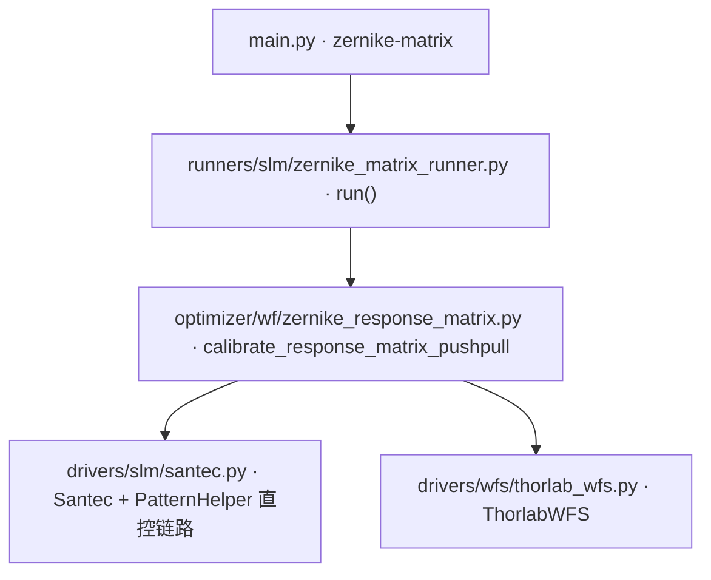

# Zernike 响应矩阵标定 (zernike-matrix)

> **生成脚本**: [`scripts/zernike_bench/generate_zernike_response_matrix_report.py`](../../scripts/zernike_bench/generate_zernike_response_matrix_report.py)
> **复现命令**: `python scripts/zernike_bench/generate_zernike_response_matrix_report.py`
> **运行环境**: 离线 (纯源码静态分析; 不开设备)

## 1. 这条命令做什么

通过 SLM 加载正负 Zernike 扰动模式，测量 Thorlabs WFS 响应，建立 Zernike 响应矩阵。

支持 N 次正负交替循环测量 + M 次 WFS 读取取平均 + 方差跟踪 + 逆矩阵计算。

## 2. 调用关系



## 3. 算法流程

1. **初始化**：打开 SLM 与 WFS，设置波长、瞳面参数
2. **pupil（瞳面） 自动检测**：CLI 默认 pupil（瞳面） (2.7mm/(0,0)) 视为"未指定" → `optimize_pupil()` 自动获取并**写回**（硬编码 pupil（瞳面） 会污染 WFS_ZernikeLsf 拟合）
3. **初始状态捕获**：捕获出厂/用户参考状态 (display_data flat)
4. **标定循环** (每个幅度)：
   - 对每个 Zernike 模式 (Noll 4..n_max) 施加 `±magnitude` 扰动
   - WFS 读取 `n_averages` 帧平均，重复 `n_cycles` 次正负交替消除漂移
   - 组装响应矩阵 `matrix[wfs_coeff_index, slm_mode_index]`
5. **离线矫正测试**：测完矩阵后自动执行 —— 恢复内部参考 → 平场基线 → pinv 反解当前像差 → ×2π 弧度加载 → 复测残差 + 模型自检 → export_correction_csv
6. **保存**：`.h5` 文件含响应矩阵、伪逆矩阵、方差矩阵、硬件配置快照

## 4. 单位链 (红线)

- **矩阵单位 = λ/λ**：列 = Δ(WFS λ) / Δ(SLM 幅度 λ)
- WFS 系数 µm → `um_to_waves()` → λ
- 施加相位 = 系数(λ) × 2π = 弧度
- 2026-09-16 修复两个单位 bug：µm/λ 混用放大 1.88×，λ/rad 混用缩小 6.28×

## 5. 主要选项

| 选项 | 说明 | 默认值 |
|------|------|--------|
| `--n-max` | Zernike 最大阶数 | 10 |
| `--magnitude` | 扰动幅度 (**弧度**, 0=自动优化) | 3.0 rad ≈0.48λ |
| `--zernike-radius` | Zernike 归一化半径 px | 600 |
| `--n-averages` | 每次 WFS 读取次数 M | 3 |
| `--n-cycles` | 正负交替循环次数 N | 1 |
| `--wait` | 等待时间 (秒) | 0.2 |
| `--output` | 输出文件路径 | data/zernike_response_matrix |
| `--no-inverses` | 不计算逆矩阵 | False |
| `--excluded-tip-tilt` | 排除 tip/tilt 模式 (Z2, Z3) | False |
| `--cancel-tile` | 测量时去除 WFS tip/tilt | False |
| `--display/--no-display` | 显示实时 pygame 显示 | False |
| `--debug` | 启用调试模式 | None |
| `--auto-optimize/--no-auto-optimize` | 自动优化扰动幅度 | True |
| `--optimize-n-avg` | 幅度优化时的 WFS 读取次数 | 10 |
| `--n-magnitudes` | 自动生成 N 个不同扰动幅度并分别保存 | 0 |
| `--dither-amp` | 亚波长抖动幅度 [λ] | 0.0 |
| `--correction-csv` | 误差矫正 CSV 文件路径 | None |

## 6. DLL Zernike 排序

DLL Zernike 排序 = 顺序 m 枚举 (非标准 Noll 1976)：`[5](2,0) [9](3,1) [13](4,0)`。

矩阵布局：`matrix[wfs_coeff_index, slm_mode_index]`，行 0..65 ↔ DLL [1..66]。

## 7. 输出契约

- `{output_path}.h5`：响应矩阵、伪逆矩阵、方差矩阵、子孔径掩码、硬件配置快照
- `{output_path}_mag{magnitude}_auto.h5`：多幅度模式下各幅度独立文件
- `{output_path}/debug_<timestamp>/`：调试模式原始测量数据

## 8. 闭环控制 (closed-loop)

基于已保存的响应矩阵进行闭环波前优化，使用 `closed-loop` 命令（详见 `docs/wfs/closed_loop.md`）。

## 9. 单独运行

```bash
python -m ao_shaping.runners.slm.zernike_matrix_runner [OPTIONS]
```