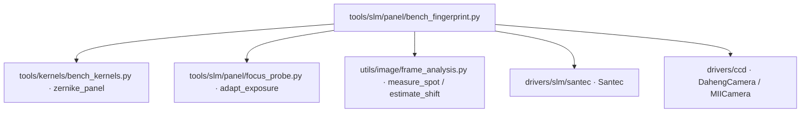

# SLM 光路指纹 (slm_bench_fingerprint)

> **运行环境**: 硬件实测 (需 SLM + 相机)

## 1. 这条工具做什么

判断「本次运行所依赖的标定，量在的光路，是否就是当前这条光路」。

一次标定（入射中心、口径、焦面尺度）只对量出它的那台光路有效。本实验系统的光路
在会话之间可以被物理重配：相机挪离 2f 面、底座被碰、SLM 被换。而标定产物里
没有任何字段记录「它量在哪条光路上」，一份过期标定会被静默复用，下游所有
数值自信地算错。TTL 解决不了这个问题——光路可能一秒内就变了，也可能一周不动
——所以校验必须是一次**测量**。

做法是显示两个已知相位、读光斑：

1. **平场 (flat)** 读 `FWHM`、`hollowness`、`centroid`
2. **平场 + 已知 Zernike 倾斜** 读 `centroid`

这三个量正好编码了重配光路真正会移动的三件事：

- `FWHM` 携带**轴向位置**。本实验系统实测：相机在 2f 面后约 11 mm 时平场 FWHM 约 39 px，
  在焦面约 16 px，差 2.4 倍，远在噪声底之外。
- `tilt_shift` 携带**焦面尺度**（面板到相机的角放大率）。换透镜或改变 SLM–相机
  间距都会移动它。
- `centroid` 携带**光束轴**。搬动标定与架装都体现在这里。

**亮度刻意不进判定**：本实验系统实测同一平场相位先后两次峰值读数 20.6 与 2.9
counts/ms（7.3 倍台阶），而单次运行内两分钟的稳定性是 1.05 倍。任何亮度阈值
都会在照度上误触发。亮度只作为上下文记录，从不参与比对。

每次读数都做过曝光自适应，且裁切帧被拒收，因为欠曝或饱和帧的 FWHM 不是测量：
本实验系统 0.05 ms 下同一光斑量出 1064 px 宽。

## 2. 调用关系



会话级入口为 `probe_session_fingerprint`（`runners/slm/model_in_loop_session.py`
的 `verify_bench_path` 调用它）。集成是**非致命**的：

- `calibrate_session(fingerprint=True)` 把本次指纹写入会话目录的
  `bench_fingerprint.json`，作为**下一次**会话比对的参考（采集失败只记
  `notes`，不掀翻标定）。
- 运行前 `verify_bench_path` 用实测光路对照上一份 `bench_fingerprint.json`；
  测量本身失败或光路过远离焦时返回 `skipped`，**校验永远不会 veto 一次运行**。
- 独立 CLI 路径（本工具）则直接 `raise BenchPathChanged`（退出码 3），供手动
  把关。

## 3. 比对与容差

判定用三个量，容差**不对称**，分别守护各自最可能漂移的量：

| 量 | 容差 | 依据 |
|---|---|---|
| `flat_fwhm_px` | 相对 25% (`FWHM_RTOL`) | 轴向信号，实测变化 140%，带宽宽但判定明确 |
| `tilt_shift_px` | 相对 15% (`SHIFT_RTOL`) | 三者中最稳 |
| `flat_centroid` | 绝对 30 px (`CENTROID_TOL_PX`) | 质心随架装移动 |

**无法判定 ≠ 通过。** 平场光斑宽于 `FWHM_FOCUSED_PX = 30 px` 时（相机明显离焦，
本实验系统离焦 11 mm 时读 58–79 px），任何形状统计量都不可信（同一相位两次读数
79.2 与 59.9 px；倾斜对的相位相关为 0.0，因为大光斑内的散斑已去相关）。此时判定
标 `skipped`（`notes` 说明「无法判定」），**不**当作阻断运行的理由——一个在
这种噪声上否掉运行比没有校验更糟。

## 4. 用法

```bash
$env:PYTHONPATH="${PWD}/src;${PWD}/libs"
# 采集 + 与参考比对（参考默认取最新一份）
python -m ao_shaping.tools.slm.panel.bench_fingerprint --slm-number 1 --cam-type daheng
# 仅采集，不比对
python -m ao_shaping.tools.slm.panel.bench_fingerprint --skip-compare
# 显式指定参考
python -m ao_shaping.tools.slm.panel.bench_fingerprint --reference data/debug/bench_settings/fingerprint/fingerprint_slm1_x.json
```

CLI 选项（`--help` 顺序）：

| 选项 | 默认 | 含义 |
|---|---|---|
| `--slm-number` | 1 | SLM 编号 |
| `--slm-wavelength` | 1064 | SLM 波长 nm |
| `--cam-type` | daheng | 相机类型 |
| `--cam-id` | 0 | 相机 ID |
| `--centre-x` / `--centre-y` | 960 / 690 | 入射中心（面板 px） |
| `--radius-px` | 450 | 照明半径（面板 px） |
| `--tilt-rad` | 4.0 | 已知倾斜幅度 rad（约 20 px 位移） |
| `--exposure-ms` | 0.2 | 起始曝光 ms（自动调整） |
| `--reference` | 最新一份 | 参考指纹 JSON 路径 |
| `--skip-compare` | 关 | 只采集不比对 |

退出码：`0` 与参考一致（或跳过比对）；`3` 光路已变更（`BenchPathChanged`）；
`1` 采集失败。

## 5. 证据

证据写入 `data/debug/bench_settings/fingerprint/`（`FINGERPRINT_DEBUG_DIR`），
每份为 `fingerprint_slm{N}_<ts>.json`，字段见 `BenchFingerprint`。
