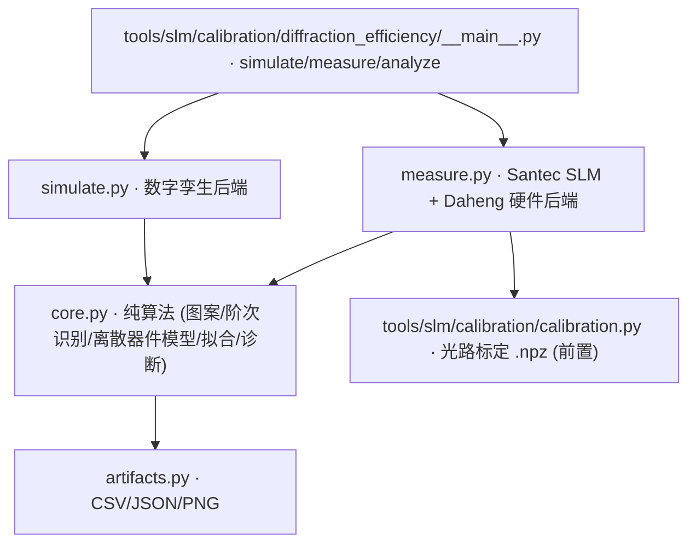

# SLM 闪耀光栅衍射效率 / 相位响应标定 (diffraction_efficiency)

> **运行环境**: `simulate` 纯数字孪生（无硬件）；`measure` 硬件实测（需 Santec SLM + 相机 + 光路标定 `.npz`）；`analyze` 离线（读已保存 CSV）

## 1. 这条工具做什么

在 **2f 实验系统**里用**一维闪耀光栅**测器件的**相位调制深度**与**衍射效率**。
一维闪耀光栅把相位指令按 `order = (2·index+1)·k` 分布到各衍射级，量出各级能量占比
后反解出器件在该命令灰度下的真实相位深度 Δφ_max 与 ±1 级效率。`gray` 模式测器件
本征（命令轴是灰度值本身），`phase` 模式测"命令弧度 → 器件实际相位"这条链路。

**硬件前置条件**：必须先有光路标定 `.npz`（由 `python -m ao_shaping.tools.slm.calibration`
几何标定产出）。零级中心与 Kx/Ky（面板像元→CCD 像素的放大系数）来自它；没有它就没有
"预期间距"，阶次分配与几何核对无从谈起，所以缺键**直接失败**，而不是退化成"先测了再说"。

## 2. 调用关系

CLI 入口：`python -m ao_shaping.tools.slm.calibration.diffraction_efficiency {simulate,measure,analyze}`。
`simulate` 与 `measure` 共用 `core` 的同一套代码路径 —— 仿真验证的就是实验系统要走的那条路。

## 3. 两种测量模式

- **`gray`（默认）—— 器件本征表征**：灰度图**直接**写进 SLM 内存，绕开驱动的
  弧度→灰度管线（波前矫正图 / 相位 LUT / 平移 / 底相位）。命令轴是灰度值本身，
  拟合出的 Δφ_max 是器件在该灰度下的**真实**相位深度。代价：此路径无法叠加菲涅尔
  离焦补偿（补偿是弧度量，折回灰度必须由驱动完成），因此有限焦距会告警并忽略。
- **`phase` —— 命令弧度链路核对**：图案以**弧度**生成（raw 未包裹），再经
  `phase_to_slm_grayscale` 交给驱动管线（矫正 / LUT / 平移 / mod 2π）。
  测的是"命令弧度 → 器件实际相位"这条链路，不是器件本征。

## 4. 可信范围（必读）

- **相对效率曲线可信**；但**拟合出的相位深度**只在「**幂律器件** + **在焦** +
  **填充因子≈1**」三前提**同时**成立时可信：填充因子 0.8 会把标称器件报成过调制
  (+16%)，非幂律 LUT 偏 +42%，离焦偏 +11%。
- **光斑宽度门禁**（`--fwhm-gate-ratio`，默认 3×；`--reference-fwhm-px` 给一条**在焦**
  的绝对参照）把这类失真变成显式失败：门禁触发时越限点与"零级被熄灭"的点**一并**
  退出拟合，有效点不足即**拟合报错**，而不是给出一个偏了的深度。

## 5. 主要选项

| 子命令 | 关键选项（默认值） |
|---|---|
| `simulate` | `--period-px`(32) `--axis`(x/y) `--n-steps`(21) `--mode`(gray/phase) `--depth-max-rad`(2π) `--gamma`(1.0) `--defocus-coeff`(0.0) `--peak-adu`(18000) `--read-noise-adu`(25) `--seed`(0) `--reference-fwhm-px` `--fwhm-gate-ratio`(3.0) |
| `measure` | `--slm-number`(1) `--slm-wavelength`(1064) `--cam-type`(daheng/miicam/sim) `--cam-id`(0) `--exposure-ms`(0.4) `--period-px`(16) `--n-steps`(21) `--frames`(4) `--discard`(3) `--settle-s`(0.4) `--pupil-center` `--pupil-radius`(480) `--defocus-focal-mm`(inf) `--reference-fwhm-px` `--fwhm-gate-ratio`(3.0) |
| `analyze` | `--csv`(data/diffraction_efficiency/hw/measurements.csv) `--command-max`(1023) `--period-px`(16) `--reference-fwhm-px` `--fwhm-gate-ratio`(3.0) |

- `measure` 前需先跑 `python -m ao_shaping.tools.slm.calibration` 生成光路标定 `.npz`。
- `analyze` 对已保存的扫描 CSV 重新拟合（离线，不碰硬件），用于复算与门禁复核。
- 产物（CSV/JSON/PNG）由 `artifacts.py` 写盘；数字孪生非理想性分析见
  `report/slm/diffraction_efficiency/sim_nonideality_20261022.md`。
