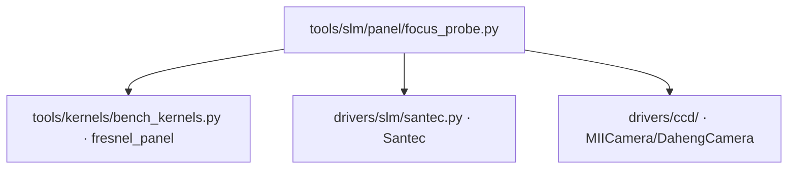

# SLM 焦面探测 (slm_focus_probe)

> **运行环境**: 硬件实测 (需 SLM + 相机)

## 1. 这条工具做什么

在 **plain 相位**上扫描菲涅尔焦距（1/f，单位 m⁻¹），找出让焦面回到相机的
二次相位。相机一旦离开 2f 焦面（哪怕几毫米），0 阶光斑就散成一个锥，PIB /
方形整形 / Zernike 响应矩阵全部在失焦光斑上测量。补偿量是**光路事实**：
随相机毫米级移动而变，也不能从标称 125 mm 透镜推出（面板相位符号方向与
包裹透镜相位的衍射效率都不在纸面上），所以实测。

## 2. 调用关系



GUI 入口为 `probe_session_focus`（侧栏「本次实验光路」D 组「探测焦面」按钮）。

## 3. 测量原理

- 在 plain 相位上加载菲涅尔二次相位（`fresnel_panel`），以光焦度
  `D = 1/f` 为参数扫描（`D = 0` 即 plain 相位基线），范围默认对称 ±6 m⁻¹
- **曝光陷阱**：近焦点峰顶饱和到 255、远焦点只剩读出噪声，亮度跨数个数量级。
  固定曝光无法给各点排序 → **每个点都重新调曝光**（目标带
  25%–80% 量程），排序量用 `peak / exposure_ms`（每毫秒灰度），
  传感器对曝光线性时该比值正比于真实强度，跨点可比
- 在胜出点**复验线性假设**（半曝光再读一帧），不盲信
- 粗扫找盆地 → 抛物线顶点 + 重测精化；若最优点落在扫描边缘，向外扩一次/两次

## 4. 测量流程

1. 对称扫描 `--steps` 个光焦度点（默认 25），每点自动重调曝光到可用带
2. 以 `peak / exposure_ms` 选最亮点
3. 抛物线顶点估出精化中心，再细扫一轮
4. 在胜出点做半曝光线性复验
5. 证据落 `data/debug/bench_settings/focus_probe/`

## 5. 主要选项

| 选项 | 说明 | 默认值 |
|------|------|--------|
| `--slm-number` | SLM 设备编号 | 1 |
| `--slm-wavelength` | SLM 波长 (nm) | 1064 |
| `--cam-type` | 相机类型 (daheng/miicam/sim；`sim` 走数字孪生 `SimSLMPib` + 仿真相机，同结构产物，无需硬件) | daheng |
| `--cam-id` | 相机 ID | 0 |
| `--exposure-ms` | 起始曝光 ms（每点自动调整） | 0.1 |
| `--radius-px` | 照明半径 (面板px) | `BEAM_RADIUS_PANEL` |
| `--centre-x` / `--centre-y` | 入射中心 (面板px) | 面板中心 |
| `--steps` | 粗扫点数 | 25 |
| `--diopter-range` | 光焦度扫描半宽 (m⁻¹) | 6.0 |
| `--refine` | 精化点数 | 见 CLI `--help` |
| `--frames` | 每点平均帧数 | 3 |
| `--max-exposure-ms` | 曝光上限 (ms) | 见 CLI `--help` |

## 6. 示例

```bash
python -m ao_shaping.tools.slm.panel.focus_probe --exposure-ms 0.1
python -m ao_shaping.tools.slm.panel.focus_probe --steps 25 --frames 3
```

## 7. 输出

- 控制台打印：最佳焦距 (mm)、光焦度 (m⁻¹)、峰值/曝光比、线性复验结果
- 证据文件：`data/debug/bench_settings/focus_probe/`

### 7.1 退出码：光路受阻 ≠ 没找到焦面

| 码 | 含义 |
|---|---|
| 0 | 找到了焦面（最佳 1/f 与焦距都写进了证据文件） |
| 1 | 探测本身失败（设备报错，证据文件里有 `error`） |
| 2 | 没找到焦面 —— 扫描范围内没有任何一点落进可用曝光带 |
| 3 | **光路受阻** —— 画面里根本没有光，不是「没对上焦」，是光没到相机 |

🔴 **2 与 3 必须分开**。光路被挡住时画面里同样「找不到光斑」，而「被挡住」这件事
**只能靠结构看出来**：峰值停在读出噪声本底（2026-10-21 实测 1–2 counts，即便
20 ms 曝光）+ 帧里没有任何局域结构（FWHM ≈ 整个画幅，实测 2592×1944 上
2267 px）。两者的处置完全不同：2 要重扫焦距 / 挪相机，3 要去查
**光束 → SLM 面板 → 2f 透镜 → CCD 三段光路**。

判据在 `utils/image/frame_analysis.py::assess_spot`（三个脚本共用：焦面探测、
离焦探针、泽尼克阶次扫描）。证据 JSON 里带 `path_blocked` 与 `blockage_reason`。

## 8. 与离焦叠加的关系

实测焦距写入 `slm{N}_bench_focus_probe`，供侧栏「离焦叠加 (发送叠加)」区
（`multi_slm_controller._render_defocus_overlay_block`）的推荐焦距做粗补偿
（`bench_fresnel_focal_mm` 读 `best_focal_mm`；三态：未探测 / 哨兵 `-9999` /
人工覆盖，见 `bench_settings.bench_defocus_focal`）。该层用菲涅尔项做粗调
（焦距 mm）+ Zernike (2,0) 做细调（`build_defocus_overlay`，纯函数，每次现算
不累积），由驱动 `set_phase_overlay` 承载，开关一开就作用于其后**所有**发送
（优化器 / 一键下发 / CSV / 周期切换），与底相位同属 T4 发送管线叠加层。
