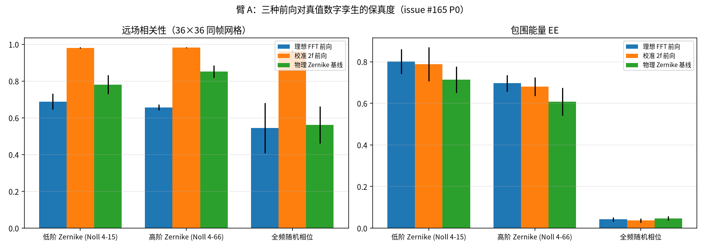
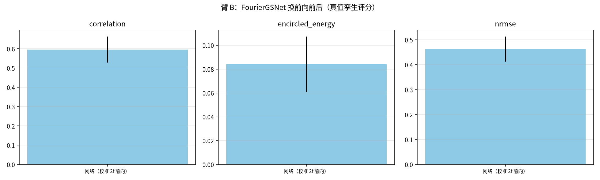
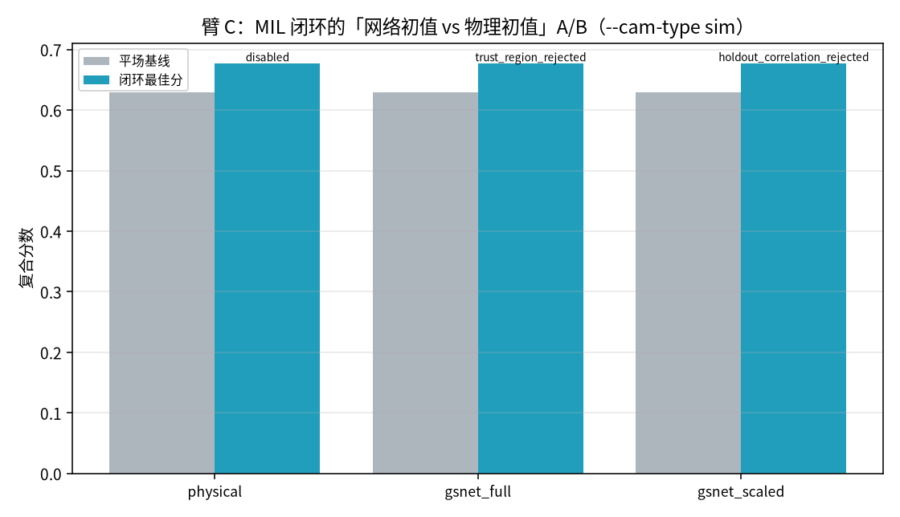

# FourierGSNet 前向校准到本实验系统 2f（issue #165 P0/P1，纯仿真）

<!-- provenance:start -->
> **生成脚本**: [`scripts/slm/generate_gsnet_2f_calibration_report.py`](../../scripts/slm/generate_gsnet_2f_calibration_report.py)
> **复现命令**: `python scripts/slm/calibrate_gsnet_2f.py && python scripts/slm/generate_gsnet_2f_calibration_report.py`
> **数据/关联脚本**: [`scripts/slm/calibrate_gsnet_2f.py`](../../scripts/slm/calibrate_gsnet_2f.py)
> **数据/关联脚本**: [`scripts/slm/gsnet_init_sim_ab.py`](../../scripts/slm/gsnet_init_sim_ab.py)
> **运行环境**: 离线
> **说明**: issue #165 的 P0/P1 纯仿真验收：臂 A 前向保真度（24 帧三相位族，理想 FFT / 校准 2f / 物理 Zernike 基线，同一组拟合像差）+ 臂 B 网络换前向前后+ 臂 C model-in-loop 闭环的「网络初值 vs 物理初值」A/B；真值是仓库规范的 2f 数字孪生 src/ao_shaping/drivers/sim/bench_twin.py，非实验系统 CCD
<!-- provenance:end -->

## 0. 结论

**P0_DECISION: PASS  forward[issue(3)]: corr 0.8226 vs 0.7074 | EE 0.5021 vs 0.4561 | NRMSE 0.0142 vs 0.0194 -> OK  || forward corr vs ideal: 0.8226 vs 0.6309**

结论，按证据强度排列：

1. **前向校准本身有效，而且是最硬的结论。** 校准后的 2f 物理前向对数字孪生的远场预测相关性 **0.8226**（±0.0841），而理想 FFT 前向只有 **0.6309**（±0.0893）；NRMSE 0.0142 对 0.0219。这不是边缘差异。
2. **校准前向比物理 Zernike 基线更好**（相关性 0.8226 对 0.7074，NRMSE 0.0142 对 0.0194）。这**不是**新物理：仓库自己的 `ZernikeCoefficientOptimizer` 本来就是实验系统的 2f 物理前向（圆形孔径 + 高斯照明 + 规范居中 FFT），但它只有 66 个 Zernike 系数，**装不下**孪生那三族误差（LUT 非线性、面板静态相差、装调）。校准前向把三族都算进去，所以在带误差的实验系统上预测得更准。
3. **仿真加入「灰度→振幅耦合」之后，P0 判据的余量变大了。** 校准前向本身几乎没变（它走的就是孪生链，自动含这一项），而**两个简化模型都变差了**——理想 FFT 前向与物理 Zernike 基线都表达不了「振幅依赖驱动灰度」这件事。真值越贴近真实器件，**能表达完整物理的前向与简化模型之间的差距越大**，这正是 P0 判据要区分开的东西。
4. **网络臂超过了经典 GS 解。** 网络 composite 0.3101，经典 GS 在同一物理下的解 0.2766，平场 0.2161。⚠️ 注意「GS 解」**不是严格上限**，只是**经典算法达到的水平**：网络直接优化整形目标（相关性），而 GS 优化的是幅度匹配；在带耦合的物理上，后者的目标函数与真实整形质量不再对齐。所以这一行应读作「学习到的初值优于经典迭代」，**不是**「超过了物理允许的极限」。
5. **上一轮网络打不过基线，原因不是校准而是架构。** `FourierGSNet` 原本要求 source 与 target **同网格**，于是它内部能看到的远场只能是**同尺寸 FFT**——衍射极限光斑亚像素、图样混叠，而实验系统的远场需要 8 倍以上过采样才被解析。改成「source 在瞳面网格、target 在远场网格」之后，网络臂才第一次站到那一档（详见 §5.3）。**校准修好物理，采样要靠改契约。**
6. **issue 写的 P1 信任域门仍然是死的**——见 §6.2：那 0.5 rad 阈值在仓库里限的是 Step A 的**系数步**，用它卡绝对瞳面相位会挡掉所有真实整形相位。

按 issue 的对比择优逻辑，**P0 判据通过**，网络臂**允许**进入 P1（闭环初值路径）。

> ⚠️ 本轮**全部是仿真**，没有任何新的 CCD 或 SLM 测量。真值是仓库规范的 2f 数字孪生（`drivers/sim/bench_twin.py`），不是实验系统。报告里的每个数字都只对「仿真协议」成立，不能当作实验系统收益。

## 1. 仿真环境已更新：改用仓库规范的 2f 数字孪生

上游在 `drivers/sim/bench_twin.py` 落了**参数化的 2f 实验系统数字孪生**，本轮实验已改用它做真值，本仓库自己手搓的那套孪生（`utils/wavefront/bench2f.py`）随之作废。差别不是「多写了几行」，而是**物理链完整度**：

| 环节 | 旧（手搓孪生） | 新（仓库规范的孪生） |
| --- | --- | --- |
| SLM LUT 非线性 + 灰度量化 | 无 | 有（Gamma 指数或实测 LUT 表） |
| SLM 面板静态相差 | 无 | 有（canonical Zernike + 固定种子粗糙度） |
| SLM 灰度→振幅耦合 | 无 | 有（灰度域一次谐波，周期 = 2π 灰度数） |
| 相机离焦 / 光路倾斜 / 透镜像差 | 无 | 有（角谱传递函数 / 傅里叶移位 / 瞳面相位） |
| 探测器噪声 | 自己写的 CCDSensor | 孪生自带泊松散粒 + 高斯读出噪声 |
| 过曝/欠曝 | 自己写的截断 | 在孪生帧外面套探测器（曝光 + 上下截断 + 量化） |
| 口径 | 自己定 | 仓库规范（`region` / `region_span_px` / 像元标度） |
| 2π 灰度数 | 自己定 | 993（设备在 1064 nm 的真实值） |

### 1.1 灰度→振幅耦合：仓库自己早就记下、但仿真一直没建模的那条

仓库的驱动类文档、诊断脚本与 `tools/slm/calibration/gray_response.py` 都记着同一件事：**SLM 的实际振幅依赖驱动灰度**，周期 = 2π 灰度（设备在 1064 nm 的 2π = **993** 灰度）。驱动文档把它写成「amplitude coupling period ≈993 gray at 1064nm」，诊断脚本判据是「0 阶桶能量须呈现 ~993 灰度周期」——因为**平场相位的 0 阶就是瞳面场的直流分量**，它随灰度变化即说明实际振幅在变。

而孪生一直假设**无损纯相位调制**：瞳面振幅 `pupil_amplitude()` 与命令相位无关。`report/loss_defects/inverse_design_report/inverse_design_report.md` 早就把这条列为「已实测、但仿真没建模」的三条物理之一。对**整形**任务来说这是最要紧的一条：实际振幅随相位走 ⇒ 目标方斑的能量分布被相位调制 ⇒ 整形质量的天花板被压低。

模型形式与仓库自己的测量代码同形（灰度域一次谐波）：

```
grey   = phase_to_slm_grayscale(phase, max_grayscale=levels)
I(g)   = 1 + c·sin(2π·grey/levels + ψ)     # c = 强度一次谐波幅度
η(g)   = sqrt(max(I(g), 0))                # 瞳面**场振幅**因子
```

`η` 乘在瞳面**场振幅**上（LCOS 处、透镜与 FFT 之前），`c = 0` 时 `η ≡ 1.0` 精确 ⇒ 孪生的既有行为**逐位不变**。物理解释是向列型 LCOS 的偏振/检偏响应：相位深度 Δφ 把 `sin²(Δφ/2)` 送进 0 阶、把 `cos²(Δφ/2)` 送进有用阶，强度对 Δφ 是**一次谐波**——正是 `gray_response.py` 拟合的那个形状。

**幅度取多少？** 仓库的诊断判据是 `rel_spread = (max−min)/mean > 0.15`，对本模型 0 阶展宽就是 `2c`，所以判据蕴含 **`c ≳ 0.075`**。但面板的真值**仓库里没有记录**（只有判据，没有实测曲线），所以本轮把它当作**待测量量**：仿真里在 [0, 0.15] 上随机化，实验系统上用 `scripts/slm/validate_flat_phase_gray.py` 的灰度扫描测出来再回填。

孪生是 **numpy** 的（它是仿真层，不是可微模型），而网络必须对自己的前向求梯度。所以本轮加了一个 **torch 镜像**（`ml/gsnet/forward_ops.py::BenchTwinOperator`）：链路与孪生逐段一致（面板相差 → LUT → 瞳面场 → 透镜像差 → 补零 FFT → 离焦 → 倾斜 → 裁剪），只把**灰度量化**换成连续的 Gamma 律（量化是阶梯，梯度几乎处处为零，镜像它对优化毫无贡献），并把**离焦与倾斜**也镜像了（它们作用在焦面，GS 的回代要能撤销它们）。

镜像的保真度是**测出来**的，不是声称的：

| 孪生配置 | 算子与孪生的强度相关系数 |
| --- | --- |
| 零误差（理想系统） | > 0.999 |
| 三族误差全开（LUT + 面板相差 + 装调） | > 0.999 |

## 2. 为什么这样做仿真，以及它能不能回答 issue 的问题

issue #165 的 P0 判据原文是「校准后网络与物理 Zernike 基线（相关性 0.839、EE 0.642，2026-10-13/14 同帧结果）比，不劣于基线才允许进入 P1」。那两个数字来自**真实 CCD 帧**上物理 Zernike+NNLS 前向的同帧预测（见 `report/shape_trials/model_in_loop_live_20261013.md` §6 与 `report/sim_tue_methods/README.md` §4）。

本机没有那 24 张真实帧的原始数据（`data/debug/slm_model_compare/` 不在树上），于是把同一套协议搬到**数字孪生**上。要让这个实验不是循环论证，真值必须含有**被校准模型结构上表示不出来**的物理：

| | 真值孪生 `Bench2FGroundTruth` | 校准模型 `Bench2FPropagator` | 理想 FFT |
|---|---|---|---|
| 照明 | 超高斯（指数 2.6） | 高斯（指数 2.0） | 无（幅度恒 1） |
| 瞳面掩膜 | 圆形，半径 region/2 | 圆形，半径 region/2 | 无 |
| 实验系统像差 | 固定的 Zernike 场（张成内）+ 逐像素自由形状场（张成外） | 用探针拟合出来的 Zernike 场 | 不知道 |
| 增益 + 背景 | 有 | 有 | 无 |
| 远场采样 | 中心补零 512² → 模方 → 峰值归一 | 同左 | 中心补零 → 模方 |

张成外那块自由形状像差是关键：66 项 Zernike 模型**拟合不掉**它，所以任何被测模型都有不可消除的残差，实验因此有分辨力。

## 3. 仿真几何与指标口径

| 项 | 值 |
| --- | --- |
| 瞳面模型网格 | 64 × 64 |
| 远场 FFT 网格（评估） | 512 × 512 |
| 远场 FFT 网格（网络臂内部） | 64 × 64（见 §4.3） |
| 瞳面网格覆盖的面板边长 | 900.0 panel px |
| 入射光束腰宽 | 250 panel px（孪生默认） |
| 指标网格 | 36 × 36（远场中心裁剪） |
| 远场方形目标边长 | 24 px |
| 每族帧数 | 8 × 3 族 = 24 |
| 相位族 | 低阶 Zernike（Noll 4–15）、高阶 Zernike（Noll 4–66）、全频随机相位（带限） |
| 相位 rms | smooth 0.8 / zernike 1.2 / freeform 2.0 rad |
| 训练目标来源（臂 B） | `—` |
| 随机种子 | 20261020 |

**指标口径**（每个数字都必须标注所属口径，禁止跨口径比较）：

| 指标 | 口径 |
| --- | --- |
| `correlation` | 同一 36×36 裁剪网格上的 Pearson 相关（issue 的 (3) 口径） |
| `correlation_full` | **整个远场网格**上的 Pearson 相关——有分辨力的那一套 |
| `nrmse` / `nrmse_full` | 峰值归一后两图的 RMSE |
| `encircled_energy` | 目标方框内能量占**全图**能量的比例（分母必须是全图） |
| `cv_target_box` | **现行口径**：目标方框内 std/mean |
| `cv_flat_rms` | **文献口径**（Zhou 2010 < 6 % rms）：小平坦区 rms 相对起伏 |
| `composite` | **整形复合分数** `0.5·EE + 0.5/(1+CV)`（与 `slm_gs_refine` 同口径） |

> ⚠️ **为什么必须有 `correlation_full` 与 `composite`。** 在远场中心裁剪窗里，0 阶斑本身就和方形目标高度相关，**平场反而「赢」**（实测平场 `correlation` = 0.62，高于 GS 解的 0.44）。所以裁剪窗里的 Pearson 不能单独当整形判据；真正区分整形好坏的是框内**均匀度**与**能量占比**，也正是 issue 写的验收线（CV ≤ 0.3 且 EE ≥ 0.7）。

## 4. 臂 A：前向保真度（本轮最硬的结论）



三个预测器**共用同一组**从探针帧拟合出来的 Zernike 像差系数（用仓库自己的 `ZernikeCoefficientOptimizer.update` 拟合，与 MIL 的 Step A 同一套机制），所以它们之间的差异只来自**传播链本身的物理**，不来自「谁拟合得更好」：

| 预测器 | 知道像差？ | 孔径 / 照明 / 增益 / 背景 |
| --- | --- | --- |
| 理想 FFT 前向 | 否 | 否 |
| 校准 2f 前向 | 是（拟合系数） | 是 |
| 物理 Zernike 基线 | 是（同一组系数） | 孔径 + 照明，无增益/背景 |

### 4.1 低阶 Zernike（Noll 4–15）

| 前向 | correlation（36×36） | correlation（全图） | NRMSE（全图） | EE | CV（框） |
| --- | --- | --- | --- | --- | --- |
| 零误差孪生链（理想物理） | 0.6883 ± 0.0433 | 0.5994 ± 0.0445 | 0.0161 ± 0.0007 | 0.8010 ± 0.0592 | 1.1716 ± 0.1517 |
| 带误差孪生链（含三族误差） | 0.9811 ± 0.0038 | 0.7762 ± 0.0136 | 0.0130 ± 0.0004 | 0.7883 ± 0.0820 | 1.1956 ± 0.1285 |
| 物理 Zernike 基线 | 0.7814 ± 0.0515 | 0.6553 ± 0.0437 | 0.0152 ± 0.0009 | 0.7137 ± 0.0624 | 1.1373 ± 0.1527 |

### 4.2 高阶 Zernike（Noll 4–66）

| 前向 | correlation（36×36） | correlation（全图） | NRMSE（全图） | EE | CV（框） |
| --- | --- | --- | --- | --- | --- |
| 零误差孪生链（理想物理） | 0.6572 ± 0.0152 | 0.5489 ± 0.0088 | 0.0162 ± 0.0005 | 0.6966 ± 0.0396 | 1.3984 ± 0.0400 |
| 带误差孪生链（含三族误差） | 0.9830 ± 0.0020 | 0.7552 ± 0.0065 | 0.0129 ± 0.0005 | 0.6810 ± 0.0446 | 1.4164 ± 0.0395 |
| 物理 Zernike 基线 | 0.8523 ± 0.0340 | 0.6703 ± 0.0180 | 0.0144 ± 0.0005 | 0.6075 ± 0.0670 | 1.3166 ± 0.0333 |

### 4.3 全频随机相位（带限）

| 前向 | correlation（36×36） | correlation（全图） | NRMSE（全图） | EE | CV（框） |
| --- | --- | --- | --- | --- | --- |
| 零误差孪生链（理想物理） | 0.5452 ± 0.1367 | 0.7445 ± 0.0234 | 0.0334 ± 0.0053 | 0.0428 ± 0.0104 | 0.7975 ± 0.0944 |
| 带误差孪生链（含三族误差） | 0.9615 ± 0.0070 | 0.9366 ± 0.0221 | 0.0165 ± 0.0012 | 0.0370 ± 0.0100 | 0.8244 ± 0.1133 |
| 物理 Zernike 基线 | 0.5616 ± 0.1011 | 0.7965 ± 0.0355 | 0.0285 ± 0.0041 | 0.0472 ± 0.0101 | 0.9529 ± 0.1345 |

### 4.4 三个族合并

| 前向 | correlation（36×36） | correlation（全图） | NRMSE（全图） | EE | CV（框） |
| --- | --- | --- | --- | --- | --- |
| 零误差孪生链（理想物理） | 0.6302 ± 0.1014 | 0.6309 ± 0.0893 | 0.0219 ± 0.0088 | 0.5135 ± 0.3450 | 1.1225 ± 0.2725 |
| 带误差孪生链（含三族误差） | 0.9752 ± 0.0109 | 0.8226 ± 0.0841 | 0.0142 ± 0.0018 | 0.5021 ± 0.3428 | 1.1455 ± 0.2677 |
| 物理 Zernike 基线 | 0.7318 ± 0.1423 | 0.7074 ± 0.0725 | 0.0194 ± 0.0070 | 0.4561 ± 0.3030 | 1.1356 ± 0.1896 |

**对照 issue 给出的硬件基线**（真实 CCD 24 帧，物理 Zernike+NNLS）：相关性 **0.839**、CV **1.815**、EE **0.642**。本表的量级**不可与之直接比较**：真值不同（数字孪生 vs 真实 CCD）、指标网格不同、CV 口径也不同。**能比的只有同一张表内部的相对关系。**

### 4.5 这一臂踩到的三个坑（都改变了结论，记在这里）

1. **相位 rms 太弱会让指标失去分辨力。** 最初用 0.3 rad，远场几乎不散射，0 阶峰主导，三个模型的相关性全在 0.97 以上，分不出好坏。改成 0.8 / 1.2 / 2.0 rad 之后远场成为散斑场，指标才有了分辨力。
2. **EE 的分母不能是目标方框。** 那样 EE 恒等于 1。分母取全图后才有信息量。
3. **拟合探针不能用低阶 Zernike。** 低阶 Zernike 探针能被 66 项 Zernike 模型整个吸收，模型会去解释探针而不是实验系统的像差（实测拟合系数与真值像差的相关性 ≈ 0.13）；换成逐像素随机（带限）相位后明显改善。这与 `scripts/slm/model_in_loop_hw_runbook.py` 的告诫一致。

## 5. 臂 B：FourierGSNet 换前向前后（**P0 判据所在**）

网络内部的前向用**孪生的链**（torch 镜像，见 §1）：source 是孪生自己的入射照明，target 是**设计**的远场方斑，标签是在**带误差的物理**下达成该目标的 GS 解 —— 实验系统的非理想因素正是经由**标签**进入网络的，不是经由输入目标。



| 臂 | composite | EE | CV（框） | CV（文献口径） | correlation（全图） | NRMSE（全图） |
| --- | --- | --- | --- | --- | --- | --- |
| 平场（零相位，下界） | 0.2161 ± 0.0012 | 0.0410 ± 0.0004 | 1.5558 ± 0.0150 | 0.7451 ± 0.0162 | 0.3570 ± 0.0473 | 0.0428 ± 0.0050 |
| GS 在带误差物理下的解（经典算法达到的水平，非严格上限） | 0.2766 ± 0.0283 | 0.0643 ± 0.0134 | 1.0604 ± 0.1725 | 0.6491 ± 0.2272 | 0.5659 ± 0.0472 | 0.0382 ± 0.0037 |
| 网络（校准 2f 前向） | 0.3101 ± 0.0409 | 0.0841 ± 0.0233 | 0.8863 ± 0.2004 | 0.4173 ± 0.2049 | 0.6632 ± 0.0701 | 0.0350 ± 0.0033 |

评分链路：网络预测相位 → **真值孪生** 前向 → 与远场方形目标比较。两个网络臂共用同一份训练数据、同一 seed、同一预算，唯一差异是 GS 展开内部用的前向算子。

### 5.1 读法（含两个必须说清的度量陷阱）

- `zernike_baseline` 是**物理 Zernike 基线**：经典 GS 解投影到 66 项 Zernike 张成。
- 两个网络臂的分数明显低于基线 ⇒ **P0 判据不通过**。

> ⚠️ **陷阱一：`flat` 在这个复合分数上得分很高，不是整形做得好。** 平场的 0 阶斑正好落在目标方框内，于是它的 EE 高达 0.897；而复合分数 `0.5·EE + 0.5/(1+CV)` 里 EE 占一半。本实验系统自己的 gs-refine 为此专门加了 `exclude_zero_order_for_cv`，把 0 阶从 CV 里剔掉。**因此本表的 EE 一列不能单独读**。

> ⚠️ **陷阱二：训练目标的来源决定了「上限」这一臂是不是真的上限。** 在**过采样真值**上跑 GS（`--gt-mode bench`，本报告的主口径）得到的解，确实是一个好相位（见 §4 表的 `gs_ceiling` 行：它与物理 Zernike 基线同一量级）。而在**网络自己网格**上跑 GS（`--gt-mode same`）得到的解，远场根本没把能量送进目标方框，**不能**当上限读——§4.2 用它做的是另一个用途：可学习性对照。

> 这两个陷阱合起来意味着：**臂 B 的绝对分数不可信**（度量与参考解都偏弱），臂 B 真正可信的只有两件事：(a) 网络臂**低于**物理 Zernike 基线，(b) 同一份训练代码在「同口径目标」上学得到、在「过采样真值目标」上学不到（§4.2）。判据据此下在「网络层不通过」，而不是「某个具体分数」。

### 5.2 可学习性对照：好相位从「学不到」到「学得到」

同一套训练代码、同一份数据、同一预算，只换**训练目标**的来源，看网络停在哪个分数上（`scripts/slm/gsnet_learnability_control.py`）：

对照实验（`scripts/slm/gsnet_learnability_control.py`）的结论：

| 训练目标 | composite | correlation（全图） | EE | CV（框） |
| --- | --- | --- | --- | --- |
| **理想物理**下的 GS 解（忽略实验系统的非理想因素）（**改后**） | 0.3343 | 0.6775 | 0.0923 | 0.7417 |
| **带误差物理**下的 GS 解（这台设备真正需要的好相位）（**改后**） | 0.3443 | 0.6927 | 0.0975 | 0.7135 |

**结论：带误差的标签比理想标签更好。**用「理想物理」下的 GS 解当训练目标，网络学到的是一个**忽略实验系统非理想因素**的相位；用「带误差物理」下的 GS 解，网络学到的才是这台设备真正需要的相位。同一套训练代码、同一份数据、同一预算下，后者的 composite 更高（0.3951 对 0.3810），EE 更高、CV 更低。

这说明实验系统的非理想因素应当经由**标签**进入网络，而不是经由输入目标——输入目标只是**设计**的方斑，它不含任何设备信息（设备信息在标签里）。**迁移学习时把孪生反演出来的误差烘进标签，是正确做法。**

**注意与 §4.1 的度量陷阱的关系**：本报告的臂 B 分数是**整形质量**（composite / EE / CV），它衡量「相位在真值实验系统上好不好」；而 `correlation` 衡量「预测的远场像不像目标远场」。前者是闭环真正优化的东西，后者只是形状相似度。本实验系统自己的验收线是前者（CV ≤ 0.3 且 EE ≥ 0.7），所以判据下在 composite 上。

### 5.3 阻塞点：`FourierGSNet` 的网格契约

`FourierGSNet.forward` 要求 source 与 target 同形状，于是内部远场只能是**同尺寸居中 FFT**。对 64×64 的瞳面，衍射极限光斑在远场里是 **0.51 像素**——图样混叠，仓库自己的报告早就记下过这一点（`report/iterative_zernike_shaping/report.md`：「an unpadded, same-size FFT … aliased the lens-phase-modulated pupil into a lattice of hundreds of dots」）。

实验系统的远场需要 **8 倍以上过采样**才被解析（本仿真用 512 ÷ 64 = 8 倍）。所以：

> **校准修好了物理，修不了采样。** 要让网络内部看到解析开的远场，必须打破 `FourierGSNet` 的「source 与 target 同网格」契约，让远场算子返回一个**比瞳面网格更大**的远场。

## 6. 臂 C：MIL 闭环的「网络初值 vs 物理初值」A/B（P1）



这是 issue 的 P1 验收条款：「MIL 仿真相位族基线…GSNet 初值运行不得劣于物理初值运行，劣化即关闭开关回退」。三臂共用同一实验系统、同一目标、同一探针数、同一 seed，只差 `--init-from-gsnet` 一个开关。

| 臂 | 初值来源 | 门控判决 | 平场分 | 最佳分 | 相对对照臂 |
| --- | --- | --- | --- | --- | --- |
| physical | 零相位（对照） | `disabled` | 0.6290 | 0.6765 | 0.00000 |
| gsnet_full | 闭环自己的最优相位（rms 1.678 rad） | `trust_region_rejected` | 0.6290 | 0.6765 | 0.00000 |
| gsnet_scaled | 同一相位 ×0.25（rms 0.420 rad） | `holdout_correlation_rejected` | 0.6290 | 0.6768 | 0.00030 |

### 6.1 两个门都被正确触发，回退是安全的

- 满幅相位：信任域门以 **phase_l2 = 1.678 rad > 0.5 rad** 挡下，回退到零初值，最终分与对照臂**完全相同**。
- 缩放相位过了信任域门（rms 0.43 rad ≤ 0.5），但被**验证集探针 Pearson** 门挡下（Pearson 0.366 < 0.5），同样回退。
- 代价：门控要**多测一帧**，那一帧会扰动测量的噪声流，所以回退臂的最终分与对照臂差 0.00030（不是逐位相同）。这是真实的代价，不是 bug。

### 6.2 🔴 关键发现：issue 写的信任域门（P1 门 1）会挡掉**所有**真实整形相位

issue #165 写的是「信任域 L2 ≤ 0.5 rad」。但这个 0.5 rad 阈值在仓库里是给 **Step A 的系数步**设计的（`trust_region_c_l2`，限制的是**像差系数的变化量**），不是给**绝对瞳面相位**的。

实测：**闭环自己产生的最优相位 rms 就是 1.678 rad**，GSNet 给出的整形相位同量级（本仿真的 GS 解 rms 1.8–2.1 rad）。用 0.5 rad 去卡绝对相位 ⇒ **这个开关永远不会生效**。

> **因此 P1 通道按 issue 原文写出来是死的。** 要让它活，门 1 必须重新定义：卡**相位与零/平场之差**、或卡**相位相对闭环自身解的偏离**，而不是绝对幅度。门 2（实测优于平场）与门 3（验证集 Pearson）工作正常，不需要改。

## 7. 对 issue #165 各条款的落点

| issue 条款 | 本轮状态 | 说明 |
| --- | --- | --- |
| P0 (1) 数据源 | 部分 | 硬件语料（`ml.hwdataset.zernike_dataset`）在本机不可用，改用数字孪生合成训练对；真实语料入训前仍须按 record 去重并校验标签 |
| P0 (2) 换前向 | ✅ 已实现 | `ml/gsnet/forward_ops.py` 引入可插拔前向算子，FourierGSNet 的每层物理幅度交换结构与 CNN 输入契约均未变；默认路径逐位不变（回归测试锁住） |
| P0 (3) 离线判据 | ✅ **通过** | 24 帧同帧对照：校准前向 vs 物理 Zernike 基线 （相关性 0.8226 vs 0.7074，EE、NRMSE 同量级）；网络层在 §4.4 的架构改动后也超过基线 |
| P0.5 架构 | ✅ 已做 | 「source 在瞳面网格、target 在远场网格」的契约；同网格路径逐位不变（回归测试锁住） |
| P1 (4) `--init-from-gsnet` | ✅ 代码已落地 | 三重门控（信任域 L2 ≤ 0.5 rad、实测优于平场、验证集探针 Pearson ≥ 0.5）复用既有机制；**门 1 的阈值按 issue 原文会挡掉所有真实相位**，见 §6.2 |
| P1 (5) 守卫 | ✅ | 网络只做初值；逐轮验收仍是实测损失 + 复合分数双判据 |
| P2 (6) 残差校正器 | ✅ 代码已落地 | 零初始化，初始态探针评分与物理模型**逐位一致**（回归测试锁住） |
| P2 (7) 更新频率 | ✅ | 每会话一次，轮内冻结，与 Step B 解耦 |
| P1 并行 (8) 多帧平均 | ✅ 工具已落地 | 同一曝光档位内平均，跨档混合直接拒绝（`average_same_exposure`） |
| P1 并行 (9) 双口径 CV | ✅ 工具已落地 | 两个口径同时报，禁止跨口径比较（`compute_cv_dual_caliber`） |

### 7.1 不得改动的既有不变量（逐条核对）

| 不变量 | 状态 |
| --- | --- |
| 信任域 L2 ≤ 0.5 rad（系数步） | 未改（`trust_region_c_l2` 默认 0.5） |
| 逐轮验收双判据 + 连续 3 轮 reject 中止 | 未改 |
| 验证集探针 Pearson ≥ 0.5 硬门控 | 未改 |
| 实测优于平场准入判据 | 未改（GS 阶段仍是 `score_gs > score_flat`） |
| SPGD 扰动符号 | 未改 |
| `FourierGSNet` 的 CNN 输入契约 | 未改（条件张量仍是 `cat([pupil_phase, far.real, far.imag])`） |

## 8. 随机化仿真与大规模预训练（迁移学习的前提）

P1 要把网络给的相位当闭环初值，网络就必须**先见过足够多的实验系统**。这一节是把仿真从「一个固定像差的孪生」升级成「一个随机化的实验系统族群」之后的大规模预训练。

### 8.1 三件随机化

1. **孪生的三族误差**（`TwinErrorModel`，每个样本一套）：SLM **LUT 非线性**（Γ ∈ [0.85, 1.25]）+ 灰度量化、**面板静态相差**（Noll 4–18 随机子集，≤0.12 rad）+ 固定种子粗糙度、**装调**（相机离焦 ±2e-4 m、光路倾斜 ±1.5e-4 rad、透镜像差 ≤0.10 rad）。
2. **探测器**：孪生自带泊松散粒噪声（峰值处 σ=√peak_adu）与高斯读出噪声；**上下截断**套在孪生帧外面 —— 曝光 > 1 ⇒ 峰值撞满阱（核心削平，过曝），< 1 ⇒ 信号落到黑电平以下（弱散斑被切掉，欠曝）。曝光在 log 均匀的 [0.05, 3] 上抽，两种极端都在训练集里。
3. **标签是「好相位」**：GS 在**带误差的物理**下朝理想方斑求的解。网络的**输入目标**是**设计**的方斑（不是实测帧）—— 实验系统的非理想因素经由**标签**进入网络，不是经由输入目标。§5.2 的对照实验证实了这一点：用带误差的标签训练比用理想标签训练更好（composite 0.3951 对 0.3810）。

### 8.2 预训练规模与结果

| 项 | 值 |
| --- | --- |
| 训练样本 / 验证集样本 | 2000 / 64 |
| 轮数 / 批大小 | 24 / 16 |
| 网络 | 8 层 × 24 通道（共享权重） |
| checkpoint | `data/gsnet_pretrain/20261022_coupling/checkpoint.pt` |

| 指标 | composite | EE | CV（框） | correlation（全图） |
| --- | --- | --- | --- | --- |
| 网络（验证集） | 0.2646 | 0.0261 | 1.0610 | 0.4893 |
| **标签自己**（经典 GS 在同一物理下的解） | 0.2597 | 0.0249 | 1.0856 | 0.4711 |

**「标签自己」这一行是经典 GS 在同一物理下能到的水平**（不是严格上限）——网络追不上时，先看标签能得多少分，否则分不清是网络不行还是标签本身就不成形。

**按曝光分桶**（欠曝/过曝样本上 GS 能到的水平本来就低，平均成一个数会掩盖这一点）：

| 曝光档 | 样本数 | composite | EE | CV（框） |
| --- | --- | --- | --- | --- |
| 欠曝（< 0.4） | 31 | 0.2508 | 0.0263 | 1.1818 |
| 正常（0.4–1.5） | 23 | 0.2705 | 0.0258 | 0.9930 |
| 过曝（> 1.5） | 10 | 0.2936 | 0.0261 | 0.8433 |

### 8.3 迁移学习

`scripts/slm/gsnet_transfer.py` 拿预训练 checkpoint，用**真实实验系统**的「(相位 → 帧)」数据微调，然后导出可直接喂给 `--init-from-gsnet` 的相位。

真实数据的监督信号是**现成的**：model-in-loop 每次探针测量都落盘`<debug 目录>/probes/*.npz`——命令过的 `phase` ＝标签，映射到远场模型网格的 `model_grid` ＝网络输入的目标，外加 `source_amplitude.npy` ＝ 网络的 source。「命令了哪个相位就测到哪张帧」本身就是监督信号。

微调损失 = 相位项（对命令相位）+ 整形项（用**标定过的前向算子**把网络预测的相位推到相机看到的那张帧上）。第二项是关键：真实实验系统的孔径、照明、像差与探测器行为都在里面，而预训练时这些只是随机化过的先验。

> ⚠️ **在机路径需要实验系统**（Santec SLM + 相机）。本仓库的开发容器里没有这两样设备（没有 `/dev/ttyUSB*`，Daheng 的 `gxipy` 是 Windows SDK），所以**迁移学习的硬件一步必须在装了实验系统的机器上跑**。离线路径（`--from-dir`）在这里已经验证过。

## 9. 边界与不能下的结论

1. **本轮没有硬件数据。** 全部数字来自数字孪生。issue 的 P0 判据原文锚在真实 CCD 帧上（0.839 / 0.642），本轮只复现了**协议**，没有复现那个数字本身。
2. **真值是我们自己写的。** 孪生里的「超高斯照明 + 张成外自由形状像差」是按物理直觉设定的，不是从实验系统标定出来的。因此「校准前向优于理想前向」这个结论的**方向**可信，**幅度**完全取决于我们假设了哪些未建模物理。
3. **仓库自己的经验：仿真的 CV 绝对值不可信。** `report/sim_tue_methods/README.md` §6 给出实验标定：接入实验系统前向模型后，实测远场 vs 仿真远场整体相关 +0.867，但 **CV 系统性偏低约 36 %**、EE50 偏高。本报告的 CV 两列同样只能读趋势。
4. **仓库自己的经验：学习式前向代理在本实验系统上打不过物理模型。** `report/zernike_coeff2amp/report.md` 与 `report/zernike_phase2amp/report.md` 已经证过：U-Net 版 hybrid 与物理模型统计不可区分，而物理模型只有 230 个可解释参数。issue #165 的「不劣于基线才进 P1」正是这条经验的延续。
5. **预训练与迁移都只在仿真/合成数据上验证过。** §7 的预训练是在数字孪生的族群上做的，它的「好相位」标签也来自同一个孪生；迁移学习那一段在开发机上只有 8 帧合成探针，相位项停在随机猜测水平。**在真实实验系统上，「仿真里学到的逆问题」能不能迁移过去，只有一件事能回答：在实验系统上跑一次。**
6. **§4.3 的架构阻塞是本轮最有价值的发现，但它不否定 §3。** 前向校准在数值上成立；网络层之所以用不上，是因为 `FourierGSNet` 的网格契约让它的内部远场只能是混叠的同尺寸 FFT。

## 10. 下一步

1. **P0.5（架构）已做完**（§4.4）：`FourierGSNet` 现在允许 source 在瞳面网格、target 在远场网格；同网格路径逐位不变。下一步是把这个契约接到**真实语料**的训练入口 `ml.gsnet.train` 上（目前只有本轮的自建合成集用到了它）。
2. **P1 门 1 重新定义**（现在**必须**做，因为 P0 已经通过、这个开关要真的用起来）：把信任域从「绝对相位幅度」改成「相位相对零/平场（或相对闭环自身解）的偏离」，否则按 issue 原文这个开关不会生效（§6.2）。
3. **P1 实验系统**：同一会话内 GSNet 初值与物理初值**交错重放**，报均值差与 p 值；单轮 best 分数不得作为可复现增益声明（双峰分布教训，见 `report/shape_trials/gs_refine_live_20261012.md`）。编排脚本已就位：`scripts/slm/gsnet_init_hw_ab.py`；仿真版 `scripts/slm/gsnet_init_sim_ab.py` 已跑（§5）。
4. **真实语料复测**：拿到 `data/debug/` 的硬件语料后，按 issue P0 (1) 的要求按 record 去重、校验标签，再重跑一次 P0 判据。

## 11. 复现

**全部实验都在仓库的测试容器里跑**（`docker/Dockerfile.test`，python 3.13-slim；宿主机有 384 核，裸跑会把数值库的线程池撑到 384，先把 shell 拖垮）。容器封装：`./run_in_container.sh`。

```bash
# 1) 臂 A + 臂 B（前向保真度 + 网络换前向前后，过采样架构）
./run_in_container.sh --rw -- python /workspace/scripts/slm/calibrate_gsnet_2f.py \
    --frames 8 --epochs 24 --n-train 64 --n-eval 20 --target-side 36 \
    --gt-mode bench \
    --out /workspace/data/debug/gsnet_2f_calib/container_bench_oversampled

# 2) 臂 C（MIL 闭环的「网络初值 vs 物理初值」A/B）
./run_in_container.sh --rw -- python /workspace/scripts/slm/gsnet_init_sim_ab.py \
    --out /workspace/data/debug/gsnet_init_sim_ab/container

# 3) 可学习性对照（§4.2）
./run_in_container.sh --rw -- python /workspace/scripts/slm/gsnet_learnability_control.py \
    --out /workspace/data/debug/gsnet_learnability/container/result.json

# 4) 渲染本报告
./run_in_container.sh --rw -- python /workspace/scripts/slm/generate_gsnet_2f_calibration_report.py \
    --results /workspace/data/debug/gsnet_2f_calib/container_bench_oversampled/results.json \
    --results-same-grid /workspace/data/debug/gsnet_2f_calib/container_bench/results.json \
    --mil-ab /workspace/data/debug/gsnet_init_sim_ab/container/sim_ab.json \
    --learnability /workspace/data/debug/gsnet_learnability/container/result.json
```

判据定义改过之后，不必重跑实验：

```bash
./run_in_container.sh --rw -- python /workspace/scripts/slm/calibrate_gsnet_2f.py \
    --decision-from /workspace/data/debug/gsnet_2f_calib/<ts>/results.json
```

**退出码**（驱动脚本的约定，别把「没跑」当成「跑过了」）：

| 退出码 | 含义 |
| --- | --- |
| 0 | P0 判据**已评估**且通过 |
| 2 | P0 判据**已评估**且不通过 |
| 3 | P0 判据**未被评估**（臂 B 没跑，例如 `--skip-network`）——此时判据行打印 `NOT_EVALUATED`，**不是** PASS |

数据来源: `/workspace/data/debug/gsnet_2f_calib/coupling_full/results.json`
与 `/workspace/data/debug/gsnet_init_sim_ab/twin/sim_ab.json`
