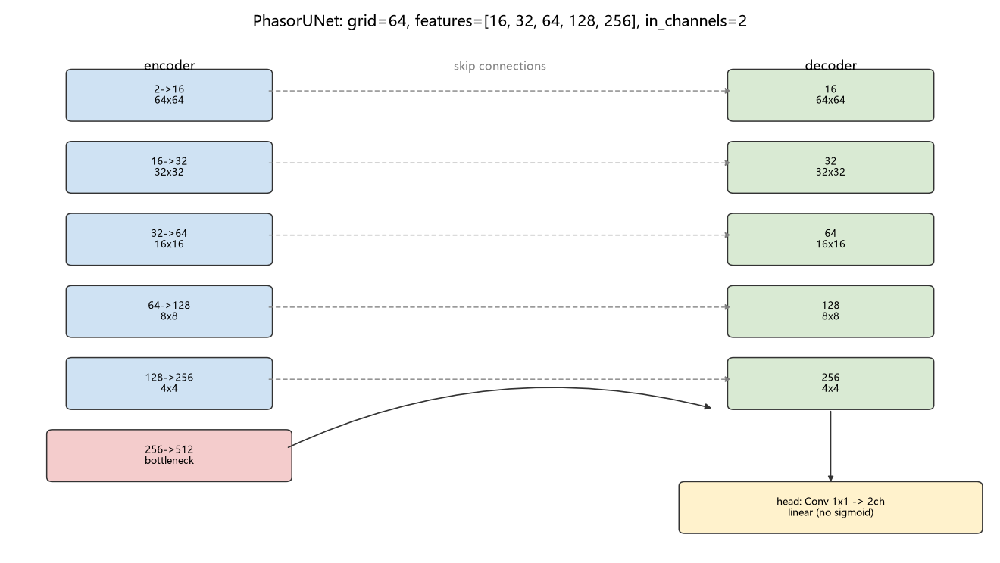
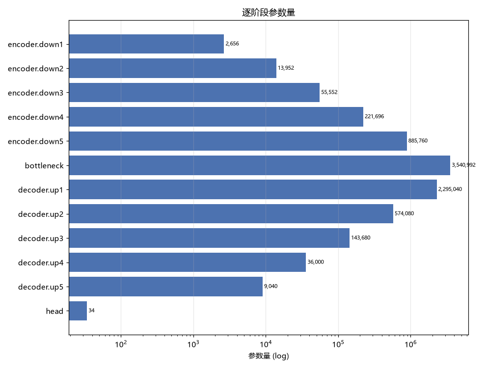

# 逆向光束整形模型详解 (PhasorUNet)

<!-- provenance:start -->
> **生成脚本**: [`scripts/generate_inverse_shaping_model_report.py`](../../scripts/generate_inverse_shaping_model_report.py)
> **复现命令**: `python scripts/generate_inverse_shaping_model_report.py`
> **运行环境**: 离线
> **说明**: PhasorUNet 模型详解: 逐阶段形状/参数量由脚本现场 introspection 真实模型得到; 含 phasor 表示理由/unit_phasor/物理前向 FOV 分桶/损失/unit-vs-non-unit L1 下界实测
<!-- provenance:end -->

本文详解 `src/ml/shaping/models.py::PhasorUNet` —— 把**远场相机图像**映射回**SLM 瞳面相位**的逆向模型。表格中的通道数、空间尺寸与参数量均由脚本**现场 introspection 真实模型**得到，而非手抄；因此报告不可能与代码不一致。

## 0. 一句话概括

一个 **7778482 参数**（约 7.78M）的 U-Net：输入 `(2, 64, 64)`（远场图像 + 标准化对数曝光），输出 `(2, 64, 64)` 的连续 phasor 场 `(cos, sin)`，再经 `unit_phasor` 投影到单位圆。训练目标是「监督 phasor L1 + 可微物理往返 L1」。

```
远场图像 (B,1,64,64) ─┐
                      ├─► 拼接 (B,2,64,64) ─► PhasorUNet ─► (B,2,64,64) raw
exposure_log10 (B,1) ─┘                                      │
                                                             ▼
                                          unit_phasor 投影 ─► (cos,sin), ‖·‖=1
```

## 1. 任务定义与张量接口

| | 张量 | 含义 |
|---|---|---|
| 输入 | `(2, 64, 64)` f32 | 通道 0 = 远场强度帧（`abs255`，**保留绝对亮度**）；通道 1 = 逐样本标准化的 `log10(曝光 ms)` 广播 |
| 输出(原始) | `(2, 64, 64)` f32 | 通道 0 = cos 分量，通道 1 = sin 分量，**线性无激活** |
| 输出(投影后) | `(2, 64, 64)` f32 | `unit_phasor` 后的合法 phasor，逐格满足 `cos²+sin²=1` |
| 目标 | `(2, grid, grid)` | 语料提供的 `(phase_cos, phase_sin)` |

现场核对：真实前向得到 raw `(1, 2, 64, 64)`、投影后 `(1, 2, 64, 64)`，与上表一致；投影后逐格模长 min/max = 1.000000/1.000000。

## 2. 为什么是 phasor 而不是角度

这是**物理约束**，不是风格选择。SLM 相位在驱动层被卷绕到 `[0, 2π)`（全仓唯一的 wrap 点在 `Santec.create_phase_from_array`）。一个卷绕的标量目标在`±π` 处有**人为分支切口**：两个几乎相同的相位若跨过切口，数值上看起来差异最大。从网络输出反解角度需要双参数反三角函数，其输出本身在切口处不连续 —— 梯度恰好在数据不连续处失效。

`(cos, sin)` 没有切口，网络可在任意两个相位之间连续移动；回到角度的映射发生在**网络之外、只做一次**，那里不连续只是表示层的问题，而不是训练信号。

## 3. 网络结构

骨干复用 `ml/phase/unet.py::UNetGenerator`（**不 fork** 编码器/解码器），仅把 1 通道输出头换成 2 通道 phasor 头。`grid=64`、`features=[16, 32, 64, 128, 256]`、`in_channels=2`。



### 3.1 逐阶段明细（现场 introspection）

| 阶段 | 模块 | 输出形状 | 参数量 | 作用 |
|---|---|---|---|---|
| `encoder.down1` | `DoubleConv(2→16)` | 16×64×64 | 2,656 | 下采样编码 |
| `encoder.down2` | `DoubleConv(16→32)` | 32×32×32 | 13,952 | 下采样编码 |
| `encoder.down3` | `DoubleConv(32→64)` | 64×16×16 | 55,552 | 下采样编码 |
| `encoder.down4` | `DoubleConv(64→128)` | 128×8×8 | 221,696 | 下采样编码 |
| `encoder.down5` | `DoubleConv(128→256)` | 256×4×4 | 885,760 | 下采样编码 |
| `bottleneck` | `DoubleConv(256→512)` | 512×2×2 | 3,540,992 | 最深层特征 |
| `decoder.up1` | `ConvT(512→256) + cat(skip 256) + DoubleConv(512→256)` | 256×4×4 | 2,295,040 | 上采样 + 跳跃连接 |
| `decoder.up2` | `ConvT(256→128) + cat(skip 128) + DoubleConv(256→128)` | 128×8×8 | 574,080 | 上采样 + 跳跃连接 |
| `decoder.up3` | `ConvT(128→64) + cat(skip 64) + DoubleConv(128→64)` | 64×16×16 | 143,680 | 上采样 + 跳跃连接 |
| `decoder.up4` | `ConvT(64→32) + cat(skip 32) + DoubleConv(64→32)` | 32×32×32 | 36,000 | 上采样 + 跳跃连接 |
| `decoder.up5` | `ConvT(32→16) + cat(skip 16) + DoubleConv(32→16)` | 16×64×64 | 9,040 | 上采样 + 跳跃连接 |
| `head` | `Conv2d(16→2, kernel=1)` | 2×64×64 | 34 | phasor 输出头 (线性) |
| **合计** | | | **7,778,482** | |

`DoubleConv` = `Conv3×3 → BatchNorm → ReLU` ×2（无 bias，BN 带仿射参数）；编码器每个 `DoubleConv` 之后都接 `MaxPool2d(2,2)`，**包括最后一层**。

### 3.2 编码器 —— 逐级下采样

5 级，通道 `16 → 32 → 64 → 128 → 256`，空间 `64 → 2`。每级输出被保存为跳跃连接（共 5 条）。

### 3.3 瓶颈

`DoubleConv(256 → 512)`，在 `2×2` 上运行，**占全部参数的 45.5%** —— 单块最大。这也是 `grid` 必须 ≥ 8 的原因：5 次池化后不能退化到 0。

### 3.4 解码器 —— 上采样 + 跳跃连接

每级为 `ConvTranspose2d(k=2, s=2)` → `cat([skip, x], dim=1)` → `DoubleConv`。**拼接顺序是 skip 在前**（`torch.cat([skip, x], dim=1)`），与 `UNetGenerator` 一致。若转置卷积输出与 skip 空间尺寸不符，会先 `F.interpolate(mode='bilinear')` 对齐 —— 本配置下 `grid` 是 2 的幂，对齐分支不会触发。

参数呈金字塔递减（up1 2295040 → up5 9040），因为每一级既要处理上采样特征又要处理跳跃特征。

### 3.5 输出头：为什么是 1×1 卷积，为什么**必须**线性

`self.final_conv = nn.Conv2d(16, 2, kernel_size=1)` —— 输出通道从 1 改为 2、宽度为 1 的卷积（仅 34 个参数）。`kernel_size=1` 是**逐像素线性混合**，在 `features[0]=16` 个特征图上为每个像素产生一个二维 phasor 分量。

**头是线性的（`output_mode="image"`，无 sigmoid），这一点必须说明白。** `UNetGenerator` 的 docstring 里记录了一条实测警告：**对 1 通道强度回归**，线性头比 sigmoid 头更差（skill −1.622 vs −0.994，配对 p=0.0059，d_z=+0.92，见 `report/zernike_r2_baseline/report.md`）。但这里是 **2 通道 phasor 头**：`sin` 必须能取负值，而 sigmoid 的值域是 `(0,1)`，**在结构上无法表示** `sin<0` 的半个圆。因此线性头不是「选了更差的」，而是**此处唯一可用的**。

配套代价：线性头输出无界，模长不受约束，所以必须靠 `unit_phasor`（§4）把它拉回单位圆。

## 4. `unit_phasor` —— 可微的单位圆投影

```python
magnitude = hypot(cos_raw, sin_raw)
divisor   = clamp(magnitude, min=eps)      # 防止除零
cos, sin  = cos_raw/divisor, sin_raw/divisor
dark      = magnitude <= eps               # 无相位信息的暗格
cos, sin  = where(dark, 1.0, cos), where(dark, 0.0, sin)
```

- **为什么需要**：线性头输出无界，`(cos,sin)` 只有在单位圆上才是合法相位。投影同时让损失只比较**相位方向**，与 SLM 的物理含义一致（相位是角度）。
- **为什么不用 `raw/(mag+eps)`**：那在零输入处恰好得 0，不是合法 phasor；这里改为 `clamp` 分母，并把阈下格**显式停靠**在 `(1, 0)`（相位 0）。
- **可微性**：`hypot`/除法/`where` 均可微，梯度对**所有有信息的格**正常回传；暗格被 `where` 选中后不产生梯度（其相位本就无定义）。

## 5. 物理前向模型：可微的「预测相位 → 相机图像」

监督项只要求网络输出「像语料里的相位」；物理项要求「把预测相位真的传一遍光路，得到的远场要像语料里的那张图」。后者是这套模型**唯一的物理约束来源**。实现位于 `ml/shaping/physics.py`，它**不重新实现**前向光学，而是组装并按 FOV 分派给 `ml.zernike.models.ZernikeAmpModel`。

### 5.1 完整前向链（逐步，含张量形状）

```
输入 pred phasor (B,2,64,64)  ── 网络输出，已过 unit_phasor
   │
   ├─(1) 拆成复数场   measured = complex(cos, sin)          (B,64,64) complex
   ├─(2) 瞳孔掩模     cos,sin *= inscribed_mask(64)          半径 32px，覆盖 78.81%
   ├─(3) 叠加台架像差 field = measured * exp(i·correction)   correction = Σ c_k·Z_k
   ├─(4) 补零 + FFT   fftshift(fft2(ifftshift(field_padded)))
   │                   padding = recommended_padding(fov)    ★ 按 FOV 分桶
   ├─(5) 中心裁剪回   (B,64,64)   ← 与语料 image 同尺寸，才能逐像素比
   ├─(6) 强度         |focal|² = real² + imag²
   └─(7) 峰值归一     除以逐帧最大值                        → (B,1,64,64)
```

其中 `correction = Σ_k c_k·Z_k` 有 **K = 14 个 Zernike 系数**（Noll 1 活塞被排除 —— 活塞不改变远场强度，留着只会留下一个近零空间列）。初始化时 `correction ≡ 0`（实测 `|correction|max = 0`），即起步是纯 Fraunhofer 模型。

**关键语义：这是一个「台架前向模型」，不是生成器。** 它的公式是

```
field = measured_phasor · exp(i·correction)
        ^^^^^^^^^^^^^^^   ^^^^^^^^^^^^^^^^
        你下发的相位       台架自身的像差
```
所以把它喂零 phasor 会让整场恒为零、梯度**精确**为 0（`ZernikeAmpModel` 的docstring 记录了这次实测），因此「只想用系数」必须走它的`correction_far_field()`，而不是 `forward()`。**物理项走的是 `forward()`，语义正确**：它回答的是「如果 SLM 被设成预测相位，相机会看到什么」。

### 5.2 为什么按 FOV 分桶：padding 是尺度标定，不是超参数

远场只有在模型的 Fourier 补零倍数**匹配产生语料的那个相机窗口**时，才与语料图像**逐像素可比**。补零倍数直接决定远场的角尺度：语料 `slm_zernike_shaping` 的相机窗口是 248 px，若按 `pad=1`（整孔衍射全展）传播，预测与目标的角度尺度相差约 4 倍，逐像素比毫无意义。

| fov_px | 是否可标定 | `far_field_padding` | 依据 |
|---|---|---|---|
| 64 | ✅ | 8 | `PADDING_BY_FOV_PX` 实测内点最优 |
| 248 | ✅ | 14 | `PADDING_BY_FOV_PX` 实测内点最优 |
| 320 | ✅ | 16 | `PADDING_BY_FOV_PX` 实测内点最优 |
| 1944 | ❌ | — | `NO_VALID_PADDING_FOV`：任何 padding 都无有效最优点 |

padding 取自 `ml.zernike.models.recommended_padding`（**唯一来源**），本模块不写死任何 padding 字面量。⚠️ **它是内点最优，不是「越锐越好」**：实测 `pad=1 → R²=−0.20`，`8 → +0.33`，**`10 → +0.46`**，`12 → +0.53`，`20 → +0.18`。故 padding 必须**按 FOV 各测**，换 family 就要重测。

### 5.3 掩模的不对称：物理项掩模，监督项不掩模（重要）

`ForwardBank.forward` 在传播前把 phasor 乘上 `inscribed_mask`（内接圆，半径 `grid/2 = 32 px`，覆盖网格的 78.81% ≡ π/4）。理由：`forward()` 直接使用输入的 phasor，若不掩模，一个「只有相位」的瞳面在照明圆盘之外仍是单位振幅，而台架只照亮有限圆盘。

但**监督项 `L_sup` 不掩模** —— 它对完整 `grid×grid` 逐格求 L1。这是一个刻意的不对称，后果在 §7.1 量化：瞳孔外那些格子的目标 phasor 模长很小（如 `panel_gray` 源填的是小常值），而 `unit_phasor` 强制预测模长为 1，于是**这些格子的误差不可能被消除**，构成一块结构性地板。

**未标定的 FOV 不参与物理项，也不会伪造一个值**：`forward()` 返回 `(pred, excluded)`，被排除的行在损失里权重为 0 并被单独计数（`physics_excluded`）。

### 5.4 物理项实际覆盖哪些样本（按家族实测，不能从族大小推断）

FOV 分布**按家族而异**，所以「物理项覆盖哪些样本」必须按家族读，不能一概而论（每家族抽样 30 条，共 176 条）：

| 家族 | 语料记录 | 抽样 FOV 直方图 | 参与物理项 |
|---|---|---|---|
| `slm_pib` | 12,732 | `248×20, 320×8, 250×2` | 28/30 |
| `slm_zernike_shaping` | 1,010 | `248×30` | 30/30 |
| `slm_pib_online` | 192 | `248×30` | 30/30 |
| `phase_replay` | 112 | `248×30` | 30/30 |
| `slm_gsnet_square` | 114 | `1944×27, 250×3` | **0/30** |

合计 **144/176 ≈ 81.8%** 可参与物理项。即**物理项覆盖的是语料主体**（`slm_pib` 占 88.8%，其 ~93% 落在他标定的 248/320 上）；真正被整族排除的是 `slm_gsnet_square`（主要 fov 1944，落在 `NO_VALID_PADDING_FOV`），加上 `slm_pib` 里少数 fov=250 的窗口。

> ⚠️ **这条结论曾被写反。** 早先版本声称「占语料 88.8% 的 `slm_pib` 是 fov=1944，因此大多数样本只参与监督项」—— 与实测完全相反，且无法解释评估报告里「仅 228 条物理指标不可用」。族级 FOV 必须实测，不能从族大小推断。

## 6. 损失函数：监督项与物理项

```
pred_phasor = unit_phasor(model(x))                 # (B,2,64,64), 逐格模长恒为 1
gt_phasor   = cat(phase_cos, phase_sin)            # (B,2,64,64), 语料原始值

L_sup   = mean|pred_phasor − gt_phasor|             # 全图逐格 L1，不掩模
L_phy   = mean_valid| peaknorm(fwd(pred))−peaknorm(image) |   # 仅已标定 FOV
L_smooth= TV(pred_phasor)                          # 默认关闭

L_total = 1.0·L_sup + 1.0·L_phy + 0.0·L_smooth
```

| 项 | 权重（默认） | 覆盖范围 | 是否掩模 |
|---|---|---|---|
| `sup` 监督 phasor L1 | `1.0` | 全图 64×64 逐格 | ❌ 不掩模 |
| `phy` 物理往返 L1 | `1.0` | 仅已标定 FOV 的行 | ✅ 瞳孔内接圆 |
| `smooth` 全变差 | `0.0` | 全图 | ❌ |

### 6.1 监督项 `L_sup`

目标就是语料存的 `(phase_cos, phase_sin)`，**逐格 L1**，通道 0 与通道 1 一起进入同一个 L1（不是分开两个损失）。

**为什么是 L1 而不是 L2**：
- phasor 距离天然有界：两个单位相量之间 `|Δ| ≤ 2`，所以 L1 的**每格梯度有界**，不像 L2 会被大误差格放大。
- L1 对稀疏的大误差更稳健：语料里存在少量**整族平场**的样本（§结果报告 §3），L2 会把这些格的误差平方后主导整个 batch 的梯度。
⚠️ **诚实标注：L1 vs L2 本仓库没有做过消融**，上面是按损失几何的推理，不是实测结论。若要断言「L1 更好」，需要补一次配对实验。

**两个必须注意的性质**：
1. **目标不是单位模长**。`unit_phasor` 强制预测模长为 1，而语料目标模长可为 0.0625…1.0（实测均值 0.8974–0.9537），于是存在**不可约的 L1 下界**`mean|1 − |t||` —— 逐家族实测见 §7.1。
2. **不掩模**：瞳孔外的格子也计入。这些格子目标模长小、预测模长为 1，其误差无法消除（同上）。物理项掩模而监督项不掩模，是刻意保留的不对称。

### 6.2 物理项 `L_phy`

把预测相位经 §5 的前向链变成相机图像，与**语料真实图像**比。三个实现细节都是必要的：

1. **先峰值归一再比**。相机帧的绝对亮度由曝光决定（语料跨 0.1–80 ms），不归一化就变成在比「曝光设对了没有」而不是比光斑形状。归一化用 `_peak_normalise`，并把峰值下界钳在 `1e-8`，避免把一张全黑（被排除）的帧除以零。
2. **只对已标定 FOV 的行求均值，并对被排除行显式计数**（`weights = valid`，`phy = Σ(per_sample·w)/Σw`）。不是「忽略」，而是可观测地丢弃 —— `physics_excluded` 会随损失一起返回并被记录。
3. **整个 batch 全被排除时退化为有限的 0，而不是 NaN**。否则一个只含 `slm_gsnet_square`（全 fov 1944）的 batch 会让 `total` 变成 NaN，一次反向就把整轮训练污染掉。

物理项与监督项的**量纲不同**：`L_sup` 是 phasor L1（量级 ~0.2），`L_phy` 是归一化强度 L1（量级 ~0.05，实测）。二者以等权 (`1.0`) 相加，意味着**当前配方把监督项当作主导项**；这是默认值，未做权重扫描。

### 6.3 平滑项 `L_smooth`（默认关闭）

`w_smooth = 0.0`，即**默认不启用**。实现走 `ml.zernike.losses.tv`（不可导入时回退 `torchmetrics`），全仓只有一份 TV 实现。默认关闭的理由：在没有任何「已验证的收益」证据前，加正则会改变结论而无法归因。

### 6.4 梯度流

- `unit_phasor` 全程可微，梯度对所有有信息的格回传（暗格被 `where` 旁路）。
- `ForwardBank` 的**模型参数是冻结的**（`requires_grad_(False)`），但梯度仍流到**输入相位** —— 这正是 `L_phy` 需要的：不训练前向模型，只用它约束预测。
- 前向 bank 可能与网络不在同一 device（它默认偏爱 CUDA），所以 `L_phy` 在 bank 的 device 上算完后被搬回 `pred_raw` 的 device，保证 `total` 是单 device 求和。

## 7. 参数量构成与一个不可约的 L1 下界

| 部分 | 参数量 | 占比 |
|---|---|---|
| encoder | 1,179,616 | 15.17% |
| bottleneck | 3,540,992 | 45.52% |
| decoder | 3,057,840 | 39.31% |
| head | 34 | 0.00% |
| **合计** | **7,778,482** | 100% |



消融对照：`in_channels=1`（去掉曝光通道）时总计 **7,778,338** 参数，仅差 144 个（第一层卷积少一个输入通道）。该消融用于分离「学到了光学」与「识别了家族」—— 曝光在这份语料里与家族高度相关。

### 7.1 `unit_phasor` 与语料目标的模长不匹配（**实测，重要**）

`unit_phasor` 强制预测模长为 1，但**语料给出的目标 phasor 本身并不总是单位模长**（例如 `panel_gray` 源在瞳孔外填的是一个小的常值，`phase_sin ≡ 0`）。单位模长的预测对模长 `r` 的目标，最小可能 L1 是 `|1 − r|` —— 这是一块**任何模型都无法消除的误差地板**。

| 家族 | 语料记录 | 抽样 | 平均 \|t\| | L1 下界 | \|t\|<0.99 占比 |
|---|---|---|---|---|---|
| `slm_pib` | 12,732 | 6 | 0.9371 | 0.0629 | 21.8% |
| `slm_pib_online` | 192 | 6 | 0.9537 | 0.0463 | 6.2% |
| `slm_zernike_shaping` | 1,010 | 6 | 0.9521 | 0.0479 | 8.3% |
| `slm_gsnet_square` | 114 | 6 | 0.8974 | 0.1026 | 28.1% |

结论：该地板是**真实存在但量级不大**的 —— `slm_pib` 约为 0.063，而评估报告的 `phasor_mae` 是 ~0.29（模型）/ ~0.32（基线）。即**约两成的 `phasor_mae` 是结构性的**，把 `phasor_mae` 压到 0 在数学上不可能。这既解释了为什么监督指标难以显著（§见结果报告），也说明**仅凭 `phasor_mae` 下降不足以证明模型学到了相位结构**。

## 8. 训练配置

| 项 | 值 |
|---|---|
| 优化器 | `torch.optim.Adam`（**无** weight decay / scheduler / grad clip） |
| 学习率 | `0.0003` |
| batch | `16`（默认可被 CLI 覆盖） |
| epochs | `40`（同时受 `--max-steps` 约束） |
| seed | `42`（权重初始化 + 分组采样器共用） |
| 精度 | fp32 |

**未做梯度裁剪**：`unit_phasor` 的除法在模长趋近 `eps` 时会把梯度放大，理论上存在尖峰风险；本轮的 6 epoch 运行未观察到发散，但这属于**未验证**的稳健性。

## 9. 与 `ml/phase` U-Net 的关系

`PhasorUNet` 是 `UNetGenerator` 的**薄子类**：`super().__init__(..., output_mode="image")` 之后**只替换** `self.final_conv`。编码器、瓶颈、解码器、跳跃连接全部原样复用。这样做的理由是避免第二份 U-Net 实现随时间漂移（本仓库已被「重复实现漂移」多次咬伤）。

副作用：基类仍然创建了 `self.sigmoid`，在 `output_mode="image"` 下**永远不会被调用**。它是无害的未使用模块，但 `named_children()` / 状态字典里会出现 —— 读模型结构时不要误判。

## 10. 已知局限与取舍

1. **参数量 7.78M 相对数据量偏大**：全部语料仅 14,350 条、且 val/test 被单一家族主导，7.78M 参数在 6 epoch 下几乎必然欠拟合而非过拟合 —— 但两者都无法由本轮证据区分。
2. **`phasor_mae` 有约 0.06 的不可约下界**（§7.1）。任何「误差降到 X」的说法都必须扣掉它。
3. **绝大多数样本不参与物理项**（fov 1944 无标定）。物理项的实际影响面远小于其名义权重。
4. **BatchNorm 行为依赖 `train()`/`eval()`**：推理前必须 `.eval()`，否则单样本 batch 的统计量会污染输出。评估脚本已遵循，但手工调用时是常见陷阱。
5. **线性头的选择是被 phasor 结构强制的**，不构成对 sigmoid 头的优劣结论；§3.5 引用的实测只适用于 1 通道强度回归。

## 11. 复现

```bash
# 只需模型即可重生成（本报告主体不读语料）
python scripts/generate_inverse_shaping_model_report.py

# 含 §7.1 的语料地板表时需要快照
python -c "from ml.hwdataset.index import build_hw_index; build_hw_index('data/debug', index_cache='data/hw_index_snapshot.json')"
python scripts/generate_inverse_shaping_model_report.py
```
