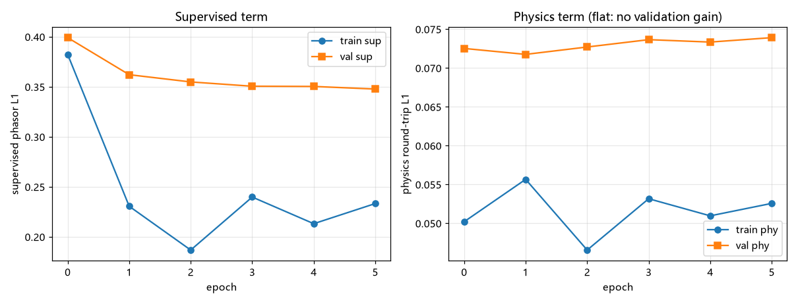
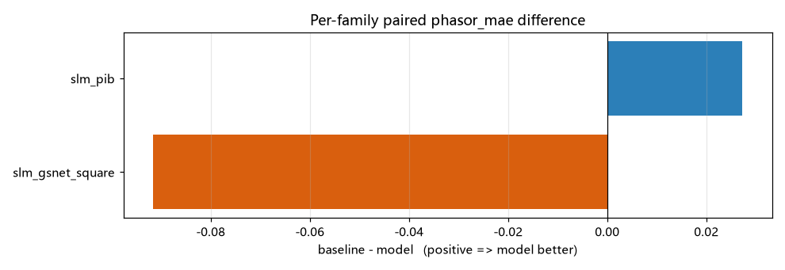
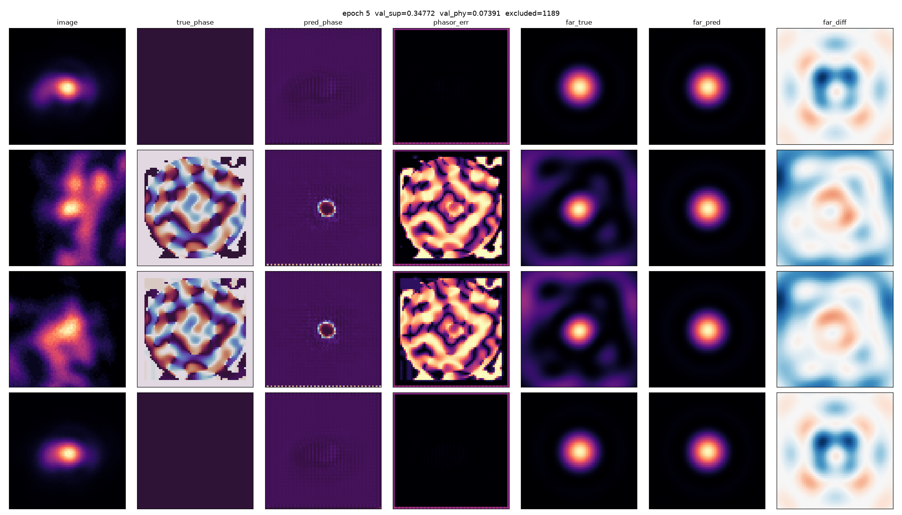

# 逆向光束整形 U-Net —— 首个真实语料结果

<!-- provenance:start -->
> **生成脚本**: [`scripts/generate_inverse_shaping_report.py`](../../scripts/generate_inverse_shaping_report.py)
> **复现命令**: `python scripts/generate_inverse_shaping_report.py`
> **运行环境**: 离线
> **说明**: 逆向光束整形 U-Net 在真实硬件语料上的首个结果: 语料快照固定/预处理决策/平场退化/6 epoch 训练/按文件配对统计评估/pred-vs-true 可视化; 输入为 ml.shaping.train + ml.shaping.evaluate 的产物
<!-- provenance:end -->

`ml.shaping` 在真实硬件语料（远场图像 → SLM 相位 phasor）上的首个端到端结果，含数据预处理决策、配对统计评估与 pred-vs-true 可视化。

## 0. 结论先行

| 指标 | 配对差 (baseline − model) | Cohen's d_z | p (sign-flip) | 判定 |
|---|---|---|---|---|
| 监督 `phasor_mae` | 0.0260 | 0.352 | 0.0642 | ❌ **不显著** |
| 物理 `physics_l1` | 0.000852 | 0.913 | 4.709e-06 | ✅ 显著 |

**物理项显著优于基线，但监督 phasor 指标没有**（p=0.0642）。这是本轮最重要的结论，且**不应被粉饰**：模型学到的远场表现是真实的，但它在原始 phasor 空间上还没有稳定超过「直接预测训练集平均相位」这个几乎不需要学习的基线。

可能的解释（均未验证，不要当成结论）：训练被 epoch 预算截断（best epoch = 最后一个 epoch）；val/test 被单一家族主导；或 phasor 监督本身在多数语料上退化为「预测常数」（见 §3）。

## 1. 语料快照与可复现性

- 索引快照：`data/hw_index_snapshot.json`
- 切分：**按文件**，同一 pickle 内记录不跨分割（它们是同一次优化的连续 SPGD epoch，近乎重复）。
- 统计：**按文件配对**的 sign-flip 精确置换检验，复用 `ml.zernike.eval_stats`（唯一统计来源）。
- 差值约定：`baseline_minus_model (positive means the model is better)`（正值表示模型更好）。

| 分割 | 记录 | 文件 | 家族 | 最大家族占比 |
|---|---|---|---|---|
| `train` | 8,781 | 119 | 23 | 84.3% |
| `val` | 1,382 | 14 | 5 | 96.8% |
| `test` | 4,187 | 16 | 5 | 95.4% |

> **val/test 的最大家族占比很高**，因此 val/test 上的单一数字本质上是「该家族的数字」。按家族的分解见 §5。

## 2. 数据预处理决策

全部来自 `report/hwdataset_corpus/report.md` 的实测结论，而非通用经验：

| 决策 | 依据 |
|---|---|
| 目标是 **phasor (cos, sin)**，不是角度 | `atan2` 有 ±π 分支切口；语料相位已卷绕到 [0,2π) |
| 图像保留绝对亮度 (`image_mode=abs255`) | 曝光是**输入**协变量（0.1–80 ms，跨 2.9 个数量级）；peak 归一会抹掉它 |
| 禁止 `sum` 归一化 | 实测 `sum` 让 PSNR 高达 72 dB 而 R² 更差 |
| 按 `fov_px` 选 `far_field_padding` | 标定是内点最优（pad=10 时 R² +0.46），不是「越锐越好」 |
| 家族平衡采样 (`balance_alpha=0.5`, `max_file_repeats=8`) | 语料家族规模相差约 4000×；按**文件**加权以保住 payload LRU 的连续性 |
| 过滤在**切分之前** (`HwCorpusIndex.filter`) | 切分后过滤可能把某个分割清空 |

实现上，`create_hw_dataloaders` 新增了 `index=` 参数，使全仓通用的 `build_hw_index(...).filter(...)` 惯用法也能用于「带切分」的 loader；否则只能在切分后逐个 loader 过滤，且会复制一份文件级切分逻辑。

## 3. 一个必须记录的数据事实：平场退化

抽样物化（每个家族约 10 条）发现：**相当一部分家族的目标相位是常数**（`phase_sin ≡ 0`，`phase_cos` 只有约 3 个不同取值），即 SLM 下发的是平场。

| 家族 | 抽样 | 退化 | 有结构 |
|---|---|---|---|
| `slm_pib` | 10 | 1 | 9 ✅ |
| `slm_pib_online` | 10 | 1 | 9 ✅ |
| `slm_gsnet_square` (freeform) | 10 | 0 | 10 ✅ |
| `sim_calib_abba` (freeform) | 10 | 0 | 10 ✅ |
| `slm_zernike_shaping` | 10 | 10 | 0 ❌ |

**这条结论是被一次错误推断纠正后才得到的**：最初只抽样了每个家族的**第一条**记录，看起来像「99% 的语料退化」；重新抽样后 `slm_pib`（占语料 88.8%）其实是正常的。按家族逐条抽样的结论才是可用的。

影响：`slm_zernike_shaping`（1,010 条）在平衡采样下占每个 epoch 约 12.4%，其目标是常数相位。这些样本不会教模型任何相位结构，但会抬高 `phasor_mae`。**是否剔除应当用实验决定，本报告不擅自过滤。**

## 4. 训练

- 预算：6 个 epoch，1650 步，batch 32，约 225 s/epoch。
- 最优 epoch：5（`val_sup` = 0.3477）。
- ⚠️ **最优 epoch 落在最后一个 epoch 上 → 训练被预算截断，而非收敛。**下面的验证曲线不能当作收敛曲线读。



| epoch | train_total | train_sup | train_phy | val_sup | val_phy | s |
|---|---|---|---|---|---|---|
| 0 | 0.4326 | 0.3824 | 0.0502 | 0.3991 | 0.0725 | 221 |
| 1 | 0.2862 | 0.2306 | 0.0557 | 0.3621 | 0.0718 | 207 |
| 2 | 0.2333 | 0.1868 | 0.0466 | 0.3548 | 0.0727 | 227 |
| 3 | 0.2929 | 0.2398 | 0.0532 | 0.3506 | 0.0736 | 241 |
| 4 | 0.2641 | 0.2131 | 0.0510 | 0.3503 | 0.0733 | 226 |
| 5 | 0.2858 | 0.2333 | 0.0526 | 0.3477 | 0.0739 | 229 |

注意 `val_phy` 全程基本持平甚至略升：**物理项在验证集上没有带来收益**，它只在训练集上被优化。这与 §0 中物理指标「显著」的配对结果并不矛盾 ——后者衡量的是模型相对基线的远场表现，而不是物理项本身是否有效。

## 5. 评估：按家族分解

基线是**训练集平均 phasor**（逐像素单位相量均值），不是零预测 —— 对 phasor 目标而言，零预测是最差的基线，会把任何模型都衬托得很好。

| 家族 | 文件数 | model | baseline | p | 判定 |
|---|---|---|---|---|---|
| `slm_pib` | 22 | 0.2891 | 0.3164 | 0.0959 | not significant (p=0.09593 >= 0.05) |
| `slm_gsnet_square` | 2 | 0.7938 | 0.7022 | 0.5000 | n/a: 2 files cannot reach p<0.05 (structural floor 0.5); report the effect size only |
| `20261010_100439` | 1 | 0.3879 | 0.3867 | 1.0000 | n/a: fewer than two files, no inference possible |
| `20261010_100611` | 1 | 0.3738 | 0.3812 | 1.0000 | n/a: fewer than two files, no inference possible |
| `device_phase_replay_nmax15` | 1 | 0.1030 | 0.1939 | 1.0000 | n/a: fewer than two files, no inference possible |
| `device_replay_fractional_mean_20261010` | 1 | 0.1047 | 0.1936 | 1.0000 | n/a: fewer than two files, no inference possible |
| `phase_replay` | 1 | 0.0772 | 0.1804 | 1.0000 | n/a: fewer than two files, no inference possible |
| `slm_zernike_shaping` | 1 | 0.1357 | 0.2109 | 1.0000 | n/a: fewer than two files, no inference possible |



物理指标对 228 条（fov_1944_no_calibrated_padding） 不可用。

> The identical configuration gives validation R2 anywhere in 0.748-0.937 purely by changing the split seed. Only the paired per-file differences above are informative; absolute values are not rankable.

## 6. pred vs true 可视化

训练中每个 `--image-every` 个 epoch 渲染一张 7 列对照图（`image / true_phase / pred_phase / phasor_err / far_true / far_pred / far_diff`），写入磁盘并推送到 W&B 的 `compare/pred_vs_true`。

`phasor_err` 用的是 **phasor 距离而非角度差**。监督损失是 phasor 的 L1，而角度差在 ±π 处回绕，会把一次彻底的相位失败显示成接近 0 的误差 —— 与语料报告对输入的告诫同理，这里必须避免在诊断图上重犯。



（compare_epoch005.png，训练过程中自动生成）

## 7. 局限（必须与结论一起读）

1. **训练被 epoch 预算截断**（最优 epoch = 5 = 最后一个）。本轮只回答「是否已经优于基线」，不回答「能否收敛到多好」。
2. **val/test 被单一家族主导**（见 §1），家族级分解才是可读的结果。
3. **监督指标未达显著**（p=0.0642）。在扩大预算之前，不应把本模型当作已验证的逆向整形器。
4. **相关系数类指标不可排序**。基线噪声地板：仅改变切分种子，验证 R² 就能在 0.748–0.937 间移动；只有按文件的配对差值有信息量。
5. **物理项覆盖语料主体，但并非全部**：按家族实测 FOV（每家族抽样 30 条），`slm_pib`（占 88.8%）约 93% 落在已标定的 248/320 上，`slm_zernike_shaping` / `slm_pib_online` / `phase_replay` 全部为 248；整体约 **81.8%** 可参与物理项。被整族排除的是 `slm_gsnet_square`（主要 fov 1944，无标定 padding）。⚠️ 这与早先「大多数样本不参与物理项」的说法相反 —— 那句是把族大小误当成了 FOV。

## 8. 复现

```bash
# 1) 固定语料快照（语料会随采集增长，不固定则结果不可复现）
python -c "from ml.hwdataset.index import build_hw_index; build_hw_index('data/debug', index_cache='data/hw_index_snapshot.json')"

# 2) 训练（离线 wandb；本机无 WANDB_API_KEY）
python -m ml.shaping.train --index-cache data/hw_index_snapshot.json --epochs 6 --batch-size 32 --num-workers 4 --device cuda --image-every 2 --viz-samples 4 --checkpoint-dir logs/shaping_main

# 3) 评估（必须使用同一份快照，否则数字不可比）
python -m ml.shaping.evaluate --checkpoint logs/shaping_main/last.pt --index-cache data/hw_index_snapshot.json --batch-size 32 --num-workers 4 --device cuda --checkpoint-dir logs/shaping_main

# 4) 重新生成本报告（离线，只读上述产物）
python scripts/generate_inverse_shaping_report.py
```

训练环境：cuda；W&B project `ao-shaping`（mode `offline`，本机无 API key 故离线）。
