# 电压测试

<!-- provenance:start -->
> **生成脚本**: 人工撰写，无生成脚本
> **运行环境**: 硬件
> **说明**: 微驱动器频率测试记录；images/freq_test/ 为同期截图
<!-- provenance:end -->

**本轮结论**（微变形镜 R50 频率响应初测）：使用 114 控制器全部单元，静态电压 0/50/80/100 V 下镜面响应正常；交变驱动下**1000 Hz 出现异常响应**，表明该微驱动器+控制器组合的可用带宽低于 1 kHz。对闭环应用，实际更新率应保守取数百 Hz 以内，并需在后续用标定波形定位异常起始频率与成因（驱动带宽或镜面谐振）。

使用114控制器全部单元

* 0V
* 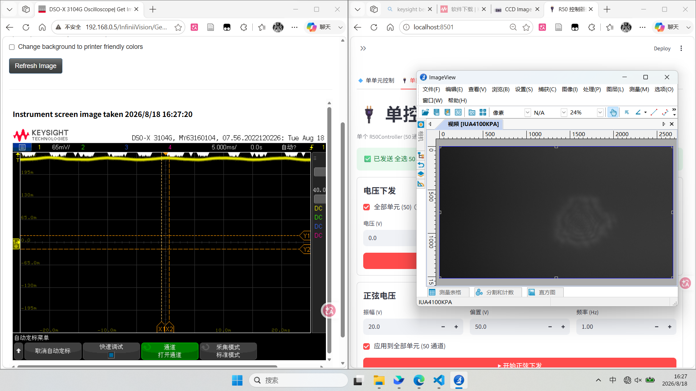
* 50V
* 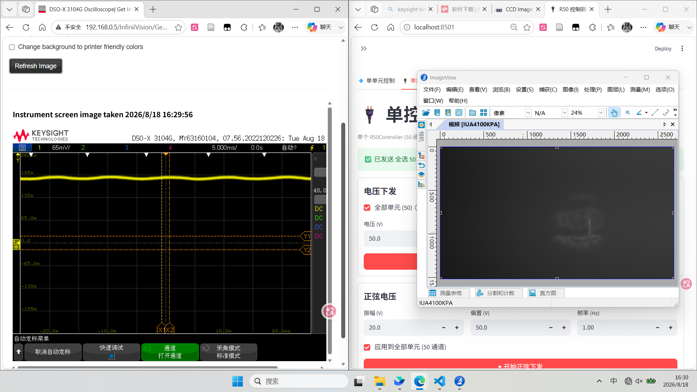
* 80V
* 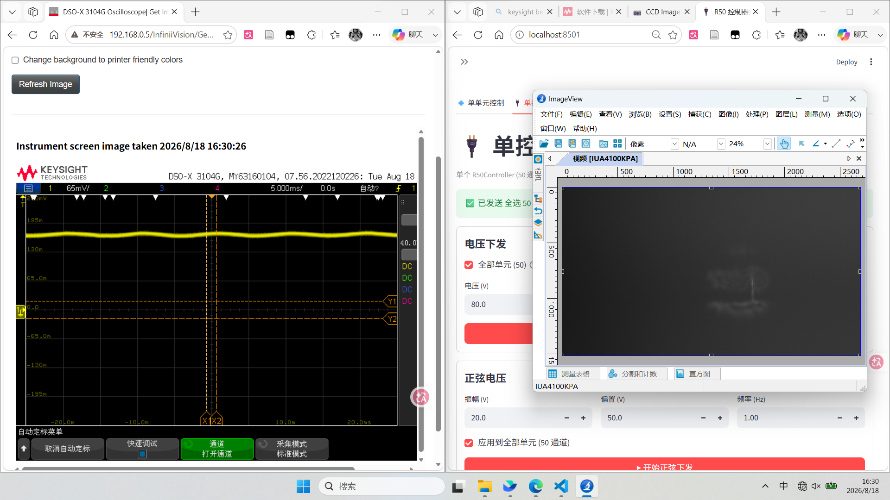
* 100V
* 

# 频率测试

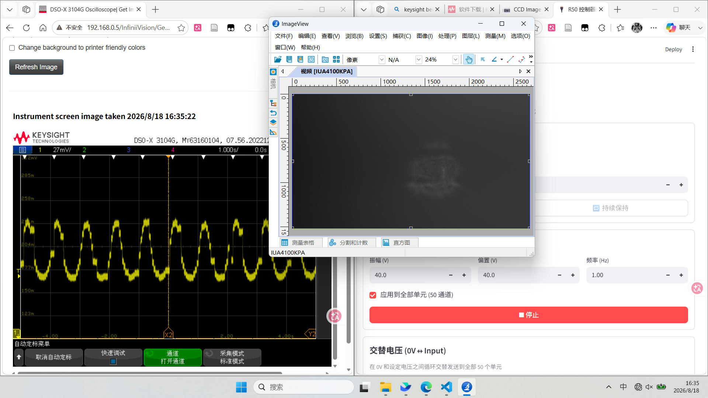

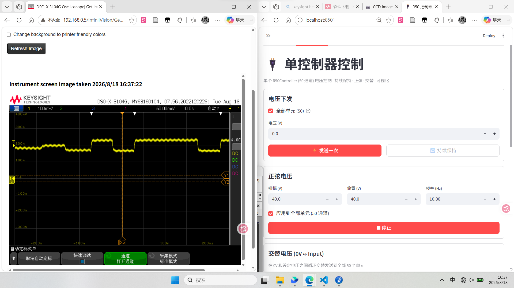

---

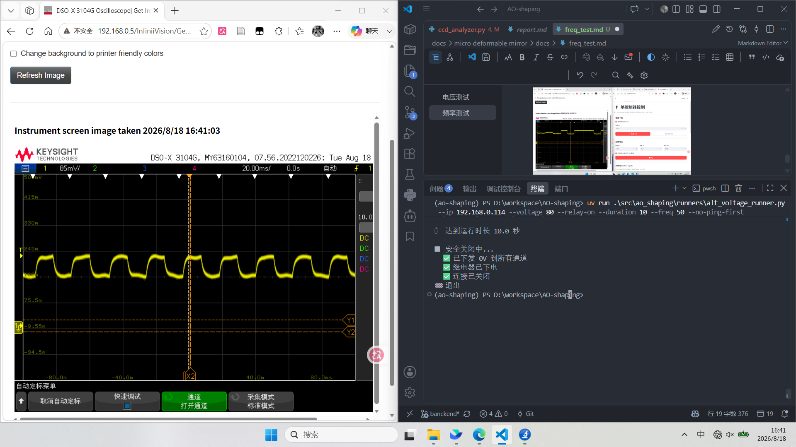

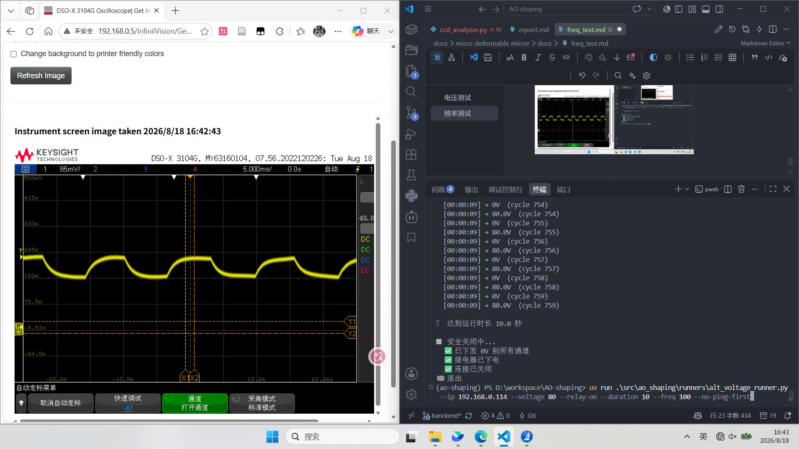

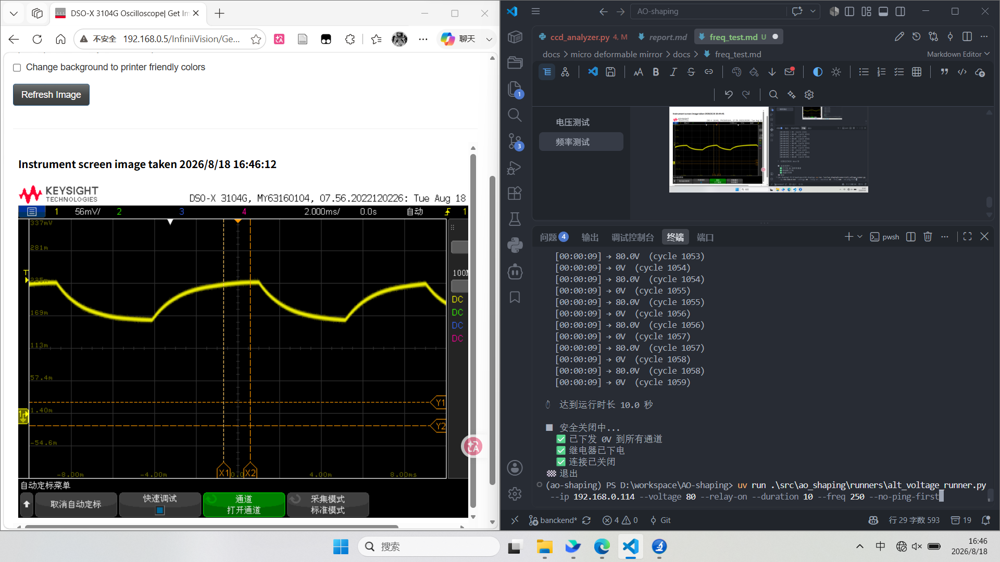

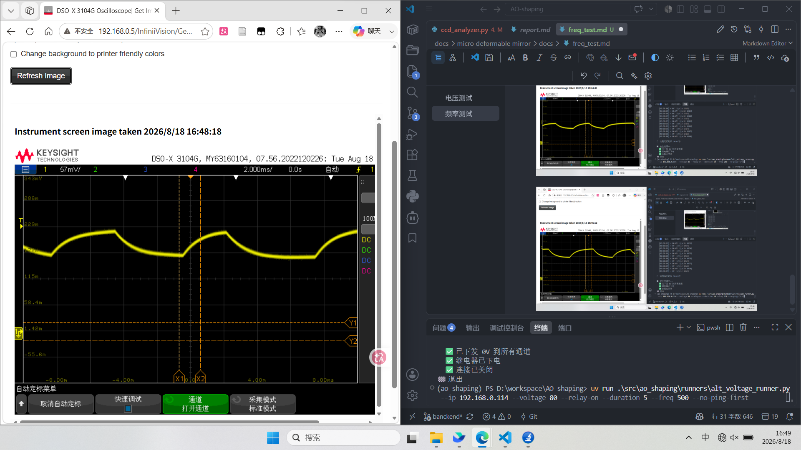

1000hz出现异常

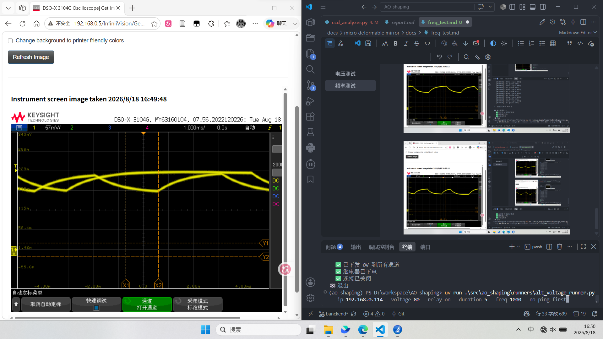

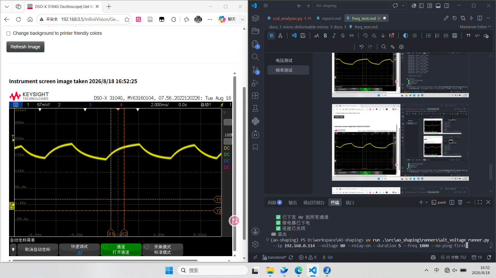
