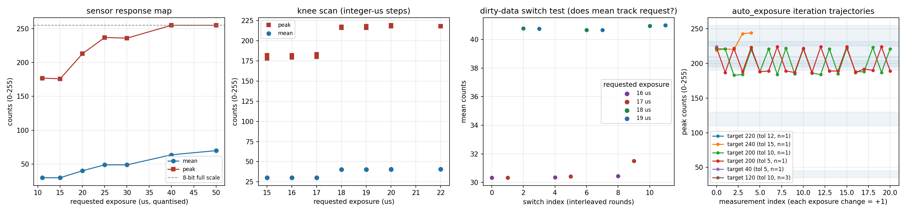

# MiiCam 自动曝光算法实验报告

<!-- provenance:start -->
> **生成脚本**: [`tests/ao_shaping/drivers/ccd/test_miicam_auto_exposure_report.py`](../../../tests/ao_shaping/drivers/ccd/test_miicam_auto_exposure_report.py)
> **复现命令**: `python -m pytest tests/ao_shaping/drivers/ccd/test_miicam_auto_exposure_report.py -m hardware -s`
> **数据/关联脚本**: [`scripts/ccd/miicam_auto_exposure_probe.py`](../../../scripts/ccd/miicam_auto_exposure_probe.py)
> **运行环境**: 硬件
> **说明**: MiiCam auto_exposure 算法硬件验证 (2026-10-22 起替代 miicam_simulation 仿真报告): 响应台阶扫描 / 脏数据核查 (帧序号-时间戳-重复帧-交叉切换) / 六类目标场景的收敛-边界退出-有界不收敛行为; 报告正文与图由探针脚本生成, 线性度 R2 等为诊断项不计入通过率
<!-- provenance:end -->

- 时间: 2026-10-22T21:21:20 ~ 2026-10-22T21:22:35
- 相机: sn=TP2408221418059418FD83E3A448D82, 2688x1520, 8 bit, 模式 wait
- 设备安全: 仅经 miicam SDK 枚举/打开/取帧; Daheng (gxipy/GigE) 全程未导入、未枚举、未打开
- 起点: 曝光 0.02 ms, 峰值中位数 212 counts (范围 211-213), 点亮像素占比最低 0.63

## 总体结论

**28/28 项检查通过**（全部通过），另有 2 项诊断记录（不计入通过率）

| 检查项 | 结果 | 明细 |
|---|---|---|
| `premise_brightness` | 通过 | median peak 212 counts at 0.020 ms (range 211-213); scene must be clearly lit |
| `premise_lit_fraction` | 通过 | min lit fraction 0.63 (expected >= 0.5) |
| `info_response_mean_linearity` | 记录 | mean = 1.619 counts/us, R2=0.7014 (n=7, axis = requested exposure quantised to integer us), saturation onset 40 us -- the proportional iteration assumes linearity; a stepped scene breaks it |
| `info_response_peak_linearity` | 记录 | peak = 9.622 counts/us, R2=-1.5517 (n=5) -- diagnostic only, see above |
| `device_expo_matches_request` | 通过 | frame-info expotime not provided by this camera/SDK (flag lacks MIICAM_FRAMEINFO_FLAG_EXPOTIME=0x04, field reads 0); device-side exposure readback unavailable, requested exposure taken from the driver cache |
| `frame_seq_advances` | 通过 | 17.0 us: [1, 1, 1, 1, 1, 1, 1]; 20.0 us: [1, 1, 1, 1, 1, 1, 1] |
| `frame_timestamps_advance` | 通过 | 17.0 us: [12572, 12572, 12572, 12572, 12572, 12572, 12572]; 20.0 us: [12572, 12572, 12572, 12572, 12572, 12572, 12572] |
| `frames_not_duplicated` | 通过 | 17.0 us: mean\|diff\|=1.91 counts, exact duplicates=0; 20.0 us: mean\|diff\|=2.07 counts, exact duplicates=0 |
| `switch_step_deterministic` | 通过 | 16.0 us: mean 30.37 (spread 0.4%); 17.0 us: mean 30.43 (spread 3.9%); 18.0 us: mean 40.78 (spread 0.7%); 19.0 us: mean 40.76 (spread 0.8%) |
| `switch_no_lag` | 通过 | 17.0->18.0 us: lag 0%; 19.0->16.0 us: lag 0%; 17.0->18.0 us: lag 1%; 19.0->16.0 us: lag 1%; 17.0->18.0 us: lag 2% |
| `sdk_auto_exposure_disabled` | 通过 | state={'enabled': False, 'mode': 0, 'target': 120} |
| `exposure_readback_consistent` | 通过 | readback=0.0110 ms, last applied=0.0110 ms |
| `converged[target=220_tol12_n1_twice1_conv]` | 通过 | band contains a response rung: final peak 221 in [208, 232], exp 0.0200 ms, 0 reset(s) |
| `returned_matches_last[target=220_tol12_n1_twice1_conv]` | 通过 | returned peak 221 vs last measured 221.0 |
| `frames_fresh[target=220_tol12_n1_twice1_conv]` | 通过 | at 0.0200 ms: peaks ['221', '221', '221'], mean\|diff\|=2.08 counts, duplicates=0, peak spread 0.0% |
| `converged[target=240_tol15_n1_twice1_conv]` | 通过 | band contains a response rung: final peak 244 in [225, 254], exp 0.0260 ms, 3 reset(s) |
| `returned_matches_last[target=240_tol15_n1_twice1_conv]` | 通过 | returned peak 244 vs last measured 244.0 |
| `frames_fresh[target=240_tol15_n1_twice1_conv]` | 通过 | at 0.0260 ms: peaks ['243', '243', '242'], mean\|diff\|=2.18 counts, duplicates=0, peak spread 0.4% |
| `deadzone_bounded[target=200_tol10_n1_twice1_dead]` | 通过 | band between rungs: terminated after 20 reset(s) of max 20, converged=False, final peak 221 at 0.0182 ms |
| `returned_matches_last[target=200_tol10_n1_twice1_dead]` | 通过 | returned peak 221 vs last measured 221.0 |
| `frames_fresh[target=200_tol10_n1_twice1_dead]` | 通过 | at 0.0182 ms: peaks ['222', '223', '222'], mean\|diff\|=2.08 counts, duplicates=0, peak spread 0.5% |
| `deadzone_bounded[target=200_tol5_n1_twice1_dead]` | 通过 | band between rungs: terminated after 20 reset(s) of max 20, converged=False, final peak 189 at 0.0169 ms |
| `returned_matches_last[target=200_tol5_n1_twice1_dead]` | 通过 | returned peak 189 vs last measured 189.0 |
| `frames_fresh[target=200_tol5_n1_twice1_dead]` | 通过 | at 0.0169 ms: peaks ['191', '189', '193'], mean\|diff\|=1.91 counts, duplicates=0, peak spread 2.1% |
| `boundary_exit[target=40_tol5_n1_twice1_bound]` | 通过 | target below the lowest response rung: final exp 0.0110 ms (min boundary), 1 reset(s) of max 20 iterations, returned peak 224 |
| `returned_matches_last[target=40_tol5_n1_twice1_bound]` | 通过 | returned peak 224 vs last measured 224.0 |
| `frames_fresh[target=40_tol5_n1_twice1_bound]` | 通过 | at 0.0110 ms: peaks ['190', '189', '191'], mean\|diff\|=1.91 counts, duplicates=0, peak spread 1.1% |
| `boundary_exit[target=120_tol10_n3_twice1_bound]` | 通过 | target below the lowest response rung: final exp 0.0110 ms (min boundary), 1 reset(s) of max 20 iterations, returned peak 222 |
| `returned_matches_last[target=120_tol10_n3_twice1_bound]` | 通过 | returned peak 222 vs last measured 222.0 |
| `frames_fresh[target=120_tol10_n3_twice1_bound]` | 通过 | at 0.0110 ms: peaks ['190', '190', '192'], mean\|diff\|=1.92 counts, duplicates=0, peak spread 1.1% |

## 传感器响应图

| 请求曝光 (ms) | 量化 (us) | 帧信息回读 (us) | 峰值 | 均值 |
|---|---|---|---|---|
| 0.0110 | 11 | 不回读 | 177 | 29.81 |
| 0.0150 | 15 | 不回读 | 176 | 29.89 |
| 0.0200 | 20 | 不回读 | 213 | 40.20 |
| 0.0250 | 25 | 不回读 | 237 | 48.95 |
| 0.0300 | 30 | 不回读 | 236 | 48.92 |
| 0.0400 | 40 | 不回读 | 255 | 63.79 |
| 0.0500 | 50 | 不回读 | 255 | 69.89 |

- 峰值过原点拟合: 9.622 counts/us, R2 = -1.5517 (n=5)
- 均值过原点拟合: 1.619 counts/us, R2 = 0.7014 (n=7)
- 峰值饱和起始设备曝光: 40 us

## 脏数据检查（调整曝光验证读取是否正常）

**交叉切换测试**（多轮交替设置 16/17/18/19 us，每次取跳过首帧后的一帧）:

| 轮次 | 请求 (us) | 帧信息回读 (us) | 峰值 | 均值 |
|---|---|---|---|---|
| 0 | 16 | 不回读 | 183 | 30.35 |
| 0 | 17 | 不回读 | 184 | 30.33 |
| 0 | 18 | 不回读 | 219 | 40.78 |
| 0 | 19 | 不回读 | 219 | 40.76 |
| 1 | 16 | 不回读 | 184 | 30.37 |
| 1 | 17 | 不回读 | 184 | 30.43 |
| 1 | 18 | 不回读 | 219 | 40.66 |
| 1 | 19 | 不回读 | 219 | 40.66 |
| 2 | 16 | 不回读 | 186 | 30.46 |
| 2 | 17 | 不回读 | 185 | 31.52 |
| 2 | 18 | 不回读 | 219 | 40.94 |
| 2 | 19 | 不回读 | 221 | 40.99 |

各请求档位的统计:

| 请求 (us) | 帧信息回读 (us) | 均值中位数 | 跨轮离散度 |
|---|---|---|---|
| 16 | 不回读 | 30.37 | 0.4% |
| 17 | 不回读 | 30.43 | 3.9% |
| 18 | 不回读 | 40.78 | 0.7% |
| 19 | 不回读 | 40.76 | 0.8% |

切换滞后（切换后读数距新档位的比例，0=完全落位，1=仍是旧档位）:

| 切换 (us) | 实测均值 | 档位均值 | 滞后 |
|---|---|---|---|
| 17→18 | 40.78 | 40.78 | 0% |
| 19→16 | 30.37 | 30.37 | 0% |
| 17→18 | 40.66 | 40.78 | 1% |
| 19→16 | 30.46 | 30.37 | 1% |
| 17→18 | 40.94 | 40.78 | 2% |

**定档帧新鲜度**（连续 burst 帧的 SDK 帧信息）:

| 档位 (us) | 帧序号增量 | 时间戳增量 (us) | 帧信息 flag | 设备曝光字段 (us) | 相邻帧平均绝对差 (counts) | 完全重复帧对数 |
|---|---|---|---|---|---|---|
| 17 | [1, 1, 1, 1, 1, 1, 1] | [12572, 12572, 12572, 12572, 12572, 12572, 12572] | ['0x3', '0x3', '0x3'] | [0, 0, 0, 0, 0, 0, 0, 0] | 1.91 | 0 |
| 20 | [1, 1, 1, 1, 1, 1, 1] | [12572, 12572, 12572, 12572, 12572, 12572, 12572] | ['0x3', '0x3', '0x3'] | [0, 0, 0, 0, 0, 0, 0, 0] | 2.07 | 0 |

判定: 设备曝光与请求一致=True, 帧序号推进=True, 时间戳推进=True, 无完全重复帧=True, 台阶确定性=True, 切换无滞后=True

## 各用例轨迹

### target=220_tol12_n1_twice1_conv

- 目标峰值 220±12 counts, n_sample=1, twice_valid=True; 预期: 带内存在响应台阶，应收敛
- 起始曝光 0.02 ms → 终止曝光 **0.0200 ms**; 返回帧峰值 221 (收敛); 曝光修改 0 次, 测量 2 次, 耗时 0.1 s; 返回类型 ndarray

| # | t (s) | 曝光 (ms) | 峰值 | 均值 |
|---|---|---|---|---|
| 0 | 0.01 | 0.0200 | 221 | 40.85 |
| 1 | 0.07 | 0.0200 | 221 | 40.87 |

终曝光 0.0200 ms 连续帧新鲜度: 峰值 ['221', '221', '221'], 相邻帧平均绝对差 2.08 counts, 完全重复帧 0 对, 峰值离散 0.0% (新鲜)

### target=240_tol15_n1_twice1_conv

- 目标峰值 240±15 counts, n_sample=1, twice_valid=True; 预期: 带内存在响应台阶，应收敛
- 起始曝光 0.02 ms → 终止曝光 **0.0260 ms**; 返回帧峰值 244 (收敛); 曝光修改 3 次, 测量 5 次, 耗时 2.8 s; 返回类型 ndarray

| # | t (s) | 曝光 (ms) | 峰值 | 均值 |
|---|---|---|---|---|
| 0 | 0.01 | 0.0200 | 219 | 41.07 |
| 1 | 0.89 | 0.0219 | 221 | 41.17 |
| 2 | 1.76 | 0.0238 | 220 | 42.21 |
| 3 | 2.63 | 0.0260 | 243 | 50.94 |
| 4 | 2.70 | 0.0260 | 244 | 50.93 |

曝光变化时的峰值响应（本场景响应呈台阶状，平台内不响应属正常；仅作记录，判定见下方新鲜度探针）:

| 曝光变化 | 峰值变化 |
|---|---|
| 0.0200→0.0219 ms (+10%) | 219→221 (+1%) |
| 0.0219→0.0238 ms (+9%) | 221→220 (+0%) |
| 0.0238→0.0260 ms (+9%) | 220→243 (+10%) |

终曝光 0.0260 ms 连续帧新鲜度: 峰值 ['243', '243', '242'], 相邻帧平均绝对差 2.18 counts, 完全重复帧 0 对, 峰值离散 0.4% (新鲜)

### target=200_tol10_n1_twice1_dead

- 目标峰值 200±10 counts, n_sample=1, twice_valid=True; 预期: 目标带落在台阶之间，有界不收敛为正确行为
- 起始曝光 0.02 ms → 终止曝光 **0.0182 ms**; 返回帧峰值 221 (未收敛/边界退出); 曝光修改 20 次, 测量 21 次, 耗时 17.6 s; 返回类型 ndarray

| # | t (s) | 曝光 (ms) | 峰值 | 均值 |
|---|---|---|---|---|
| 0 | 0.01 | 0.0200 | 221 | 41.08 |
| 1 | 0.86 | 0.0181 | 221 | 41.05 |
| 2 | 1.73 | 0.0164 | 183 | 30.57 |
| 3 | 2.61 | 0.0179 | 184 | 30.46 |
| 4 | 3.45 | 0.0195 | 220 | 40.96 |
| 5 | 4.32 | 0.0177 | 188 | 30.71 |
| 6 | 5.21 | 0.0188 | 221 | 41.22 |
| 7 | 6.10 | 0.0170 | 184 | 30.67 |
| 8 | 6.96 | 0.0185 | 222 | 41.19 |
| 9 | 7.83 | 0.0167 | 185 | 30.72 |
| 10 | 8.72 | 0.0180 | 221 | 41.00 |
| 11 | 9.61 | 0.0163 | 186 | 30.57 |
| 12 | 10.48 | 0.0175 | 184 | 30.76 |
| 13 | 11.34 | 0.0191 | 221 | 41.05 |
| 14 | 12.22 | 0.0173 | 185 | 30.56 |
| 15 | 13.11 | 0.0187 | 222 | 41.14 |
| 16 | 13.98 | 0.0168 | 188 | 30.80 |
| 17 | 14.86 | 0.0179 | 188 | 30.84 |
| 18 | 15.73 | 0.0190 | 223 | 41.40 |
| 19 | 16.61 | 0.0171 | 187 | 31.12 |
| 20 | 17.48 | 0.0182 | 221 | 41.42 |

曝光变化时的峰值响应（本场景响应呈台阶状，平台内不响应属正常；仅作记录，判定见下方新鲜度探针）:

| 曝光变化 | 峰值变化 |
|---|---|
| 0.0200→0.0181 ms (+10%) | 221→221 (+0%) |
| 0.0181→0.0164 ms (+10%) | 221→183 (+17%) |
| 0.0164→0.0179 ms (+9%) | 183→184 (+1%) |
| 0.0179→0.0195 ms (+9%) | 184→220 (+20%) |
| 0.0195→0.0177 ms (+9%) | 220→188 (+15%) |
| 0.0177→0.0188 ms (+6%) | 188→221 (+18%) |
| 0.0188→0.0170 ms (+10%) | 221→184 (+17%) |
| 0.0170→0.0185 ms (+9%) | 184→222 (+21%) |
| 0.0185→0.0167 ms (+10%) | 222→185 (+17%) |
| 0.0167→0.0180 ms (+8%) | 185→221 (+19%) |
| 0.0180→0.0163 ms (+10%) | 221→186 (+16%) |
| 0.0163→0.0175 ms (+8%) | 186→184 (+1%) |
| 0.0175→0.0191 ms (+9%) | 184→221 (+20%) |
| 0.0191→0.0173 ms (+10%) | 221→185 (+16%) |
| 0.0173→0.0187 ms (+8%) | 185→222 (+20%) |
| 0.0187→0.0168 ms (+10%) | 222→188 (+15%) |
| 0.0168→0.0179 ms (+6%) | 188→188 (+0%) |
| 0.0179→0.0190 ms (+6%) | 188→223 (+19%) |
| 0.0190→0.0171 ms (+10%) | 223→187 (+16%) |
| 0.0171→0.0182 ms (+7%) | 187→221 (+18%) |

终曝光 0.0182 ms 连续帧新鲜度: 峰值 ['222', '223', '222'], 相邻帧平均绝对差 2.08 counts, 完全重复帧 0 对, 峰值离散 0.5% (新鲜)

### target=200_tol5_n1_twice1_dead

- 目标峰值 200±5 counts, n_sample=1, twice_valid=True; 预期: 目标带落在台阶之间，有界不收敛为正确行为
- 起始曝光 0.02 ms → 终止曝光 **0.0169 ms**; 返回帧峰值 189 (未收敛/边界退出); 曝光修改 20 次, 测量 21 次, 耗时 17.4 s; 返回类型 ndarray

| # | t (s) | 曝光 (ms) | 峰值 | 均值 |
|---|---|---|---|---|
| 0 | 0.01 | 0.0200 | 223 | 41.41 |
| 1 | 0.88 | 0.0179 | 187 | 30.84 |
| 2 | 1.76 | 0.0192 | 222 | 41.39 |
| 3 | 2.63 | 0.0173 | 188 | 30.73 |
| 4 | 3.51 | 0.0184 | 223 | 41.53 |
| 5 | 4.39 | 0.0165 | 188 | 30.74 |
| 6 | 5.27 | 0.0175 | 189 | 30.74 |
| 7 | 6.14 | 0.0186 | 224 | 41.28 |
| 8 | 7.01 | 0.0166 | 189 | 30.79 |
| 9 | 7.88 | 0.0175 | 187 | 30.98 |
| 10 | 8.76 | 0.0188 | 222 | 41.32 |
| 11 | 9.61 | 0.0169 | 187 | 31.01 |
| 12 | 10.46 | 0.0181 | 224 | 41.37 |
| 13 | 11.33 | 0.0161 | 189 | 30.97 |
| 14 | 12.17 | 0.0171 | 189 | 30.95 |
| 15 | 13.03 | 0.0181 | 224 | 41.30 |
| 16 | 13.89 | 0.0161 | 187 | 30.76 |
| 17 | 14.76 | 0.0173 | 192 | 31.04 |
| 18 | 15.63 | 0.0180 | 190 | 31.04 |
| 19 | 16.48 | 0.0189 | 224 | 41.62 |
| 20 | 17.33 | 0.0169 | 189 | 31.06 |

曝光变化时的峰值响应（本场景响应呈台阶状，平台内不响应属正常；仅作记录，判定见下方新鲜度探针）:

| 曝光变化 | 峰值变化 |
|---|---|
| 0.0200→0.0179 ms (+10%) | 223→187 (+16%) |
| 0.0179→0.0192 ms (+7%) | 187→222 (+19%) |
| 0.0192→0.0173 ms (+10%) | 222→188 (+15%) |
| 0.0173→0.0184 ms (+6%) | 188→223 (+19%) |
| 0.0184→0.0165 ms (+10%) | 223→188 (+16%) |
| 0.0165→0.0175 ms (+6%) | 188→189 (+1%) |
| 0.0175→0.0186 ms (+6%) | 189→224 (+19%) |
| 0.0186→0.0166 ms (+11%) | 224→189 (+16%) |
| 0.0166→0.0175 ms (+6%) | 189→187 (+1%) |
| 0.0175→0.0188 ms (+7%) | 187→222 (+19%) |
| 0.0188→0.0169 ms (+10%) | 222→187 (+16%) |
| 0.0169→0.0181 ms (+7%) | 187→224 (+20%) |
| 0.0181→0.0161 ms (+11%) | 224→189 (+16%) |
| 0.0161→0.0171 ms (+6%) | 189→189 (+0%) |
| 0.0171→0.0181 ms (+6%) | 189→224 (+19%) |
| 0.0181→0.0161 ms (+11%) | 224→187 (+17%) |
| 0.0161→0.0173 ms (+7%) | 187→192 (+3%) |
| 0.0173→0.0180 ms (+4%) | 192→190 (+1%) |
| 0.0180→0.0189 ms (+5%) | 190→224 (+18%) |
| 0.0189→0.0169 ms (+11%) | 224→189 (+16%) |

终曝光 0.0169 ms 连续帧新鲜度: 峰值 ['191', '189', '193'], 相邻帧平均绝对差 1.91 counts, 完全重复帧 0 对, 峰值离散 2.1% (新鲜)

### target=40_tol5_n1_twice1_bound

- 目标峰值 40±5 counts, n_sample=1, twice_valid=True; 预期: 目标低于最低台阶，应在最小曝光边界退出
- 起始曝光 0.02 ms → 终止曝光 **0.0110 ms**; 返回帧峰值 224 (未收敛/边界退出); 曝光修改 1 次, 测量 1 次, 耗时 0.9 s; 返回类型 ndarray

| # | t (s) | 曝光 (ms) | 峰值 | 均值 |
|---|---|---|---|---|
| 0 | 0.01 | 0.0200 | 224 | 41.45 |

终曝光 0.0110 ms 连续帧新鲜度: 峰值 ['190', '189', '191'], 相邻帧平均绝对差 1.91 counts, 完全重复帧 0 对, 峰值离散 1.1% (新鲜)

### target=120_tol10_n3_twice1_bound

- 目标峰值 120±10 counts, n_sample=3, twice_valid=True; 预期: 目标低于最低台阶，应在最小曝光边界退出
- 起始曝光 0.02 ms → 终止曝光 **0.0110 ms**; 返回帧峰值 222 (未收敛/边界退出); 曝光修改 1 次, 测量 1 次, 耗时 1.0 s; 返回类型 AveragedFrame

| # | t (s) | 曝光 (ms) | 峰值 | 均值 |
|---|---|---|---|---|
| 0 | 0.11 | 0.0200 | 222 | 41.44 |

终曝光 0.0110 ms 连续帧新鲜度: 峰值 ['190', '190', '192'], 相邻帧平均绝对差 1.92 counts, 完全重复帧 0 对, 峰值离散 1.1% (新鲜)

## 运行后状态

- SDK 自动曝光状态: {'enabled': False, 'mode': 0, 'target': 120}
- 曝光回读 0.0110 ms, 最后一次 applied 0.0110 ms

---

生成脚本: `scripts/ccd/miicam_auto_exposure_probe.py` （本报告由该脚本自动生成，数值见 `results.json` / `trajectory.csv`，图见 `figures/auto_exposure_probe.png`）
