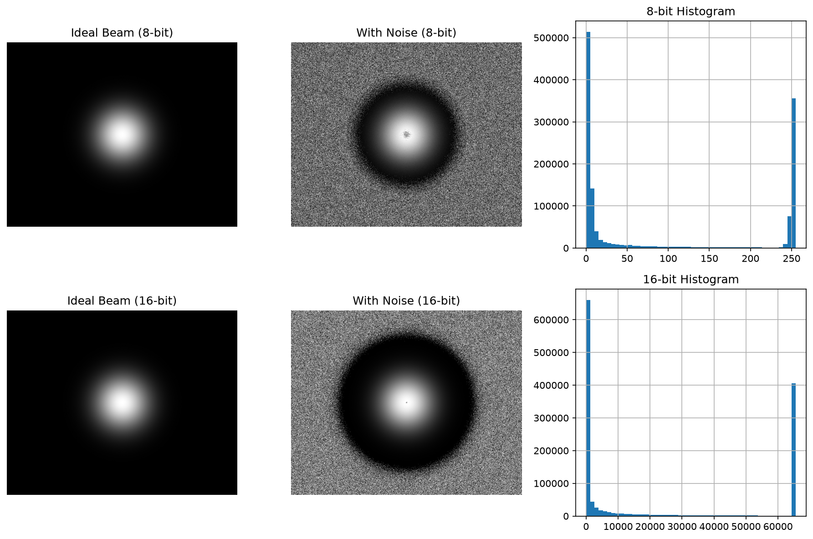

# MIICAM Hardware Test Report

<!-- provenance:start -->
> **生成脚本**: [`tests/ao_shaping/drivers/ccd/test_miicam_simulation_report.py`](../../tests/ao_shaping/drivers/ccd/test_miicam_simulation_report.py)
> **复现命令**: `python -m pytest tests/ao_shaping/drivers/ccd/test_miicam_simulation_report.py`
> **运行环境**: 离线
> **说明**: 仿真 MiiCam 的测试报告 (无需设备)
<!-- provenance:end -->

**Generated:** 2026-10-15 13:29:49
**Device:** miicam
---

## MIICAM Simulation Test Report
This test runs without hardware using simulated data.

### Simulated Image Generation

*Simulated camera images*

**Status:** ✅ PASS

**Duration:** 1.78s

---
