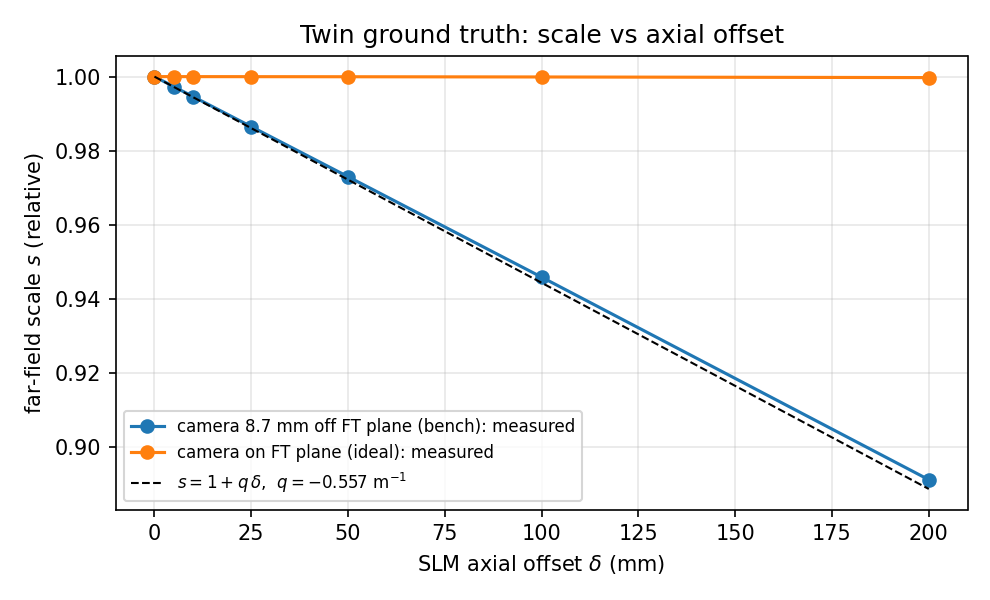
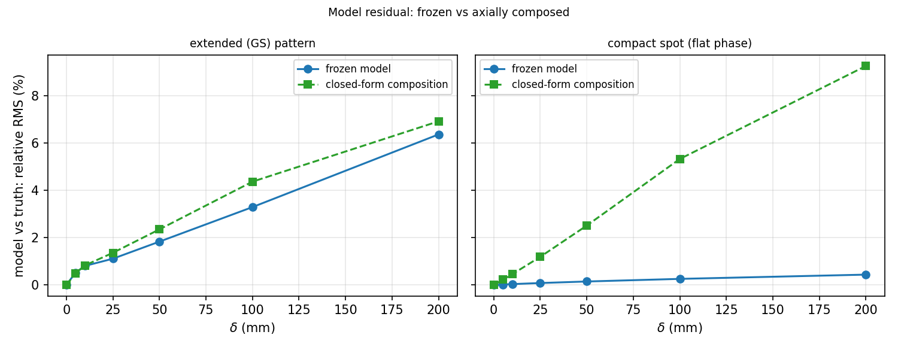
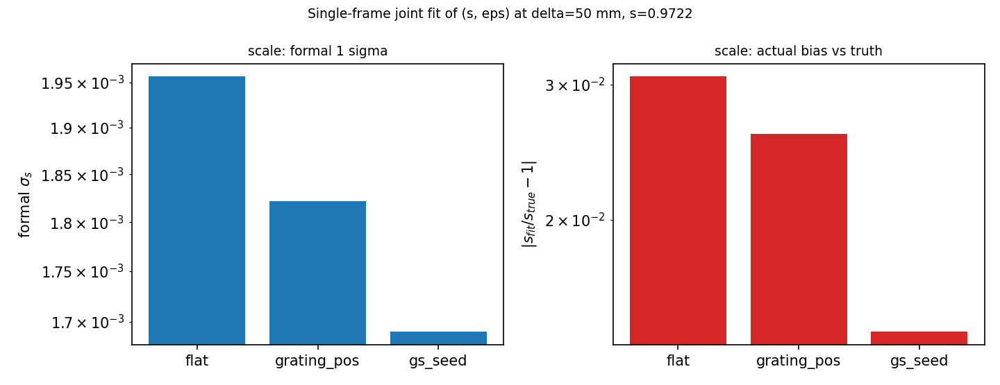

# SLM 轴向移动的模型代价与再辨识（仿真，2026-10-29）

<!-- provenance:start -->
> **生成脚本**: [`scripts/slm/generate_axial_move_sim_report.py`](../../../scripts/slm/generate_axial_move_sim_report.py)
> **复现命令**: `python scripts/slm/generate_axial_move_sim_report.py`
> **数据/关联脚本**: [`src/ao_shaping/tools/slm/transfer/axial.py`](../../../src/ao_shaping/tools/slm/transfer/axial.py)
> **数据/关联脚本**: [`src/ao_shaping/drivers/sim/bench_twin.py`](../../../src/ao_shaping/drivers/sim/bench_twin.py)
> **运行环境**: 离线（数字孪生真值，无任何实验测量，无设备）
> **说明**: SLM 沿光轴移动的模型代价、远场标度律与 (s, ε) 再辨识边界；S1 标称几何只作灵敏度上界，S2 取 2026-10-29 现场读数。
<!-- provenance:end -->

> 本报告的数字全部来自数字孪生真值，**不含任何实验测量**。适用面是「把 SLM 从前焦面附近沿光轴移开」这一类改动。**几何口径有两档，正文 §3–§6 的全部表格按 S1 渲染，S1 只是灵敏度上界，不是当天实验系统的配置**：
>
> | 口径 | 焦距 | 相机离焦 | `q = -ε/f²` | 来源 |
> | --- | --- | --- | --- | --- |
> | **S1（本报告渲染用的标称几何）** | 125 mm | 8.7 mm | **-0.5568 m⁻¹** | 设计值与 2026-10-22 前后的装配离焦 |
> | **S2（2026-10-29 现场实测）** | 123.9 mm（闪耀 ±1 级落点反推） | ≈0.25 mm（同轮拟合离焦屈光度 0.0159 m⁻¹） | **≈0.0159 m⁻¹** | `report/shape_trials/blackbox_path/live_20261029.md` run #1 |
>
> 两档差 **35 倍**，所以凡是「由 `q·δ` 决定」的量，S2 下都是 S1 数值的 1/35 —— 正文给出的是**上界**，S2 的换算见 §1.1。上一轮 `axial_plane_20261026.md` 已给出同一套 ABCD 关系与硬件上的「条件最优在扫描边界、验证集改善很小」的判读；本报告补的是**孪生真值下的量级与可辨识性**。

## 结论

1. **移动本身几乎不可见，除非相机不在傅里叶面。** 相机在后焦面时 `A = 1 - d₂/f = 0`，面板后移只改变输出二次相位，强度在一阶意义下不变：仿真在 `ε=0` 列的标度读数是 0.99996、平相位帧相对残差 9.04e-04%（**不是逐位恒等** —— 那 9e-6 是离散化残差：新增那一步走的是面板网格上的循环角谱，而远场是补零 FFT，两者的频率弥散口径不同）。移动的可见度**只由 `A` 这一个耦合决定**。而 2026-10-29 现场实测的 `ε ≈ 0.25 mm`（S2）比本报告渲染用的 8.7 mm 小 35 倍 ⇒ 当天实验系统上真实效应量级是正文各表的 1/35，见 §1.1。
2. **可观测的只有两个标量，且都有闭式解。** 远场标度 `s = 1 + q·δ`（`q = A/B`，按当前几何 `q = -0.5568 m⁻¹`）：δ = 50 mm 时 s = 0.9722，±1 级间距实测 0.9730（偏差 +0.08%）；δ ≤ 100 mm 内最大偏差 0.16%。 离焦屈光度同步变为 `q' = q/s`。**模型不需要新增自由度**。
3. **冻结模型的代价可以量化，但只有延展图样才看得见。** δ = 50 mm 时延展图样的模型残差从 1.8% 涨到 2.3%（δ = 100 mm：3.3% → 4.4%）；而紧凑光斑（平相位）即使 δ = 50 mm 也只有 0.15%。 也就是说：**用小平斑自检会得出「移动没有影响」的错误结论**。
4. **单帧标度可测，单帧离焦不可测。** 在 δ = 50 mm 的真值帧上联合拟合 (s, ε)：平相位探针把 s 拟到偏差 3.07%，相关系数 -0.66（s 与 ε 几乎不可分）；延展图样偏差 1.43%、相关系数 -0.54。 形式 1σ（1.7e-03）**远小于**实际偏差，因为失配是系统性的 —— 报告里只把偏差当精度。
5. **不重训练、不重标定面板项。** 面板 LUT / Zernike / 粗糙度属于器件，移动不改它们；要更新的只有两个几何标量、一次辐射度锚定，以及随之而来的**目标框与窗口标度**。

> **口径提醒（S1 → S2）。** 结论 2–4 里的百分比都是 S1（`ε = 8.7 mm`）的数值。按 2026-10-29 的现场读数 `|q| ≈ 0.0159 m⁻¹`（S2），它们整体小 35 倍：`s(δ=50 mm)−1` 只有 −0.079%、`s(δ=200 mm)−1` 只有 −0.32%，冻结模型残差落在 0.05% 量级，**低于单帧探针自身的重复性**。要判断「当天这套光路能不能测到移动」，读 §1.1，不要读 §3–§6 的绝对值。

## 1. 物理：移动改变了什么

近轴 ABCD 复合链 `P(d₂)·L(f)·P(d₁)`：

```text
A = 1 - d₂/f,   B = d₁ + d₂ - d₁·d₂/f,   q = A/B
```

相机在后焦面（`d₂ = f`）⇒ `A = 0`、`B = f`，与 `d₁` 无关：面板位置只改变**输出**二次相位，强度不变。这就是孪生里 `ε = 0` 列的零假设。

相机离焦（`d₂ = f + ε`）⇒ `A = -ε/f ≠ 0`。面板后移 δ 等价于总矩阵右侧乘 `P(δ)`：

```text
B' = B + A·δ   ⇒   s = B'/B = 1 + q·δ,    q' = q/s
```

这正是 `defocus_forward_core.axial_plane_correction(q, δ)` 的返回式：`ramp_matrix` 乘 `s`、光学增益除 `s²`。除此之外模型没有新自由度。

被忽略的二阶项，放在同一把尺子上（S1 几何，`w₀ = 2 mm` ⇒ `z_R = 11.8 m`）：

| 效应                         | 标度                  | δ = 50 mm | δ = 200 mm |
| ---------------------------- | --------------------- | ---------- | ----------- |
| 远场标度 `q·δ`           | `0.557 m⁻¹ × δ` | 2.8%       | 11.1%       |
| 离焦屈光度相对变化 `q·δ` | 同上                  | 2.8%       | 11.1%       |
| 照明半径 `w(δ)/w₀ - 1`   | `(δ/z_R)²/2`      | 9e-6       | 1.4e-4      |
| 衍射展宽 `λδ/(πw₀)`    | 1.7 µm @ 50 mm       | 2e-4       | 8e-4        |

⇒ **δ ≤ 200 mm 时只有标度与离焦两项进入误差预算**。照明项只在把光束收得很紧（`w₀ ≲ 0.5 mm`，`z_R ≲ 0.7 m`）时才需要显式建模；移动前后各测一次 `beam_extent` 就能判定自己落在哪一侧。

### 1.1 几何口径：S1 标称 vs S2 当天实测

上面两个数字里，`f` 是设计值，`ε` 是**某一次装配**的相机离焦量。焦距随透镜组固定，离焦却随「透镜位置、相机位置、SLM 位置中任何一个被改动」而变，它**不能跨会话继承** —— 把它当成当前系统的属性，正是本报告初稿最大的口径错误。

2026-10-29 在同一实验系统上重新做了两个独立读数（`report/shape_trials/blackbox_path/live_20261029.md` 的 run #1）：

| 量 | 读法 | 读数 | 对照 S1 |
| --- | --- | --- | --- |
| 焦距 | 闪耀光栅周期 64 SLM px ⇒ ±1 级落点 ±117 CCD px；周期 128 ⇒ ±58 px。按 `x₁ = λf/(P·p)`、`p = 8 µm`、CCD 2.2 µm/px 反解 | `f_eff = 123.9 / 122.9 mm` | 与 125 mm 一致（≤1%） |
| 离焦 | 同轮物理预测模型拟合的 `defocus_diopter` | `\|q\| = 0.0159 m⁻¹` ⇒ `ε = -q·f² ≈ 0.25 mm` | 比 0.5568 小 **35 倍** |

⇒ **当天实验系统是 `A ≈ -8e-4`（近焦），S1 的 `ε = 8.7 mm` 是 2026-10-22 前后的历史配置。** §3–§6 的表格因此只能当灵敏度上界读。把同一套闭式代入 S2：

| 量（δ = 50 mm / 200 mm） | S1（`ε = 8.7 mm`，`q = -0.5568`） | S2（`ε ≈ 0.25 mm`，`\|q\| = 0.0159`） |
| --- | --- | --- |
| `s − 1` | −2.78% / −11.1% | **−0.079% / −0.32%** |
| 延展图样冻结模型残差 | 1.83% / 6.36% | ≈0.05% / ≈0.18%（按 `q·δ` 同比缩放，**未重跑仿真**） |
| 平相位帧残差 | 0.15% / 0.44% | ≈0.004% / ≈0.013%（同上） |
| 可辨识性偏差（§6） | 3.07% / — | 同比例缩小，`s` 与 `ε` 的相关性绝对值不变 |

S2 下 δ = 50 mm 的标度变化折合 **0.008 采样点**（`29.857 → 29.855`），比 §3 方法自身的偏差（+0.08%，约 0.024 采样点）还小 3 倍：**这个量级在单帧读数里不可判读**。要判读只有三条路 —— 把 δ 放大到 S1 那种量级、改成多帧平均压低方法偏差、或者干脆用「移动之后重新拟合几何」而不是「用固定标度去察觉移动」。

后两行是按一阶律缩放的估算，不是仿真结果：生成器把几何写成模块常量（`scripts/slm/generate_axial_move_sim_report.py` 的 `F0_M` / `EPS0_M`），要拿到 S2 的仿真数字得改常量重跑，本报告没有重跑。

## 2. 仿真方法

- 真值：`bench_twin` + 本轮新增的 `slm_axial_offset_m`（调制后的面板场先角谱传播 δ 到透镜面）。**几何取 S1**：`f = 125 mm`、`w₀ = 250` 面板 px、相机离焦 `ε = 8.7 mm`、瞳面 128² / 56.25 µm。
- 模型族：`rescale(s) ∘ bench_twin(defocus_m = ε)`，即冻结前向的 `(q, ramp scale)` 两个标量；增益按最小二乘解析边缘化。其余项（面板误差、透镜像差、口径）两侧取同一值 ⇒ 残差只剩轴向移动。
- 探针：一维闪耀 ±1 级（周期 32 面板 px，落点 ±40 模型采样点，尺度读数用它）、平相位（紧凑光斑）、GS 方形种子（边长 60 采样点，延展图样）。三者都是流水线真会用量级的相位，不用像素级随机相位（它在孪生的周期网格上会引入绕回伪影）。
- 指标：`protocol.aperture_metrics` 的 `cv` / `ee_rel`，尺寸读数用目标框内「强度过半高」的等效方形边长。

## 3. 结果 A：标度律

| δ (mm) | ±1 级间距 (采样点) | s 实测 | s = 1+q·δ | 偏差   | 平相位帧残差（ε=8.7 mm） | 平相位帧残差（ε=0） |
| ------- | ------------------- | ------ | ----------- | ------ | ------------------------- | -------------------- |
| 0       | 29.857              | 1.0000 | 1.0000      | +0.00% | 0.00%                     | 0.00e+00%            |
| 5       | 29.777              | 0.9973 | 0.9972      | +0.01% | 0.02%                     | 1.37e-05%            |
| 10      | 29.696              | 0.9946 | 0.9944      | +0.02% | 0.04%                     | 5.33e-05%            |
| 25      | 29.454              | 0.9865 | 0.9861      | +0.04% | 0.08%                     | 2.87e-04%            |
| 50      | 29.050              | 0.9730 | 0.9722      | +0.08% | 0.15%                     | 9.04e-04%            |
| 100     | 28.240              | 0.9458 | 0.9443      | +0.16% | 0.26%                     | 2.72e-03%            |
| 200     | 26.607              | 0.8911 | 0.8886      | +0.28% | 0.44%                     | 8.04e-03%            |

读数：闭式标度律在 δ ≤ 100 mm 内成立到 0.16%；δ = 200 mm 偏 +0.28%，说明二阶项已经进 1% 预算，那里要用实测标度而不是公式外推。 `ε = 0` 列是**离散化残差**（9e-6 到 8e-5 的相对量级），不是逐位恒等：新增的那一步走面板网格上的循环角谱，远场却走补零 FFT，两者的频率弥散口径不同（回归测试实测 δ = 20 mm 时相对 L2 = 9.1e-4）。它比 `ε ≠ 0` 列小 3–4 个数量级，足以支持「移动的强度效应主要经 `A` 进来」这一判读，但不足以把 `A = 0` 当成恒等零。

## 4. 结果 B：冻结模型 vs 闭式复合

| 探针    | δ (mm) | s      | q' (1/m) | 冻结模型残差 | 复合后残差 |
| ------- | ------- | ------ | -------- | ------------ | ---------- |
| gs_seed | 0       | 1.0000 | -0.5568  | 0.00%        | 0.00%      |
| gs_seed | 5       | 0.9972 | -0.5584  | 0.52%        | 0.49%      |
| gs_seed | 10      | 0.9944 | -0.5599  | 0.81%        | 0.83%      |
| gs_seed | 25      | 0.9861 | -0.5647  | 1.11%        | 1.36%      |
| gs_seed | 50      | 0.9722 | -0.5727  | 1.83%        | 2.35%      |
| gs_seed | 100     | 0.9443 | -0.5896  | 3.29%        | 4.37%      |
| gs_seed | 200     | 0.8886 | -0.6266  | 6.36%        | 6.92%      |
| flat    | 0       | 1.0000 | -0.5568  | 0.00%        | 0.00%      |
| flat    | 5       | 0.9972 | -0.5584  | 0.02%        | 0.22%      |
| flat    | 10      | 0.9944 | -0.5599  | 0.04%        | 0.45%      |
| flat    | 25      | 0.9861 | -0.5647  | 0.08%        | 1.19%      |
| flat    | 50      | 0.9722 | -0.5727  | 0.15%        | 2.51%      |
| flat    | 100     | 0.9443 | -0.5896  | 0.26%        | 5.32%      |
| flat    | 200     | 0.8886 | -0.6266  | 0.44%        | 9.25%      |

**复合式在本轮仿真里没有削掉残差，反而更高**：`gs_seed` δ = 50 mm 从 1.83% 升到 2.35%，δ = 200 mm 从 6.36% 升到 6.92%；平相位最刺眼 —— 它的物理敏感度本来就比延展图样小一个数量级（0.15%），复合后却是 2.51%，**17 倍**。三族 21 行里，除 `gs_seed` δ = 5 mm 一处（0.52% → 0.49%）外，复合列没有一行更低。

原因不在物理，在实现：`model_frame` 的复合是 `rescale_about_axis(twin(0, ε/s).far_field(phase), s)`，而 `rescale_about_axis` 用的是 `map_coordinates(..., order=3)` —— **在强度图上做三次样条重采样**。这张图的峰值陡、旁瓣低，重采样误差本身就落在 1–2.5% 量级（δ = 5 mm 时平相位已 0.22%，而那时真值偏差本该只有 0.02%），与它要去掉的 2.8% 效应同量级。用一个 1–2.5% 的重采样噪声去量 2.8% 的效应，连符号都不可信。

⇒ 该改的是实现，不是结论：闭式律必须作用在**相位/矩阵域** —— `ramp_matrix` 乘 `s`、光学增益除 `s²`，这正是 `defocus_forward_core.axial_plane_correction` 的做法（§1），那里既没有重采样也没有插值误差。把模型**强度帧**按 `s` 重采样再比对是错误路径；「冻结模型」列才是可用的残差读数，「复合」列只作为「不要这么做」的反面证据。

紧凑光斑一列即使在 δ = 50 mm 也只有千分之几 —— **这就是为什么不能拿小平斑做移动后自检**：它对尺度几乎不敏感。

## 5. 结果 C：延展图样的尺寸读数

目标框半边长 30 采样点（`FixedAperture`），边长读数是「框内强度过半高的等效方形边长」。GS 种子未收敛到干净方斑，所以这一栏读的是**尺寸**，不是形状质量。

| δ (mm) | s      | 真值边长 | 真值 ee_rel（旧框） | 真值 ee_rel（框×s） | 冻结模型边长 | 复合模型边长 |
| ------- | ------ | -------- | ------------------- | -------------------- | ------------ | ------------ |
| 0       | 1.0000 | 45.76    | 0.6460              | 0.6460               | 45.76        | 45.76        |
| 5       | 0.9972 | 45.65    | 0.6471              | 0.6471               | 45.76        | 45.78        |
| 10      | 0.9944 | 45.60    | 0.6477              | 0.6477               | 45.76        | 45.76        |
| 25      | 0.9861 | 45.51    | 0.6486              | 0.6486               | 45.76        | 45.85        |
| 50      | 0.9722 | 45.21    | 0.6499              | 0.6313               | 45.76        | 46.09        |
| 100     | 0.9443 | 44.79    | 0.6524              | 0.6147               | 45.76        | 46.69        |
| 200     | 0.8886 | 44.63    | 0.6578              | 0.6009               | 45.76        | 46.54        |

**真值边长比 `s` 收缩得少，差的量是离焦模糊。** δ = 50 mm 读 45.21，是 δ = 0 的 **0.988 倍**；而 `s = 0.9722` 预测的是 0.972 倍 —— 少掉的那 1.6 个百分点不是标度，是模糊把半高宽撑住了。按像素算：`s` 预测边长掉 1.28 px，实测只掉 0.55 px，差 **0.7 px**；δ = 200 mm 时 `s` 预测 40.66（掉 5.10 px），实测 44.63 只掉 1.13 px，差 **≈4.0 px**。模糊随 `|δ|` 增长（`s` 越小离焦越远），所以在 δ ≥ 100 mm 之后边长读数已经被模糊压住，**不能再当成尺度计**。

**目标框必须按实测半宽定，不能按 `half_side × s` 缩。** 旧框（框不随移动改）的 `ee_rel` 从 0.6460 **升到** 0.6499 —— 光斑变小、框没变，框内占比自然变高；若把框按 `s` 缩（`×s` 列），`ee_rel` 反而掉到 0.6313，因为真实光斑比 `s` 预测的大（模糊）。两个读数符号相反，只有**按实测半宽 45.21 重定框**给出的 `ee_rel` 才是「能量集中度变没变」的答案。这也是 §7「移动后」第 3 条要求先测半宽再定框的原因。

**冻结模型的一列是「没更新 ⇒ 看不见」的直接证据**：不管 δ 多大，冻结模型报的边长都是 45.76，一像素不动 —— 它对移动完全无视，所以它的残差就是**全部**物理变化（§4 的 1.8% → 2.3%）。**复合模型的一列走错方向**：δ = 50 mm 报 46.09（真值 45.21，偏大 0.9 px），δ = 200 mm 报 46.54（真值 44.63，偏大 1.9 px），且 δ = 100 → 200 之间不单调 —— 与 §4 同一成因（强度域三次样条重采样），这一列只作反面证据。

> 边长读数只在 δ ≥ 50 mm 时可用：δ = 25 mm 真值只掉 0.25（0.5%），δ = 5 / 10 mm 掉 0.11 / 0.16，都在半高插值的读数量化之内。

## 6. 结果 D：可辨识性

| 探针        | s 拟合 | s 真值 | 偏差   | 形式 σ_s | ε 拟合 (mm) | ε 真值 (mm) | corr(s, ε) |
| ----------- | ------ | ------ | ------ | --------- | ------------ | ------------ | ----------- |
| flat        | 1.0020 | 0.9722 | +3.07% | 2.0e-03   | 8.69         | 8.95         | -0.655      |
| grating_pos | 0.9973 | 0.9722 | +2.59% | 1.8e-03   | 8.74         | 8.95         | -0.522      |
| gs_seed     | 0.9861 | 0.9722 | +1.43% | 1.7e-03   | 8.77         | 8.95         | -0.535      |

真值是 δ = 50 mm（s = 0.9722，ε = 8.95 mm）。平相位探针的相关系数 -0.66、s 偏差 3.07%：紧凑光斑的**尺寸**同时被尺度和离焦改变，两者在这一个读数上退化。延展图样把 s 定到 1.43% 偏差、相关 -0.54；单帧闪耀的偏差是 2.59%。形式 σ 比实际偏差小一到两个数量级，因为模型失配是系统性的 —— 报告只把**偏差**当精度。

结论与 `axial_plane_20261026.md` 的硬件判读同向，并且给了量：**单帧强度不能同时定出 (q, 映射)**，但**也不需要**同时定出 —— δ 是机械量（输入），s 与 q' 是输出；用一次延展图样测 s、一次离焦扫描测 q' 即可。

## 7. 下次移动 SLM 的操作流程

### 移动前（只读，约 10 分钟）

1. `bench_fingerprint` 存指纹，并记下机械标尺读数 `z_before`。
2. `beam_extent` 测照明半径 `w₀` 与中心，按 §1 的表判定 `δ/z_R` 落在哪一侧。
3. 存**平相位**与**延展图样**各一帧定曝光画面，连同该轮 `result.json` —— 这是移动后唯一可比参照。

### 移动后（按此顺序，约 15 分钟）

1. **先验光路**：`light_guard` 判「有光」，`focus_preflight` 做离焦补偿与去转向；零级与 ROI 必须在补偿**之后**重新定位（沿用 `focus_probe` 的结论：补偿前定的 ROI 会偏几十 px）。
2. **两个标量各用一次专门测量**：
   - 标度 `s`：延展图样帧对移动前那一帧做一维标度搜索（或直接量 ±1 级间距的比值，本报告 §3 的做法）。核对 `s ≈ 1 + q·δ_model`：一致 ⇒ δ 与模型自洽；不一致 ⇒ 以**实测 s** 为准，并检查 `q` 的符号。
   - 离焦 `q'`：`focus_probe` 重扫一次（现有入口），或用 `q' = q/s` 预测后只测一个验证点。
3. **重算几何书签**（最容易漏、后果最长）：`ramp_matrix × s`、光学增益 `/ s²`、窗口跨度与 `control_grid` 同步缩放；**目标框按实测半宽重定，不要用 `half_side × s`** —— §5 实测边长比 `s` 预测的大 1.6 pp（离焦模糊），按 `s` 缩会把框缩得比光斑小、`ee_rel` 假跌（0.6499 → 0.6313）；`origin_xy` / `amplitude_center_xy` 不动（它们由光轴与照明中心定，不由 δ 定）。
4. **一次辐射度锚定**：平相位单帧重定 `gain` 与 `background`（`s⁻²` 只作用于光学增益，背景与曝光偏置不缩放）。
5. **写溯源**：检查点记录 `slm_axial_offset_m`、`axial_reference_curvature_diopter`、`bench_fingerprint` 哈希、`z_before/z_after`、实测 s 与该次测量的曝光。指纹不一致时**拒绝**加载旧检查点，并在报错里点名哪一项变了。
6. **面板项一律冻结**：LUT / 面板 Zernike / 粗糙度属于器件，移动不改它们。

### 验收（三条，任一不过就不要开形状 campaign）

1. **延展图样的模型残差**与移动前同量级 —— 读的是**冻结模型**那一列（本报告 1.8% → 2.3% @ δ = 50 mm，S1 上界；S2 下再小 35 倍）。**不要**读复合列：那一列的实现是错的（§4），它的 2.35% 不是模型代价。
2. 平相位帧的 `ee_rel` 与峰值在移动前后相差 ≤ 5%（否则是截光或曝光，不是模型问题）。
3. 一个已知方形目标做 A–B–A（旧检查点 / 新检查点 / 旧检查点）：新检查点的 `cv` 与 `ee_rel` 不劣于旧检查点 —— 这一条同时检验标度与离焦是否都改对了（注意两条 run 之间的 `cv` 本身随曝光变，只能同曝光比）。

## 8. 本轮改动的代码

| 位置                                                | 改动                                                                                                                     | 理由                                                                               |
| --------------------------------------------------- | ------------------------------------------------------------------------------------------------------------------------ | ---------------------------------------------------------------------------------- |
| `drivers/sim/bench_twin.py`                       | 新增 `BenchTwinConfig.slm_axial_offset_m` 与 `BenchTwin.slm_plane_to_lens()`；`far_field` 在透镜像差之前插入这一步 | 孪生此前无法表示「面板不在前焦面」，于是「移动后模型是否还成立」在仿真里无法被证伪 |
| `drivers/sim/bench_twin.py`                       | **修** `from_dict` 漏读 `slm_axial_offset_m`（`to_dict` 写了，读回时不构造该键）                                 | 非零偏移经一次 JSON 往返静默归 0，而检查点里记着"有偏移" —— 见下         |
| `scripts/slm/generate_axial_move_sim_report.py`   | 本报告、三张图与 `metrics.json`                                                                                        | 生成命令即复现命令                                                                 |
| `tests/ao_shaping/drivers/sim/test_bench_twin.py` | §10 `TestAxialOffset`：9 个用例（δ=0 逐位恒等 / ε=0 的离散残差上界 / 标度 `1+q·δ` / Parseval / JSON 往返）         | 把本节与被推翻的两个直觉一起钉成测试                                               |

测试里被推翻的两个直觉，都已写进断言而不是只写进散文：

1. **「`A = 0` ⇒ 逐位不变」是错的。** δ = 20 mm、`ε = 0` 时远场相对 L2 差 `9.1e-4`（`region = 64` / δ = 50 mm 时 `1.3e-3`），`np.array_equal` 为 `False`。这不是物理：连续极限下 `|F(field ⊛ h_δ)|² ≡ |H_δ·F(field)|²` 且 `|H_δ| ≡ 1`。差异全部来自离散链不一致 —— δ 那一步在 `region` 网格上做**循环**角谱传播，而远场是补零后 `M = region·padding` 点 FFT。所以断言写成单边上界「相对 L2 < 2e-3」；真做到逐位恒等的实现同样满足它。**δ = 0 本身仍是逐位恒等**（`6.7e-16` 量级的符号往返）—— 两条不能混为一谈。
2. **离焦确实放大这一项（5.3×）。** 同一 δ = 20 mm：`defocus_m = 0.5` 时相对 L2 是 `4.8e-3`，无离焦是 `9.1e-4`。也就是说「面板后移」的可见度不只是 `A = 0` 一个开关，相机一旦离焦就重新变成一阶可见 —— 这与 §1 的判据一致，且是本报告之所以要单列 S2 的原因。

`from_dict` 那个漏读是写本节测试时才暴露的：`to_dict` / `from_dict` 不对称，任何把孪生配置存成 JSON 再读回的流程（反演结果、检查点）都会把偏移悄悄清零，而**远场随之改变**、症状表现为「模型读回来就不准了」。修法是 `from_dict` 里补一行该键；对应用例此前以 `xfail(strict=True)` 钉住期望契约，修好后已删标记（现在全文件 69 passed，此前是 68 passed + 1 xfailed）。

> 三张图（§3 / §4 / §6）**全部按 S1 几何渲染**，正文的百分比也是 S1。S2 只给了换算（§1.1 与「口径提醒」），没有另出一套图 —— 因为 S2 的数值是 S1 的 1/35，画出来与坐标轴噪声同宽，没有读图价值。要看 S2 请读数字，不要读图。

模型侧（`defocus_forward_core.axial_plane_correction`、`FrozenDefocusParameters.slm_axial_offset_m` / `effective_parameters()`）**无需改动**：本报告验证的正是这两个已存在的量。

## 9. 边界与未验证项

- 孪生的瞳面网格跨 900 面板 px（128 点 / 56.25 µm 节距），面板真实的 8 µm 结构不在传播里，所以本报告是**控制网格口径**下的结论。真实面板的高频结构在 δ 传播中抹得更快，但那一层已经超出冻结前向的表达能力。
- 有限透镜口径与传播后截光未建模（孪生用网格边界当口径）；按 §1 的量级估计，δ ≤ 200 mm 时它进不了 1% 预算。若将来把光束收窄到 `w₀ < 0.5 mm`，这一项要重估。
- 照明项只在 §1 的量级表里出现，没有单独仿真：它的判据是 `δ/z_R`，由实测 `w₀` 决定，不需要新的模型自由度。
- GS 种子未收敛到干净方斑（高斯照明 + 硬方形目标），§5 的边长读数因此只当尺寸用。
- 报告里所有 δ 都是**标称机械位移**。`axial_plane_20261026.md` 已说明，任何从强度反推的 δ 都不能当卷尺读数；本报告的立场相同：δ 是输入，`s` 与 `q'` 是输出。
- **口径差 35 倍是这份报告最大的适用面限制。** 正文渲染用 S1（`ε = 8.7 mm`，`q = -0.5568 m⁻¹`），而 2026-10-29 现场实测是 S2（`ε ≈ 0.25 mm`，`|q| ≈ 0.0159 m⁻¹`）。所以「冻结模型残差 1.8% → 2.3%」在当天的实验系统上应读成 0.05% 量级 —— 这个量级**低于本轮实验能分辨的水平**（单帧读数量化就在这个量级）。**不要拿 S1 的数字去判定当天硬件「模型是否失配」**；S1 只回答「如果相机离焦 8.7 mm，代价有多大」。新增自由度（`slm_axial_offset_m`）与 `s` / `q'` 的闭式关系不受这一条影响，受影响的只有量级。
- **孪生焦距读数与既有标定冲突，未解决。** 今天用一维闪耀光栅反推：周期 64 面板 px → ±1 级 ±117 px、周期 128 → ±58 px ⇒ `f_eff ≈ 123–124 mm`（标称 125 mm）。而 `report/simulation/bench_twin/bench_twin_fidelity_20261021.md` 报的是 `f_eq = 311.32 mm`（实测标度 `2.614022`）配 `defocus_m = 0.0005`。两者差约 2.5 倍，无法同时成立。本报告采用 125 mm（与孪生配置 `focal_length_m = 0.125` 一致，且与今天的实测相符），但**那份标定报告的数字没有被本报告推翻**：它测的是另一个口径（含离焦的等效焦距），两者的换算关系尚未查清。任何依赖 `f_eq = 311 mm` 的下游结论都应视为**待复核**。
- **闭式修正律本身没有在本轮仿真里在线实现。** §4 的「复合」列是强度域重采样的错误实现，`defocus_forward_core.axial_plane_correction`（相位/矩阵域）没有被这个生成器调用。所以报告能说的是「冻结模型代价多大」，**不能**说「闭式律能把它消掉多少」——后者需要另一次仿真（把 `s` 乘进 `ramp_matrix`、增益除 `s²`，再比对），本轮没做。
- `from_dict` 漏读 `slm_axial_offset_m` 的问题已在写本节测试时发现并修复（§8）；在此登记是因为它属于**序列化边界**而非物理边界，任何消费孪生 JSON 的外部流程（检查点、反演结果）在此之前的读回都丢了偏移。

## 附：复现

```bash
python scripts/slm/generate_axial_move_sim_report.py
```

产物：`artifacts/metrics.json`




