# 无历史权重与无 GS 的冷启动整形实验（2026-10-26）

<!-- provenance:start -->
> **生成脚本**: [`scripts/slm/generate_cold_start_report.py`](../../../scripts/slm/generate_cold_start_report.py)
> **复现命令**: `python scripts/slm/generate_cold_start_report.py`
> **数据/关联脚本**: [`src/ao_shaping/tools/slm/transfer/capture.py`](../../../src/ao_shaping/tools/slm/transfer/capture.py)
> **数据/关联脚本**: [`src/ao_shaping/tools/slm/transfer/bootstrap.py`](../../../src/ao_shaping/tools/slm/transfer/bootstrap.py)
> **数据/关联脚本**: [`src/ao_shaping/tools/slm/transfer/fit.py`](../../../src/ao_shaping/tools/slm/transfer/fit.py)
> **数据/关联脚本**: [`src/ao_shaping/tools/slm/transfer/validate.py`](../../../src/ao_shaping/tools/slm/transfer/validate.py)
> **数据/关联脚本**: [`src/ao_shaping/tools/slm/transfer/cold_start.py`](../../../src/ao_shaping/tools/slm/transfer/cold_start.py)
> **数据/关联脚本**: [`src/ao_shaping/tools/slm/transfer/progress.py`](../../../src/ao_shaping/tools/slm/transfer/progress.py)
> **运行环境**: 离线（重算 Santec #1 与 Daheng 当前光路实验数据）
> **说明**: 无历史权重、平面或随机整形初相位，物理模型从零拟合与 CCD 配对验收。
<!-- provenance:end -->

## 数据与方法

原始实验目录：`data/debug/slm_transfer/cold_start_20261026_1004`。
未使用历史训练权重或历史目标相位。标称高斯振幅、零像差模型只根据本次相位探针拟合。
平面/随机整形初相位另叠加当前几何的定位载波，不叠加拟合静态像差补偿。所有冷启动配置应记录 `gs_iterations=0`。
训练与验证按相位分组；拟合阶段以训练损失选择检查点。最终以独立 CCD 配对测量验收，模型损失下降不等于物理改善。

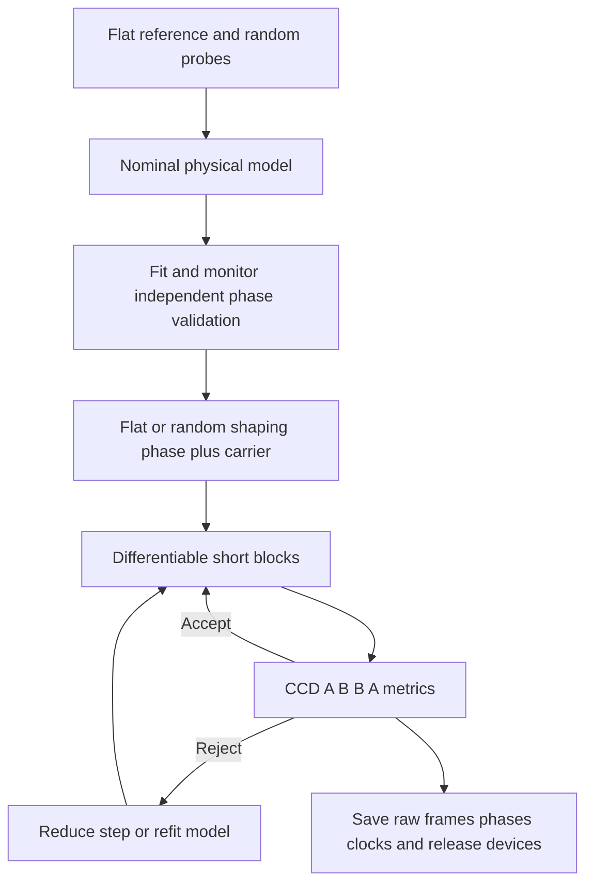

## 模型指标轨迹

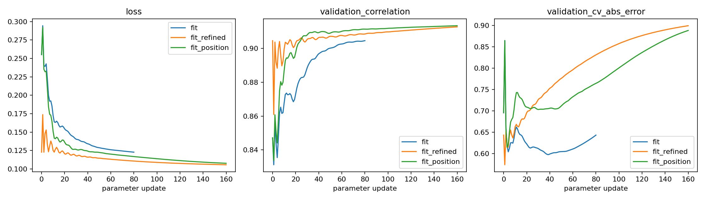

| 拟合阶段 | 初始→最终训练损失 | 初始→最终验证相关性 | 初始→最终验证 CV 绝对误差 |
|---|---:|---:|---:|
| fit | 0.255154 → 0.122829 | 0.847120 → 0.904579 | 0.695836 → 0.643443 |
| fit_refined | 0.122829 → 0.105745 | 0.904579 → 0.912735 | 0.643443 → 0.899475 |
| fit_position | 0.255150 → 0.107742 | 0.847120 → 0.913418 | 0.695836 → 0.888308 |

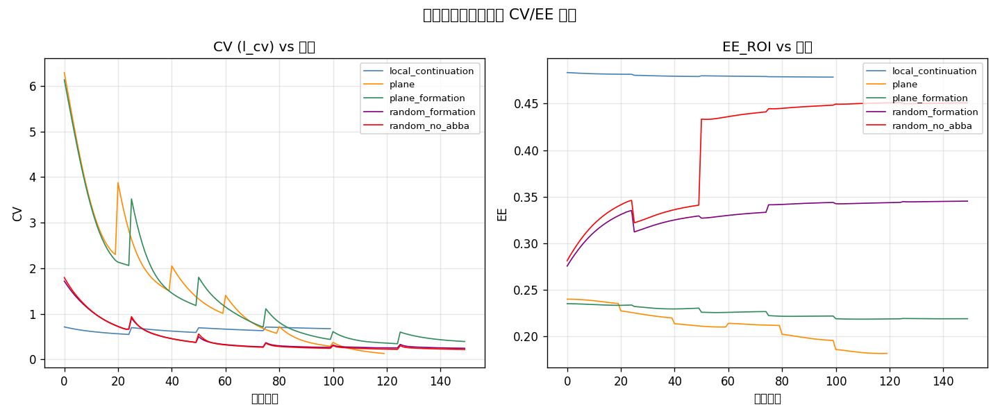

## local_continuation

模式 `anchored`；初相位 `gs`；GS 次数 `0`。

| 形状 | 初始→最终 CV | 初始→最终 EE_ROI | 初始→最终综合损失 | 接受块 |
|---|---:|---:|---:|---:|
| square | 0.828013 → 0.845306 | 0.482544 → 0.477302 | 4.653487 → 4.704972 | 0/4 |

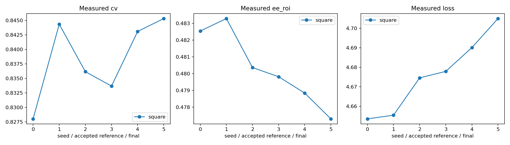

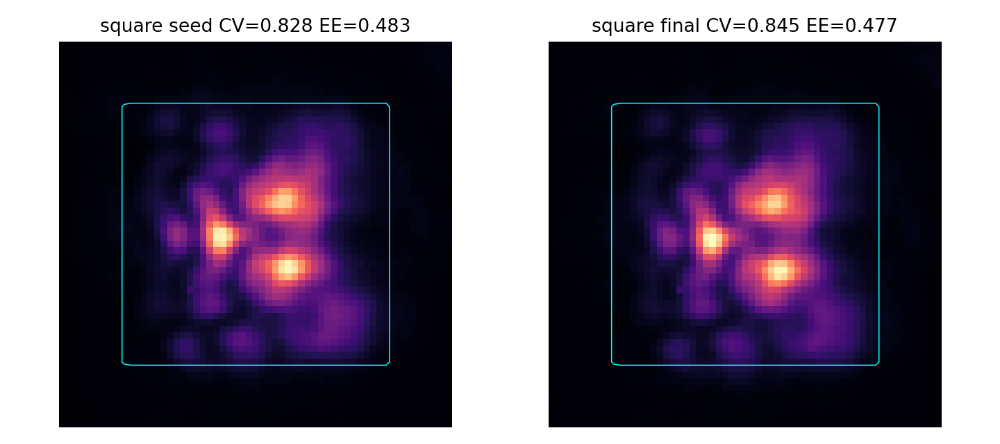


**SLM 相位（初始 vs 最终）**：
**迭代过程 metrics**：

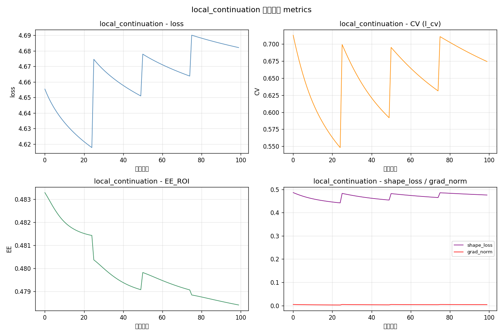


## plane

模式 `anchored`；初相位 `plane`；GS 次数 `0`。

| 形状 | 初始→最终 CV | 初始→最终 EE_ROI | 初始→最终综合损失 | 接受块 |
|---|---:|---:|---:|---:|
| square | 2.512252 → 0.480641 | 0.240924 → 0.173016 | 8.846365 → 2.606964 | 6/6 |

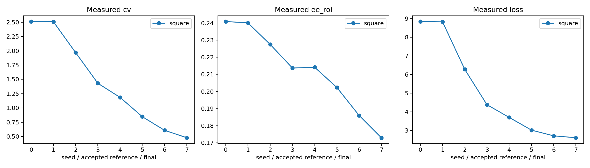

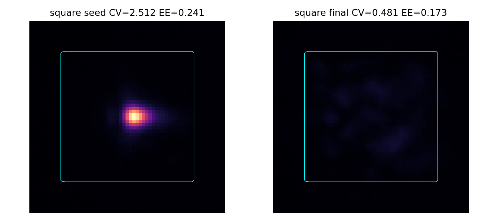


**SLM 相位（初始 vs 最终）**：
**迭代过程 metrics**：

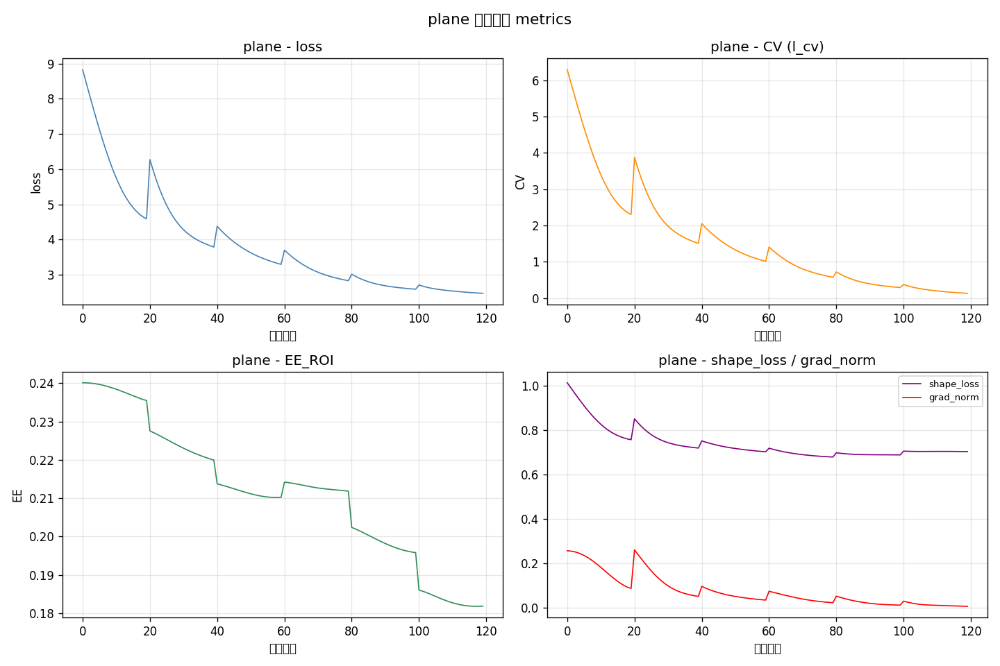


## plane_formation

模式 `anchored`；初相位 `plane`；GS 次数 `0`。

| 形状 | 初始→最终 CV | 初始→最终 EE_ROI | 初始→最终综合损失 | 接受块 |
|---|---:|---:|---:|---:|
| square | 2.494991 → 0.774408 | 0.237472 → 0.218249 | 7.417649 → 6.955435 | 4/6 |

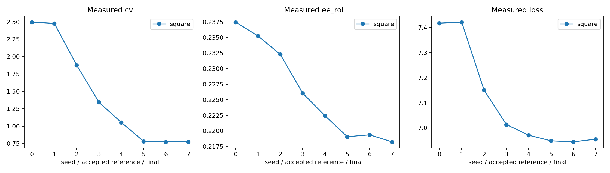

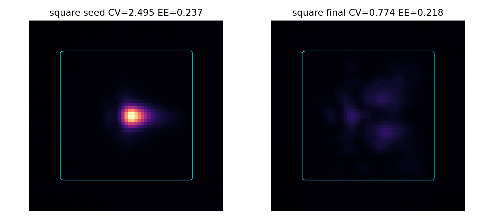


**SLM 相位（初始 vs 最终）**：
**迭代过程 metrics**：

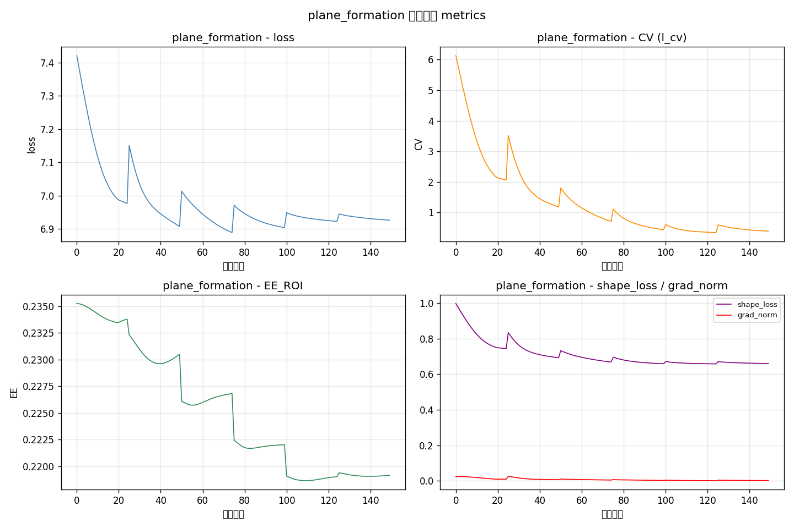


## random_formation

模式 `anchored`；初相位 `random`；GS 次数 `0`。

| 形状 | 初始→最终 CV | 初始→最终 EE_ROI | 初始→最终综合损失 | 接受块 |
|---|---:|---:|---:|---:|
| square | 1.301139 → 0.572299 | 0.276161 → 0.344856 | 6.566011 → 5.754396 | 5/6 |

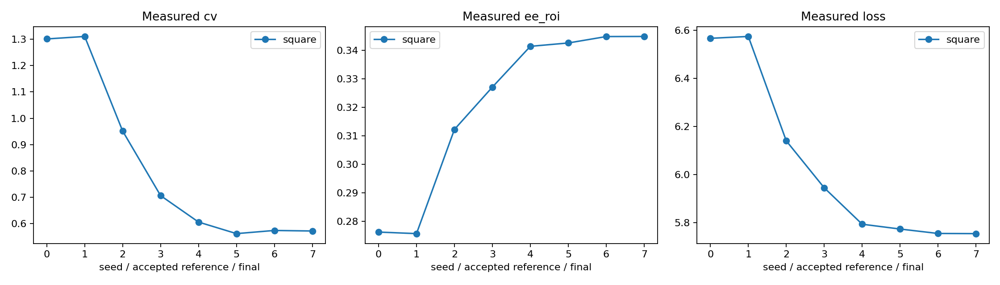

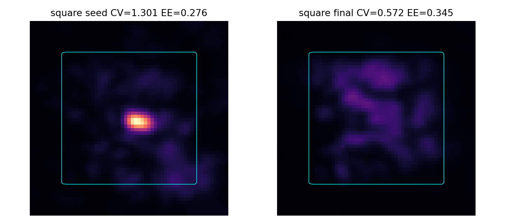


**SLM 相位（初始 vs 最终）**：
**迭代过程 metrics**：

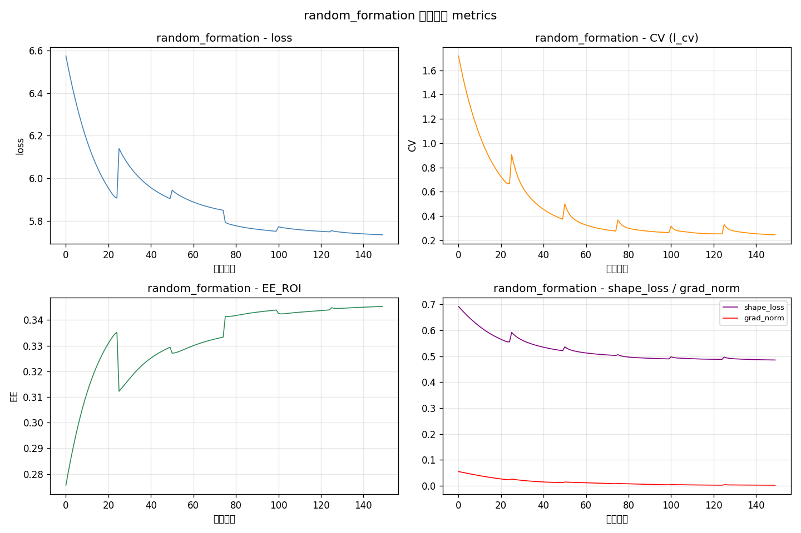


## random_no_abba

模式 `anchored`；初相位 `random`；GS 次数 `0`。

| 形状 | 初始→最终 CV | 初始→最终 EE_ROI | 初始→最终综合损失 | 接受块 |
|---|---:|---:|---:|---:|
| square | 1.360296 → 0.534441 | 0.278252 → 0.360815 | 6.564248 → 5.602644 | 6/6 |

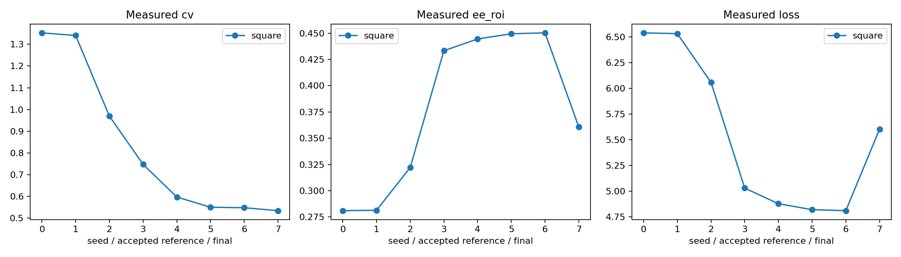

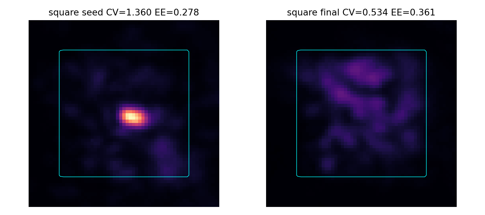


**SLM 相位（初始 vs 最终）**：
**迭代过程 metrics**：

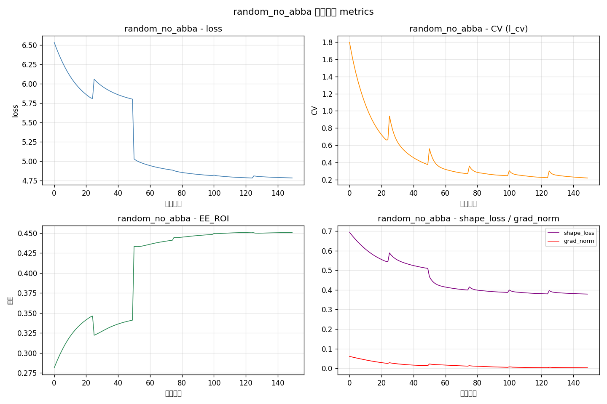


## 解释范围

核心 CV 使用固定目标掩膜腐蚀后的区域；EE_ROI 分母为固定相机采样窗口，不能等同于全传感器能量效率。
曝光在每个形状的配对测量中保持固定；跨曝光归一化假设响应近似线性，不代表本轮独立完成了相机响应标定。
每次相位更新保存相位、模型指标、主机 UTC 微秒时间与单调纳秒时间；并非相机硬触发时间戳。
候选接受只保证当前配对规则下的测量改善，不保证所有时间点或每个指标单调改善。

## 实验发现与调整依据

本轮只验证正方形目标（边长 80 CCD 像元），未测试长方形、三角形或任意光路。所有模型均源自本次标称零像差初值与当前采集，不读取历史训练权重。平面整形初相位包含单独的定位载波，因此完整面板相位不是常数。随机初相位为固定种子 20261026 的平滑随机相位，另加相同定位载波。

1. 首次采集的两步曝光搜索在第 4 个随机探针处未收敛，状态为 `clipped`；该组原始峰值 237/255，没有把它当作有效训练数据。保留 13 组/39 张原始帧，设备退出。改用 12 次搜索预算重新采集，34 组/102 张全部有效，包括 12 个训练相位、12 个验证相位以及 10 个参考/几何相位。
2. 首次 80 次模型更新使验证相关性从 0.8471 提升到 0.9046，相对 L2 从 0.5191 降到 0.3948，但 CV 绝对误差仍约 0.6434。继续 160 次更新后相关性约 0.9127，CV 误差反而增到 0.8995。另从标称模型重新拟合、将入射位置学习率提高到 5 panel px/update，最终 CV 误差仍约 0.8883。训练损失与相关性不是充分的选择标准。
3. 将全部已存档拟合迭代按 `1−corr+relative_L2+0.25*CV_abs_error` 评分，选择首轮第 65 次状态：验证相关性 0.903646、相对 L2 0.396091、CV 误差 0.617625。验证集参与了模型选择，最终 CCD 测量才是后续独立检验。分数中的 0.25 是公开的策略权重，不是物理常数。
4. 平面初相位下综合目标使 CV 显著下降，但目标区域平均 counts 和 EE 下降，CCD 图像主要表现为亮点弥散，没有形成清晰正方形边界。因此增加 `formation` 能量优先目标，并保留原目标作对照。平面形成实验后两个候选被拒绝，学习率缩小，未覆盖接受相位。
5. 已保存的正负扰动显示局部响应幅值预测偏大，正增益拟合比为 0.329722；残余展宽候选 0/1/2/4/8 px 中选择 0 px。它只拟合一组局部响应，不代表全局增益标定。后续局部校正实验 4/4 候选被拒绝，未改善接受相位；因此不能把该校正作为默认有效模型。
6. 不同阶段自动曝光从约 0.47 ms 变化到 2.85 ms，同一接受相位的原始 EE 明显变化。这包含背景与信噪比的影响，不能归因于相位改善，也不能将 counts/exposure 假设当作已经完成相机线性化。块内保持一致曝光，跨段分别比较。
7. 允许更大相位预算的离线 400 次可微更新，把模型 formation 损失从约 7.803 降到 7.205，模型 EE 从 0.142 升到 0.187；最终相位增量加权 RMS 约 1.396 rad，低于 3 rad 上限。该检查不支持“只需增加步数或放宽相位上限即可解决”的判断；它没有增加 CCD 测量，也不是实验形状成功的证据。

## A–B–B–A 是否值得默认启用

同一物理模型、同一随机种子、相同 6 块 ×25 次相位更新的记录如下。时间口径为第一组正式测量至最终测量的主机单调时间差，不包含设备打开和首次自动曝光。

| 配置 | 原始测量帧 | 测量段时间 s | 同曝光初始→最终 CV | 同曝光初始→最终 EE_ROI | 接受范围 |
|---|---:|---:|---:|---:|---|
| A–B–B–A 开，固定 1.530 ms | 84 | 110.98 | 1.301139 → 0.572299 | 0.276161 → 0.344856 | CCD 配对接受 5/6 |
| A–B–B–A 关，块间自动曝光 | 30 | 80.64 | 1.360296 → 0.534441 | 0.278252 → 0.360815 | 模型接受 6/6；最终同曝光 CCD 确认整体改善 |

关闭配对的测量帧减少 64.29%，这一测量段时间缩短约 27.34%。本组没有证据表明启用配对带来更好的最终整形结果，因此按用户要求改为 CLI、配置容器和 GUI 默认关闭，显式 `--abba` 可开启。已有 GUI 会话中的操作者选择保留。

这不是严格因果结论：两次实验按时间先后进行，不配对阶段同时启用了块间曝光调整，且最后一块的接受轨迹不同。不能宣称任何光路下关闭配对都会更好。配对的直接价值是拒绝不利候选和估计漂移：此前局部校正阶段 4 个候选均被拒绝；它不直接改变模型梯度。关闭时仍保留每块 A1 CCD 锚定测量，候选按模型损失接受，标签为 `model_only`，不能描述为经过逐块 CCD 验收。

## 运行中曝光的实际验证

不配对阶段正式测量使用 1.619 与 3.203 ms 两档曝光，原始搜索帧、相位、曝光读回值和时间均保存。最终先保存 3.203 ms 的 `square_final_adaptive`，再以 1.619 ms 重拍初始与最终相位，形成 `square_seed_replay` / `square_final` 同曝光对照。CV 降低约 60.71%，EE 增加约 29.67%，目标核心平均 counts 从 9.580 增到 12.606。该变化同时包含均匀度和目标区域信号改善，优于仅有 CV 下降的平面初值阶段。

图像仍有内部结构和不均匀，不能称为理想均匀正方形。不要用高曝光下的 EE=0.451645 与低曝光初始 EE 直接相减来报告相位收益；最终同曝光 EE 为 0.360815。

## 数据、复现与设备释放

总计保存 161 组/483 张正式原始帧（含首次未完成采集的 39 张），另有所有启用保存的曝光搜索帧。五段整形记录共 670 次相位更新，保存每次相位、指标、主机 UTC 微秒时间及单调纳秒起止值。三组主体模型拟合共 400 次参数梯度更新，所有迭代预测与参数均保留；另有离线长块流程的初始化拟合。五段整形的原始帧、相位与验收审计均通过。

SLM #1（22030108）最后于 **2026-10-26 10:44:25.243 Asia/Shanghai** 关闭，相机上下文退出，之后只进行离线分析。最终不配对接受相位：`data/debug/slm_transfer/cold_start_20261026_1004/random_no_abba/square_best.npy`；配套本次模型：`data/debug/slm_transfer/cold_start_20261026_1004/selected_final/frozen_parameters.json`。这些产物不保证另一会话无需重新测量。

从零开始、允许曝光调整、默认不启用配对的操作入口：

```powershell
$py = '.venv\Scripts\python.exe'
$out = "data/debug/slm_transfer/$(Get-Date -Format 'yyyyMMdd_HHmmss')"
& $py -m ao_shaping.tools.slm.transfer run --out $out `
  --initial-phase random --seed 20261026 --shapes square --skip-calibration `
  --count 24 --iterations 80 --blocks 6 --updates 25 `
  --objective formation --phase-lr 0.03 --phase-rms-cap 0.5 `
  --adaptive-step --adaptive-exposure --exposure-max-steps 12 --save-dataset --execute
```

该一键入口会重新拟合当前光路，不能保证重现此次验证集选择到的第 65 次模型。精确重放本轮最终实验应使用上述本次模型、随机种子、固定目标几何和完整配置 `random_no_abba/config.json`；它属于已标定模型的重放，不再属于无权重初始化。

下一步优先校准曝光响应与电子偏置，避免低 counts 下的 EE/CV 偏差；在目标相位附近新增多个正负小扰动并按扰动方向划分拟合/验证数据，检验物理 Jacobian 的泛化，再考虑 LUT、非高斯入射和空间变化的剩余像差。仅增加随机探针相关性或训练步数已经不足以证明整形会继续改善。
