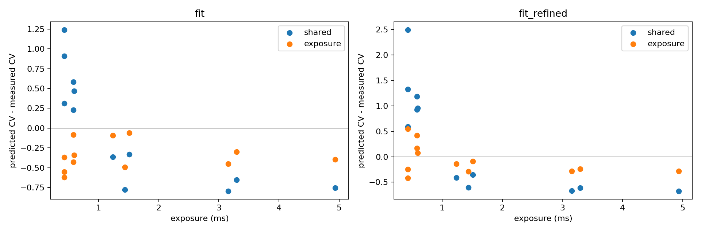
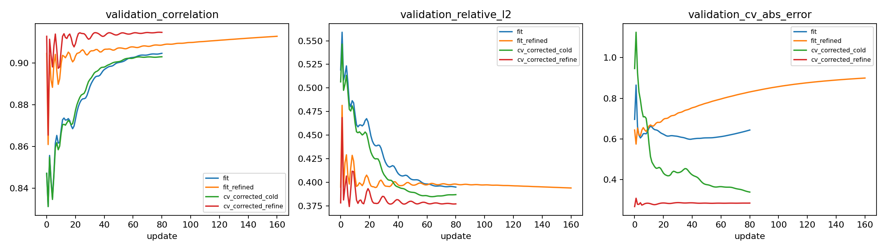

# 冷启动物理模型 CV 误差的曝光偏置诊断（2026-10-26）

<!-- provenance:start -->
> **生成脚本**: [`scripts/slm/analyze_cold_start_cv.py`](../../../scripts/slm/analyze_cold_start_cv.py)
> **复现命令**: `python scripts/slm/analyze_cold_start_cv.py`
> **数据/关联脚本**: [`src/ao_shaping/tools/slm/transfer/radiometry.py`](../../../src/ao_shaping/tools/slm/transfer/radiometry.py)
> **数据/关联脚本**: [`src/ao_shaping/tools/slm/transfer/fit.py`](../../../src/ao_shaping/tools/slm/transfer/fit.py)
> **数据/关联脚本**: [`src/ao_shaping/algorithm/signal_processing/differentiable_defocus_uniformity.py`](../../../src/ao_shaping/algorithm/signal_processing/differentiable_defocus_uniformity.py)
> **运行环境**: 离线（已存档的 Santec #1 与 Daheng 同相位、同曝光数据）
> **说明**: 训练相位拟合曝光偏置，验证整体窗口与目标核心 CV，并检查传播采样收敛。
<!-- provenance:end -->

## 已定位的原因

旧模型在 counts/ms 空间拟合 `g*optical+b`。若相机还包含曝光无关的 counts 项，正确形式应为 `g*optical+b+bias_counts/exposure_ms`。光学加性背景与曝光无关的电子偏置不能混为同一常数。
该形式与电子偏置、低 counts 量化等效偏置相容；仅凭当前有光数据不能唯一识别电子学来源，也不能证明短曝光非线性已经全部校准。

固定光学参数，所有辐射系数只在 12 个训练相位拟合，12 个验证相位仅作评估。新增参数只有一个 `bias_counts`。
验证 CV 是拟合窗口（241×241 CCD 像元、2 px 采样）的整体 CV，不等于整形目标核心 CV。

| 光学状态 | 辐射模型 | 验证相关性 | 验证相对 L2 | 验证 CV 绝对误差 | counts 偏置 |
|---|---|---:|---:|---:|---:|
| fit iter 65 | shared | 0.903646 | 0.396091 | 0.617625 | 0.000000 |
| fit iter 65 | exposure | 0.903646 | 0.380814 | 0.348742 | 0.608396 |
| fit_refined iter 160 | shared | 0.912735 | 0.393848 | 0.899475 | 0.000000 |
| fit_refined iter 160 | exposure | 0.912735 | 0.378052 | 0.266393 | 0.608328 |

加性常数和正增益不改变 Pearson 相关性，却直接改变 `CV=std/mean` 的分母，因此会出现相关性提高但 CV 误差增大的现象。
旧模型在低曝光时低估归一化背景，容易高估 CV；较高曝光时则相反。后期光学参数变化进一步放大这种偏差。固定光学参数的对照已证实，误差变化不能完全归因于传播模型退化。

## 修正后的继续拟合

| 阶段 | 初始→最终验证相关性 | 初始→最终验证相对 L2 | 初始→最终验证 CV 误差 |
|---|---:|---:|---:|
| fit | 0.847120 → 0.904579 | 0.519064 → 0.394792 | 0.695836 → 0.643443 |
| fit_refined | 0.904579 → 0.912735 | 0.394792 → 0.393848 | 0.643443 → 0.899475 |
| cv_corrected_cold | 0.847120 → 0.902937 | 0.506418 → 0.386777 | 0.946341 → 0.337738 |
| cv_corrected_refine | 0.912735 → 0.914611 | 0.378052 → 0.376968 | 0.266393 → 0.283526 |

## 独立整形相位的目标核心检查

下列图像未参与本次修正拟合，但来自此前相同光路的优化轨迹；不是新采集的独立实验。初相位有重复，不能当作八个独立光路样本。

| 数据段 / 相位 | 实测核心 CV | 旧选择模型 CV | 新选择模型 CV |
|---|---:|---:|---:|
| plane / square_seed | 2.512252 | 3.578650 | 3.218523 |
| plane / square_final | 0.480641 | 0.684361 | 0.701612 |
| plane_formation / square_seed | 2.494991 | 3.578654 | 3.230666 |
| plane_formation / square_final | 0.774408 | 0.781792 | 0.897870 |
| random_formation / square_seed | 1.301139 | 1.592593 | 1.519656 |
| random_formation / square_final | 0.572299 | 0.738316 | 0.821997 |
| random_no_abba / square_seed_replay | 1.360296 | 1.592593 | 1.524378 |
| random_no_abba / square_final | 0.534441 | 0.649257 | 0.764010 |

全部八组的核心 CV 平均绝对误差：旧模型 0.395719，新模型 0.331031。

四组最终整形相位的核心 CV 平均绝对误差：旧模型 0.122984，新模型 0.205925。

整体窗口 CV 改善不保证最终整形核心预测改善。剩余误差还涉及光学模型对优化后相位的适配，不能仅靠曝光偏置一项宣布解决。

## 传播采样与 CCD 像素积分收敛

固定新模型和最后一组最终相位，仅改变 FFT 与像素积分采样；本检查不重新拟合参数。

| FFT | 每轴像素积分采样 | 核心 CV | EE_ROI |
|---:|---:|---:|---:|
| 1024 | 3 | 0.764010 | 0.242664 |
| 2048 | 3 | 0.764739 | 0.242671 |
| 2048 | 5 | 0.764594 | 0.242670 |

本相位加密采样的核心 CV 最大变化约 0.00073，远小于预测与实测约 0.23 的差值。采样误差不是这一个最终相位剩余偏差的主要来源；该结论不能推广为所有相位都已收敛。

## 下一步针对目标核心的模型改进

优先从已接受的整形相位附近采集小幅正负扰动，并保留不参与拟合的新扰动方向作验证。现有随机探针拟合改善不代表优化后相位族的局部响应准确；应同时检查核心平均信号、方差、CV 和目标区域能量，避免仅用相关性选择模型。

先固定曝光响应参数，逐项比较入射振幅位置与宽度、剩余像差和 PSF 展宽对新相位的预测。每次只增加可由数据识别的少量参数，以验证响应与核心 CV 同时改善为依据；当前数据不能唯一归因到某一个光学误差项。

在仿真中用有限差分检查模型内部导数，再用 CCD 正负扰动差分检查物理响应方向。曝光偏置与相位无关，新增项不改变强度对相位的导数，但会改变 CV 损失的数值与梯度权重；不能用内部导数通过来替代物理响应验证。

## 工程实现与边界

`transfer.radiometry.fit_radiometry` 统一拟合共享光学增益、光学加性背景和 counts 偏置；禁止读取验证像素估计这些系数。`transfer.fit` 默认使用曝光模型，`--radiometry shared` 可重放旧行为。
冻结参数新增 `bias_counts`，旧检查点默认零；非零偏置预测必须显式提供当前曝光。CCD 优化每次自动曝光后更新协变量，汇总、方向分析、离线合成与展宽校准沿用同一口径。不能把已校正检查点当作与曝光无关的图像预测器。
当前结果来自存档数据的离线拟合与评估，没有重新占用设备，也没有验证新模型生成相位后的物理整形效果。此前验证集已经参与过模型选择，后续仍需新相位和新 CCD 图像确认泛化。
