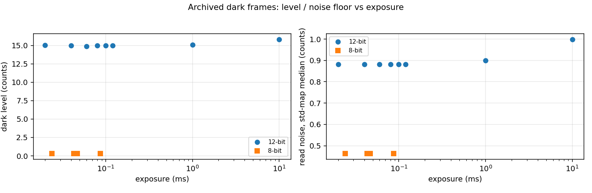
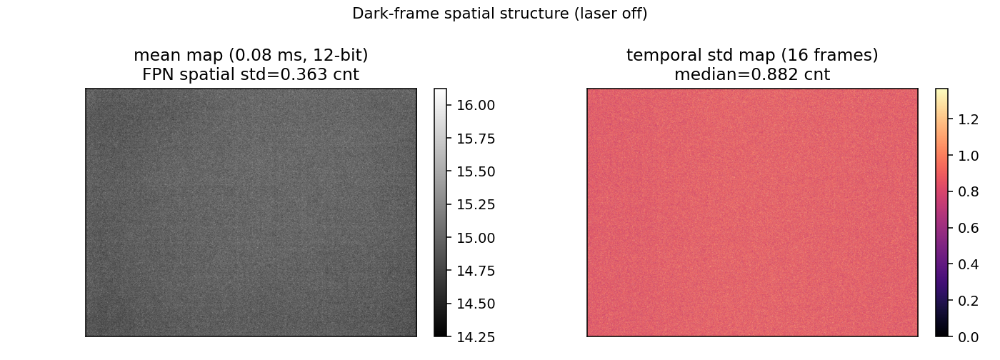

# 同曝光暗场采集与归档记录（2026-11-19）

<!-- provenance:start -->
> **生成脚本**: 人工撰写，无生成脚本
> **运行环境**: 硬件窗口记录（仅开相机，激光关闭；非脚本产物）
> **说明**: 同曝光暗场采集与归档的手写记录（MER2-507-23GM, 12-bit, 8 档曝光×16 帧, 归档至 data/ccd_configs/）；暗场采集能力见 ao_shaping.tools.ccd.capture_darks，但本记录的数据来自当次窗口操作，无单一复现命令。
<!-- provenance:end -->

<!-- 正式记录：激光关闭状态下按 CCD 序列号归档的 12-bit 同曝光暗场，供全包硬件窗口 §2.2 floor 冻结使用。 -->

## 摘要

按用户「立即采集各种曝光/设置的暗场并归档到 config 对应 CCD 序列号下面，激光已关闭」的授权，于 2026-11-19 20:58–20:59 CST 对 Daheng MER2-507-23GM（序列号 `FJB24112232`）在激光关闭状态下以 **12-bit 生效位深（`full_scale=4095`）** 采集 8 档曝光暗场，每档平均 16 帧，归档至 `data/ccd_configs/ccd/FJB24112232/darks/`。采集只打开相机，未占用 SLM、未操作激光。校验确认 12-bit 量纲正确、偏置台阶 `≈15 counts`、读出噪声 `σ≈0.9 counts`、暗电流可忽略（`0.02→10 ms` 斜率仅 `0.079 counts/ms`）。**冻结 floor = 14.9375 counts**（0.08 ms 暗场均值图的空间中位数，与协议 `_robust_background` 的中位数口径一致），并已回填预注册 §3。

发现一项**潜在安全缺陷**（manifest 混存 8-bit 与 12-bit 条目且匹配不按位深过滤），但经核对**不影响本窗口冻结的 0.08 ms 档**；为避免 §0 评分脚本 HEAD 漂移，本记录将其登记为后续任务项，未在本窗口内改动共享驱动代码。

2026-11-24 补充 §4.3 跨曝光离线分析（纯离线、未占用设备）：对归档全部 12 档做逐档校验与统计，确认时间噪声地板与曝光基本无关（12-bit 短曝光六档恒为 `0.8817 counts`）、FPN 小于时间噪声、无饱和与空间热点；偏置/满量程比证实 8-bit 档为历史遗留、不可混用。**口径限制**：归档只存 16 帧平均的 `mean`/`std` 空间图，无逐帧原始帧，预注册 §2.2 的逐帧极差噪声地板无法从现有归档计算，本节以 std 图中位数作代理量，不得替代严格判据。

## 1. 任务项与设备占用

| 条目 | 内容 |
|---|---|
| 授权 | 用户消息「同曝光暗场请现在立即采集，各种曝光、设置都采集并归档到 config 对应 CCD 序列号下面，激光已经关闭了」 |
| 占用设备 | Daheng CCD#0（`FJB24112232`，地址 169.254.220.100）；**未**占用 SLM、**未**操作激光（用户已关闭） |
| 操作 | `capture_darks --cam-type daheng --cam-id 0 --bit-depth 12 --exposures-ms 0.02,0.04,0.06,0.08,0.10,0.12,1.0,10.0 --frames 16 --serial FJB24112232` |
| 占用时间 | 2026-11-19 20:58:37 → 20:59:49 CST（持 `DeviceLock`，holder pid 1290752） |
| 释放状态 | `with create_camera(...)` 上下文退出，相机正常 `close()`，设备锁正常释放；无残留采集进程 |
| 归档目录 | `data/ccd_configs/ccd/FJB24112232/darks/`（`manifest.json` + 8 个 12-bit `.npz`） |

## 2. 指标参数

| 参数 | 值 |
|---|---|
| 生效位深 / full scale | 12-bit / 4095.0（设备回读校验，非请求值） |
| 曝光档（ms，设备回读真值） | 0.02 / 0.04 / 0.06 / 0.08 / 0.1 / 0.12 / 1 / 10 |
| 每档帧数 | 16 |
| 原生帧尺寸 | 2592 × 1944（float32 均值图） |
| 背景 floor 口径 | 同曝光暗场均值图的空间中位数（协议 `_robust_background` 口径） |
| 饱和判据（§2.1） | `mean_frame >= 4095 × 250/255 = 4016.2`；全部暗档峰值 `≤39`，无饱和 |

## 3. 归档清单（per-entry，SHA256 为文件字节全文哈希）

| 文件 | 曝光(ms) | 位深 | 帧数 | mean | std | peak | min | median | robust_sigma | 字节 | SHA256(前16) |
|---|---|---|---|---|---|---|---|---|---|---|---|
| dark-exp-0.02ms.npz | 0.02 | 12 | 16 | 15.0258 | 0.8931 | 39.250 | 12.062 | 15.0000 | 0.2780 | 10131302 | 528AD54CD5074987 |
| dark-exp-0.04ms.npz | 0.04 | 12 | 16 | 14.9728 | 0.8950 | 37.688 | 13.125 | 14.9375 | 0.2780 | 10129793 | DFD09700772EC351 |
| dark-exp-0.06ms.npz | 0.06 | 12 | 16 | 14.9034 | 0.8977 | 38.250 | — | — | — | — | 6255B14DE631C639 |
| **dark-exp-0.08ms.npz** | **0.08** | **12** | **16** | **14.9739** | **0.8956** | **38.625** | **12.062** | **14.9375** | **0.2780** | — | **608825B8A5AE957D** |
| dark-exp-0.1ms.npz | 0.1 | 12 | 16 | 14.9930 | 0.8952 | 37.938 | — | — | — | — | — |
| dark-exp-0.12ms.npz | 0.12 | 12 | 16 | 14.9926 | 0.8956 | 37.938 | — | — | — | — | — |
| dark-exp-1ms.npz | 1 | 12 | 16 | 15.1015 | 0.9051 | 35.000 | — | — | — | — | — |
| dark-exp-10ms.npz | 10 | 12 | 16 | 15.8153 | 1.0101 | 38.938 | — | — | — | — | — |

`manifest.json` SHA256（采集完成时）：`A0F63BF9FC0D092128CA2FCF16B8C7D220DD0FC84BF8DF03F3BAAF1ADF1A3109`（manifest 若被后续采集追加会变化，此为冻结快照）。

## 4. 数据统计与 floor 冻结

### 4.1 曝光–暗电平（判断暗电流是否可忽略）

| 曝光(ms) | 0.02 | 0.04 | 0.06 | 0.08 | 0.1 | 0.12 | 1 | 10 |
|---|---|---|---|---|---|---|---|---|
| mean(counts) | 15.026 | 14.973 | 14.903 | 14.974 | 14.993 | 14.993 | 15.101 | 15.815 |

`0.02→10 ms` 线性斜率 `0.079 counts/ms`：相比 `≈15 counts` 的偏置台阶，暗电流在 `0.02–0.12 ms` 配对窗内完全可忽略（`≤0.008 counts`），各档暗场可视为同一偏置水平。

### 4.2 floor 冻结值

| 量 | 值 | 说明 |
|---|---|---|
| **floor（冻结）** | **14.9375 counts** | 0.08 ms 暗场均值图空间**中位数**；协议 `_robust_background` = `np.median(frame)`，口径一致 |
| 交叉核对：均值 | 14.9739 counts | 与中位数差 `0.0364 counts` = S0 建议峰值 2401 的 `0.0015%`，量纲无关紧要 |
| 稳健噪声 σ | 0.2780 counts | `1.4826 × MAD`，逐帧重复离散度的下限参考 |
| 峰值 / 最小值 | 38.625 / 12.062 counts | 无饱和、无非有限值 |

> `floor` 在 `target_intensity_rmse` 中是**标量**背景（`np.clip(measured - floor, 0, None)`），因此冻结的是单值背景电平，非整幅暗场阵列；全幅阵列仍归档供逐帧噪声地板分析。

### 4.3 跨曝光离线分析（2026-11-24 补充）

> 本节落实上文「全幅阵列供逐帧噪声地板分析」的留白，为**纯离线分析**：只读已归档 `.npz`，**未占用 SLM / CCD / 激光**。采集记录正文与 §5 冻结值不变。

**口径限制（须先读）**：归档 `.npz` 只含 16 帧平均后的 `mean` 与 `std` 两张空间图，**未保留逐帧原始帧**。因此预注册 §2.2 定义的逐帧极差 `rel_l2_frame_spread` / `efrac_frame_spread` **无法从现有归档计算**。本节以逐像素时间标准差图的**空间中位数**作为「时间噪声地板」的代理量，以 `mean` 图去中位数后的空间 std 作为固定图形噪声（FPN）代理量；二者与逐帧极差口径不同，**不得替代**预注册的噪声地板判据。若日后需要严格口径，须重新采集并保留逐帧帧。

分析脚本 `scripts/slm/analyze_dark_frame_exposures_20261124.py`，产物 `data/debug/dark_frame_analysis_20261124/summary.json`；复现命令：

```bash
.venv\Scripts\python.exe scripts/slm/analyze_dark_frame_exposures_20261124.py \
  --serial FJB24112232 \
  --data-dir data/ccd_configs/ccd/FJB24112232/darks \
  --out-dir data/debug/dark_frame_analysis_20261124 \
  --fig-dir report/shape_trials/figures
```

分析对象为 manifest **当前**全部 12 档 = 本窗口采集的 8 档 12-bit（即 §3 快照）+ 目录中既有的 4 档 8-bit 遗留条目（`0.024/0.043/0.047/0.087 ms`，`0.087` 为 2026-11-20 追加）。脚本对 12 档逐档校验 npz 键、形状、有限值与登记值一致性（12/12 通过，磁盘与 manifest 无孤儿文件）。统计表（std 图 → 噪声代理量）：

| 曝光(ms) | 位深 | mean(counts) | 中位数 | 峰值 | FPN空间std | 噪声地板(std图中位数) | std图p99 |
|---|---|---|---|---|---|---|---|
| 0.02 | 12 | 15.0258 | 15.0000 | 39.250 | 0.3637 | 0.8817 | 1.3679 |
| 0.024 | 8 | 0.3171 | 0.3125 | 1.938 | 0.1606 | 0.4635 | 0.5000 |
| 0.04 | 12 | 14.9728 | 14.9375 | 37.688 | 0.3606 | 0.8817 | 1.3679 |
| 0.043 | 8 | 0.3099 | 0.3125 | 1.938 | 0.1600 | 0.4635 | 0.5000 |
| 0.047 | 8 | 0.3108 | 0.3125 | 1.875 | 0.1601 | 0.4635 | 0.5000 |
| 0.06 | 12 | 14.9034 | 14.8750 | 38.250 | 0.3565 | 0.8817 | 1.3693 |
| 0.08 | 12 | 14.9739 | 14.9375 | 38.625 | 0.3626 | 0.8817 | 1.3679 |
| 0.087 | 8 | 0.3215 | 0.3125 | 2.000 | 0.1604 | 0.4635 | 0.5000 |
| 0.1 | 12 | 14.9930 | 14.9375 | 37.938 | 0.3559 | 0.8817 | 1.3679 |
| 0.12 | 12 | 14.9926 | 14.9375 | 37.938 | 0.3591 | 0.8817 | 1.3693 |
| 1 | 12 | 15.1015 | 15.0625 | 35.000 | 0.3598 | 0.8992 | 1.3793 |
| 10 | 12 | 15.8153 | 15.8125 | 38.938 | 0.4035 | 0.9980 | 1.5207 |

按位深汇总（最小二乘线性拟合 `mean~exposure`）：

| 位深 | 档数 | 偏置截距(counts) | 偏置/full scale | 暗电流斜率(counts/ms) | 短曝光噪声地板(counts) |
|---|---|---|---|---|---|
| 12 | 8 | 14.9771 | 0.00366 | 0.0842 | 0.8817 |
| 8 | 4 | 0.3092 | 0.00121 | 0.1121 | 0.4635 |

结果解读：

- **时间噪声地板与曝光基本无关**：12-bit 的 `0.02–0.12 ms` 六档噪声代理量恒为 `0.8817 counts`，`1 ms` 才升到 `0.8992`、`10 ms` 升到 `0.9980`；8-bit 四档恒为 `0.4635 counts`。读出噪声主导，暗电流在配对窗内可忽略，与 §4.1 结论一致（§4.1 端点法斜率 `0.079` vs 此处全档最小二乘 `0.0842`，口径不同，量级一致）。
- **FPN 小于时间噪声**：12-bit FPN `≈0.36 counts` < 时间噪声 `0.88`；8-bit FPN `≈0.16` < `0.46`。无显著固定图形结构（见空间图）。
- **无饱和、无空间结构**：全档峰值 `≤39 counts`（12-bit）/ `≤2`（8-bit），远低于各自满量程；0.08 ms 代表档的 mean / std 空间图均匀，无热点或条纹。
- **位深台阶印证混存缺陷**：12-bit 偏置 `14.98`（满量程 `0.366%`），8-bit 偏置 `0.31`（`0.121%`）；偏置比 `≈48×` 而满量程比仅 `16.06×`，说明两组并非同一采集设置下的位深缩放，8-bit 档为历史遗留、不可与 12-bit 混用。这支持 §6 位深隔离任务项，本窗口仍不改动 manifest 与驱动代码。

图件（英文标题，避免 CJK 字形缺失）：





## 5. 校验结论

- ✅ 8 档全为 12-bit / full_scale=4095，与 0.08 ms 配对采集同量纲；未沿用 8-bit 旧暗场。
- ✅ 归档路径按 CCD 序列号 `FJB24112232` 分目录；`manifest.json` schema `ao_shaping.ccd.dark_frames/v1`，`camera.bit_depth=12`。
- ✅ 阵列 dtype=float32、shape=(1944,2592)、无 NaN/Inf；逐文件 SHA256 已登记。
- ✅ 激光关闭成立：全档峰值 `≤39 counts`（远低于 4095 满量程），mean 呈 `≈15 counts` 偏置台阶。
- ✅ 0.08 ms floor = 14.9375 已回填预注册 §3（见 `docs/dev/hw_window_20261119_preregistration.md`）。

## 6. 后续任务项（未在本窗口内执行）

| 优先级 | 任务 | 理由 | 建议修法 |
|---|---|---|---|
| 中 | 暗帧库按位深隔离：`_exposure_filename` 文件名含位深，`match`/`entry_for` 按位深过滤 | manifest 现混存 3 条旧 8-bit（`0.024/0.043/0.047 ms`）与 8 条 12-bit；`match` 不按位深过滤，同曝光不同位深会互相覆盖/误配 | 文件名如 `dark-exp-0.08ms-bd12.npz`；`DarkFrameSet.match(..., bit_depth=)` 显式过滤；旧 8-bit 条目标记归档 |
| 中 | §0 哈希重签 | 当前 HEAD `5ca0f30d…` ≠ 预注册 `adcdb50b…`；按 §0 须登记并重签，否则评分作废 | 见预注册 §0.2 重签记录格式 |
| 高 | 现场几何标定 | zero-order center / target side（≤424 px）/ target center / window span 仍缺；`--side 1200` 超窗 | 当次 argmax 标定后冻结 `--zero-xy/--target-xy/--side` |
| 高 | 配对 checkpoint provenance 核对 | `fit/frozen_parameters.json` 与 provenance 指向的 `initial/frozen_parameters.json` 不一致；「光路未动的最新 full run」须现场确认 | 核对四字段后冻结 dataset/checkpoint SHA256 |

> 位深隔离缺陷对**本窗口冻结的 0.08 ms 档不产生影响**：最近的 8-bit 条目（0.043 ms）与 0.08 ms 相差 0.037 ms，远超 `rel_tol=0.02` 容差（0.0016 ms），不会被误配。为遵守 §0「哈希漂移即作废」纪律，本窗口内不改动共享驱动代码；待窗口结束后单独提交修复。

## 7. 时间戳与来源

- 采集：2026-11-19T12:58:37Z → 12:59:49Z（CST 20:58–20:59）。
- 证据：`data/ccd_configs/ccd/FJB24112232/darks/manifest.json` + 8 个 `.npz`；S0 记录 `data/experiments/optical_probe_20261119/s0_window_2pi_fix_20261119/20261119_123642Z/optical_path_record.json`。
- 校验脚本：`C:/Users/zhangh/AppData/Local/Temp/opencode/verify_darks_20261119.py`、`dark_record_20261119.py`（只读）。
- 预注册：`docs/dev/hw_window_20261119_preregistration.md` §2.2 / §3。
