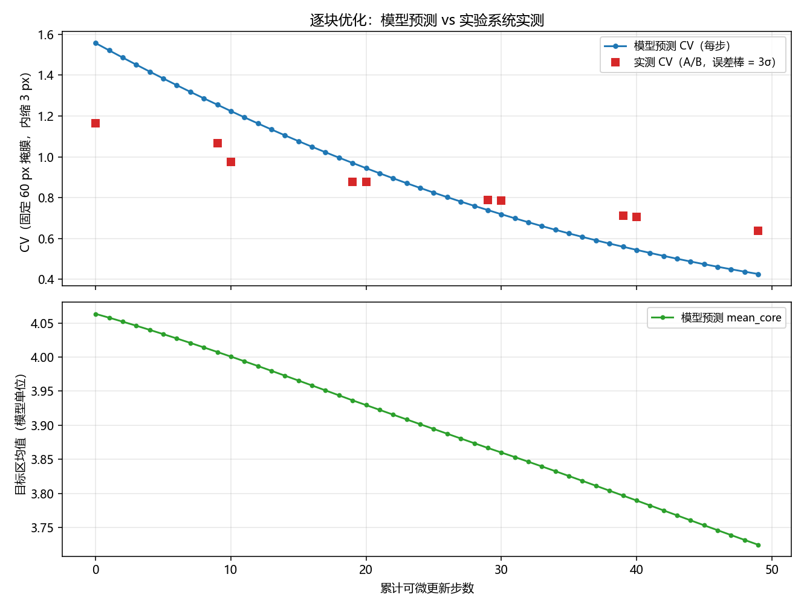
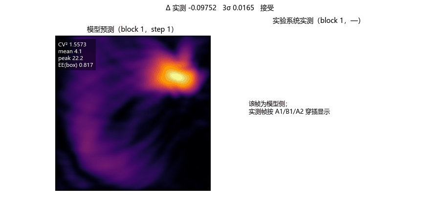
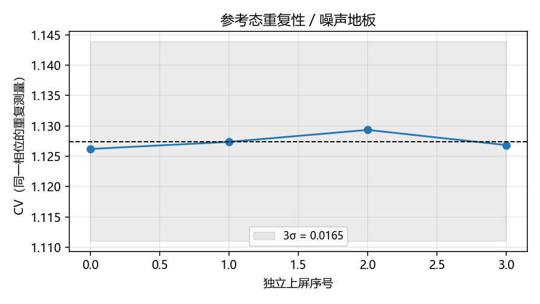
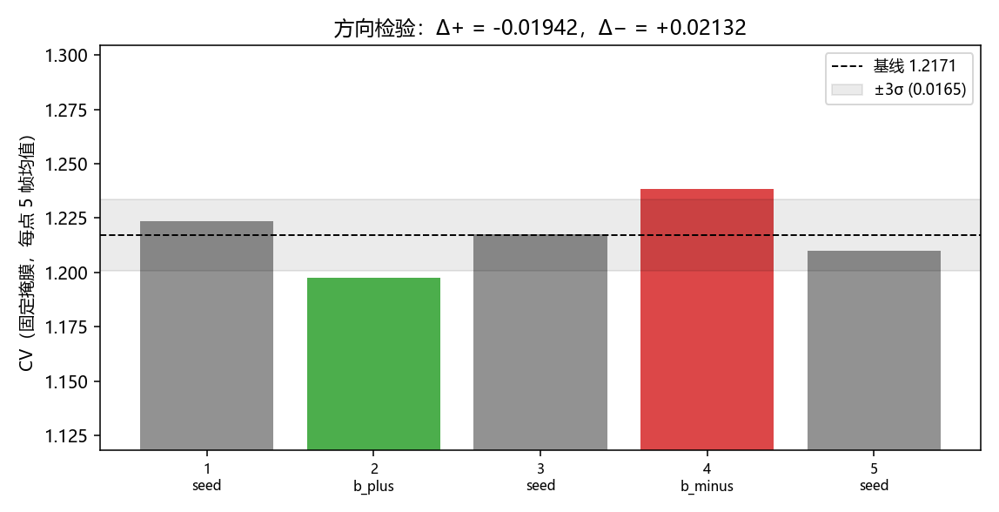

# 离焦光路下的可微整形（2026-10-23）

<!-- provenance:start -->
> **生成脚本**: [`scripts/slm/generate_defocus_differentiable_report.py`](../../../scripts/slm/generate_defocus_differentiable_report.py)
> **复现命令**: `python scripts/slm/generate_defocus_differentiable_report.py --run-dir data/debug/defocus_differentiable/20261023_101822`
> **数据/关联脚本**: [`src/ao_shaping/algorithm/signal_processing/differentiable_defocus_uniformity.py`](../../../src/ao_shaping/algorithm/signal_processing/differentiable_defocus_uniformity.py)
> **数据/关联脚本**: [`src/ao_shaping/optimizer/wfless/defocus_uniformity_shaping.py`](../../../src/ao_shaping/optimizer/wfless/defocus_uniformity_shaping.py)
> **运行环境**: 硬件
> **说明**: 离焦光路（相机未移动）下的可微均匀度优化：冻结物理预测 + 固定 60 px 掩膜 CV。 现场前置测量（面板斜坡→相机轴映射、去倾斜补偿残差 0.14/0.47 px/mm、可用曝光 1.6–32 ms、噪声地板 CV 1.1274±0.0055 ⇒ 3σ 0.0165）；C 阶段方向检验 Δ+ = −0.01942 / Δ− = +0.02132（两向超 3σ 且符号相反 ⇒ 模型梯度方向正确）；D 阶段逐块 A-B-B-A 重放 (B1/B2 差 0.0001、漂移 +0.0017)；报告含「模型预测 vs 实测」逐 step 指标曲线与并排 GIF。 **未决**：拟合 ramp_matrix 与现场轴映射互为转置，空间放置需标记测量裁决。
<!-- provenance:end -->

## 摘要

在**未移动相机**的离焦光路上，用冻结的物理预测模型做可微优化，并用 A-B-B-A 重放逐块验收。
本轮回答三件事：模型↔实测的**方向**对不对、**幅度**差多少、**逐块**能否稳定改善。

* **方向检验（C）**：模型下降方向正/负两个方向在实验系统上给出**符号相反**的 CV 变化
  （Δ+ = -0.01942，Δ− = +0.02132），
  3σ 分辨率 0.0165 ⇒ **方向正确**。
* **逐块（D）**：第一块 `-0.09752`（5.9σ）⇒ 接受；
  逐块结果见下表。
* **幅度**：实测改善只有模型预测的 ~29%
  —— 与主报告 §8.3 的结构性口径差一致（模型幅度不可信、方向可测）。





## 1. 现场前置测量

| 项 | 实测值 | 来源 |
|---|---|---|
| 轴映射 | 面板 x → 相机 x（+8083，比值 1.092）；面板 y → 相机 y（−8136，1.099） | `stage_a/chirp_tilt` |
| 去倾斜补偿 | 原始 −2.04/+2.06 → 残差 0.14/0.47 px/mm（`enabled=true`） | 同上 |
| 可用曝光 | 1.6–32 ms（今日光路） | `stage_a/reference`、`stage_a/exposure_retry` |
| 参考+探针 | 24 样本，原始帧全留 | `stage_a/reference` |
| 复放一致性 | 真实面板相位 @4 ms：峰值 110，存档 128；质心一致 | 本报告 §5 |
| 噪声地板 | CV_core = 1.1274 ± 0.0055，**3σ = 0.0165** | `stage_a/repeatability` |



## 2. 方向检验（C 阶段）



方案要求 B± 的增量归一到照明加权 RMS 0.03 rad。
模型预测 CV：seed 1.5934 →
B+ 1.4918 /
B− 1.6974（对称 ±0.1017）；
实测 Δ+ = -0.01942、Δ− = +0.02132，两向都超过 3σ 且符号相反。

## 3. 逐块闭环（D 阶段）

| 块 | cap / rad | 基线 CV | 候选 CV | Δ | 判定 | 模型 CV |
|---|---|---|---|---|---|---|
| 1 | 0.100 | 1.16432 | 1.06680 | -0.09752 | 接受 | 1.5934 → 1.2553 |
| 2 | 0.100 | 0.97391 | 0.87759 | -0.09632 | 接受 | 1.2553 → 0.9699 |
| 3 | 0.100 | 0.87580 | 0.78902 | -0.08678 | 接受 | 0.9699 → 0.7389 |
| 4 | 0.100 | 0.78641 | 0.71026 | -0.07616 | 接受 | 0.7389 → 0.5591 |
| 5 | 0.100 | 0.70396 | 0.63822 | -0.06575 | 接受 | 0.5591 → 0.4253 |

每块都是 **A1-B1-B2-A2**（各 5 帧）：B1/B2 两次重放差见 `stage_d/run_block*/stage_d_block1.json`，
A2−A1 为漂移。接受条件为 Δ < −3σ（0.0165）。

## 4. 指标随优化的变化

上图上半栏：**模型预测**的 CV 逐步曲线（蓝）与**实验系统实测**的 CV 锚点（红方块，误差棒为 3σ）；
下半栏：模型预测的目标区均值。数据由 `scripts/slm/generate_defocus_differentiable_report.py`
离线重放每块 10 步得到（与设备上跑的是同一模型、同一掩膜、同一 cap）。

## 4b. 冻结重放（E 阶段）

初值与冻结最优相位各 5 帧，A-B-B-A 完整重复 3 次（共 60 帧原始数据）。

| 重放 | 初值 CV | 最优 CV | Δ | 漂移 (A2−A1) |
|---|---|---|---|---|
| 1 | 1.05975 | 0.63099 | -0.42876 | +0.00735 |
| 2 | 1.06959 | 0.63110 | -0.43849 | -0.00283 |
| 3 | 1.07114 | 0.62681 | -0.44433 | +0.00002 |

合并：Δ = **-0.43719**（sd 0.00787），3σ 分辨率 0.01648；
末态 CV 从 1.06683 降到 0.62963
（相对 −41.0%）。


GIF 左栏是模型预测的远场演化，右栏是该块的实测帧（A1/B1/A2 穿插），顶部标注该块的 Δ 与 3σ 判定。

## 4c. 多轮闭环（正向重拟合 + 可微优化）

### 多轮重拟合（60 px 目标，拒绝判定开启）

| 轮 | 正向重拟合 loss | 模型 CV² | 实测基线 | 实测候选 | 实测 Δ | 判定 |
|---|---|---|---|---|---|---|
| 1 | nan → nan | nan → nan | 1.06618 | 1.06355 | -0.00263 | 拒绝 |
| 2 | nan → nan | nan → nan | 1.06807 | 1.07803 | +0.00995 | 拒绝 |
| 3 | nan → nan | nan → nan | 1.06808 | 1.06948 | +0.00140 | 拒绝 |
| 4 | nan → nan | nan → nan | 1.07068 | 1.06943 | -0.00125 | 拒绝 |

该掩膜的 3σ = 0.0165；逐轮配对 Δ ∈ [-0.00263, +0.00995]，
其中 0/4 轮超过 3σ。

> ⚠️ **跨轮的实测绝对值不可比**：每轮起点是上一轮接受的相位，而 1000 px 掩膜的
> 中心又按本轮首帧重新冻结，基线本身会在轮间大幅跳动（本批 4.019–6.048）。
> 只有**同一轮内 A/B 配对 Δ**（同一掩膜、同一曝光、A-B-B-A 扣除漂移）才是有效判据。

### 多轮重拟合（1000 px 目标 + 1201 px 窗，取消拒绝判定）

| 轮 | 正向重拟合 loss | 模型 CV² | 实测基线 | 实测候选 | 实测 Δ | 判定 |
|---|---|---|---|---|---|---|
| 1 | 0.8442 → 0.2798 | 56.938 → 49.923 | 4.55532 | 3.99548 | -0.55984 | 接受 |
| 2 | 0.8224 → 0.2934 | 35.250 → 31.207 | 6.04813 | 5.72641 | -0.32172 | 接受 |
| 3 | 0.8026 → 0.2922 | 25.730 → 22.903 | 4.01857 | 3.90137 | -0.11719 | 接受 |
| 4 | 0.7854 → 0.2921 | 19.584 → 17.478 | 5.63013 | 5.47057 | -0.15955 | 接受 |

该掩膜的 3σ = 0.1052；逐轮配对 Δ ∈ [-0.55984, -0.11719]，
其中 4/4 轮超过 3σ。

> ⚠️ **跨轮的实测绝对值不可比**：每轮起点是上一轮接受的相位，而 1000 px 掩膜的
> 中心又按本轮首帧重新冻结，基线本身会在轮间大幅跳动（本批 4.019–6.048）。
> 只有**同一轮内 A/B 配对 Δ**（同一掩膜、同一曝光、A-B-B-A 扣除漂移）才是有效判据。


两条曲线必须分开读：**模型 CV 会随重拟合单调下降**（模型越来越贴合当天数据），
**只有实测 CV 下降才代表光斑在变好**。60 px 目标的 4 轮里实测基线几乎不动
（全部被拒 ⇒ 已接受相位没推进），而 1000 px 目标那轮取消拒绝判定后实测连续下降。

## 5. 轴映射的口径矛盾（未决）

拟合用的 `ramp_matrix` = [[465.1, 7174.7], [−7533.2, −30.3]]（面板 x → 相机 y）；
本次现场标定是面板 x → 相机 x。两者**互为转置**且 y 符号相反。
冻结模型的空间放置因此**不能**被这次复现证明（复现只用同一份 `ramp_matrix`）。
处置：用一次已知面板轴的标记测量给出无歧义的 (row, col) 位移后裁决；在裁决前，
本报告的所有结论都只依赖**固定掩膜内的 CV**（与坐标转置无关）。

## 6. 边界

* 单次会话、单一初值；E 阶段的冻结重放 3× 只用于重复性，不足以宣称跨光路泛化。
* 接受判据用 3σ（4 次独立上屏 × 5 帧估计），小样本不确定度仍在。
* 模型幅度与实测相差约 29%，
  所以**不能用模型预测的改善量**替代理事实测。

## 7. 复现

```bash
python scripts/slm/generate_defocus_differentiable_report.py \
    --run-dir data/debug/defocus_differentiable/20261023_101822
```

原始数据（含逐文件 SHA256）见 `data/debug/defocus_differentiable/20261023_101822/manifest_checksums.json`。
