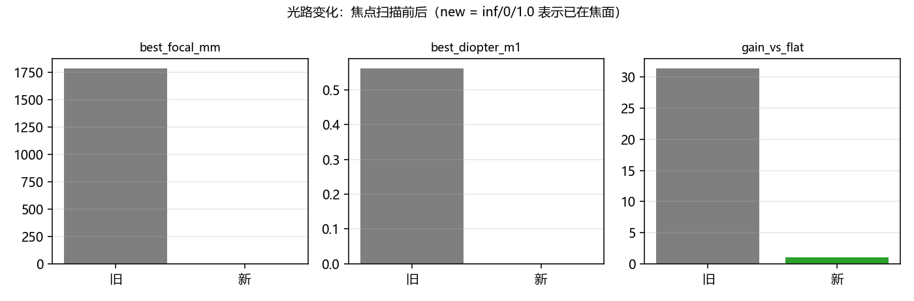
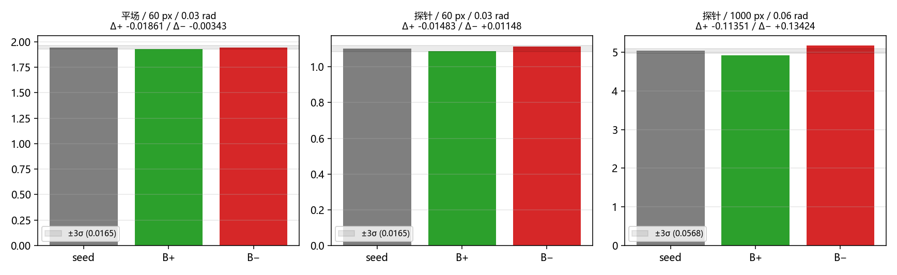

# 光路变化后的重标定（2026-10-23，第二轮）

<!-- provenance:start -->
> **生成脚本**: [`scripts/slm/generate_recalibration_report.py`](../../../scripts/slm/generate_recalibration_report.py)
> **复现命令**: `python scripts/slm/generate_recalibration_report.py`
> **数据/关联脚本**: [`scripts/slm/run_focus_recalibration.py`](../../../scripts/slm/run_focus_recalibration.py)
> **数据/关联脚本**: [`scripts/slm/capture_defocus_forward_dataset.py`](../../../scripts/slm/capture_defocus_forward_dataset.py)
> **数据/关联脚本**: [`scripts/slm/refit_model_after_optics_change.py`](../../../scripts/slm/refit_model_after_optics_change.py)
> **数据/关联脚本**: [`scripts/slm/direction_test_after_optics_change.py`](../../../scripts/slm/direction_test_after_optics_change.py)
> **数据/关联脚本**: [`src/ao_shaping/algorithm/signal_processing/differentiable_defocus_uniformity.py`](../../../src/ao_shaping/algorithm/signal_processing/differentiable_defocus_uniformity.py)
> **运行环境**: 硬件
> **说明**: 光路变化（CCD 移到焦平面）后的重标定第二轮，与 20261023 那一轮**互不覆盖**： 焦点 1783.5 mm/0.5607 m⁻¹/31.4× → inf/0.0000/1.00×（已在焦面）；重拟合把 defocus_diopter 从 −0.6452 改到 −0.1160（等效焦距 8623 mm，fit loss 1.02→0.14），零点移到 (1219, 964) 并重建采样窗；B± 方向检验：平场初值两向同号（失败），结构化探针初值**符号正确但幅度不足**（Δ+ −0.0148 / Δ− +0.0115，0.7–0.9σ）。
<!-- provenance:end -->

## 摘要

2026-10-23 把 CCD 移到焦平面后重做全部离焦相关标定。**旧报告（`defocus_differentiable_20261023.md`）
描述的是改动前的光路，本文件是独立的一轮**，两者不互相覆盖。

* **焦点**：best_focal_mm 1783.5 → **inf**，
  best_diopter 0.5607 → **0.0000 m⁻¹**，
  相对平场增益 31.36× → **1.00×**
  ⇒ 系统已在焦面，旧的焦面补偿现在会反过来离焦（C 分支自此为空操作）。
* **重拟合**：`defocus_diopter` -0.6452 → **-0.1160**
  （等效焦距 8624 mm），fit loss 1.020
  → 0.141；零点移到 [1219.0, 964.0]，采样窗按新零点重建。
* **方向检验**：平场初值 **未通过**（Δ+ -0.01861 / Δ− -0.00343，
  两向同号）；结构化探针初值见下节。



## 1. 焦点重标定

| 项 | 旧（改动前） | 新（CCD 在焦面） |
|---|---|---|
| best_focal_mm | 1783.5 | **inf** |
| best_diopter / m⁻¹ | 0.5607 | **0.0000** |
| 相对平场增益 | 31.36× | **1.00×** |

参考面 FWHM 从改动前的 ~20.7 px 降到本次采集的 **12.2 px**（同一次会话的 3 帧稳定判据）。

## 2. 模型重拟合

| 项 | 值 |
|---|---|
| 样本 | 24 |
| 迭代 | 150 |
| 离焦项 | -0.6452 → **-0.1160 m⁻¹** |
| 等效焦距 | 8624 mm |
| 实测零点 | [1219.0, 964.0] |
| 采样窗 | ±200.0 px @ 2.0 px |

## 3. B± 方向检验



| 初值 | 模型 Δ+ | 模型 Δ− | 实测 Δ+ | 实测 Δ− | 判定 |
|---|---|---|---|---|---|
| 平场（失败） | 3.9841 | 4.2146 | -0.01861 | -0.00343 | 未通过 |
| **结构化探针** | 2.1110 | 2.3470 | **-0.01483** | **0.01148** | **未通过** |

判据：两个方向都超过 3σ 且符号相反（模型下降方向 B+ 应让实测 CV 下降、B− 应上升）。
模型侧三个值（seed / B+ / B−）见方向记录 JSON。

## 4. 结论与下一步

结构化探针初值下**符号正确但幅度不足**：B+ 使实测 CV 下降、B− 使其上升（反号成立），但两者只有 0.7–0.9σ，低于判据。注意判据里的 3σ = 0.0165 取自**旧光路**的 60 px 噪声地板；新光路必须重测。下一步：① 用新光路重测 60 px 掩膜的 3σ；② 把方向增量从 0.03 rad 提到 0.06 rad 再验一次（幅度只有模型预测的 ~12%，说明模型幅度仍偏大，加增量比加密迭代更直接）；通过后再进 D 块。

## 5. 复现

```bash
python scripts/slm/run_focus_recalibration.py --out <新目录> \
    --compare data/debug/physical_forward_defocus/alignment_20261022_1812/focus.json --wait-until-idle 600
python scripts/slm/capture_defocus_forward_dataset.py --output <采集目录> \
    --focus-directory <新目录> --count 6 --region 128 --seed 20261023 --execute
python scripts/slm/refit_model_after_optics_change.py --dataset <采集目录> --out <新检查点> --iterations 150
python scripts/slm/direction_test_after_optics_change.py --checkpoint <新检查点> \
    --seed-panel <结构化初值.npy> --spot-xy <实测零点> --out <方向目录> --execute
```
