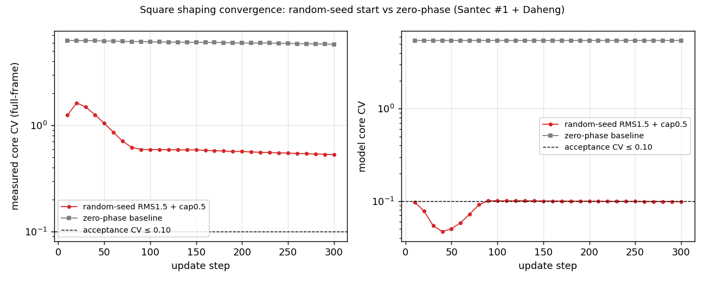
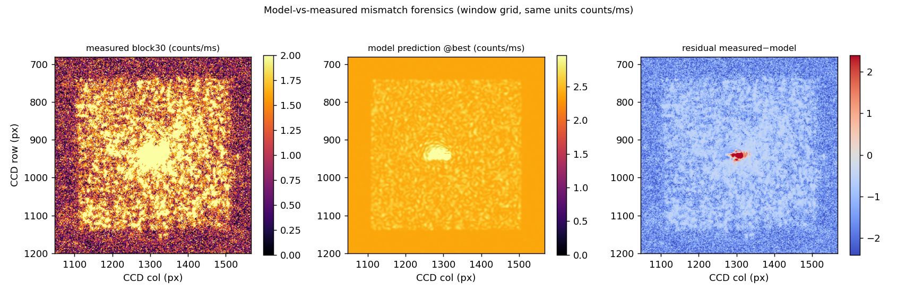
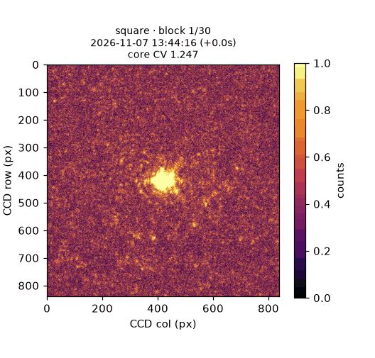
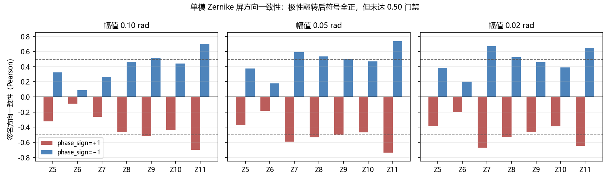
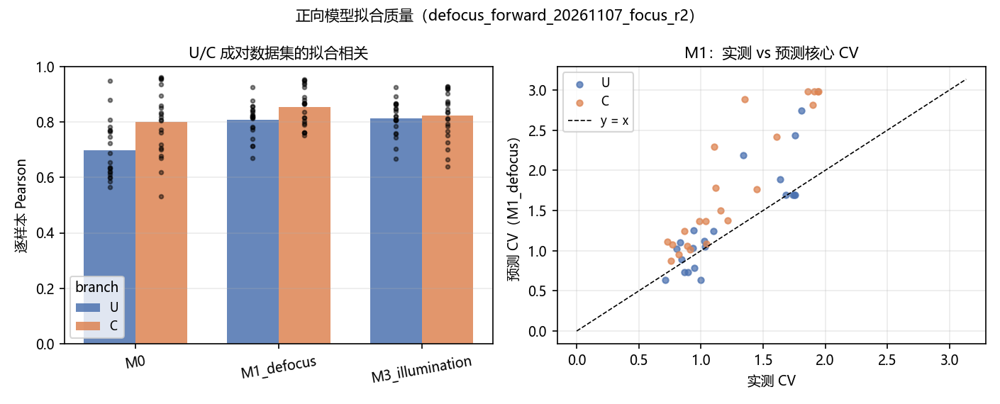
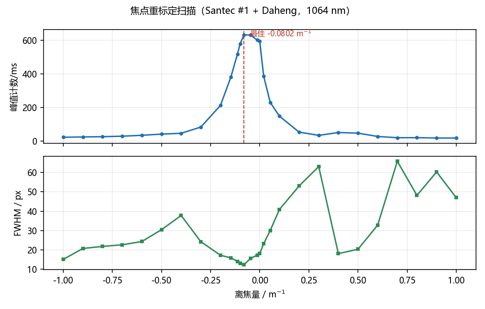
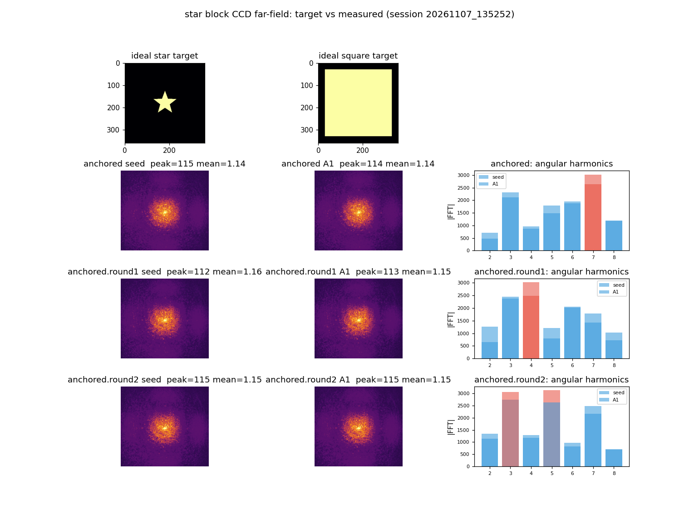
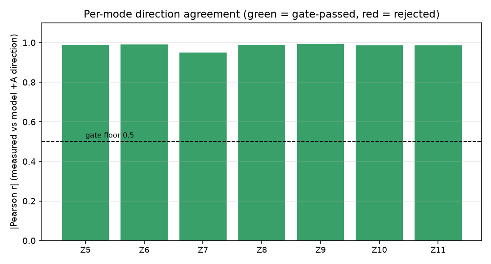
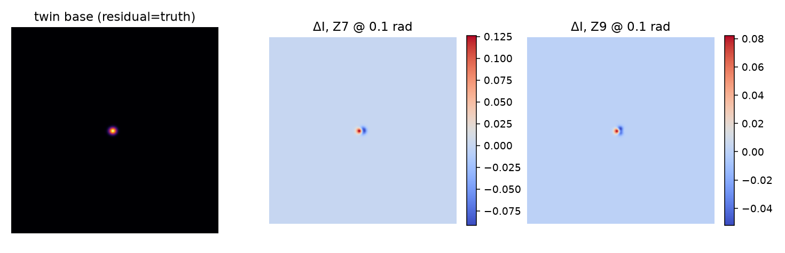

# 形状整形周度总结报告（2026-11-02 ~ 2026-11-08）

<!-- provenance:start -->
> **生成脚本**: 人工撰写，无生成脚本
> **运行环境**: 离线+硬件
> **说明**: 2026-11-02 ~ 2026-11-08 形状整形全部报告的汇总: 重点转向动态整形; 不含任何新测量, 全部数字来自已有报告与保存的实验产物离线复算; 含当前现状与最优路线、逐报告指标与任务项, 供脱离硬件复现
<!-- provenance:end -->

> **生成脚本**: 人工撰写，基于 `report/shape_trials/` 下 2026-11-02 ~ 2026-11-08 的全部报告及 `data/debug/` 下实验产物离线复算
> **运行环境**: 离线复算 + 硬件实验记录汇总
> **说明**: 本报告不含任何新测量，全部数字来自已有报告与保存的实验产物；证据等级沿用 [shaping_experience_20261103.md](experience_review/shaping_experience_20261103.md) §证据等级（E1 实测有效 / E2 方向性证据 / E3 仿真或离线重算 / E4 计划或跑完没报错）。

---

## 摘要

本周（2026-11-02 ~ 2026-11-08）形状整形工作的**重点转向动态整形**：从"单形状静态整形"转向"时序上多形状、多帧、变化目标下的整形性能与模型-实测一致性"。核心结论：**动态整形的瓶颈不在优化器/噪声，而在 FrozenDefocusForward 物理预测模型的表征误差**——模型能把核心 CV 降到 0.099，实测只到 0.529，5 倍残差全部来自模型（背景 2.9×、光斑对比度 1/16、雅可比方向不可信）；实测 anchored 闭环非但无改善反而把 CV 推高。零相位起步困在焦斑盆地被证实是起步问题，随机起步 + cap≥0.3 是必要条件（实测 CV 改善 10 倍，1.247→0.529）。极性核查确认 `phase_sign=−1` 是硬件正确方向（42/42 对符号翻正），但翻正不足以过方向门禁（中位 +0.459 < 0.50），且出现自洽性矛盾（U/C 拟合 Pearson 反而从 0.851 降到 0.637）——极性作用域与硬件行为不一致，**属未解决项**。由此 #236 损失 对比择优 结论未定、#229 探针设计被证明不改变光学可辨识性上限。**最优路线**：先修物理预测模型表征（辐射定标 → 全局亚像素配准 → 实测 PSF → LUT/串扰），过方向门禁（单模屏 ≥0.50）后，再以随机起步 + cap≥0.3 + 有界可微更新的动态闭环；门控循环残差头当前无收益，memoryless 优先。

---

## 1. 当前现状与最优路线

### 1.1 现状总览

| 维度 | 状态 | 依据 |
|---|---|---|
| 静态整形（已验证可复现） | ✅ E1：同一会话实测标定局部响应 + 有界可微更新 + 独立同曝光复测；目标函数 1.179→1.000（−15.19%），EE 0.526→0.600（+7.35pp） | [local_forward_20261103.md](local_forward/local_forward_20261103.md) |
| 动态整形（本周重点） | ⚠️ 随机起步有效（CV 1.247→0.529），但卡在模型表征；anchored 闭环**不可用**（两种锚定语义均变差） | [shape_transition_timing_20261107.md](shape_transition/shape_transition_timing_20261107.md) |
| 物理预测模型极性 | ❌ `phase_sign=−1` 方向正确（42/42 翻正）但**门禁未过**（中位 +0.459）；U/C 自洽性矛盾（0.851→0.637）→ 未解决 | [forward_model_polarity_20261107.md](forward_model_polarity/forward_model_polarity_20261107.md) |
| 损失函数选择 | ⚠️ #236 无区分度（7 种方向中位全在 ±0.07 内）+ 基线复现 FAILED → **未定** | [loss_compare_20261107.md](loss_compare_20261107/loss_compare_20261107.md) |
| 门控循环残差头 | ⚠️ #239 verdict=inconclusive；memoryless（103k 参数）达相当终值且更早达标，attention 崩溃 | [gated_recurrent_20261107.md](gated_recurrent_20261107/gated_recurrent_20261107.md) |
| 物理预测模型结构精化 | ⚠️ #237：全局亚像素配准**支持进入实现**（已落地，默认关闭）；PSF 不稳健、增益场不支持（拟合退化）、LUT 数据不足 | [measured_forward_refine_20261107.md](measured_forward_refine_20261107/measured_forward_refine_20261107.md) |
| SLM 响应 LUT/串扰 | ⚠️ #238 规划完成，**实现未开始**；验收门槛 holdout Z5–Z11 相关 <0.5 → ≥0.9 | [shared_lut_crosstalk_20261107.md](shared_lut_crosstalk_20261107/shared_lut_crosstalk_20261107.md) |
| 探测相位/波前传感 | ✅ E3：HMWS 五点法 2f 光路仿真恢复误差 <0.01 rad；推荐偏置 b=0.2–0.3 rad | [zernike_probe_sim_20261105.md](zernike_probe_sim/zernike_probe_sim_20261105.md) |
| 主动选样/样本效率 | ❌ 主动探针无**可测**样本效率收益（±Zernike 与随机族全帧预算差 ≤3%）；twin 空间结构不足（NCC 0.97 vs 硬件 0.81） | [hw_depth_matched_20261105.md](hw_depth_matched/hw_depth_matched_20261105.md) |
| 在线回灌 | ⏳ #230 计划完成，采集与分析均未执行（PENDING） | [issue230_refeed_20261105.md](issue230_refeed/issue230_refeed_20261105.md) |

### 1.2 本周主题转向：为什么是动态整形

- 本周前（11-03 收口）静态整形的 E1 成功路径已经闭环：**同一会话实测标定局部响应 + 有界可微更新 + 独立同曝光复测**（[shaping_experience_20261103.md](experience_review/shaping_experience_20261103.md) 一句话结论）。
- 11-07 的 `shape_transition` 实验首次把整形从"单形状"推进到"**时序上多形状、多帧、变化目标**"的计时与失配取证：300 步 / 149.6 s 墙钟，实测核心 CV 1.247→0.529（10 倍改善），直接暴露**动态闭环的瓶颈**。
- 由此本周的后续报告（#235 极性作用域、#236 损失比较、#239 门控循环、#237 结构精化、#238 LUT/串扰、#229 结构化探针）全部指向同一个目标：**修好物理预测模型，让动态闭环可用**。这是本周重点转向的完整动机链。

### 1.3 最优路线（当前已验证最优路径）

按"先修模型、再上闭环"的依赖顺序，最优路线为：

1. **修物理预测模型表征**（动态整形前提，当前唯一卡点）
   - `fit_radiometry`：用当前光路实测帧重标定 gain/background/bias——先确认是辐射定标漂移还是 PSF/雅可比本身错（[shape_transition §5](../shape_trials/shape_transition/shape_transition_timing_20261107.md)）。
   - 全局亚像素 2D 配准（#237 唯一"支持进入实现"子项，已落地默认关闭，方向一致性 35/42）。
   - 实测 PSF 标定（#237：有信号但不稳健）、CCD 响应 LUT 扩展（需实验 ≥4 曝光档）、SLM 共享 LUT + 3×3/5×5 串扰核（#238，验收 Z5–Z11 相关 ≥0.9）。
2. **过方向门禁**（单模屏方向中位 ≥0.50；当前 +0.459）：修好模型后，`phase_sign=−1` 的极性作用域矛盾（U/C Pearson 0.851→0.637）必须先澄清，`aberration_focus` 变体需复现。
3. **重做损失 对比择优**（#236，当前无区分度 + 基线复现 FAILED）：等方向门禁通过后，在单模屏或闭环指标上重做；当前 held-out 仅 9 个 U/C 对，不足以选损失。
4. **上动态闭环**：随机起步 + cap≥0.3 + 有界可微更新（实测 10 倍改善的前提）；anchored 语义在模型修好前**不要用**（已证实把 CV 推高）。
5. **残差头选型**：#239 verdict=inconclusive → memoryless（103k 参数，最简）优先；attention（821k）崩溃不保留；门控无一致收敛压缩。

**一句话最优路线**：*先做 `fit_radiometry` + 全局亚像素配准，把物理预测模型表征误差压下来；过了单模屏方向门禁（≥0.50）再以随机起步 + cap≥0.3 的可微更新上动态闭环，anchored 语义与损失重选都等模型修好之后再谈。*

### 1.4 关键指标（本周动态整形核心）

| 指标 | 随机起步（RMS1.5 + cap0.5 + lr0.05） | 零相位基线 | 判据 |
|---|---|---|---|
| 步数 / 墙钟 | 300 步 / 149.6 s | 300 步 / ~319 s | 随机起步更快更有效 |
| 实测核心 CV（全帧） | 1.247 → **0.529** | 6.28 → 5.77（square 段） | **10 倍改善** |
| 模型核心 CV | 5.47 → **0.099** | 无改善（~5.47） | 模型 10 步即收敛 |
| accepted（CV≤0.10） | 否 | 否 | 瓶颈在模型不在优化器 |
| 模型背景 (counts/ms) | 2.386（实测 0.816） | — | 模型背景 **2.9×** 实测 |
| 光斑峰值对比度 (peak/bg) | 2.31（实测 37.2） | — | 模型仅实测 **1/16** |
| 散粒噪声地板 | 1/√N ≈ 0.0057 | — | CV≤0.10 物理可达 |

---

## 2. 本周报告清单与逐项结论

### 2.1 动态整形核心

**shape_transition_timing_20261107.md（11-07）** — 实验系统可微整形速度计时：随机起步 square

- 随机起步把实测 CV 改善 10 倍（1.25→0.53），证实零相位困焦斑盆地是**起步问题**、cap≥0.3 是必要条件。
- 模型侧 10 步收敛（model_cv≈0.099），残差 5 倍（模型 0.10 vs 实测 0.53）**全部来自 FrozenDefocusForward 表征误差**。
- **anchored 闭环不可用**：两种锚定语义（preanchored / raw）都停在 6 块，实测 CV 反而升高到 ≈1.0–1.1；原因是 `update()` 的 measured 分支梯度只经 `prediction − baseline`（模型雅可比）流过，而**模型雅可比在残差频段不可信**——锚定只抵消静态偏置，抵消不了雅可比方向的错误。

**star_farfield_20261107.md（11-07）** — star 块 CCD 实测远场对照

- 实测远场是**弥散圆斑（零级主导）**，既非五角星也非方块；之前实时视图里的"方块"是显示/光学伪影（ROI 边界框 / 十字-椭圆渲染）。
- 根因：star 目标填充率低（非零占比 ≈2.8%），零级泄漏 + 弱变体被亮核淹没；末次迭代 `ee_roi≈0.51`、`shape_loss≈0.62–0.66`。
- **模型预测的"方块"也是伪影**：`FrozenDefocusForward.predict` 的真实焦面强度是占满 1024×1024 的散斑；"方块"是 `camera_sample_grids` 的 in-bounds 采样窗（~7.6%）+ out-of-bounds 零填充 + background 偏置。模型与实测都未产出星形，但失败形态不同。

### 2.2 物理预测模型表征（本周主线）

**forward_model_polarity_20261107.md（11-07）** — 物理预测模型极性核查与单模屏方向门禁

| 指标 | `phase_sign=+1`（历史） | `phase_sign=−1`（硬件实测） | 判据 | 结论 |
|---|---|---|---|---|
| 单模屏方向中位相关（42 对） | −0.459 | +0.459 | 符号为正 | 已翻正（0/42 → 42/42） |
| 单对 ≥ 0.50 | 0/42 | 17/42 | ≥ 0.50 | **未通过** |
| 全局平移最优（dx=−2） | +0.218 | +0.481 | ≥ 0.50 | **未通过** |
| U/C 拟合全帧相关（M1） | 0.851 | 0.637 | 参考 | 取反后反而变差 |

- 极性缺陷确实存在：`+1` 下 0/42 对为负，`−1` 下 42/42 对为正，且 |相关| 逐对完全不变——是模型唯一非对称项（指令相位）被翻转的精确特征。
- **自洽性矛盾**：同一份 U/C 数据上 `−1` checkpoint 全帧 Pearson 0.637 < `+1` 的 0.851。当前 `phase_sign` 作用域（把整条指令相位，含载波/倾斜，一起取反）与硬件行为不一致，是**未解决项**，不是已修好的 bug。
- 焦点重标定：`best_diopter_m1 = −0.08023`（f ≈ −12.46 m），相对平场增益 1.066×；成对 U/C 数据集 52 帧，M1_defocus 逐样本中位 Pearson 0.823。
- 本轮**没有**进行 anchored 闭环采集。

**measured_forward_refine_20261107.md（11-07）** — 实测正向精化规划 + 离线探针（#237）

| #237 子项 | 离线结论 | 能否进入实现 |
|---|---|---|
| 2D 全局亚像素配准 | 支持（两集同向改善，方向一致性 35/42） | **是**（2026-11-08 已落地，默认关闭，逐位无差异） |
| 实测 PSF 标定 | 有信号但不稳健 | 暂否（先扩网格再判） |
| 空间增益场 | 不支持，但拟合退化（14,307/14,641 像素截断，信号掩膜仅 ~198 px） | 暂否（先修掩膜/正则化） |
| CCD 响应 LUT 扩展 | 数据不足/无法辨识 | 需实验同命令 ≥4 曝光档 |
| 杂散光（复振幅） | 加性背景不可辨识（拟合恒为 0） | 需实验暗场隔离 |

**shared_lut_crosstalk_20261107.md（11-07）** — 1×1 共享响应 LUT 与像素串扰核规划（#238）

- 目标：`slm_phase` 旁增加两个默认关闭、零初始化恒等的功能——256 级共享 SLM 响应 LUT（单调约束 + 可微插值 + 2–4 个低频空间基小系数展开）+ 3×3/5×5 对称串扰小核。
- 状态：**实现未开始、参数拟合未开始、实验验证未开始**。验收门槛：LUT+串扰标定后 train loss 下降 ≥10–30%，holdout Z5–Z11 对称 pattern 相关从 <0.5 提升到 ≥0.9（median ≥0.95）。
- 风险提示：现有 `monotonic_ccd_h`（MonotonicResponse）作用位置是 **CCD 辐射度响应**，不能当作本 issue 的 SLM 灰度到相位 LUT——存在归因歧义风险。

**forward_model_transfer_20261107.md（11-08）** — 物理预测模型迁移实施：三档 zernike_block 微调、结构化探针与在线回灌（#229 步骤 3/4/5）

- 代码（worktree `feat/zernike-block-transfer`，主分支零改动）：`structured_probes.py` / `zernike_block.py` / `online_augment.py` 三模块 + `fit.py` 接入 + 20 条新测试 + 328 条回归全过、ruff 全净。
- P0 离线孪生：结构化单模 ±Zernike 探针把 7 个模态设计成对角（设计 Gram 条件数 **1.0** vs 随机 4.05），但远场 2f 光路本身把 7 个模的焦面响应交叉耦合（逐模 peak/leakage **0.69–0.88**，低于 2.0 辨识地板；交叉响应矩阵条件数 **17425**）。
- 结论：探针设计**不改变光学可辨识性上限**（与 #229 硬件空结果同因）；其真实价值在逐模可归因的 Jacobian 测量与低维 `zernike_block` 档的筛选依据。物理设备实验方案见 §6（待执行）。

### 2.3 循环/损失/采样（动态整形的算法层）

**gated_recurrent_20261107.md（11-07）** — 门控循环残差头对比（#239 groundwork）

- 四变体（memoryless 103,552 / concat 152,704 / gated 242,880 / attention 821,184 参数）× 3 种子。
- **verdict = inconclusive**（r2 与 ladder 均 winner:none，wins 0 / losses 0 / ties 3）：门控与 memoryless 在全部收敛阈值上的迭代数差异都在 10 次评估粒度内。
- r2 域：门控在较低阈值约快 3 次评估，最高阈值持平；ladder 域：门控持平或更慢。**没有观察到一致的迭代数压缩**。
- **attention 崩溃**：r2 域 rel L2 2.26±2.21、最高阈值仅 1/3 种子达成；不构成可保留的变体。
- 方向指标：memoryless 把方向均值从 0.5596（frozen base）抬到 0.7598——方向指标可通过学习残差头改善，不必先解决物理预测模型；但这是代理指标，不等于闭环收敛。
- Caveats：held-out 测的是复现性而非泛化（ladder pass2 重复 pass1 同一批 ±指令）；n=3 种子，统计功效有限。

**loss_compare_20261107.md（11-07）** — 离线损失函数比较（#236）

- −1 主变体 7 种损失方向中位全部落在 **−0.043 … +0.070**，最优 `mse` 仅 +0.070（核心61 0.589）；held-out 仅 9 个 U/C 对——**无区分度**，不足以在损失之间做选择。
- +1 历史对照（已被 #235 推翻，不构成推荐）：方向中位最高 masked_mse +0.483。
- **基线复现 FAILED**：−1 变体重拟合 d = −0.0021 m⁻¹，与存档 M1_defocus 的 +0.1139 相差 0.116（容差 0.005）；原点偏移 15.9 px（容差 1）。
- 结论记为**未定**：损失选择必须等方向门禁通过后，在单模屏或闭环指标上重做。

**phase_scope_20261107.md（11-07）** — phase_sign 作用域实验（#235）

- 作用域机制可用：`command` 变体精确复现存档 −1 拟合（Pearson 路径 Δd 4.7e-10，origin 偏差 0 px）。
- 单模屏方向四变体等价（中位数相同，均值差约 1e-4），**无法据此区分作用域**；−1 符号翻转幅度与存档 +1 屏互为镜像（amp 0.05：−0.496 ↔ +0.496）。
- `aberration_focus` 变体使 d 翻号（+0.0249 → −0.1159）、origin 偏移 20.6 px，**结果不稳定，需复现**。
- `aberration_carrier` 不可分离，等同 `aberration`（未伪造差异）；非零作用域 checkpoint 导出往返通过（pearson ≥ 0.999998）。

### 2.4 采样/迁移（本周前段，衔接 #229/#230）

**hw_depth_matched_20261105.md（11-05）** — 硬件深度匹配复测与全口径仿真：主动探针样本效率终判

- 激励深度匹配后（±1.0/2.0 rad vs 随机族 RMS 0.99–2.28 rad），±Zernike 主动变体与随机变体在所有帧预算（n=2–32）下与无适应基线差异**仍 ≤3%**，无单调趋势；run01 的 NCC 配对显著（n=2/8/24）在深度匹配后消失。
- 全口径 hw2f 仿真同样无区分力；twin 与硬件 NCC 差距（0.97 vs 0.81）证明当前 twin 空间结构不足，**不能作为在线回灌/闭环收益的判据**。

**issue230_refeed_20261105.md（11-05）** — 在线回灌是否提升验证集 NRMSE（#230）

- 一句话结论〔PENDING〕：待采集与离线分析后回填。设计：两次 pass（t0 / 漂移窗后），`stale`（仅 pass1 train）在 pass2 holdout 上退化，`refeed`（pass1+pass2 train）恢复至 `fresh`（仅 pass2 train）以内 ⇒ 在线回灌提升验证集 NRMSE。
- 把焦点从"选样"转移到"适应"：不改变训练池选择，考察相机/光学状态随时间漂移后在线回灌能否恢复预测质量。

**transfer_uncertainty_20261104.md（11-04）** — 不确定性选样与少样本迁移

- 少样本物理参数迁移改善独立命令预测：12 条实测训练命令拟合后，8 条独立测试形状相对 L2 从 0.67259 降至 0.45920（−31.73%）。
- 历史参数热启动 baseline 0.45039；加 4 条主动采样 0.44361（−1.51%）、加 4 条随机采样 0.44582——主动与随机差异的配对区间跨零，**本轮不支持主动选样有可靠优势**。残留形状误差约 0.44，模型仍需改进。

### 2.5 波前传感/探测（动态整形的使能组件）

**zernike_probe_sim_20261105.md（11-05）** — 探测相位与 CCD 画面解析 Zernike 相差：2f 光路仿真验证

- 基于 Pathak & Jomy 2026 HMWS 五点估计：`PatternHelper.generate_probe_phase` + `utils/image/zernike_probe.py`，端到端 2f 恢复误差 **<0.01 rad**（defocus/spherical/astigmatism，a_true=0.2 rad，b=0.3 rad）。
- 偏置 b 权衡：b 过小信噪比不足，b 过大二次近似退化（b=0.5 时恢复误差 −0.024 rad）；推荐 **b=0.2–0.3 rad**。
- 纯二次强度模型下五点估计恢复系数误差 <0.031 rad；符号与幅度缩放正确，证明探测相位与解析算法在 2f 光路中可行。

---

## 3. 图表

### 3.1 动态整形：随机起步 vs 零相位（收敛 + 失配取证）

随机起步 300 步实测核心 CV 1.247→0.529（10 倍改善）；模型 10 步即收敛到 0.099，残差全部来自模型表征（背景 2.9×、光斑对比度 1/16）。

实测 CCD 动态过程（标题含抓帧时间戳，随机起步 30 帧 / 142.6 s 墙钟）：

### 3.2 极性核查与方向门禁

`phase_sign=−1` 把 42/42 对符号翻正（+0.459 中位），但全局平移最多抬到 +0.481，**均未过 ≥0.50 门禁**；且 U/C 拟合 Pearson 反而从 0.851 降到 0.637。

### 3.3 焦点重标定与 star 远场

### 3.4 结构化探针可辨识性（#229 P0）

结构化设计 Gram 条件数 1.0 vs 随机 4.05，但逐模 peak/leakage 0.69–0.88 低于 2.0 辨识地板——探针设计不改变光学可辨识性上限。

---

## 4. 任务项

按优先级与依赖排序；`[ ]` 未开始、`[~]` 进行中、`[x]` 完成。设备占用纪律见 `docs/dev/hardware_discipline.md`。

### 4.1 物理预测模型修好（动态整形前提，最高优先级）

- [x] **全局亚像素 2D 配准**落地（#237，默认关闭逐位无差异，方向一致性 35/42）——2026-11-08 已完成。
- [ ] **`fit_radiometry`**：用当前光路实测帧重标定 gain/background/bias；先区分"辐射定标漂移"还是"PSF/雅可比本身错"（shape_transition §5 直接下一步）。
- [ ] **实测 PSF 标定**（#237）：先扩采样网格再判稳健性；当前 σ=4 落在预设网格边界，结论依赖该网格。
- [ ] **CCD 响应 LUT 扩展**（#237）：需实验同命令 ≥4 曝光档采集。
- [ ] **SLM 共享 LUT + 3×3/5×5 串扰核**（#238）：实现 + 参数拟合 + 实验验证，验收 Z5–Z11 相关 ≥0.9；注意与 `monotonic_ccd_h`（CCD 辐射度响应）的归因区分。

### 4.2 方向门禁（模型修好后的闸口）

- [ ] **澄清极性作用域矛盾**（#235/#forward_model_polarity）：`phase_sign=−1` 使 U/C 拟合 Pearson 0.851→0.637 的矛盾必须先解释；`aberration_focus` 变体需复现。
- [ ] **过单模屏方向门禁**：中位相关 ≥0.50（当前 +0.459，单对最高 ~0.50）；门禁未过前不进行 anchored 闭环采集。

### 4.3 动态闭环（门禁通过后）

- [ ] **重做损失 对比择优**（#236）：在单模屏或闭环指标上重做；当前 7 种损失无区分度 + 基线复现 FAILED。
- [ ] **动态闭环**：随机起步 + cap≥0.3 + 有界可微更新（实测 10 倍改善前提）；anchored 语义在模型修好前**不要用**。
- [ ] **时序/循环选型**（#239）：memoryless（103k）优先；attention 崩溃不保留；门控无一致收益。

### 4.4 使能组件与采样

- [ ] **在线回灌**（#230）：采集 pass1/pass2 + 离线分析，判据 refeed < stale 且 ≤ fresh 上限。
- [ ] **波前传感实装**（zernike_probe_sim E3 → 实验）：偏置 b=0.2–0.3 rad；2f 光路已验证可行。
- [ ] **#229 物理设备实验**（§6 待执行）：结构化探针逐模可归因 Jacobian 测量。

---

## 5. 指标参数汇总

### 5.1 本周设备与口径（贯穿全文）

| 项 | 值 |
|---|---|
| 设备 | Santec SLM-200 #1（1920×1200）+ Daheng MER2-507-23GM（2592×1944，像元 2.2 µm，0.5 ms，5 帧平均） |
| 波长 | 1064 nm |
| 光路 | 2f 傅里叶实验系统 |
| 焦点标定 | `best_diopter_m1 = −0.08023`（f ≈ −12.46 m），平场增益 1.066×（取代 2026-10-27 标定） |
| 成对 U/C 数据集 | `defocus_forward_20261107_focus_r2`：52 帧 / 43 样本（25 训 / 18 测）/ 9 个 held-out 对 / 121×121 裁剪 |
| 模型档 | FrozenDefocusForward / PhysicalForwardFit；M1_defocus 逐样本中位 Pearson 0.823 |

### 5.2 动态整形参数（shape_transition 20261107）

| 参数 | 值 | 说明 |
|---|---|---|
| 随机起步 RMS | 1.5 rad | 避免零相位焦斑盆地 |
| 相位 RMS cap | 0.5 rad（cap≥0.3 必要条件） | 有界更新 |
| 学习率 | 0.05 | — |
| 步数 / 墙钟 | 300 步 / 149.6 s | 随机起步；零相位 ~319 s |
| 实测核心 CV | 1.247 → 0.529 | 10 倍改善；accepted 否 |
| 模型核心 CV | 5.47 → 0.099 | 10 步收敛；残差 5 倍为模型误差 |

### 5.3 模型表征误差（失配取证，同单位 counts/ms）

| 量 | 实测 | 模型 | 比值 |
|---|---|---|---|
| 背景常数 | 0.816 | 2.386 | 2.9× |
| 光斑峰值对比度 (peak/bg) | 37.2 | 2.31 | 1/16 |
| 核心 CV（窗） | 0.511 | 0.073 | — |
| PSF FWHM | 竖 9 / 横 14 px | 竖 9 / 横 21 px | 横向失配 |

### 5.4 物理预测模型结构精化探针（#237 离线，11-07）

| 子项 | 关键数字 | 结论 |
|---|---|---|
| 全局亚像素配准 | 整数 (1,2) 与亚像素 (+0.527,+1.762) 一致；方向一致性 35/42 | 支持 |
| 实测 PSF | σ=4 ccd px 位于预设网格边界 | 不稳健，暂不推进 |
| 空间增益场 | 14,307/14,641 像素截断；信号掩膜 ~198 px；系数 50–80 | 不支持（证据弱，拟合退化） |
| CCD 响应 LUT | 无法辨识 | 数据不足，需 ≥4 曝光档 |

### 5.5 结构化探针可辨识性（#229 P0，11-08）

| 量 | 值 | 判据 |
|---|---|---|
| 设计 Gram 条件数（结构化 vs 随机） | 1.0 vs 4.05 | 结构化对角 |
| 逐模 peak/leakage | 0.69–0.88 | < 2.0 辨识地板（**不满足**） |
| 交叉响应矩阵条件数 | 17425 | — |
| 新测试 / 回归 | 20 新增 / 328 全过 | ruff 全净 |

---

## 6. 附录

### 6.1 证据等级说明

沿用 [shaping_experience_20261103.md](experience_review/shaping_experience_20261103.md) §证据等级：**E1** 实测有效（同曝光配对/独立 A-B-B-A）；**E2** 方向性实测证据（待复验）；**E3** 仿真或离线重算（不写实验整形成功）；**E4** 计划或跑完没报错。全文不升级：仿真修复不标为实测。

### 6.2 本周报告索引（11-02 ~ 11-08）

| 日期 | 报告 | 主题 | 结论等级 |
|---|---|---|---|
| 11-08 | [forward_model_transfer_20261107.md](physical_refine/forward_model_transfer_20261107.md) | #229 三档 zernike_block 微调 + 结构化探针 + 在线回灌 | E3（P0 孪生）；§6 物理方案待执行 |
| 11-07 | [measured_forward_refine_20261107.md](measured_forward_refine_20261107/measured_forward_refine_20261107.md) | #237 实测正向精化规划 + 离线探针 | E3（配准支持）/ E4（其余暂否） |
| 11-07 | [phase_scope_20261107.md](phase_scope_20261107/phase_scope_20261107.md) | #235 phase_sign 作用域 | E3（离线回放） |
| 11-07 | [loss_compare_20261107.md](loss_compare_20261107/loss_compare_20261107.md) | #236 离线损失 对比择优 | E3（无区分度，未定） |
| 11-07 | [gated_recurrent_20261107.md](gated_recurrent_20261107/gated_recurrent_20261107.md) | #239 门控循环残差头 | E3（inconclusive） |
| 11-07 | [shared_lut_crosstalk_20261107.md](shared_lut_crosstalk_20261107/shared_lut_crosstalk_20261107.md) | #238 SLM LUT + 串扰核规划 | E4（实现未开始） |
| 11-07 | [forward_model_polarity_20261107.md](forward_model_polarity/forward_model_polarity_20261107.md) | 物理预测模型极性核查 + 方向门禁 | E2/E3（未过门禁，未解） |
| 11-07 | [shape_transition_timing_20261107.md](shape_transition/shape_transition_timing_20261107.md) | 动态整形速度计时 + 失配取证 | E2（实测方向性；accepted 否） |
| 11-07 | [star_farfield_20261107.md](star_farfield/star_farfield_20261107.md) | star 块远场对照 | E2（非星非方，伪影定位） |
| 11-05 | [zernike_probe_sim_20261105.md](zernike_probe_sim/zernike_probe_sim_20261105.md) | HMWS 五点法 2f 仿真 | E3（<0.01 rad） |
| 11-05 | [issue230_refeed_20261105.md](issue230_refeed/issue230_refeed_20261105.md) | #230 在线回灌 | E4（PENDING） |
| 11-05 | [hw_depth_matched_20261105.md](hw_depth_matched/hw_depth_matched_20261105.md) | 主动探针样本效率终判 | E2（无可测收益） |
| 11-04 | [transfer_uncertainty_20261104.md](transfer_uncertainty/transfer_uncertainty_20261104.md) | 少样本迁移 + 不确定性选样 | E2（主动无优势） |
| 11-03 | [local_forward_20261103.md](local_forward/local_forward_20261103.md) | 局部物理预测模型可微整形 | **E1**（五组独立复测通过） |

### 6.3 与上周衔接

- 上周（11-03 收口）的 [shaping_experience_20261103.md](experience_review/shaping_experience_20261103.md) 给出静态整形 E1 成功路径与证据等级体系，本周在此基础上转向动态整形。
- 上周的 [mask_closed_loop_20261031.md](mask_closed_loop/mask_closed_loop_20261031.md)（标定孪生 4/4 形状 12/12 轮实测验收通过）表明"标定过的模型 + 实测验收的局部更新 = 任意形状可整形"——本周动态整形是把它从标定孪生推向实验系统的直接延伸。

---

## 7. 复现

本报告为人工撰写的汇总，不含新测量。所有数字来自 `report/shape_trials/` 下已落盘的逐报告，复现各报告请按其溯源块（HTML 注释标记 `provenance:start`/`provenance:end` 之间的命令）执行：

- `shape_transition`：`python scripts/slm/generate_shape_transition_report_20261107.py`
- `forward_model_polarity`：`python scripts/slm/generate_forward_model_polarity_report_20261107.py`
- `star_farfield`：`python scripts/slm/star_farfield_analysis_20261107.py`
- `loss_compare`：`python scripts/slm/generate_loss_compare_report_20261107.py`
- `gated_recurrent`：`python scripts/slm/generate_gated_recurrent_report_20261107.py`
- `#229`：`python scripts/slm/issue229_structured_probes_p0.py`（离线 P0）
