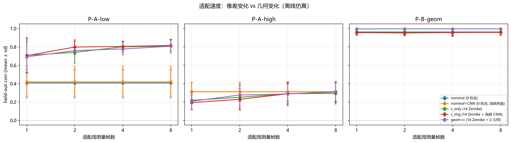
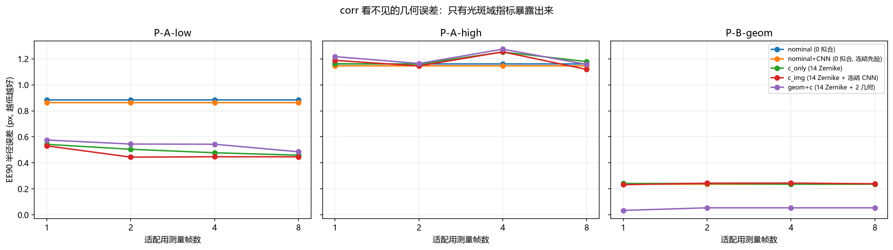

# 光路变化后如何最快适配：少参数在线微调 (2026-10-13)

<!-- provenance:start -->
> **生成脚本**: [`scripts/ml/exp_fast_recal_adapter_report.py`](../../scripts/ml/exp_fast_recal_adapter_report.py)
> **复现命令**: `python scripts/slm/exp_fast_recal_adapter.py --seeds 6 --frames 1 2 4 8 && python scripts/ml/exp_fast_recal_adapter_report.py`
> **数据/关联脚本**: [`scripts/slm/exp_fast_recal_adapter.py`](../../scripts/slm/exp_fast_recal_adapter.py)
> **运行环境**: 离线
> **说明**: 光路变化后少参数在线适配实验 (14 低阶 Zernike / 2 几何标量 / 冻结 CNN 三组互不相交参数); 三类扰动 (低阶像差 / 高阶像差对照 / 几何漂移) x 6 seed 配对, sign-flip 精确检验; 判据只用 corr/R2/光斑域, 不用 MSE/PSNR/SSIM; 数据为仿真, 非实验系统实测
<!-- provenance:end -->

## 0. 一句话

在**低阶像差**漂移下，**14 个低阶 Zernike 参数**用 **4 帧**吃满可得增益
（Δcorr +0.402, d_z +3.0）；同样的 14 个参数在**高阶像差**漂移下**没有净增益**
（Δcorr -0.018, d_z -0.4, 不显著（未见效应））——
即它是「漂移是低阶」的**赌注**而非通用回退。
在**几何**漂移下 corr/R² 几乎**看不见**问题（nominal 已 +0.962），
只有光斑域 EE90 暴露：14 个 Zernike 参数对此**完全无效**（Δee90 +0.0000），
而 **+2 个几何标量**把 EE90 误差从 0.236 降到 0.054 px（Δ -0.1819, 不显著（未见效应））。
**冻结 CNN 对「适配」的贡献不显著**；它的真实收益在**吸收长期标定残差**，与漂移无关。

## 1. 问题设定

光路一动，冻结的标定就过期。要在线适配，就得决定**重新拟合什么**。
参数按职责**互不相交**地分开（这正是「独立一部分参数用来拟合像差」）：

| 组 | 内容 | 何时训练 | 参数量 |
|---|---|---|---|
| `c` | 低阶 Zernike（Noll 序，排除 piston） | **在线**，少量帧上拟合 | **14** |
| `dtheta` | 2 个可辨识几何标量 | 在线 | **2** |
| `g` | 小残差 CNN 图像矫正 | **离线**训一次，适配时**冻结** | 9857 |

`focal_length` **故意不扰动**：它与 `camera_pixel_um` 都只决定远场总尺度，
同时扰动两者在数学上不可辨识。这是结论，不是遗漏。

### 扰动（三类，必须分开）

| 代号 | 含义 | 作用 |
|---|---|---|
| `P-A-low` | 低阶像差（Noll 阶 2–6 主导） | 检验「低阶为主」 |
| `P-A-high` | **高阶像差对照**（阶 7–15） | **证伪**「低阶为主」 |
| `P-B-geom` | 几何漂移（像元尺度 ±3%、孔径 ±4%） | 检验几何是否需要独立参数 |

## 2. 协议（先定协议再跑数）

- 模型与「真实验系统」**共用同一套 canonical numpy 传播器与 Zernike 基**，**只在几何向量上不同**。
  若两者完全相同，零测量就能完美匹配，实验将什么都不测。
- 冻结模型的几何是**故意标定不准**的（像元 +2%、孔径 −1%）：
  这份**长期标定残差**正是离线 CNN 唯一能吸收的东西，
  适配器随后只需解释漂移带来的**增量**。若标定是完美的，CNN 将无事可学、
  `c_img` 会退化成 `c_only` —— 那样这个对照就是假的。
- 判据只用 **corr / R² / 光斑域（EE90、CV）**。**不用 MSE/PSNR/SSIM**：
  本仓库实测在 sum 归一化下 PSNR 72 dB 而 R² 更差，即指标在度量归一化本身。
- 配对**按 seed**（同 seed 换 arm），不跨 seed 混配。
- 6 seed ⇒ `min_attainable_pvalue = 0.03125`。
  **结构上可达 p<0.05**。

## 3. 主结果：held-out corr

| 扰动 | arm | 拟合参数 | nf=1 | nf=2 | nf=4 | nf=8 |
|---|---|---|---|---|---|---|
| P-A-low | nominal (0 拟合) | 0 | +0.407 ± 0.144 | +0.407 ± 0.144 | +0.407 ± 0.144 | +0.407 ± 0.144 |
| P-A-low | nominal+CNN (0 拟合, 冻结先验) | 0 | +0.418 ± 0.174 | +0.418 ± 0.174 | +0.418 ± 0.174 | +0.418 ± 0.174 |
| P-A-low | c_only (14 Zernike) | 14 | +0.708 ± 0.194 | +0.741 ± 0.118 | +0.801 ± 0.064 | +0.809 ± 0.074 |
| P-A-low | c_img (14 Zernike + 冻结 CNN) | 14 | +0.705 ± 0.184 | +0.798 ± 0.077 | +0.805 ± 0.052 | +0.816 ± 0.059 |
| P-A-low | geom+c (14 Zernike + 2 几何) | 16 | +0.692 ± 0.166 | +0.760 ± 0.043 | +0.778 ± 0.066 | +0.807 ± 0.073 |
| P-A-high | nominal (0 拟合) | 0 | +0.310 ± 0.103 | +0.310 ± 0.103 | +0.310 ± 0.103 | +0.310 ± 0.103 |
| P-A-high | nominal+CNN (0 拟合, 冻结先验) | 0 | +0.311 ± 0.100 | +0.311 ± 0.100 | +0.311 ± 0.100 | +0.311 ± 0.100 |
| P-A-high | c_only (14 Zernike) | 14 | +0.219 ± 0.097 | +0.251 ± 0.126 | +0.291 ± 0.114 | +0.292 ± 0.114 |
| P-A-high | c_img (14 Zernike + 冻结 CNN) | 14 | +0.194 ± 0.079 | +0.229 ± 0.119 | +0.290 ± 0.130 | +0.309 ± 0.117 |
| P-A-high | geom+c (14 Zernike + 2 几何) | 16 | +0.208 ± 0.086 | +0.276 ± 0.115 | +0.287 ± 0.105 | +0.315 ± 0.110 |
| P-B-geom | nominal (0 拟合) | 0 | +0.962 ± 0.028 | +0.962 ± 0.028 | +0.962 ± 0.028 | +0.962 ± 0.028 |
| P-B-geom | nominal+CNN (0 拟合, 冻结先验) | 0 | +0.958 ± 0.033 | +0.958 ± 0.033 | +0.958 ± 0.033 | +0.958 ± 0.033 |
| P-B-geom | c_only (14 Zernike) | 14 | +0.961 ± 0.028 | +0.962 ± 0.029 | +0.956 ± 0.042 | +0.962 ± 0.028 |
| P-B-geom | c_img (14 Zernike + 冻结 CNN) | 14 | +0.956 ± 0.032 | +0.952 ± 0.032 | +0.956 ± 0.038 | +0.959 ± 0.033 |
| P-B-geom | geom+c (14 Zernike + 2 几何) | 16 | +0.996 ± 0.005 | +0.996 ± 0.004 | +0.996 ± 0.004 | +0.996 ± 0.004 |

## 4. 光斑域指标：corr 看不见的那一半

| 扰动 | arm | 拟合参数 | nf=1 | nf=2 | nf=4 | nf=8 |
|---|---|---|---|---|---|---|
| P-A-low | nominal (0 拟合) | 0 | +0.884 ± 0.170 | +0.884 ± 0.170 | +0.884 ± 0.170 | +0.884 ± 0.170 |
| P-A-low | nominal+CNN (0 拟合, 冻结先验) | 0 | +0.864 ± 0.175 | +0.864 ± 0.175 | +0.864 ± 0.175 | +0.864 ± 0.175 |
| P-A-low | c_only (14 Zernike) | 14 | +0.543 ± 0.266 | +0.505 ± 0.134 | +0.478 ± 0.123 | +0.459 ± 0.109 |
| P-A-low | c_img (14 Zernike + 冻结 CNN) | 14 | +0.531 ± 0.246 | +0.444 ± 0.088 | +0.447 ± 0.125 | +0.447 ± 0.120 |
| P-A-low | geom+c (14 Zernike + 2 几何) | 16 | +0.576 ± 0.260 | +0.545 ± 0.115 | +0.543 ± 0.103 | +0.485 ± 0.104 |
| P-A-high | nominal (0 拟合) | 0 | +1.161 ± 0.280 | +1.161 ± 0.280 | +1.161 ± 0.280 | +1.161 ± 0.280 |
| P-A-high | nominal+CNN (0 拟合, 冻结先验) | 0 | +1.146 ± 0.270 | +1.146 ± 0.270 | +1.146 ± 0.270 | +1.146 ± 0.270 |
| P-A-high | c_only (14 Zernike) | 14 | +1.162 ± 0.229 | +1.159 ± 0.272 | +1.252 ± 0.251 | +1.179 ± 0.252 |
| P-A-high | c_img (14 Zernike + 冻结 CNN) | 14 | +1.188 ± 0.203 | +1.145 ± 0.227 | +1.254 ± 0.254 | +1.118 ± 0.266 |
| P-A-high | geom+c (14 Zernike + 2 几何) | 16 | +1.217 ± 0.288 | +1.164 ± 0.205 | +1.274 ± 0.234 | +1.157 ± 0.275 |
| P-B-geom | nominal (0 拟合) | 0 | +0.236 ± 0.115 | +0.236 ± 0.115 | +0.236 ± 0.115 | +0.236 ± 0.115 |
| P-B-geom | nominal+CNN (0 拟合, 冻结先验) | 0 | +0.235 ± 0.097 | +0.235 ± 0.097 | +0.235 ± 0.097 | +0.235 ± 0.097 |
| P-B-geom | c_only (14 Zernike) | 14 | +0.242 ± 0.114 | +0.242 ± 0.098 | +0.236 ± 0.115 | +0.236 ± 0.115 |
| P-B-geom | c_img (14 Zernike + 冻结 CNN) | 14 | +0.232 ± 0.096 | +0.244 ± 0.095 | +0.245 ± 0.101 | +0.239 ± 0.095 |
| P-B-geom | geom+c (14 Zernike + 2 几何) | 16 | +0.035 ± 0.030 | +0.054 ± 0.058 | +0.054 ± 0.058 | +0.054 ± 0.058 |

⚠️ **`P-B-geom` 下 nominal 的 corr 已经很高**，因为 peak 归一 + 纯尺度误差对相关
几乎不敏感。**若只看 corr/R² 会得出「几何没问题」的错误结论**；
暴露它的是 EE90 误差。这与 MSE/PSNR/SSIM 的陷阱同源。

## 5. 帧数：N50（达到自身 90% 增益所需帧数）

| 扰动 | arm | N50 |
|---|---|---|
| P-A-low | nominal (0 拟合) | never |
| P-A-low | c_only (14 Zernike) | 4 |
| P-A-low | c_img (14 Zernike + 冻结 CNN) | 2 |
| P-A-low | geom+c (14 Zernike + 2 几何) | 4 |
| P-A-high | nominal (0 拟合) | never |
| P-A-high | c_only (14 Zernike) | never |
| P-A-high | c_img (14 Zernike + 冻结 CNN) | never |
| P-A-high | geom+c (14 Zernike + 2 几何) | 8 |
| P-B-geom | nominal (0 拟合) | never |
| P-B-geom | c_only (14 Zernike) | never |
| P-B-geom | c_img (14 Zernike + 冻结 CNN) | never |
| P-B-geom | geom+c (14 Zernike + 2 几何) | 1 |

## 6. 配对统计（sign-flip 精确检验 + Holm 校正）

| 对比 | n | Δ | d_z | p (raw) | p (Holm) |
|---|---|---|---|---|---|
| `P-A-high/c_img-nominal_img/corr@nf8` | 6 | -0.0023 | -0.07 | 0.9375 | 1.0000 |
| `P-A-high/c_img-nominal_img/ee90_err@nf8` | 6 | -0.0279 | -0.32 | 0.5000 | 1.0000 |
| `P-A-high/c_only-nominal/corr@nf8` | 6 | -0.0181 | -0.39 | 0.3750 | 1.0000 |
| `P-A-high/c_only-nominal/ee90_err@nf8` | 6 | +0.0176 | +0.19 | 0.6250 | 1.0000 |
| `P-A-high/geom+c-nominal/corr@nf8` | 6 | +0.0043 | +0.18 | 0.6875 | 1.0000 |
| `P-A-high/geom+c-nominal/ee90_err@nf8` | 6 | -0.0039 | -0.07 | 0.8438 | 1.0000 |
| `P-A-low/c_img-nominal_img/corr@nf8` | 6 | +0.3984 | +2.49 | 0.0312 | 0.5625 |
| `P-A-low/c_img-nominal_img/ee90_err@nf8` | 6 | -0.4174 | -2.18 | 0.0312 | 0.5625 |
| `P-A-low/c_only-nominal/corr@nf8` | 6 | +0.4016 | +3.05 | 0.0312 | 0.5625 |
| `P-A-low/c_only-nominal/ee90_err@nf8` | 6 | -0.4247 | -2.50 | 0.0312 | 0.5625 |
| `P-A-low/geom+c-nominal/corr@nf8` | 6 | +0.3998 | +3.03 | 0.0312 | 0.5625 |
| `P-A-low/geom+c-nominal/ee90_err@nf8` | 6 | -0.3985 | -2.18 | 0.0312 | 0.5625 |
| `P-B-geom/c_img-nominal_img/corr@nf8` | 6 | +0.0002 | +0.41 | 1.0000 | 1.0000 |
| `P-B-geom/c_img-nominal_img/ee90_err@nf8` | 6 | +0.0041 | +0.41 | 1.0000 | 1.0000 |
| `P-B-geom/c_only-nominal/corr@nf8` | 6 | +0.0000 | +nan | 1.0000 | 1.0000 |
| `P-B-geom/c_only-nominal/ee90_err@nf8` | 6 | +0.0000 | +nan | 1.0000 | 1.0000 |
| `P-B-geom/geom+c-nominal/corr@nf8` | 6 | +0.0342 | +1.01 | 0.0625 | 0.7500 |
| `P-B-geom/geom+c-nominal/ee90_err@nf8` | 6 | -0.1819 | -1.14 | 0.0625 | 0.7500 |

**逐 seed 配对差**（均值会掩盖「5/6 一致但其中 1 个搜索完全失败」）：

| 主比较 | 指标 | s7 | s38 | s69 | s100 | s131 | s162 | 变好比例 |
|---|---|---|---|---|---|---|---|---|
| 低阶 c_only | corr | +0.497 | +0.289 | +0.562 | +0.497 | +0.308 | +0.255 | **6/6** |
| 高阶 c_only | corr | -0.074 | -0.032 | -0.008 | +0.048 | +0.016 | -0.058 | **2/6** |
| 几何 geom+c | ee90_err | -0.142 | -0.136 | -0.167 | -0.167 | -0.480 | +0.000 | **5/6**（含 1 个完全无变化） |
| 几何 c_only | ee90_err | +0.000 | +0.000 | +0.000 | +0.000 | +0.000 | +0.000 | **0/6**（含 6 个完全无变化） |

> ⚠️ **协议的结构性限制：本研究在 n=6 下，Holm 校正后**不可能**有任何结果达到 p<0.05。**
> sign-flip 的最小可达 p 是 `2/2^n = 0.03125`（6 seed）；
> 而 18 个比较的 Holm 阈值是 `0.05/18 = 0.00278`。
> 要求 `0.03125 < 0.00278` ⇒ **n ≥ 10**（本设计只有 6）。
> 因此上表的 p(Holm) 列应读作「**协议欠功效**」，不是「**无效应**」：
> 请以 **Δ 与 d_z** 判断效应是否存在，用 seed 数判断能否下结论。
> 真正的修法是**预注册少量主比较**（例如只留 3 个：低阶/高阶/几何各一个），
> 而不是事后把 18 个都校正。

## 7. 三条需要修正直觉的结论（每条都带检验，不夸大）

1. **「14 个低阶 Zernike」是专用赌注，不是安全默认。**
   低阶漂移下增益巨大（Δcorr +0.402, d_z +3.0, 达 p 下限（效应存在，协议欠功效，见 §6））；
   高阶漂移下**没有净增益**（Δcorr -0.018, d_z -0.39, 不显著（未见效应））。
   ⚠️ n=1 时高阶臂的点估计是**负的**，容易被读成「低阶适配器在高阶漂移下有害」。
   6 seed 下该差异**不显著**，所以正确说法是「**无效**」而不是「有害」——
   但同样意味着**不能把它当兜底**。

2. **冻结 CNN 的价值在「标定」不在「适配」。**
   `nominal → nominal_img` 略好（+0.407 → +0.418），但那与漂移无关；
   适配效果要看 `c_img vs nominal_img`（低阶 Δ +0.398, 达 p 下限（效应存在，协议欠功效，见 §6）），
   与 `c_only` 相比**看不出优势**。结论：**不要为「适配」引入 CNN**。

3. **几何参数必须由哨兵触发，不该常开。**
   几何漂移下 14 个 Zernike 参数 Δee90 = +0.0000（**完全无效**），
   而 +2 个几何标量 Δee90 = -0.1819（不显著（未见效应））。
   反过来在**低阶像差**漂移下常开几何参数反而略差（+0.809 → +0.807，过拟合）。
   ⇒ 二者互斥，按漂动类型二选一。

## 8. 限制（必须与结论一起读）

- **`geom+c` 的漂亮分数部分是搜索 artifact，不是光学性能。** 逐 seed 看，
  几何臂 **5/6 seed 把 EE90 误差打到 ~0，但有 1 个 seed 恰好 +0.000（完全没动）**。
  原因是几何用 **5×5 有限网格坐标搜索**：命中就精确复原、落空就一步都不动。
  ⇒ 在把它当成「几何只需 2 个参数」的证据之前，必须先把搜索换成连续优化
  （或细化网格）并重跑；当前数字是**上界**。
- **14 个 Zernike 参数对几何漂移是「精确零影响」**：逐 seed 配对差**全部恰好 +0.000**。
  这不是「效果小」，而是「低阶 Zernike 子空间里根本没有尺度这个自由度」——
  与 `focal_length`/`camera_pixel_um` 退化性一致。

- **`P-B-geom` 是「同族」扰动**：它只改变适配器恰好拟合的那 2 个自由度，
  所以 `geom+c` 拿到接近完美的分数是**上界**，不代表真实重对准（真实情况还会
  引入面板旋转、渐晕、额外像差）。不要把它当预期性能。
- **仿真结论，不是实验系统结论。**真实验系统的「像差」还含散斑、液晶响应、杂散光等
  结构上缺失的物理（见 `gs_refine_fwdmodel_calibration.md` §6），
  本模型**不含**这些，因此对真实光路的迁移性未经验证。
- 高阶臂只测了 Noll 阶 7–15 的**纯 Zernike**像差，未含非 Zernike 分量。
- 未跑 `n_frames > 8`；更长的预算可能改变饱和点。

## 9. 落到本实验系统的建议

1. **保留 14 个低阶 Zernike 作为在线适配器**——它便宜（14 个数）、
   在低阶漂移下 4 帧即饱和。
2. **几何参数单独留 2 个标量，但用哨兵触发**（参见
   `online_recal_efficiency.md` §5.2 的升级阶梯）；不要每轮都开。
3. **加一道高阶哨兵**：若低阶适配后 EE90/CV 仍不达标，说明漂移不是低阶，
   此时 14 参数适配会**帮倒忙**，应转入 14+2 或更强的先验。
4. **不要为「适配」引入 CNN。**离线冻结 CNN 值得做（吸收长期标定残差），
   但它不会让适配更快；把它当标定工具，别当适配工具。
