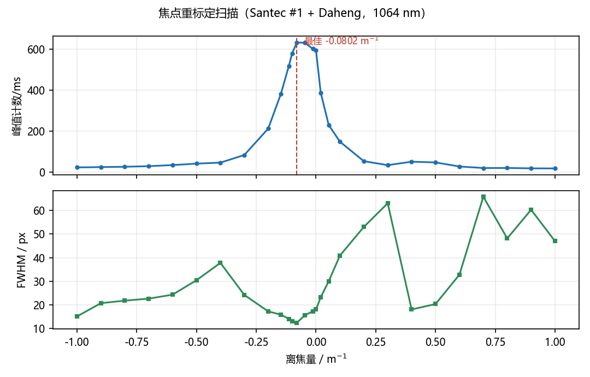
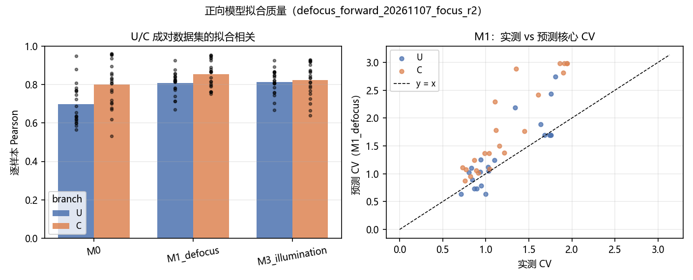
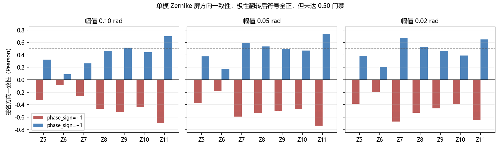
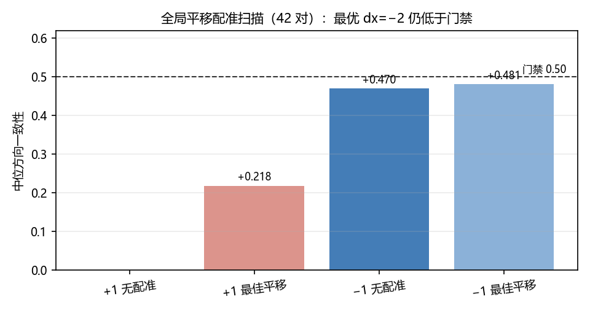

# 正向模型极性核查与单模屏方向门禁（20261107）

<!-- provenance:start -->
> **生成脚本**: [`scripts/slm/generate_forward_model_polarity_report_20261107.py`](../../../scripts/slm/generate_forward_model_polarity_report_20261107.py)
> **复现命令**: `python scripts/slm/generate_forward_model_polarity_report_20261107.py`
> **运行环境**: 离线渲染（实验系统数据 2026-11-07：Santec #1 1064 nm + Daheng CCD）
> **说明**: 正向模型极性核查与单模屏方向门禁：输入为 20261107_focus_scan/focus.json、defocus_forward_20261107_focus_r2(_fit)、issue234_*_screen_20261107 三组 ladder、issue235_parity_20261107/parity_registration_scan.json、loss_compare_20261107_phase_sign_m1/（#236 主臂 −1）与 gated_recurrent_20261107/（#239）的存档产物；figures/ 五张 PNG 为本脚本产物。报告本体不占用设备。
<!-- provenance:end -->

**日期** 2026-11-07 · **脚本** `scripts/slm/generate_forward_model_polarity_report_20261107.py`（离线渲染）
**设备** Santec SLM-200 #1（1920×1200）+ Daheng MER2-507-23GM（2592×1944）
**数据** `data/debug/slm_transfer/` 下的焦点扫描、成对 U/C 数据集与拟合、三组单模屏 ladder、配准扫描、离线损失比较、门控循环原型

## 1. 结论速览

| 指标 | `phase_sign=+1`（历史） | `phase_sign=−1`（硬件实测） | 判据 | 结论 |
|---|---|---|---|---|
| 单模屏方向中位相关（42 对） | -0.459 | +0.459 | 符号为正 | 已翻正（0/42 → 42/42） |
| 单对 ≥ 0.50 | 0/42 | 17/42 | ≥ 0.50 | **未通过** |
| 全局平移最优（dx=−2） | +0.218 | +0.481 | ≥ 0.50 | **未通过** |
| U/C 拟合全帧相关（M1） | 0.851 | 0.637 | 参考 | 取反后反而变差（见 §4.4） |
| 实机 anchored 闭环 | 未运行 | 未运行 | 门禁 + 实测 CV | 门禁未过，不上机 |

- 极性缺陷确实存在：`+1` 下 0/42 对为负，`−1` 下 42/42 对为正，且 |相关| 逐对完全不变——这是模型唯一非对称项（指令相位）被翻转的精确特征。
- 但翻正符号**不足以**通过门禁：中位只有 +0.459，单对最高也只到 0.50 附近；全局平移最多把它抬到 +0.481。
- 更关键的是**自洽性矛盾**：同一份 U/C 数据上，`−1` checkpoint 的全帧 Pearson 为 0.637，低于 `+1` 的 0.851。若极性真是全局传播约定，`−1` 不应同时破坏拟合质量。这说明当前 `phase_sign` 的作用域（把整条指令相位，含载波/倾斜，一起取反）与硬件行为不一致，是未解决项，不是已修好的 bug。
- 因此本轮**没有**进行 anchored 闭环采集；设备占用仅限数据采集阶段（§8）。
- 已在别处记录并修复的问题不在此复述。

## 2. 焦点重标定与成对 U/C 数据集

焦点扫描给出 `best_diopter_m1 = -0.08023`（f ≈ -12.46 m），相对平场增益 1.066×，扫描范围 -1.0 … +1.0 m⁻¹。该结果取代 2026-10-27 的标定，写入 `data/debug/slm_transfer/20261107_focus_scan/focus.json`。

成对 U/C 数据集 `defocus_forward_20261107_focus_r2` 共 52 帧，按 U/C 分支配对采集，随后用 `scripts/slm/fit_defocus_forward_dataset.py` 拟合三档模型（M0 无离焦、M1 离焦、M3 离焦+照明）。逐样本中位相关：

| 模型 | 中位 Pearson | 平均实测 CV | 平均预测 CV | 平均 Pearson |
|---|---|---|---|---|
| M0 | 0.762 | 1.228 | 1.694 | 0.750 |
| M1_defocus | 0.823 | 1.228 | 1.586 | 0.831 |
| M3_illumination | 0.821 | 1.228 | 1.570 | 0.819 |

要点：M1/M3 的逐样本相关中位在 0.83 左右，但预测 CV 与实测 CV 的斜率并不一致（图右）。这解释了为什么模型核心 CV 能到 0.10 而实测停在 0.53：残差是**表征误差**，不是优化器或投影问题。

## 3. 单模 Zernike 屏方向 ladder（核心实验）

三组 ladder 分别以 ±0.10、±0.05、±0.02 rad 施加 Z7…Z11（实际覆盖 Z5–Z11），每档 7 个模式 × 2 个 pass = 14 对。方向指标为 `jacobian_guard.direction_agreement`：模型与实测的 C−U 差分做签名 Pearson，裁剪 128×128，模型原点。

| 幅值/rad | 对数 | +1 中位 | +1 为正 | −1 中位 | −1 为正 | −1 ≥0.50 |
|---|---|---|---|---|---|---|
| 0.10 | 14 | -0.441 | 0 | +0.441 | 14 | 4 |
| 0.05 | 14 | -0.496 | 0 | +0.496 | 14 | 7 |
| 0.02 | 14 | -0.459 | 0 | +0.459 | 14 | 6 |

- 逐对 |相关| 在两种极性下完全相同（例如 Z7 幅值 0.10：-0.263 → +0.263），说明翻转只改变了差分符号，没有改变幅度结构。
- 最弱的模式是 Z6（散光 0°/90° 附近），在两种极性下 |相关| 都只有 0.2 左右；最强的是 Z7/Z11。
- 没有一对达到 0.50。这不是"再多跑几次就好"的统计问题，而是模型与实测在差分**形状**上仍有系统性差异。

## 4. 极性定位：已排除项与未解矛盾

### 4.1 显示链已排除

对 `panel_gray` 做反解，`gray/1023·2π` 与 `+panel_phase` 的 RMS 差为 0.0035 rad，与 `−panel_phase` 为 0.1791 rad。驱动器忠实编码 `+phase`，缺陷不在 LUT/显示链。

### 4.2 基函数与残差项已排除

`FrozenDefocusForward._mode_basis(j)` 与 `generate_zernike_phase` 对 Z5–Z11 的相关 1.0000、尺度 1.0000；旧 checkpoint 的 Noll 5–11 残差项翻转后仍是 0/42。

### 4.3 镜像/转置/背景增益已排除

8 种二面体变换 × ±极性中，`pol=−1 identity` 最优；背景（2.39 vs 0.82 counts/ms）与约 16× 增益误差对仿射不变的 Pearson 无影响；SLM↔相机轴交换已被拟合的 `ramp_matrix` 吸收。

### 4.4 未解矛盾：整条指令取反与 U/C 拟合不自洽

导出 checkpoint 时把 `phase_sign` 设为 −1，作用域是 `total_phase_grid` 之后的**整条指令相位**（含载波/倾斜），而离焦与残差项保留原符号。结果：

| 模型 | 导出的 phase_sign | 与实测全帧 Pearson（−1） | 与实测全帧 Pearson（+1 历史） | −1 与 +1 的相对 L2 |
|---|---|---|---|---|
| M1_defocus | -1 | 0.637 | 0.851 | 0.838 |
| M3_illumination | -1 | 0.709 | 0.852 | 0.712 |

单模屏只测了 Zernike 项，没有载波；U/C 数据则由载波主导。若极性是全局传播约定，取反应同时改善两者；实测是单模屏变好、U/C 变差。**最可能的解释**是缺陷只作用于"像差指令"这一层，而不作用于定位光斑的载波/倾斜项；但这一假设尚未在硬件上单独验证。在验证之前，不能把 `−1` checkpoint 当作已修好的模型。

## 5. 全局配准排查

42 对合并后，`pol=−1` 无配准中位 +0.470（17/42 ≥0.50）；扫描全局平移后最优为 dy=0, dx=-2，中位 +0.481（16/42）。单一全局平移无法达到门禁，逐对最优平移不可部署（每对一个自由参数）。

## 6. 离线损失函数比较（#236）

同一数据划分、同一初始化、300 次 full-batch Adam，比较 7 种损失；`phase_sign=−1` 为主臂（`scripts/slm/loss_compare_20261107.py`，产物 `data/debug/slm_transfer/loss_compare_20261107_phase_sign_m1/`），`+1` 臂仅作历史对照。首轮以 `+1` 为主臂的推荐（masked_mse，方向中位 +0.483）**作废**：其符号约定已被 §3 的硬件证据推翻。

| 损失 | −1 方向中位 | −1 核心 Pearson | +1 方向中位（作废） | +1 核心 Pearson |
|---|---|---|---|---|
| mse | +0.070 | 0.589 | +0.388 | 0.718 |
| ee_uniformity | +0.058 | 0.160 | +0.069 | 0.041 |
| masked_mse | +0.037 | 0.584 | +0.483 | 0.729 |
| rel_l2 | +0.036 | 0.584 | +0.469 | 0.725 |
| log_mse | +0.029 | 0.195 | +0.003 | 0.213 |
| pearson | -0.018 | 0.566 | +0.390 | 0.716 |
| composite | -0.043 | 0.486 | +0.329 | 0.678 |

- `−1` 主臂最优为 **mse**（方向中位 +0.070），但 7 种损失全部落在 -0.043 … +0.070，方向分辨率仅 ±0.05，held-out 又只有 9 个 U/C 对——**无法据此选损失**。
- 基线复现**失败**：`−1` 臂重新拟合的离焦 d = -0.0021 m⁻¹，与存档 M1_defocus 的 +0.1139 相差 0.116（容差 0.005）；原点偏移 15.9 px（容差 1）。与 §4.4 的作用域矛盾一致：把含载波/倾斜的整条指令取反，连 U/C 基线都保不住。
- U/C 数据以径向对称的离焦为主，对极性不敏感；它既不能验证极性，也不能替代单模屏 ladder。
- 因此 #236 的结论记为**未定**：损失选择必须等方向门禁通过后，在单模屏或闭环指标上重做。

## 7. 门控循环原型（#239）

四臂对比（memoryless / concat / gated / attention，各 3 个种子），共享优化器、预算与数据；门控臂额外输入上一帧 CCD、相位与残差。基础模型按 `phase_sign=−1` 运行（`scripts/slm/gated_recurrent_transfer_20261107.py`，产物 `data/debug/slm_transfer/gated_recurrent_20261107/`）。

| 臂 | 方向均值 | 标准差 | 对数 |
|---|---|---|---|
| frozen base | +0.5596 | 0.2020 | 42 |
| memoryless | +0.7598 | 0.0057 | 42 |
| concat | +0.6490 | 0.0530 | 42 |
| gated | +0.6297 | 0.0214 | 42 |
| attention | +0.4756 | 0.0478 | 42 |

- 判定为 `inconclusive`：门控臂与 memoryless 在全部收敛阈值上的迭代数差异都在 10 次评估粒度内（r2 域门控约快 3 次，ladder 域持平或更慢），没有观察到迭代数压缩。
- 值得注意的是 memoryless 残差头把方向均值从 +0.560 抬到 +0.760；这说明方向指标可以通过学习残差头改善，而不必先解决物理模型。但这只是代理指标，不等于闭环收敛。
- 样本量很小（r2 可用 36 帧；ladder pass1/pass2 各 42 帧，且 pass2 重复 pass1 的同一批 ±指令——held-out 测的是复现性而非对新相位的泛化），结论不能外推。

## 8. 设备占用与释放记录

| 时间（2026-11-07） | 占用 | 内容 | 释放 |
|---|---|---|---|
| 13:52 | SLM #1 + Daheng cam 0 | 旧光学状态下的 U/C 语料（后判定为 stale-optics） | 采集结束即释放 |
| 15:32 | SLM #1 + Daheng cam 0 | 重标定后的成对 U/C 数据集 `defocus_forward_20261107_focus_r2` | 采集结束即释放 |
| 16:21 | SLM #1 + Daheng cam 0 | 单模屏 ladder（0.10/0.05/0.02 rad） | 每档结束即释放 |
| 17:48–17:54:45 | SLM #1 + Daheng cam 0 | anchored 闭环捕获 `20261107_174854` | 17:54:45 结束，17:55:59 复查无占用进程 |

期间 SLM #1 出现一次控制器无响应（`ReadSU = −1000`），由用户手动重启后恢复；软件侧未做恢复尝试。本报告为离线渲染，未占用任何设备。

## 9. 未解决项与下一步

1. **极性作用域**：验证"只翻转像差指令、保留载波/倾斜"是否同时满足单模屏符号与 U/C 拟合质量；§6 的基线复现失败（整条指令取反连 U/C 基线都保不住）进一步支持该假设。这是当前最高优先级，且可离线用已有数据先做筛选。
2. **门禁**：在作用域修正后重跑三组 ladder，目标 ≥0.50；若仍不足，需要 oracle 评审残差结构（候选：SLM 相位非线性、亚像素原点约定、相机响应）。
3. **#236**：`−1` 臂上 7 种损失方向中位全部落在 ±0.07 内，无区分度，结论记"未定"。
4. **#237/#238**：2D 配准、实测 PSF、增益场、CCD 响应 LUT、1×1/3×3 LUT 与串扰核，均未开始。
5. 门禁通过后才安排实机 anchored 闭环，判据仍是实测核心 CV ≤ 0.10。
