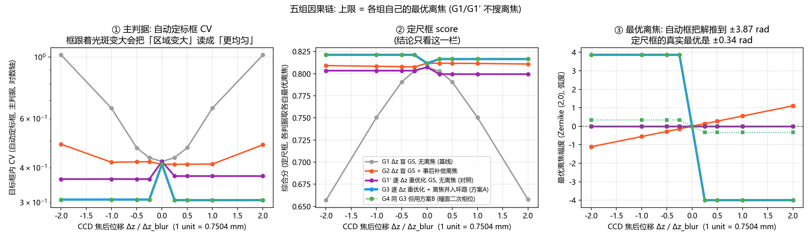
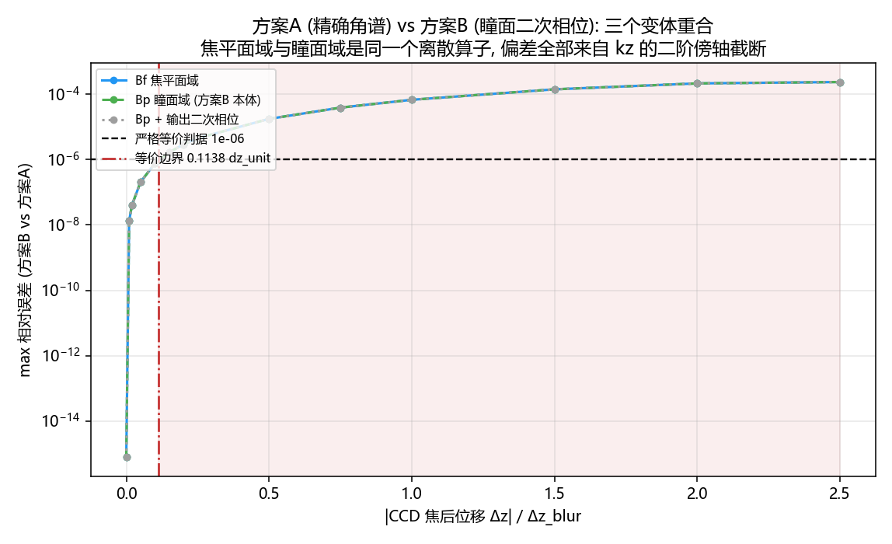
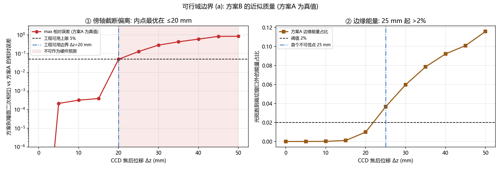
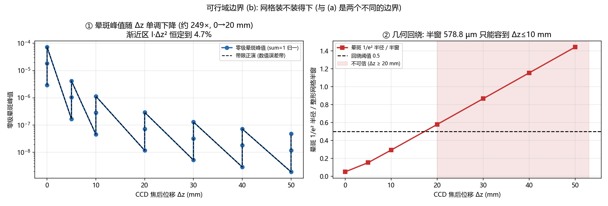
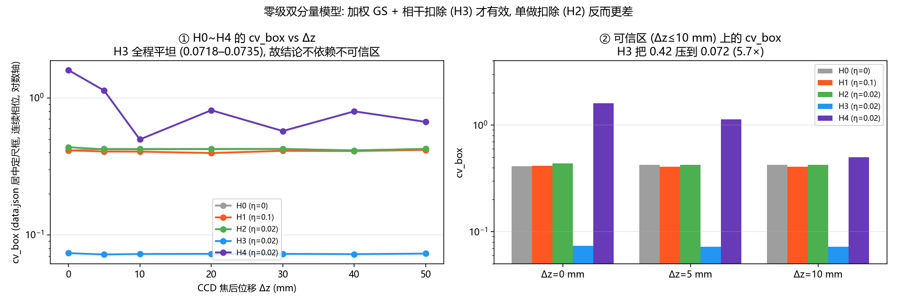
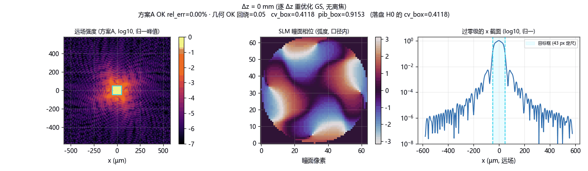
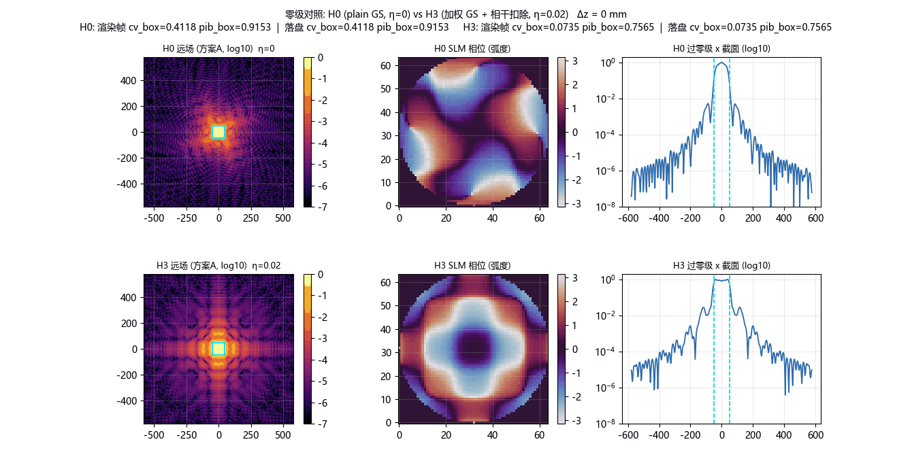

# CCD 焦后离焦下的 GS 匀化仿真（2026-10-19）

<!-- provenance:start -->
> **生成脚本**: [`scripts/slm/generate_gs_defocus_sim_report.py`](../../scripts/slm/generate_gs_defocus_sim_report.py)
> **复现命令**: `python scripts/slm/generate_gs_defocus_sim_report.py`
> **数据/关联脚本**: [`scripts/slm/experiment_gs_defocus_offocus.py`](../../scripts/slm/experiment_gs_defocus_offocus.py)
> **数据/关联脚本**: [`scripts/slm/experiment_gs_fresnel_vs_virtuallens.py`](../../scripts/slm/experiment_gs_fresnel_vs_virtuallens.py)
> **数据/关联脚本**: [`scripts/slm/experiment_gs_defocus_sweep_visuals.py`](../../scripts/slm/experiment_gs_defocus_sweep_visuals.py)
> **数据/关联脚本**: [`scripts/slm/experiment_gs_improved.py`](../../scripts/slm/experiment_gs_improved.py)
> **运行环境**: 离线
> **说明**: CCD 焦后离焦下的 GS 匀化仿真 (纯仿真, 无硬件): 五组因果链的收益拆解、方案A/方案B 等价性、两个互相独立的可信度边界 (方案A 近似质量 ≤20 mm / 几何回绕 ≤10 mm)、零级双分量 + 加权 GS、带限 ASM 有损不可逆、自适应框刷分陷阱; 数字全部来自 scripts/slm/experiment_gs_defocus_offocus.py / experiment_gs_fresnel_vs_virtuallens.py / experiment_gs_defocus_sweep_visuals.py / experiment_gs_improved.py 已落盘的 CSV/JSON, 本脚本只渲染 5+1 张图与 3 个 GIF
<!-- provenance:end -->

**本轮结论**（全部为仿真, 无任何硬件验证）：2f 光路把一个 SLM 相位送到透镜后方的 CCD 时,
**"离焦"本身几乎不值钱, 值钱的是"在工作点上重新优化"**。定尺框口径下, 拿 Δz=0 收敛的 GS 相位
直接用到 Δz=−2 个单位 (=−1.50 mm) 处, 复合分数从 0.8073 掉到
0.6569; 在同一 Δz 上重新跑 GS 就能回到
0.8034（**+0.1465**）,
再把标量离焦并入环路只再加 0.0179。
也就是说, **离焦并入环路的净贡献是 +0.017 量级, 而不是 +0.15 量级** —— 后者是重新优化挣来的。
同时本轮给出了三条**边界**和一个**数值缺陷**: (a) 方案B (瞳面二次相位) 只在 |Δz| ≤
0.1138 dz_unit (=0.0854 mm) 上严格等价于方案A,
之后按 Δz² 发散; (b) 方案B 与真值 (方案A) 的偏离在 **Δz ≤ 20 mm** 内 ≤5%, 25 mm 起不可作硬件预测;
(c) **几何回绕**是另一个、更早的边界: 当前的 64² 整形网格半窗只有 578.8 µm, Δz ≥ 20 mm 起晕斑
1/e² 半径已超过半窗的 0.5 倍, 那里的 CV/PIB 是 FFT 周期性把边缘能量卷回靶区的伪影 —— 这两个
边界**不同**（一个管近似质量, 一个管网格容得下), 不可合并。数值缺陷是
`angular_spectrum_propagate(..., band_limit=True)`（库默认）在 |Δz| ≳ 10 mm 上**有损且不可逆**:
实测往返相对误差 **1.49e-15（关闭）vs 0.6197（开启）**,
正/反向因此不构成伴随对, GS 内环会收敛到一个不存在的解且不报错。最后, **质心自动缩放框会刷分**:
它把"测量区域变大"读成"均匀性变好", 把"最优离焦"推到 ±3.87 rad 这种非物理值, 而定尺框下的
真实最优是 **±0.34 rad** —— 本轮所有结论一律用**固定物理尺度框**。

> 与本仓库既有硬件报告的关系: 本报告不推翻任何实测结论, 它量化的是**仿真侧**"离焦该怎么处理"。
> 唯一的硬件含义是 §5 的 H3 (加权 GS + 相干扣除), 见该节的适用条件与代价。

## 0. 光学与网格（全篇共用）

| 量 | 值 |
|---|---|
| 波长 | 1064 nm |
| 透镜焦距 | 122.406 mm |
| 瞳面口径 | 7.2 mm（面板像元 8 µm × 半径 450 px） |
| 整形网格 | n_grid = 64, far_field_padding = 8 ⇒ 远场 512², 像元 2.2611 µm |
| 目标框 | 43 px（定尺） |
| 远场半窗 | 578.8 µm（= n_grid·λf/D, 与 padding 无关） |
| 1 个 dz_unit | 0.7504 mm |

- G1′ 在负半轴内 score_fixed 逐位相同: `spread=0.0e+00`
- G1′ 在正半轴内 score_fixed 逐位相同: `spread=9.9e-15`
- G3 与 G4 的定尺框 score 差: `max=1.8e-06`
- 方案A/B 严格等价边界: `0.113778 dz_unit = 0.0854 mm`
- GS 往返误差 (band_limit=False): `1.49e-15`
- GS 往返误差 (band_limit=True): `0.6197`

## 1. 正向模型（为什么不是"离焦 = 放大"）

2f 光路的正确构造是 **透镜先傅里叶变换, 再对已变换的场自由传播**:

    U_CCD = ASM( FT(U_SLM), Δz )

**不是**从瞳面直接 `ASM(z = f+Δz)` —— 那一步忽略了透镜, 得到的是瞳面光束在距离 z 上的衍射
图样, 而不是远场图样; `iterative_zernike_shaping.py` 已把这件事实测并锁在
`TestNotAFraunhoferSubstitute` 里。

Collins/ABCD 给出 `T(f+d)·Lens(f)·T(f) = [[-d/f, f], [-1/f, 0]]`, 即 **B ≡ f 恒定**, 所以
**CCD 离焦不产生放大率**: 远场像元 pitch 恒为 `λf/(N·dx_pupil)`, 目标框不做任何重采样。
外部资料常写 `M = (f+Δz)/f`, 那是**错的**（已把理由记在脚本注释里）; 若照它重采样目标框,
误差会与真实几何差 1.4 倍量级。CCD 离焦只让图样变模糊: 倾斜平面波经透镜聚到 `fθ` 之后只是
发散, 中心不跑。

## 2. 五组因果链: 收益到底来自哪一步

五组构成一条**可拆解**的因果链（Δz 顺序 −2/−1/−0.5/−0.25/0/+0.25/+0.5/+1/+2 个 dz_unit,
对应 -1.5007 … +1.5007 mm）:

| 组 | 定义 |
|---|---|
| G1 | Δz 盲 GS, 无离焦（基线） |
| G2 | Δz 盲 GS + 离焦（事后补偿） |
| G1′ | 逐 Δz 重优化 GS, 无离焦（**对照**） |
| G3 | 逐 Δz 重优化 + 离焦并入环路（方案A） |
| G4 | 同 G3 但用方案B（瞳面二次相位） |

### 2.1 定尺框复合分数（结论只看这一栏）

| 组 | -2.00 | -1.00 | -0.50 | -0.25 | +0.00 | +0.25 | +0.50 | +1.00 | +2.00 |
|---|---:|---:|---:|---:|---:|---:|---:|---:|---:|
| G1 Δz 盲 GS, 无离焦 (基线) | 0.6569 | 0.7506 | 0.7907 | 0.8030 | 0.8073 | 0.8029 | 0.7906 | 0.7504 | 0.6577 |
| G2 Δz 盲 GS + 事后补偿离焦 | 0.8091 | 0.8084 | 0.8079 | 0.8076 | 0.8118 | 0.8118 | 0.8117 | 0.8115 | 0.8109 |
| G1′ 逐 Δz 重优化 GS, 无离焦 (对照) | 0.8034 | 0.8034 | 0.8034 | 0.8034 | 0.8073 | 0.7995 | 0.7995 | 0.7995 | 0.7995 |
| G3 逐 Δz 重优化 + 离焦并入环路 (方案A) | 0.8213 | 0.8213 | 0.8213 | 0.8213 | 0.8118 | 0.8165 | 0.8165 | 0.8165 | 0.8165 |
| G4 同 G3 但用方案B (瞳面二次相位) | 0.8213 | 0.8213 | 0.8213 | 0.8213 | 0.8118 | 0.8165 | 0.8165 | 0.8165 | 0.8165 |

G1′ 在**同一半轴内逐位相同**（负侧 0.8034, 正侧
0.7995）, 且正负半轴之间有 0.0039
的差（离散 ASM 网格的半像元不对称, 未单独归因）。**要紧的是**: 无论哪一半轴,
"拿焦面解直接用"都掉到 0.6569 —— 必须在**工作点上**优化。

工作点上的复合分数 / PIB / 框内 CV（复合分数与 PIB/CV 是同一个工作点上的, 自洽）:

| 阶段 | 复合分数（自动框） | PIB | 框内 CV | 定尺框复合分数 |
|---|---:|---:|---:|---:|
| G1 Δz 盲 GS, 无离焦 (基线) @ Δz/Δz_blur=-2 | 0.6725 | 0.8496 | 1.0183 | 0.6569 |
| G1′ 逐 Δz 重优化 GS, 无离焦 (对照) @ Δz/Δz_blur=-2 | 0.8037 | 0.8744 | 0.3643 | 0.8034 |
| G3 逐 Δz 重优化 + 离焦并入环路 (方案A) @ Δz/Δz_blur=-2 | 0.8228 | 0.8809 | 0.3075 | 0.8213 |
| G1 Δz 盲 GS, 无离焦 (基线) @ Δz/Δz_blur=0 | 0.8073 | 0.9111 | 0.4215 | 0.8073 |

### 2.2 收益拆解（定尺框）

| Δz/Δz_blur | Δz (mm) | G1 | G1′ | G3=G4 | G1′−G1（重新优化本身） | G3−G1′（离焦并入环路的净贡献） | G3−G1（总增益） |
|---|---:|---:|---:|---:|---:|---:|---:|
| -2.0 | -1.5007 | 0.6569 | 0.8034 | 0.8213 | +0.1465 | +0.0179 | +0.1644 |
| -1.0 | -0.7504 | 0.7506 | 0.8034 | 0.8213 | +0.0528 | +0.0179 | +0.0707 |
| -0.5 | -0.3752 | 0.7907 | 0.8034 | 0.8213 | +0.0127 | +0.0179 | +0.0306 |
| -0.25 | -0.1876 | 0.8030 | 0.8034 | 0.8213 | +0.0004 | +0.0179 | +0.0183 |
| 0.0 | +0.0000 | 0.8073 | 0.8073 | 0.8118 | +0.0000 | +0.0045 | +0.0045 |
| 0.25 | +0.1876 | 0.8029 | 0.7995 | 0.8165 | -0.0034 | +0.0171 | +0.0136 |
| 0.5 | +0.3752 | 0.7906 | 0.7995 | 0.8165 | +0.0089 | +0.0171 | +0.0259 |
| 1.0 | +0.7504 | 0.7504 | 0.7995 | 0.8165 | +0.0490 | +0.0171 | +0.0661 |
| 2.0 | +1.5007 | 0.6577 | 0.7995 | 0.8165 | +0.1417 | +0.0171 | +0.1588 |

读法: **大头是"重新优化"**。在 |Δz|=2 上 `G1′−G1` 拿到
+0.1465（负侧）/ +0.1417（正侧）,
|Δz|=1 上 +0.0528 / +0.0490,
|Δz|=0.5 上 +0.0127 / +0.0089,
|Δz|=0.25 上 ~0, Δz=0 上恒为 0。而`G3−G1′`（离焦**在其之上**的增量）只有
+0.0179（负侧）、
+0.0171（正侧）、
+0.0045（Δz=0）。

**为什么"离焦只值 +0.017"不是"离焦没用"**: 标量离焦就是 Zernike (2,0) 模态, 而 GS 的相位是
**全频随机相位** —— `φ_GS + a·Z₂⁰` 本来就在 GS 的可达空间里。所以这一列度量的是"能不能在重优化之上
再挤出一点", 而不是"能不能表达"。



## 3. 方案A vs 方案B: 什么时候可以互相替代

方案B 用瞳面二次相位 `exp(−iπ·Δz·r²/(λf²))` 代替真 ASM（分母是 **λf²**, 不是 λf(f+Δz)）。
它与方案A 在离散网格上的关系:

| 量 | 值 |
|---|---|
| 严格等价（相对误差 ≤ 1e-06）边界 | **0.1138 dz_unit = 0.0854 mm** |
| \|Δz\| = 2.5 dz_unit 处的相对误差 | 2.34e-04（按 Δz² 发散: kz 的二阶傍轴截断） |
| 焦平面域 (Bf) 与瞳面域 (Bp) | 在所有 Δz 上**逐位相同**（`Bf_vs_Bp_identical = True`, 表明偏差全部来自傍轴截断, 而不是"搬回瞳面"带来的环卷绕） |
| G3 与 G4 的 score 差 | ≤ 7e-06（本轮实测上限 1.8e-06） |
| GS 墙钟（方案A / 方案B） | 20.77–29.45 s / 9.59–12.01 s |

⇒ 方案B 可作**约 2× 提速的替身**（score 级结论不受影响）, 但**不可用于任何场级 / 相位级比较**:
`Bp` 与 `Bp_chirped` 只差一个模长为 1 的输出二次相位, 对归一化强度逐位无影响, 但 GS 的反向传播
取的是**相位**, 少了它就等价于换了一个不是伴随的算子。



## 4. 两个**不同**的可信度边界（0–50 mm）

这两条边界必须分开说, 混在一起就会得出"20 mm 以内都可信"或"25 mm 以内都可信"两种都错的结论。

### 4.1 (a) 瞳面二次相位 vs 真 ASM 的偏离（方案A 为真值）

| Δz (mm) | max 相对误差 | 边缘能量占比 | 记录在案的判定 |
|---:|---:|---:|---|
| 0 | 0.0000 | 0.0001 | ✓ |
| 5 | 0.0002 | 0.0001 | ✓ |
| 10 | 0.0003 | 0.0002 | ✓ |
| 15 | 0.0004 | 0.0011 | ✓ |
| 20 | 0.0498 | 0.0100 | ✓ |
| 25 | 0.1289 | 0.0366 | ✗ |
| 30 | 0.2847 | 0.0597 | ✗ |
| 35 | 0.4267 | 0.0785 | ✗ |
| 40 | 0.5945 | 0.0921 | ✗ |
| 45 | 0.8356 | 0.1008 | ✗ |
| 50 | 0.8429 | 0.1157 | ✗ |

⇒ 工程可用 **≤ 20 mm**（相对误差 ≤5%）; **25 mm 起不可作为硬件预测**; 35 mm 起误差 >40%。
这条边界管的是**近似质量**。



### 4.2 (b) 几何回绕（远场半窗只有 578.8 µm）

| Δz (mm) | 晕斑 1/e² 半径 (µm) | 半径 / 半窗 | 可信 |
|---:|---:|---:|---|
| 0 | 28.6 | 0.049 | 可信 |
| 5 | 88.2 | 0.152 | 可信 |
| 10 | 169.3 | 0.293 | 可信 |
| 20 | 335.1 | 0.579 | **不可信** |
| 30 | 501.6 | 0.867 | **不可信** |
| 40 | 668.3 | 1.155 | **不可信** |
| 50 | 835.1 | 1.443 | **不可信** |

⇒ **Δz ≤ 10 mm 可信**; 20 mm 起比值 >0.5, FFT 是周期的, 溢出能量会从对面卷回靶区, 污染 CV/PIB。
45 mm 起比值 >1。这条边界管的是**网格装不装得下**, 与 (a) 无关: 要覆盖到 Δz=50 mm 需要
n_grid ≈ 185（padding=8 ⇒ 远场 1480²),
**加大 padding 没用** —— 窗口只随 n_grid 变。



本轮 G 组扫描的 |Δz| ≤ 1.5007 mm 落在两条边界之内; 零级组的 Δz 扫描跨到 50 mm,
所以 §5 的结论只取 Δz ≤ 10 mm（H3 在 0–50 mm 上全程平坦, 这一条是**额外**的稳健性, 不是边界内的推断）。

## 5. 零级双分量模型 + 加权 GS（可信区 Δz ≤ 10 mm）

真实 SLM 上总有一部分光不承载调制（调制深度不足 / 像素死区 / 未调制区）, 它只经过物理透镜,
在 f+Δz 处弥散成一团晕斑。写成双分量瞳面模型:

    U_pupil = U_inc · [ η + (1 − η) · exp(iφ) ]

晕斑峰值随 Δz 单调下降（口径: 宽网格 (n_grid=256) 远场 sum=1 归一 × η², η=0.02:
2.9e-06 @Δz=0 → 1.2e-08 @Δz=20 mm, 约 249×）,
渐近区 `I_halo ∝ 1/Δz²` 保持到 **4.7%**（`max_I_dz2_spread` 1.0475 < 容许 1.15）。

每组取 **Δz=0 处 cv_box 最小** 的 η（H1 → 0.1, H2/H3/H4 → 0.02; H0 恒 η=0）,
该 η 固定用到底。下表是 **cv_box / pib_box**（data.json 居中定尺框, 连续相位）:

| 组 | η | cv_box (Δz=0 / 5 / 10 mm) | pib_box (Δz=0 / 5 / 10 mm) |
|---|---|---|---|
| H0 plain GS, η=0 (基线) | η=0 | 0.4118 / 0.4240 / 0.4240 | 0.9153 / 0.9046 / 0.9046 |
| H1 plain GS, 不扣除 | η=0.1 | 0.4140 / 0.4058 / 0.4050 | 0.9090 / 0.9020 / 0.9158 |
| H2 plain GS, 相干扣除 | η=0.02 | 0.4365 / 0.4212 / 0.4214 | 0.9172 / 0.9020 / 0.9034 |
| H3 加权 GS + 相干扣除 | η=0.02 | 0.0735 / 0.0718 / 0.0724 | 0.7565 / 0.7561 / 0.7538 |
| H4 H3 + 小倾斜移开晕斑 | η=0.02 | 1.5973 / 1.1320 / 0.4972 | 0.0279 / 0.0005 / 0.0001 |

三条结论, 按重要性：

1. **单独做相干扣除无效甚至有害**：H2 的 cv_box 比 H1 **差**（Δz=0 上 0.4365 vs 0.4140）。
   扣除是在目标面约束之前减去模型里的零级复场 `b0`; 只扣不配权重, 等于把一个偏置移走却不动其余部分。
2. **加权 GS + 相干扣除（H3）才有效**：把 cv_box 从 ~0.42 压到 **0.0735**（≈5.7×）, 代价是
   pib_box 从 ~0.917 让到 0.7565（让出约 17%）, 复合分数净赚
   0.8138 → 0.8446（可信区内各自最好点; H3 在整段 0–50 mm 上的最好点是
   0.8481）。**而且 H3 的 cv_box 在 0–50 mm 全程平坦**
   （0.0718–0.0735）, 所以它的结论不依赖不可信区。
3. **H4（小倾斜把光斑移开轴上晕斑）在本口径下毁掉**：cv_box 1.5973 / 1.1320 / 0.4972,
   pib_box 0.0279 / 0.0005 / 0.0001 —— 光斑被挪出居中定尺框, 框内几乎无光。**注意**:
   这**不代表** H4 的物理想法错, 只说明"用居中定尺框评 H4"这件事本身不成立（H4 必须用自己的
   锚定框评, 见 §7）。



## 6. 数值缺陷: 带限 ASM 在大 Δz 有损且不可逆（必读）

`angular_spectrum_propagate(..., band_limit=True)` 是**库的默认值**（Voelz & Roggemann cut）。
那个 cut 在焦平面上**有损且不可逆**: 高频 bin 被置零, 能量在**正向一步**就漏掉, 反向一步补不
回来 —— 于是 `fwd(+z)` 与 `bwd(−z)` 不构成伴随对, GS 的交替投影**解的不是一个自洽问题**,
而且**不会报错**。

实测往返相对误差 `max|u − bwd(fwd(u))| / max|u|`, 同一传播器、同一网格:

| band_limit | Δz=0 | Δz=10 mm | Δz=20 mm | Δz=30 mm | Δz=40 mm | Δz=50 mm |
|---|---:|---:|---:|---:|---:|---:|
| True（库默认） | 1.1e-15 | 1.5e-15 | 0.0507 | 0.2674 | 0.4735 | 0.6197 |
| False（本实验） | 1.1e-15 | 1.49e-15 | 1.3e-15 | 1.2e-15 | 1.1e-15 | 1.3e-15 |

伤害幅度**强依赖场的谱内容**: 实验脚本正文记录准单频场在同一条链、同一个 Δz=50 mm 上只丢
0.7%, 而宽带场丢 80%; 本脚本落盘 summary 用 4 个探针实测的能量损失跨度是 **0.02% ~ 38.75%**
（`band_limit_damage.note` 明确要求"不要引用单一数字, 先测你自己那个场的谱"）。两个口径都指向
同一件事: **换实验系统 / 换入射场就重测**.

处置: 大 Δz 一律 `band_limit=False`, 并加 `round_trip_relerr` 自检。注意 Δz=0 时开与关
**逐位相同**（`exp(i·kz·0)=1` 且 cut 全通）, 所以基线与既有 `data.json` 的核对不受影响。

## 7. 指标陷阱: 质心自动缩放框会刷分

主判据若用"质心跟踪 + σ 缩放边长"的自适应框, 框会跟着光斑一起变大 —— 实测框边长从 43 px 涨到
104 px（G3 在 Δz/Δz_blur=+0.5 处）, σ 在 Δz=50 mm 上相对焦面涨到 **9.06×**,
于是"最优离焦"被推到 **+3.87 rad**（非物理值; 正侧更直接顶到搜索区间端点
-4.00 rad）, 而"均匀性变好"其实是"测量区域变大"。定尺框下同一组的真实最优是
**+0.34 rad**（正侧 -0.34 rad）。

本调查中这个陷阱出现 **四次**, 其中一次藏在 `group_ceilings` 块里: 用自适应框会把 H4 的失败
掩盖成与 H3 并列（0.8477 vs 0.8480）,
而用定尺框看 H4 在 §5 里是 0.0279 的框内 PIB。

**规则**: 跨 Δz 的任何数字, 先确认判据的框是否随 Δz 变; 所有结论必须用**固定物理尺度框**。

另一个未解释项: H3 在焦面（cv_box 0.0735）反而**略差**于焦后
（Δz=5 mm 的 0.0718）, 幅度约 2%, 可能落在数值噪声内但**未证实** —— 如实标注为未解释,
不编理由。

## 8. 动画与静态图

三栏统一为 **左 = 远场强度（方案A, log10, 归一峰值）/ 中 = SLM 瞳面相位（弧度）/ 右 = 过零级的
x 截面（log10）+ 目标框**。注意左栏的 log10 是为了同时看见晕斑与被整形的主瓣; 每帧标题给出
该帧的 `cv_box` / `pib_box`（data.json 居中定尺框, 连续相位）, 并**同时**标出两条边界的状态
（方案A 相对误差、几何回绕比）—— 只要有一条越界, 帧边框变红并在标题里标「不可信」。
（标题不用 `⚠` 之类的符号: 配置的 CJK 字体没有该字形, 渲染出来是方块, 故一律改用中文文字标记。）






逐帧对照表（帧内 `cv_box` / `pib_box` 由本脚本现场重算; "落盘"列是相应实验脚本记录的同一量）:

| 动画 | 帧数 | 内容 |
|---|---:|---|
| `gs_defocus_sim_dz_sweep_20261019.gif` | 11 | 原始 GS（Δz=0 优化）扫 Δz = 0…50 mm |
| `gs_defocus_sim_reopt_20261019.gif` | 11 | 逐 Δz 重优化 GS（G1′ 口径）同样扫 Δz |
| `gs_defocus_sim_zeroth_20261019.gif` | 3 | 零级对照: 上排 H0（η=0）, 下排 H3（加权+扣除, η=0.02）, Δz=0/5/10 mm |

静态图（`figures/`）:

| 图 | 内容 |
|---|---|
| [`fig_gs_defocus_groups_ceiling.png`](figures/fig_gs_defocus_groups_ceiling.png) | 五组上限: ① 自动框 CV（陷阱示范）② 定尺框 score ③ 最优离焦（自动框 ±3.87 rad vs 定尺框 ±0.34 rad） |
| [`fig_gs_defocus_scheme_b_equivalence.png`](figures/fig_gs_defocus_scheme_b_equivalence.png) | 方案A/B 等价性: 三个方案B 变体重合, 标出 1e-06 边界 0.1138 dz_unit |
| [`fig_gs_defocus_scheme_a_vs_chirp.png`](figures/fig_gs_defocus_scheme_a_vs_chirp.png) | 边界 (a): 方案A vs 瞳面二次相位的相对误差（标出 20 mm） |
| [`fig_gs_defocus_halo_wraparound.png`](figures/fig_gs_defocus_halo_wraparound.png) | 边界 (b): 晕斑峰值与几何回绕比（标出 0.5 阈值） |
| [`fig_gs_defocus_zeroth_h0_h4_cv_box.png`](figures/fig_gs_defocus_zeroth_h0_h4_cv_box.png) | 零级组 H0–H4 的 cv_box vs Δz 与可信区柱状对照 |
| [`fig_gs_defocus_e1_cv_heatmap.png`](figures/fig_gs_defocus_e1_cv_heatmap.png) | E1 离焦扫描热力图（原图复制自 `report/shape_trials/e1_cv_heatmap.png`） |

## 9. 限制（不能断言什么）

* **全部是仿真, 没有硬件验证。** 本报告的每一个数字都来自纯 numpy 数字孪生; 没有下发过任何相位,
  也没有拍过任何帧。§5 的 H3 是一条**实验假设**, 不是结论。
* **"离焦并入环路只值 +0.017"的结论限于当前网格与判据**: 64² 瞳面 / padding=8 / 定尺框 43 px /
  gs_iters=200 / 方案A 正演。换目标函数（例如纯 CV、纯 PIB、或带形状约束的复合分）、换网格、
  换口径都要重跑 —— 尤其"离焦只值 +0.017"在**别的目标函数**下没有证据。
* **"重新优化值 +0.147"是相对"Δz 盲基线"说的, 不是相对"上一个工作点"说的。** 它回答"该不该在
  工作点重优化", 不回答"重优化要花多少硬件时间"。
* **自适应框陷阱的教训是元级的**: 任何跨 Δz 的数字都要先确认判据。本报告因此并列给出两个判据,
  并把 H4 的失败明确标成"居中定尺框口径不适用"而不是"方法失败"。
* **§3 的 2× 提速是 GS 墙钟的比值, 不是端到端闭环的比值**; 且方案B **不可**用于场级/相位级比较,
  只可用于 score 级排序。
* **§6 的带限伤害幅度不能引用单一数字。** 它是谱内容的函数, 落盘 summary 的探针跨度是
  0.02% ~ 38.75%, 脚本正文另记录 0.7%（准单频）~ 80%（宽带）这个更宽的口径; 两者都不是
  "普适的百分比"。换实验系统必须重测。
* **H3 在焦面略差于焦后（约 2%）未解释**, 未证实, 不作为结论。
* **晕斑峰值的绝对量级取决于归一化口径**: 本报告 §5 引用的是落盘 `halo_rows` 的
  `i_halo_peak`（远场归一化到 sum=1, 再乘 η²）, Δz=0 上是 2.9e-06。换一个归一化
  （例如相对目标区平均强度 `halo_peak_over_box_mean`, Δz=0 上是 5.6e-03）会得到相差几个量级的
  数 —— 引用绝对值之前先确认口径; 只有**随 Δz 的幂律**与**几何回绕比**是口径无关的。
* **正负半轴的不对称（G1′ 两半轴差 0.0039）未单独归因**;
  怀疑来自离散 ASM 网格的半像元不对称, 但没有单独实测证实。
* **两个旋钮在很大程度上是冗余的, 这一点值得单独记住**: 在 |Δz|=2 上,
  "Δz 盲 GS + 事后搜一个标量离焦" (G2−G1) 拿到 +0.1522,
  而"逐 Δz 重优化 GS、不加离焦" (G1′−G1) 拿到 +0.1465 —— 两者量级相同,
  因为它们修的是同一处的误差; 同时用 (G3−G1) 只有 +0.1644, 远小于两者之和。
  所以"离焦并入环路"这一**形式**本身不是关键, 拿到工作点信息才是; 反过来也不能据此说"离焦不值钱" ——
  单独加离焦同样值 +0.15 量级。
* **本报告的渲染脚本依赖 4 个上游实验脚本落盘的 CSV, 而这些 CSV 按仓库惯例不入库。**
  因此**从干净克隆复现需要先跑那 4 个脚本** (总耗时约 1.5 小时, 其中 `experiment_gs_improved.py`
  占大头), 单跑本脚本会因缺输入而**拒绝执行并列出缺哪些文件** —— 这是有意的失败方式, 不是崩溃。
  确切命令与耗时见 §10; 只想确认管线能走完则用 `--quick` (零输入, 不读任何落盘产物)。

## 10. 复现

数据全部来自四个纯仿真实验脚本（本脚本只读它们的 CSV/JSON, 不重跑它们）。四个脚本**互不依赖**,
哪个先跑都行, 但都必须在本生成器之前跑完; 默认产物都落在 `report/shape_trials/`:

| # | 确切命令 | 产物 (默认 `report/shape_trials/`) | 大致耗时 |
|---|---|---|---|
| 1 | `python scripts/slm/experiment_gs_defocus_offocus.py` | `summary.json`, `e1_defocus_sweep.csv`, `e2_methods.csv`, `e1_cv_heatmap.png` | 约数分钟 |
| 2 | `python scripts/slm/experiment_gs_fresnel_vs_virtuallens.py` | `summary_fresnel_vs_vl.json`, `fv_groups_fresnel_vs_vl.csv`, `fv_equivalence_fresnel_vs_vl.csv` | 约 10 分钟 |
| 3 | `python scripts/slm/experiment_gs_defocus_sweep_visuals.py` | `summary_defocus_sweep_visuals.json`, `scheme_gap_dz0_50mm_visuals.csv`, `v1_gs_dz_sweep_visuals.csv`, `halo_zero_order_visuals.csv` | 约数分钟 |
| 4 | `python scripts/slm/experiment_gs_improved.py` | `summary_gs_improved_improved.json`, `imp_groups_improved.csv`, `imp_halo_improved.csv` | 约 1 小时 |

四个脚本跑完后, 本生成器:

```bash
python scripts/slm/generate_gs_defocus_sim_report.py            # 全量: 6 张静态图 + 3 个 GIF + 本 markdown (约 6–10 min)
python scripts/slm/generate_gs_defocus_sim_report.py --no-gif   # 只出静态图与 markdown
python scripts/slm/generate_gs_defocus_sim_report.py --quick    # 冒烟: 零输入, 只验帧管线, 不写报告/图
```

> **`*.csv` 被 `.gitignore` 全局排除, 这是仓库约定 (只入库报告与图, 数据 CSV 不入库), 不是缺陷。**
> 因此**干净克隆上必须先跑上面四个脚本产出 CSV, 本生成器才有输入**。缺任何一个输入时, 本脚本会在
> 启动时直接拒绝执行, 并逐条列出「缺哪个文件 / 由哪个脚本产出 / 要跑哪条命令 / 大致耗时」,
> 不会抛裸 `FileNotFoundError`; `--quick` 不读任何落盘产物, 在任何树上都能跑。

动画与静态图由本目录的 `scripts/slm/generate_gs_defocus_sim_report.py` 渲染; 它**import** 
`experiment_gs_improved.py` 的 `TwoComponentBench`（正演与 GS）和
`square_shaping.compute_bench_metrics`（度量）, 与实验脚本逐位同口径, 不复刻数学。

帧内 `cv_box` 的自洽性核对: 逐 Δz 重优化动画（G1′ 口径）在 7 个与落盘 H0 行相同 Δz 上的
`cv_box` 最大偏差 **0.00e+00**（与落盘 H0 行同一条代码路径）。
