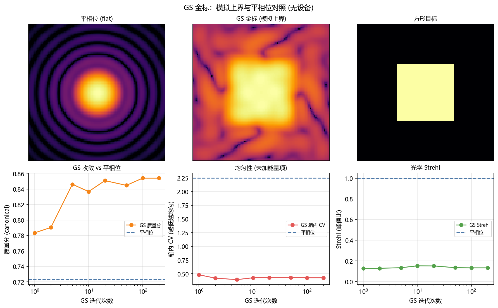

# GS 金标参照：模拟上界与平相位对照

<!-- provenance:start -->
> **生成脚本**: [`scripts/slm/generate_gs_golden_reference.py`](../../scripts/slm/generate_gs_golden_reference.py)
> **复现命令**: `python scripts/slm/generate_gs_golden_reference.py`
> **运行环境**: 离线
> **说明**: GS 金标参照 (模拟上界) 与平相位的对照 + GS 迭代预算收敛曲线; 相位由 ml.shaping.gs_reference 委托 canonical gs_shape 产出, 远场用 canonical forward_intensity, 指标 (含 Strehl / 相对 M²) 全取自 ao_shaping.utils.image.beam_metrics; GS 是对照而非基线 —— 实验记录为 GS 输给平相
<!-- provenance:end -->

**这是什么**：把 GS 方形相位当作**上界**——即「若正向模型完全准确，纯相位 SLM 最多能达到什么」。硬件运行可以据此读出自己离光学允许的上限还有多远。

**实验系统参数**：`n_grid=64`、`aperture=12.0 mm`、`λ=1064 nm`、`f=125 mm`、`target_side=40 px`（远场）、`padding=8`、`seed=42`。全部为仿真，无设备。



## 1. 对照结论（数据给出，不是断言）

| 臂 | 质量分 (canonical) | 箱内 CV | 箱内能量 EE | Strehl | 远场 M²(相对) |
|---|---|---|---|---|---|
| 平相位 (flat) | 0.7229 | 2.2464 | 0.9990 | 1.0000 | 1.0000 |
| GS 金标 (n_iters=200) | 0.8543 | 0.4276 | 0.9137 | 0.1329 | 1.4415 |

在**本仿真**中 GS 胜出：质量分 0.8543 对平相位的 0.7229，箱内 CV 从 2.2464 降到 0.4276。
> ⚠️ **这是关于仿真的陈述，不是硬件预期。** 仿真里正向模型按构造是精确的，GS 因此几乎必然占优。硬件上仓库记录的结论相反：GS 反复**输给平相位**（`report/shape_trials/README.md`：候选未能战胜平相，SLM 被退回平相位），逆向整形包也记录 GS 单独使用在 90/90 次中为负。**本表的上界不可当作硬件目标。**

## 2. GS 收敛：迭代预算不是猜的

| n_iters | 质量分 | 箱内 CV | 箱内能量 EE | Strehl | 相对 M² | 相位范围 (rad, 未包裹) |
|---|---|---|---|---|---|---|
| 1 | 0.7835 | 0.4821 | 0.7119 | 0.1277 | 4.7803 | [-3.140, 3.142] |
| 2 | 0.7904 | 0.4215 | 0.7779 | 0.1287 | 3.2399 | [-3.134, 3.142] |
| 5 | 0.8463 | 0.3938 | 0.8645 | 0.1344 | 2.2536 | [-3.141, 3.142] |
| 10 | 0.8369 | 0.4278 | 0.8835 | 0.1525 | 1.9956 | [-3.141, 3.142] |
| 20 | 0.8511 | 0.4293 | 0.9041 | 0.1517 | 1.6301 | [-3.140, 3.142] |
| 50 | 0.8449 | 0.4308 | 0.9139 | 0.1349 | 1.4497 | [-3.141, 3.142] |
| 100 | 0.8543 | 0.4276 | 0.9137 | 0.1329 | 1.4415 | [-3.141, 3.142] |
| 200 | 0.8543 | 0.4276 | 0.9137 | 0.1329 | 1.4415 | [-3.141, 3.142] |

平相位参考：质量分 0.7229、CV 2.2464、EE 0.9990、Strehl 1.0000。**把这张表当成 GS 的收敛曲线读**：第一个越过平相位分数的迭代次数，就是这个实验系统上 GS 值得花的钱；再多迭代只买仿真里的边际改善。

## 3. 口径与本报告不宣称什么

1. **0 级由 `argmax` 定位，不用几何中心。** 2f 傅里叶实验系统里光轴落在画面全局最大值处，几何中心只是碰巧重合；所有箱内指标都按定位到的中心计算。
2. **箱内 CV 单独看会骗人。** 仓库已记录「只优化 `-CV` 会把目标箱掏空」（实测 EE 塌到 0.002），所以本报告始终与 EE、Strehl 并列，不给 CV 单独下结论。
3. **相对 M² 不是绝对 M²。** 单个焦面无法定 M²，故报 BPP 比值（`m2_reference_relative`），绝对值需要焦点栈。本表中平相位相对 M² = 1.0000（它本身就是 BPP 参考）。
4. **GS 的均匀性是用峰值换来的，不要误读成像差。** 本次 GS 把箱内 CV 从 2.2464 压到 0.4276，代价是 Strehl 从 1.0000 掉到 0.1329、相对 M² 升到 1.4415。这三个数**同向**是平坦化变换的正常表现，不是相位误差的表现：要把一个高斯焦斑摊成平顶方块，中心峰值必然下降、二阶矩半径必然变大。所以**不能**用 Strehl 下降来判定 GS 失败，也不能用它来判定像差——在这张表里 Strehl 衡量的是「有多少能量离开了 0 级峰值」，而不是波前质量；要评波前质量必须另看相位本身（未包裹弧度的分布，见 §3.6）。
5. **Strehl 用同一前向链路的理想峰值做分母**（`ideal_peak_from_pupil`，同样的零填充），所以它度量的是相位误差而不是数值归一化。
6. **相位是未包裹弧度。** GS 返回 raw radians；唯一的 `mod 2π` 在 SLM 驱动（`Santec.create_phase_from_array`）里，本脚本不去碰它。

## 4. 复现

```bash
python scripts/slm/generate_gs_golden_reference.py
```

GS 相位由 `ml/shaping/gs_reference.py::gs_golden_phase` 产出（委托给 canonical `gs_shape`，不复刻）；远场由 canonical `forward_intensity` 计算；全部指标来自 `ao_shaping.utils.image.beam_metrics`，脚本内不另算光学量。
