# GS 方法实机对照与形状验收预检（2026-10-15）

<!-- provenance:start -->
> **生成脚本**: 人工撰写；汇总数据由 `scripts/slm/evaluate_gs_variant_runs.py` 从本地可信调试记录复算
> **运行环境**: Santec SLM #1 + Daheng CCD `FJB24112232`，真实光路
> **数据**: `data/debug/slm_gs_refine/20261015_issue_comparison/summary.json`
> **说明**: 固定曝光、同种子 GS 方法对照；仅用于本次光路状态的诊断，不构成形状成功验收
<!-- provenance:end -->

## 结论

在这组 100 像素方形目标实机测试中，plain GS 的综合分高于 weighted 和
adaptive-feedback。plain 首末两次 GS 分数为 0.5796、0.5740，相差 0.0055；
weighted 为 0.5323，adaptive-feedback 为 0.5548。后续 plain 复测为 0.5885，
说明方法排序仅是当前光路和单种子下的观察，不能外推为普遍优劣。

所有 GS 帧的半峰亮区与目标的 IoU 仅 0.0684–0.0980，画面仍是分散亮斑，
**没有形成实心均匀方斑**。这也验证了 GitHub #115 指出的风险：综合分、CV 或
`accepted` 不能单独代表形状达标。本轮已把 IoU 与其他指标并列记录，但未设
经硬件标定的 IoU 门槛，#115 尚未完成验收。#134 的自适应探针尚未进入实机，
应先通过其要求的仿真对照。

## 设备、曝光与设置

本次重新枚举的 SLM #1 报告 optionboardID `23020027`，与较早报告中的
`22030108` 不同；CCD 序列号为 `FJB24112232`。测试前在固定 0.020 ms 下拍摄
六张平场，峰值 19.5–20/255，固定 ROI 能量 11,215–11,311，极差约为均值的
0.85%。原始帧和逐帧 UTC 时间戳在
`data/debug/slm_flat_stability/20261015_issue_preflight_retry/`。这一短时稳定性
不能证明运行之间的光路完全不漂移。

五轮均请求 0.050 ms 曝光、2 帧平均、SLM 面板中心 `(960,690)`、照明半径
450 像素、目标边长 100 CCD 像素、12 次 GS、12×12 自由相位网格、随机种子
87、1 轮 SPGD。最后一轮的 CSV 逐阶段曝光回读均为 0.050 ms，并带 UTC 微秒
时间戳。自动探测的当次曝光上限约为 0.197–0.207 ms；这只是对应光路和功率
下的会话探测结果，**不是永久设备上限**。`AO_DAHENG_MAX_EXPOSURE_MS` 为正数时
使用该会话配置；缺失或为 0 时根据平场画面探测。此前报告提到的 0.4 或
0.6 ms 也不应被解释成跨光路永久边界。

## 实机结果

以下为 GS 阶段原始 CCD 帧计算值。PIB 是原代码的目标区域能量比例；CV 是
目标区域内的变异系数。IoU 是扣除帧中位背景后，以当前帧半峰阈值形成亮区，
与目标掩模取交并比。分数越高越好；CV 越低越好。

| 时间目录 | 方法 | 平场分数 | GS 分数 | GS PIB | GS CV | GS IoU |
| --- | --- | ---: | ---: | ---: | ---: | ---: |
| `20261015_205654` | plain | 0.4745 | 0.5796 | 0.5389 | 0.6123 | 0.0802 |
| `20261015_205848` | weighted | 0.4719 | 0.5323 | 0.5026 | 0.7793 | 0.0756 |
| `20261015_210048` | adaptive-feedback | 0.4723 | 0.5548 | 0.5236 | 0.7064 | 0.0980 |
| `20261015_210155` | plain 复测 | 0.4685 | 0.5740 | 0.5290 | 0.6152 | 0.0684 |
| `20261015_211345` | plain 再复测 | 0.4790 | 0.5885 | 0.5551 | 0.6080 | 0.0829 |

每轮完整 CSV、PKL、JSON、PNG 与最佳相位均在
`data/debug/slm_gs_refine/<时间目录>/`。汇总脚本从本地 PKL 原始帧和 CSV
保存的目标尺寸、固定中心复算 IoU，汇总文件在上述 `summary.json`。
这些 PKL 仅应作为可信本地实验产物读取。

与首末相邻 plain 对照相比，weighted 的 GS 分数低约 0.042–0.047，
adaptive-feedback 低约 0.019–0.025。adaptive-feedback 的 IoU 略高于当时
plain，但仍远低于实心目标。单种子、非相位交错重放，以及约 3.5–4.5/255 的
GS 帧峰值，使半峰二值 IoU 易受量化和背景影响；不能根据这些数据把方法
排序或 IoU 门槛固化为默认策略。1 轮 SPGD 仅作执行链检查，不作为收敛速度
比较。

## 本轮代码与后续验收

`compute_shape_iou` 已加入共用图像指标，GS 与 model-in-loop 的记录加入
`shape_iou`，GS 还记录 Daheng 曝光回读并拒绝超过会话上限的读数。曝光探测
改用单张原始整数 CCD 帧；多帧平均为浮点帧，不满足探针的原始帧契约。
无配置上限时先显示平相并以 0.020 ms 开始探测；估计上限不超过实际拍到的
最后一个未饱和曝光。实机测试均已结束并正常释放设备。

下一轮应在更高但经探测确认未饱和、全程固定的曝光下，提高 GS 帧信噪比；
以 plain/候选交错下发同一批保存相位并穿插平场，量化漂移与方法差异；
对方形、三角形和五角星共同校准独立的轮廓指标与阈值，再决定是否将其
加入成功验收。#134 的探针策略先进行模拟器配对评估。当前 GitHub API
在执行环境不可达，issue 依据为仓库内
`docs/slm/闭环光束整形_文献与优化建议_20261014.md` 的记录，未核验远端最新状态。

## 实机结果 — 相位与远场图像

以下为五轮 GS 阶段保存的最佳相位与最佳远场 CCD 图像。每个方法均保存最佳相位
(`best_phase.npy`，1200×1920，弧度) 与最佳远场 (`best_far_field.png`，0.050 ms)。
相位绕到 [0, 2π) 显示，远场使用 `inferno` 拆灰度渲染。

### plain (`20261015_205654`，GS CV = 0.6123)

**SLM 相位**

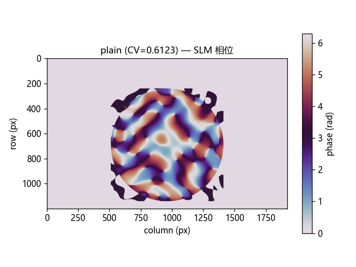

**CCD 远场**

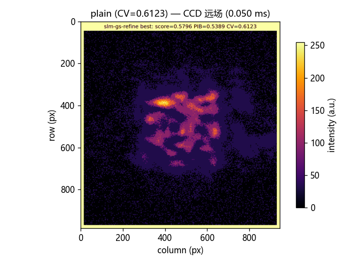

**CCD 远场强度截面 (X/Y 方向)**

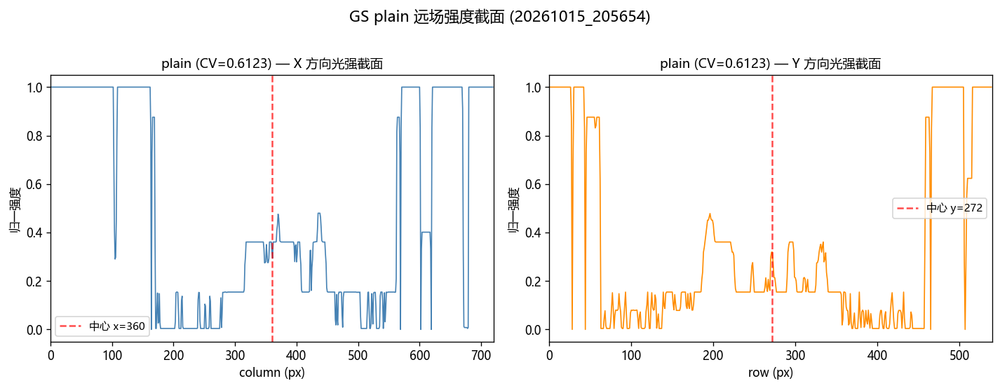

### weighted (`20261015_205848`，GS CV = 0.7793)

**SLM 相位**

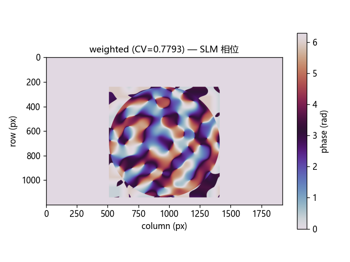

**CCD 远场**

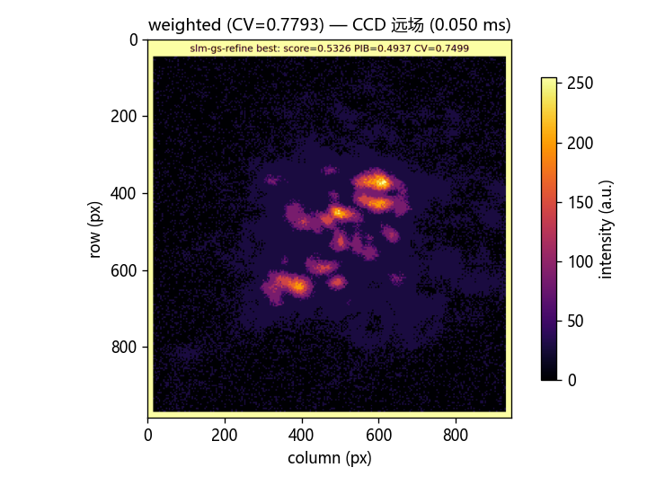

**CCD 远场强度截面 (X/Y 方向)**

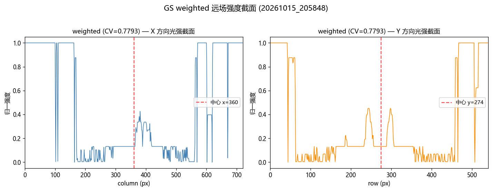

### adaptive-feedback (`20261015_210048`，GS CV = 0.7064)

**SLM 相位**

**CCD 远场**

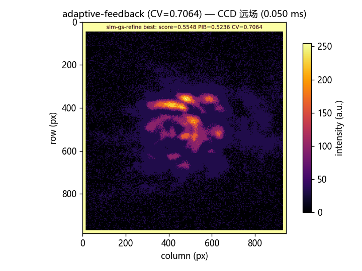

**CCD 远场强度截面 (X/Y 方向)**

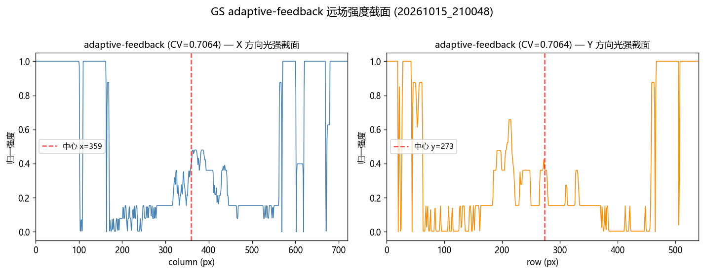

### plain 复测 (`20261015_210155`，GS CV = 0.6152)

**SLM 相位**

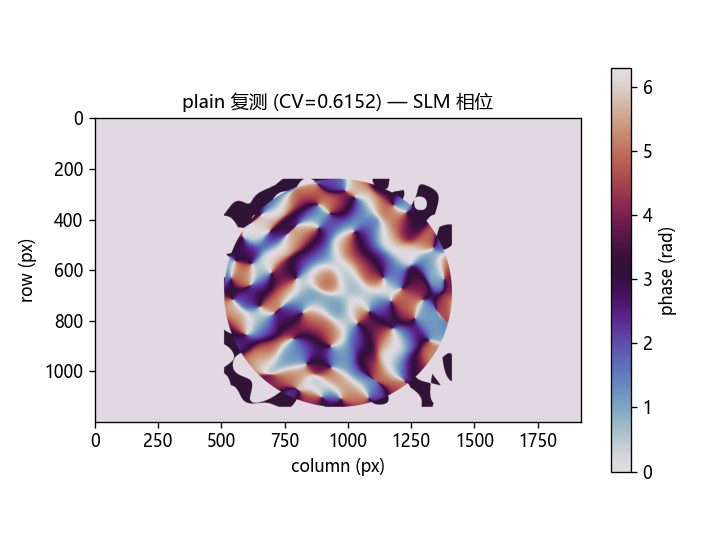

**CCD 远场**

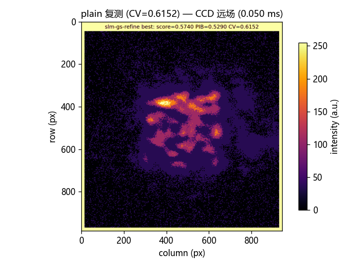

**CCD 远场强度截面 (X/Y 方向)**

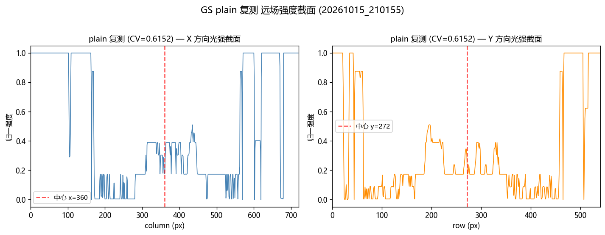

### plain 再复测 (`20261015_211345`，GS CV = 0.6080，最优 CV)

**SLM 相位**

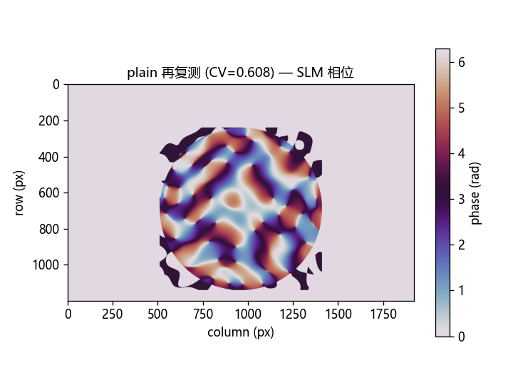

**CCD 远场**

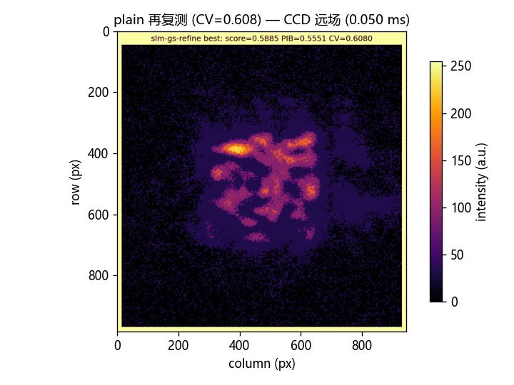

**CCD 远场强度截面 (X/Y 方向)**

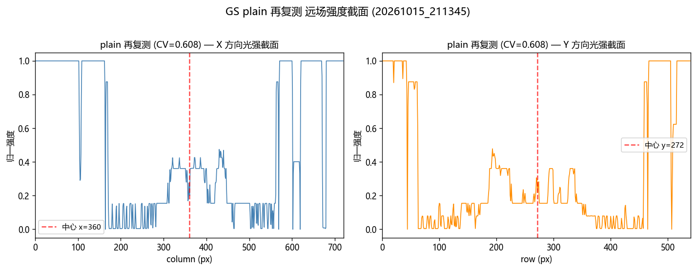
