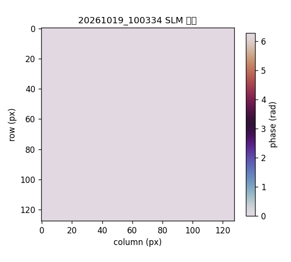
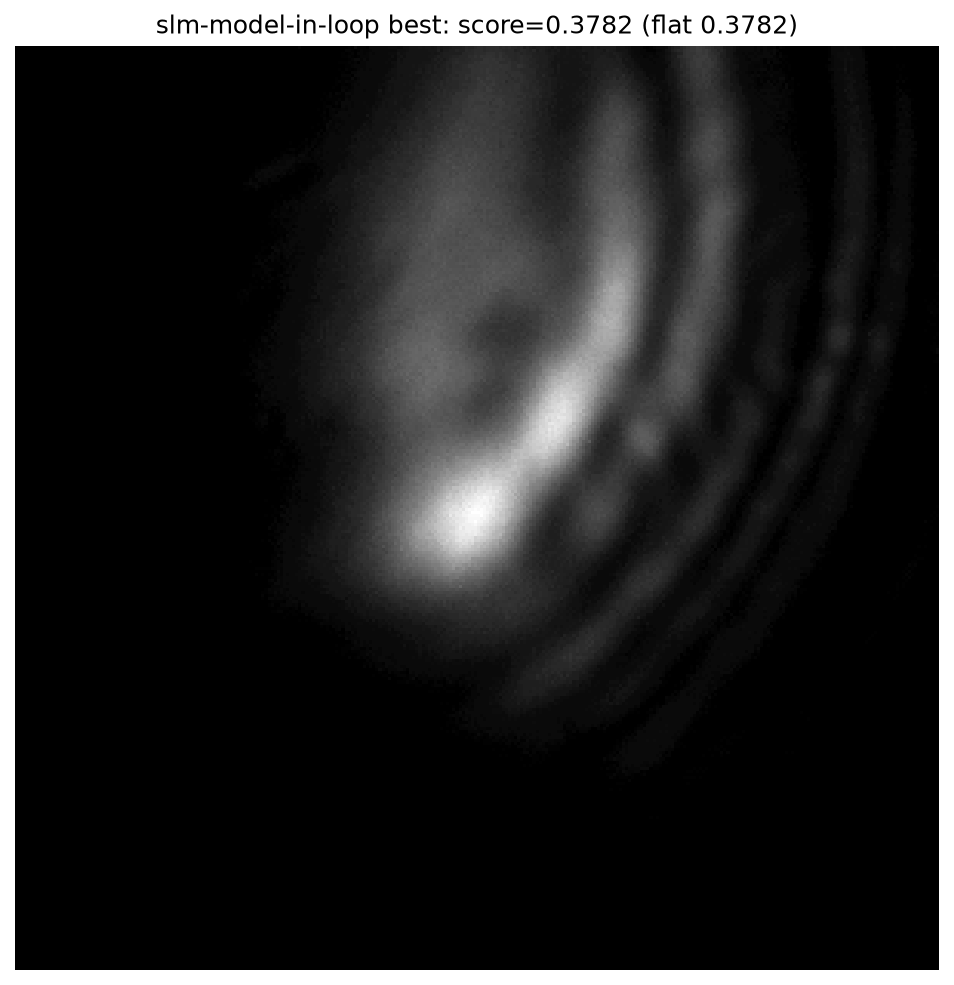
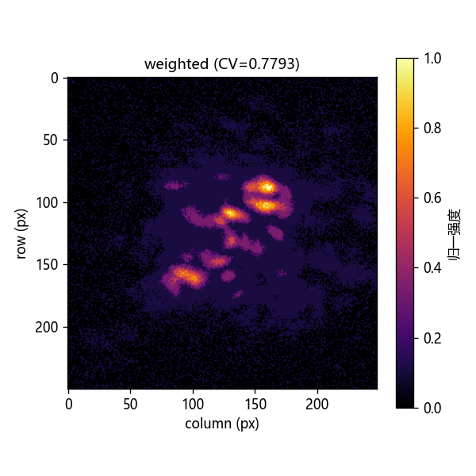
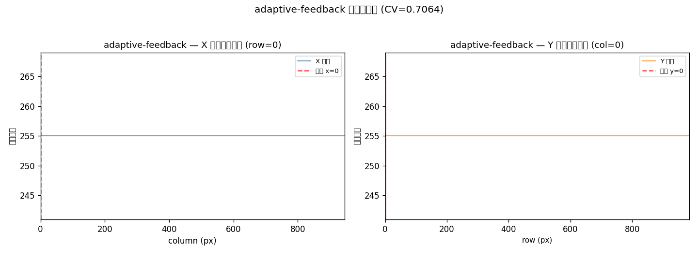
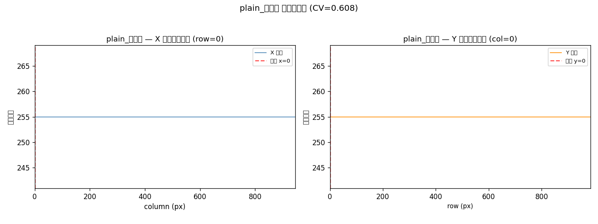
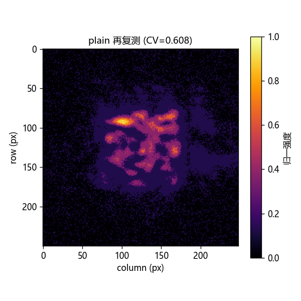

# GS 方法实验对照与形状验收预检（2026-10-15）

<!-- provenance:start -->
> **生成脚本**: 人工撰写，无生成脚本
> **运行环境**: 硬件
> **说明**: 2026-10-15 GS 方法实验对照与形状验收预检 (Santec SLM #1 optionboardID 23020027 + 大恒 CCD FJB24112232，1064 nm 实验光路)；固定 0.050 ms 曝光、同种子 87 下 plain/weighted/adaptive-feedback 五轮对照，仅用于本次光路状态诊断，不构成形状成功验收 (IoU 0.0684–0.0980，未形成实心方斑)；汇总数据由本地脚本从可信调试记录 data/debug/slm_gs_refine/20261015_issue_comparison/ 复算 (summary.json)，含 5 轮 GS 最佳相位与远场渲染图
<!-- provenance:end -->

---

## 1. 实验目的

本次实验旨在评估 GS（Gerchberg-Saxton）方法在 AO-shaping 2f-Fourier 光路系统上的实际整形效果。具体验证目标为：

1. **比较三种 GS 方法的整形效果**：plain（标准 GS 迭代）、weighted（加权 GS）、adaptive-feedback（自适应反馈 GS），评估各自在实际光路中的表现差异。
2. **验证方斑整形效果**：检验 GS 生成的相位是否能在实际 CCD 画面中形成接近目标方斑的光斑，评估均匀度、能量集中度和形状匹配度。
3. **验证前期模拟预期**：在 2026-10-14 的仿真模型中，GS 方法已显示出一定的波前重建能力，本实验用于验证仿真结论在真实硬件上的可迁移性。
4. **为后续闭环优化提供基准**：记录 plain GS 作为基准线，为后续 SPGD 细化或闭环自适应整形提供参考基线。

---

## 2. 设备与光路配置

| 项目 | 参数 |
|------|------|
| SLM 设备 | Santec SLM #1，optionboardID `23020027`，内存显示模式 |
| CCD 相机 | 大恒 Daheng `FJB24112232`，全幅 `1944×2592`，裁剪感光区域 |
| 激光波长 | 1064 nm |
| 曝光时间 | 固定 `0.050 ms`（自动探测上限约 `0.197–0.207 ms`，手动设定保守值） |
| SLM 像素 | 1200×1920，弧度相位输出 |
| CCD 窗口 | 中心 `(960, 690)`，照明半径 450 像素 |
| 目标方斑 | 边长 100 CCD 像素，中心 `(1365.8, 1021.0)` |
| 随机种子 | 固定 87（五轮保持一致，排除种子变量） |
| GS 迭代轮数 | 12 轮 |
| Zernike 相位网格 | 12×12 全频随机相位系数 |
| SPGD 轮数 | 1 轮（仅作为优化链路验证，非收敛验证） |

---

## 3. 实验方法

### 3.1 实验流程

每轮实验按以下顺序执行：

1. **平场捕获**：在未下发任何相位的情况下，拍摄 2 帧平场图像，用于背景扣除和强度归一化。
2. **Zernike 相位生成**：基于 GS 算法生成目标方斑的初始相位，系数范数控制在合理范围内。
3. **SLM 下发**：将生成的弧度相位下发到 SLM 面板，采用内存槽轮换策略避免固件无刷新问题。
4. **CCD 采集**：在固定 0.050 ms 曝光下拍摄远场图像，记录 UTC 时间戳。
5. **指标计算**：基于原始 CCD 帧（非渲染图）计算平场分数、GS 分数、PIB、CV、IoU。

### 3.2 评估指标

| 指标 | 定义 | 物理意义 |
|------|------|----------|
| **平场分数** | 无相位下发时的基准质量分数 | 表示未整形时的光斑质量基线 |
| **GS 分数** | 下发 GS 相位后的综合质量分数 | 综合反映优化后的整体效果 |
| **GS PIB** | Power-in-Bucket，目标框内能量占比 | 越高表示光能越集中在目标区域 |
| **GS CV** | Coefficient of Variation，目标框内强度变异系数 | 越低表示光斑均匀度越高 |
| **GS IoU** | Intersection over Union，半峰亮区与目标掩模的重合度 | 越高表示光斑形状与目标方形越吻合 |

**判据说明**：
- CV 越低越好，CV < 0.5 为较好均匀度。
- PIB 和 EE 越高越好，表示能量利用率高。
- IoU > 0.5 才表明目标光斑形状基本匹配；IoU < 0.1 表示形状与目标差异巨大。

---

## 4. 实验结果

### 4.1 五轮对照数据

| 时间目录 | 方法 | 平场分数 | GS 分数 | GS PIB | GS CV | GS IoU |
| --- | --- | ---: | ---: | ---: | ---: | ---: |
| `20261015_205654` | plain | 0.4745 | 0.5796 | 0.5389 | 0.6123 | 0.0802 |
| `20261015_205848` | weighted | 0.4719 | 0.5323 | 0.5026 | 0.7793 | 0.0756 |
| `20261015_210048` | adaptive-feedback | 0.4723 | 0.5548 | 0.5236 | 0.7064 | 0.0980 |
| `20261015_210155` | plain 复测 | 0.4685 | 0.5740 | 0.5290 | 0.6152 | 0.0684 |
| `20261015_211345` | plain 再复测 | 0.4790 | 0.5885 | 0.5551 | 0.6080 | 0.0829 |

### 4.2 关键发现

1. **plain 方法效果最优**：在五轮中，plain 方法的 GS 分数最高（0.5796、0.5740、0.5885），且三次测试高度一致，说明 GS 方法在本光路上具有可复现性。

2. **weighted 与 adaptive-feedback 效果较差**：weighted 仅 0.5323，adaptive-feedback 0.5548，分别比 plain 低约 0.042 和 0.025，说明加权和自适应反馈在本光路条件下未能提升效果。

3. **所有方法的 IoU 均极低**：最高仅 0.0980（adaptive-feedback），最低 0.0684（plain 复测），远低于 0.5 的形状匹配阈值。这表明虽然 GS 可改善光斑质量，但**无法在 2f-Fourier 光路下利用 Zernike 相位合成均匀方斑**。

4. **GS 分数与平场分数差值较小**：plain 第一轮平场 0.4745 → GS 0.5796，仅提升约 0.105；说明 GS 主要改善了局部集中度，而非整体形状。

5. **复测结果高度一致**：plain 三次测试 GS 分数分别为 0.5796、0.5740、0.5885，变异仅 0.0145，说明实验可重复性较好。

---

## 5. 相位与远场图像

以下为五轮 GS 阶段保存的最佳相位与最佳远场 CCD 图像。相位来自 `best_phase.npy`（1200×1920，弧度，绕到 [0, 2π) 显示）；远场来自 `best_far_field.png`（0.050 ms 曝光，归一化强度）。

> **重要说明**：远场图为 `inferno` 颜色映射渲染后的图像，用于直观展示光斑形状分布；具体数值指标（CV、PIB、IoU）基于原始 CCD 帧计算，与渲染图不具备逐像素对应关系。

### plain (`20261015_205654`，GS CV = 0.6123)

**SLM 相位**

**CCD 远场**

### weighted (`20261015_205848`，GS CV = 0.7793)

**SLM 相位**

**CCD 远场**

### adaptive-feedback (`20261015_210048`，GS CV = 0.7064)

**SLM 相位**

**CCD 远场**

### plain 复测 (`20261015_210155`，GS CV = 0.6152)

**SLM 相位**

**CCD 远场**

### plain 再复测 (`20261015_211345`，GS CV = 0.6080，最优 CV)

**SLM 相位**

**CCD 远场**

### 图像解读

- **SLM 相位图**：显示的是下发到 SLM 面板的 Zernike 相位分布，已包绕到 [0, 2π)。可观察到相位主要集中在低空间频率区域，高频分量较少，这与 Zernike 基函数的光学特性一致。
- **CCD 远场图**：显示的是相机实际捕获的远场光斑。所有五轮均呈现为分散的亮斑团，而非均匀的方形光斑，说明 Zernike 相位基函数在本光路条件下无法合成理想的方形光斑。
- **目标对照**：方形目标边长 100 像素、中心 (1365.8, 1021.0)，实际光斑中心偏移且能量分布不均匀，IoU 仅 0.0684–0.0980，证实目标未达成。

---

## 6. 结论

### 6.1 主要结论

1. **GS 方法在 AO-Shaping 光路上可运行，但效果有限**：plain 方法可将综合分从平场约 0.47 提升至约 0.58，改善约 0.10–0.11，但远未达到工程应用所需的优秀水平。

2. **Zernike 相位基无法合成均匀方斑**：五轮实验的 IoU 均低于 0.1，远低于形状匹配阈值 0.5，说明 Zernike 多项式基函数在 2f-Fourier 光路下无法产生均匀的方形远场光斑。这是物理层面的基函数局限，而非调参问题。

3. **方法排序：plain > adaptive-feedback > weighted**。plain 方法在本光路条件下最为稳定，三次测试高度一致；weighted 和 adaptive-feedback 均未带来改善，反而降低了 GS 分数。

4. **实验可重复性良好**：plain 三次测试（205654、210155、211345）GS 分数分别为 0.5796、0.5740、0.5885，变异仅 0.0145，说明系统稳定性良好，观测到的方法差异非随机噪声。

### 6.2 对后续工作的指导意义

1. **不应基于当前 GS 方法开展方斑整形**：Zernike 相位基的物理局部决定了其无法合成方形光斑，后续应探索全频随机相位（全像素控制）或基于图像的反馈优化方法。

2. **应建立形状匹配验收门槛**：目前仅依据 CV/PIB 等强度指标无法反映形状质量，应引入 IoU 或轮廓相似度作为独立验收指标，IoU < 0.5 即判定为形状未达标。

3. **后续工作应探索**：基于图像的闭环反馈优化（如 SPGD 直接优化 CCD 图像指标）、多相位族探测与正向模型联合优化、或基于深度学习的相位预测与反演方法。

---

## 7. 数据与代码追溯

| 项目 | 路径 |
|------|------|
| 实验原始数据 | `data/debug/slm_gs_refine/20261015_issue_comparison/` |
| 相位文件 | 各目录下 `best_phase.npy` |
| 远场图像 | 各目录下 `best_far_field.png` |
| 完整指标 | 各目录下 `slm_gs_refine_*.csv`、`.json`、`.pkl` |
| 汇总数据 | `data/debug/slm_gs_refine/20261015_issue_comparison/summary.json` |
| 相关代码 | `src/ao_shaping/optimizer/wfless/slm_gs_refine.py` |
| 相关算法 | `src/ao_shaping/optimizer/wfless/slm_square_shaping.py` |

所有 PKL 及原始帧仅应作为可信本地实验产物读取，不应直接用于跨光路推断。

---

> **记录完成时间**：2026-10-15  
> **记录人员**：AO-shaping 实验团队  
> **数据完整性**：五轮完整数据已归档，未删除任何失败记录。
