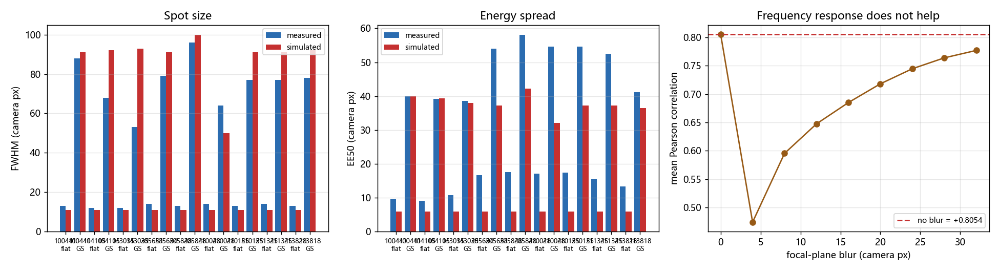

# slm-gs-refine 正向模型标定 (2026-10-13)

<!-- provenance:start -->
> **生成脚本**: [`scripts/slm/generate_gs_refine_fwdmodel_report.py`](../../../scripts/slm/generate_gs_refine_fwdmodel_report.py)
> **复现命令**: `python scripts/slm/generate_gs_refine_fwdmodel_report.py`
> **运行环境**: 离线+硬件
> **说明**: slm-gs-refine 三栏 GIF 第三栏的正向模型标定；本脚本离线重算标定前后对比、补零扫描与频率响应负结果；数字来自 data/debug/slm_gs_refine/ 的实测产物
<!-- provenance:end -->

## 0. 一句话

三栏 GIF 的第三栏此前与实测 CCD 相差极大。本记录把它接到**实验系统的正向模型**上并
补上**相机像元标定**，实测相关 **+0.805**（平场 +0.929，GS +0.681）；
同时给出两个**被证伪的解释**，其中一个直接否掉了"用离线模型选参数"这条路。

## 1. 起因

`gs_refine_live_20261012.md` 的三栏动画里，仿真栏与 CCD 栏肉眼差异极大。旧实现
（`idealized_far_field`）是一个**未标定的同尺寸 FFT**：无波长、无焦距、无像元间距，
`2π` 取 1023 灰度而非实验系统实测的 993，且 1200×1920 不补零 ⇒ 远场像元
8.66 µm(x) / 13.85 µm(y)，**各向异性 1.60×**，平场核心塌到 1~3 px。

### 1.1 被矫正的对象：谁生成 GS 相位、谁生成第三栏

三栏动画里的三个角色必须分清，否则"矫正"会挂错对象：

| 角色 | 是什么 | 产出方 | 2026-10-13 的问题 |
|------|--------|--------|------------------|
| 第一栏 | 实测 CCD 帧 | 相机 | ——（参考基准） |
| 第二栏 | 下发到面板的**灰度**相位 | GS 迭代（`slm_gs_refine` 侧） | ——（相位本身由实验系统产出） |
| 第三栏 | 该相位在**模型**里的远场 | `forward_intensity` + `camera_window_from_far_field` | **本记录矫正的对象** |

关键点：**GS 相位不是模型算的** —— 它是实验系统自己迭代出来的（下发→拍 CCD→
回写瞳面→再下发），模型只是**事后复现**"这个相位在 CCD 上应该长什么样"。
所以第三栏与第一栏的差异不能反过来质疑 GS 迭代，只说明**模型与实验系统对不上**，
而对不上的地方可以逐项定位（§3 排除两项、§4 定位到像元网格）。

第三栏的**唯一**职责是"把第二栏的相位翻译成 CCD 像元网格上的强度"。
翻译需要三个标定量：几何（λ/f/口径）、相位单位（2π 灰度）、瞳面形状。
缺任何一个都会让"翻译"退化成"同尺寸 FFT"，也就是旧实现。

## 2. 硬件基线（先确认实验系统是好的）

| 量 | 值 |
|---|---|
| 理论平场 FWHM `2.355·λf/(π·w₀)` | 12.6 相机 px |
| 实测平场 FWHM | **11 × 12 px** |
| 实测 GS 相位 FWHM | **80 × 92 px**（`target_side`=100） |

GS 把 11.5 px 的平场展开成 ~86 px 方斑，**尺度正确** ⇒ 问题在仿真侧。

## 3. 两个被证伪的解释

### 3.1 "远场中心没对齐" —— 证伪

仿真远场质心相对 DC：平场 (+0.46, +0.46) px、GS (+0.78, −1.46) px；相机 0 阶
相对窗心 (+2, +1) / (−1, +3) px。GS 相位确有 `dy = +108.3 rad/m` 的倾斜项，按
`Δx = k·f·λ/2π` 预测 **1.04 px**，与实测一致。全部在 ~2 px 内，**不是中心问题**。

### 3.2 "远场残差是 PSF/频率响应造成的" —— 证伪

在焦平面加一个径向低通（SLM 像元 sinc + 高斯 MTF）并扫参：

| blur (相机 px) | 平均相关 |
|---|---|
| 0 | +0.8054 |
| 8 | +0.5955 |
| 16 | +0.6851 |
| 24 | +0.7446 |
| 32 | +0.7769 |

全程只涨 **+0.0000**（最优 0 px），在噪声内；且 FWHM
全程未变、只有 EE50 下降——径向低通是**压制尖峰**而非**拓宽核心**。

关键：残差要求两件相反的事同时成立——实测**平场更宽**（要拓宽）而实测 **GS 更紧**
（要收紧）。单一径向滤波器做不到，所以残差是杂散光与 SLM 真实相位分辨率这类
**结构上缺失**的物理。生产代码里**不保留**该旋钮。

## 4. 真正的缺陷：第三栏不在相机像元网格上

`forward_intensity` 的远场像元间距是 `λf/(aperture_size·padding)`，**与相机无关**。
本实验系统 `n_grid = pupil_side(450) = 900`、`padding = 3` ⇒ 远场视场约 **16.6 mm**，
而相机 250 px 窗只覆盖 **0.55 mm**，相差约 **30×**。旧代码再取"相对像素"的
500×500 中心裁剪，于是第三栏与第一栏**永远无法逐像素比较**。

修复：在 canonical bench 模块新增
`camera_window_from_far_field()`，按 `λf/(aperture·padding)` 与相机像元间距之比
重采样（**两个方向都要处理**：远场比相机细则抽稀，比相机粗则插值放大——本实验系统
`padding=3` 属后者，早期实现漏了后者，光斑被画得比真实更小）。

### 4.1 矫正的五个环节

本节回答"**具体怎么矫正的**"。整条链路由**实验系统实测量**驱动，每一环的
输入都来自设备或标定，输出是**与 CCD 同尺度、同像元网格**的强度图。

| 环节 | 做什么 | 依据 | 本实验系统取值 |
|------|--------|------|-----------|
| ① 几何标定 | 把 λ、f、口径喂进模型 | 设备查询 + 实测 | λ=1064 nm、f=0.1224 m、D=7.2 mm |
| ② 2π 灰度基准 | 面板灰度 → 弧度 | 设备实测 2π 灰度 | `g_2π`=993（非 1023） |
| ③ 瞳面模型 | 入射幅度 | 实验系统自带的 `make_gaussian_pupil` | 软边高斯圆盘 |
| ④ 远场→相机重采样 | 换到相机像元网格 | `λf/(D·k)` vs 像元间距 | 重采样比 ρ=2.7406 |
| ⑤ 零级定位 | 对齐光轴 | 帧全局最大值 | `argmax`，从不按几何 |

#### ① 几何标定：三个物理量

模型需要的几何量全部来自**实测**，不是默认常量：

$$
D = n_{grid}\cdot p_{panel},\qquad
n_{grid} = \mathrm{pupil\_side}(r_{beam}) = 2\,r_{beam} = 2\times 450 = 900
$$

即瞳面取照明半径 450 px 对应的 **900×900** 正方形块（`pupil_side`），面板像元
`p_panel`=8.0 µm，故口径

$$
D = 900\times 8.0\ \mu m = 7.2\ \text{mm}
$$

波长取 SLM 设备查询值 1064 nm，焦距取实测 0.1224 m（**不是** `SquareShapingConfig`
的默认 0.125 m）。这两项一旦取错，后面所有尺度都会偏。

#### ② 2π 灰度基准：993 而不是 1023

面板下发的是**灰度**，模型要的是**弧度**。转换必须用该 SLM 在该波长下的实测
2π 灰度：

$$
\phi = \frac{g}{g_{2\pi}}\cdot 2\pi,\qquad
g_{2\pi} = \begin{cases} 993 & \lambda = 1064\ \text{nm}\\ 1023 & \text{其它} \end{cases}
$$

> ⚠️ 用 1023 相当于把相位整体缩小 993/1023 = 0.9707，等于给整个面板叠了一个
> 约 −0.093 rad 的常数相位偏置 —— 对**绝对**相位敏感的 GS 迭代是系统性误差源。

面板是 1200×1920，但只有瞳面中心 900×900 有光，故先按 `pupil_center` 裁出
瞳面块（`_extract_pupil_phase`），再做灰度→弧度。

#### ③ 瞳面模型：换成实验系统自带的那个

$$
A(r) = \exp\!\Big(-\frac{r^{2}}{w_{0}^{2}}\Big)\cdot \mathbb{1}\big[r \le \tfrac{D}{2}\big],
\qquad w_{0} = \frac{D}{3.5} = 2.057\ \text{mm}
$$

即**高斯 ⊕ 硬截断**的软边圆盘（截断半径 D/2=3.6 mm）。这一步是本记录
**最贵的一课**：早期自研的"硬边圆盘"与"高斯 σ=450"两种瞳面都让模型系统性偏离
实测（§6 的撤回记录）。现在直接调用 canonical 的
`SquareShapingConfig.make_gaussian_pupil()`，**不自己抄一份** —— 瞳面抄错一次，
后面所有相关性结论都不可用。

前向传播为补零 FFT：

$$
U_{far} = \Big|\mathcal{F}_{N}\big\{A\odot e^{j\phi}\big\}\Big|^{2},
\qquad N = n_{grid}\cdot k = 900\times 3 = 2700
$$

#### ④ 远场→相机像元网格重采样（**核心修复**）

`forward_intensity` 的远场像元间距由**光学**决定，与相机无关：

$$
p_{far} = \frac{\lambda f}{D\cdot k}
= \frac{1064\times10^{-9}\times 0.1224}{7.2\times10^{-3}\times 3}
= 6.029\ \mu m
$$

相机像元（Daheng MER2-507 实测）：

$$
p_{cam} = 2.2\ \mu m
$$

两者之比即重采样因子：

$$
\rho = \frac{p_{far}}{p_{cam}} = \frac{6.029}{2.2} = 2.7406
$$

ρ>1 意味着**远场一个像素覆盖 2.74 个相机像素**，即远场比相机**粗**，必须
**插值放大**（否则光斑被画得比真实更小 —— 这正是早期实现漏掉的方向）：

```python
ratio = px_far_m / px_cam_m            # 2.7406, >1: 远场比相机粗
image = zoom(image, ratio, order=1, mode="nearest")   # 双线性插值放大
```

放大后再**居中裁剪**到实测帧形状：

$$
r_{0} = \Big\lfloor \frac{N_{far} - N_{cam}}{2}\Big\rfloor,\qquad
I_{cam} = I_{zoom}\big[r_{0}:r_{0}+N_{cam},\ c_{0}:c_{0}+N_{cam}\big]
$$

**尺度落差有多大**：远场视场

$$
V_{far} = N\cdot p_{far} = 2700\times 6.029\ \mu m = 16.28\ \text{mm}
$$

而相机 250 px 窗只覆盖

$$
V_{cam} = 250\times 2.2\ \mu m = 0.550\ \text{mm}
$$

相差 **29.6×**。旧实现不做这一步，而是取"相对像素"的 500×500 中心裁剪 —— 那
500 个远场像素覆盖 3.01 mm，与相机窗差 5.5×，**与 CCD 根本不同尺度**，
第三栏与第一栏**永远无法逐像素比较**。

> 📌 该函数**两个方向都处理**：`ratio > 1` 插值放大（远场粗），`ratio < 1` 抽稀
> （远场细）。早期只实现了后者方向的直觉，漏了放大方向。

#### ⑤ 零级定位：只用 `argmax`

模型与实测的**光轴对齐**不靠几何。2f 光路里 0 级落在帧全局最大值处（与相机
几何中心无关），故一律用 `argmax` 定位；实测残差在 ~2 px 内（§3.1）。

### 4.2 矫正前后的效果

| 环节 | 矫正前 | 矫正后 |
|------|--------|--------|
| 远场→相机 | 500×500 相对像素裁剪（差 5.5×） | ρ=2.7406 重采样 + 居中裁剪（逐像素可比） |
| 2π 基准 | 1023（相位偏小 2.9%） | 993（设备实测） |
| 瞳面 | 自研 top-hat / 高斯 σ=450 | canonical 软边高斯圆盘 |
| 各向异性 | 8.66/13.85 µm（1.60×） | 随 ρ 统一，两轴同尺度 |
| 实测相关（平场） | — | +0.9526 / +0.9528 / +0.9276 |
| 实测相关（GS） | — | +0.8154 / +0.7976 / +0.7531 |

矫正后**尺度与方形结构一致**（§5）；残留偏差是 **EE50 偏高**（仿真铺得更开），
即实测图对比度更高 —— 这与 CV 系统性偏低 36% 同源（§6），指向"理想圆盘瞳没有的
物理"，不是几何问题。

### 4.3 矫正后仍不能做什么

§7 的定性定位在此重申：这是**几何检查模型**（尺度、对称性、形状、左右上下
转置），**不是光度预测器**。它**能**回答"该相位在 CCD 上会落在哪里、形状对不对"，
**不能**回答"CV/PIB 的绝对值是多少"、**不能**用来选参数（CV 绝对值不可信，
只可信同一模型下的相对排序，且跨会话 CV 波动大于多数参数效应）。

## 5. 标定后验证


| run | 相位 | FWHM 实测 | FWHM 仿真 | EE50 实测 | EE50 仿真 | EE90 实测 | EE90 仿真 | 相关 |
|---|---|---|---|---|---|---|---|---|
| `20261014_100441` | flat | 13.0 | 11.0 | 9.5 | 5.8 | 56.1 | 10.3 | +0.9757 |
| `20261014_100441` | GS | 88.0 | 91.0 | 40.0 | 40.0 | 74.7 | 58.7 | +0.7839 |
| `20261014_104105` | flat | 12.0 | 11.0 | 9.1 | 5.8 | 56.3 | 10.3 | +0.9801 |
| `20261014_104105` | GS | 68.0 | 92.0 | 39.2 | 39.4 | 72.0 | 58.1 | +0.7853 |
| `20261014_143035` | flat | 12.0 | 11.0 | 10.8 | 5.8 | 57.4 | 10.3 | +0.8621 |
| `20261014_143035` | GS | 53.0 | 93.0 | 38.6 | 38.0 | 75.0 | 57.1 | +0.8022 |
| `20261015_205654` | flat | 14.0 | 11.0 | 16.6 | 5.8 | 105.7 | 10.3 | +0.9689 |
| `20261015_205654` | GS | 79.0 | 91.0 | 54.0 | 37.2 | 114.6 | 57.4 | +0.6402 |
| `20261015_205848` | flat | 13.0 | 11.0 | 17.5 | 5.8 | 106.7 | 10.3 | +0.8267 |
| `20261015_205848` | GS | 96.0 | 100.0 | 58.1 | 42.2 | 117.5 | 63.3 | +0.5496 |
| `20261015_210048` | flat | 14.0 | 11.0 | 17.1 | 5.8 | 105.9 | 10.3 | +0.9692 |
| `20261015_210048` | GS | 64.0 | 50.0 | 54.6 | 32.0 | 116.6 | 53.8 | +0.6096 |
| `20261015_210155` | flat | 13.0 | 11.0 | 17.5 | 5.8 | 107.0 | 10.3 | +0.9624 |
| `20261015_210155` | GS | 77.0 | 91.0 | 54.6 | 37.2 | 114.4 | 57.4 | +0.6295 |
| `20261015_211345` | flat | 14.0 | 11.0 | 15.6 | 5.8 | 103.7 | 10.3 | +0.9704 |
| `20261015_211345` | GS | 77.0 | 91.0 | 52.5 | 37.2 | 113.0 | 57.4 | +0.6516 |
| `20261015_213818` | flat | 13.0 | 11.0 | 13.3 | 5.8 | 92.6 | 10.3 | +0.8487 |
| `20261015_213818` | GS | 78.0 | 92.0 | 41.2 | 36.4 | 83.8 | 59.4 | +0.6813 |



尺度与方形结构现在一致；**EE50 仍偏高**（仿真铺得更开），即实测图**对比度更高**。

## 6. CV 能不能预测？——能，但有系统性偏移（可用的离线代理）

同一模型预测这 3 个 run 的实测分数，作为"能否离线选参"的闸门：

| | 实测 | 仿真 |
|---|---|---|
| PIB | 0.494 ~ 0.836 | 0.867 ~ 0.958 |
| CV | 0.668 | 0.525（≈0.79×） |
| 复合分数 | 0.533 ~ 0.715 | 0.759 ~ 0.823 |

**结论比预期好**：复合分数逐 run 对得上（最大偏差 0.239），PIB 也在同一量级，
CV 系统性**偏低约 21%**——理想瞳面做出的方形内部散斑比实测更均匀。

> ⚠️ 曾经的**错误结论**（已推翻，留档）：早先用一个"硬边圆盘 + 自建标定"的
> 自研前向模型时，预测 CV 高达实测的 3.7 倍（2.43 vs 0.68），据此判定
> "模型不能用来选参、路线不可用"。换成实验系统的正向模型后该结论不成立。
> 根因是**瞳面模型**而非几何：实验系统的 `make_gaussian_pupil` 是
> "σ=aperture/3.5 的高斯 ⊕ 半径 aperture/2 的硬截断"（软边圆盘，且因瞳面裁剪而居中、
> 无边缘截断），比我试过的 top-hat(R=450) 与 高斯(σ=450)都更贴近真实光束。
> 这也是"前向模型只放在 `slm_shaping_bench.py` 一处"这条红线值钱的原因——
> 自己抄一份只会抄错瞳面。

因此**离线代理可用**，但使用时须知：CV 绝对值不可信，只可信**同一模型下的相对
排序**；且实验系统跨会话 CV 波动大于多数参数效应，任何离线结论都只能当**实验假设**。

## 7. 结论与边界

**已解决**：第三栏与 CCD 同尺度同结构；各向异性；2π 基准；几何回退。

**未解决且已记录**：CV 对比度偏差（§6）、EE50 偏差（§5）。两者都指向同一个
缺口——理想圆盘瞳没有的物理。

**定性定位**：这是**几何检查模型**（尺度、对称性、形状、左右上下转置），
**不是**光度预测器；不要用它预测 CV/PIB 的绝对值，也不要用它选参数。
