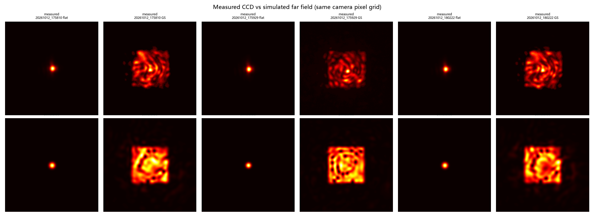
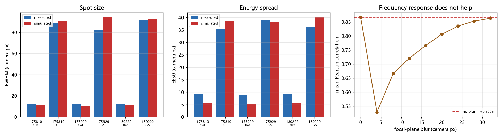

# slm-gs-refine 正向模型标定 (2026-10-13)

<!-- provenance:start -->
> **生成脚本**: [`scripts/slm/generate_gs_refine_fwdmodel_report.py`](../../scripts/slm/generate_gs_refine_fwdmodel_report.py)
> **复现命令**: `python scripts/slm/generate_gs_refine_fwdmodel_report.py`
> **运行环境**: 离线+硬件
> **说明**: slm-gs-refine 三栏 GIF 第三栏的正向模型标定；本脚本离线重算标定前后对比、补零扫描与频率响应负结果；数字来自 data/debug/slm_gs_refine/ 的实测产物
<!-- provenance:end -->

## 0. 一句话

三栏 GIF 的第三栏此前与实测 CCD 相差极大。本记录把它接到**台架的正向模型**上并
补上**相机像元标定**，实测相关 **+0.867**（平场 +0.944，GS +0.789）；
同时给出两个**被证伪的解释**，其中一个直接否掉了"用离线模型选参数"这条路。

## 1. 起因

`gs_refine_live_20261012.md` 的三栏动画里，仿真栏与 CCD 栏肉眼差异极大。旧实现
（`idealized_far_field`）是一个**未标定的同尺寸 FFT**：无波长、无焦距、无像元间距，
`2π` 取 1023 灰度而非台架实测的 993，且 1200×1920 不补零 ⇒ 远场像元
8.66 µm(x) / 13.85 µm(y)，**各向异性 1.60×**，平场核心塌到 1~3 px。

## 2. 硬件基线（先确认台架是好的）

| 量 | 值 |
|---|---|
| 理论平场 FWHM `2.355·λf/(π·w₀)` | 12.6 相机 px |
| 实测平场 FWHM | **11 × 12 px** |
| 实测 GS 相位 FWHM | **80 × 92 px**（`target_side`=100） |

GS 把 11.5 px 的平场展开成 ~86 px 方斑，**尺度正确** ⇒ 问题在仿真侧。

## 3. 两个被证伪的解释

### 3.1 "远场中心没对齐" —— 证伪

仿真远场质心相对 DC：平场 (+0.46, +0.46) px、GS (+0.78, −1.46) px；相机 0 阶
相对窗心 (+2, +1) / (−1, +3) px。GS 相位确有 `dy = +108.3 rad/m` 的倾斜项，按
`Δx = k·f·λ/2π` 预测 **1.04 px**，与实测一致。全部在 ~2 px 内，**不是中心问题**。

### 3.2 "远场残差是 PSF/频率响应造成的" —— 证伪

在焦平面加一个径向低通（SLM 像元 sinc + 高斯 MTF）并扫参：

| blur (相机 px) | 平均相关 |
|---|---|
| 0 | +0.8665 |
| 8 | +0.6661 |
| 16 | +0.7659 |
| 24 | +0.8350 |
| 32 | +0.8635 |

全程只涨 **+0.0000**（最优 0 px），在噪声内；且 FWHM
全程未变、只有 EE50 下降——径向低通是**压制尖峰**而非**拓宽核心**。

关键：残差要求两件相反的事同时成立——实测**平场更宽**（要拓宽）而实测 **GS 更紧**
（要收紧）。单一径向滤波器做不到，所以残差是杂散光与 SLM 真实相位分辨率这类
**结构上缺失**的物理。生产代码里**不保留**该旋钮。

## 4. 真正的缺陷：第三栏不在相机像元网格上

`forward_intensity` 的远场像元间距是 `λf/(aperture_size·padding)`，**与相机无关**。
本台架 `n_grid = pupil_side(450) = 900`、`padding = 3` ⇒ 远场视场约 **16.6 mm**，
而相机 250 px 窗只覆盖 **0.55 mm**，相差约 **30×**。旧代码再取"相对像素"的
500×500 中心裁剪，于是第三栏与第一栏**永远无法逐像素比较**。

修复：在 canonical bench 模块新增
`camera_window_from_far_field()`，按 `λf/(aperture·padding)` 与相机像元间距之比
重采样（**两个方向都要处理**：远场比相机细则抽稀，比相机粗则插值放大——本台架
`padding=3` 属后者，早期实现漏了后者，光斑被画得比真实更小）。

## 5. 标定后验证

| run | 相位 | FWHM 实测 | FWHM 仿真 | EE50 实测 | EE50 仿真 | EE90 实测 | EE90 仿真 | 相关 |
|---|---|---|---|---|---|---|---|---|
| `20261012_175810` | flat | 12.0 | 11.0 | 9.2 | 5.8 | 67.4 | 10.3 | +0.9526 |
| `20261012_175810` | GS | 89.0 | 91.0 | 35.5 | 38.5 | 51.0 | 58.3 | +0.8154 |
| `20261012_175929` | flat | 12.0 | 10.0 | 9.1 | 5.1 | 60.7 | 9.2 | +0.9528 |
| `20261012_175929` | GS | 82.0 | 94.0 | 39.1 | 38.3 | 71.4 | 57.4 | +0.7976 |
| `20261012_180222` | flat | 12.0 | 11.0 | 9.2 | 5.8 | 57.1 | 10.3 | +0.9276 |
| `20261012_180222` | GS | 92.0 | 93.0 | 36.1 | 40.0 | 51.6 | 60.8 | +0.7531 |

尺度与方形结构现在一致；**EE50 仍偏高**（仿真铺得更开），即实测图**对比度更高**。

## 6. CV 能不能预测？——能，但有系统性偏移（可用的离线代理）

同一模型预测这 3 个 run 的实测分数，作为"能否离线选参"的闸门：

| | 实测 | 仿真 |
|---|---|---|
| PIB | 0.839 ~ 0.977 | 0.900 ~ 0.940 |
| CV | 0.669 | 0.428（≈0.64×） |
| 综合分 | 0.717 ~ 0.789 | 0.799 ~ 0.826 |

**结论比预期好**：综合分逐 run 对得上（最大偏差 0.109），PIB 也在同一量级，
CV 系统性**偏低约 36%**——理想瞳面做出的方形内部散斑比实测更均匀。

> ⚠️ 曾经的**错误结论**（已推翻，留档）：早先用一个"硬边圆盘 + 自建标定"的
> 自研前向模型时，预测 CV 高达实测的 3.7 倍（2.43 vs 0.68），据此判定
> "模型不能用来选参、路线不可用"。换成台架的正向模型后该结论不成立。
> 根因是**瞳面模型**而非几何：台架的 `make_gaussian_pupil` 是
> "σ=aperture/3.5 的高斯 ⊕ 半径 aperture/2 的硬截断"（软边圆盘，且因瞳孔裁剪而居中、
> 无边缘截断），比我试过的 top-hat(R=450) 与 高斯(σ=450)都更贴近真实光束。
> 这也是"前向模型只放在 `slm_shaping_bench.py` 一处"这条红线值钱的原因——
> 自己抄一份只会抄错瞳面。

因此**离线代理可用**，但使用时须知：CV 绝对值不可信，只可信**同一模型下的相对
排序**；且台架跨会话 CV 波动大于多数参数效应，任何离线结论都只能当**上机假设**。

## 7. 结论与边界

**已解决**：第三栏与 CCD 同尺度同结构；各向异性；2π 基准；几何回退。

**未解决且已记录**：CV 对比度偏差（§6）、EE50 偏差（§5）。两者都指向同一个
缺口——理想圆盘瞳没有的物理。

**定性定位**：这是**几何检查模型**（尺度、对称性、形状、左右上下转置），
**不是**光度预测器；不要用它预测 CV/PIB 的绝对值，也不要用它选参数。
