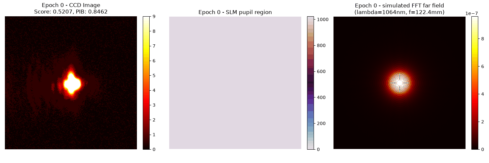
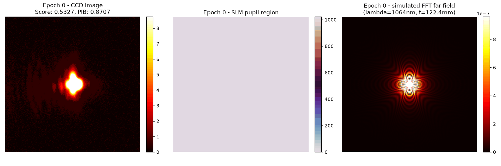
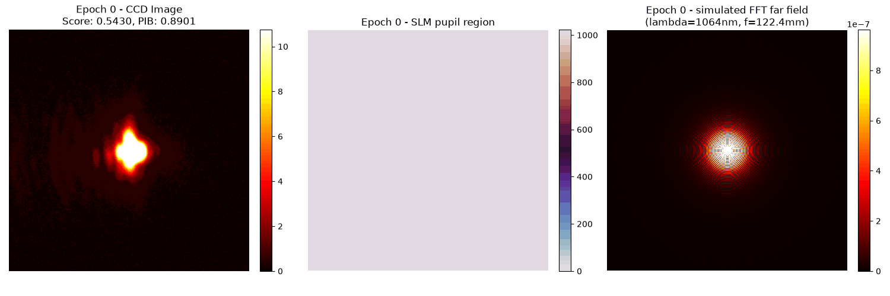
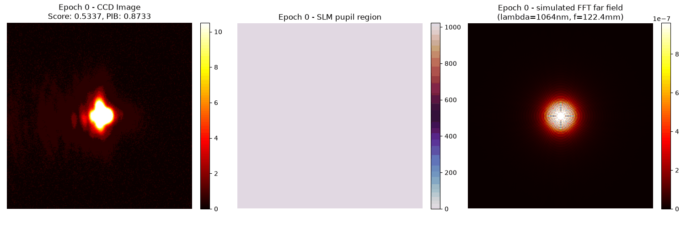
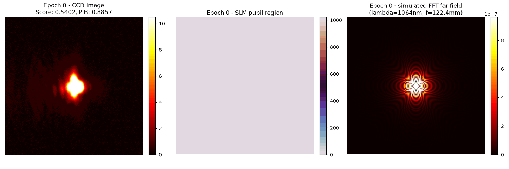

# GS 重构后真实设备调试（2026-10-12）

<!-- provenance:start -->
> **生成脚本**: 人工撰写，无生成脚本
> **数据/关联脚本**: [`scripts/generate_gif_from_pkl.py`](../../scripts/generate_gif_from_pkl.py)
> **运行环境**: 硬件
> **说明**: GS 重构后真实设备调试记录；images/ 为三栏动画，由 generate_gif_from_pkl.py 渲染
<!-- provenance:end -->

**本轮结论**（GS 重构后实机调试，固定 0.05 ms 曝光）：曝光策略确定——0.1 ms 曾致 CCD 平场饱和（流程在第 0 阶段中止），此后统一 0.05 ms（三帧峰值 200/201/201，12 轮峰值 203/255 未饱和）。30 轮 SPGD 内最佳 shape_score 0.7895，但**不能据此断言相对 GS 基线（前次短测 0.7826）获得 0.0674 的可复现提升**：30 轮记录中 13/32 低于 0.74、16/32 达 0.78+，原始图总和呈 25.7k/33.6k 两簇，说明光路/采集状态并非单一稳定分布；`20261012_180222` 最佳相位尚未独立交错重放。SLM #1 板卡 ID 本轮读为 `23020027`（早先日志 `22030108`），现有日志不足以判定面板是否更换，驱动配置文档旧序列号待核对实物。数据治理：跨秒分裂的原始三件套已合并，保存器支持同一运行目录，交错重放入口 `scripts/replay_gs_refine_hw.py` 已就绪（仅离线部分经测试）。

## 设备与功率

激光功率在本轮期间变化。0.1 ms 曾出现 CCD 平场饱和，流程在第 0 阶段中止，没有执行 SPGD；相机只读测得 0.05 ms 的三帧峰值为 200/201/201，因此后续统一使用固定 0.05 ms（低于 0.4 ms 上限）。12 轮运行的平场峰值 203/255，未饱和。

SLM #1 的板卡 ID 本轮查询为 `23020027`（产品序列号 `240236000005`、LCOS 序列号 `KB1881T050`），早先定位会话日志为 `22030108`。这可能是设备映射变化，也可能是 SDK 读取不同板卡 ID 的回退路径；现有日志不足以判定物理面板是否更换。当前板卡已重新定位；驱动配置文档中关于 SLM #1 的旧序列号仍需核对实物连接。

## 入射位置

定位探针改为每候选平场→随机相位圆盘→平场，按相邻平场均值计算零级能量变化，保存三张原始 CCD 图并拒绝饱和或大漂移。在当前板卡、0.05 ms、半径 200 面板像素的 3×2 扫描中，x=760/960/1160 在 y=600 的响应为 -0.142/-0.179/-0.145，在 y=780 为 -0.132/-0.187/-0.129。六个候选前后平场漂移均 <0.4%，最大 CCD 峰值 221/255。使用粗估面板中心 `(960,690)`；半径 450 面板像素仍为旧模型值，尚无独立光斑半径测量。原始数据在 `data/gs_refine_live_20261012/panel_locate_23020027_005ms/`。

## GS 与 SPGD

真实设备命令参数：`slm-gs-refine --cam-type daheng --exposure-time-ms 0.05 --pupil-center 960,690 --beam-radius-px 450 --target-side 100 --cam-size 250 --gs-iters 12 --far-field-padding 3 --phase-grid 12 --epochs 12 --seed 0 --confirm-best --debug`。CSV、最佳相位及 PNG 在 `data/gs_refine_live_20261012/gs_refine_12_005ms/slm_gs_refine/20261012_163615/`，原始 CCD/SLM 相位 PKL 在相邻 `debug/` 下。结束时设备关闭。

| 阶段 | 综合分 | PIB | 框内 CV |
|---|---:|---:|---:|
| 平场 | 0.5269 | 0.8602 | 4.1616 |
| plain GS | 0.7743 | 0.9769 | 0.7490 |
| 12 轮 SPGD 最佳，独立重测 | 0.7783 | 0.9781 | 0.7287 |

交错重放 `flat/GS/best/GS/flat/best/flat`，固定 0.05 ms，原始图在 `data/gs_refine_live_20261012/replay_23020027_005ms/`。三次平场为 0.52497/0.52364/0.52495；GS 为 0.77588/0.77501；最佳相位为 0.77970/0.77976。最佳相位相对相邻 GS 提高约 0.0043，幅度小但两次重放一致。重放 CCD 峰值分别为平场 204–206、GS 16、最佳 14；低峰值来自能量铺展，不能单独解释为暗场。图像仍有热点与空洞，CV 约 0.72，不能称为均匀方斑；PIB 仅相对于 250×250 CCD 窗口，不是全系统效率。

## 重构策略对照

同样的 0.05 ms 曝光、12 次 GS、1 轮 SPGD，对照 `weighted` GS 得分 0.7167/CV 1.069，`hio-weighted` 为 0.7618/CV 0.799，均低于 plain GS 的约 0.775/CV 0.74。记录分别在 `data/gs_refine_live_20261012/weighted_gs_005ms/` 和 `hio_weighted_gs_005ms/`。当前保留 plain GS；继续增加 SPGD 轮数前，优先检查光斑半径、面板位置的更细定位及均匀性目标。单次会话分数随功率和背景变化，跨会话比较应继续采用交错重放。

## 验证范围

偏心相位、越界、Daheng 曝光上限和 CCD 开窗的定向测试通过（11 项）。完整 `test_slm_gs_refine.py` 的慢速仿真在 50 项通过后遇到旧测试对已不存在的私有 `_display_and_average` 属性打桩失败；测试现已更新并通过定向复验，未再重跑整套耗时仿真。真实设备的定位、12 轮优化、相位重放以及两种 GS 变体均已完成。

后续 GS 运行的 CSV、最佳相位、最佳图和原始 PKL/PNG/JSON 统一存入 `<输出根目录>/debug/slm_gs_refine/<时间戳>/`。默认根目录为 `data`。旧的 0.05 ms 实验目录保持原位。

## 0.04 ms 曝光复验与目标域反馈对照

激光功率再次变化后，0.05 ms 的只读平场检查峰值已到 227–229/255，改用 0.04 ms。先前一次 1 轮 plain GS + SPGD 复验的平场/GS/最佳重测分数为 0.5207/0.7722/0.7763，CSV、相位、图和原始 PKL/PNG/JSON 现统一在 `data/debug/slm_gs_refine/20261012_173710/`。它与后续对照的分数差距说明跨时段功率或光路状态仍会变化，不宜直接拼成同一组统计。

动画三栏为 CCD 测量 / SLM 灰度相位 / FFT 仿真远场（1064 nm、f=125 mm、像素 7.8 µm Fraunhofer 近似）。第三栏为定性示意，不含真实入射振幅、SLM LUT 或 CCD 标定，不宜与 CCD 逐像素比较。

目标域自适应反馈 `adaptive-feedback` 在目标区将当前振幅与均匀目标振幅混合，保留比例为 `beta * min(A_current,A_target)/max(A_current,A_target)`；框外仍置零。`beta=0` 退化为 plain GS 的相位解，数值测试已验证。此前的 `weighted`/`hio-weighted` 均未优于 plain；本轮只用 `beta=0.6`、12 次 GS、1 轮 SPGD 做短测，并紧接着以相同参数运行 plain。两次均用 SLM #1 (`23020027`)、Daheng #0、0.04 ms、偏心瞳孔 `(960,690)`、半径 450、相机窗 250、目标边长 100、padding 3、seed 0。算法默认仍为 plain。

| 顺序 | 方法 | 平场分数 | GS 分数 | GS PIB | GS CV | 1 轮后最佳分数 |
|---|---|---:|---:|---:|---:|---:|
| 先 | adaptive-feedback, beta=0.6 | 0.5366 | 0.6567 | 0.8159 | 1.0101 | 0.6567 |
| 后 | plain | 0.5327 | 0.7076 | 0.8245 | 0.6931 | 0.7098 |

原始平场帧峰值分别为 159.75 和 162/255，GS 帧峰值为 17.5 和 13/255，均未饱和；SLM 在每次结束时正常关闭。两次运行的 CSV、最佳相位/图及原始 CCD/相位 PKL 分别统一在 `data/debug/slm_gs_refine/20261012_174456/` 和 `data/debug/slm_gs_refine/20261012_174627/`。第二次原始文件名保留采集时间 `174628`。相邻会话平场相差 0.0039，但尚未做到同会话交错重放；结论限于当前参数下反馈法弱于 plain，不外推到其他反馈强度。

当前 `gs_shape` 已用 `sqrt(target)` 对方框内施加均匀振幅约束，并保留远场相位自由演化，因此“只约束非零”和“锁定目标域相位”不适用于本实现。FFT 零填充已经提高远场采样密度，但 SLM 相位插值不产生新的物理像素自由度。周期相位平滑需要先在复平面处理 `exp(iφ)` 再评估硬件像素串扰；多平面/多波长非相干叠加需要额外光路或经过验证的时间复用时序。本轮没有把这两项作为现有单色静态系统的实机能力。

## 功率再次变化后的半径对照与 30 轮 SPGD

17:53 后激光功率再次上升，0.04 ms 与 0.025 ms 均在 Daheng 全帧零级定位时触发饱和保护，GS/SPGD 未开始。Daheng 驱动报告的最短曝光为 0.020 ms，故后续固定 0.020 ms；未尝试低于设备下限的设定。SLM #1 仍报告 `23020027`。以下三次短测均为 plain GS、偏心瞳孔 `(960,690)`、目标边长 100、12 次 GS、1 轮 SPGD、seed 0、`confirm-best`，只改变模型半径。此扫描是 GS **模型参数对照**，不是独立的入射光斑半径测量。

| 模型半径 (SLM px) | 平场分数 | GS 分数 | GS PIB | GS CV | 1 轮后最佳 | 运行目录 |
|---:|---:|---:|---:|---:|---:|---|
| 400 | 0.5430 | 0.6944 | 0.8197 | 0.7570 | 0.7559 | `data/debug/slm_gs_refine/20261012_175632/` |
| 450 | 0.5337 | 0.7826 | 0.9807 | 0.7106 | 0.7859 | `data/debug/slm_gs_refine/20261012_175810/` |
| 500 | 0.5402 | 0.7171 | 0.8391 | 0.6804 | 0.7171 | `data/debug/slm_gs_refine/20261012_175929/` |

平场分数在 0.5337–0.5430，半径 450 在当前会话中的 GS 综合分最高，因此保留 450 做 30 轮 SPGD。运行目录 `data/debug/slm_gs_refine/20261012_180222/` 包含 CSV、最佳相位、最佳图及 32 条记录的原始 PKL/PNG/JSON；Daheng 曝光 0.020 ms，运行结束时 SLM 正常关闭。平场 0.5436；GS 0.7221（PIB 0.8383、CV 0.6503）；最佳记录 `_epoch=27`（SPGD `epoch=25`）的**运行内确认**分数为 0.7895（PIB 0.9719、CV 0.6473）。相对该次 GS 起点提高 0.0674，主要来自 ROI 内能量占比，而框内 CV 几乎不变。保存的平均帧峰值范围 10.5–193.25/255，未显示饱和。

**限制：**相同模型的前一次短测 GS 已达到 0.7826，30 轮运行却从 0.7221 起步。30 轮记录中有 13/32 条低于 0.74、16/32 条达到至少 0.78，且原始图总和呈约 25.7k 与 33.6k 两簇，说明当前光路/采集状态并非单一稳定分布。因此 0.7895 是这次运行内的最佳值，不能据此断言 SPGD 相对稳定 GS 基线获得 0.0674 的可复现提升。设备已关闭，`20261012_180222` 的最佳相位尚未独立交错重放；早先 0.05 ms 的最佳相位有两次一致的交错重放证据。

## 数据与工具整理

10 月 12 日新记录统一在 `data/debug/slm_gs_refine/<运行时间>/`。原保存器跨秒产生的 `174628` 原始三件套已并入 `174627`，`175811` 已并入 `175810`，文件名仍保留各自采集时间。共享 `save_recorder_debug_artifacts(output_dir=...)` 现在允许 GS 结果保存器传入同一个运行目录，避免未来再次分裂。

> **2026-10-12 布局统一**：`data/debug/` 已整体迁移到本节描述的 `data/debug/<脚本名>/<运行时间>/` 布局，三件套文件名同步收敛为 `<脚本名>_<运行时间>.{json,png,pkl}`（此前为 `<前缀>_<ts>/<ts>/<前缀>_<ts>_<ts>.*` 的双时间戳形态）。`save_recorder_debug_artifacts` 的**默认**输出已改为该布局，`slm_gs_refine` 不再需要靠 `output_dir=` 绕开双时间戳 —— 所有调用方现已一致。迁移脚本 `scripts/reorganize_debug_corpus.py`（先 dry-run 再 `--apply`），19 个 SHA-256 逐一验证相同的重复 run 移入 `data/debug_dedup_quarantine/`（未删除，可手动回滚）。19 个文件系统层面的等价性检查（双射、无碰撞、缓存目录随 stem 改名、pickle 计数守恒）全部通过；`ml.hwdataset` 索引重建后 14350 → 14303 条记录，差额可完整对账：−356（19 个重复 run）+ 259（10-11/12 新增 `model_in_loop_hw_*`）+ 50（10-12 新增 gs_refine）。

离线盘点确认 10 月 12 日的 7 个 GS 运行目录（`173710`、`174456`、`174627`、`175632`、`175810`、`175929`、`180222`）各有一组 JSON/PNG/PKL、一份 CSV、`best_phase.npy`、`best_far_field.png` 和 GIF，共 49 个文件。`174627` 与 `175810` 的三件套及 GIF 文件名仍保留跨秒采集时间，文件均已归入对应运行目录；没有改写原始 PKL。早期 10 月 10 日目录并非每次都有完整的七件套，不能用这一清单推断它们的内容。

动画副本也已复制到本报告同级 `images/` 目录，嵌入在本报告下方。

交错重放入口为 `python scripts/replay_gs_refine_hw.py <运行目录> --exposure-ms <当前安全曝光> --slm-serial 23020027 --expected-wavelength 1064 --cam-center <全帧零级x,y>`。它离线解析目录中的唯一 PKL，自动读取平场 ROI 中心和目标边长；上机时先读取并核对 SLM 现有波长，不在打开时重编相位表，同时检查相机曝光回读、每张原始 CCD 帧是否饱和，将原始帧、处理帧、评分和源 PKL/最佳记录号写入该目录的 `replay/`。SLM 显示状态的恢复已提为定位和重放共用的上下文函数。仅对离线解析、参数校验和显示恢复做了测试；设备关闭后没有运行新的交错重放。
