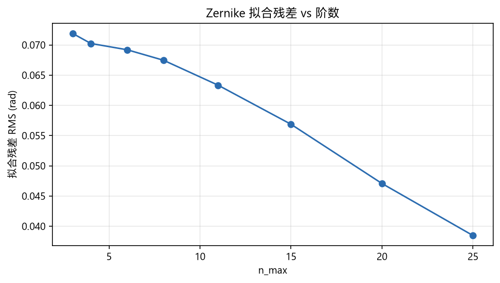
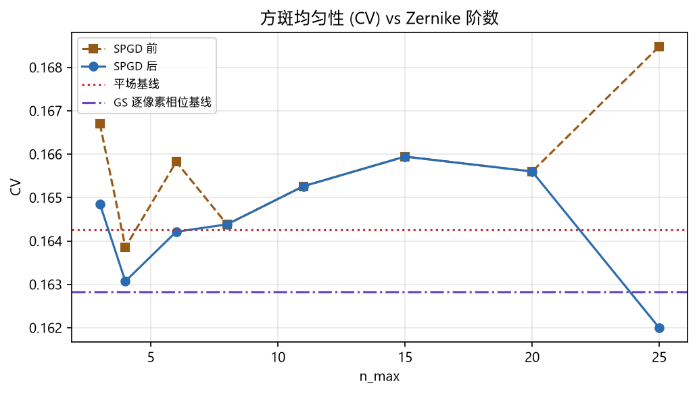
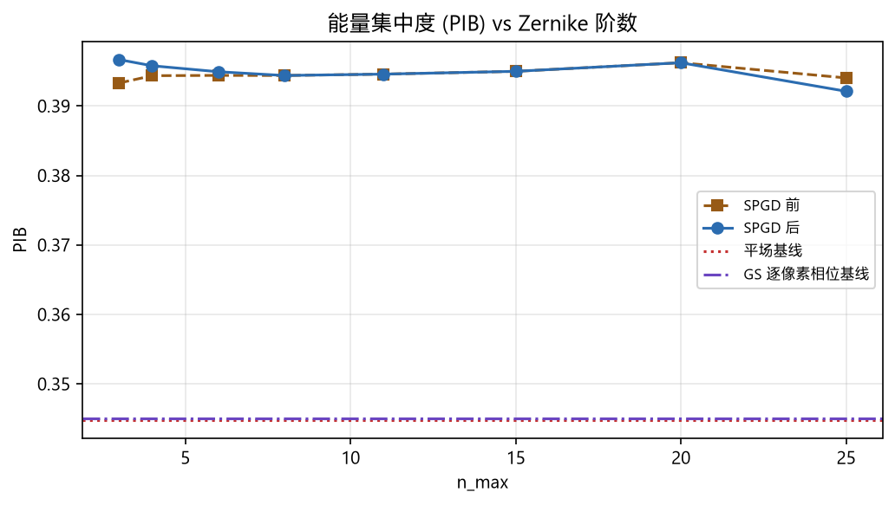

# GS-refine Zernike 阶数扫描 (uniformity)

<!-- provenance:start -->
> **生成脚本**: [`scripts/slm/generate_gs_refine_zernike_report.py`](../../../scripts/slm/generate_gs_refine_zernike_report.py)
> **复现命令**: `python scripts/slm/generate_gs_refine_zernike_report.py`
> **数据/关联脚本**: [`scripts/slm/run_gs_refine_zernike_sweep.py`](../../../scripts/slm/run_gs_refine_zernike_sweep.py)
> **运行环境**: 离线
> **说明**: GS 逐像素相位 → Zernike 拟合 (多阶) → SPGD 细化 的阶数扫描；本脚本离线读取 run_gs_refine_zernike_sweep.py 产出的 summary.json + spgd_nmax*.csv，渲染拟合残差/CV/PIB 三图与阶数扫描表
<!-- provenance:end -->

数据来源：8 阶扫描 run，`cam_type=sim`（数字孪生仿真，非硬件实测），目录 `E3_orders`。

## 结论

共扫描 8 个 Zernike 阶数 (n_max = 3, 4, 6, 8, 11, 15, 20, 25)。
平场基线 PIB=0.3448, CV=0.1643;
GS 逐像素相位基线 PIB=0.3450, CV=0.1628。
- ⚠️ **本次仿真运行不能回答本实验的科学问题** (需要多少阶 Zernike 才能复现 GS 整形)。原因见局限 3: 数字孪生里 GS 前向模型未经标定 ⇒ 送入拟合的相位≈平场。上表验证的是**管线正确性**, 不是物理结论。
- **唯一随阶数单调的量是拟合残差**: 0.0719 → 0.0385 rad (-46.5%), 单调递减 = True。这是本次扫描中唯一站得住的阶数效应。
- **阶数之间无法排序**: PIB 跨阶数极差 0.0046、CV 极差 0.0039, 而 SPGD **单轮运行内**的目标抖动就有 0.0010~0.0035。两者同量级 ⇒ 任何「最优阶数」都是在读噪声, 本报告不给这个结论。
- **基相对平场的变化与阶数无关**: 各阶 ΔPIB 均为 +0.0473~+0.0519, 来自拟合相位本身, 不是来自选了哪个阶数。
- **拟合几乎没抓到结构**: 残差 rms 是最大系数的 2.7~5.1 倍 (max|c| = 0.0142 rad, 各阶相同) ⇒ 被拟合的相位接近平场, Zernike 基在任何阶数下都没有可表达的内容, SPGD 因此无信号可优化。

## 实验设置

| 参数 | 值 |
|---|---|
| `beam_radius_px` | `450.0` |
| `cam_id` | `0` |
| `cam_size` | `256` |
| `cam_type` | `sim` |
| `delta` | `0.02` |
| `epochs` | `12` |
| `exposure_time_ms` | `0.0` |
| `gs_iters` | `60` |
| `lr` | `0.01` |
| `max_energy_loss` | `0.6` |
| `n_max_list` | `[3, 4, 6, 8, 11, 15, 20, 25]` |
| `seed` | `0` |
| `sim_far_field_padding` | `16` |
| `slm_number` | `1` |
| `spgd_epochs` | `8` |
| `target_side` | `0.0` |

| 量 | 值 |
|---|---|
| `cam_size` | 256 |
| `w0_px` | 6.83 |
| `target_side` | 13.67 |
| `beam_radius_px` | 450.0 |
| `best_stage` | `refine` |
| 数据目录 | `data/debug/E3_orders` |

## 基线

| 相位 | PIB | CV | EE | AR | 复合分数 |
|---|---|---|---|---|---|
| 平场 | 0.3448 | 0.1643 | 0.3448 | 1.0000 | 0.6259 |
| GS 逐像素相位 | 0.3450 | 0.1628 | 0.3450 | 1.0000 | 0.6268 |

## 阶数扫描

| n_max | 模态数 | 拟合残差 (rad) | max\|c\| | PIB 前 | PIB 后 | CV 前 | CV 后 | SPGD 改善 | clip 警告 |
|---|---|---|---|---|---|---|---|---|---|
| 3 | 10 | 0.0719 | 0.0142 | 0.3933 | 0.3967 | 0.1667 | 0.1649 | ✓ |  |
| 4 | 15 | 0.0702 | 0.0142 | 0.3944 | 0.3958 | 0.1639 | 0.1631 | ✓ |  |
| 6 | 28 | 0.0692 | 0.0142 | 0.3944 | 0.3949 | 0.1658 | 0.1642 | ✓ |  |
| 8 | 45 | 0.0675 | 0.0142 | 0.3944 | 0.3944 | 0.1644 | 0.1644 | ✗ |  |
| 11 | 78 | 0.0633 | 0.0142 | 0.3946 | 0.3946 | 0.1653 | 0.1653 | ✗ |  |
| 15 | 136 | 0.0569 | 0.0142 | 0.3950 | 0.3950 | 0.1659 | 0.1659 | ✗ |  |
| 20 | 231 | 0.0471 | 0.0142 | 0.3962 | 0.3962 | 0.1656 | 0.1656 | ✗ |  |
| 25 | 351 | 0.0385 | 0.0142 | 0.3940 | 0.3921 | 0.1685 | 0.1620 | ✓ |  |

SPGD 轨迹 CSV 已保存 (9 行, n_max=3)。

## 图

## 口径与已知局限

1. **`cv` 与 `ee` 必须一起看。** 单独优化 `-cv` 会掏空目标方斑（硬件实测 EE → 0.002）；
   目标函数必须包含能量项。
2. **Zernike 基半径锁定 `beam_radius_px`**，且与 GS 瞳面一致；更换光路必须重扫。
3. **仿真模式下 GS 预矫正未经物理标定。** 数字孪生是纯 FFT；`_derive_target_side`
   的实验系统模型（`camera_pixel_um=2.2`、焦距来自实测 tilt-shift scale）与仿真角尺度
   不匹配。日志会出现 "GS warm start ... did not beat flat ...; keeping flat"。
   仿真只验证 Zernike 拟合 + SPGD 路径与退化几何守卫；物理对比仅在真实硬件上有意义。
4. **`max_abs_coefficient` vs `ZERNIKE_CLIP = 5.0` rad。** 超过阈值会触发 clip，
   拟合质量不可信；上表 clip 列非空即为警告。
5. **已知潜在缺陷 (未修)：** `SlmGsRefineConfig` 自动目标边长约 400 px vs `cam_size`
   默认 300 → `square_mask` 裁剪到整幅 → `pib` 恒等于 1.0。驱动通过 waist 推导
   共享边长规避；共享优化器有意保持不变（其测试契约已固定）。
6. **只可比同一次 run 内的阶数, 不可跨 run 比 `fit_rms`。** 实测: 完全相同的命令行
   在 12 路并发与低负载下**逐位一致** (9 位小数全同), 说明 Stage A 本身确定性良好;
   但 `--n-max` 列表或 `--max-energy-loss` 不同时, Stage A 的 GS 最佳相位会整体改变
   (同一 `n_max` 跨 run 的 `fit_rms` 相差 0.008~0.012 rad)。这两个参数都在 Stage A
   之后才被读取, 根因未查明。因此本报告的阶数单调性只在**单次 run 内**成立
   (同一 `best_phase`, 已验证 `fit_best_phase` 不原地修改入参, 各阶互相独立)。
7. **`fit_rms` 的可比性依赖 `beam_radius_px`。** 该值同时锁定 GS 瞳面与拟合基,
   换光路必须与 `--n-max` 一起重扫, 否则阶数之间的差异里混入了基半径不匹配。
