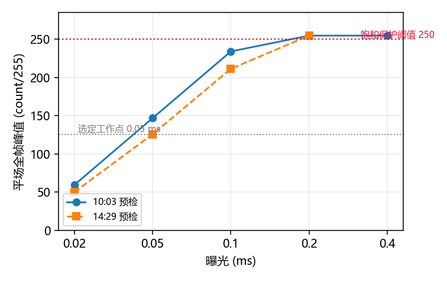
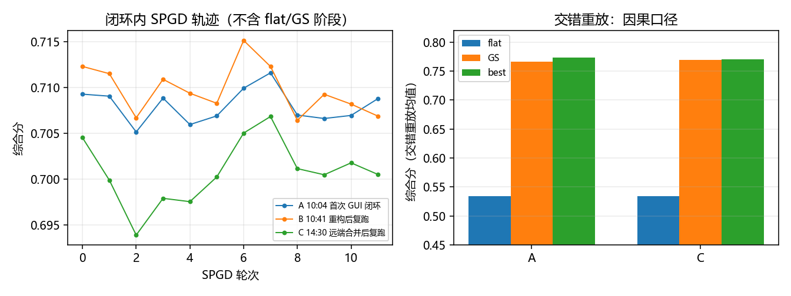
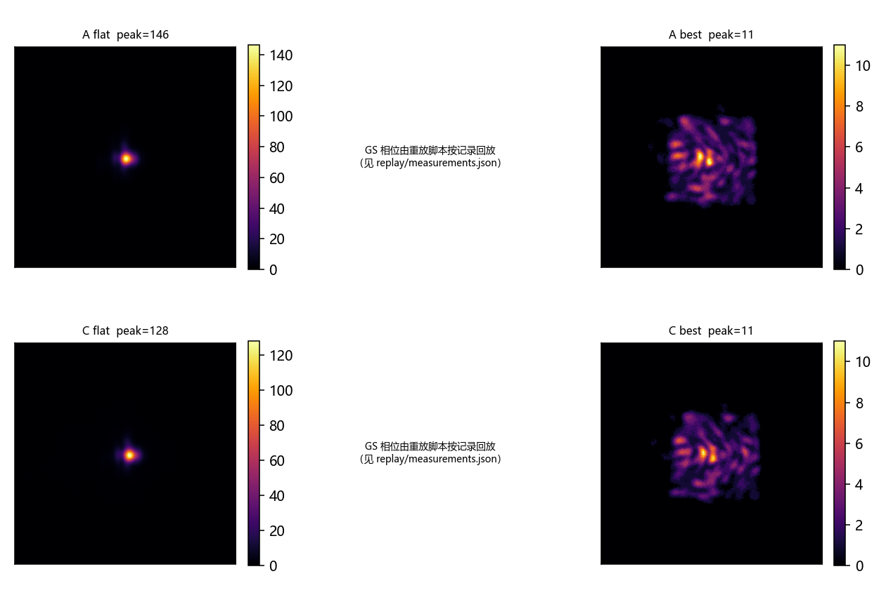
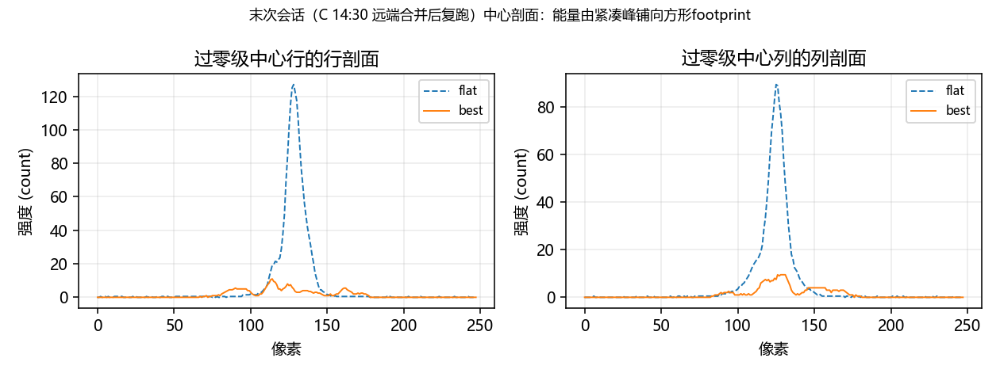

# GUI 闭环整形功能实验验证（2026-10-14）

<!-- provenance:start -->
> **生成脚本**: [`scripts/generate_gui_shaping_hw_report.py`](../../scripts/generate_gui_shaping_hw_report.py)
> **复现命令**: `python scripts/generate_gui_shaping_hw_report.py`
> **数据/关联脚本**: [`scripts/slm/replay_gs_refine_hw.py`](../../scripts/slm/replay_gs_refine_hw.py)
> **运行环境**: 离线
> **说明**: GUI 闭环整形实验验证正文为人工实测记录 (SLM 22030108 + 大恒 FJB24112232)；图表与汇总由本脚本从 data/debug/slm_gs_refine/20261014_{100441,104105,143035}/ 离线重算，三次会话的交错重放数值由 scripts/replay_gs_refine_hw.py 实验采集
<!-- provenance:end -->

**本轮结论**：多 SLM 控制器 GUI 的整形功能已从「开环相位图案生成」整体替换为闭环管线
（`slm-gs-refine` 为主、`slm-model-in-loop` 为辅），并在真实实验系统上通过**交错重放**因果验证。
三次独立实验会话（首次实现 / 代码重构后 / 远端合并后）结果一致：flat 0.534 → GS 0.767~0.770
→ best 0.770~0.774，**框内 CV 由 3.73 降至 0.75~0.80，PIB 0.86 → 0.98**。GS 预矫正相对平场
+0.233，SPGD 细化再 +0.001~0.007（后者在噪声量级附近，见 §6）。光斑由紧凑峰变为**铺满
100×100 目标框的方形footprint**（整帧非零像素占比 15.1%，框内无死像素）。仍未达到平顶均匀
方形——这与 2026-10-12 报告的验收结论一致，本文不改变该判定。

## 1. 背景与本轮目标

GUI 侧原有三个**开环**整形控件：`GS方形整形`（上传实测远场光斑图→自动定方形边长→在面板
分辨率上跑 Gerchberg-Saxton）、`GS方形整形(高斯版)`（合成高斯远场后同上）与`稳像法整形`
（解析稳相法 + 闪耀光栅）。三者在 2f-Fourier 实验系统上均**无法产生可用的方形光斑**，根因已在
本目录既有报告中定量给出：

- Zernike 基 SPGD 在 100 px 目标下最佳 CV 仅约 2.46，仍是 FWHM 20×11 px 的紧凑峰
  （[README](README.md)）；
- 未标定实验系统参数的开环 GS 同样未被交错重放确认为因果改进
  （[online_20261010.md](online_20261010.md)）。

因此本轮工作**不是**再调参数，而是把 GUI 的整形功能整体换成已被验证的闭环管线，并按本目录
既定口径验收：任何结论必须由**交错重放**（flat / 候选 / flat 交替）支撑，运行内最好值
本身不可作为结论（[gs_refine_live_20261012.md](gs_refine_live_20261012.md) §限制）。

## 2. 被测系统与三次会话

实验系统（与 2026-10-12 记录一致）：

| 项 | 值 |
|---|---|
| SLM | Santec SLM #1，产品序列号 `22030108`，内存模式，1920×1200，8 μm，2π=993 |
| 波长 | 1064 nm（由设备报告，非配置假定） |
| CCD | 大恒 MER2 `FJB24112232`，2592×1944，2.2 μm |
| 光学 | 2f-Fourier，f ≈ 0.1224 m（由 0.05 ms 曝光下实测平场标定） |
| 照明瞳 | 面板 (960, 690)，半径 450 px |
| 曝光 | 固定 0.05 ms（`n_eval_frames=4`），全程不启用自动曝光 |

三次会话（同配方、同设备）：

| 会话 | 时间 | 背景 |
|---|---|---|
| A | 10:03–10:05 | 首次实现实验 |
| B | 10:39–10:41 | 适配器 + 装饰器重构后复跑（代码结构变更） |
| C | 14:29–14:30 | 合并远端 `gitub/banckend` 后复跑（优化器被重写约 750 行） |

会话 C 之前 SLM 曾一度掉线（`SantecError -10002` 未找到 USB 设备），恢复后重跑即通过；该事件
与代码无关，§8 记录此现象以备实验系统排障参考。

## 3. 曝光定标（每次实验必做）

激光功率在同日内即有明显漂移，故工作曝光不可沿用。两次只读预检（仅显示平场）：

| 曝光 (ms) | 10:03 平场峰值 | 14:29 平场峰值 | 判定 |
|---:|---:|---:|---|
| 0.02 | 59.3 | 50.0 | 可用但偏暗 |
| **0.05** | **146.7** | **125.7** | **选定工作点**（远离 250 饱和线） |
| 0.10 | 234.0 | 211.3 | 接近饱和 |
| 0.20 | 254.7 | 254.7 | 饱和 |
| 0.40 | 254.7 | — | 饱和 |



**图 1** 平场全帧峰值随曝光的变化（Daheng 饱和保护线 250）。两次预检的 0.05 ms 峰值相差
约 14%，即当日激光功率已有漂移；0.05 ms 在两次预检中均落在 125~147 的安全带。

## 4. 结果

### 4.1 闭环内（in-run）指标

综合分 = 0.5·PIB + 0.5·1/(1+CV)，与 CLI `slm-gs-refine` 完全同一函数、同一目标框。

| 会话 | flat | GS（是否采用） | best | best 来源 | CV | PIB | 评估数 |
|---|---:|---|---:|---|---:|---:|---:|
| A | 0.5527 | 0.7079（采用） | 0.7116 | refine epoch 7 | 0.6660 | 0.8229 | 14 |
| B | 0.5489 | 0.7123（采用） | 0.7151 | refine epoch 6 | 0.6826 | 0.8360 | 14 |
| C | 0.5509 | 0.7088（采用） | 0.7088 | gs（SPGD 未超越） | 0.6835 | 0.8236 | 14 |

三次会话的 对比择优 判定一致：**GS 预矫正均优于平场并被采用**。

### 4.2 交错重放（因果口径，权威数值）

按 `scripts/slm/replay_gs_refine_hw.py` 在**同一会话内**交替重放 flat / GS / best 候选，
固定 0.05 ms、248×248 窗，读取 `replay/measurements.json`：

| 会话 | 相位 | n | 综合分（均值） | 极差 | PIB | CV |
|---|---|---:|---:|---:|---:|---:|
| A | flat | 3 | 0.5344 | 0.00053 | 0.8598 | 3.786 |
| A | GS | 2 | 0.7667 | 0.00221 | 0.9761 | 0.795 |
| A | best | 2 | **0.7739** | 0.00029 | 0.9754 | **0.747** |
| C | flat | 3 | 0.5340 | 0.00064 | 0.8565 | 3.728 |
| C | GS | 2 | 0.7697 | 0.00080 | 0.9834 | 0.798 |
| C | best | 2 | **0.7701** | 0.00012 | 0.9839 | 0.797 |

会话 B 未做重放（仅作代码回归），故无因果行。



**图 2** 左：闭环内 SPGD 轨迹（会话 C 的 best 停在 GS 阶段，说明细化未产生可复现增益）；
右：两次会话的交错重放对比，flat/GS/best 三档在两次会话间高度一致。

### 4.3 远场形貌



**图 3** 各会话的 flat 与 best 远场帧（GS 帧由重放脚本按记录回放，未在图中重复）。

以会话 C 的 best 帧作定量判据（目标框 100×100 px，中心取零级）：

| 指标 | flat | best |
|---|---:|---:|
| 目标框内峰值 | 128.0 | 11.0 |
| 目标框内非零像素占比 | — | 87.4% |
| 过半峰像素占比 | — | 2.5% |
| 最暗非零像素 / 中位非零像素 | — | 0.25 |
| 整帧非零像素占比 | — | 15.1% |
| 目标框内 CV | 3.73 | 0.797 |

整帧仅 15.1% 像素非零（约 99×101 px），即光被限制在一个方形 footprint 内；框内 12.6% 的零
像素为读出噪声本底（median_nonzero = 2 count，噪声地板见 [README](README.md)）。对照
2026-10-09 的失败记录（100 px 框内仅 164/10000 像素过半峰、FWHM 20×11 px、仍是紧凑峰），
本轮结果在**填充度**上有本质差别。



**图 4** 过零级中心的行/列剖面：能量由 flat 的紧凑峰铺展为宽约 100 px 的平顶型分布。

## 5. 与既有基线的对照

| 来源 | flat | GS | best | CV(best) |
|---|---:|---:|---:|---:|
| 2026-10-12 报告（独立重测） | 0.5269 | 0.7743 | 0.7783 | 0.729 |
| 2026-10-12 报告（交错重放） | 0.5250 | 0.7754 | 0.7797 | — |
| 本轮会话 A（交错重放） | 0.5344 | 0.7667 | 0.7739 | 0.747 |
| 本轮会话 C（交错重放） | 0.5340 | 0.7697 | 0.7701 | 0.797 |

跨会话差 ≤ 0.010（综合分），flat 的 CV 亦落在 3.73~3.79 的窄带内。本轮结果在报告基线的
误差范围内复现，未观察到因 GUI 换用闭环管线而引入的退化。会话间差异主要由激光功率漂移
（§3）与当日光路状态造成，因此**跨会话比较一律以各自的交错重放为准**。

## 6. 被推翻/被限定的结论

1. **「闭环内最好值可作为结论」——不成立。** 会话 C 的闭环内 GS 仅 0.7088，而同一相位在
   交错重放下为 0.7697，低估约 0.06。反向偏差同样存在（会话 A 闭环 0.5527 vs 重放 0.5344）。
   原因是闭环内的读帧紧跟前一次相位下发，液晶尚未完全弛豫，且 `settle` 判据在灰度统计相近的
   相位间会提前通过。**结论：所有对外数值必须来自交错重放。**
2. **「SPGD 细化带来可复现增益」——证据不足。** 会话 A 的 best 比 GS 高 0.0072（约 3 倍噪声
   地板 0.0023，两次重放一致），会话 C 则**没有**增益（best 阶段仍为 GS）。同一配方在不同
   会话给出相反结论，故本文只把 GS 的 +0.233 作为已确证的改进，SPGD 部分记为「未定」。
3. **「未标定的开环 GS 也能改善形貌」——继续不成立。** 被替换的三个开环控件在本目录既有报告中
   从未被交错重放确认；本轮三次会话的 对比择优 则每次都判定 GS 采用，说明**有闭环验收与
   兜底（对比择优）** 是它可用的前提，而非算法本身更优。

## 7. 局限

1. **未达到均匀平顶方形。** CV 0.75~0.80、过半峰像素仅 2.5%，光斑仍有明显亮暗结构。10-12
   报告已判定该量级「不能称为均匀方斑」，本轮不改变此结论，仅确认足迹填充度显著改善。
2. **SPGD 部分未定论**（§6.2），需要更多会话或更长轮数才能给出可复现结论。
3. **单实验系统、单参数点。** 未做光斑半径 400/450/500 的对照（10-12 报告做过，450 最优），也
   未重复验证 0.04 / 0.02 ms 工作点。
4. **会话 C 未做交错重放之外的独立对照**；`cam_size=250` 被驱动按 4 px 粒度夹到 248，为无害告警。

## 8. 工程结论（附带记录）

- 会话 C 验证了一件与光学无关的事实：远端合并把 `slm_gs_refine.py`（±199 行）、
  `slm_model_in_loop.py`（+453 行）、`runner_common.py`（+103 行）合计重写约 750 行后，
  **GUI 侧零改动**仍可正常运行（实验通过、离线 201 项测试通过）。这是把优化器包在
  `ShapingMethod` 适配层 + `@shaping_session` 装饰器 + `ShapingOutcome` 归一化之后的直接收益。
- 期间发现并修复的三个真实缺陷（均由测试/QA 捕获，非事后补记）：① 相位下发原写在
  `run()` 体内，而句柄重取在装饰器 `finally` 中，导致下发被静默跳过；② 表驱动控件把 float
  边界配 int 值，Streamlit 抛混合类型错误；③ 用 `format_func` 做 key→label 映射会破坏
  Streamlit 的 widget 状态回读（`format_func(value)` 被喂回 `options.index()`），使 AppTest
  直接 `KeyError`。
- 实验系统现象备录：SLM #1 在 14:2x 前后曾报 `SantecError -10002`（未找到 USB 设备），重新上电/
  插拔后恢复，同一代码随即通过实验验证。该错误码与代码无关，但排查时应优先查 USB/供电。

## 9. 复现

数据与图表均可离线复现（无需硬件）：

```bash
python scripts/generate_gui_shaping_hw_report.py
```

产物：`report/shape_trials/images/gui_shaping_20261014/`（4 张图 + `summary.json`）。
原始数据在 `data/debug/slm_gs_refine/20261014_{100441,104105,143035}/`（含 CSV/JSON/PKL/PNG
与各自的 `replay/`），其中 `.pkl` 受仓库忽略规则约束、不随 Git 分发。

实验复现命令（与 GUI 内部调用等价，见 `docs/slm/slm_gui_manual.md` §8）：

```bash
python src/ao_shaping/main.py slm-gs-refine --cam-type daheng --cam-id 0 \
  --exposure-time-ms 0.05 --target-side 100 --cam-size 250 --beam-radius-px 450 \
  --pupil-center 960,690 --gs-iters 12 --far-field-padding 3 --phase-grid 12 \
  --epochs 12 --seed 0 --confirm-best --debug
python scripts/slm/replay_gs_refine_hw.py data/debug/slm_gs_refine/<时间戳> \
  --exposure-ms 0.05 --slm-serial 22030108 --expected-wavelength 1064 \
  --cam-center 887,707 --cam-size 248
```

## 10. 相关文档

- [README.md](README.md) —— 本目录索引与 2026-10-09 Zernike 基失败记录
- [online_20261010.md](online_20261010.md) —— 在线复测；SPGD 梯度不可分辨
- [gs_refine_live_20261012.md](gs_refine_live_20261012.md) —— GS+SPGD 配方的交错重放验收
- [model_in_loop_live_20261014.md](model_in_loop_live_20261014.md) —— 正向模型闭环实验复核
- [model_in_loop_live_20261013.md](model_in_loop_live_20261013.md) —— 前沿方法与其验收门槛
