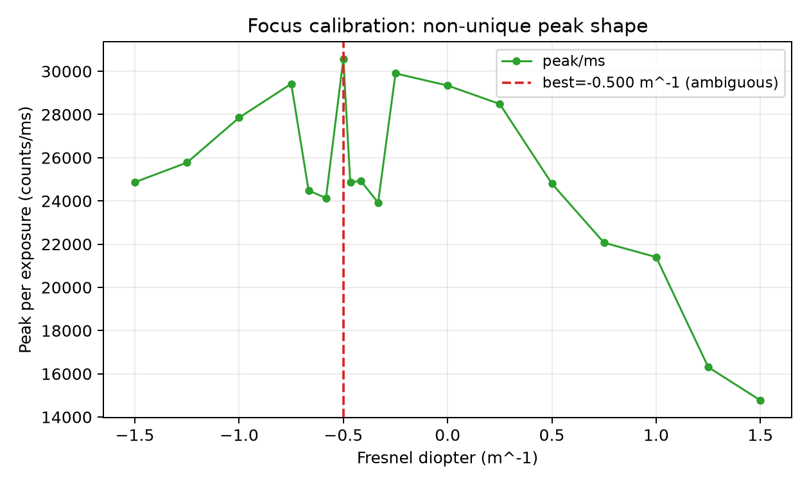
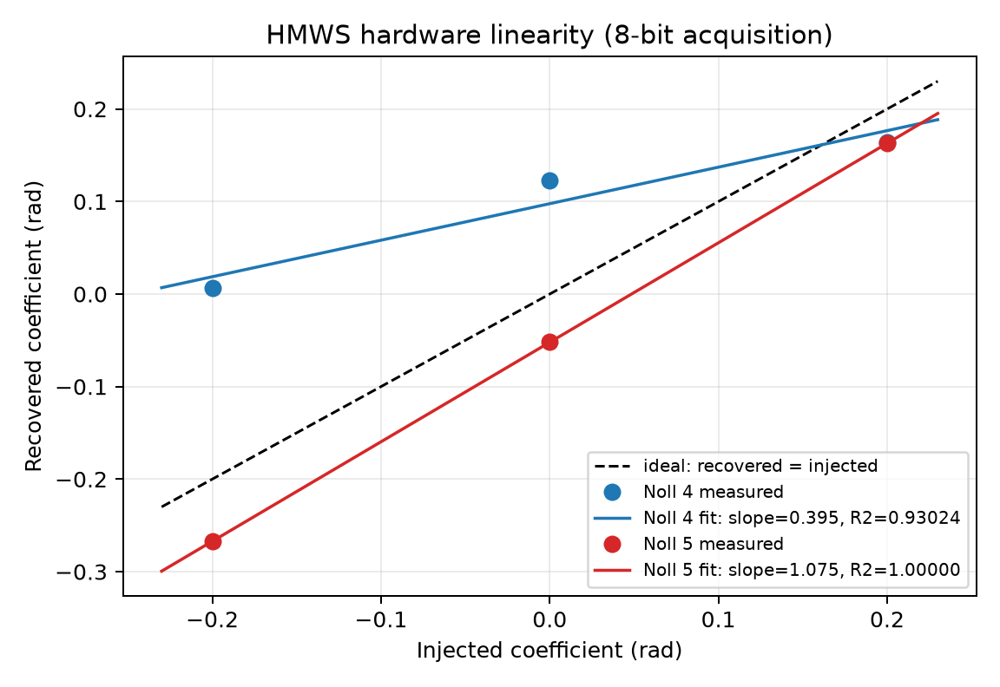
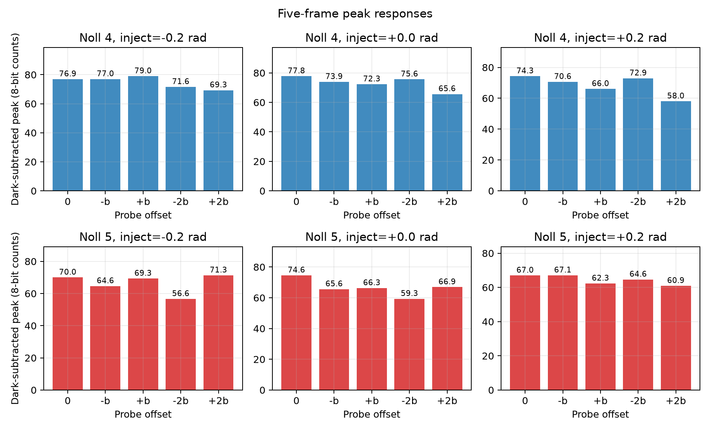

# HMWS 五点 Zernike 探测真机验证：焦面扫描与五帧采集（8-bit 首采）

<!-- provenance:start -->
> **生成脚本**: [`scripts/slm/hmws_zernike_probe.py`](../../../scripts/slm/hmws_zernike_probe.py)
> **复现命令**: `python scripts/slm/hmws_zernike_probe.py --noll 4 5 --inject-rad -0.2 0.0 0.2 --bias-rad 0.3 --radius 450 --exposure-ms 0.06 --auto-exposure --wait-until-idle 600 --out data/hmws_zernike_probe`
> **数据/关联脚本**: [`scripts/slm/probe_optical_path_validity.py`](../../../scripts/slm/probe_optical_path_validity.py)
> **数据/关联脚本**: [`tests/ao_shaping/scripts/test_hmws_zernike_probe.py`](../../../tests/ao_shaping/scripts/test_hmws_zernike_probe.py)
> **数据/关联脚本**: [`src/ao_shaping/utils/image/zernike_probe.py`](../../../src/ao_shaping/utils/image/zernike_probe.py)
> **数据/关联脚本**: [`src/ao_shaping/utils/wavefront/pattern_helper.py`](../../../src/ao_shaping/utils/wavefront/pattern_helper.py)
> **运行环境**: 硬件：1064 nm Santec SLM-200 #1 + Daheng MER2-507-23GM CCD；本轮相机 8-bit / full_scale=255，暗帧 12-bit；分析离线 CPU
> **说明**: Pathak & Jomy 2026 HMWS 五点估计真机验证：先六步光路探测 + Fresnel 焦面扫描（verdict=ok，标定 ambiguous，未补偿），再对 Noll 4/5 各注入 ±0.2/0 rad、b=0.3 rad、r=450 px、曝光 0.06 ms 采集五帧。Noll 5 线性良好（slope=1.0753，R²≈0.999996）；Noll 4 线性失效（slope=0.3947，R²=0.9302），受 8-bit 量化与离焦弱响应限制，不作系数定标；12-bit 重采待 SLM #1 恢复。
<!-- provenance:end -->

**HMWS Five-Point Zernike Probe on Hardware: Focus Scan and Five-Frame Acquisition (First 8-bit Run)**

---

## 摘要

本报告给出 HMWS（模态波前传感，Pathak & Jomy 2026）五点 Zernike 探测在真实 SLM+CCD 光路上的首次上机验证结果。验证分两段：先复用 `probe_optical_path_validity.py --focus-calibration` 在一次设备会话内完成六步光路探测与 Fresnel 焦面扫描，再运行 `scripts/slm/hmws_zernike_probe.py` 对 Noll 4（离焦，n,m=(2,0)）与 Noll 5（像散，(2,−2)）各注入 −0.2/0/0.2 rad，以偏置 b=0.3 rad、孔径半径 450 px、曝光 0.06 ms 完成每组五帧采集（帧均值 3 帧）。六步光路探测判定 `verdict=ok`；焦面扫描在 −0.500 m⁻¹ 处峰值最高但峰形不唯一（`status=ambiguous`，`accepted=false`），且曝光线性度 1.35 偏离 [0.8, 1.25]，因此**本采集不加 Fresnel 焦面补偿**（`focal_mm=null`）。

采集共 6 条记录（2 模式 × 3 注入），全部 `valid=true`、`dark_subtracted=true`、clipped=0、质量门 `qualified=true`。结果分化明显：**Noll 5（像散）线性良好**——slope=1.0753、R²≈0.999996、截距=−0.0521 rad，ΔRMSE=0.0536 rad；**Noll 4（离焦）线性失效**——slope=0.3947、R²=0.9302，五帧对比度仅 −0.27%～−19.5%，ΔRMSE=0.1401 rad。离线复核确认：位深错位（本轮相机 8-bit、暗帧 12-bit）不是 Noll 4 失效的数学原因（暗帧是常数偏置，在五点组合中被抵消），真正的差异在峰值响应本身——Noll 4 的峰值随注入几乎不变，Noll 5 则有明显单调响应。本报告结论：**Noll 5 五点估计在真机光路上得到初步验证；Noll 4 在本轮条件下不可靠，不能作为系数定标**，需以 12-bit 重采复核（脚本已修复 `--bit-depth` 请求与回读校验，留待 SLM #1 重新上线后执行）。

**关键词**：自适应光学；HMWS 模态波前传感；五点估计；Zernike 相差；相位探测；SLM；CCD；真机验证

---

## 1. 引言

本项目 AO-Shaping 在 2f 光学系统中用 SLM 前焦、CCD 后焦测焦面强度。Pathak & Jomy（2026）的 ds-AO 系统把“区域波前传感”（GAWS）与“模态波前传感”（HMWS）合并在同一块 LCSLM 与单个 CCD 上。此前已在 `zernike_probe_sim_20261105.md` 用 Sim2f 数字孪生验证了 `PatternHelper.generate_probe_phase` + `utils/image/zernike_probe.py` 五点估计算法：2f 光路下 defocus/spherical/astigmatism 恢复误差 <0.01 rad（a_true=0.2 rad，b=0.3 rad）。本报告把同一套探测相位与解析算法放到真实 SLM+CCD 上，回答“五点估计在真实 2f 光路上是否复现仿真线性”。

## 2. 方法

### 2.1 探测相位与五点估计

探测相位由 `src/ao_shaping/utils/wavefront/pattern_helper.py::generate_probe_phase` 生成：在待测模式 Zernike 系数上叠加偏置 b，再沿该模式的 ±b、±2b 加探测偏移，共五帧（中心 0、−b、+b、−2b、+2b）。CCD 焦面峰值经 `src/ao_shaping/utils/image/zernike_probe.py::probe_peak_intensity`、`five_point_estimate` 解析反演系数。Noll↔(n,m) 映射委托 `zernike_calc`。本报告探测相位偏置**加进待测模式 Zernike 系数**（非 piston `bias_rad`）。

### 2.2 焦面扫描

复用 `scripts/slm/probe_optical_path_validity.py --focus-calibration`：一次设备会话内完成六步光路探测与 Fresnel 屈光度标定（免二次 open/close SLM）。粗扫 13 点、范围 ±1.5 m⁻¹，抛物线细化 7 点，每点 3 帧；曝光自适应（start 0.05 ms，floor 0.02 ms，ceiling 50 ms）。判据：peak/ms 排序极值做抛物线细化并复测，仅在曝光线性度落在 0.8–1.25 且光路未受阻时才写入 Fresnel 补偿。

### 2.3 五帧采集

`scripts/slm/hmws_zernike_probe.py`（无 `--execute` 开关，不加 `--dry-run` 即碰硬件）。采集前自动曝光预检（取平场 + 全部 `(noll,inject)` 候选帧最亮者，接受带 0.25–0.70 满量程）；曝光 0.06 ms + 自动曝光；严格按有效曝光匹配暗帧（`dark-exp-0.06ms.npz`，匹配失败则 `dark_subtracted=false` 并告警）。

### 2.4 参数表

| 参数 | 值 |
|------|-----|
| 待测模式 | Noll 4 (2,0) 离焦；Noll 5 (2,−2) 像散 |
| 注入系数 `inject-rad` | −0.2 / 0.0 / +0.2 rad（每模式） |
| 探测偏置 `bias-rad` | 0.3 rad |
| 孔径半径 `radius` | 450 px（panel 像素） |
| 曝光 | 0.06 ms（自动曝光预检，接受带 0.25–0.70 FS） |
| 帧均值 `frames` | 3 |
| 相机位深（本轮） | **8-bit**，full_scale=255（见 §5 限制） |
| 暗帧 | `dark-exp-0.06ms.npz`，12-bit，full_scale=4095，mean=14.90，严格匹配 |
| Fresnel 补偿 | 无（`focal_mm=null`；焦面标定 ambiguous，见 §3.1） |
| SLM | Santec SLM-200 #1，面板 1920×1200，1064 nm，2π=993 |
| 相机 | Daheng MER2-507-23GM NIR，像素 2.2 µm，曝光范围 0.02–1000 ms |

## 3. 结果

### 3.1 六步光路探测与焦面扫描

| 项目 | 结果 |
|------|------|
| 光路判定 | `verdict=ok`，光斑可用、未受阻 |
| 焦面最优屈光度 | `best_diopter_m1=-0.500`（`best_focal_mm=-2000.0`） |
| 峰值增益 vs 平场 | `gain_vs_flat=1.0418` |
| 曝光线性度 | 1.3461（偏离 [0.8, 1.25]，×0.5 曝光复核） |
| 标定状态 | **`status=ambiguous`，`accepted=false`，`fresnel_compensation_m_inv=null`** |
| 拒绝原因 | 最优点 −0.500 m⁻¹ 两侧 peak/ms 未各单调下降 2 点（峰形不唯一） |

设备会话：`acquired_at=2026-11-24T14:08:09Z`，`released_at=2026-11-24T14:11:21Z`，`closed_normally=true`。焦点扫描的峰形非唯一（见 `figures/focus_sweep.png`），且曝光线性度 1.35 可能破坏 peak/ms 排序，故 `fresnel_compensation_m_inv` 保持 null，HMWS 采集不补偿。



### 3.2 五帧采集（8-bit）

生成时间 `2026-11-24T14:16:33Z`，产物 `data/hmws_zernike_probe/20261124_141243Z/`。6 条记录全部 `valid=true`、`dark_subtracted=true`、clipped_pixels 全 0、`qualified=true`（`quality.problems=[]`）。

**逐记录结果**（`recovered_rad` / `delta_rad` / `contrast`）：

| Noll | (n,m) | 注入 (rad) | 恢复 (rad) | Δ (rad) | 对比度 (%) |
|------|-------|-----------:|-----------:|--------:|-----------:|
| 4 | (2,0) | −0.2 | 0.0062 | 0.2062 | −0.27 |
| 4 | (2,0) | 0.0 | 0.1226 | 0.1226 | −11.60 |
| 4 | (2,0) | +0.2 | 0.1641 | −0.0359 | −19.50 |
| 5 | (2,−2) | −0.2 | −0.2674 | −0.0674 | +19.33 |
| 5 | (2,−2) | 0.0 | −0.0516 | −0.0516 | +8.33 |
| 5 | (2,−2) | +0.2 | 0.1627 | −0.0373 | −8.48 |

**线性度拟合**（n=3 点/模式）：

| Noll | slope | intercept (rad) | R² |
|------|------:|----------------:|----:|
| 4 | 0.3947 | 0.0977 | 0.9302 |
| 5 | **1.0753** | −0.0521 | **0.999996** |

**派生指标**（`artifacts/derived_metrics.json`）：

| Noll | ΔRMSE (rad) | 零注入恢复 (rad) |
|------|------------:|-----------------:|
| 4 | 0.1401 | 0.1226 |
| 5 | 0.0536 | −0.0516 |





## 4. 讨论

**Noll 5 结果可信。** slope≈1.075（理想 1）、R²≈0.999996、ΔRMSE=0.0536 rad（注入幅度 0.2 rad），五帧峰值随注入呈明显单调响应（contrast +19.3% → −8.5%）。零注入恢复 −0.0516 rad 可视为偏置/背景项，量级与截距 −0.0521 rad 一致。这支持“五点估计在真实 2f 光路上对像散复现仿真线性”的初步结论。

**Noll 4 结果不可靠。** slope=0.3947 偏离 1 明显，ΔRMSE=0.1401 rad；五帧对比度仅 −0.27%～−19.5%，峰值几乎不随注入变化（~72–79 counts，8-bit 口径）。这既不符合二次强度模型，也不符合仿真预期。离线复核已排除两个候选原因：

1. **位深错位非数学原因**：本轮相机 8-bit（full_scale=255），暗帧 12-bit（full_scale=4095）。暗帧是常数偏置（mean≈14.9），在五点组合公式中作为常数被抵消，raw/扣暗估计完全相同；8-bit 量化（±0.5 counts）本身不是 Noll 4 失效的主因。但它是数据质量/溯源问题，见 §5。
2. **真正的差异在峰值响应**：Noll 4 五帧峰值几乎不变，而 Noll 5 有明显响应——问题不在算法或暗帧，而在离焦模式对焦面峰值的实际影响弱/被其他因素掩盖（偏置 b 选择、离焦在近似焦面处响应弱、或与光斑弥散/相机增益耦合）。

**与仿真对比。** `zernike_probe_sim_20261105.md` 中 2f 光路下 defocus（Noll 4）恢复误差 <0.01 rad；本真机 Noll 4 的失效说明“仿真模型未捕获”的真实物理因素（量化/离焦响应/光路状态）在起作用，需在 12-bit 与更合适偏置下复核。

## 5. 数据质量限制与已知问题

1. **位深口径不一致（本轮）**：开相机未传 `bit_depth`，驱动默认 8；暗帧库与光路探测脚本均为 12-bit 口径。暗帧匹配不校验位深（`BaseCamera.get_dark_frame` 只按序列号与曝光比较），因此本轮扣暗虽 `dark_subtracted=true`，实为“8-bit 帧 − 12-bit 常数偏置”。修复后脚本已加 `--bit-depth`（默认 12）+ 设备回读校验 + 暗帧位深缩放契约（`scripts/slm/hmws_zernike_probe.py`），待重采。
2. **焦面标定 ambiguous**：`status=ambiguous`、`accepted=false`、`fresnel_compensation_m_inv=null`，故本采集未补偿 Fresnel；若真实焦面偏离 CCD 面，Noll 4 的弱响应可能与此耦合。
3. **曝光线性度 1.35**：破坏 peak/ms 排序的判据，焦点扫描的“最优点”不可直接代入 `--focal-mm`。
4. **Noll 4 对比度不足**：−0.27%～−19.5% 落在噪声量级，不能作为系数定标。
5. **12-bit 补采未完成**：因 SLM #1 控制器掉 USB（−10002，设备没插上或没通电）于 2026-11-24 22:52 中止，按用户决定本报告以 8-bit 数据为准，12-bit 留待设备恢复。

## 6. 设备占用与释放记录

| 阶段 | 设备 | 占用/释放 (UTC) | 正常关闭 |
|------|------|-----------------|:--------:|
| 光路探测 + 焦面扫描 | SLM #1 + Daheng CCD | 14:08:09 → 14:11:21 | 是（`closed_normally=true`） |
| HMWS 五帧采集 | SLM #1 + Daheng CCD | ~14:12 → 14:16:33 | 是（SLM #1 `成功关闭`，CCD/锁正常释放） |

**执行命令（设备侧）**：

```bash
# 光路探测 + 焦面扫描（六步 + Fresnel 标定，一次会话）
python scripts/slm/probe_optical_path_validity.py --focus-calibration
# 脚本退出码 1：建议曝光峰值落在目标带外（verdict=ok，标定 ambiguous）

# HMWS 五帧采集（默认碰硬件）
python scripts/slm/hmws_zernike_probe.py \
  --noll 4 5 --inject-rad -0.2 0.0 0.2 --bias-rad 0.3 --radius 450 \
  --exposure-ms 0.06 --auto-exposure --wait-until-idle 600 \
  --out data/hmws_zernike_probe
# 脚本侧返回 0（qualified=true）；外层 PowerShell 管道因日志走 stderr 报 Exit code: 1（NativeCommandError 包装，非质量门失败）
```

## 7. 结论

1. 六步光路探测 `verdict=ok`，设备（SLM #1 + CCD）正常开关、锁正常释放。
2. **Noll 5（像散）**：五点估计在真实 2f 光路上得到初步验证——slope=1.0753、R²≈0.999996、ΔRMSE=0.0536 rad。
3. **Noll 4（离焦）**：slope=0.3947、ΔRMSE=0.1401 rad，五帧对比度不足，**不能作为系数定标**。
4. 焦面标定 ambiguous（峰形不唯一、曝光线性度 1.35），本采集未做 Fresnel 补偿。
5. 数据质量限制：本轮 8-bit 相机 × 12-bit 暗帧口径不一致（修复已入脚本）；12-bit 补采因 SLM #1 掉 USB 中止，留待设备恢复。

## 8. 后续任务项

- [ ] **12-bit 重采**：等 SLM #1 重新上线后，用修复后的 `hmws_zernike_probe.py --bit-depth 12`（参数不变：Noll 4/5、inject ±0.2/0、b=0.3、r=450、曝光 0.06 ms）重跑，验证 Noll 4 线性度是否恢复。
- [ ] **焦面标定复核**：排查曝光线性度 1.35（×0.5 曝光复核）的来源，重测并确认 Fresnel 补偿符号与量级，再决定是否给采集加 `--focal-mm`。
- [ ] **若 12-bit 后 Noll 4 仍失效**：检查偏置 b 选择（b 过小信噪比不足、过大二次近似退化）、离焦在近似焦面处的实际响应、光斑弥散与相机增益耦合，考虑用更小注入幅度或更大孔径半径重测。
- [ ] **设备健康**：下次上机前确认 SLM #1 驱动板首读正常（首读失败即停，避免背对背开关假死）。

---

## 附录 A：引用产物

| 产物 | 路径 |
|------|------|
| 采集摘要 | `artifacts/summary.json`、`artifacts/summary.csv` |
| 采集配置 | `artifacts/probe_config.json` |
| 焦面标定 | `artifacts/focus_calibration.json` |
| 光路标准记录 | `artifacts/optical_path_record.json` |
| 派生指标 | `artifacts/derived_metrics.json` |
| 原始五帧 NPZ | `data/hmws_zernike_probe/20261124_141243Z/`（6 组 × 5 帧） |
